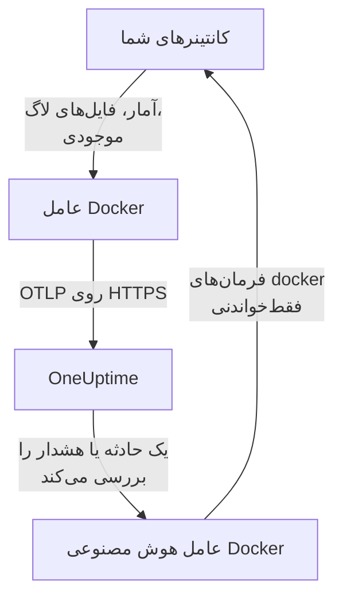

# عامل Docker

عامل Docker در OneUptime یک کانتینر است که روی یک میزبان Docker اجرا می‌کنید. آمار و فایل‌های لاگ هر کانتینر روی میزبان را می‌خواند و آن‌ها را به OneUptime می‌فرستد، جایی که میزبان با کانتینرها، متریک‌ها و لاگ‌هایش دیده می‌شود. کانتینر دوم، یعنی عامل هوش مصنوعی Docker، به OneUptime AI اجازه می‌دهد میزبان را بررسی کند. [مانیتورهای Docker](/docs/monitor/docker-monitor) بر پایه آنچه عامل می‌فرستد هشدار می‌دهند.

:::cards
- [نصب عامل](#نصب-عامل): دو کانتینر، با `docker run` یا Docker Compose.
- [آنچه عامل گردآوری می‌کند](#آنچه-عامل-گردآوری-میکند): متریک‌ها، لاگ‌ها و موجودی هر کانتینر.
- [لاگ‌های کانتینر به json-file نیاز دارند](#لاگهای-کانتینر-به-درایور-لاگ-json-file-نیاز-دارند): درایور لاگ یک کانتینر را بررسی و عوض کنید.
- [رفع اشکال](#رفع-اشکال): چرخه‌های راه‌اندازی دوباره، متریک‌های ناموجود، لاگ‌های ناموجود.
:::

## چگونه کار می‌کند

عامل یک OpenTelemetry Collector است که پیکربندی OneUptime درونش ساخته شده است. از راه سوکت Docker، آمار هر کانتینر را هر ۳۰ ثانیه می‌خواند و هر ۵ دقیقه همه کانتینرها، ایمیج‌ها، شبکه‌ها و حجم‌ها را فهرست می‌کند. فایل‌های لاگ کانتینرها را دنبال می‌کند و همه چیز را با کلید دریافت داده‌ای که به آن می‌دهید از راه OTLP به نشانی OneUptime شما می‌فرستد.



میزبان با نخستین داده‌هایش، با نامی که در `DOCKER_HOST_NAME` به آن می‌دهید، خود را ثبت می‌کند. عامل هوش مصنوعی اختیاری است: کنارش بگذارید و کالکتور همان‌طور کار می‌کند.

## پیش از شروع

- Docker Engine 20.10 یا بعد از آن، و دسترسی root روی میزبان: عامل `/var/run/docker.sock` را می‌خواند.
- Docker Compose v2 (فرمان `docker compose`)، اگر با Docker Compose نصب می‌کنید.
- یک کلید دریافت داده. آن را زیر **تنظیمات پروژه** > **تله‌متری و APM** > **کلیدهای دریافت داده** بسازید و مقدارش را کپی کنید.
- HTTPS خروجی از میزبان به نشانی OneUptime شما.
- برای لاگ‌های کانتینر، کانتینرهایی که از درایور لاگ `json-file` در Docker استفاده می‌کنند، که پیش‌فرض Docker است. ببینید [لاگ‌های کانتینر به درایور لاگ json-file نیاز دارند](#لاگهای-کانتینر-به-درایور-لاگ-json-file-نیاز-دارند).

## نصب عامل

:::steps
### عامل را اجرا کنید

`YOUR_ONEUPTIME_URL` را با نشانی OneUptime خود، `YOUR_TELEMETRY_INGESTION_TOKEN` را با کلید دریافت داده، و `my-docker-host` را با نامی برای این میزبان مانند `prod-docker-01` جایگزین کنید. میزبان با همین نام در OneUptime دیده می‌شود، پس آن را ثابت نگه دارید: نام تازه یک میزبان تازه ثبت می‌کند.

:::tabs
@tab Docker CLI
```bash
docker run -d \
  --name oneuptime-docker-agent \
  --user 0:0 \
  --restart unless-stopped \
  -v /var/run/docker.sock:/var/run/docker.sock:ro \
  -v /var/lib/docker/containers:/var/lib/docker/containers:ro \
  -e ONEUPTIME_URL="YOUR_ONEUPTIME_URL" \
  -e ONEUPTIME_SERVICE_TOKEN="YOUR_TELEMETRY_INGESTION_TOKEN" \
  -e DOCKER_HOST_NAME="my-docker-host" \
  oneuptime/docker-agent:release
```

سپس [عامل هوش مصنوعی](#عامل-هوش-مصنوعی) را با همان مقدارها کنار آن اجرا کنید. **بررسی‌های هوش مصنوعی به‌طور پیش‌فرض روشن‌اند**: هنگامی که OneUptime AI یک حادثه یا هشدار را روی این میزبان بررسی می‌کند، فرمان‌های فقط‌خواندنی `docker` را از راه عامل هوش مصنوعی اجرا می‌کند و تا اصلاح‌ها را مجاز نکنید هیچ چیزی را تغییر نمی‌دهد. برای نصب بدون بررسی‌های هوش مصنوعی، از این فرمان بگذرید.

```bash
docker run -d \
  --name oneuptime-docker-ai-agent \
  --user 0:0 \
  --restart unless-stopped \
  --read-only --tmpfs /tmp \
  -v /var/run/docker.sock:/var/run/docker.sock:ro \
  -e ONEUPTIME_URL="YOUR_ONEUPTIME_URL" \
  -e ONEUPTIME_SERVICE_TOKEN="YOUR_TELEMETRY_INGESTION_TOKEN" \
  -e ONEUPTIME_AI_AGENT_RESOURCE_TYPE=docker \
  -e DOCKER_HOST_NAME="my-docker-host" \
  oneuptime/resource-ai-agent:release
```
@tab Docker Compose
این را با نام `docker-compose.yml` در پوشه‌ای روی میزبان ذخیره کنید. سرویس دوم [عامل هوش مصنوعی](#عامل-هوش-مصنوعی) است: برای اجرای کالکتور بدون بررسی‌های هوش مصنوعی آن را کنار بگذارید.

```yaml title="docker-compose.yml"
services:
  oneuptime-docker-agent:
    image: oneuptime/docker-agent:release
    container_name: oneuptime-docker-agent
    user: "0:0"
    restart: unless-stopped
    volumes:
      - /var/run/docker.sock:/var/run/docker.sock:ro
      - /var/lib/docker/containers:/var/lib/docker/containers:ro
    environment:
      - ONEUPTIME_URL=YOUR_ONEUPTIME_URL
      - ONEUPTIME_SERVICE_TOKEN=YOUR_TELEMETRY_INGESTION_TOKEN
      - DOCKER_HOST_NAME=my-docker-host
    logging:
      driver: json-file
      options:
        max-size: "10m"
        max-file: "3"
  oneuptime-docker-ai-agent:
    image: oneuptime/resource-ai-agent:release
    container_name: oneuptime-docker-ai-agent
    user: "0:0"
    restart: unless-stopped
    read_only: true
    tmpfs:
      - /tmp
    volumes:
      - /var/run/docker.sock:/var/run/docker.sock:ro
    environment:
      - ONEUPTIME_URL=YOUR_ONEUPTIME_URL
      - ONEUPTIME_SERVICE_TOKEN=YOUR_TELEMETRY_INGESTION_TOKEN
      - ONEUPTIME_AI_AGENT_RESOURCE_TYPE=docker
      - DOCKER_HOST_NAME=my-docker-host
```

آن را در همان پوشه اجرا کنید:

```bash
docker compose up -d
```
:::

### بررسی کنید که عامل اجرا می‌شود

```bash
docker ps --filter name=oneuptime-docker-agent
docker logs -f oneuptime-docker-agent
```

پس از شروع کالکتور، لاگ‌ها باید این خط را نشان دهند:

```text
Everything is ready. Begin running and processing data.
```

### میزبان را در OneUptime پیدا کنید

به **محصولات** > **زیرساخت** > **Docker** > **همه میزبان‌ها** بروید. میزبان در حدود یک دقیقه با `DOCKER_HOST_NAME` خود، همراه با کانتینرها، متریک‌ها و لاگ‌هایش دیده می‌شود. عامل هوش مصنوعی در صفحه **عامل هوش مصنوعی** میزبان، و پایین **نمای کلی** آن، وصل‌شده نشان داده می‌شود.
:::

## متغیرهای محیطی

| متغیر | الزامی | توضیح |
| --- | --- | --- |
| `ONEUPTIME_URL` | بله | نشانی OneUptime شما، مانند `https://oneuptime.com` یا نمونه خودمیزبان شما. اگر نمونه فقط HTTP دارد، از `http://` و پورتش استفاده کنید. |
| `ONEUPTIME_SERVICE_TOKEN` | بله | کلید دریافت داده از **تنظیمات پروژه** > **تله‌متری و APM** > **کلیدهای دریافت داده**. |
| `DOCKER_HOST_NAME` | خیر | نام میزبان در OneUptime. پیش‌فرض آن `docker-host` است، پس به هر میزبان نام خودش را بدهید. |
| `DOCKER_API_VERSION` | خیر | نسخه Docker Engine API که عامل با آن سخن می‌گوید. پیش‌فرض آن `1.44` است. روی یک daemon قدیمی‌تر پایینش بیاورید، یا مقدار خالی بگذارید تا با daemon بر سر آن مذاکره کند (ببینید [رفع اشکال](#رفع-اشکال)). |

برای تغییر یک مقدار، عامل را بردارید و فرمانش را دوباره اجرا کنید (Docker CLI)، یا `docker-compose.yml` را ویرایش کنید و `docker compose up -d` را اجرا کنید (Docker Compose).

## آنچه عامل گردآوری می‌کند

| داده | چیست |
| --- | --- |
| متریک‌های کانتینر | CPU (مصرف، درصد، محدودسازی)، حافظه (مصرف، حد، درصد)، ورودی/خروجی شبکه و بلوک، مدت کارکرد، راه‌اندازی‌های دوباره و شمار فرایندها، برای هر کانتینر، هر ۳۰ ثانیه. |
| لاگ‌های کانتینر | stdout و stderr هر کانتینر، از فایل لاگ `json-file` آن. |
| موجودی | هر کانتینر در هر وضعیتی، و هر ایمیج، شبکه و حجم، هر ۵ دقیقه. |

متریک‌ها و لاگ‌های هر کانتینر زیر سرویسی به نام همان کانتینر ثبت می‌شوند. هر خط لاگ شدتی را از سطحی که نام می‌برد می‌گیرد، مانند `[ERROR]`، `level=warn` یا `{"level":"info"}`؛ خطی که هیچ سطحی نام نبرد شدت جریانش را می‌گیرد: stderr برابر `ERROR` و stdout برابر `INFO` است. خط‌هایی که با فاصله یا یک کروشه بسته آغاز شوند به خط پیشین می‌پیوندند، پس یک رد پشته به‌صورت یک رکورد می‌رسد. لاگ‌های خود عامل کنار گذاشته می‌شوند.

[مانیتور Docker](/docs/monitor/docker-monitor#متریکهای-جمعآوریشده) هر متریک و معنایش را فهرست می‌کند.

## لاگ‌های کانتینر به درایور لاگ json-file نیاز دارند

عامل `/var/lib/docker/containers/*/*-json.log` را دنبال می‌کند، فایل‌هایی که درایور لاگ `json-file` در Docker می‌نویسد. کانتینری که درایور دیگری به کار می‌برد فایلی برای خواندن به جا نمی‌گذارد: `local` فایل‌های دودویی می‌نویسد، و `journald`، `syslog`، `fluentd` و `gelf` لاگ‌ها را به جای دیگری می‌فرستند. متریک‌هایش همچنان می‌رسند؛ لاگ‌هایش نه.

درایور لاگ یک کانتینر، و پیش‌فرض daemon، را بررسی کنید:

```bash
docker inspect <container> --format '{{.HostConfig.LogConfig.Type}}'
docker info --format '{{.LoggingDriver}}'
```

یک سرویس Compose را با چرخش به `json-file` ببرید:

```yaml
services:
  my-app:
    image: my-app:latest
    logging:
      driver: "json-file"
      options:
        max-size: "100m"
        max-file: "5"
```

یا آن را در `/etc/docker/daemon.json` پیش‌فرض هر کانتینری کنید که پس از این ساخته می‌شود:

```json title="/etc/docker/daemon.json"
{
  "log-driver": "json-file",
  "log-opts": {
    "max-size": "100m",
    "max-file": "5"
  }
}
```

سپس Docker را دوباره راه‌اندازی کنید و کانتینرها را دوباره بسازید. یک کانتینر درایور لاگی را که با آن ساخته شده نگه می‌دارد، پس راه‌اندازی دوباره‌اش کافی نیست.

## به‌روزرسانی عامل

وقتی عامل از OneUptime شما قدیمی‌تر باشد، یک نشانه هشدار کنار **نسخه عامل** در **نمای کلی** میزبان دیده می‌شود. آن را برگزینید تا این فرمان‌ها را ببینید.

:::tabs
@tab Docker CLI
```bash
docker pull oneuptime/docker-agent:release
docker pull oneuptime/resource-ai-agent:release
docker rm -f oneuptime-docker-agent oneuptime-docker-ai-agent
```

سپس هر دو فرمان `docker run` را از [عامل را اجرا کنید](#عامل-را-اجرا-کنید) دوباره اجرا کنید.
@tab Docker Compose
```bash
docker compose pull
docker compose up -d
```
:::

برچسب `release` همیشه به تازه‌ترین انتشار اشاره می‌کند. برای ثابت کردن یک نسخه، از `oneuptime/docker-agent:<version>` استفاده کنید، مانند `oneuptime/docker-agent:10.0.31`. همین ایمیج در GitHub Container Registry با نام `ghcr.io/oneuptime/docker-agent:release` هست.

## حذف عامل

:::tabs
@tab Docker CLI
```bash
docker rm -f oneuptime-docker-agent
docker rm -f oneuptime-docker-ai-agent
```
@tab Docker Compose
```bash
docker compose down
```
:::

میزبان با داده‌هایی که فرستاده در OneUptime می‌ماند. اگر دیگر به آن نیاز ندارید، آن را با **حذف میزبان** در منوی آن حذف کنید.

## عامل هوش مصنوعی

فرمان‌ها و فایل Compose بالا، `install.sh` عامل Docker و `docker-compose.yml` در [پوشه DockerAgent](https://github.com/OneUptime/oneuptime/tree/master/agents/DockerAgent) آن، همه **عامل هوش مصنوعی Docker** را اجرا می‌کنند: کانتینر دومی به نام `oneuptime-docker-ai-agent` (ایمیج `oneuptime/resource-ai-agent:release`) که فرمان‌های فقط‌خواندنی `docker` را که OneUptime AI هنگام بررسی یک حادثه یا هشدار روی این میزبان می‌خواهد اجرا می‌کند — `docker ps -a`، `docker logs --tail 200 web`، `docker container inspect web`، `docker stats --no-stream` — و فقط اگر اجازه دهید اصلاح‌هایی مانند راه‌اندازی دوباره یک کانتینر نام‌برده را اعمال می‌کند. همان `ONEUPTIME_URL`، `ONEUPTIME_SERVICE_TOKEN` و `DOCKER_HOST_NAME` کالکتور را می‌خواند، پس دقیقاً به همین میزبان خدمت می‌کند و در صفحه **عامل هوش مصنوعی** میزبان در OneUptime دیده می‌شود.

- **بررسی‌های هوش مصنوعی به‌طور پیش‌فرض روشن‌اند.** همین که عامل وصل شود، OneUptime AI حادثه‌ها و هشدارهای این میزبان را با آن بررسی می‌کند و **نمای کلی** میزبان وضعیت عامل را نشان می‌دهد. برای توقف، `ONEUPTIME_AI_INVESTIGATION=false` را جایی که عامل اجرا می‌شود تنظیم کنید (**تغییر** زیر **کارهای مجاز هوش مصنوعی** در صفحه عامل هوش مصنوعی روشش را نشان می‌دهد)، یا عامل را کنار بگذارید.
- فقط‌خواندنی است مگر آنکه آن را با `ONEUPTIME_AI_ALLOW_WRITES=true` اجرا کنید؛ `ONEUPTIME_AI_WRITE_TARGETS` (برای نمونه `web-*,api-*`) محدود می‌کند که یک اصلاح به کدام کانتینرها دست بزند. آن را با `ONEUPTIME_AI_FIXES` هم اجرا کنید تا بگویید اصلاح‌ها چگونه اجرا شوند — `ask-for-approval` (یک نفر هر کدام را تأیید می‌کند)، `automatic` یا `bypass-approval` — و صفحه عامل هوش مصنوعی آن را فقط‌خواندنی نشان می‌دهد ([کارهای مجاز هوش مصنوعی، تنظیم‌شده به دست عامل](/docs/ai/infrastructure-ai-agents#what-ai-may-do-set-by-the-agent)).
- با سوکت Docker سوارشده و به‌عنوان root اجرا می‌شود، چون مالک سوکت root است — و هر کس بتواند از سوکت استفاده کند روی این میزبان root است، چه با `:ro` چه بدون آن. مرز را سیاست فرمان عامل تعیین می‌کند: هرگز `exec`، `run`، `rm` یا `prune` را اجرا نمی‌کند و هرگز خودش، کالکتور یا هر چیزی در `ONEUPTIME_AI_PROTECTED_TARGETS` (الگوهای glob نام کانتینر) را تغییر نمی‌دهد. مقدارهای محیطی در خروجی `docker inspect` پیش از آنکه چیزی از میزبان بیرون برود پوشانده می‌شوند.
- `install.sh --no-ai-agent` آن را کنار می‌گذارد؛ `docker rm -f oneuptime-docker-ai-agent` آن را برمی‌دارد. آن را مانند کالکتور به‌روز کنید: `docker pull oneuptime/resource-ai-agent:release`، برش دارید و دوباره اجرایش کنید.

چه چیزی می‌تواند اجرا کند، اصلاح‌ها چگونه کار می‌کنند و چگونه اشکالش را رفع کنید: [عامل‌های AI زیرساخت](/docs/ai/infrastructure-ai-agents#docker-and-podman-hosts).

## رفع اشکال

:::details عامل با "client version is too new" دوباره راه‌اندازی می‌شود
لاگ‌های عامل نشان می‌دهند:

```text
Error: cannot start pipelines: failed to start "docker_stats" receiver:
Error response from daemon: client version 1.44 is too new.
Maximum supported API version is 1.41
```

یک daemon کلاینتی را که از بیشینه خودش تازه‌تر باشد رد می‌کند، پس گیرنده هرگز شروع نمی‌شود و کالکتور هم با آن بیرون می‌رود. بیشینه daemon را پیدا کنید:

```bash
docker version --format '{{ .Server.APIVersion }}'
```

سپس `-e DOCKER_API_VERSION=1.41` (یا مقداری که گرفتید) را به `docker run` بیفزایید، یا `DOCKER_API_VERSION` را در Compose تنظیم کنید. daemonهای تازه‌تر همچنان نسخه‌های قدیمی‌تر API را پشتیبانی می‌کنند، پس این تنظیم پس از به‌روزرسانی هم معتبر می‌ماند.

نمی‌خواهید عدد را پیدا کنید؟ `DOCKER_API_VERSION` را روی رشته خالی بگذارید. آنگاه عامل نسخه را با daemon مذاکره می‌کند (یک `HEAD /_ping`، سپس بیشینه خود daemon)، که هم با daemonهای قدیمی و هم با تازه کار می‌کند:

```bash
docker run -d ... -e DOCKER_API_VERSION= ...
```
:::

:::details دسترسی به سوکت Docker رد می‌شود
عامل برای خواندن `/var/run/docker.sock` باید با root اجرا شود. بررسی کنید که `--user 0:0` در فرمان `docker run` شما، یا `user: "0:0"` در Compose، باشد.
:::

:::details میزبان قطع‌شده نشان داده می‌شود
1. بررسی کنید که عامل اجرا می‌شود: `docker ps --filter name=oneuptime-docker-agent`
2. در لاگ‌هایش دنبال خطا بگردید: `docker logs oneuptime-docker-agent 2>&1 | grep -i error`
3. `ONEUPTIME_URL` و `ONEUPTIME_SERVICE_TOKEN` را بررسی کنید: کلید باید یک کلید دریافت داده معتبر باشد که غیرفعال نشده است.
4. بررسی کنید که میزبان از راه شبکه به نشانی OneUptime شما می‌رسد.
:::

:::details هیچ متریکی دیده نمی‌شود
1. بررسی کنید که سوکت Docker در عامل سوار شده است. ایمیج آن پوسته ندارد، پس از یک کانتینر یک‌بارمصرف که سوارشده‌های آن را به اشتراک می‌گیرد نگاه کنید: `docker run --rm --volumes-from oneuptime-docker-agent alpine:3.19 ls -la /var/run/docker.sock`
2. در لاگ‌هایش دنبال خطاهای صدور بگردید: `docker logs oneuptime-docker-agent 2>&1 | tail -100`
3. بررسی کنید که کلید دریافت داده معتبر است و منقضی نشده.
:::

:::details متریک‌ها می‌رسند ولی هیچ لاگ کانتینری نمی‌رسد
کانتینرهای شما به احتمال زیاد درایور لاگی جز `json-file` به کار می‌برند. بررسی کنید عامل کدام فایل‌ها را می‌پاید و یک کانتینر کدام درایور را به کار می‌برد:

```bash
docker logs oneuptime-docker-agent 2>&1 | grep -E "Started watching file|no files match"
docker inspect <container> --format '{{.HostConfig.LogConfig.Type}}'
```

اگر عامل `no files match the configured criteria` را گزارش می‌کند، کانتینرها را به `json-file` ببرید و دوباره بسازید، همان‌طور که [لاگ‌های کانتینر به درایور لاگ json-file نیاز دارند](#لاگهای-کانتینر-به-درایور-لاگ-json-file-نیاز-دارند) نشان می‌دهد.
:::

:::details لاگ‌ها روی میزبان دیگری می‌نشینند، یا نام میزبان docker-host است
نام میزبان از `DOCKER_HOST_NAME` می‌آید. عاملی که بدون آن اجرا شود `docker-host` را گزارش می‌کند، پس هر میزبانی که این‌گونه راه‌اندازی شده مانند همان یکی دیده می‌شود؛ اگر بعداً نام را تغییر دهید، OneUptime میزبان دومی ثبت می‌کند که داده‌های تازه را دارد. `DOCKER_HOST_NAME` را روی هر میزبان نامی از آنِ خودش بگذارید و عامل را دوباره بسازید. برای بررسی نامی که عامل گزارش می‌کند:

```bash
docker inspect oneuptime-docker-agent --format '{{range .Config.Env}}{{println .}}{{end}}' | grep DOCKER_HOST_NAME
```
:::

## گام‌های بعدی

:::cards
- [مانیتور Docker](/docs/monitor/docker-monitor): هشدار بر پایه CPU، حافظه و راه‌اندازی‌های دوباره کانتینر.
- [پایگاه‌های داده](/docs/telemetry/databases): کانتینرهای پایگاه داده روی میزبان پیدا می‌شوند و صفحه‌های خودشان را می‌گیرند.
- [عامل Kubernetes](/docs/telemetry/kubernetes-agent): به‌جایش یک خوشه Kubernetes را پایش کنید.
- [کالکتور OpenTelemetry روی میزبان](/docs/telemetry/host-otel-collector): خود ماشین را پایش کنید: CPU، دیسک‌ها، فرایندها و لاگ‌ها.
:::
