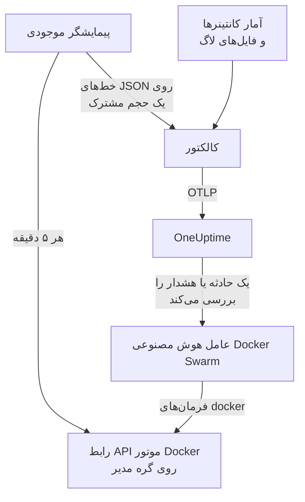

# عامل Docker Swarm

عامل Docker Swarm در OneUptime یک خوشه Docker Swarm را زیر نظر دارد: گره‌ها، سرویس‌ها، وظیفه‌ها، پشته‌ها، شبکه‌های overlay، سکرت‌ها، پیکربندی‌ها و حجم‌های آن، به‌علاوه متریک‌ها و لاگ‌های هر کانتینر. آن را با Docker Compose روی یک گره مدیر swarm اجرا می‌کنید و خوشه با همه این‌ها در OneUptime نمایان می‌شود. [مانیتورهای Docker Swarm](/docs/monitor/docker-swarm-monitor) بر پایه آنچه می‌رسد هشدار می‌دهند.

:::cards
- [نصب عامل](#نصب-عامل): اسکریپت نصب یا Docker Compose، روی یک گره مدیر.
- [آنچه عامل جمع می‌کند](#آنچه-عامل-گردآوری-میکند): موجودی، شمارش‌های خوشه، و متریک‌ها و لاگ‌های کانتینرها.
- [عامل هوش مصنوعی](#عامل-هوش-مصنوعی): بگذارید OneUptime AI هنگام بررسی، swarm را بخواند.
- [رفع اشکال](#رفع-اشکال): یک اسکریپت تشخیصی، و مشکلات معمول.
:::

## چگونه کار می‌کند

عامل سه کانتینر است که همه در یک `docker-compose.yml` تعریف شده‌اند:

1. **کالکتور**: یک OpenTelemetry Collector که `docker_stats` را برای متریک‌های هر کانتینر می‌خواند، فایل‌های لاگ کانتینرها را دنبال می‌کند و فایل عکس فوری موجودی را هم دنبال می‌کند. همه‌چیز را با نام خوشه شما (`docker.swarm.cluster.name`) مُهر می‌زند و آن را روی OTLP به OneUptime می‌فرستد.
2. **پیمایشگر موجودی**: یک sidecar کوچک با `curl` و `jq` که هر ۵ دقیقه API مدیر swarm را می‌پیماید (`/nodes`، `/services`، `/tasks`، `/networks`، `/secrets`، `/configs`، `/volumes`) و پشته‌ها را از برچسب سرویس `com.docker.stack.namespace` به دست می‌آورد. به ازای هر شیء یک خط JSON می‌نویسد تا کالکتور آن را بفرستد.
3. **عامل هوش مصنوعی**: `oneuptime-docker-swarm-ai-agent`، که فرمان‌های `docker` درخواستی OneUptime AI را هنگام بررسی یک حادثه یا هشدار روی این خوشه اجرا می‌کند. فقط‌خواندنی است، مگر اینکه اجازه اصلاح بدهید ([عامل هوش مصنوعی](#عامل-هوش-مصنوعی) را ببینید).



خوشه با نخستین داده‌هایش، با نام خوشه‌ای که پیکربندی می‌کنید، خود را ثبت می‌کند.

## پیش از شروع

- یک گره **مدیر** swarm برای اجرای عامل: پیمایشگر موجودی و عامل هوش مصنوعی نقطه‌های پایانی API را فرا می‌خوانند که فقط گره‌های مدیر پاسخ می‌دهند.
- Docker Engine 20.10 یا بعد از آن با افزونه Docker Compose v2.
- یک کلید دریافت داده. آن را زیر **تنظیمات پروژه** > **تله‌متری و APM** > **کلیدهای دریافت داده** بسازید و مقدارش را کپی کنید.
- HTTPS خروجی از گره به نشانی OneUptime شما.

### عامل را کجا اجرا کنید

آن را روی یک گره مدیر اجرا کنید. کالکتور کانتینرهای گره‌ای را گزارش می‌کند که روی آن اجرا می‌شود، پس برای متریک‌های کانتینر همه گره‌ها، کالکتور را روی هر گره اجرا کنید، همه با یک `DOCKER_SWARM_CLUSTER_NAME`؛ پیمایشگر موجودی و عامل هوش مصنوعی فقط لازم است روی یک گره مدیر اجرا شوند. `install.sh` روی گره‌ای که مدیر نیست عامل هوش مصنوعی را کنار می‌گذارد (و عاملی را که پیش‌تر آنجا نصب کرده بود حذف می‌کند). عامل هوش مصنوعی‌ای که با این حال روی یک گره کارگر راه‌اندازی شود، هرگز برای خوشه ثبت نمی‌شود: منتظر می‌ماند تا گره‌اش مدیر شود، پس نمی‌تواند عامل هوش مصنوعی گره مدیر را کنار بزند. عامل را به‌جای Compose به‌صورت یک پشته swarm مستقر می‌کنید؟ پیمایشگر موجودی و عامل هوش مصنوعی را با قید `node.role == manager` روی گره‌های مدیر نگه دارید.

## نصب عامل

:::steps
### عامل را نصب و اجرا کنید

:::tabs
@tab install.sh
اسکریپت نصب را دانلود کنید و روی یک گره مدیر اجرا کنید:

```bash
curl -sSL https://raw.githubusercontent.com/OneUptime/oneuptime/master/agents/DockerSwarmAgent/install.sh -o install.sh
sh install.sh
```

اسکریپت نشانی OneUptime شما، کلید دریافت داده و نامی برای خوشه را می‌پرسد. در `/opt/oneuptime-docker-swarm-agent` نصب می‌کند، یک فایل `.env` می‌نویسد که فقط مالکش می‌تواند بخواند، و هر سه کانتینر را راه می‌اندازد. برای کنار گذاشتن عامل هوش مصنوعی، `--no-ai-agent` را بیفزایید.
@tab Docker Compose
`docker-compose.yml`، `otel-collector-config.yaml` و `inventory-snapshot.sh` را از [پوشه DockerSwarmAgent](https://github.com/OneUptime/oneuptime/tree/master/agents/DockerSwarmAgent) در یک پوشه تازه روی یک گره مدیر دانلود کنید:

```bash
curl -fsSL https://raw.githubusercontent.com/OneUptime/oneuptime/master/agents/DockerSwarmAgent/docker-compose.yml -o docker-compose.yml
curl -fsSL https://raw.githubusercontent.com/OneUptime/oneuptime/master/agents/DockerSwarmAgent/otel-collector-config.yaml -o otel-collector-config.yaml
curl -fsSL https://raw.githubusercontent.com/OneUptime/oneuptime/master/agents/DockerSwarmAgent/inventory-snapshot.sh -o inventory-snapshot.sh
chmod +x inventory-snapshot.sh
```

کنار آن‌ها یک فایل `.env` بسازید. کلید دریافت داده را در خود دارد، پس با `chmod 600 .env` خصوصی‌اش نگه دارید:

```bash title=".env"
ONEUPTIME_URL=https://oneuptime.com
ONEUPTIME_SERVICE_TOKEN=your-telemetry-ingestion-key
DOCKER_SWARM_CLUSTER_NAME=my-swarm
```

عامل را راه بیندازید:

```bash
docker compose up -d
```
:::

### بررسی کنید که عامل اجرا می‌شود

```bash
docker compose ps
docker compose logs --tail 50 oneuptime-docker-swarm-agent oneuptime-docker-swarm-inventory
```

`docker compose ps` سه کانتینر را فهرست می‌کند: کالکتور (`oneuptime-docker-swarm-agent`)، پیمایشگر موجودی (`oneuptime-docker-swarm-inventory`) و عامل هوش مصنوعی (`oneuptime-docker-swarm-ai-agent`).

### خوشه را در OneUptime پیدا کنید

**محصولات** > **زیرساخت** > **Docker Swarm** > **همه خوشه‌ها** را باز کنید. خوشه در چند دقیقه نمایان می‌شود، و صفحه‌های **گره‌ها**، **سرویس‌ها**، **وظایف**، **Stacks**، **شبکه‌ها**، **اسرار**، **Configs** و **حجم‌ها** آن پس از نخستین عکس فوری موجودی، در کمتر از ۵ دقیقه پر می‌شوند.
:::

## متغیرهای محیطی

اسکریپت نصب سه مورد نخست را در `/opt/oneuptime-docker-swarm-agent/.env` می‌نویسد؛ نصب با Docker Compose آن‌ها را از `.env` کنار `docker-compose.yml` می‌خواند. هر کدام را همان‌جا بیفزایید یا تغییر دهید، سپس `docker compose up -d` را در همان پوشه اجرا کنید.

| متغیر | الزامی | توضیح |
| --- | --- | --- |
| `ONEUPTIME_URL` | بله | نشانی OneUptime شما، مانند `https://oneuptime.com` یا نمونه خودمیزبان شما. اگر نمونه فقط HTTP دارد، از `http://` و پورتش استفاده کنید. |
| `ONEUPTIME_SERVICE_TOKEN` | بله | کلید دریافت داده از **تنظیمات پروژه** > **تله‌متری و APM** > **کلیدهای دریافت داده**. |
| `DOCKER_SWARM_CLUSTER_NAME` | بله | نام خوشه در OneUptime، و کلیدی که داده‌های هر گره با آن به هم می‌پیوندند: به‌صورت ویژگی منبع `docker.swarm.cluster.name` روی همه‌چیز مُهر زده می‌شود. ثابتش نگه دارید: تغییرش در آینده خوشه دومی ثبت می‌کند. پیش‌فرض آن `docker-swarm` است. |
| `DOCKER_INVENTORY_INTERVAL_SECONDS` | خیر | اینکه پیمایشگر موجودی هر چند وقت یک عکس فوری می‌گیرد، بر حسب ثانیه. پیش‌فرض آن `300` است. |
| `DOCKER_API_VERSION` | خیر | نسخه API موتور Docker که کالکتور و پیمایشگر موجودی با آن کار می‌کنند. پیش‌فرض آن `1.44` است؛ خالی، آن را با دیمن مذاکره می‌کند ([رفع اشکال](#رفع-اشکال) را ببینید). عامل هوش مصنوعی آن را مذاکره می‌کند، مگر اینکه یکی را تعیین کنید. |

تنظیمات ویژه عامل هوش مصنوعی زیر [عامل هوش مصنوعی](#عامل-هوش-مصنوعی) آمده است.

## آنچه عامل گردآوری می‌کند

| سیگنال | منبع | کجا نمایش داده می‌شود |
| --- | --- | --- |
| گره‌ها، سرویس‌ها، وظیفه‌ها، پشته‌ها، شبکه‌ها، سکرت‌ها، پیکربندی‌ها و حجم‌ها | پیمایشگر موجودی، از API مدیر swarm | فهرست‌ها و صفحه‌های جزئیات خوشه |
| شمارش‌های خوشه (گره‌های آماده، وظیفه‌های در حال اجرا، سرویس‌ها، پشته‌ها، …) | همان عکس فوری | کارت‌های نمای کلی و نشان‌های منوی کناری |
| CPU، حافظه، تعداد فرایندها و زمان کارکرد کانتینر | گیرنده `docker_stats` | صفحه **متریک‌ها** |
| لاگ‌های stdout و stderr کانتینر | گیرنده `filelog` | صفحه **لاگ‌ها** |

### تفاوت آن با عامل Docker

[عامل Docker](/docs/telemetry/docker-host) یک میزبان را مدل می‌کند و `host.name` و `container.runtime=docker` را مُهر می‌زند. عامل Docker Swarm عمداً فقط `docker.swarm.cluster.name` را مُهر می‌زند: آنگاه OneUptime داده‌ها را زیر خوشه swarm بایگانی می‌کند، به‌جای اینکه هر گره را میزبانی جداگانه ثبت کند.

## برچسب‌گذاری خوشه با برچسب‌های پروژه

ویژگی منبعی که با `oneuptime.label.` آغاز شود، به برچسب پروژه روی خوشه تبدیل می‌شود: `oneuptime.label.<dimension>=<value>` همان برچسب `<dimension>:<value>` است. ویژگی‌ها را در `otel-collector-config.yaml` به پردازشگر `resource`، کنار `docker.swarm.cluster.name`، بیفزایید:

```yaml
processors:
  resource:
    attributes:
      # ...existing attributes...
      - key: oneuptime.label.team
        value: platform
        action: upsert
      - key: oneuptime.label.env
        value: production
        action: upsert
```

کالکتور پیکربندی‌اش را فقط هنگام راه‌اندازی می‌خواند: `docker compose restart oneuptime-docker-swarm-agent` را اجرا کنید. سپس خوشه برچسب‌های `team:platform` و `env:production` را نشان می‌دهد. برچسب‌ها بدون توجه به بزرگی و کوچکی حروف مقایسه می‌شوند، پس برچسب موجود `Production` به‌جای تکرار دوباره به کار می‌رود، و عامل هرگز برچسبی را که کسی در OneUptime افزوده است برنمی‌دارد.

## اجرا به‌صورت یک سرویس systemd

برای اینکه عامل همراه گره شروع شود و اگر از کار افتاد دوباره راه‌اندازی شود، واحد systemd آن را نصب کنید. این واحد فرض می‌کند عامل در `/opt/oneuptime-docker-swarm-agent` است، جایی که اسکریپت نصب آن را می‌گذارد:

```bash
sudo curl -fsSL https://raw.githubusercontent.com/OneUptime/oneuptime/master/agents/DockerSwarmAgent/systemd/oneuptime-docker-swarm-agent.service -o /etc/systemd/system/oneuptime-docker-swarm-agent.service
sudo systemctl daemon-reload
sudo systemctl enable --now oneuptime-docker-swarm-agent
```

## به‌روزرسانی عامل

عامل نسخه کالکتوری را که اجرا می‌کند گزارش می‌دهد. وقتی این نسخه از نسخه‌ای که این انتشار OneUptime ثابت کرده قدیمی‌تر باشد، در صفحه **نمای کلی** خوشه، کنار نسخه عامل، یک نشانه هشدار نمایان می‌شود. آن را انتخاب کنید تا این فرمان‌ها را ببینید.

اسکریپت نصب را دوباره روی گره مدیر اجرا کنید و به پرسش‌هایش با همان نشانی، کلید و نام خوشه پاسخ دهید. تازه‌ترین فایل‌ها را دانلود می‌کند، ایمیج‌ها را می‌کشد و عامل را دوباره راه‌اندازی می‌کند:

```bash
curl -sSL https://raw.githubusercontent.com/OneUptime/oneuptime/master/agents/DockerSwarmAgent/install.sh -o install.sh
sh install.sh
```

اسکریپت `.env` را از روی پاسخ‌های شما دوباره می‌نویسد. فقط فهرست‌های هدف عامل هوش مصنوعی و کارهای مجاز هوش مصنوعی (`ONEUPTIME_AI_INVESTIGATION`، `ONEUPTIME_AI_FIXES`) را نگه می‌دارد: هر متغیری را که خودتان تنظیم کرده بودید، مانند `DOCKER_API_VERSION`، دوباره بیفزایید. اصلاح‌های هوش مصنوعی را روشن کرده بودید؟ برای روشن ماندنشان، آن را به‌صورت `ONEUPTIME_AI_ALLOW_WRITES=true sh install.sh` اجرا کنید. عامل هوش مصنوعی را کنار گذاشته بودید؟ دوباره `--no-ai-agent` را بدهید.

با Docker Compose، سه فایل را دوباره در پوشه عامل دانلود کنید (سپس هر تغییری را که در `docker-compose.yml` داده بودید دوباره اعمال کنید)، و ایمیج‌ها را بکشید و دوباره راه‌اندازی کنید:

```bash
docker compose pull
docker compose up -d
```

نسخه کالکتور در فایل‌ها ثابت شده است، پس فقط کشیدن ایمیج‌ها عامل را جلو نمی‌برد.

## حذف عامل

```bash
cd /opt/oneuptime-docker-swarm-agent
docker compose down
```

## عامل هوش مصنوعی

فایل `docker-compose.yml` مربوط به swarm (و `install.sh`) **عامل هوش مصنوعی Docker Swarm** را هم اجرا می‌کند: کانتینر سوم، `oneuptime-docker-swarm-ai-agent` (ایمیج `oneuptime/resource-ai-agent:release`)، که فرمان‌های فقط‌خواندنی `docker` درخواستی OneUptime AI را هنگام بررسی یک حادثه یا هشدار روی این خوشه اجرا می‌کند — `docker node ls`، `docker service ps web --no-trunc`، `docker service logs --tail 200 web` — و فقط اگر اجازه دهید، اصلاح‌هایی مانند راه‌اندازی دوباره تدریجی یک سرویس نام‌برده را اعمال می‌کند. همان `ONEUPTIME_URL`، `ONEUPTIME_SERVICE_TOKEN` و `DOCKER_SWARM_CLUSTER_NAME` کالکتور را می‌خواند، پس دقیقاً به همین خوشه خدمت می‌کند، و در OneUptime در صفحه **هوش مصنوعی** > **عامل هوش مصنوعی** خوشه نمایان می‌شود.

- **بررسی‌های هوش مصنوعی به‌طور پیش‌فرض روشن‌اند.** همین که عامل وصل شود، OneUptime AI حادثه‌ها و هشدارهای این خوشه را با آن بررسی می‌کند و **نمای کلی** خوشه وضعیت عامل را نشان می‌دهد. برای توقف، `ONEUPTIME_AI_INVESTIGATION=false` را جایی که عامل اجرا می‌شود تنظیم کنید (**تغییر** زیر **کارهای مجاز هوش مصنوعی** در صفحه عامل هوش مصنوعی روشش را نشان می‌دهد)، یا عامل را کنار بگذارید.
- مانند پیمایشگر موجودی، **باید روی یک گره مدیر اجرا شود**: فرمان‌های گره، سرویس و وظیفه فقط روی گره‌های مدیر کار می‌کنند. روی یک گره کارگر هیچ چیزی اجرا نمی‌کند و تا گره مدیر نشود برای خوشه ثبت نمی‌شود (`/status` آن دلیلش را می‌گوید). برای هر خوشه یکی اجرا کنید.
- این عامل **فقط‌خواندنی** است، مگر اینکه `ONEUPTIME_AI_ALLOW_WRITES=true` را در `.env` تنظیم کنید و `docker compose up -d` را اجرا کنید (یا `install.sh` را با آن اجرا کنید؛ نصب‌کننده `ONEUPTIME_AI_ALLOW_WRITES`، `ONEUPTIME_AI_INVESTIGATION`، `ONEUPTIME_AI_FIXES`، `ONEUPTIME_AI_WRITE_TARGETS` و `ONEUPTIME_AI_PROTECTED_TARGETS` را از محیط خود در `.env` می‌نویسد، و اجرای دوباره برای چهار مورد آخر همان چیزی را نگه می‌دارد که `.env` از پیش دارد، مگر اینکه آن متغیر را بدهید، حتی خالی)؛ `ONEUPTIME_AI_WRITE_TARGETS` (الگوهای glob نام سرویس‌ها و گره‌ها، برای نمونه `web_*,api_*`) محدود می‌کند که یک اصلاح به چه چیزی دست بزند. `ONEUPTIME_AI_FIXES` در همان `.env` تعیین می‌کند اصلاح‌ها چگونه اجرا شوند — `ask-for-approval` (یک نفر هر کدام را تأیید می‌کند)، `automatic` یا `bypass-approval` — و صفحه عامل هوش مصنوعی آن را فقط‌خواندنی نشان می‌دهد ([کارهای مجاز هوش مصنوعی، تعیین‌شده توسط عامل](/docs/ai/infrastructure-ai-agents#what-ai-may-do-set-by-the-agent)). تخلیه یک گره همیشه به تأیید یک نفر نیاز دارد، در هر حالتی.
- با سوکت Docker سوارشده و به‌عنوان root اجرا می‌شود، چون مالک سوکت root است — و روی گره مدیر، هر کس بتواند از سوکت استفاده کند کل swarm را در دست دارد، چه `:ro` باشد چه نباشد. مرز، سیاست فرمان‌های عامل است: هرگز سرویس یا پشته‌ای نمی‌سازد یا حذف نمی‌کند، هرگز به سکرت‌ها یا پیکربندی‌ها دست نمی‌زند، و هرگز خودش، کالکتور، پیمایشگر موجودی یا هر چیزی در `ONEUPTIME_AI_PROTECTED_TARGETS` (الگوهای glob نام سرویس‌ها و گره‌ها) را تغییر نمی‌دهد.
- `install.sh --no-ai-agent` آن را کنار می‌گذارد؛ یا سرویس `oneuptime-docker-swarm-ai-agent` را از `docker-compose.yml` حذف کنید.

آنچه می‌تواند اجرا کند، اینکه اصلاح‌ها چگونه کار می‌کنند و چگونه اشکال آن را رفع کنید: [عامل‌های AI زیرساخت](/docs/ai/infrastructure-ai-agents#docker-swarm-clusters).

## رفع اشکال

:::details نخست اسکریپت تشخیصی را اجرا کنید
عامل با یک اسکریپت، [`troubleshoot.sh`](https://github.com/OneUptime/oneuptime/blob/master/agents/DockerSwarmAgent/troubleshoot.sh)، عرضه می‌شود که کل زنجیره را بررسی می‌کند: کانتینرها، اینکه پیمایشگر موجودی روی یک گره مدیر است (`docker node ls`)، فایل عکس فوری، نام خوشه‌ای که روی همه‌چیز مُهر زده می‌شود، شکل توکن، متریک‌های خود کالکتور، و اینکه آیا OneUptime کلید دریافت داده را می‌پذیرد. این بررسی آخر از همه مهم‌تر است. OneUptime کلید بد را با `401` رد می‌کند (`422` برای کلید غیرفعال یا کلید مرورگر)، و کالکتور آن را به ازای هر دسته فقط به‌صورت یک خط `Exporting failed` در لاگ می‌نویسد، که آسان از چشم می‌افتد. اسکریپت `GET <url>/otlp/v1/validate` را می‌پرسد تا یک `200` (معتبر) یا `401` (نامعتبر) مستقیم بگیرد. آن را روی گره مدیر اجرا کنید:

```bash
curl -sSL https://raw.githubusercontent.com/OneUptime/oneuptime/master/agents/DockerSwarmAgent/troubleshoot.sh -o troubleshoot.sh
bash troubleshoot.sh    # add -d <dir> if you installed outside /opt/oneuptime-docker-swarm-agent
```
:::

:::details خوشه هرگز نمایان نمی‌شود
نخست اسکریپت تشخیصی را اجرا کنید. وگرنه لاگ‌های کالکتور را بخوانید (`docker compose logs oneuptime-docker-swarm-agent`)، بررسی کنید که `ONEUPTIME_SERVICE_TOKEN` و `ONEUPTIME_URL` در `.env` درست باشند، و اینکه گره به نشانی OneUptime شما می‌رسد.
:::

:::details هیچ موجودی‌ای نمایان نمی‌شود
بررسی کنید که پیمایشگر موجودی روی یک گره مدیر اجرا می‌شود: `docker node ls` باید آنجا موفق شود. سپس در لاگ‌هایش دنبال خط‌های `failed to emit ...` بگردید: `docker compose logs oneuptime-docker-swarm-inventory`.
:::

:::details خوشه به قطع‌شده تغییر می‌کند
وقتی OneUptime به مدت ۱۵ دقیقه هیچ چیزی از یک خوشه دریافت نکند، خوشه قطع‌شده می‌شود؛ OneUptime هر ۵ دقیقه بررسی می‌کند، و زمانی که خودش داده دریافت نمی‌کرد به حساب نمی‌آید. مطمئن شوید کانتینر کالکتور روشن می‌ماند: `docker compose ps` آن را نشان می‌دهد.
:::

:::details کالکتور با "client version is too new" بسته می‌شود
لاگ‌های کالکتور نشان می‌دهند:

```text
Error: cannot start pipelines: failed to start "docker_stats" receiver:
Error response from daemon: client version 1.44 is too new.
Maximum supported API version is 1.41
```

بالاترین نسخه API دیمن پایین‌تر از پیش‌فرض `1.44` است (Docker Engine 20.10 در `1.41` می‌ایستد)، پس گیرنده `docker_stats` نمی‌تواند راه بیفتد و کانتینر پشت سر هم دوباره راه‌اندازی می‌شود. بالاترین نسخه دیمن را پیدا کنید:

```bash
docker version --format '{{ .Server.APIVersion }}'
```

`DOCKER_API_VERSION` را در `.env` روی همان مقدار تنظیم کنید و `docker compose up -d` را روی هر گره‌ای که عامل روی آن اجرا می‌شود اجرا کنید. دیمن‌های تازه‌تر همچنان نسخه‌های قدیمی‌تر API را ارائه می‌کنند، پس این تنظیم پس از ارتقای Docker هم کار می‌کند. یا `DOCKER_API_VERSION=` (خالی) را تنظیم کنید تا کالکتور به‌جای ثابت کردن یک نسخه، آن را با دیمن مذاکره کند.
:::

:::details خوشه با نام نادرست نمایان می‌شود
نام خوشه از `DOCKER_SWARM_CLUSTER_NAME` می‌آید. آن را در `.env` تغییر دهید و `docker compose up -d` را اجرا کنید: نام تازه به‌جای تغییر نام خوشه قبلی، خوشه تازه‌ای ثبت می‌کند.
:::

## گام‌های بعدی

:::cards
- [مانیتور Docker Swarm](/docs/monitor/docker-swarm-monitor): هشدار بر پایه گره‌ها، سرویس‌ها، وظیفه‌ها و کانتینرها.
- [عامل‌های AI زیرساخت](/docs/ai/infrastructure-ai-agents): آنچه عامل هوش مصنوعی Docker Swarm می‌تواند اجرا کند، و اینکه اصلاح‌ها چگونه کار می‌کنند.
- [عامل Docker](/docs/telemetry/docker-host): به‌جای آن، یک میزبان Docker تکی را زیر نظر بگیرید.
:::
