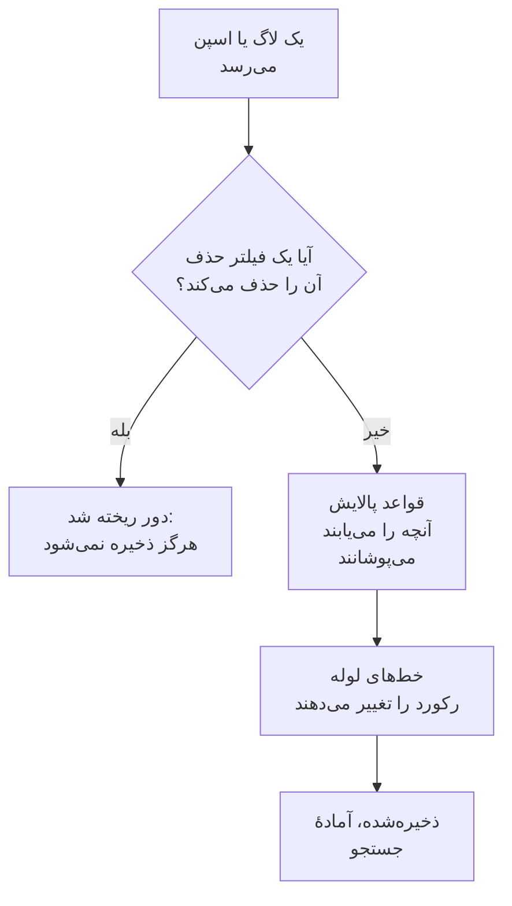

# فیلترهای حذف و قواعد پالایش

فیلترهای حذف و قواعد پالایش هنگام رسیدن لاگ‌ها و اسپن‌هایتان، پیش از ذخیره شدن هر چیزی، روی آن‌ها کار می‌کنند. فیلتر حذف رکوردهایی را که هرگز لازمشان ندارید دور می‌ریزد، یا فقط نمونه‌ای از آن‌ها را نگه می‌دارد. قاعدهٔ پالایش داده‌های شخصی و اسرار، مانند نشانی‌های ایمیل، شماره کارت‌ها و گذرواژه‌ها، را می‌پوشاند تا هرگز به فضای ذخیره‌سازی شما نرسند.

:::cards
- [کجا اجرا می‌شوند](#کجا-اجرا-میشوند): پیش از خط‌های لوله، پیش از ذخیره‌سازی.
- [حذف یا نمونه‌برداری رکوردها](#حذف-یا-نمونهبرداری-رکوردها): رکوردها را برگزینید، سپس حذفشان کنید یا سهمی را نگه دارید.
- [پالایش داده‌های حساس](#پالایش-دادههای-حساس): آنچه یک الگو می‌یابد را حذف، پوشانده یا درهم‌سازی کنید.
- [بررسی آنچه یک فیلتر حذف کرده](#بررسی-آنچه-یک-فیلتر-حذف-کرده): شمارش روی هر فیلتر.
:::

## کجا اجرا می‌شوند

لاگ‌ها مال خودشان را زیر **لاگ‌ها** > **تنظیمات** دارند، و اسپن‌ها زیر **ترِیس‌ها** > **تنظیمات**. وقتی رکوردی می‌رسد، OneUptime آن‌ها را به این ترتیب اجرا می‌کند:



- **فقط روی رکوردهای تازه کار می‌کنند.** قاعده‌ای که می‌سازید یا تغییر می‌دهید روی رکوردهایی اعمال می‌شود که حدود یک دقیقه بعد می‌رسند. رکوردهایی که پیش‌تر ذخیره شده‌اند تغییر نمی‌کنند.
- **رکورد حذف‌شده از دست رفته است.** هیچ جستجو، نمودار، مانیتور یا قاعدهٔ ضبطی هرگز آن را نمی‌بیند، و هیچ استثنایی از آن ساخته نمی‌شود. در OneUptime Cloud هزینه‌ای هم برایش محاسبه نمی‌شود.
- **هر فهرست به ترتیب اجرا می‌شود.** برای تغییر ترتیب، ردیف‌های فهرست را بکشید. فقط فیلترها و قواعد فعال اجرا می‌شوند.

فیلترهای حذف و قواعد پالایش لاگ به یک اندازه روی لاگ‌های OpenTelemetry، Syslog، Fluent Bit و Fluentd اعمال می‌شوند. [خط‌های لوله لاگ](/docs/telemetry/log-pipelines) گام پس از آن‌ها را توضیح می‌دهد.

## پیش از شروع

- **لاگ‌ها یا اسپن‌های در حال رسیدن.** [OpenTelemetry](/docs/telemetry/open-telemetry) را ببینید.
- **نقشی که تنظیمات تله‌متری را تغییر دهد.** Project Owner یا Project Admin، یا یک نقش سفارشی با مجوز همان چیزی که تغییر می‌دهید، مانند Create Log Drop Filter یا Create Trace Scrub Rule. نقش‌های Telemetry می‌توانند فیلترها و قواعد را ببینند، اما نمی‌توانند تغییرشان دهند.

## حذف یا نمونه‌برداری رکوردها

:::steps
### باز کردن فیلترهای حذف

به **لاگ‌ها** > **تنظیمات** > **فیلترهای حذف** بروید، یا برای اسپن‌ها به **ترِیس‌ها** > **تنظیمات** > **فیلترهای حذف**.

### برگزیدن رکوردها

روی **ساخت فیلتر حذف لاگ** کلیک کنید، یا برای اسپن‌ها روی **ساخت فیلتر حذف ترِیس**. در **تطبیق**، به فیلتر یک **نام** بدهید، سپس **کوئری فیلتر** آن را بسازید: برای هر شرط یک فیلد، یک عملگر و یک مقدار، و این‌که **همه شرط‌ها** باید برقرار باشند یا **هر یک از شرط‌ها**. روی **بعدی** کلیک کنید.

### انتخاب اقدام

در **اقدام**، **حذف** را نگه دارید تا هر رکورد منطبق دور ریخته شود، یا **نمونه‌برداری** را برگزینید و **درصد نمونه‌برداری** را برای نگه داشتن، از ۱ تا ۹۹، وارد کنید. سپس فیلتر را بسازید.
:::

فیلتر ظرف یک دقیقه شروع به حذف می‌کند. برای ذخیرهٔ آن بی‌آنکه هنوز چیزی حذف شود، پیش از ساختنش **فعال** را زیر **پیشرفته** خاموش کنید.

> [!WARNING]
> رکورد حذف‌شده را نمی‌توان برگرداند. کوئری فیلتر را محدود نگه دارید، و پس از ساختنش شمارش **Dropped** آن را زیر نظر بگیرید.

یک فیلتر می‌تواند این فیلدها را، و هر ویژگی‌ای را با **Custom Attribute...**، بیازماید:

| رکوردها | فیلدها |
| --- | --- |
| لاگ‌ها | **شدت**، **بدنه لاگ**، **شناسه سرویس** |
| اسپن‌ها | **نام اسپن**، **گونه اسپن**، **وضعیت**، **پیام وضعیت**، **شناسه سرویس**، **استثنا دارد**، **اسپن ریشه است** |

| عملگر | منطبق است با |
| --- | --- |
| **مساوی است با** | مقدار دقیق، با حروف بزرگ و کوچکش: `Debug` منطبق است، `DEBUG` نه. |
| **مساوی نیست با** | هر چیزی جز مقدار دقیق. |
| **شامل است** | مقدار در هر جای فیلد، بدون توجه به بزرگی و کوچکی حروف. یک `%` در مقدار نویسهٔ عام است. |
| **یکی از این‌هاست** | یکی از فهرستی از مقدارهای دقیق که با ویرگول جدا شده‌اند. |

**Preview query** کوئری‌ای را که شرط‌ها می‌سازند نشان می‌دهد. این یکی خط‌های اشکال‌زدایی یک بررسی سلامت را حذف می‌کند:

```text
severityText = 'Debug' AND body LIKE 'healthcheck'
```

نمونه‌برداری رکورد به رکورد تصمیم می‌گیرد: با **درصد نمونه‌برداری** برابر ۱۰، حدود یک رکورد از هر ده رکورد منطبق نگه داشته می‌شود. فیلترها به ترتیب فهرست اجرا می‌شوند، و نخستین فیلتری که رکوردی را حذف کند تصمیم می‌گیرد؛ رکوردی که یک نمونه‌برداری نگه دارد به فیلتر بعدی می‌رود.

## پالایش داده‌های حساس

:::steps
### باز کردن قواعد پالایش

به **لاگ‌ها** > **تنظیمات** > **قواعد پالایش** بروید، یا برای اسپن‌ها به **ترِیس‌ها** > **تنظیمات** > **قواعد پالایش**.

### برگزیدن آنچه باید یافت شود

روی **ساخت قاعده پالایش لاگ** کلیک کنید، یا برای اسپن‌ها روی **ساخت قاعده پالایش ترِیس**، و یک **نوع الگو** برگزینید. قاعده تا وقتی نام دلخواهتان را تایپ نکرده‌اید به نام آن خوانده می‌شود، مانند **پالایش نشانی‌های ایمیل**. برای **عبارت باقاعده سفارشی**، **الگوی عبارت باقاعده سفارشی** را هم وارد کنید.

### انتخاب روش پالایش

زیر **پیشرفته**، **اقدام پالایش** و **فیلدهایی که باید پالایش شوند** را برگزینید، یا همان‌طور که هستند بگذارید: قاعدهٔ تازه هر تطبیق را، هر جای رکورد که باشد، با `[REDACTED]` جایگزین می‌کند. سپس قاعده را بسازید.
:::

| نوع الگو | آنچه می‌یابد |
| --- | --- |
| **آدرس ایمیل** | نشانی‌های ایمیل، مانند `jane@example.com` |
| **شماره کارت اعتباری** | شانزده رقم در گروه‌های چهارتایی، مانند `4111 1111 1111 1111` |
| **SSN (شماره تأمین اجتماعی)** | شماره‌های تأمین اجتماعی آمریکا، مانند `123-45-6789` |
| **شماره تلفن** | شماره‌تلفن‌های آمریکای شمالی، مانند `555-123-4567` |
| **آدرس IP** | نشانی‌های IPv4، مانند `192.168.1.1` |
| **Sensitive Attribute Keys** | کل مقدار هر ویژگی‌ای که کلیدش محرمانه به نظر می‌رسد، مانند `password`، `token`، `api_key`، `authorization` یا `cookie` |
| **عبارت باقاعده سفارشی** | عبارت باقاعدهٔ خودتان، بدون اسلش یا پرچم نوشته‌شده، و با حساسیت به بزرگی و کوچکی حروف تطبیق داده‌شده |

| اقدام پالایش | تطبیق به چه تبدیل می‌شود |
| --- | --- |
| **حذف** | `[REDACTED]`، پیش‌فرض |
| **پوشاندن** | بیشترش پنهان: ایمیل نخستین حرف و انتهای دامنه‌اش را نگه می‌دارد، شمارهٔ کارت، تلفن یا تأمین اجتماعی چهار رقم آخرش را، و یک تطبیق سفارشی یا مقدار محرمانه نخستین و آخرین نویسه‌اش را. نشانی IP کاملاً پنهان می‌شود. |
| **درهم‌سازی** | یک درهم‌سازی کوتاه از مقدار، که برای یک مقدار همیشه یکسان است، تا تکرارها همچنان شمرده شوند |

برای نمونه، یک قاعدهٔ **آدرس ایمیل** این بدنهٔ لاگ را:

```text
Payment failed for jane@example.com
```

بسته به **اقدام پالایش** خود، به یکی از این شکل‌ها ذخیره می‌کند:

```text
Redact: Payment failed for [REDACTED]
Mask:   Payment failed for j***@***.com
Hash:   Payment failed for [HASHED:8c87b489]
```

**فیلدهایی که باید پالایش شوند** برای یک قاعدهٔ لاگ **هر دو (بدنه و ویژگی‌ها)** است مگر این‌که **فقط بدنه** یا **فقط ویژگی‌ها** را برگزینید، و برای یک قاعدهٔ اسپن **همه (نام، ویژگی‌ها و رویدادها)** است مگر این‌که **فقط نام اسپن**، **فقط ویژگی‌ها** یا **فقط ویژگی‌های رویداد** را برگزینید. قاعدهٔ **Sensitive Attribute Keys** همیشه مقدار ویژگی‌ها را پالایش می‌کند، چون کلیدهای ویژگی‌ها را می‌خواند.

- **استثناها از رکورد پالایش‌شده می‌آیند.** استثنایی که در یک لاگ یافت شود پس از پالایش ساخته می‌شود، و قواعدی که رویدادهای اسپن را پالایش می‌کنند استثناهای ثبت‌شده روی آن‌ها را هم پالایش می‌کنند.
- **Session Replayها هم پالایش می‌شوند.** قواعد پالایش لاگ روی ضبط‌های Session Replay هم اجرا می‌شوند، افزون بر پوشاندنی که ضبط‌کننده در مرورگر انجام می‌دهد.
- **قواعد به ترتیب فهرست اجرا می‌شوند.** هر قاعده آنچه را قواعد پیش از آن باقی گذاشته‌اند می‌بیند.
- **یک الگوی سفارشی زمانی متناسب با رکورد می‌گیرد.** نحو و پاسخ‌های JavaScript را، با نگاه به جلو و نگاه به عقب، نگه می‌دارد، هر طور که نوشته شده باشد. ارجاع به عقب، مانند `\1`، نمی‌تواند این‌گونه اجرا شود: قاعده‌ای که آن را داشته باشد هنگام ذخیره رد می‌شود، همان‌طور که الگویی که برای اجرا بیش از حد بزرگ است. اگر یافتن همهٔ تطبیق‌ها نیاز داشت یک مقدار طولانی را بارها و بارها بخواند، قاعده کل مقدار را پالایش می‌کند. فیلترهای حذف، قواعد پالایش و خط‌های لولهٔ یک پروژه همچنین برای هر دسته‌ای که می‌فرستد یک سهمیهٔ کار مشترک دارند، متناسب با اندازهٔ دسته و به اندازه‌ای که ده‌ها الگوی سفارشی بتوانند هر مقدار را بخوانند. وقتی الگوهایشان بیشتر نیاز داشته باشند، یک قاعدهٔ پالایش سفارشی کل مقدار را پالایش می‌کند و فیلتری که نمی‌توان پاسخش را یافت روی رکورد اعمال نمی‌شود.

## بررسی آنچه یک فیلتر حذف کرده

فهرست **فیلترهای حذف** برای هر فیلتر شمارش **Dropped** و زمان **Last Dropped** آن را نشان می‌دهد. **Nothing dropped yet** یعنی هرگز منطبق نشده است. صفحهٔ خود فیلتر همین را زیر **فعالیت** نشان می‌دهد که ظرف یک دقیقه پس از یک حذف به‌روز می‌شود. کارت **شرط‌های فیلتر** آن نشان می‌دهد چه چیزی را برمی‌گزیند، و می‌توانید شرط‌ها را همان‌جا تغییر دهید.

## عیب‌یابی

:::details یک فیلتر حذف چیزی حذف نمی‌کند
**مساوی است با**، **مساوی نیست با** و **یکی از این‌هاست** متن دقیق را، با حروف بزرگ و کوچک، مقایسه می‌کنند. شدت‌ها `Information` و `Warning` هستند، نه `INFO` یا `WARN`. بررسی کنید فیلتر فعال باشد، و پس از هر تغییر یک دقیقه صبر کنید.
:::

:::details لاگ‌هایی که انتظارشان را داشتم نیستند
شمارش **Dropped** و زمان **Last Dropped** هر فیلتر حذف را نگاه کنید. **فعال** را روی فیلتری که به آن مشکوکید خاموش کنید، و لاگ‌های بعدی دوباره می‌رسند.
:::

:::details یک قاعدهٔ پالایش سفارشی می‌گوید چیزی را پالایش نمی‌کند
الگوی آن خالی است، یک عبارت باقاعدهٔ معتبر نیست، یا نمی‌تواند اجرا شود، مثلاً چون ارجاع به عقبی مانند `\1` دارد، پس چیزی را پالایش نمی‌کند. قاعده را ویرایش کنید و الگویی به آن بدهید که دست‌کم با یک نویسه منطبق شود.
:::

:::details رکوردهای قدیمی هنوز داده‌ای را که قاعدهٔ تازه پالایش می‌کند نشان می‌دهند
قواعد پالایش هنگام رسیدن رکوردها عمل می‌کنند. رکوردهایی که پیش از قاعده ذخیره شده‌اند آنچه را داشتند تا پایان دورهٔ نگهداری‌شان نگه می‌دارند. [نگهداری داده](/docs/telemetry/data-retention) را ببینید.
:::

## گام‌های بعدی

:::cards
- [خط‌های لوله لاگ](/docs/telemetry/log-pipelines): لاگ‌هایی را که نگه می‌دارید تجزیه و غنی کنید.
- [کاوشگر لاگ](/docs/telemetry/logs-explorer): در آنچه ذخیره شده جستجو کنید.
- [کاوشگر ترِیس](/docs/telemetry/traces-explorer): اسپن‌هایی را که نگه می‌دارید دنبال کنید.
- [نگهداری داده](/docs/telemetry/data-retention): تعیین کنید چه مدت نگه داشته شوند.
:::
