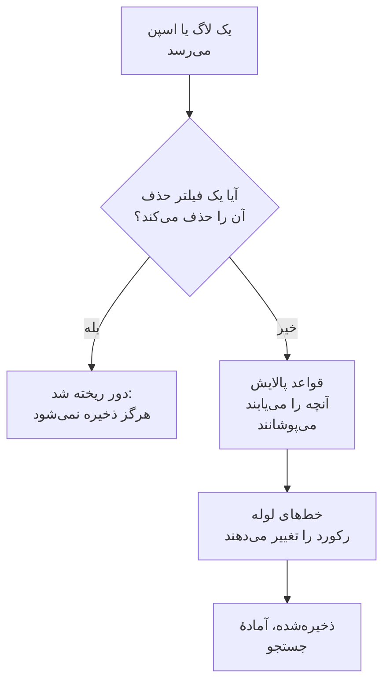

# فیلترهای حذف و قواعد پالایش

فیلترهای حذف و قواعد پالایش هنگام رسیدن لاگ‌ها و اسپن‌هایتان، پیش از ذخیره شدن هر چیزی، روی آن‌ها کار می‌کنند. فیلتر حذف رکوردهایی را که هرگز لازمشان ندارید دور می‌ریزد، یا فقط نمونه‌ای از آن‌ها را نگه می‌دارد. قاعدهٔ پالایش داده‌های شخصی و اسرار، مانند نشانی‌های ایمیل، شماره کارت‌ها و گذرواژه‌ها، را می‌پوشاند تا هرگز به فضای ذخیره‌سازی شما نرسند.

:::cards
- [کجا اجرا می‌شوند](#کجا-اجرا-میشوند): پیش از خط‌های لوله، پیش از ذخیره‌سازی.
- [حذف یا نمونه‌برداری رکوردها](#حذف-یا-نمونهبرداری-رکوردها): رکوردها را برگزینید، سپس حذفشان کنید یا سهمی را نگه دارید.
- [پالایش داده‌های حساس](#پالایش-دادههای-حساس): آنچه یک الگو می‌یابد را حذف، پوشانده یا درهم‌سازی کنید.
- [بررسی آنچه یک فیلتر حذف کرده](#بررسی-آنچه-یک-فیلتر-حذف-کرده): شمارش روی هر فیلتر.
:::

## کجا اجرا می‌شوند

لاگ‌ها مال خودشان را زیر **لاگ‌ها** > **تنظیمات** دارند، و اسپن‌ها زیر **ترِیس‌ها** > **تنظیمات**. وقتی رکوردی می‌رسد، OneUptime آن‌ها را به این ترتیب اجرا می‌کند:



- **فقط روی رکوردهای تازه کار می‌کنند.** قاعده‌ای که می‌سازید یا تغییر می‌دهید روی رکوردهایی اعمال می‌شود که حدود یک دقیقه بعد می‌رسند. رکوردهایی که پیش‌تر ذخیره شده‌اند تغییر نمی‌کنند.
- **رکورد حذف‌شده از دست رفته است.** هیچ جستجو، نمودار، مانیتور یا قاعدهٔ ضبطی هرگز آن را نمی‌بیند، و هیچ استثنایی از آن ساخته نمی‌شود. در OneUptime Cloud هزینه‌ای هم برایش محاسبه نمی‌شود.
- **هر فهرست به ترتیب اجرا می‌شود.** برای تغییر ترتیب، ردیف‌های فهرست را بکشید. فقط فیلترها و قواعد فعال اجرا می‌شوند.

فیلترهای حذف و قواعد پالایش لاگ به یک اندازه روی لاگ‌های OpenTelemetry، Syslog، Fluent Bit و Fluentd اعمال می‌شوند. [خط‌های لوله لاگ](/docs/telemetry/log-pipelines) گام پس از آن‌ها را توضیح می‌دهد.

## پیش از شروع

- **لاگ‌ها یا اسپن‌های در حال رسیدن.** [OpenTelemetry](/docs/telemetry/open-telemetry) را ببینید.
- **نقشی که تنظیمات تله‌متری را تغییر دهد.** مالک پروژه یا مدیر پروژه، یا یک نقش سفارشی با مجوز همان چیزی که تغییر می‌دهید، مانند Create Log Drop Filter یا Create Trace Scrub Rule. نقش‌های Telemetry می‌توانند فیلترها و قواعد را ببینند، اما نمی‌توانند تغییرشان دهند.

## حذف یا نمونه‌برداری رکوردها

:::steps
### باز کردن فیلترهای حذف

به **لاگ‌ها** > **تنظیمات** > **فیلترهای حذف** بروید، یا برای اسپن‌ها به **ترِیس‌ها** > **تنظیمات** > **فیلترهای حذف**.

### برگزیدن رکوردها

روی **ساخت فیلتر حذف لاگ** کلیک کنید، یا برای اسپن‌ها روی **ساخت فیلتر حذف ترِیس**. در **تطبیق**، به فیلتر یک **نام** بدهید، سپس **کوئری فیلتر** آن را بسازید: برای هر شرط یک فیلد، یک عملگر و یک مقدار، و این‌که **همه شرط‌ها** باید برقرار باشند یا **هر یک از شرط‌ها**. روی **بعدی** کلیک کنید.

### انتخاب اقدام

در **اقدام**، **حذف** را نگه دارید تا هر رکورد منطبق دور ریخته شود، یا **نمونه‌برداری** را برگزینید و **درصد نمونه‌برداری** را برای نگه داشتن، از ۱ تا ۹۹، وارد کنید. سپس فیلتر را بسازید.
:::

فیلتر ظرف یک دقیقه شروع به حذف می‌کند. برای ذخیرهٔ آن بی‌آنکه هنوز چیزی حذف شود، پیش از ساختنش **فعال** را زیر **پیشرفته** خاموش کنید.

> [!WARNING]
> رکورد حذف‌شده را نمی‌توان برگرداند. کوئری فیلتر را محدود نگه دارید، و پس از ساختنش شمارش **رهاشده** آن را زیر نظر بگیرید.

یک فیلتر می‌تواند این فیلدها را، و هر ویژگی‌ای را با **ویژگی سفارشی...**، بیازماید:

| رکوردها | فیلدها |
| --- | --- |
| لاگ‌ها | **شدت**، **بدنه لاگ**، **شناسه سرویس** |
| اسپن‌ها | **نام اسپن**، **گونه اسپن**، **وضعیت**، **پیام وضعیت**، **شناسه سرویس**، **استثنا دارد**، **اسپن ریشه است** |

| عملگر | منطبق است با |
| --- | --- |
| **مساوی است با** | مقدار دقیق، با حروف بزرگ و کوچکش: `Debug` منطبق است، `DEBUG` نه. |
| **مساوی نیست با** | هر چیزی جز مقدار دقیق. |
| **شامل است** | مقدار در هر جای فیلد، بدون توجه به بزرگی و کوچکی حروف. یک `%` در مقدار نویسهٔ عام است. |
| **یکی از این‌هاست** | یکی از فهرستی از مقدارهای دقیق که با ویرگول جدا شده‌اند. |

**پیش‌نمایش پرس‌وجو** کوئری‌ای را که شرط‌ها می‌سازند نشان می‌دهد. این یکی خط‌های اشکال‌زدایی یک بررسی سلامت را حذف می‌کند:

```text
severityText = 'Debug' AND body LIKE 'healthcheck'
```

نمونه‌برداری رکورد به رکورد تصمیم می‌گیرد: با **درصد نمونه‌برداری** برابر ۱۰، حدود یک رکورد از هر ده رکورد منطبق نگه داشته می‌شود. فیلترها به ترتیب فهرست اجرا می‌شوند، و نخستین فیلتری که رکوردی را حذف کند تصمیم می‌گیرد؛ رکوردی که یک نمونه‌برداری نگه دارد به فیلتر بعدی می‌رود.

## پالایش داده‌های حساس

:::steps
### باز کردن قواعد پالایش

به **لاگ‌ها** > **تنظیمات** > **قواعد پالایش** بروید، یا برای اسپن‌ها به **ترِیس‌ها** > **تنظیمات** > **قواعد پالایش**.

### برگزیدن آنچه باید یافت شود

روی **ساخت قاعده پالایش لاگ** کلیک کنید، یا برای اسپن‌ها روی **ساخت قاعده پالایش ترِیس**، و یک **نوع الگو** برگزینید. قاعده تا وقتی نام دلخواهتان را تایپ نکرده‌اید به نام آن خوانده می‌شود، مانند **پالایش نشانی‌های ایمیل**. برای **عبارت باقاعده سفارشی**، **الگوی عبارت باقاعده سفارشی** را هم وارد کنید.

### انتخاب روش پالایش

زیر **پیشرفته**، **اقدام پالایش** و **فیلدهایی که باید پالایش شوند** را برگزینید، یا همان‌طور که هستند بگذارید: قاعدهٔ تازه هر تطبیق را، هر جای رکورد که باشد، با `[REDACTED]` جایگزین می‌کند. سپس قاعده را بسازید.
:::

| نوع الگو | آنچه می‌یابد |
| --- | --- |
| **آدرس ایمیل** | نشانی‌های ایمیل، مانند `jane@example.com` |
| **شماره کارت اعتباری** | شانزده رقم در گروه‌های چهارتایی، مانند `4111 1111 1111 1111` |
| **SSN (شماره تأمین اجتماعی)** | شماره‌های تأمین اجتماعی آمریکا، مانند `123-45-6789` |
| **شماره تلفن** | شماره‌تلفن‌های آمریکای شمالی، مانند `555-123-4567` |
| **آدرس IP** | نشانی‌های عمومی IPv4 و IPv6، مانند `203.0.113.7` یا `2001:db8::1`، اما نه نشانی‌های خصوصی، loopback یا link-local |
| **کلیدهای ویژگی حساس** | کل مقدار هر ویژگی‌ای که کلیدش محرمانه به نظر می‌رسد، مانند `password`، `token`، `api_key`، `authorization` یا `cookie` |
| **عبارت باقاعده سفارشی** | عبارت باقاعدهٔ خودتان، بدون اسلش یا پرچم نوشته‌شده، و با حساسیت به بزرگی و کوچکی حروف تطبیق داده‌شده |

| اقدام پالایش | تطبیق به چه تبدیل می‌شود |
| --- | --- |
| **حذف** | `[REDACTED]`، پیش‌فرض |
| **پوشاندن** | بیشترش پنهان: ایمیل نخستین حرف و انتهای دامنه‌اش را نگه می‌دارد، شمارهٔ کارت، تلفن یا تأمین اجتماعی چهار رقم آخرش را، و یک تطبیق سفارشی یا مقدار محرمانه نخستین و آخرین نویسه‌اش را. نشانی IP کاملاً پنهان می‌شود. |
| **درهم‌سازی** | توکنی ویژهٔ پروژهٔ شما، که برای یک مقدار همیشه یکسان است، تا تکرارها همچنان شمرده شوند، اما هیچ‌کس نتواند از آن به مقدار اصلی برسد |

برای نمونه، یک قاعدهٔ **آدرس ایمیل** این بدنهٔ لاگ را:

```text
Payment failed for jane@example.com
```

بسته به **اقدام پالایش** خود، به یکی از این شکل‌ها ذخیره می‌کند:

```text
Redact: Payment failed for [REDACTED]
Mask:   Payment failed for j***@***.com
Hash:   Payment failed for [HASHED:5e29db14e508e09a]
```

**فیلدهایی که باید پالایش شوند** برای یک قاعدهٔ لاگ **هر دو (بدنه و ویژگی‌ها)** است مگر این‌که **فقط بدنه** یا **فقط ویژگی‌ها** را برگزینید، و برای یک قاعدهٔ اسپن **همه (نام، ویژگی‌ها و رویدادها)** است مگر این‌که **فقط نام اسپن**، **فقط ویژگی‌ها** یا **فقط ویژگی‌های رویداد** را برگزینید. ویژگی‌های پیوندهای یک اسپن همراه با ویژگی‌های خود اسپن پالایش می‌شوند، و **همه (نام، ویژگی‌ها و رویدادها)** پیام وضعیت یک اسپن و نام رویدادهای آن را هم پالایش می‌کند. قاعدهٔ **کلیدهای ویژگی حساس** کلیدها را می‌خواند، پس همیشه مقدارهای زیر آن‌ها را پالایش می‌کند: در ویژگی‌ها، و در بدنهٔ JSON یک لاگ.

- **یک قاعده می‌تواند برای یک سرویس باشد.** زیر **پیشرفته**، سرویس را در **فقط برای یک سرویس** برگزینید: قاعده رکوردهای همان سرویس را پالایش می‌کند و رکوردهای سرویس‌های دیگر همان‌طور که هستند می‌مانند. اگر خالی بماند، رکوردهای همهٔ سرویس‌ها را پالایش می‌کند. ستون **دامنه** در فهرست می‌گوید کدام.
- **فرم می‌گوید یک قاعده برای دیگران چه چیزی را تغییر می‌دهد.** پیش از ساختن یک قاعده و هنگام روشن کردن آن، OneUptime آنچه مقادیر پنهان‌شدنی را می‌خواند فهرست می‌کند: مانیتورها، داشبوردها، نماهای ذخیره‌شده، قواعد ضبط و SLOها، هر کدام به صورت پیوند، و آنچه [رویدادهای امنیتی](/docs/telemetry/security-events) از دست می‌دهند. مانیتوری که روی یک مقدار پنهان‌شده فیلتر می‌کند دیگر با آن مطابقت نمی‌کند. قاعده در هر حال ذخیره می‌شود.
- **قاعدهٔ آدرس IP نشانی‌هایی را پنهان می‌کند که دادهٔ شخصی‌اند.** این‌ها نشانی‌های عمومی IPv4 و IPv6 هستند، هر طور که نوشته شوند: کوتاه‌شده، مانند `2001:db8::1`، در کروشه با پورت، مانند `[2001:db8::1]:443`، که کروشه‌ها و پورتش می‌مانند، با ناحیه، مانند `2001:db8::2%eth0`، که ناحیه‌اش می‌ماند، یا نشانی IPv4 که به شکل IPv6 نوشته شده، مانند `::ffff:203.0.113.7`، که یکجا پنهان می‌شود. نشانی‌های خصوصی، loopback و link-local، مانند `10.0.0.12`، `127.0.0.1` و `fe80::1`، می‌مانند، و نشانی فرادادهٔ ابری `169.254.169.254` در URL یک درخواست هم می‌ماند، جایی که [رویدادهای امنیتی](/docs/telemetry/security-events) به دنبال جعل درخواست سمت سرور می‌گردد. برای پنهان کردن نشانی‌های داخلی هم، یک قاعدهٔ **عبارت باقاعده سفارشی** برای آن‌ها بیفزایید، مانند `\b(?:\d{1,3}\.){3}\d{1,3}\b` برای همهٔ نشانی‌های IPv4.
- **توکن درهم‌سازی مال پروژهٔ شماست.** این توکن با کلیدی ویژهٔ پروژهٔ شما ساخته می‌شود که از `ENCRYPTION_SECRET` نصب به دست می‌آید، پس یک مقدار در پروژهٔ دیگر توکن دیگری دارد، و هیچ‌کس که توکنی را می‌خواند نمی‌تواند به مقدار اصلی برسد یا حدسی را درهم‌سازی کند و مقایسه کند. یک نشانی IP هر طور که نوشته شود یک توکن دارد: `::ffff:203.0.113.7` و `203.0.113.7` یک توکن دارند. رکوردهایی که پیش از کلیددار شدن توکن‌ها ذخیره شده‌اند توکن‌های ۸ نویسه‌ای دارند، مانند `[HASHED:8c87b489]`، که با توکن‌های ۱۶ نویسه‌ای امروز فرق دارند: تا وقتی آن رکوردها به پایان نگهداری‌شان برسند، هر دو را جست‌وجو کنید. تغییر `ENCRYPTION_SECRET` همهٔ توکن‌ها را تغییر می‌دهد، و در نصبِ خودمیزبان، توکن‌ها فقط به اندازهٔ همان راز پنهان‌اند.
- **رویدادهای امنیتی همچنان می‌توانند نشانی IP درهم‌سازی‌شده را نام ببرند.** وقتی [رویدادهای امنیتی](/docs/telemetry/security-events) لاگ‌ها یا تریس‌های شما را می‌خواند، قاعدهٔ نشانی IP که درهم‌سازی می‌کند هر نشانی را که پنهان می‌کند کنار توکنش در انباری هم نگه می‌دارد که فقط پویش‌های رویدادهای امنیتی آن را می‌خوانند: هیچ صفحه، جست‌وجو، خروجی، API یا ابزار هوش مصنوعی نمی‌تواند آن را بخواند. پس حمله‌ای از نشانی‌ای که لاگ‌های شما فقط به شکل توکن نشانش می‌دهند همچنان آن نشانی را نام می‌برد، و پرونده‌اش می‌گوید کدام نشانی را مسدود کنید. هر نشانی تا ۳۰ روز پس از آخرین باری که دیده شد نگه داشته می‌شود. قاعده‌ای که نشانی را پاک یا پوشانده می‌کند چیزی نگه نمی‌دارد، پس رویدادهای امنیتی می‌گوید یک قاعدهٔ پالایش نشانی را پنهان کرده است، همان‌طور که دربارهٔ توکنی قدیمی‌تر از ۳۰ روز یا توکنی که پیش از کلیددار شدن توکن‌ها ساخته شده می‌گوید.
- **فهرست‌ها و مقدارهای تودرتو هم خوانده می‌شوند.** قاعده هر متنی را درون یک فهرست، فهرستی از فهرست‌ها یا یک فهرست کلید-مقدار، مانند مقدارهای یک سرآیند HTTP، می‌خواند و شکل مقدار را نگه می‌دارد: عددها و درست یا نادرست همان‌طور که هستند می‌مانند. قاعدهٔ **کلیدهای ویژگی حساس** کلیدهای درون یک مقدار را هم می‌خواند، پس `password` درون یک فهرست کلید-مقدار هم پنهان می‌شود. بدنهٔ لاگی که به‌صورت نگاشت یا فهرست فرستاده شود به‌صورت متن JSON خود ذخیره می‌شود، و قاعدهٔ **کلیدهای ویژگی حساس** کلیدهای درون آن را می‌خواند، همان‌طور که در بدنه‌ای که به JSON نوشته شده می‌خواند. قاعدهٔ الگو چنین بدنه‌ای را JSON نگه می‌دارد، و ویژگی‌ای را هم که به JSON نوشته شده، مانند پیام‌های یک فراخوانی هوش مصنوعی: متن را همان‌طور می‌خواند که برنامهٔ شما نوشته است، نویسهٔ گریزی مانند `\n` را همان شکست خطی می‌خواند که نمایندهٔ آن است، و آنچه را می‌یابد فقط درون متن‌ها و عددهای آن جایگزین می‌کند.
- **JSON درون یک متن هم خوانده می‌شود.** متنی که خودش JSON است، مانند ویژگی `http.request.body` که `{"password":"hunter2"}` را در خود دارد، یا خط `log` یک رکورد Fluentd درون بدنهٔ یک لاگ، به‌صورت JSON خوانده می‌شود، تا ۴ سطح JSON درون یکدیگر، و عمیق‌تر از آن به‌صورت متن. قاعدهٔ **کلیدهای ویژگی حساس** مقدارهای زیر کلیدهایی از آن را که محرمانه به نظر می‌رسند پنهان می‌کند و چیز دیگری را نه: عددها، فاصله‌ها و دیگر متن‌های آن همان‌طور می‌مانند که برنامهٔ شما نوشته است. متنی که فقط شبیه JSON است، مانند `{token}`، همان‌طور که هست می‌ماند.
- **مقداری که برای خواندن قلم به قلم بیش از حد بزرگ است به‌صورت متن خوانده می‌شود.** مقداری که بیش از ۳۲ سطح تودرتو باشد، یا مقداری که شمار مقدارهای درون فهرست‌ها و نگاشت‌های یک رکورد را از ۱۰٬۰۰۰ فراتر ببرد، به‌صورت متن JSON خود خوانده و ذخیره می‌شود. قاعدهٔ الگو آنچه را در آن متن می‌یابد پالایش می‌کند، و قاعدهٔ **کلیدهای ویژگی حساس** وقتی واژه‌ای مانند `password` یا `token` در آن بیاید، کل مقدار را پنهان می‌کند. در بدنهٔ یک لاگ، و در JSON درون یک متن، تنها بخشی که از این مرزها فراتر می‌رود به‌صورت متن خوانده می‌شود: بقیه همچنان کلید به کلید خوانده می‌شود.
- **استثناها از رکورد پالایش‌شده می‌آیند.** استثنایی که در یک لاگ یافت شود پس از پالایش ساخته می‌شود، و قواعدی که رویدادهای اسپن را پالایش می‌کنند استثناهای ثبت‌شده روی آن‌ها را هم پالایش می‌کنند. هر استثنا همچنان بر اساس آنچه پیش از پالایش داشت گروه‌بندی می‌شود، پس افزودن یک قاعده هرگز استثنایی را که از قبل دارید به استثنایی تازه تبدیل نمی‌کند و **استثنای جدید** را دوباره برای آن به کار نمی‌اندازد. وقتی قاعده‌ای بخشی از آنچه یک استثنای تازه بر اساس آن گروه‌بندی می‌شود را پنهان کند، اثر انگشت آن با کلیدی ویژهٔ پروژهٔ شما ساخته می‌شود، مانند توکن درهم‌سازی، تا هیچ‌کس نتواند از آن به آنچه پنهان شده برسد.
- **رونوشت‌های خام یک خط syslog آنچه را قاعده‌ها در بخش‌های آن پنهان کرده‌اند پنهان می‌کنند.** syslog دادهٔ ساختاریافتهٔ یک خط RFC 5424 را همان‌گونه که رسیده در `syslog.structured.raw` نگه می‌دارد، و syslog فرستاده‌شده از راه HTTP کل خط را در `syslog.raw` نگه می‌دارد. هر رونوشت دوباره از آنچه قاعده‌ها از فیلدهای سرآیند، هر پارامتر دادهٔ ساختاریافته و پیام باقی گذاشته‌اند ساخته می‌شود، و سپس قاعده‌ها آن را همان‌طور می‌خوانند که هر ویژگی را می‌خوانند. پس گذرواژه‌ای که قاعدهٔ **کلیدهای ویژگی حساس** در `syslog.structured.auth_1.password` پنهان می‌کند، یا نشانی‌ای که قاعدهٔ **فقط بدنه** در پیام پنهان می‌کند، در رونوشت‌ها هم پنهان است و همان‌گونه نوشته می‌شود که RFC 5424 یک مقدار را می‌نویسد: `password="[REDACTED\]"`. خطی که قاعده‌ها چیزی را در آن تغییر نمی‌دهند رونوشت‌هایش را همان‌گونه که رسیده نگه می‌دارد.
- **شناسهٔ نشست یک رکورد نگه داشته می‌شود.** قاعدهٔ **کلیدهای ویژگی حساس** نشست ورود را پنهان می‌کند، مانند `session_id`، `sessionid` یا یک کوکی، اما `session.id` را وقتی نشستی را دارد که لاگ یا span به آن تعلق دارد نگه می‌دارد: شناسهٔ تصادفی‌ای که [Session Replay](/docs/telemetry/session-replay) رکورد را زیر آن بایگانی می‌کند، و رکورد در هر حال آن را به‌عنوان نشست خود نگه می‌دارد. شناسهٔ گفت‌وگوی یک فراخوانی هوش مصنوعی هم به همین شکل نگه داشته می‌شود. راز یک نشست ورود را به‌عنوان `session.id` نفرستید.
- **Session Replayها هم پالایش می‌شوند.** قواعد پالایش لاگ که برای همهٔ سرویس‌ها هستند روی ضبط‌های Session Replay هم اجرا می‌شوند، افزون بر پوشاندنی که ضبط‌کننده در مرورگر انجام می‌دهد.
- **قواعد به ترتیب فهرست اجرا می‌شوند.** هر قاعده آنچه را قواعد پیش از آن باقی گذاشته‌اند می‌بیند.
- **یک الگوی سفارشی زمانی متناسب با رکورد می‌گیرد.** نحو و پاسخ‌های JavaScript را، با نگاه به جلو و نگاه به عقب، نگه می‌دارد، هر طور که نوشته شده باشد. ارجاع به عقب، مانند `\1`، نمی‌تواند این‌گونه اجرا شود: قاعده‌ای که آن را داشته باشد هنگام ذخیره رد می‌شود، همان‌طور که الگویی که برای اجرا بیش از حد بزرگ است. اگر یافتن همهٔ تطبیق‌ها نیاز داشت یک مقدار طولانی را بارها و بارها بخواند، قاعده کل مقدار را پالایش می‌کند. فیلترهای حذف، قواعد پالایش و خط‌های لولهٔ یک پروژه همچنین برای هر دسته‌ای که می‌فرستد یک سهمیهٔ کار مشترک دارند، متناسب با اندازهٔ دسته و به اندازه‌ای که ده‌ها الگوی سفارشی بتوانند هر مقدار را بخوانند. وقتی الگوهایشان بیشتر نیاز داشته باشند، یک قاعدهٔ پالایش سفارشی کل مقدار را پالایش می‌کند و فیلتری که نمی‌توان پاسخش را یافت روی رکورد اعمال نمی‌شود.

## بررسی آنچه یک فیلتر حذف کرده

فهرست **فیلترهای حذف** برای هر فیلتر شمارش **رهاشده** و زمان **آخرین حذف** آن را نشان می‌دهد. **هنوز چیزی حذف نشده** یعنی هرگز منطبق نشده است. صفحهٔ خود فیلتر همین را زیر **فعالیت** نشان می‌دهد که ظرف یک دقیقه پس از یک حذف به‌روز می‌شود. کارت **شرط‌های فیلتر** آن نشان می‌دهد چه چیزی را برمی‌گزیند، و می‌توانید شرط‌ها را همان‌جا تغییر دهید.

## عیب‌یابی

:::details یک فیلتر حذف چیزی حذف نمی‌کند
**مساوی است با**، **مساوی نیست با** و **یکی از این‌هاست** متن دقیق را، با حروف بزرگ و کوچک، مقایسه می‌کنند. شدت‌ها `Information` و `Warning` هستند، نه `INFO` یا `WARN`. بررسی کنید فیلتر فعال باشد، و پس از هر تغییر یک دقیقه صبر کنید.
:::

:::details لاگ‌هایی که انتظارشان را داشتم نیستند
شمارش **رهاشده** و زمان **آخرین حذف** هر فیلتر حذف را نگاه کنید. **فعال** را روی فیلتری که به آن مشکوکید خاموش کنید، و لاگ‌های بعدی دوباره می‌رسند.
:::

:::details یک قاعدهٔ پالایش سفارشی می‌گوید چیزی را پالایش نمی‌کند
الگوی آن خالی است، یک عبارت باقاعدهٔ معتبر نیست، یا نمی‌تواند اجرا شود، مثلاً چون ارجاع به عقبی مانند `\1` دارد، پس چیزی را پالایش نمی‌کند. قاعده را ویرایش کنید و الگویی به آن بدهید که دست‌کم با یک نویسه منطبق شود.
:::

:::details رکوردهای قدیمی هنوز داده‌ای را که قاعدهٔ تازه پالایش می‌کند نشان می‌دهند
قواعد پالایش هنگام رسیدن رکوردها عمل می‌کنند. رکوردهایی که پیش از قاعده ذخیره شده‌اند آنچه را داشتند تا پایان دورهٔ نگهداری‌شان نگه می‌دارند. [نگهداری داده](/docs/telemetry/data-retention) را ببینید.
:::

## گام‌های بعدی

:::cards
- [خط‌های لوله لاگ](/docs/telemetry/log-pipelines): لاگ‌هایی را که نگه می‌دارید تجزیه و غنی کنید.
- [کاوشگر لاگ](/docs/telemetry/logs-explorer): در آنچه ذخیره شده جستجو کنید.
- [کاوشگر ترِیس](/docs/telemetry/traces-explorer): اسپن‌هایی را که نگه می‌دارید دنبال کنید.
- [نگهداری داده](/docs/telemetry/data-retention): تعیین کنید چه مدت نگه داشته شوند.
:::
