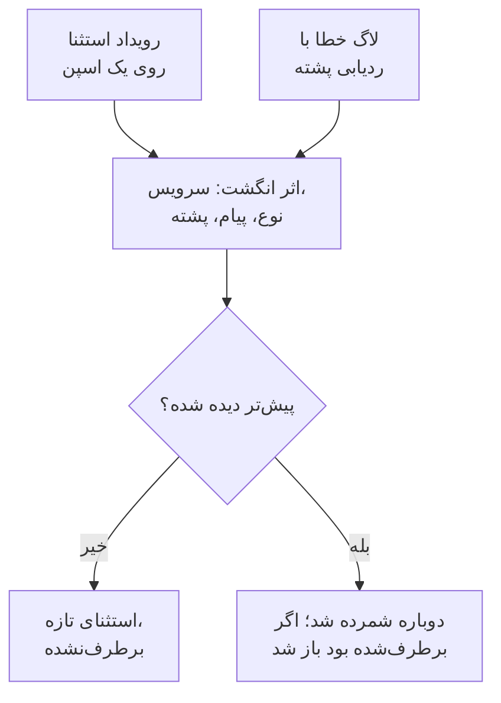

# ردیابی استثناها

ردیابی استثناها خطاهایی را که کدتان پرتاب می‌کند جمع می‌کند و هر رخداد از یک خطای یکسان را در یک استثنا گروه می‌کند، با ردیابی پشته، روند و درخواست‌هایی که در آن‌ها رخ داده است. آن‌ها را مثل یک فهرست کارها دسته‌بندی کنید: اصلاح کنید، برطرف‌شده علامت بزنید، یا هیاهو را بایگانی کنید، و بگذارید هوش مصنوعی برای آن‌هایی که می‌تواند اصلاح کند یک pull request باز کند.

:::cards
- [استثناها از کجا می‌آیند](#استثناها-از-کجا-میآیند): اسپن‌ها و لاگ‌هایی که سرویس‌هایتان همین حالا می‌فرستند.
- [دسته‌بندی فهرست](#دستهبندی-فهرست): برطرف‌نشده‌ها اول، هیاهو پنهان.
- [صفحهٔ یک استثنا](#صفحهٔ-یک-استثنا): ردیابی پشته، رخدادها و زمینه.
- [اصلاح آن با هوش مصنوعی](#اصلاح-آن-با-هوش-مصنوعی): یک pull request با اصلاح، یا یک آزمون رگرسیون.
- [یافتن و اصلاح استثناهای تازه و رو به افزایش با هوش مصنوعی](#یافتن-و-اصلاح-استثناهای-تازه-و-رو-به-افزایش-با-هوش-مصنوعی): pull requestهایی برای استثناهایی که OneUptime پیدا می‌کند.
:::

## استثناها از کجا می‌آیند

لازم نیست استثناها را جداگانه بفرستید. OneUptime آن‌ها را در تله‌متری‌ای پیدا می‌کند که سرویس‌هایتان همین حالا می‌فرستند:

- یک رویداد استثنا روی یک اسپن، همان چیزی که `recordException()` در OpenTelemetry می‌نویسد؛
- لاگی با ویژگی‌های `exception.type`، `exception.message` یا `exception.stacktrace`؛
- لاگی با شدت Error یا Fatal که پیامش یک ردیابی پشته دارد، وقتی آن لاگ درون یک اسپن نوشته نشده باشد (اسپن خودش آن را گزارش می‌کند).

هر رخداد با رخدادهای پیشینِ همان خطا در یک استثنا گروه می‌شود:

- **یک استثنا برای هر سرویس و خطا.** اثر انگشت از سرویس، نوع استثنا، پیام و ردیابی پشته ساخته می‌شود. مقادیری که از فراخوانی به فراخوانی تغییر می‌کنند اول کنار گذاشته می‌شوند: UUIDها و شناسه‌های دیگر، مهرهای زمانی، نشانی‌های IP و ایمیل، و عددهای هفت رقمی یا بیشتر. پس `Order id=1042 not found` و `Order id=2077 not found` یک استثنا هستند.
- **رخداد تازه یک استثنای برطرف‌شده را دوباره باز می‌کند.** اگر پس از برطرف کردنش دوباره رخ دهد، اصلاح جواب نداده است و استثنا با **بازگشته** علامت می‌خورد. رخدادی از پیش از برطرف کردن که دیرتر به OneUptime می‌رسد، آن را دوباره باز نمی‌کند.
- **استثنای بایگانی‌شده بایگانی‌شده می‌ماند.** رخدادهای تازه‌اش همچنان شمرده می‌شوند، اما دیگر اعلان نمی‌فرستند.

> [!TIP]
> برای اینکه یک خطای مورد انتظار، مانند ورودی نامعتبری که سرویستان رد کرده، وارد ردیابی استثناها نشود، ویژگی `error.class` را روی رویداد استثنای اسپن به `user-error` یا `expected-denial` تنظیم کنید. آنگاه OneUptime برایش هیچ استثنایی ثبت نمی‌کند.

## پیش از شروع

- **اسپن‌ها یا لاگ‌های در حال رسیدن.** سرویس‌هایتان را با [OpenTelemetry](/docs/telemetry/open-telemetry) ابزارگذاری کنید. زبانهٔ **راهنمای راه‌اندازی** کد زبان شما را نشان می‌دهد.
- **نقشی که تله‌متری را بخواند.** Project Owner، Project Admin، Project Member، Viewer، Telemetry Admin، Telemetry Member یا Telemetry Viewer، یا یک نقش سفارشی با مجوز Read Telemetry Service Exception. برطرف کردن و بایگانی کردن به Project Owner یا Project Admin، یا مجوز Edit Telemetry Service Exception نیاز دارد.

## دسته‌بندی فهرست

:::steps
### استثناها را باز کنید

به **محصولات** > **مشاهده‌پذیری** > **استثناها** بروید. نشانِ روی زبانهٔ **استثناها** مسائل برطرف‌نشده را می‌شمارد، و فهرست روی استثناهای **برطرف‌نشده** باز می‌شود.

### یک وضعیت انتخاب کنید

میان **برطرف‌نشده**، **برطرف‌شده**، **بایگانی‌شده** و **همه** جابه‌جا شوید. نمودار بالای فهرست نشان می‌دهد در طول زمان چند رخداد **مدیریت‌نشده** و چند رخداد **مدیریت‌شده** بوده‌اند. ردیفی با علامت **بازگشته** پس از برطرف‌شدن دوباره رخ داده است و ردیفی با علامت **جدید** نخستین بار در ۲۴ ساعت گذشته دیده شده است.

### انتخاب کنید چه چیزی مسئله شمرده شود

**مسائل**، که پیش‌فرض است، خطاهای کاربر و ردهای مورد انتظار را پنهان می‌کند، تا فهرست آنچه را که به اصلاح نیاز دارد نشان دهد. **User errors** فقط آن‌ها را نشان می‌دهد، و **همه** هر استثنایی را.

### جستجو و فیلتر کنید

پرس‌وجویی مانند `type:TypeError env:production` بنویسید، [نحو جستجو](/docs/telemetry/search-syntax#استثناها) را ببینید، یا روی مقداری در نوار کناری **فیلترها** کلیک کنید: یک سرویس، یک میزبان یا منبع دیگر، یک **نوع استثنا**، یک **محیط** یا یک **Error Class**.

### یک استثنا را باز کنید

روی یک ردیف کلیک کنید تا صفحهٔ استثنا باز شود.
:::

## صفحهٔ یک استثنا

منوی کناری صفحه کارهایی را که با یک استثنا می‌کنید گروه‌بندی می‌کند:

| صفحه | چه نشان می‌دهد |
| --- | --- |
| **نمای کلی** | پیام، سرویس، اینکه چند بار رخ داده و نخستین و آخرین بار کی دیده شده، روندش در طول زمان، و آخرین رخدادش: نسخهٔ انتشار، محیط، اسپن، ترِیس و نشست کاربر. |
| **ردیابی پشته** | قاب‌های پشته. برای کد مرورگر، پس از بارگذاری [نقشه‌های منبع](/docs/telemetry/source-maps) برای آن نسخهٔ انتشار، فایل‌ها و خط‌های اصلی. |
| **Occurrences** | هر رخداد، با زمانش، پیامش و ترِیسی که در آن رخ داده است. |
| **Context** | ویژگی‌های آخرین رخداد، بازپخش نشستش وقتی ضبط شده باشد، و گام‌هایی که به آن انجامیدند. |
| **لاگ‌ها** | لاگ‌هایی که پیرامون آخرین رخداد نوشته شده‌اند. |
| **AI Assistance** | وظایف هوش مصنوعی که استثنا را اصلاح یا آزمایش می‌کنند. |
| **تنظیمات** | استثنا را برطرف یا بایگانی کنید. این صفحه زیر **مدیریت** است، که در آغاز بسته است. |

## برطرف کردن، بازگشایی و بایگانی

دکمه‌های بالای صفحهٔ استثنا، صفحهٔ **تنظیمات** آن و منوی ⋯ در ردیف آن در فهرست، وضعیتش را تغییر می‌دهند:

| اقدام | کی از آن استفاده کنید | پس از آن چه می‌شود |
| --- | --- | --- |
| **رفع** | اصلاح را مستقر کرده‌اید. | از فهرست **برطرف‌نشده** بیرون می‌رود. یک رخداد تازه دوباره بازش می‌کند. |
| **رفع در نسخهٔ بعدی** | اصلاح در نسخهٔ بعدی شما منتشر می‌شود. | از فهرست **برطرف‌نشده** بیرون می‌رود. رخدادهای نسخه‌ای که آخرین بار در آن دیده شده آن را دوباره باز نمی‌کنند، و رخدادی از هر نسخهٔ دیگری بازش می‌کند. |
| **بازگشایی** | اصلاح جواب نداده است. | دوباره برطرف‌نشده است. |
| **بایگانی** | هیاهویی است که قصد اصلاحش را ندارید. | از فهرست بیرون می‌رود. رخدادهای تازه شمرده می‌شوند اما دیگر اعلان نمی‌فرستند. |
| **خروج از بایگانی** | می‌خواهید دوباره از آن باخبر شوید. | به فهرستی که به آن تعلق دارد برمی‌گردد. |

تا وقتی رخدادهای استثنا نسخهٔ خود را نام می‌برند (ویژگی منبع `service.version`)، **رفع در نسخهٔ بعدی** در منوی کنار **رفع**، در منوی ⋯ ردیف، در **اقدامات گروهی** و در **تنظیمات** هست.

**تنظیمات** نشان می‌دهد آخرین بار چه کسی و کی استثنا را برطرف یا بایگانی کرده است. دکمه‌هایش **علامت‌گذاری به‌عنوان برطرف‌شده** یا **علامت‌گذاری به‌عنوان برطرف‌نشده**، و **بایگانی** یا **خروج از بایگانی** نام دارند.

برای تغییر هم‌زمان چند استثنا، ردیف‌هایشان را در فهرست علامت بزنید، یا کادر بالای ردیف‌ها را برای همهٔ استثناهای صفحه، و همین اقدام‌ها را در **اقدامات گروهی** به کار ببرید. نتیجه می‌گوید کدام استثناها تغییر کردند، کدام‌ها همان‌طور ماندند و چرا.

## کلاس‌های خطا

هر استثنا یک کلاس خطا دارد، که می‌گوید مشکل مال کیست. OneUptime AI آن را وقتی تعیین می‌کند که بینشی دربارهٔ استثنا، مانند یک استثنای تازه یا جهش‌یافته، را دسته‌بندی کند: [AI SRE](/docs/ai/ai-sre#بینشها-شناسایی-پیشدستانه) را ببینید. استثنایی که هنوز دسته‌بندی نکرده `unknown` می‌ماند.

| کلاس | چه معنایی دارد | در **مسائل** |
| --- | --- | --- |
| `code-fault` | نقصی در کد. تنها کلاسی که هوش مصنوعی خودش اصلاح می‌کند. | بله |
| `infrastructure` | یک وقفهٔ زمانی، یک اتصال قطع‌شده یا منابع تمام‌شده. | بله |
| `unknown` | هنوز طبقه‌بندی نشده است. | بله |
| `user-error` | نتیجهٔ ورودی نامعتبر یک کاربر. | خیر |
| `expected-denial` | بررسی‌ای که کارش را انجام می‌دهد، مانند یک ورود ردشده. | خیر |

با روشن بودن **بایگانی استثناهای مورد انتظار** در تنظیمات AI Insights، استثناهایی که دسته‌بندی آن‌ها را ردهای مورد انتظار تشخیص دهد برایتان بایگانی می‌شوند.

## اصلاح آن با هوش مصنوعی

صفحهٔ **AI Assistance** سه وظیفه پیشنهاد می‌کند. هر کدام به‌صورت یک وظیفهٔ هوش مصنوعی اجرا می‌شود که در مخزن کد شما یک pull request باز می‌کند:

| وظیفه | آن pull request چه می‌کند |
| --- | --- |
| **این استثنا را با هوش مصنوعی برطرف کنید** | علت ریشه‌ای را اصلاح می‌کند. آن را با **رفع با هوش مصنوعی** آغاز کنید. |
| **Generate Regression Test** | آزمونی می‌افزاید که تا وقتی باگ اصلاح نشده شکست می‌خورد. |
| **بهبود مدیریت خطا** | برای خطاهای مورد انتظار: ورودی را زودتر اعتبارسنجی می‌کند، دادهٔ کاربر را از پیام‌ها بیرون نگه می‌دارد، و خطا را مدیریت‌شده علامت می‌زند. |

هوش مصنوعی اول به سه چیز نیاز دارد: یک ارائه‌دهندهٔ LLM، یک مخزن متصل (روی GitHub، GitLab، Forgejo یا Gitea، یا هر سرور Git)، و یک ایجنت هوش مصنوعی آنلاین برای اجرای وظیفه. صفحه هر کدام را بررسی می‌کند و به آنچه کم است پیوند می‌دهد. تا وقتی استثنا برطرف‌شده یا بایگانی‌شده است، وظایف متوقف می‌مانند. [کد](/docs/ai/ai-agent) را ببینید.

## یافتن و اصلاح استثناهای تازه و رو به افزایش با هوش مصنوعی

OneUptime هر ۱۵ دقیقه استثناهای شما را برای یافتن استثناهای تازه، استثناهایی که ناگهان بسیار بیشتر رخ می‌دهند، و سرویس‌هایی که استثناهایشان هیچ ردیابی پشته‌ای ندارند بررسی می‌کند و یافته‌ها را همراه با شواهد به‌صورت بینش‌های هوش مصنوعی ثبت می‌کند. سپس OneUptime AI هر کدام را بررسی می‌کند و برای هر کدام که بتواند اصلاح کند یک pull request باز می‌کند. هیچ‌چیز هرگز ادغام نمی‌شود: تیم شما هر pull request را بازبینی می‌کند.

| یافته | OneUptime چه زمانی آن را ثبت می‌کند | pull request |
| --- | --- | --- |
| **استثنای جدید** | استثنایی که نخستین بار در ۲۴ ساعت گذشته دیده شده و تاکنون ۳ بار یا بیشتر رخ داده است. | استثنا را اصلاح می‌کند، یا آن را بهتر مدیریت می‌کند. |
| **جهش استثناها** | استثنایی که در یک ساعت گذشته ۱۰ بار یا بیشتر رخ داده است، با ۵ برابر یا بیشترِ نرخ ساعتی‌اش در ۲۴ ساعت پیش از آن. | استثنا را اصلاح می‌کند، یا آن را بهتر مدیریت می‌کند. |
| **بدون ردیابی پشته** | استثناهایی که یک سرویس در روز گذشته ثبت کرده هیچ ردیابی پشته‌ای ندارند و روی هم ۲۰ بار یا بیشتر رخ داده‌اند. | کاری می‌کند که سرویس با هر استثنا یک ردیابی پشته ثبت کند. |

pull request یک استثنای تازه یا رو به افزایش، وظیفهٔ هوش مصنوعیِ خودِ آن استثناست، همان که صفحهٔ **AI Assistance** آن آغاز می‌کند، و منتظر می‌ماند تا OneUptime AI یافته را بررسی کند. اگر کدِ مقصر را پیدا کند (`code-fault`)، pull request آن را اصلاح می‌کند، همان‌طور که **این استثنا را با هوش مصنوعی برطرف کنید** می‌کند. اگر یک خطای مورد انتظار پیدا کند (`user-error` یا `expected-denial`)، pull request آن خطا را بهتر مدیریت می‌کند، همان‌طور که **بهبود مدیریت خطا** می‌کند. هر نتیجهٔ دیگری به‌خودی‌خود هیچ pull requestی باز نمی‌کند. با روشن بودن **بایگانی استثناهای مورد انتظار**، یک ردِ مورد انتظار به‌جای آن بایگانی می‌شود و هیچ pull requestی نمی‌گیرد.

OneUptime AI تنها برای استثنایی که در کدِ خودتان پرتاب شده باشد خودش یک pull request باز می‌کند: استثنایی که ردیابی پشته‌اش یک فریم از کد شما دارد، نه فقط فریم‌هایی از کتابخانه‌ها یا محیط اجرا. pull requestی که کسی بدون ادغام بسته باشد، pull requestهای خودکارِ آن استثنا را متوقف می‌کند. هر کسی همچنان می‌تواند هر یک از آن‌ها را با **رفع با هوش مصنوعی** روی یافته بخواهد.

### روشن کردن

**استثناها** > **هوش مصنوعی** > **تنظیمات** کلید **یافتن و اصلاح استثناهای تازه و رو به افزایش** را دارد که برای پروژه‌های جدید روشن است. تا وقتی خاموش است، استثناهای تازه و رو به افزایش مثل قبل در دست بینش‌های هوش مصنوعی هستند: [AI SRE](/docs/ai/ai-sre#بینشها-شناسایی-پیشدستانه) را ببینید. وقتی **فعال کردن هوش مصنوعی** خاموش باشد، آن‌ها همچنان پیدا می‌شوند، اما OneUptime AI کاری با آن‌ها نمی‌کند. برای باز کردن pull request، OneUptime AI به مخزنی نیاز دارد که در [کد](/docs/ai/ai-agent) متصل شده باشد: صفحه اول می‌گوید چه چیزی کم است. کد هر مخزن روی Runnerی تغییر می‌کند که آن مخزن در کد انتخاب می‌کند.

OneUptime AI روزانه (UTC) حداکثر ۵ pull request را خودش باز می‌کند، برای هر یافته یکی، و هرگز بیشتر از سقف pull requestهای باز هوش مصنوعی یک مخزن.

### قواعد هوش مصنوعی

بدون قاعده، OneUptime AI هر استثنایی را که پیدا کند بی‌درنگ بررسی می‌کند و برای هر کدام که بتواند اصلاح کند یک pull request باز می‌کند. **قواعد هوش مصنوعی** در **تنظیمات بیشتر** این را در سه گام محدود می‌کنند:

| گام | چه چیزی را تعیین می‌کند |
| --- | --- |
| **تطبیق** | کدام سرویس‌ها: سرویس‌های انتخاب‌شده، سرویس‌هایی با برچسب‌های مشخص، یا سرویس‌هایی که نامشان با یک الگو مطابقت دارد. |
| **بررسی** | **بی‌درنگ**، یا **فقط اگر پس از یک انتظار هنوز پیدا شود**: استثنایی که در طول انتظار از بین برود بررسی نمی‌شود. |
| **اصلاح** | **اصلاح نکن**، **پرسیدن پیش از اصلاح** یا **اصلاح بدون پرسیدن**. پرسیدن پیش از اصلاح، pull request را به یک نفر می‌سپارد: یافته **رفع با هوش مصنوعی** را پیشنهاد می‌دهد. |

در **فیلدهای بیشتر** هر قاعده مخزن‌های کد، سرورهای MCP و ارائه‌دهندهٔ LLMی را انتخاب می‌کند که OneUptime AI برای آن قاعده می‌تواند به کار ببرد. اگر چیزی انتخاب نشود، می‌تواند از همه استفاده کند، و از ارائه‌دهندهٔ پیش‌فرض LLM پروژه.

### دیدن کارهایی که انجام داد

- **استثناها** > **هوش مصنوعی** > **بینش‌ها** آنچه OneUptime پیدا کرد را فهرست می‌کند، هر یافته با شواهدش، از جمله فریم‌های کد شما در ردیابی پشته‌اش. **View Exception Group** استثنا را باز می‌کند، و برای ردیابی‌های پشتهٔ گم‌شدهٔ یک سرویس، **باز کردن در استثناها** استثناهای برطرف‌نشدهٔ روز گذشتهٔ آن را باز می‌کند.
- **استثناها** > **هوش مصنوعی** > **لاگ‌ها** هر بررسی و هر pull request را، از جدیدترین، با وضعیت هر کدام و آنچه هر بررسی پیدا کرده است فهرست می‌کند.
- pull request می‌گوید چرا باز شده است، با پیوندی به یافته‌اش. pull request یک استثنای تازه یا رو به افزایش به خود استثنا هم پیوند می‌دهد و در صفحهٔ **AI Assistance** آن استثنا دیده می‌شود. در کد، وظیفه‌اش استثنایی را که اصلاح می‌کند، یا یافته‌ای را که از آن آمده، نام می‌برد.

## بینش‌های استثنا

زبانهٔ **بینش‌ها** استثناهای **برطرف‌نشده**، **برطرف‌شده** و **بایگانی‌شده** و نرخ برطرف‌سازی شما را می‌شمارد، و پرتکرارترین استثناها، سرویس‌هایی که تحت تأثیرشان هستند و استثناهایی را که اخیراً دیده شده‌اند فهرست می‌کند.

## عیب‌یابی

:::details استثنایی که همین الان پرتاب کردم در فهرست نیست
اول نمای فهرست را بررسی کنید: **مسائل** خطاهای کاربر و ردهای مورد انتظار را پنهان می‌کند، پس **همه** را انتخاب کنید. سپس بازهٔ زمانی را گسترش دهید، و بررسی کنید که استثنا روی یک اسپن، یا در لاگی با ردیابی پشته، ثبت شده باشد.
:::

:::details یک خطا به‌صورت چند استثنا نمایش داده می‌شود
اثر انگشت پیام و ردیابی پشته را در بر دارد. وقتی این‌ها فرق کنند، مثلاً وقتی یک پیام عدد کوتاه یا نامی دارد که با هر فراخوانی تغییر می‌کند، هر گونه استثنای جداگانهٔ خودش است.
:::

:::details یک استثنای برطرف‌شده مدام برمی‌گردد
رخداد تازه یک استثنای برطرف‌شده را عمداً دوباره باز می‌کند: خطا هنوز رخ می‌دهد. بررسی کنید که اصلاح به نسخهٔ انتشاری که آن را گزارش می‌کند رسیده باشد، یا اگر دیگر نمی‌خواهید از آن باخبر شوید، استثنا را بایگانی کنید. اگر پادهای قدیمی آن نسخه در حین استقرار همچنان آن را گزارش می‌کنند، به‌جای آن از **رفع در نسخهٔ بعدی** استفاده کنید.
:::

## گام‌های بعدی

:::cards
- [مانیتور استثناها](/docs/monitor/exceptions-monitor): وقتی استثناها جهش می‌کنند هشدار بگیرید.
- [نقشه‌های منبع](/docs/telemetry/source-maps): ردیابی‌های پشتهٔ خوانا برای کد مرورگر.
- [کد](/docs/ai/ai-agent): هوش مصنوعی چگونه کد را اصلاح می‌کند و pull request باز می‌کند.
- [کاوشگر ترِیس](/docs/telemetry/traces-explorer): درخواستی را که یک استثنا در آن رخ داده ببینید.
:::
