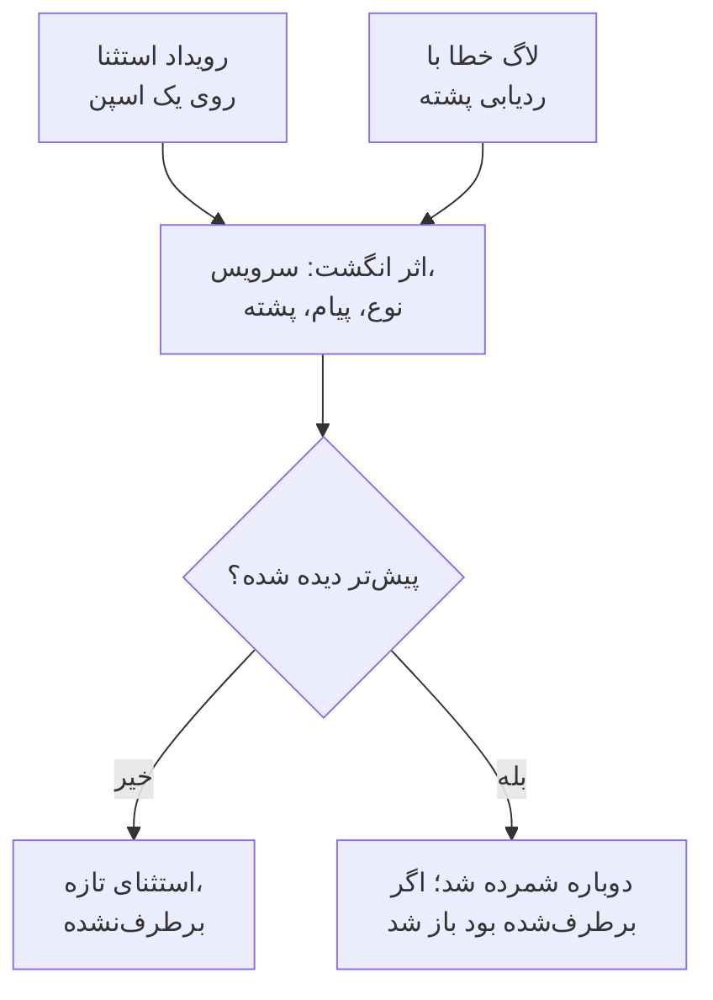

# استثناها

ردیابی استثناها خطاهایی را که کدتان پرتاب می‌کند جمع می‌کند و هر رخداد از یک خطای یکسان را در یک استثنا گروه می‌کند، با ردیابی پشته، روند و درخواست‌هایی که در آن‌ها رخ داده است. آن‌ها را مثل یک فهرست کارها دسته‌بندی کنید: اصلاح کنید، برطرف‌شده علامت بزنید، یا هیاهو را بایگانی کنید، و بگذارید هوش مصنوعی برای آن‌هایی که می‌تواند اصلاح کند یک pull request باز کند.

:::cards
- [استثناها از کجا می‌آیند](#استثناها-از-کجا-میآیند): اسپن‌ها و لاگ‌هایی که سرویس‌هایتان همین حالا می‌فرستند.
- [دسته‌بندی فهرست](#دستهبندی-فهرست): برطرف‌نشده‌ها اول، هیاهو پنهان.
- [صفحهٔ یک استثنا](#صفحهٔ-یک-استثنا): ردیابی پشته، رخدادها و زمینه.
- [اصلاح آن با هوش مصنوعی](#اصلاح-آن-با-هوش-مصنوعی): یک pull request با اصلاح، یا یک آزمون رگرسیون.
- [یافتن و اصلاح استثناهای تازه و رو به افزایش با هوش مصنوعی](#یافتن-و-اصلاح-استثناهای-تازه-و-رو-به-افزایش-با-هوش-مصنوعی): pull requestهایی برای استثناهایی که OneUptime پیدا می‌کند.
:::

## استثناها از کجا می‌آیند

لازم نیست استثناها را جداگانه بفرستید. OneUptime آن‌ها را در تله‌متری‌ای پیدا می‌کند که سرویس‌هایتان همین حالا می‌فرستند:

- یک رویداد استثنا روی یک اسپن، همان چیزی که `recordException()` در OpenTelemetry می‌نویسد؛
- لاگی با ویژگی‌های `exception.type`، `exception.message` یا `exception.stacktrace`؛
- لاگی با شدت Error یا Fatal که پیامش یک ردیابی پشته دارد، وقتی آن لاگ درون یک اسپن نوشته نشده باشد (اسپن خودش آن را گزارش می‌کند).

هر رخداد با رخدادهای پیشینِ همان خطا در یک استثنا گروه می‌شود:

- **یک استثنا برای هر سرویس و خطا.** اثر انگشت از سرویس، نوع استثنا، پیام و ردیابی پشته ساخته می‌شود. مقادیری که از فراخوانی به فراخوانی تغییر می‌کنند اول کنار گذاشته می‌شوند: UUIDها و شناسه‌های دیگر، مهرهای زمانی، نشانی‌های IP و ایمیل، و عددهای هفت رقمی یا بیشتر. پس `Order id=1042 not found` و `Order id=2077 not found` یک استثنا هستند. استثنای تازه در عوض بر پایهٔ نوعش و تابع‌ها و فایل‌های کد خودتان در ردیابی پشته گروه‌بندی می‌شود: شمارهٔ خط‌ها، فریم‌های کتابخانه‌ها و پیام کنار گذاشته می‌شوند، پس گونه‌هایی که از همان کد پرتاب شده‌اند یک استثنا هستند. بدون ردیابی پشته، پیامش آن را گروه‌بندی می‌کند، مانند بالا. استثناهایی که پیش از این گروه‌بندی ثبت شده‌اند گروه‌بندی خود را نگه می‌دارند.
- **رخداد تازه یک استثنای برطرف‌شده را دوباره باز می‌کند.** اگر پس از برطرف کردنش دوباره رخ دهد، اصلاح جواب نداده است و استثنا با **بازگشته** علامت می‌خورد. رخدادی از پیش از برطرف کردن که دیرتر به OneUptime می‌رسد، آن را دوباره باز نمی‌کند.
- **استثنای بایگانی‌شده بایگانی‌شده می‌ماند.** رخدادهای تازه‌اش همچنان شمرده می‌شوند، اما دیگر اعلان نمی‌فرستند.

> [!TIP]
> برای اینکه یک خطای مورد انتظار، مانند ورودی نامعتبری که سرویستان رد کرده، وارد ردیابی استثناها نشود، ویژگی `error.class` را روی رویداد استثنای اسپن به `user-error` یا `expected-denial` تنظیم کنید. آنگاه OneUptime برایش هیچ استثنایی ثبت نمی‌کند.

## پیش از شروع

- **اسپن‌ها یا لاگ‌های در حال رسیدن.** سرویس‌هایتان را با [OpenTelemetry](/docs/telemetry/open-telemetry) ابزارگذاری کنید. زبانهٔ **راهنمای راه‌اندازی** کد زبان شما را نشان می‌دهد.
- **نقشی که تله‌متری را بخواند.** Project Owner، Project Admin، Project Member، Viewer، Telemetry Admin، Telemetry Member یا Telemetry Viewer، یا یک نقش سفارشی با مجوز Read Exceptions. برطرف کردن و بایگانی کردن به Project Owner یا Project Admin، یا مجوز Edit Exceptions نیاز دارد.

## دسته‌بندی فهرست

:::steps
### استثناها را باز کنید

به **محصولات** > **مشاهده‌پذیری** > **استثناها** بروید. نشانِ روی زبانهٔ **استثناها** مسائل برطرف‌نشده را می‌شمارد، و فهرست روی استثناهای **برطرف‌نشده** باز می‌شود.

### یک وضعیت انتخاب کنید

میان **برطرف‌نشده**، **برطرف‌شده**، **بایگانی‌شده** و **همه** جابه‌جا شوید. نمودار بالای فهرست نشان می‌دهد در طول زمان چند رخداد **مدیریت‌نشده** و چند رخداد **مدیریت‌شده** بوده‌اند. ردیفی با علامت **بازگشته** پس از برطرف‌شدن دوباره رخ داده است و ردیفی با علامت **جدید** نخستین بار در ۲۴ ساعت گذشته دیده شده است.

هر ردیف همچنین نشان می‌دهد این استثنا در بازهٔ انتخاب‌شده چند کاربر را تحت تأثیر قرار داده است، همراه با نمودار کوچکی از رخدادهایش در آن بازه. هر رخداد کاربرش را با ویژگی `user.id`، `enduser.id` یا `enduser.pseudo.id` روی رویداد استثنا، اسپن یا رکورد لاگ آن، یا منبع آن مشخص می‌کند؛ رخدادهایی که کاربری را مشخص نمی‌کنند شمرده نمی‌شوند.

### انتخاب کنید چه چیزی مسئله شمرده شود

**مسائل**، که پیش‌فرض است، خطاهای کاربر و ردهای مورد انتظار را پنهان می‌کند، تا فهرست آنچه را که به اصلاح نیاز دارد نشان دهد. **خطاهای کاربر** فقط آن‌ها را نشان می‌دهد، و **همه** هر استثنایی را.

### جستجو و فیلتر کنید

پرس‌وجویی مانند `type:TypeError env:production` بنویسید، [نحو جستجو](/docs/telemetry/search-syntax#استثناها) را ببینید، یا روی مقداری در نوار کناری **فیلترها** کلیک کنید: یک سرویس، یک میزبان یا منبع دیگر، یک **نوع استثنا**، یک **محیط** یا یک **کلاس خطا**. برای کنار گذاشتن آن استثناها، روی علامت منفی کنار یک مقدار کلیک کنید. **واگذارشده به من** فقط استثناهایی را نشان می‌دهد که به شما واگذار شده‌اند، و منوی مرتب‌سازی فهرست را بر اساس **آخرین دیده‌شدن**، **نخستین مشاهده** یا **بیشترین رویداد** مرتب می‌کند.

**نماهای ذخیره‌شده** فهرست را زیر یک نام برای همهٔ افراد پروژه نگه می‌دارد: جستجو، فیلترها، بازهٔ زمانی، وضعیت، آنچه مسئله به شمار می‌آید، **واگذارشده به من**، مرتب‌سازی و اندازهٔ صفحه. نمایی با **واگذارشده به من** به هر کس استثناهایی را نشان می‌دهد که به خود او واگذار شده‌اند، و **پاک کردن نما** فهرست را به همان حالتی برمی‌گرداند که نخست باز می‌شود. نشانی صفحه نمایی را که برگزیده‌اید نام می‌برد، پس پیوندی که هم‌رسانی می‌کنید همان را باز می‌کند. در باقی موارد، نماهای ذخیره‌شده همان‌طور کار می‌کنند که در [کاوشگر لاگ](/docs/telemetry/logs-explorer#ذخیرهٔ-یک-نما).

### یک استثنا را باز کنید

روی یک ردیف کلیک کنید تا صفحهٔ استثنا باز شود.
:::

## صفحهٔ یک استثنا

هر صفحهٔ یک استثنا زیر سرصفحه‌ای یکسان باز می‌شود: نوع و پیامش، وضعیتش، اینکه مدیریت‌شده است یا نه، کلاس خطا و محیطش، و مشخصاتش: چند بار رخ داده، نخستین و آخرین بار کی دیده شده، سرویسش و اینکه به چه کسی واگذار شده است. در هر صفحه جز **تنظیمات**، که دکمه‌های خودش را دارد، **رفع** و **بایگانی** کنار این‌ها قرار دارند، و ⋯ کنار آن دو، **رفع در نسخهٔ بعدی** و **ساخت مانیتور** را در خود دارد.

منوی کناری صفحه کارهایی را که با یک استثنا می‌کنید گروه‌بندی می‌کند:

| صفحه | چه نشان می‌دهد |
| --- | --- |
| **نمای کلی** | **کجا رخ داد**: خطی از کد شما که استثنا از آن پرتاب شد. روندش در طول زمان، و آخرین رخدادش: نسخهٔ انتشار، محیط، اثر انگشت، اسپن، ترِیس و نشست کاربر. در بالا، وقتی هوش مصنوعی روشن است، توضیح OneUptime AI از آنچه رخ داد. |
| **ردیابی پشته** | قاب‌های پشته. برای کد مرورگر، پس از بارگذاری [نقشه‌های منبع](/docs/telemetry/source-maps) برای آن نسخهٔ انتشار، فایل‌ها و خط‌های اصلی. |
| **رخدادها** | هر رخداد، با زمانش، پیامش و ترِیسی که در آن رخ داده است. |
| **زمینه** | ویژگی‌های آخرین رخداد، بازپخش نشستش وقتی ضبط شده باشد، و گام‌هایی که به آن انجامیدند. |
| **لاگ‌ها** | لاگ‌هایی که پیرامون آخرین رخداد نوشته شده‌اند. |
| **رفع با هوش مصنوعی** | یک وظیفهٔ هوش مصنوعی که استثنا را با یک pull request اصلاح می‌کند، و وظایف دیگری که زیر آن جمع شده‌اند. |
| **تنظیمات** | استثنا را برطرف یا بایگانی کنید. این صفحه زیر **مدیریت** است، که در آغاز بسته است. |
| **گزارش‌های ممیزی** | چه کسی و چه زمانی استثنا را برطرف، بایگانی، واگذار یا ادغام کرد. این صفحه هم زیر **مدیریت** است. |

**کجا رخ داد** نخستین فریم از کد خودتان را نشان می‌دهد، یعنی محتمل‌ترین جایی که خطا از آن پرتاب شده است: فایل و خط اصلی‌اش وقتی نقشهٔ منبع آن را به کد اصلی برگردانده باشد، کدِ پیرامونش وقتی نقشه آن را در خود داشته باشد، و تا سه فریم از کد شما که آن را فراخوانده‌اند. اگر هیچ فریمی در کد خودتان نباشد، درونی‌ترین فریم ردیابی پشته را نشان می‌دهد. **مشاهده‌ی کامل ردیابی پشته** همهٔ فریم‌ها را در **ردیابی پشته** باز می‌کند. وقتی آخرین رخداد هیچ فریم ساختاریافته‌ای ثبت نکرده باشد، کارت نخستین خط‌های ردیابی پشته را همان‌گونه که هستند نشان می‌دهد (در traceback پایتون، آخرین خط‌ها را، که خطا همان‌جاست)، و استثنایی که ردیابی پشته ندارد کارتی ندارد.

## برطرف کردن، بازگشایی و بایگانی

دکمه‌های بالای صفحهٔ استثنا و ⋯ کنار آن‌ها، صفحهٔ **تنظیمات** آن و منوی ⋯ در ردیف آن در فهرست، وضعیتش را تغییر می‌دهند:

| اقدام | کی از آن استفاده کنید | پس از آن چه می‌شود |
| --- | --- | --- |
| **رفع** | اصلاح را مستقر کرده‌اید. | از فهرست **برطرف‌نشده** بیرون می‌رود. یک رخداد تازه دوباره بازش می‌کند. |
| **رفع در نسخهٔ بعدی** | اصلاح در نسخهٔ بعدی شما منتشر می‌شود. | از فهرست **برطرف‌نشده** بیرون می‌رود. رخدادهای نسخه‌ای که آخرین بار در آن دیده شده آن را دوباره باز نمی‌کنند، و رخدادی از هر نسخهٔ دیگری بازش می‌کند. |
| **بازگشایی** | اصلاح جواب نداده است. | دوباره برطرف‌نشده است. |
| **بایگانی** | هیاهویی است که قصد اصلاحش را ندارید. | از فهرست بیرون می‌رود. رخدادهای تازه شمرده می‌شوند اما دیگر اعلان نمی‌فرستند. |
| **خروج از بایگانی** | می‌خواهید دوباره از آن باخبر شوید. | به فهرستی که به آن تعلق دارد برمی‌گردد. |

تا وقتی رخدادهای استثنا نسخهٔ خود را نام می‌برند (ویژگی منبع `service.version`)، **رفع در نسخهٔ بعدی** در ⋯ بالای صفحهٔ استثنا، در منوی ⋯ ردیف، در **اقدامات گروهی** و در **تنظیمات** هست.

**تنظیمات** نشان می‌دهد آخرین بار چه کسی و کی استثنا را برطرف یا بایگانی کرده است. دکمه‌هایش **علامت‌گذاری به‌عنوان برطرف‌شده** یا **علامت‌گذاری به‌عنوان برطرف‌نشده**، و **بایگانی** یا **خروج از بایگانی** نام دارند.

برای تغییر هم‌زمان چند استثنا، ردیف‌هایشان را در فهرست علامت بزنید، یا کادر بالای ردیف‌ها را برای همهٔ استثناهای صفحه، و همین اقدام‌ها را در **اقدامات گروهی** به کار ببرید. وقتی همهٔ استثناهای صفحه علامت خورده باشند، نوار بالای ردیف‌ها پیشنهاد می‌کند همهٔ استثناهایی را که با جست‌وجو و فیلترهای فهرست منطبق‌اند، در همهٔ صفحه‌ها و تا ۱۰٬۰۰۰ مورد در هر بار، انتخاب کنید؛ آن‌گاه هر اقدام پیش از تغییرشان می‌پرسد. نتیجه می‌گوید کدام استثناها تغییر کردند، کدام‌ها همان‌طور ماندند و چرا.

**تخصیص**، زیر **مسئول** در سرصفحهٔ استثنا، آن را به یک نفر یا یک تیم می‌سپارد؛ برای سپردنش به کس دیگری روی نامش کلیک کنید، و × کنار نام، واگذاری را لغو می‌کند. هر ردیف نشان می‌دهد استثنا از آنِ کیست، منوی ⋯ آن **واگذاری به من** را پیشنهاد می‌کند، و **واگذاری به…** در **اقدامات گروهی** چند استثنا را با هم واگذار می‌کند. کسی که استثنا به او واگذار شده، یا هر عضو تیم، همان‌طور که ردیف **استثنای واگذارشده به من** در [تنظیمات اعلان](/docs/notifications/notification-settings) او می‌گوید، اعلان می‌گیرد؛ کسی که آن را واگذار کرده اعلانی نمی‌گیرد.

**ساخت مانیتور**، در ⋯ بالای صفحهٔ استثنا، برای نوع این استثنا در سرویسش ساختن یک [مانیتور استثناها](/docs/monitor/exceptions-monitor) را آغاز می‌کند تا اگر دوباره رخ داد به شما هشدار دهد. این گزینه به کسانی پیشنهاد می‌شود که اجازهٔ ساختن مانیتور دارند.

**فعالیت** در پایین **نمای کلی** استثنا نشان می‌دهد چه کسی و چه زمانی آن را تغییر داد، جدیدترین در ابتدا: چه کسی آن را برطرف، بازگشایی، بایگانی یا واگذار کرد، استثنایی دیگر را با آن ادغام کرد یا یکی را جدا کرد، و پس از برطرف شدن چه زمانی دوباره رخ داد. هر تغییری آنجاست، چه در صفحهٔ استثنا، چه در فهرست، در **اقدامات گروهی**، از راه API یا خود OneUptime انجام شده باشد، و تغییری که با کلید API انجام شده نام آن کلید را دارد.

## کلاس‌های خطا

هر استثنا یک کلاس خطا دارد، که می‌گوید مشکل مال کیست. OneUptime AI آن را وقتی تعیین می‌کند که بینشی دربارهٔ استثنا، مانند یک استثنای تازه یا جهش‌یافته، را دسته‌بندی کند: [AI SRE](/docs/ai/ai-sre#بینشها-شناسایی-پیشدستانه) را ببینید. استثنایی که هنوز دسته‌بندی نکرده `unknown` می‌ماند.

| کلاس | چه معنایی دارد | در **مسائل** |
| --- | --- | --- |
| `code-fault` | نقصی در کد. تنها کلاسی که هوش مصنوعی خودش اصلاح می‌کند. | بله |
| `infrastructure` | پایان مهلت، یک اتصال قطع‌شده یا منابع تمام‌شده. | بله |
| `unknown` | هنوز طبقه‌بندی نشده است. | بله |
| `user-error` | نتیجهٔ ورودی نامعتبر یک کاربر. | خیر |
| `expected-denial` | بررسی‌ای که کارش را انجام می‌دهد، مانند یک ورود ردشده. | خیر |

با روشن بودن **بایگانی استثناهای مورد انتظار** در تنظیمات AI Insights، استثناهایی که دسته‌بندی آن‌ها را ردهای مورد انتظار تشخیص دهد برایتان بایگانی می‌شوند.

## توضیح آن با هوش مصنوعی

در بالای **نمای کلی** یک استثنا، **توضیح با OneUptime AI** از OneUptime AI می‌پرسد چه چیزی خراب شد. ردیابی پشته، ترِیس و لاگ‌های آخرین رخداد و استقرارهای سرویس در حوالی زمان شروع استثنا را می‌خواند و در کارت **آنچه رخ داد** پاسخ می‌دهد:

| بخش | چه می‌گوید |
| --- | --- |
| **آنچه رخ داد** | یکی دو جمله، اینکه OneUptime AI چقدر مطمئن است و ایراد کجاست: کد، یک وابستگی، زیرساخت، ورودی نادرست یا پیکربندی. |
| **علت ریشه‌ای محتمل** | علت، و فریم، اسپن، خط لاگ یا استقراری که آن را نشان می‌دهد. |
| **اصلاح پیشنهادی** | چه چیزی باید تغییر کند. |
| **کجا را ببینید** | فریم‌هایی از ردیابی پشته که باید اول باز کنید. |
| **گام‌های بعدی** | حداکثر سه گام برای تأیید یا رفع آن. |

توضیح روی استثنا نگه داشته می‌شود، پس نفر بعدی که آن را باز می‌کند فوراً آن را می‌خواند، و **توضیح دوباره** توضیح تازه‌ای می‌خواهد. **رفع با هوش مصنوعی** صفحهٔ **رفع با هوش مصنوعی** استثنا را باز می‌کند و **پرسیدن سؤال تکمیلی** Ask AI را دربارهٔ این استثنا باز می‌کند.

شناسه‌ها، نشانی‌های ایمیل و IP و توکن‌ها از هر چیزی که فرستاده می‌شود حذف می‌شوند، و از ویژگی‌های یک اسپن فقط چند مورد، مانند مسیر و کد وضعیت، فرستاده می‌شود. توضیح از ارائه‌دهندهٔ LLM و اعتبار هوش مصنوعی پروژه استفاده می‌کند و تا وقتی **فعال کردن هوش مصنوعی** خاموش است ارائه نمی‌شود. هر کسی که بتواند استثنا را بخواند می‌تواند توضیح بخواهد.

زیر کارت‌ها، **استثناهای مشابه** تا پنج استثنای دیگر را که به این یکی شبیه‌اند فهرست می‌کند: با **پیام یکسان** وقتی مقدارها برداشته شوند، با **محل یکسان در کد** در کد شما، یا با **پیام مشابه** که بیشتر واژه‌هایش یکی است. یک علت ریشه‌ای ممکن است در چند استثنا پخش شود، پس **بررسی با OneUptime AI** دربارهٔ هر کدام می‌گوید **احتمالاً همان باگ** است، **باگی مرتبط** است یا **باگی دیگر**، و چرا. بررسی از اعتبار هوش مصنوعی پروژه استفاده می‌کند و تا وقتی **فعال کردن هوش مصنوعی** خاموش است پیشنهاد نمی‌شود. پاسخ آن تا رخداد بعدی نگه داشته می‌شود.

استثنایی را که OneUptime AI آن را **احتمالاً همان باگ** می‌داند و در همان سرویس است، با **ادغام** کنارش با این استثنا ادغام کنید: رخدادهای تاکنون و هر رخداد تازه‌اش از آن پس روی این استثنا شمرده می‌شود و در صفحهٔ آن دیده می‌شود، و از فهرست بیرون می‌رود. **ادغام‌شده با این استثنا** در پایین، ادغام‌شده‌ها را فهرست می‌کند و **جداسازی** کنار هر کدام، یا در صفحهٔ خود استثنای ادغام‌شده، جای خودش را در فهرست به آن برمی‌گرداند، همراه با رخدادهایش از آن پس. ادغام و جداسازی به مجوز ویرایش استثناها نیاز دارد. اینکه چه کسی یک استثنا را ادغام کرد و چه کسی آن را جدا کرد، در صفحهٔ **گزارش‌های ممیزی** همان استثنا آمده است؛ استثنایی که با آن ادغام شد ورودی‌ای نمی‌گیرد، چون چیزی که کسی روی آن تنظیم کرده بود تغییر نکرد.

## اصلاح آن با هوش مصنوعی

صفحهٔ **رفع با هوش مصنوعی** نخست یک وظیفه را نشان می‌دهد که با **رفع با هوش مصنوعی** آغاز می‌شود. این وظیفه به‌صورت یک وظیفهٔ هوش مصنوعی اجرا می‌شود که در مخزن کد شما یک pull request باز می‌کند، و کاری که آن pull request می‌کند به [کلاس خطای](#کلاسهای-خطا) استثنا بستگی دارد:

| کلاس خطا | آن pull request چه می‌کند |
| --- | --- |
| `user-error` یا `expected-denial` | خطا را بهتر مدیریت می‌کند، بی‌آنکه کار کد را تغییر دهد: ورودی را زودتر و با پیامی روشن بررسی می‌کند، دادهٔ کاربر را از پیام بیرون نگه می‌دارد، و خطا را مدیریت‌شده علامت می‌زند. |
| هر کلاس دیگر، یا هنوز طبقه‌بندی‌نشده | علت ریشه‌ای را در کد شما پیدا و اصلاح می‌کند. |

سه گام زیر آن می‌گویند چگونه کار می‌کند: ردیابی پشته را می‌خواند و کدی را که آن را پرتاب کرده پیدا می‌کند، آن کد را در مخزن شما روی شاخه‌ای جداگانه تغییر می‌دهد، و یک pull request برای بازبینی شما باز می‌کند. تا آن را ادغام نکنید چیزی تغییر نمی‌کند. پس از اجرا، دکمه‌اش **رفع دوباره** می‌شود، یا اگر تلاش شکست خورده یا اصلاحی پیدا نکرده باشد، **تلاش دوباره**.

**دیگر کارهای هوش مصنوعی**، که زیر آن جمع شده است، pull requestهای دیگر را با **شروع** باز می‌کند:

| وظیفه | آن pull request چه می‌کند |
| --- | --- |
| **رفع اشکال کد** | علت ریشه‌ای را اصلاح می‌کند. وقتی فهرست می‌شود که **رفع با هوش مصنوعی** یک خطای مورد انتظار را مدیریت کند. |
| **مدیریت بهتر خطا** | یک خطای مورد انتظار را بهتر مدیریت می‌کند، مانند بالا. وقتی فهرست می‌شود که **رفع با هوش مصنوعی** کد را اصلاح کند. |
| **نوشتن تست رگرسیون** | آزمونی می‌افزاید که استثنا را بازتولید می‌کند و تا وقتی باگ اصلاح نشده شکست می‌خورد. باگ را اصلاح نمی‌کند. |

هوش مصنوعی اول به سه چیز نیاز دارد: یک ارائه‌دهندهٔ LLM، یک مخزن متصل (روی GitHub، GitLab، Forgejo یا Gitea، یا هر سرور Git)، و یک ایجنت هوش مصنوعی آنلاین برای اجرای وظیفه. صفحه هر کدام را بررسی می‌کند و به آنچه کم است پیوند می‌دهد. تا وقتی استثنا برطرف‌شده یا بایگانی‌شده است، وظایف متوقف می‌مانند. [کد](/docs/ai/ai-agent) را ببینید. شروع یک وظیفه به اجازهٔ ویرایش مخزنی نیاز دارد که در آن کار می‌کند: کسی که فقط می‌تواند استثنا را بخواند، وظایف آن را می‌بیند اما نمی‌تواند هیچ‌کدام را شروع کند.

## یافتن و اصلاح استثناهای تازه و رو به افزایش با هوش مصنوعی

OneUptime هر ۱۵ دقیقه استثناهای شما را برای یافتن استثناهای تازه، استثناهایی که ناگهان بسیار بیشتر رخ می‌دهند، و سرویس‌هایی که استثناهایشان هیچ ردیابی پشته‌ای ندارند بررسی می‌کند و یافته‌ها را همراه با شواهد به‌صورت بینش‌های هوش مصنوعی ثبت می‌کند. سپس OneUptime AI هر کدام را بررسی می‌کند و برای هر کدام که بتواند اصلاح کند یک pull request باز می‌کند. هیچ‌چیز هرگز ادغام نمی‌شود: تیم شما هر pull request را بازبینی می‌کند.

| یافته | OneUptime چه زمانی آن را ثبت می‌کند | pull request |
| --- | --- | --- |
| **استثنای جدید** | استثنایی که نخستین بار در ۲۴ ساعت گذشته دیده شده و تاکنون ۳ بار یا بیشتر رخ داده است. | استثنا را اصلاح می‌کند، یا آن را بهتر مدیریت می‌کند. |
| **جهش استثناها** | استثنایی که در یک ساعت گذشته ۱۰ بار یا بیشتر رخ داده است، با ۵ برابر یا بیشترِ نرخ ساعتی‌اش در ۲۴ ساعت پیش از آن. | استثنا را اصلاح می‌کند، یا آن را بهتر مدیریت می‌کند. |
| **بدون ردیابی پشته** | استثناهایی که یک سرویس در روز گذشته ثبت کرده هیچ ردیابی پشته‌ای ندارند و روی هم ۲۰ بار یا بیشتر رخ داده‌اند. | کاری می‌کند که سرویس با هر استثنا یک ردیابی پشته ثبت کند. |

pull request یک استثنای تازه یا رو به افزایش، وظیفهٔ هوش مصنوعیِ خودِ آن استثناست، همان که صفحهٔ **رفع با هوش مصنوعی** آن آغاز می‌کند، و منتظر می‌ماند تا OneUptime AI یافته را بررسی کند. اگر کدِ مقصر را پیدا کند (`code-fault`)، pull request آن را اصلاح می‌کند، همان‌طور که **رفع اشکال کد** می‌کند. اگر یک خطای مورد انتظار پیدا کند (`user-error` یا `expected-denial`)، pull request آن خطا را بهتر مدیریت می‌کند، همان‌طور که **مدیریت بهتر خطا** می‌کند. هر نتیجهٔ دیگری به‌خودی‌خود هیچ pull requestی باز نمی‌کند. با روشن بودن **بایگانی استثناهای مورد انتظار**، یک ردِ مورد انتظار به‌جای آن بایگانی می‌شود و هیچ pull requestی نمی‌گیرد.

OneUptime AI تنها برای استثنایی که در کدِ خودتان پرتاب شده باشد خودش یک pull request باز می‌کند: استثنایی که ردیابی پشته‌اش یک فریم از کد شما دارد، نه فقط فریم‌هایی از کتابخانه‌ها یا محیط اجرا. pull requestی که کسی بدون ادغام بسته باشد، pull requestهای خودکارِ آن استثنا را متوقف می‌کند. هر کسی همچنان می‌تواند هر یک از آن‌ها را با **رفع با هوش مصنوعی** روی یافته بخواهد.

### روشن کردن

**استثناها** > **هوش مصنوعی** > **تنظیمات** کلید **یافتن و اصلاح استثناهای تازه و رو به افزایش** را دارد که برای پروژه‌های جدید روشن است. تا وقتی خاموش است، استثناهای تازه و رو به افزایش مثل قبل در دست بینش‌های هوش مصنوعی هستند: [AI SRE](/docs/ai/ai-sre#بینشها-شناسایی-پیشدستانه) را ببینید. وقتی **فعال کردن هوش مصنوعی** خاموش باشد، آن‌ها همچنان پیدا می‌شوند، اما OneUptime AI کاری با آن‌ها نمی‌کند. برای باز کردن pull request، OneUptime AI به مخزنی نیاز دارد که در [کد](/docs/ai/ai-agent) متصل شده باشد: صفحه اول می‌گوید چه چیزی کم است. کد هر مخزن روی Runnerی تغییر می‌کند که آن مخزن در کد انتخاب می‌کند.

OneUptime AI روزانه (UTC) حداکثر ۵ pull request را خودش باز می‌کند، برای هر یافته یکی، و هرگز بیشتر از سقف pull requestهای باز هوش مصنوعی یک مخزن.

### قواعد هوش مصنوعی

بدون قاعده، OneUptime AI هر استثنایی را که پیدا کند بی‌درنگ بررسی می‌کند و برای هر کدام که بتواند اصلاح کند یک pull request باز می‌کند. **قواعد هوش مصنوعی** در **تنظیمات بیشتر** این را در سه گام محدود می‌کنند:

| گام | چه چیزی را تعیین می‌کند |
| --- | --- |
| **تطبیق** | کدام سرویس‌ها: سرویس‌های انتخاب‌شده، سرویس‌هایی با برچسب‌های مشخص، یا سرویس‌هایی که نامشان با یک الگو مطابقت دارد. |
| **بررسی** | **بی‌درنگ**، یا **فقط اگر پس از یک انتظار هنوز پیدا شود**: استثنایی که در طول انتظار از بین برود بررسی نمی‌شود. |
| **اصلاح** | **اصلاح نکن**، **پرسیدن پیش از اصلاح** یا **اصلاح بدون پرسیدن**. پرسیدن پیش از اصلاح، pull request را به یک نفر می‌سپارد: یافته **رفع با هوش مصنوعی** را پیشنهاد می‌دهد. |

در **فیلدهای بیشتر** هر قاعده مخزن‌های کد، سرورهای MCP و ارائه‌دهندهٔ LLMی را انتخاب می‌کند که OneUptime AI برای آن قاعده می‌تواند به کار ببرد. اگر چیزی انتخاب نشود، می‌تواند از همه استفاده کند، و از ارائه‌دهندهٔ پیش‌فرض LLM پروژه.

### دیدن کارهایی که انجام داد

- **استثناها** > **هوش مصنوعی** > **بینش‌ها** آنچه OneUptime پیدا کرد را فهرست می‌کند، هر یافته با شواهدش، از جمله فریم‌های کد شما در ردیابی پشته‌اش. **مشاهده گروه استثنا** استثنا را باز می‌کند، و برای ردیابی‌های پشتهٔ گم‌شدهٔ یک سرویس، **باز کردن در استثناها** استثناهای برطرف‌نشدهٔ روز گذشتهٔ آن را باز می‌کند.
- **استثناها** > **هوش مصنوعی** > **لاگ‌ها** هر بررسی و هر pull request را، از جدیدترین، با وضعیت هر کدام و آنچه هر بررسی پیدا کرده است فهرست می‌کند.
- pull request می‌گوید چرا باز شده است، با پیوندی به یافته‌اش. pull request یک استثنای تازه یا رو به افزایش به خود استثنا هم پیوند می‌دهد و در صفحهٔ **رفع با هوش مصنوعی** آن استثنا دیده می‌شود. در کد، وظیفه‌اش استثنایی را که اصلاح می‌کند، یا یافته‌ای را که از آن آمده، نام می‌برد.

## بینش‌های استثنا

زبانهٔ **بینش‌ها** استثناهای **برطرف‌نشده**، **برطرف‌شده** و **بایگانی‌شده** و نرخ برطرف‌سازی شما را می‌شمارد، و پرتکرارترین استثناها، سرویس‌هایی که تحت تأثیرشان هستند و استثناهایی را که اخیراً دیده شده‌اند فهرست می‌کند.

**چه خبر تازه‌ای هست** در بالای زبانه، با **خلاصه با OneUptime AI**، از OneUptime AI می‌خواهد استثناهایی را که در ۲۴ ساعت گذشته نخستین بار دیده شده‌اند و آن‌هایی را که پس از برطرف شدن برگشته‌اند خلاصه کند: چند جمله دربارهٔ همه، سپس هر کدام در یک خط، فوری‌ترین اول، با پیوندی به استثنا. خلاصه وقتی درخواست کنید نوشته می‌شود و تا رخداد بعدی نگه داشته می‌شود، پس درخواست دوباره هزینه‌ای ندارد؛ از اعتبار هوش مصنوعی پروژه استفاده می‌کند و تا وقتی **فعال کردن هوش مصنوعی** خاموش است پیشنهاد نمی‌شود.

## عیب‌یابی

:::details استثنایی که همین الان پرتاب کردم در فهرست نیست
اول نمای فهرست را بررسی کنید: **مسائل** خطاهای کاربر و ردهای مورد انتظار را پنهان می‌کند، پس **همه** را انتخاب کنید. سپس بازهٔ زمانی را گسترش دهید، و بررسی کنید که استثنا روی یک اسپن، یا در لاگی با ردیابی پشته، ثبت شده باشد.
:::

:::details یک خطا به‌صورت چند استثنا نمایش داده می‌شود
اثر انگشت پیام و ردیابی پشته را در بر دارد. وقتی این‌ها فرق کنند، مثلاً وقتی یک پیام عدد کوتاه یا نامی دارد که با هر فراخوانی تغییر می‌کند، هر گونه استثنای جداگانهٔ خودش است. استثناهای تازه در عوض بر پایهٔ تابع‌های کد خودتان گروه‌بندی می‌شوند، پس این بیشتر به استثناهایی مربوط است که پیش‌تر ثبت شده‌اند؛ دو استثنایی را که همان باگ هستند از **استثناهای مشابه** ادغام کنید.
:::

:::details یک استثنای برطرف‌شده مدام برمی‌گردد
رخداد تازه یک استثنای برطرف‌شده را عمداً دوباره باز می‌کند: خطا هنوز رخ می‌دهد. بررسی کنید که اصلاح به نسخهٔ انتشاری که آن را گزارش می‌کند رسیده باشد، یا اگر دیگر نمی‌خواهید از آن باخبر شوید، استثنا را بایگانی کنید. اگر پادهای قدیمی آن نسخه در حین استقرار همچنان آن را گزارش می‌کنند، به‌جای آن از **رفع در نسخهٔ بعدی** استفاده کنید.
:::

## گام‌های بعدی

:::cards
- [مانیتور استثناها](/docs/monitor/exceptions-monitor): وقتی استثناها جهش می‌کنند هشدار بگیرید.
- [نقشه‌های منبع](/docs/telemetry/source-maps): ردیابی‌های پشتهٔ خوانا برای کد مرورگر.
- [کد](/docs/ai/ai-agent): هوش مصنوعی چگونه کد را اصلاح می‌کند و pull request باز می‌کند.
- [کاوشگر ترِیس](/docs/telemetry/traces-explorer): درخواستی را که یک استثنا در آن رخ داده ببینید.
:::
