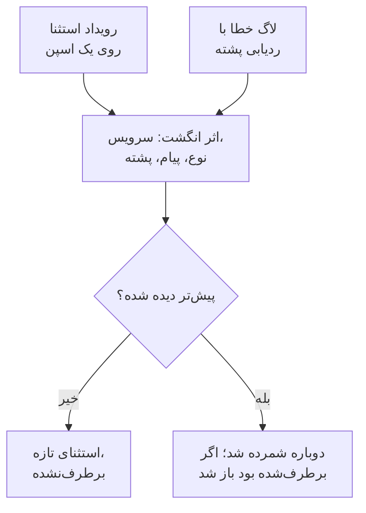

# ردیابی استثناها

ردیابی استثناها خطاهایی را که کدتان پرتاب می‌کند جمع می‌کند و هر رخداد از یک خطای یکسان را در یک استثنا گروه می‌کند، با ردیابی پشته، روند و درخواست‌هایی که در آن‌ها رخ داده است. آن‌ها را مثل یک فهرست کارها دسته‌بندی کنید: اصلاح کنید، برطرف‌شده علامت بزنید، یا هیاهو را بایگانی کنید، و بگذارید هوش مصنوعی برای آن‌هایی که می‌تواند اصلاح کند یک pull request باز کند.

:::cards
- [استثناها از کجا می‌آیند](#استثناها-از-کجا-میآیند): اسپن‌ها و لاگ‌هایی که سرویس‌هایتان همین حالا می‌فرستند.
- [دسته‌بندی فهرست](#دستهبندی-فهرست): برطرف‌نشده‌ها اول، هیاهو پنهان.
- [صفحهٔ یک استثنا](#صفحهٔ-یک-استثنا): ردیابی پشته، رخدادها و زمینه.
- [اصلاح آن با هوش مصنوعی](#اصلاح-آن-با-هوش-مصنوعی): یک pull request با اصلاح، یا یک آزمون رگرسیون.
:::

## استثناها از کجا می‌آیند

لازم نیست استثناها را جداگانه بفرستید. OneUptime آن‌ها را در تله‌متری‌ای پیدا می‌کند که سرویس‌هایتان همین حالا می‌فرستند:

- یک رویداد استثنا روی یک اسپن، همان چیزی که `recordException()` در OpenTelemetry می‌نویسد؛
- لاگی با ویژگی‌های `exception.type`، `exception.message` یا `exception.stacktrace`؛
- لاگی با شدت Error یا Fatal که پیامش یک ردیابی پشته دارد، وقتی آن لاگ درون یک اسپن نوشته نشده باشد (اسپن خودش آن را گزارش می‌کند).

هر رخداد با رخدادهای پیشینِ همان خطا در یک استثنا گروه می‌شود:

- **یک استثنا برای هر سرویس و خطا.** اثر انگشت از سرویس، نوع استثنا، پیام و ردیابی پشته ساخته می‌شود. مقادیری که از فراخوانی به فراخوانی تغییر می‌کنند اول کنار گذاشته می‌شوند: UUIDها و شناسه‌های دیگر، مهرهای زمانی، نشانی‌های IP و ایمیل، و عددهای هفت رقمی یا بیشتر. پس `Order id=1042 not found` و `Order id=2077 not found` یک استثنا هستند.
- **رخداد تازه یک استثنای برطرف‌شده را دوباره باز می‌کند.** اگر پس از برطرف کردنش دوباره رخ دهد، اصلاح جواب نداده است.
- **استثنای بایگانی‌شده بایگانی‌شده می‌ماند.** رخدادهای تازه‌اش همچنان شمرده می‌شوند، اما دیگر اعلان نمی‌فرستند.

> [!TIP]
> برای اینکه یک خطای مورد انتظار، مانند ورودی نامعتبری که سرویستان رد کرده، وارد ردیابی استثناها نشود، ویژگی `error.class` را روی رویداد استثنای اسپن به `user-error` یا `expected-denial` تنظیم کنید. آنگاه OneUptime برایش هیچ استثنایی ثبت نمی‌کند.

## پیش از شروع

- **اسپن‌ها یا لاگ‌های در حال رسیدن.** سرویس‌هایتان را با [OpenTelemetry](/docs/telemetry/open-telemetry) ابزارگذاری کنید. زبانهٔ **راهنمای راه‌اندازی** کد زبان شما را نشان می‌دهد.
- **نقشی که تله‌متری را بخواند.** Project Owner، Project Admin، Project Member، Viewer، Telemetry Admin، Telemetry Member یا Telemetry Viewer، یا یک نقش سفارشی با مجوز Read Telemetry Service Exception. برطرف کردن و بایگانی کردن به Project Owner یا Project Admin، یا مجوز Edit Telemetry Service Exception نیاز دارد.

## دسته‌بندی فهرست

:::steps
### استثناها را باز کنید

به **محصولات** > **مشاهده‌پذیری** > **استثناها** بروید. نشانِ روی زبانهٔ **استثناها** مسائل برطرف‌نشده را می‌شمارد، و فهرست روی استثناهای **برطرف‌نشده** باز می‌شود.

### یک وضعیت انتخاب کنید

میان **برطرف‌نشده**، **برطرف‌شده**، **بایگانی‌شده** و **همه** جابه‌جا شوید. نمودار بالای فهرست نشان می‌دهد در طول زمان چند رخداد **مدیریت‌نشده** و چند رخداد **مدیریت‌شده** بوده‌اند.

### انتخاب کنید چه چیزی مسئله شمرده شود

**مسائل**، که پیش‌فرض است، خطاهای کاربر و ردهای مورد انتظار را پنهان می‌کند، تا فهرست آنچه را که به اصلاح نیاز دارد نشان دهد. **User errors** فقط آن‌ها را نشان می‌دهد، و **همه** هر استثنایی را.

### جستجو و فیلتر کنید

پرس‌وجویی مانند `type:TypeError env:production` بنویسید، [نحو جستجو](/docs/telemetry/search-syntax#استثناها) را ببینید، یا روی مقداری در نوار کناری **فیلترها** کلیک کنید: یک سرویس، یک میزبان یا منبع دیگر، یک **نوع استثنا**، یک **محیط** یا یک **Error Class**.

### یک استثنا را باز کنید

روی یک ردیف کلیک کنید تا صفحهٔ استثنا باز شود.
:::

## صفحهٔ یک استثنا

منوی کناری صفحه کارهایی را که با یک استثنا می‌کنید گروه‌بندی می‌کند:

| صفحه | چه نشان می‌دهد |
| --- | --- |
| **نمای کلی** | پیام، سرویس، اینکه چند بار رخ داده و نخستین و آخرین بار کی دیده شده، روندش در طول زمان، و آخرین رخدادش: نسخهٔ انتشار، محیط، اسپن، ترِیس و نشست کاربر. |
| **ردیابی پشته** | قاب‌های پشته. برای کد مرورگر، پس از بارگذاری [نقشه‌های منبع](/docs/telemetry/source-maps) برای آن نسخهٔ انتشار، فایل‌ها و خط‌های اصلی. |
| **Occurrences** | هر رخداد، با زمانش، پیامش و ترِیسی که در آن رخ داده است. |
| **Context** | ویژگی‌های آخرین رخداد، بازپخش نشستش وقتی ضبط شده باشد، و گام‌هایی که به آن انجامیدند. |
| **لاگ‌ها** | لاگ‌هایی که پیرامون آخرین رخداد نوشته شده‌اند. |
| **AI Assistance** | وظایف هوش مصنوعی که استثنا را اصلاح یا آزمایش می‌کنند. |
| **تنظیمات** | استثنا را برطرف یا بایگانی کنید. این صفحه زیر **Manage** است، که در آغاز بسته است. |

## برطرف کردن، بازگشایی و بایگانی

دکمه‌های بالای صفحهٔ استثنا، و صفحهٔ **تنظیمات** آن، وضعیتش را تغییر می‌دهند:

| اقدام | کی از آن استفاده کنید | پس از آن چه می‌شود |
| --- | --- | --- |
| **رفع** | اصلاح را مستقر کرده‌اید. | از فهرست **برطرف‌نشده** بیرون می‌رود. یک رخداد تازه دوباره بازش می‌کند. |
| **Reopen** | اصلاح جواب نداده است. | دوباره برطرف‌نشده است. |
| **بایگانی** | هیاهویی است که قصد اصلاحش را ندارید. | از فهرست بیرون می‌رود. رخدادهای تازه شمرده می‌شوند اما دیگر اعلان نمی‌فرستند. |
| **خروج از بایگانی** | می‌خواهید دوباره از آن باخبر شوید. | به فهرستی که به آن تعلق دارد برمی‌گردد. |

**تنظیمات** نشان می‌دهد آخرین بار چه کسی و کی استثنا را برطرف یا بایگانی کرده است. دکمه‌هایش **علامت‌گذاری به‌عنوان برطرف‌شده** یا **علامت‌گذاری به‌عنوان برطرف‌نشده**، و **بایگانی** یا **خروج از بایگانی** نام دارند.

## کلاس‌های خطا

هر استثنا یک کلاس خطا دارد، که می‌گوید مشکل مال کیست. OneUptime AI آن را وقتی تعیین می‌کند که بینشی دربارهٔ استثنا، مانند یک استثنای تازه یا جهش‌یافته، را دسته‌بندی کند: [AI SRE](/docs/ai/ai-sre#بینشها-شناسایی-پیشدستانه) را ببینید. استثنایی که هنوز دسته‌بندی نکرده `unknown` می‌ماند.

| کلاس | چه معنایی دارد | در **مسائل** |
| --- | --- | --- |
| `code-fault` | نقصی در کد. تنها کلاسی که هوش مصنوعی خودش اصلاح می‌کند. | بله |
| `infrastructure` | یک وقفهٔ زمانی، یک اتصال قطع‌شده یا منابع تمام‌شده. | بله |
| `unknown` | هنوز طبقه‌بندی نشده است. | بله |
| `user-error` | نتیجهٔ ورودی نامعتبر یک کاربر. | خیر |
| `expected-denial` | بررسی‌ای که کارش را انجام می‌دهد، مانند یک ورود ردشده. | خیر |

با روشن بودن **بایگانی استثناهای مورد انتظار** در تنظیمات AI Insights، استثناهایی که دسته‌بندی آن‌ها را ردهای مورد انتظار تشخیص دهد برایتان بایگانی می‌شوند.

## اصلاح آن با هوش مصنوعی

صفحهٔ **AI Assistance** سه وظیفه پیشنهاد می‌کند. هر کدام به‌صورت یک وظیفهٔ هوش مصنوعی اجرا می‌شود که در مخزن کد شما یک pull request باز می‌کند:

| وظیفه | آن pull request چه می‌کند |
| --- | --- |
| **این استثنا را با هوش مصنوعی برطرف کنید** | علت ریشه‌ای را اصلاح می‌کند. آن را با **رفع با هوش مصنوعی** آغاز کنید. |
| **Generate Regression Test** | آزمونی می‌افزاید که تا وقتی باگ اصلاح نشده شکست می‌خورد. |
| **بهبود مدیریت خطا** | برای خطاهای مورد انتظار: ورودی را زودتر اعتبارسنجی می‌کند، دادهٔ کاربر را از پیام‌ها بیرون نگه می‌دارد، و خطا را مدیریت‌شده علامت می‌زند. |

هوش مصنوعی اول به سه چیز نیاز دارد: یک ارائه‌دهندهٔ LLM، یک مخزن متصل (روی GitHub، GitLab، Forgejo یا Gitea، یا هر سرور Git)، و یک ایجنت هوش مصنوعی آنلاین برای اجرای وظیفه. صفحه هر کدام را بررسی می‌کند و به آنچه کم است پیوند می‌دهد. تا وقتی استثنا برطرف‌شده یا بایگانی‌شده است، وظایف متوقف می‌مانند. [کد](/docs/ai/ai-agent) را ببینید.

## بینش‌های استثنا

زبانهٔ **بینش‌ها** استثناهای **برطرف‌نشده**، **برطرف‌شده** و **بایگانی‌شده** و نرخ برطرف‌سازی شما را می‌شمارد، و پرتکرارترین استثناها، سرویس‌هایی که تحت تأثیرشان هستند و استثناهایی را که اخیراً دیده شده‌اند فهرست می‌کند.

## عیب‌یابی

:::details استثنایی که همین الان پرتاب کردم در فهرست نیست
اول نمای فهرست را بررسی کنید: **مسائل** خطاهای کاربر و ردهای مورد انتظار را پنهان می‌کند، پس **همه** را انتخاب کنید. سپس بازهٔ زمانی را گسترش دهید، و بررسی کنید که استثنا روی یک اسپن، یا در لاگی با ردیابی پشته، ثبت شده باشد.
:::

:::details یک خطا به‌صورت چند استثنا نمایش داده می‌شود
اثر انگشت پیام و ردیابی پشته را در بر دارد. وقتی این‌ها فرق کنند، مثلاً وقتی یک پیام عدد کوتاه یا نامی دارد که با هر فراخوانی تغییر می‌کند، هر گونه استثنای جداگانهٔ خودش است.
:::

:::details یک استثنای برطرف‌شده مدام برمی‌گردد
رخداد تازه یک استثنای برطرف‌شده را عمداً دوباره باز می‌کند: خطا هنوز رخ می‌دهد. بررسی کنید که اصلاح به نسخهٔ انتشاری که آن را گزارش می‌کند رسیده باشد، یا اگر دیگر نمی‌خواهید از آن باخبر شوید، استثنا را بایگانی کنید.
:::

## گام‌های بعدی

:::cards
- [مانیتور استثناها](/docs/monitor/exceptions-monitor): وقتی استثناها جهش می‌کنند هشدار بگیرید.
- [نقشه‌های منبع](/docs/telemetry/source-maps): ردیابی‌های پشتهٔ خوانا برای کد مرورگر.
- [کد](/docs/ai/ai-agent): هوش مصنوعی چگونه کد را اصلاح می‌کند و pull request باز می‌کند.
- [کاوشگر ترِیس](/docs/telemetry/traces-explorer): درخواستی را که یک استثنا در آن رخ داده ببینید.
:::
