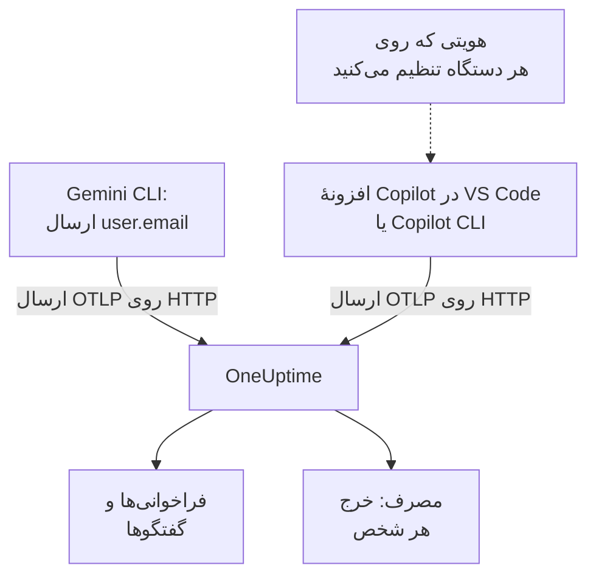

# Gemini CLI و GitHub Copilot

Gemini CLI و GitHub Copilot هر دو خودشان OpenTelemetry صادر می‌کنند: آن‌ها را به سمت OneUptime بگیرید، و فراخوانی‌های مدل، توکن‌ها، هزینه و فراخوانی‌های ابزارشان کنار فراخوانی‌های هوش مصنوعی برنامه‌های خودتان به [هوش مصنوعی / LLM](/docs/telemetry/ai-llm-observability) می‌رسد. این دو در چیزی که برای تخصیص هزینه بیشترین اهمیت را دارد فرق دارند: Gemini CLI روی هر رکورد شخص را نام می‌برد، و Copilot هیچ‌کس را، پس هر توسعه‌دهنده را خودتان نام‌گذاری می‌کنید.

:::cards
- [Gemini CLI](#راهاندازی-gemini-cli): تله‌متری را همراه با ترِیس‌ها روشن کنید و مستقیم به OneUptime بفرستید.
- [GitHub Copilot](#راهاندازی-github-copilot): از VS Code یا Copilot CLI صادر کنید.
- [هر توسعه‌دهنده را نام ببرید](#هر-توسعهدهنده-را-نام-ببرید): هویتی که Copilot جا می‌اندازد.
- [رفع اشکال](#رفع-اشکال): وقتی چیزی نمی‌رسد چه چیزهایی را بررسی کنید.
:::

## چگونه کار می‌کند



| | Gemini CLI | GitHub Copilot |
| --- | --- | --- |
| چه می‌فرستد | ترِیس‌ها، متریک‌ها و لاگ‌ها | ترِیس‌ها، متریک‌ها و رویدادها، فقط از بخش‌های عاملی‌اش |
| نام بردن از شخص | `user.email` ، وقتی کسی وارد شده باشد | هیچ‌کس: `enduser.id` و `user.email` را خودتان تنظیم می‌کنید |
| متن پرامپت | فرستاده می‌شود، مگر اینکه `logPrompts` را خاموش کنید | فرستاده نمی‌شود، مگر اینکه `captureContent` را روشن کنید |
| به‌طور پیش‌فرض به کجا می‌فرستد | `http://localhost:4317` ، روی gRPC | `http://localhost:4318` ، روی HTTP |

## پیش از شروع

- یک کلید دریافت داده: **تنظیمات پروژه** > **تله‌متری و APM** > **کلیدهای دریافت داده** را باز کنید و روی **ساخت کلید دریافت داده** کلیک کنید.
- نشانی پایهٔ OTLP شما: `https://oneuptime.com/otlp` ، یا اگر OneUptime را خودتان میزبانی می‌کنید `https://YOUR-ONEUPTIME-HOST/otlp` .
- کلید در هدر `x-oneuptime-token` هر درخواست صادرات فرستاده می‌شود.

## راه‌اندازی Gemini CLI

Gemini CLI ترِیس‌ها، متریک‌ها و رویدادهای لاگ را می‌فرستد، و وقتی کسی وارد شده باشد روی هر رکورد `user.email` را می‌گذارد. OneUptime `user.email` را به‌عنوان کارمند می‌خواند، پس خرج هر شخص بدون هیچ جدول نگاشتی و بدون تنظیم جداگانهٔ هر دستگاه نمایش داده می‌شود.

:::steps
### تله‌متری را روشن کنید

یک بلوک `telemetry` به فایل تنظیمات کاربر روی هر دستگاه، یا به `.gemini/settings.json` در یک مخزن اضافه کنید:

```json title="~/.gemini/settings.json"
{
  "telemetry": {
    "enabled": true,
    "target": "local",
    "otlpEndpoint": "https://oneuptime.com/otlp",
    "otlpProtocol": "http",
    "otlpHeaders": {
      "x-oneuptime-token": "YOUR_INGESTION_TOKEN"
    },
    "traces": true,
    "logPrompts": false
  }
}
```

### یک نشست تازه آغاز کنید

Gemini CLI تنظیماتش را هنگام آغاز می‌خواند، پس آن را دوباره راه بیندازید و یک پرامپت اجرا کنید.

### بررسی کنید که داده می‌رسد

**محصولات** > **هوش مصنوعی / LLM** > **فراخوانی‌ها** را باز کنید: فراخوانی‌ها زیر سرویس `gemini-cli` ، همراه با مدل و توکن‌ها، فهرست شده‌اند.
:::

سه تنظیم در این بلوک از بقیه مهم‌ترند:

- `otlpProtocol: "http"` . Gemini CLI از gRPC استفاده می‌کند، مگر اینکه چیز دیگری گفته شود. روی HTTP خودش `/v1/traces` ، `/v1/metrics` و `/v1/logs` را به نشانی پایه اضافه می‌کند. OneUptime پروتکل gRPC را هم روی درگاه ۴۴۳ می‌پذیرد ( [OTLP روی gRPC](/docs/telemetry/open-telemetry#otlp-روی-grpc) را ببینید)، اما HTTP ساده‌تر است.
- `traces: true` . به‌طور پیش‌فرض خاموش است، و بدون آن spanهای Gemini CLI نه مدل دارند نه شمار توکن، پس نمی‌توان قیمتی برای چیزی حساب کرد. Gemini CLI متریک هزینه هم نمی‌فرستد: برای دیدن هزینهٔ فراخوانی‌هایش ترِیس‌ها را روشن کنید.
- `logPrompts: false` . هشدار زیر را بخوانید.

> [!WARNING]
> `logPrompts` به‌طور پیش‌فرض `true` است، پس روشن کردن تله‌متری متنی را می‌فرستد که مهندسانتان تایپ می‌کنند: اغلب کد منبع، دادهٔ مشتریان و اعتبارنامه‌های چسبانده‌شده. آن را در همان تغییری که تله‌متری را روشن می‌کند روی `false` بگذارید. اگر برای اشکال‌زدایی پرامپت‌ها را می‌خواهید، آگاهانه تصمیم بگیرید، و آنچه را لازم است با قاعده‌های پاک‌سازی زیر **ترِیس‌ها** > **تنظیمات** بپوشانید.

### تنظیمات برای تعداد زیادی دستگاه

هر تنظیم یک متغیر محیطی دارد، و متغیرها بر `.gemini/settings.json` یک مخزن برتری دارند، که آن‌ها را جای مناسب سیاستی می‌کند که از راه MDM به همهٔ دستگاه‌ها فرستاده می‌شود:

```bash
export GEMINI_TELEMETRY_ENABLED=true
export GEMINI_TELEMETRY_TARGET=local
export GEMINI_TELEMETRY_OTLP_ENDPOINT="https://oneuptime.com/otlp"
export GEMINI_TELEMETRY_OTLP_PROTOCOL=http
export GEMINI_TELEMETRY_OTLP_HEADERS="x-oneuptime-token=YOUR_INGESTION_TOKEN"
export GEMINI_TELEMETRY_TRACES_ENABLED=true
export GEMINI_TELEMETRY_LOG_PROMPTS=false
```

| تنظیم | متغیر | پیش‌فرض | چه می‌کند |
| --- | --- | --- | --- |
| `enabled` | `GEMINI_TELEMETRY_ENABLED` | `false` | تله‌متری را روشن می‌کند |
| `target` | `GEMINI_TELEMETRY_TARGET` | `local` | `local` به نقطهٔ پایانی‌ای که تنظیم می‌کنید می‌فرستد؛ `gcp` به Google Cloud می‌فرستد |
| `otlpEndpoint` | `GEMINI_TELEMETRY_OTLP_ENDPOINT` | `http://localhost:4317` | تله‌متری به کجا می‌رود |
| `otlpProtocol` | `GEMINI_TELEMETRY_OTLP_PROTOCOL` | `grpc` | `grpc` یا `http` |
| `otlpHeaders` | `GEMINI_TELEMETRY_OTLP_HEADERS` | ندارد | هدرهای هر صادرات: در فایل یک شیء، در متغیر جفت‌های `key=value` یا JSON |
| `traces` | `GEMINI_TELEMETRY_TRACES_ENABLED` | `false` | مدل، توکن‌ها و محتوا را روی spanها می‌گذارد |
| `logPrompts` | `GEMINI_TELEMETRY_LOG_PROMPTS` | `true` | متن پرامپت را در رویدادهای لاگ می‌گذارد |
| `outfile` | `GEMINI_TELEMETRY_OUTFILE` | ندارد | به‌جای آن تله‌متری را در فایلی می‌نویسد، تا ببینید چه فرستاده می‌شد |

پرچم‌های خط فرمان بر متغیرهای `GEMINI_TELEMETRY_*` برتری دارند، که آن‌ها بر متغیرهای استاندارد `OTEL_EXPORTER_OTLP_*` برتری دارند، که آن‌ها هم بر `settings.json` برتری دارند. Gemini CLI `OTEL_EXPORTER_OTLP_HEADERS` را هم می‌خواند، پس هدری که پیش‌تر برای ابزارهای دیگر تنظیم کرده‌اید به آن هم می‌رسد.

:::details به‌جای آن از راه OpenTelemetry Collector بفرستید
یک کالکتور روی هر دستگاه، یا یکی برای هر تیم، می‌تواند تله‌متری را پیش از رسیدن به OneUptime دسته‌بندی، دوباره‌سعی و مسیریابی کند. Gemini CLI را روی پیش‌فرض‌هایش بگذارید، که gRPC را به `http://localhost:4317` می‌فرستند، و بگذارید کالکتور کلید را اضافه کند:

```yaml title="otel-collector-config.yaml"
receivers:
  otlp:
    protocols:
      grpc:
        endpoint: 0.0.0.0:4317
      http:
        endpoint: 0.0.0.0:4318

exporters:
  otlphttp:
    endpoint: "https://oneuptime.com/otlp"
    headers:
      "x-oneuptime-token": "YOUR_INGESTION_TOKEN"

service:
  pipelines:
    traces:
      receivers: [otlp]
      exporters: [otlphttp]
    metrics:
      receivers: [otlp]
      exporters: [otlphttp]
    logs:
      receivers: [otlp]
      exporters: [otlphttp]
```

برای اجرای کالکتور، [OpenTelemetry](/docs/telemetry/open-telemetry) را ببینید.
:::

### آنچه Gemini CLI می‌فرستد

| متریک | چه چیزی را دارد |
| --- | --- |
| `gen_ai.client.token.usage` | توکن‌های ورودی و خروجی: سری‌ای که OneUptime می‌شمارد |
| `gemini_cli.token.usage` | همان توکن‌ها با نام خود Gemini CLI، به‌اضافهٔ توکن‌های `thought` ، `cache` و `tool` آن؛ شمرده نمی‌شود، تا توکن‌ها هرگز دو بار شمرده نشوند |
| `gen_ai.client.operation.duration` | هر فراخوانی مدل چقدر طول کشید |
| `gemini_cli.api.request.count` | فراخوانی‌های مدل |
| `gemini_cli.tool.call.count` | فراخوانی‌های ابزار |
| `gemini_cli.session.count` | نشست‌های آغازشده |
| `gemini_cli.lines.changed` | خط‌هایی که عامل تغییر داد |

رویدادهای لاگ آن شامل `gemini_cli.user_prompt` ، `gemini_cli.api_request` ، `gemini_cli.api_response` ، `gemini_cli.api_error` ، `gemini_cli.tool_call` و `gemini_cli.file_operation` است. هر رکورد `session.id` ، `installation.id` ، `active_approval_mode` و، وقتی کسی وارد شده باشد، `user.email` را دارد. OneUptime `session.id` را به‌عنوان شناسهٔ گفتگو می‌خواند، پس کل یک نشست Gemini CLI زیر **گفتگوها** به‌صورت یک گفتگو نمایش داده می‌شود، هر چند ترِیس که گرفته باشد.

این متریک‌ها متریک‌های معمولی OpenTelemetry هستند: هر کدام را روی یک داشبورد نمودار کنید، یا با یک [مانیتور متریک](/docs/monitor/metrics-monitor) برایش هشدار بگذارید.

## راه‌اندازی GitHub Copilot

GitHub اپن‌تلمتری را فقط برای بخش‌های عاملی Copilot مستند کرده است:

| بخش | ارسال OpenTelemetry |
| --- | --- |
| Copilot Chat و حالت عامل در VS Code | بله |
| Copilot CLI | بله |
| Copilot SDK | بله |
| گردش‌های کاری عاملی در IDEهای JetBrains | بله، در تنظیمات افزونهٔ Copilot تنظیم می‌شود |
| تکمیل‌های درون‌خطی، Copilot در github.com، بازبینی کد Copilot | مستند نشده |

پس تیمی که بیشتر از تکمیل‌های درون‌خطی استفاده می‌کند، هر طور که صادرات تنظیم شده باشد، در OneUptime بی‌کار به نظر می‌رسد.

:::tabs
@tab VS Code
```json title="settings.json"
{
  "github.copilot.chat.otel.enabled": true,
  "github.copilot.chat.otel.exporterType": "otlp-http",
  "github.copilot.chat.otel.otlpEndpoint": "https://oneuptime.com/otlp",
  "github.copilot.chat.otel.captureContent": false
}
```
@tab Copilot CLI
```bash
export COPILOT_OTEL_ENABLED=true
export OTEL_EXPORTER_OTLP_ENDPOINT="https://oneuptime.com/otlp"
export OTEL_EXPORTER_OTLP_HEADERS="x-oneuptime-token=YOUR_INGESTION_TOKEN"
```
@tab تنظیمات مدیریت‌شده
```json
{
  "telemetry": {
    "enabled": true,
    "endpoint": "https://oneuptime.com/otlp",
    "protocol": "http/protobuf",
    "serviceName": "github-copilot",
    "captureContent": false,
    "lockCaptureContent": true,
    "headers": {
      "x-oneuptime-token": "YOUR_INGESTION_TOKEN"
    }
  }
}
```
:::

- تنظیمات VS Code کلیدی برای هدرها ندارد: `OTEL_EXPORTER_OTLP_HEADERS` را در محیطی که VS Code از آن آغاز می‌شود تنظیم کنید، همان‌طور که برای Copilot CLI. متغیرهای محیطی بر تنظیمات VS Code برتری دارند.
- تنظیمات مدیریت‌شده، که یک سازمان به VS Code و Copilot CLI می‌فرستد، کلید را در `headers` دارند و بر آنچه هر توسعه‌دهنده تنظیم می‌کند برتری دارند. `lockCaptureContent` ضبط پرامپت را برای همه خاموش نگه می‌دارد. `protocol` در آنجا قالب انتقال است، `http/protobuf` یا `http/json` .
- `captureContent` به‌طور پیش‌فرض خاموش است، پس پرامپت‌ها و پاسخ‌ها فرستاده نمی‌شوند مگر اینکه آن را روشن کنید.

## هر توسعه‌دهنده را نام ببرید

Copilot هیچ هویتی نمی‌فرستد که OneUptime بتواند به کار ببرد. تنظیم `captureIdentity` آن `user.name` را اضافه می‌کند، و Copilot CLI ممکن است `enduser.pseudo.id` را اضافه کند، اما OneUptime هیچ‌کدام را به‌عنوان کارمند نمی‌خواند. بدون هویت، همهٔ خرج Copilot در یک ردیف **بدون انتساب** در زبانهٔ **مصرف** جمع می‌شود.

هویت را روی هر دستگاه، در محیطی که VS Code و Copilot CLI از آن آغاز می‌شوند تنظیم کنید: یک پروفایل شل، یا اسکریپتی که MDM شما اجرا می‌کند.

```bash
export OTEL_RESOURCE_ATTRIBUTES="enduser.id=alice@example.com,user.email=alice@example.com,team.id=platform,cost_center=eng-tools"
```

| ویژگی | OneUptime آن را چنین می‌خواند |
| --- | --- |
| `enduser.id` | شناسهٔ کارمند |
| `user.email` | ایمیل کارمند: نامی که زبانهٔ **مصرف** نشان می‌دهد |
| `team.id`، `team`، `cost_center`، `department` | تیم یا مرکز هزینه |

این‌ها ویژگی‌های منبع هستند، پس به‌صورت `resource.enduser.id` ، `resource.user.email` و مانند آن می‌رسند: OneUptime هر کلید هویت و تیم را با پیشوند `resource.` یا بدون آن می‌خواند. Gemini CLI از پیش `user.email` را می‌فرستد؛ `OTEL_RESOURCE_ATTRIBUTES` را فقط برای تیم به آن بدهید.

- هویت را پیش از نخستین فراخوانی تنظیم کنید: فراخوانی‌هایی که بدون هویت رسیده‌اند را بعداً نمی‌توان به کسی نسبت داد.
- `resourceAttributes` را در تنظیمات مدیریت‌شدهٔ Copilot نگذارید: آن‌ها بر `OTEL_RESOURCE_ATTRIBUTES` برتری دارند، و هویتی را که روی هر دستگاه تنظیم کرده‌اید جایگزین می‌کنند.
- از `gen_ai.user` یا `llm.user` استفاده نکنید. در برنامه‌ای که به مشتریان خدمت می‌دهد این‌ها مشتری را نام می‌برند، پس OneUptime هرگز آن‌ها را به‌عنوان کارمند نمی‌خواند.

## دادهٔ Copilot چگونه به نظر می‌رسد

Copilot از قراردادهای GenAI OpenTelemetry پیروی می‌کند، پس فراخوانی‌هایش مانند فراخوانی‌های برنامه‌های خودتان در **فراخوانی‌ها** ، **گفتگوها** و **مصرف** نمایش داده می‌شوند.

| span | یکی برای هر |
| --- | --- |
| `invoke_agent` | نوبت عامل |
| `chat` | فراخوانی مدل |
| `execute_tool` | فراخوانی ابزار |
| `execute_hook` | اجرای هوک |

spanهای آن مدل، `gen_ai.usage.input_tokens` ، `gen_ai.usage.output_tokens` و `gen_ai.conversation.id` را دارند، پس کل یک نوبت عامل به‌صورت یک گفتگو نمایش داده می‌شود. هر دو بخش متریک‌های `gen_ai.client.token.usage` و `gen_ai.client.operation.duration` ، و رویدادهایی روی سیگنال لاگ‌های OTLP هم می‌فرستند: در هر کالکتوری که در میانه می‌گذارید یک خط لولهٔ `logs` نگه دارید.

OneUptime قیمت هر فراخوانی را از روی مدل و توکن‌هایش، با نرخ‌های زیر **قیمت‌گذاری** ، حساب می‌کند. این همان چیزی است که توکن‌ها با قیمت فهرست هزینه دارند، نه آنچه GitHub از شما صورت‌حساب می‌کند: هزینهٔ Copilot برای هر صندلی و هر درخواست ویژه پرداخت می‌شود.

صندلی‌ها، فعالیت صندلی‌ها و صورت‌حساب درخواست‌های ویژه اصلاً در OpenTelemetry نیستند: در REST API GitHub هستند، که OneUptime آن را نمی‌خواند. آمار صندلی و صورت‌حساب را از GitHub بگیرید.

## رفع اشکال

:::details از Gemini CLI چیزی نمی‌رسد
علت معمول این است که `otlpProtocol` روی پیش‌فرض `grpc` مانده، در حالی که نقطهٔ پایانی نشانی HTTP است. `otlpProtocol` را روی `http` بگذارید، و بررسی کنید که `otlpEndpoint` نشانی پایه‌ای باشد که به `/otlp` ختم می‌شود، و هدر `x-oneuptime-token` تنظیم شده باشد. برای مدتی کوتاه `outfile` را تنظیم کنید تا ببینید Gemini CLI چه می‌فرستاد.
:::

:::details فراخوانی‌های Gemini CLI بدون مدل، توکن یا هزینه می‌رسند
`traces` خاموش است. روشنش کنید: بدون آن spanهای Gemini CLI نه مدل دارند نه شمار توکن، و متریک هزینه هم نمی‌فرستد.
:::

:::details خرج Copilot بدون انتساب نمایش داده می‌شود
هویت به صادرکننده نرسیده است. بررسی کنید که `OTEL_RESOURCE_ATTRIBUTES` در محیطی که VS Code یا Copilot CLI از آن آغاز شده تنظیم شده باشد، و تنظیمات مدیریت‌شدهٔ Copilot `resourceAttributes` را تنظیم نکرده باشد، که جایگزینش می‌شد.
:::

:::details Copilot هیچ چیزی نمی‌فرستد
بررسی کنید که کسانی که انتظارشان را دارید از یک بخش عاملی استفاده می‌کنند، نه از تکمیل‌های درون‌خطی، و `OTEL_EXPORTER_OTLP_HEADERS` کلید را دارد: تنظیمات خود VS Code نمی‌تواند.
:::

:::details کلید رد می‌شود
OneUptime برای کلیدی که وجود ندارد، ناشناخته یا منقضی است پاسخ `401` می‌دهد، و برای کلید غیرفعال یا کلید مرورگر پاسخ `422` . یک کلید سرور به کار ببرید که در `x-oneuptime-token` فرستاده می‌شود.
:::

## گام‌های بعدی

:::cards
- [دستیارهای کدنویسی هوش مصنوعی](/docs/telemetry/ai-coding-assistants): چه کسی از کدام ابزار استفاده می‌کند، و هر شخص و تیم چقدر خرج می‌کند.
- [مشاهده‌پذیری هوش مصنوعی / LLM](/docs/telemetry/ai-llm-observability): ویژگی‌هایی که OneUptime می‌خواند، چگونگی محاسبهٔ هزینه، و بودجه‌های روزانه.
- [دروازه‌های هوش مصنوعی](/docs/telemetry/ai-gateways): ابزارهایی بدون صادرات خودشان، از راه یک دروازه.
:::
