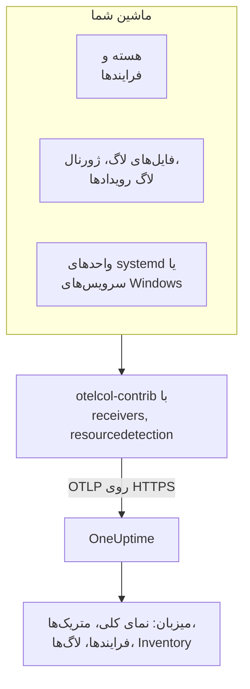

# کالکتور OpenTelemetry روی میزبان

OpenTelemetry Collector را روی یک ماشین Linux، macOS یا Windows اجرا کنید تا متریک‌ها، فرایندها، لاگ‌ها و وضعیت سرویس‌های آن را به OneUptime بفرستد. ماشین با صفحه‌های خودش زیر **محصولات** > **زیرساخت** > **میزبان‌ها** دیده می‌شود و هیچ عامل OneUptime لازم نیست نصب شود: کالکتور همان انتشار رسمی `otelcol-contrib` است. [مانیتورهای میزبان](/docs/monitor/host-monitor) بر پایه آنچه می‌فرستد هشدار می‌دهند.

:::cards
- [نصب کالکتور](#نصب-کالکتور): سه گام روی Linux، macOS یا Windows.
- [برگزیدن آنچه گردآوری شود](#برگزیدن-آنچه-گردآوری-شود): متریک‌ها، لاگ‌های فایل، ژورنال، لاگ‌های رویداد و وضعیت سرویس‌ها.
- [ویژگی‌های موجودی](#ویژگیهای-موجودی-ip-mac-شماره-سریال-سازنده-مدل-میانافزار): IP، MAC، شماره سریال، سازنده، مدل و میان‌افزار برای CMDB شما.
- [فرستادن داده کمتر](#کاهش-حجم-داده-گردآوریشده): خط‌های لاگ کمتر، بازه‌های درشت‌تر، سری‌های کمتر.
:::

## چگونه کار می‌کند

کالکتور ماشین را از راه گیرنده‌هایش می‌خواند، هر رکورد را با هویت ماشین مُهر می‌زند و آن را با کلید دریافت داده شما از راه OTLP به OneUptime می‌فرستد. OneUptime میزبان را از نخستین متریک‌هایش ثبت می‌کند و صفحه‌هایش را با رسیدن داده‌ها پر می‌کند.



| آنچه روی میزبان می‌بینید | از کجا می‌آید |
| --- | --- |
| **نمای کلی** و **متریک‌ها** | گیرنده `hostmetrics`: CPU، حافظه، دیسک‌ها، سامانه‌های فایل، شبکه، بار، صفحه‌بندی. |
| **فرایندها** | خراشگر `process` در `hostmetrics`: یک دسته سری برای هر فرایند. |
| **لاگ‌ها** | گیرنده‌های `filelog`، `journald` و `windowseventlog`. |
| **Systemd Units** (Linux) | گیرنده `systemd`. |
| **سرویس‌ها** (Windows) | گیرنده `windows_service`. |
| آیتم موجودی | پردازنده `resourcedetection`، به‌علاوه [ویژگی‌هایی که مُهر می‌زنید](#ویژگیهای-موجودی-ip-mac-شماره-سریال-سازنده-مدل-میانافزار). |
| **نسخه عامل** | `oneuptime.agent.version` در پردازنده `resource`. |

میزبان زمانی ثبت می‌شود که دسته‌ای که `host.name` دارد، متریک‌های `hostmetrics` یا `process` یا ویژگی `os.type` هم داشته باشد. پردازنده `resourcedetection` همه این‌ها را تنظیم می‌کند و برای همین هر پیکربندی آن را در جای نخست نگه می‌دارد. `host.id` یا `host.arch` به‌تنهایی میزبانی ثبت نمی‌کنند، و تله‌متری‌ای که هویت Kubernetes دارد (`k8s.cluster.name`، `k8s.node.name`، `k8s.pod.name`) به‌جای آن زیر خوشه‌اش ثبت می‌شود: گره‌های Kubernetes را با [عامل Kubernetes](/docs/telemetry/kubernetes-agent) پایش کنید.

## پیش از شروع

- یک کلید دریافت داده. آن را زیر **تنظیمات پروژه** > **تله‌متری و APM** > **کلیدهای دریافت داده** بسازید و مقدارش را کپی کنید. کالکتور آن را در سرآیند `x-oneuptime-token` می‌فرستد.
- دسترسی مدیر روی ماشین: `sudo` روی Linux و macOS، و یک PowerShell با دسترسی بالا روی Windows.
- HTTPS خروجی از ماشین به نشانی OneUptime شما.
- توزیع contrib کالکتور، یعنی `otelcol-contrib`. ساخت پایه `otelcol` گیرنده‌ها و پردازنده‌هایی را که این پیکربندی‌ها به کار می‌برند ندارد. گیرنده `systemd` (Linux) از v0.143.0 و گیرنده `windows_service` (Windows) از v0.155.0 کار می‌کند؛ فرمان‌های زیر v0.161.0 را نصب می‌کنند، انتشاری که OneUptime روی آن ثابت شده است.

## نصب کالکتور

:::steps
### پیکربندی را ذخیره کنید

این را با نام `config.yaml` در پوشه‌ای که فرمان‌های نصب را از آن اجرا می‌کنید ذخیره کنید و `YOUR_TELEMETRY_INGESTION_TOKEN` را با کلید دریافت داده خود جایگزین کنید (و اگر OneUptime را خودتان میزبانی می‌کنید، نقطه پایانی را با نشانی خودتان).

:::tabs
@tab Linux
```yaml title="config.yaml"
receivers:
  hostmetrics:
    collection_interval: 30s
    scrapers:
      cpu:
        metrics:
          system.cpu.utilization:
            enabled: true
          system.cpu.logical.count:
            enabled: true
      memory:
        metrics:
          system.memory.utilization:
            enabled: true
      disk:
      filesystem:
        metrics:
          system.filesystem.utilization:
            enabled: true
      load:
      network:
      paging:
      processes:
      process:
        mute_process_name_error: true
        mute_process_exe_error: true
        mute_process_io_error: true
        metrics:
          process.cpu.utilization:
            enabled: true
          process.memory.utilization:
            enabled: true

  # The systemd journal: every unit's logs, info and above.
  journald:
    directory: /var/log/journal
    priority: info

  # Powers the Systemd Units tab (otelcol-contrib v0.143.0+).
  systemd:
    collection_interval: 30s
    units: ["*.service"]
    metrics:
      systemd.service.cpu.time:
        enabled: false

processors:
  # Stamps host.name, host.id and os.type: this is how OneUptime attaches
  # telemetry to the host. Without it the host's pages stay empty.
  resourcedetection:
    detectors: [system, env]
    system:
      hostname_sources: [os]
      resource_attributes:
        host.name:
          enabled: true
        host.id:
          enabled: true
        host.arch:
          enabled: true
        host.ip:
          enabled: true
        host.mac:
          enabled: true
        os.type:
          enabled: true
        os.description:
          enabled: true
        os.version:
          enabled: true
  # The collector release this config is for: the host's Agent Version.
  resource:
    attributes:
      - key: oneuptime.agent.version
        value: "0.161.0"
        action: upsert
  batch:

exporters:
  otlphttp/oneuptime:
    endpoint: https://oneuptime.com/otlp
    headers:
      x-oneuptime-token: YOUR_TELEMETRY_INGESTION_TOKEN

service:
  pipelines:
    metrics:
      receivers: [hostmetrics, systemd]
      processors: [resourcedetection, resource, batch]
      exporters: [otlphttp/oneuptime]
    logs:
      receivers: [journald]
      processors: [resourcedetection, resource, batch]
      exporters: [otlphttp/oneuptime]
```
@tab macOS
```yaml title="config.yaml"
receivers:
  hostmetrics:
    collection_interval: 30s
    scrapers:
      cpu:
        metrics:
          system.cpu.utilization:
            enabled: true
          system.cpu.logical.count:
            enabled: true
      memory:
        metrics:
          system.memory.utilization:
            enabled: true
      disk:
      filesystem:
        metrics:
          system.filesystem.utilization:
            enabled: true
      load:
      network:
      paging:
      processes:
      process:
        mute_process_name_error: true
        mute_process_exe_error: true
        mute_process_io_error: true
        metrics:
          process.cpu.utilization:
            enabled: true
          process.memory.utilization:
            enabled: true

  filelog/system:
    include:
      - /var/log/install.log
      - /var/log/wifi.log
    start_at: end

processors:
  # Stamps host.name, host.id and os.type: this is how OneUptime attaches
  # telemetry to the host. Without it the host's pages stay empty.
  resourcedetection:
    detectors: [system, env]
    system:
      hostname_sources: [os]
      resource_attributes:
        host.name:
          enabled: true
        host.id:
          enabled: true
        host.arch:
          enabled: true
        host.ip:
          enabled: true
        host.mac:
          enabled: true
        os.type:
          enabled: true
        os.description:
          enabled: true
        os.version:
          enabled: true
  # The collector release this config is for: the host's Agent Version.
  resource:
    attributes:
      - key: oneuptime.agent.version
        value: "0.161.0"
        action: upsert
  batch:

exporters:
  otlphttp/oneuptime:
    endpoint: https://oneuptime.com/otlp
    headers:
      x-oneuptime-token: YOUR_TELEMETRY_INGESTION_TOKEN

service:
  pipelines:
    metrics:
      receivers: [hostmetrics]
      processors: [resourcedetection, resource, batch]
      exporters: [otlphttp/oneuptime]
    logs:
      receivers: [filelog/system]
      processors: [resourcedetection, resource, batch]
      exporters: [otlphttp/oneuptime]
```
@tab Windows
```yaml title="config.yaml"
receivers:
  hostmetrics:
    collection_interval: 30s
    scrapers:
      cpu:
        metrics:
          system.cpu.utilization:
            enabled: true
          system.cpu.logical.count:
            enabled: true
      memory:
        metrics:
          system.memory.utilization:
            enabled: true
      disk:
      filesystem:
        metrics:
          system.filesystem.utilization:
            enabled: true
      load:
      network:
      paging:
      processes:
      process:
        mute_process_name_error: true
        mute_process_exe_error: true
        mute_process_io_error: true
        metrics:
          process.cpu.utilization:
            enabled: true
          process.memory.utilization:
            enabled: true

  windowseventlog/system:
    channel: System
    start_at: end

  windowseventlog/application:
    channel: Application
    start_at: end

  windowseventlog/security:
    channel: Security
    start_at: end

  # Powers the Services tab (otelcol-contrib v0.155.0+).
  windows_service:
    collection_interval: 30s

processors:
  # Stamps host.name, host.id and os.type: this is how OneUptime attaches
  # telemetry to the host. Without it the host's pages stay empty.
  resourcedetection:
    detectors: [system, env]
    system:
      hostname_sources: [os]
      resource_attributes:
        host.name:
          enabled: true
        host.id:
          enabled: true
        host.arch:
          enabled: true
        host.ip:
          enabled: true
        host.mac:
          enabled: true
        os.type:
          enabled: true
        os.description:
          enabled: true
        os.version:
          enabled: true
  # The collector release this config is for: the host's Agent Version.
  resource:
    attributes:
      - key: oneuptime.agent.version
        value: "0.161.0"
        action: upsert
  batch:

exporters:
  otlphttp/oneuptime:
    endpoint: https://oneuptime.com/otlp
    headers:
      x-oneuptime-token: YOUR_TELEMETRY_INGESTION_TOKEN

service:
  pipelines:
    metrics:
      receivers: [hostmetrics, windows_service]
      processors: [resourcedetection, resource, batch]
      exporters: [otlphttp/oneuptime]
    logs:
      receivers:
        - windowseventlog/system
        - windowseventlog/application
        - windowseventlog/security
      processors: [resourcedetection, resource, batch]
      exporters: [otlphttp/oneuptime]
```
:::

هر پیکربندی همانی است که داشبورد زیر **محصولات** > **زیرساخت** > **میزبان‌ها** > **مستندات** می‌نویسد، به‌علاوه یک خط لوله لاگ: پردازنده‌هایش `resourcedetection`، `resource` و `batch` هستند و صادرکننده‌اش `otlphttp/oneuptime`. هیچ `service.name` تنظیم نمی‌کند، پس تله‌متری میزبان به خود میزبان تعلق دارد و با نام `host/<hostname>` ثبت می‌شود. فقط اگر می‌خواهید زیر یک سرویس تله‌متری با آن نام ثبت شود، یک `service.name` به پردازنده `resource` بیفزایید.

### کالکتور را نصب و اجرا کنید

:::tabs
@tab Linux
روی Debian یا Ubuntu:

```bash
VERSION=0.161.0                      # the release OneUptime pins
ARCH=$(dpkg --print-architecture)   # amd64 or arm64

curl -fL -o /tmp/otelcol-contrib.deb \
  "https://github.com/open-telemetry/opentelemetry-collector-releases/releases/download/v${VERSION}/otelcol-contrib_${VERSION}_linux_${ARCH}.deb"
sudo dpkg -i /tmp/otelcol-contrib.deb
```

روی RHEL، CentOS، Fedora یا Amazon Linux:

```bash
VERSION=0.161.0
ARCH=$(uname -m | sed 's/x86_64/amd64/;s/aarch64/arm64/')

curl -fL -o /tmp/otelcol-contrib.rpm \
  "https://github.com/open-telemetry/opentelemetry-collector-releases/releases/download/v${VERSION}/otelcol-contrib_${VERSION}_linux_${ARCH}.rpm"
sudo rpm -Uvh /tmp/otelcol-contrib.rpm
```

بسته `/usr/bin/otelcol-contrib` و یک واحد systemd را نصب می‌کند و کالکتور را با یک پیکربندی پیش‌فرض اجرا می‌کند. پیکربندی خودتان را جایش بگذارید، به کاربر کالکتور اجازه خواندن ژورنال بدهید و آن را دوباره راه‌اندازی کنید:

```bash
sudo install -m 0644 config.yaml /etc/otelcol-contrib/config.yaml
sudo usermod -aG systemd-journal otelcol-contrib
sudo systemctl enable otelcol-contrib
sudo systemctl restart otelcol-contrib
sudo systemctl status otelcol-contrib
```

واحد بسته کالکتور را با کاربر بی‌امتیاز `otelcol-contrib` اجرا می‌کند. گروه `systemd-journal` به آن اجازه خواندن ژورنال می‌دهد؛ برای دنبال کردن فایل‌های `/var/log` (که روی Debian و Ubuntu گروه `adm` می‌تواند بخواند)، آن گروه را هم بیفزایید. برای اینکه خراشگر `process` فرایندهای کاربران دیگر را ببیند، قابلیت `CAP_SYS_PTRACE` را به آن بدهید.
@tab macOS
```bash
VERSION=0.161.0
ARCH=$(uname -m | sed 's/x86_64/amd64/')   # arm64 on Apple silicon, amd64 on Intel

curl -fL -o /tmp/otelcol-contrib.tar.gz \
  "https://github.com/open-telemetry/opentelemetry-collector-releases/releases/download/v${VERSION}/otelcol-contrib_${VERSION}_darwin_${ARCH}.tar.gz"

sudo mkdir -p /usr/local/otelcol-contrib /usr/local/bin /etc/otelcol-contrib
sudo tar -xzf /tmp/otelcol-contrib.tar.gz -C /usr/local/otelcol-contrib
sudo ln -sf /usr/local/otelcol-contrib/otelcol-contrib /usr/local/bin/otelcol-contrib
sudo install -m 0644 config.yaml /etc/otelcol-contrib/config.yaml
```

فایل `/Library/LaunchDaemons/com.oneuptime.otelcol-contrib.plist` را بسازید تا launchd کالکتور را همراه Mac اجرا کند و اگر متوقف شد دوباره راه‌اندازی‌اش کند:

```xml title="/Library/LaunchDaemons/com.oneuptime.otelcol-contrib.plist"
<?xml version="1.0" encoding="UTF-8"?>
<!DOCTYPE plist PUBLIC "-//Apple//DTD PLIST 1.0//EN" "http://www.apple.com/DTDs/PropertyList-1.0.dtd">
<plist version="1.0">
<dict>
  <key>Label</key><string>com.oneuptime.otelcol-contrib</string>
  <key>ProgramArguments</key>
  <array>
    <string>/usr/local/bin/otelcol-contrib</string>
    <string>--config=/etc/otelcol-contrib/config.yaml</string>
  </array>
  <key>RunAtLoad</key><true/>
  <key>KeepAlive</key><true/>
  <key>StandardOutPath</key><string>/var/log/otelcol-contrib.out.log</string>
  <key>StandardErrorPath</key><string>/var/log/otelcol-contrib.err.log</string>
</dict>
</plist>
```

آن را بارگذاری کنید:

```bash
sudo launchctl load -w /Library/LaunchDaemons/com.oneuptime.otelcol-contrib.plist
sudo launchctl list | grep otelcol-contrib
```

از این بایگانی tarball استفاده کنید، نه Homebrew: فرمول Homebrew همان ساخت پایه است که با این پیکربندی اجرا نمی‌شود.
@tab Windows
در یک PowerShell با دسترسی بالا، در پوشه‌ای که `config.yaml` در آن است، این بلوک را یکجا اجرا کنید: هر خط به متغیرهای بالای خودش وابسته است.

```powershell
$VERSION = "0.161.0"                          # the release OneUptime pins; v0.155.0+ has the Services tab
$ARCH    = "amd64"                            # use "arm64" on ARM hosts
$dest    = "C:\Program Files\otelcol-contrib"
$tar     = "$env:TEMP\otelcol-contrib.tar.gz"

# Note the "-contrib" in the asset name; otelcol_... is the wrong archive.
$url = "https://github.com/open-telemetry/opentelemetry-collector-releases/releases/download/v$VERSION/otelcol-contrib_${VERSION}_windows_${ARCH}.tar.gz"

New-Item -ItemType Directory -Force -Path $dest | Out-Null
Invoke-WebRequest -Uri $url -OutFile $tar
tar -xf $tar -C $dest                          # tar.exe ships with Windows 10 1803+ / Server 2019+
Get-ChildItem $dest                            # expect otelcol-contrib.exe, not otelcol.exe
Copy-Item config.yaml "$dest\config.yaml" -Force

# --% hands the rest of the line to sc.exe unchanged, so its quoting
# survives PowerShell — keep the command on one line.
sc.exe --% create "otelcol-contrib" binPath= "\"C:\Program Files\otelcol-contrib\otelcol-contrib.exe\" --config=\"C:\Program Files\otelcol-contrib\config.yaml\"" start= auto DisplayName= "OpenTelemetry Collector (OneUptime)"
sc.exe description "otelcol-contrib" "Collects host telemetry and forwards it to OneUptime over OTLP."
sc.exe start "otelcol-contrib"
sc.exe query "otelcol-contrib"
```

سرویس با `LocalSystem` اجرا می‌شود که می‌تواند لاگ رویداد `Security` و همه سرویس‌های Windows را بخواند. روی Windows، خراشگر `load` فقط یک میانگین بار را از شمارنده *Processor Queue Length* شبیه‌سازی می‌کند و از ۰ شروع می‌شود.

نام فایل انتشار باید با `otelcol-contrib_` آغاز شود. بایگانی پایه `otelcol_<version>_windows_amd64.tar.gz` فایل `otelcol.exe` را باز می‌کند که گیرنده `windowseventlog` یا `windows_service` ندارد؛ تغییر نامش به `otelcol-contrib.exe` آن‌ها را نمی‌افزاید. نصب‌کننده را ترجیح می‌دهید؟ همان [صفحه انتشارها](https://github.com/open-telemetry/opentelemetry-collector-releases/releases) یک `otelcol-contrib_<version>_windows_x64.msi` امضاشده دارد که سرویس را برایتان ثبت می‌کند: آن را به این `config.yaml` نشانه بگیرید و سرویس را روی `LocalSystem` نگه دارید.
:::

### بررسی کنید که میزبان دیده می‌شود

به **محصولات** > **زیرساخت** > **میزبان‌ها** > **همه میزبان‌ها** بروید. میزبان با رسیدن نخستین متریک‌ها، معمولاً در ۳۰ ثانیه، با نام میزبانش دیده می‌شود و صفحه‌های **نمای کلی**، **متریک‌ها**، **فرایندها** و **لاگ‌ها** پر می‌شوند. اگر نشد، لاگ‌های خود کالکتور را بخوانید:

:::tabs
@tab Linux
```bash
sudo journalctl -u otelcol-contrib -f
```
@tab macOS
```bash
tail -f /var/log/otelcol-contrib.err.log
```
@tab Windows
```powershell
Get-WinEvent -LogName Application -MaxEvents 20 | Where-Object ProviderName -eq "otelcol-contrib"
```
:::
:::

برای ساختن یک خط لاگ آزمایشی، `logger "hello from oneuptime"` (Linux، macOS) یا `eventcreate /T INFORMATION /ID 999 /L APPLICATION /SO OneUptimeTest /D "hello from oneuptime"` (Windows، با دسترسی بالا) را اجرا کنید و سپس صفحه **لاگ‌ها** میزبان را ببینید.

## برگزیدن آنچه گردآوری شود

همه پیکربندی‌ها یک شکل دارند: گیرنده‌ها برای آنچه خوانده شود، پردازنده‌های `resourcedetection`، `resource` و `batch`، و صادرکننده `otlphttp/oneuptime`. گیرنده‌های زیر را به `receivers:` و به خط لوله‌شان بیفزایید و سپس کالکتور را دوباره راه‌اندازی کنید (`sudo systemctl restart otelcol-contrib`، `launchctl unload` و `load` روی Mac، و `Restart-Service otelcol-contrib` روی Windows). هر تکه را در بخش‌هایی که پیکربندی‌تان دارد ادغام کنید: کلید دوم `processors:` یا `service:` جای اولی را می‌گیرد.

### متریک‌های میزبان

`hostmetrics` روی هر سیستم‌عاملی کار می‌کند. CPU، حافظه، دیسک‌ها، سامانه‌های فایل، شبکه، بار، صفحه‌بندی و فرایندها را در هر `collection_interval` از هسته می‌خواند. متریک‌های `*.utilization` و `system.cpu.logical.count` در گیرنده به‌طور پیش‌فرض خاموش‌اند، و نمودارهای میزبان و الگوهای هشدار Host آن‌ها را می‌خوانند، پس مانند پیکربندی‌های بالا روشن نگهشان دارید. خراشگر `process` صفحه **فرایندها** را پر می‌کند؛ بزرگ‌ترین منبع سری‌ها هم هست (ببینید [فرستادن داده کمتر](#کاهش-حجم-داده-گردآوریشده)).

روی Linux کالکتور `/proc` و `/sys` را می‌خواند. کالکتوری که در کانتینر است باید این‌ها را از میزبان سوار کند و `HOST_PROC` و `HOST_SYS` را تنظیم کند (ببینید [در یک کانتینر Docker](#در-یک-کانتینر-docker))؛ نصب بومی به چیزی نیاز ندارد.

### لاگ‌های فایل

هر فایل لاگی روی دیسک را با یک گیرنده `filelog` دنبال کنید و آن را به خط لوله `logs` بیفزایید:

```yaml
receivers:
  filelog/app:
    include:
      - /var/log/myapp/*.log
    start_at: end
    multiline:
      # A new entry starts with a timestamp; continuation lines (the
      # "at ...", "File ...", "Caused by: ..." frames) are folded into it.
      line_start_pattern: '^\d{4}-\d{2}-\d{2}[ T]\d{2}:\d{2}:\d{2}'
```

`start_at: end` فقط خط‌های تازه را می‌خواند؛ برای خواندن فایل‌ها از ابتدا در نخستین اجرا از `beginning` استفاده کنید. کالکتور جای خود را در هر فایل نگه می‌دارد، پس پس از راه‌اندازی دوباره از همان‌جا ادامه می‌دهد.

OneUptime خط‌های لاگ error و fatal را برای ردهای پشته می‌کاود و آن‌ها را زیر میزبان در **استثناها** گروه‌بندی می‌کند. برای این کار، رد پشته چندخطی (Java، Python، .NET، Ruby) باید به‌صورت یک رکورد برسد، و `multiline` همین کار را می‌کند؛ بدون آن هر قاب یک لاگ جداگانه است. اگر برنامه شما خودش بتواند ویژگی‌های OpenTelemetry یعنی `exception.type`، `exception.message` و `exception.stacktrace` را بنویسد، باز هم مطمئن‌تر است.

روی یک میزبان systemd، `/var/log/syslog` و `/var/log/messages` همان چیزی را تکرار می‌کنند که ژورنال از پیش دارد، پس یکی از آن‌ها را بخوانید.

### ژورنال systemd

روی یک میزبان systemd، گیرنده `journald` لاگ‌های همه واحدها را یکجا و با فیلدهای ساخت‌یافته‌شان می‌خواند. پیکربندی Linux بالا همه آن‌ها را از سطح `info` و بالاتر می‌خواند؛ آن را به چند واحد محدود کنید:

```yaml
receivers:
  journald:
    directory: /var/log/journal
    units:
      # Drop this list to ingest everything; restrict it to limit volume.
      - ssh.service
      - cron.service
      - nginx.service
    priority: info
```

گیرنده `journalctl` را اجرا می‌کند که هر میزبان systemd آن را دارد، و کاربر کالکتور باید عضو گروه `systemd-journal` باشد.

### سرویس‌های Linux (واحدهای systemd، متریک‌ها)

صفحه **Systemd Units** میزبان هر واحد و وضعیتش را از [`systemdreceiver`](https://github.com/open-telemetry/opentelemetry-collector-contrib/tree/main/receiver/systemdreceiver) (نوع پیکربندی `systemd`) فهرست می‌کند؛ این همتای Linux برای صفحه **سرویس‌ها** در Windows است. پیکربندی Linux بالا آن را روشن می‌کند:

```yaml
receivers:
  systemd:
    collection_interval: 30s
    # The service manager to read: "system" (default) or "user".
    scope: system
    # Which units to scrape, as systemctl unit patterns. The default is
    # every service; widen it to include timers, sockets or mounts, or
    # narrow it to cut volume on hosts with hundreds of units:
    units: ["*.service"]
    # units: [nginx.service, postgresql.service, "*.timer"]
    metrics:
      # Per-service CPU time is on by default and doubles this receiver's
      # datapoint count. The Systemd Units tab does not use it, so turn it
      # off unless you chart it. On v0.142.0 the key is
      # systemd.unit.cpu.time — naming a metric the running build does not
      # have stops the collector at startup.
      systemd.service.cpu.time:
        enabled: false

service:
  pipelines:
    metrics:
      receivers: [hostmetrics, systemd]
      processors: [resourcedetection, resource, batch]
```

این گیرنده نخستین بار در `otelcol-contrib` v0.142.0 آمد و v0.143.0 نخستین انتشاری است که ارزش اجرا دارد. روی هر نسخه قدیمی‌تر، افزودن `systemd` هنگام شروع با `'receivers' unknown type: "systemd"` شکست می‌خورد؛ فقط v0.142.0 متریک CPU خود را `systemd.unit.cpu.time` می‌نامد و برای هر واحد دنبال آمار cgroup می‌گردد، که برای هر واحدی که `.service` نیست یک خطای برداشت در لاگ می‌نویسد.

این گیرنده `systemd.unit.state` را به‌صورت یک مجموعه وضعیت می‌فرستد: در هر برداشت، هر واحد برای هر وضعیت ممکن (`active`، `reloading`، `inactive`، `failed`، `activating`، `deactivating`، `maintenance`، `refreshing`) یک نقطه داده می‌گیرد، `1` برای وضعیتی که در آن است و `0` برای بقیه. نام واحد ویژگی منبع `systemd.unit.name` است و وضعیت، ویژگی نقطه داده `systemd.unit.active_state`. چون نام واحد یک ویژگی منبع است، `resourcedetection` باید در خط لوله متریک بماند: `host.name` را روی منبع هر واحد مُهر می‌زند و بدون آن نمونه‌ها هرگز به میزبانی وصل نمی‌شوند.

این گیرنده وضعیت واحدها را از راه D-Bus سیستم و با همان فراخوانی‌های فقط‌خواندنی‌ای می‌خواند که `systemctl list-units` انجام می‌دهد و systemd بدون امتیاز ویژه اجازه‌شان را می‌دهد. پس سرویس بسته، که با کاربر `otelcol-contrib` و نه root اجرا می‌شود، به هیچ دسترسی اضافه‌ای نیاز ندارد. ولی به خود گذرگاه نیاز دارد: کالکتور درون کانتینر هیچ `/run/dbus/system_bus_socket` ندارد مگر آنکه آن را از میزبان سوار کنید، پس از نصب بومی استفاده کنید. این گیرنده در مرحله alpha است و فقط روی Linux کار می‌کند.

> [!WARNING]
> مجموعه وضعیت برای هر واحد در هر برداشت هشت نقطه داده هزینه دارد، و `systemd.service.cpu.time` که به‌طور پیش‌فرض روشن است دو نقطه دیگر (`user` و `system`) می‌افزاید: ۱۰ نقطه داده برای هر واحد در هر برداشت. میزبانی که ۳۰۰ واحد را هر ۳۰ ثانیه دنبال می‌کند، فقط از همین گیرنده حدود ۶۰۰۰ نقطه داده در دقیقه می‌فرستد، یا با خاموش بودن متریک CPU حدود ۴۸۰۰. پیش از روشن کردن آن روی یک ناوگان کامل، `units:` را به سرویس‌هایی که برایشان هشدار دارید محدود کنید یا `collection_interval` را بالا ببرید.

### Apple Unified Log

macOS لاگ‌های سیستمی‌اش را به‌جای `/var/log/system.log` در Apple Unified Log می‌نویسد که با `log show` و `log stream` خوانده می‌شود. برای گردآوری آن، با یک اسکریپت کوچک به نام `/usr/local/otelcol-contrib/log-stream.sh` آن را در یک فایل جاری کنید:

```bash title="/usr/local/otelcol-contrib/log-stream.sh"
#!/bin/bash
exec /usr/bin/log stream --style ndjson --level info \
  --predicate 'subsystem != "com.apple.cfnetwork"' \
  >> /var/log/apple-unified.log
```

آن را اجراپذیر کنید و زیر launchd (یا برای یک آزمایش سریع با `nohup`) اجرا کنید، سپس یک گیرنده `filelog` را به آن فایل نشانه بگیرید:

```yaml
receivers:
  filelog/apple-unified:
    include:
      - /var/log/apple-unified.log
    start_at: end
    operators:
      - type: json_parser
        timestamp:
          parse_from: attributes.timestamp
          layout: "%Y-%m-%d %H:%M:%S.%f%j"
```

بسیاری از ناوگان‌های Mac با متریک‌های میزبان و چند لاگ فایل، بدون unified log، به‌خوبی کار می‌کنند.

### لاگ‌های رویداد Windows

پیکربندی Windows بالا در کانال‌های `System`، `Application` و `Security` مشترک می‌شود. برای محدود کردن کانال پرحجم `Security` به چند شناسه رویداد:

```yaml
windowseventlog/security:
  channel: Security
  start_at: end
  query: "*[System[(EventID=4625 or EventID=4740)]]"
```

برای خواندن کانالی دیگر (هر چیزی زیر *Event Viewer → Applications and Services Logs*)، نام دقیقش را به کار ببرید:

```yaml
windowseventlog/iis:
  channel: Microsoft-IIS-Logging/Logs
  start_at: end
```

### سرویس‌های Windows (متریک‌ها)

صفحه **سرویس‌ها** میزبان هر سرویس Windows را با وضعیت و نوع راه‌اندازی‌اش از [`windowsservicereceiver`](https://github.com/open-telemetry/opentelemetry-collector-contrib/tree/main/receiver/windowsservicereceiver) (نوع پیکربندی `windows_service`) فهرست می‌کند. این گیرنده از v0.155.0 در `otelcol-contrib` هست: در انتشارهای پیشین، افزودن `windows_service` هنگام شروع با `'receivers' unknown type: "windows_service"` شکست می‌خورد. پیکربندی Windows بالا آن را روشن می‌کند:

```yaml
receivers:
  windows_service:
    collection_interval: 30s
    # Collect every service by default. To cut volume — and avoid the
    # "access denied" noise from services the collector can't open —
    # list just the ones you care about:
    # include_services: [Spooler, W3SVC, MSSQLSERVER]
    # Or collect everything except a few:
    # exclude_services: [TrustedInstaller]

service:
  pipelines:
    metrics:
      receivers: [hostmetrics, windows_service]
```

این گیرنده برای هر سرویس یک سنجه `windows.service.status` می‌فرستد که وضعیت سرویس Win32 است (`4` یعنی در حال اجرا، `1` یعنی متوقف)، با ویژگی‌های `name` و `startup_mode`. کالکتور همه سرویس‌ها را با `LocalSystem` می‌خواند و از هر سرویسی که نتواند باز کند می‌گذرد. این گیرنده در مرحله alpha است و فقط روی Windows کار می‌کند؛ اگر یک خطای برداشت یا یک `access denied` روی یک سرویس بر بقیه اثر بگذارد، آن را با `include_services` محدود کنید.

`include_services` فقط می‌تواند مجموعه را محدود کند. اگر سرویس‌ها را فهرست کرده‌اید و هنوز همه را می‌بینید، پیکربندی ویرایش‌شده به کالکتور در حال اجرا نرسیده است: سرویس را دوباره راه‌اندازی کنید، بررسی کنید که `include_services` فهرستی پر و هم‌تورفتگی با `collection_interval` باشد، و چند دقیقه به صفحه **سرویس‌ها** فرصت دهید تا سرویس‌هایی که پیش از تغییر گزارش شده بودند از پنجره غلتانش بیرون بروند. نام‌ها همان نام‌های دقیق کلید سرویس با حساسیت به بزرگی و کوچکی حروف‌اند (`Spooler`، `W3SVC`) که `Get-Service | Select-Object Name` فهرست می‌کند.

### برچسب‌ها

هر ویژگی منبعی که با `oneuptime.label.` آغاز شود، روی میزبان به یک برچسب پروژه تبدیل می‌شود: `oneuptime.label.<dimension>=<value>` همان برچسب `<dimension>:<value>` است. یک پردازنده برایشان بیفزایید و آن را در خط لوله‌ها نام ببرید:

```yaml
processors:
  resource/oneuptime-labels:
    attributes:
      - key: oneuptime.label.team
        value: payments
        action: upsert
      - key: oneuptime.label.env
        value: production
        action: upsert

service:
  pipelines:
    metrics:
      processors: [resourcedetection, resource, resource/oneuptime-labels, batch]
```

برچسب‌ها بدون حساسیت به بزرگی و کوچکی حروف مقایسه می‌شوند، پس برچسب موجود `Production` دوباره به کار می‌رود و تکراری ساخته نمی‌شود، و کالکتور هرگز برچسب‌هایی را که در OneUptime افزوده شده‌اند حذف نمی‌کند.

### ویژگی‌های موجودی (IP، MAC، شماره سریال، سازنده، مدل، میان‌افزار)

هر میزبان یک آیتم موجودی هم می‌گیرد: همان رکوردی که خروجی CMDB می‌خواند. جزئیاتش مستقیم از ویژگی‌های منبع روی تله‌متری‌ای که می‌فرستید پر می‌شود، پس هر آنچه برسد همان است که همگام‌سازی CMDB می‌تواند بردارد.

| آنچه می‌خواهید | ویژگی | از کجا می‌آید |
| --- | --- | --- |
| نشانی‌های IP | `host.ip` | `resourcedetection`، با ویرگول از هم جدا وقتی ماشین چند نشانی دارد |
| نشانی‌های MAC | `host.mac` | `resourcedetection`، یکی برای هر رابط فعال، با ویرگول از هم جدا |
| معماری | `host.arch` | `resourcedetection` |
| شناسه ماشین | `host.id` | `resourcedetection`: GUID ماشین روی Windows، و `/etc/machine-id` روی Linux |
| سیستم‌عامل | `os.type`، `os.description`، `os.version` | `resourcedetection` |
| شماره سریال | `host.serial_number` | مُهرزده به دست شما، از WMI یا DMI |
| سازنده | `device.manufacturer` | مُهرزده به دست شما، از WMI یا DMI |
| مدل | `device.model.name` | مُهرزده به دست شما، از WMI یا DMI |
| نسخه میان‌افزار (BIOS یا UEFI) | `device.firmware.version` | مُهرزده به دست شما، از WMI یا DMI |

پیکربندی‌های بالا همه ویژگی‌های شناسایی‌شده را روشن می‌کنند: در آشکارساز system فقط `host.name` و `os.type` به‌طور پیش‌فرض روشن‌اند و برای همین بقیه را زیر `resource_attributes` فهرست می‌کنند. اگر پیکربندی خودتان را می‌سازید، آن بلوک `resourcedetection` را نگه دارید: بدون آن هیچ `host.name` نیست، پس نه میزبانی هست و نه آیتم موجودی‌ای.

#### شماره سریال، سازنده، مدل و نسخه میان‌افزار آشکارساز ندارند

این‌ها در میان‌افزار ماشین هستند که کالکتور آن را نمی‌خواند. روی Linux این تنظیمی نیست که بتوانید تغییرش دهید: کالکتور بسته با کاربر بی‌امتیاز `otelcol-contrib` اجرا می‌شود و `/sys/class/dmi/id/product_serial` را فقط root می‌تواند بخواند. پس یک بار، هنگام آماده‌سازی ماشین، آن‌ها را بخوانید و با یک پردازنده جداگانه روی منبع مُهر بزنید:

```yaml
processors:
  resource/oneuptime-hardware:
    attributes:
      - key: host.serial_number
        value: "7XYZ123"
        action: upsert
      - key: device.manufacturer
        value: "Dell Inc."
        action: upsert
      - key: device.model.name
        value: "OptiPlex 7090"
        action: upsert
      - key: device.firmware.version
        value: "1.21.0"
        action: upsert

service:
  pipelines:
    metrics:
      processors: [resourcedetection, resource, resource/oneuptime-hardware, batch]
```

`resource/oneuptime-hardware` را به فهرست پردازنده‌هایی که دارید بیفزایید و این خط را روی آن جای‌گذاری نکنید: اگر `resource` را بردارید، میزبان **نسخه عامل** خود را از دست می‌دهد. در هر حال `resourcedetection` را در جای نخست نگه دارید: همان است که دسته را به میزبان وصل می‌کند.

`host.manufacturer`، `host.model.name`، `host.firmware.version` و `host.bios.version` به‌عنوان نگارش‌های جایگزین پذیرفته و زیر کلیدهای `device.*` بالا ذخیره می‌شوند، پس پیکربندی‌ای که به هر یک از دو شکل نوشته شود در یک جا می‌نشیند؛ وقتی هر دو باشند، مقدار `device.*` برنده است. شماره سریال برعکس است: `device.serial_number` پذیرفته و به‌صورت `host.serial_number` ذخیره می‌شود.

> [!NOTE]
> روی منبعی که هویت میزبان ندارد، `device.manufacturer` یعنی «برنامه موبایل»: یکی از ویژگی‌هایی است که یک دسته را به‌عنوان Real User Monitoring موبایل علامت می‌زند. منبع یک میزبان همیشه `host.name` یا `host.id` دارد، پس پیکربندی کالکتوری مانند نمونه بالا هرگز با یک گوشی اشتباه گرفته نمی‌شود، ولی همین بلوک را در پیکربندی SDK یک برنامه موبایل دوباره به کار نبرید.

#### خواندن مقدارها

روی Windows، از یک PowerShell با دسترسی بالا. بلوک YAML را برای ماشینی که روی آن اجرا می‌کنید چاپ می‌کند:

```powershell
$bios = Get-CimInstance -ClassName Win32_BIOS
$cs   = Get-CimInstance -ClassName Win32_ComputerSystem

# Quote for YAML: trim, escape any embedded quote, wrap in single quotes.
# The cast to string first is what keeps this working on machines whose
# firmware leaves a field empty — .Trim() on $null throws.
function Format-YamlValue($value) {
  "'" + ("$value".Trim() -replace "'", "''") + "'"
}

@"
  resource/oneuptime-hardware:
    attributes:
      - key: host.serial_number
        value: $(Format-YamlValue $bios.SerialNumber)
        action: upsert
      - key: device.manufacturer
        value: $(Format-YamlValue $cs.Manufacturer)
        action: upsert
      - key: device.model.name
        value: $(Format-YamlValue $cs.Model)
        action: upsert
      - key: device.firmware.version
        value: $(Format-YamlValue $bios.SMBIOSBIOSVersion)
        action: upsert
"@
```

یک ورودی پردازنده را با تورفتگی آماده چاپ می‌کند: آن را درون بلوک `processors:` که دارید بیفزایید، نه به‌صورت کلید دوم `processors:`. از `Get-CimInstance` استفاده کنید، نه `Get-WmiObject` منسوخ که PowerShell 7 و بعد از آن دیگر ندارند. فیلدی که میان‌افزار خالی می‌گذارد به‌صورت `''` چاپ می‌شود: آن ویژگی را حذف کنید و مقدار خالی نفرستید. ماشین‌های مجازی اغلب اصلاً شماره سریال ندارند.

روی Linux، با root:

```bash
cat /sys/class/dmi/id/product_serial   # host.serial_number
cat /sys/class/dmi/id/sys_vendor       # device.manufacturer
cat /sys/class/dmi/id/product_name     # device.model.name
cat /sys/class/dmi/id/bios_version     # device.firmware.version
```

`bios_version` تنها یکی از این چهار است که هر کاربری می‌تواند بخواند. روی ماشین‌هایی که `/sys/class/dmi` ندارند، `dmidecode -s system-serial-number`، `-s system-manufacturer`، `-s system-product-name` و `-s bios-version` همان مقدارها را برمی‌گردانند. ماشین‌های مجازی در اینجا ناظر مجازی‌ساز خود را گزارش می‌کنند (`QEMU`، `VMware, Inc.`، `Amazon EC2`) که معمولاً همان چیزی است که در CMDB می‌خواهید.

روی یک Mac:

```bash
ioreg -l | awk -F'"' '/IOPlatformSerialNumber/{print $4}'   # host.serial_number
sysctl -n hw.model                                          # device.model.name
system_profiler SPHardwareDataType | awk -F': ' '/System Firmware Version/{print $2}'   # device.firmware.version
```

سازنده `Apple Inc.` است. `hw.model` شناسه مدل را برمی‌گرداند، مانند `Mac14,7` یا `MacBookPro18,3`، نه نام بازاری که Mac گزارش نمی‌کند: اگر به آن نیاز دارید، شناسه را در CMDB خود نگاشت کنید. با این حال آن را در `device.model.name` بگذارید: `device.model.identifier` یک دسته را، هر چه دیگری هم داشته باشد، برنامه موبایل علامت می‌زند، پس Mac‌ای که با آن مُهر خورده باشد به‌عنوان گوشی ثبت و از میزبانش جدا می‌شود.

#### استفاده از متغیرهای محیطی به‌جای پردازنده

آشکارساز `env` روشن است، پس `OTEL_RESOURCE_ATTRIBUTES` به‌جای پردازنده کار می‌کند:

```text
OTEL_RESOURCE_ATTRIBUTES=host.serial_number=7XYZ123,device.manufacturer=Dell%20Inc.,device.model.name=OptiPlex%207090
```

هر مقدار را درصدکدگذاری کنید. این متغیر به‌صورت یک فهرست W3C Baggage از `key=value` خوانده می‌شود که در آن `,` و `=` ورودی‌ها را جدا می‌کنند و فاصله‌ها میان نسخه‌های کالکتور قابل‌اتکا نیستند؛ گیومه کمکی نمی‌کند و `device.manufacturer="Dell Inc."` ممکن است با گیومه‌ها درون مقدار برسد. روی Windows، `[System.Uri]::EscapeDataString($value)` یک مقدار را کدگذاری می‌کند.

آن را روی سرویس خود کالکتور تنظیم کنید، هرگز برای کل ماشین:

- **Linux:** `sudo systemctl edit otelcol-contrib`، سپس یک بخش `[Service]` با `Environment="OTEL_RESOURCE_ATTRIBUTES=…"`.
- **Windows:** مقدار `Environment` (از نوع `REG_MULTI_SZ`) زیر `HKLM\SYSTEM\CurrentControlSet\Services\otelcol-contrib`. `sc.exe create` نمی‌تواند متغیرهای محیطی سرویس را تنظیم کند، و `setx` متغیری می‌گذارد که سرویس در حال اجرا هرگز دوباره نمی‌خواند.

> [!WARNING]
> آن را برای کل ماشین تنظیم نکنید (`setx /M`، `/etc/environment`). هر فرایند دارای OpenTelemetry SDK روی ماشین `OTEL_RESOURCE_ATTRIBUTES` را به ارث می‌برد، پس برنامه‌های شما `device.manufacturer` ماشین را از آنِ خود گزارش می‌کردند، و منبع برنامه‌ای که `device.manufacturer` دارد و `host.name` یا `host.id` ندارد برنامه موبایل خوانده می‌شود و از سرویسش جدا می‌شود.

درست کردن پردازنده آسان‌تر است: از اساس به کالکتور محدود است و مقدارها برای یک ماشین هرگز تغییر نمی‌کنند. آن را ترجیح دهید، مگر آنکه از پیش فایل‌های محیطی را با الگو می‌سازید.

#### نشانی MAC مقداری مُهرزدنی نیست

`host.mac` مانند `host.ip` از آشکارساز `system` می‌آید: یک نشانی برای هر رابط شبکه فعال، بدون loopback، به شکل IEEE که OpenTelemetry تعیین می‌کند (`AC-DE-48-23-45-67`). ماشینی که Docker یا Hyper-V اجرا می‌کند سوئیچ‌های مجازی‌اش را هم گزارش می‌کند، و برای همین مقدار یک فهرست است. رابطی که مقدار نگهدارنده تمام‌صفر (`00-00-00-00-00-00`) را گزارش کند کنار گذاشته می‌شود.

هیچ چیزی روی ماشین نسخه میان‌افزاری را که برای ارتقا در دسترس است گزارش نمی‌کند، پس OneUptime نسخه نصب‌شده را ثبت می‌کند.

#### بررسی درستی کار

آیتم میزبان را زیر **محصولات** > **Inventory** باز کنید و کارت **جزئیات دارایی** را ببینید. مقدارها چند دقیقه پس از دسته بعدی دیده می‌شوند؛ جزئیاتی که کالکتور هنوز گزارش نکرده نامعلوم نشان داده می‌شود، با پیوندی به همین بخش. چون این مقدارها مُهر زده می‌شوند و شناسایی نمی‌شوند، خودبه‌خود به‌روز نمی‌شوند: پس از تعویض مادربرد، به‌روزرسانی میان‌افزار یا نصب دوباره سیستم، دوباره مُهرشان بزنید.

## راه‌های دیگر اجرای کالکتور

### در یک کانتینر Docker

کالکتور را در کانتینری اجرا کنید که فرایندها و سامانه‌های فایل میزبان را می‌بیند، از پوشه‌ای که `config.yaml` در آن است:

```bash
docker run -d \
  --name otel-collector \
  --restart unless-stopped \
  --network host \
  --pid host \
  -v $(pwd)/config.yaml:/etc/otelcol-contrib/config.yaml:ro \
  --volume /:/hostfs:ro,rslave \
  -e HOST_PROC=/hostfs/proc \
  -e HOST_SYS=/hostfs/sys \
  -e HOST_ETC=/hostfs/etc \
  -e HOST_VAR=/hostfs/var \
  -e HOST_RUN=/hostfs/run \
  -e HOST_DEV=/hostfs/dev \
  otel/opentelemetry-collector-contrib:0.161.0 \
  --config /etc/otelcol-contrib/config.yaml
```

`--network host`، `--pid host`، سوار کردن `/hostfs` و متغیرهای `HOST_*` به `hostmetrics` و `process` اجازه می‌دهند هسته میزبان را بخوانند، نه هسته کانتینر را. فقط خط لوله متریک پیکربندی را به کار ببرید: ایمیج `journalctl` ندارد و گیرنده `systemd` به D-Bus میزبان نیاز دارد.

### از بایگانی tarball انتشار

جایی که بسته‌ها گزینه نیستند، فایل دودویی ایستا را باز کنید و یک واحد systemd جداگانه برایش بسازید:

```bash
VERSION=0.161.0
ARCH=$(uname -m | sed 's/x86_64/amd64/;s/aarch64/arm64/')

curl -fL -o /tmp/otelcol.tar.gz \
  "https://github.com/open-telemetry/opentelemetry-collector-releases/releases/download/v${VERSION}/otelcol-contrib_${VERSION}_linux_${ARCH}.tar.gz"
sudo mkdir -p /opt/otelcol-contrib
sudo tar -xzf /tmp/otelcol.tar.gz -C /opt/otelcol-contrib
sudo install -m 0644 config.yaml /opt/otelcol-contrib/config.yaml
```

```ini title="/etc/systemd/system/otelcol-contrib.service"
[Unit]
Description=OpenTelemetry Collector
After=network.target

[Service]
ExecStart=/opt/otelcol-contrib/otelcol-contrib --config /opt/otelcol-contrib/config.yaml
Restart=on-failure
RestartSec=5s
User=root

[Install]
WantedBy=multi-user.target
```

```bash
sudo systemctl daemon-reload
sudo systemctl enable --now otelcol-contrib
```

`User=root` به این واحد اجازه می‌دهد هر فایل لاگ و هر فرایندی را بخواند؛ نصب بسته‌ای بالا گزینه بی‌امتیاز است.

### روی گره‌های Kubernetes

گره‌های Kubernetes در OneUptime میزبان نیستند: تله‌متری آن‌ها هویت Kubernetes دارد و زیر خوشه ثبت می‌شود. [عامل Kubernetes](/docs/telemetry/kubernetes-agent) را نصب کنید: هر گره در صفحه **گره‌ها** خوشه‌اش، کنار پادهایش، دیده می‌شود.

## به‌روزرسانی کالکتور

هر پیکربندی در این صفحه انتشار کالکتوری را که برایش نوشته شده به‌صورت `oneuptime.agent.version` در پردازنده `resource` خود مُهر می‌زند. OneUptime آن را به‌صورت **نسخه عامل** در **نمای کلی** میزبان نشان می‌دهد و وقتی OneUptime روی انتشار تازه‌تری ثابت شده باشد، یک نشانه هشدار کنارش می‌گذارد. نشانه را برگزینید تا ببینید چگونه به همان روشی که نصب کرده‌اید به‌روزرسانی کنید.

برای به‌روزرسانی دستی، انتشار تازه را به همان روشی که این یکی را نصب کردید و با `VERSION` تازه نصب کنید (روی Debian و Ubuntu، `sudo dpkg -i --force-confold` پیکربندی شما را بی‌پرسش نگه می‌دارد)، `oneuptime.agent.version` را در `config.yaml` روی همان نسخه بگذارید و کالکتور را دوباره راه‌اندازی کنید. کالکتوری که پیکربندی‌اش هیچ نسخه‌ای مُهر نمی‌زند، نسخه‌ای نشان نمی‌دهد و هرگز نشانه‌ای ندارد.

## کاهش حجم داده گردآوری‌شده

پیکربندی از آنِ شماست، پس هیچ چیزی از ماشین بیرون نمی‌رود مگر آنکه گیرنده‌ای که افزوده‌اید آن را بخواند. اگر میزبانی بیش از آنچه می‌خواهید می‌فرستد (که به‌صورت دریافت بیشتر، و در OneUptime Cloud هزینه بیشتر دیده می‌شود)، اینجا آن را کم کنید. دو اهرم بزرگ این‌اند که کدام لاگ‌ها را می‌خوانید و هر چند وقت یک بار متریک‌ها را برداشت می‌کنید؛ یک پردازنده `filter` بقیه کار را می‌کند. هر بار یک اهرم را تغییر دهید و پس از هر ویرایش کالکتور را دوباره راه‌اندازی کنید.

### حجم از کجا می‌آید

| سیگنال | بزرگ‌ترین عامل | کاهش با |
| --- | --- | --- |
| لاگ‌ها | هر خط از هر فایل، واحد ژورنال یا کانال رویداد | گیرنده‌های کمتر، `units:` یا `query:` محدودتر، یک `filter` بر پایه شدت |
| متریک‌های میزبان | بسامد برداشت، ضرب در شمار سری‌ها | `collection_interval` طولانی‌تر، خراشگرهای کمتر |
| کاردینالیتی متریک | متریک‌های هر فرایند: یک دسته سری برای هر فرایند | کنار گذاشتن یا محدود کردن خراشگر `process` |
| واحدهای systemd | ۱۰ نقطه داده برای هر واحد در هر برداشت (مجموعه وضعیت و CPU) | `units:` محدودتر، خاموش کردن متریک CPU، `collection_interval` طولانی‌تر |

### فقط لاگ‌هایی را که لازم دارید بخوانید

لاگ‌ها تقریباً همیشه بزرگ‌ترین سهم را دارند، و کالکتور فقط آنچه را فهرست کنید می‌خواند، پس کمتر فهرست کنید:

- `filelog` را به فایل‌های مشخص نشانه بگیرید، نه به الگوهای گسترده: `/var/log/myapp/error.log` به‌جای `/var/log/**`.
- `journald` را به واحدهایی که برایتان مهم‌اند محدود کنید و `priority` را بالا ببرید تا `info` و `debug` پیش از ترک ماشین کنار گذاشته شوند:

```yaml
receivers:
  journald:
    directory: /var/log/journal
    units:
      - ssh.service
      - nginx.service
    priority: warning # info and debug are dropped before export
```

- کانال رویداد پرحجم `Security` را با یک `query:` به شناسه‌های رویدادی که بازرسی می‌کنید محدود کنید (مانند [لاگ‌های رویداد Windows](#لاگهای-رویداد-windows))، یا کانال را کنار بگذارید.

### متریک‌ها را کمتر برداشت کنید

حجم `hostmetrics` با `collection_interval` تغییر می‌کند: اگر وضوح ۳۰ ثانیه‌ای بیش از نیاز شماست، ۶۰ ثانیه نقطه‌های داده را نصف می‌کند.

```yaml
receivers:
  hostmetrics:
    collection_interval: 60s
```

### خراشگر هر فرایند را محدود کنید

خراشگر `process` برای هر فرایند در حال اجرا یک دسته سری می‌فرستد، پس روی ماشینی پرکار بزرگ‌ترین منبع سری‌هاست. اگر به صفحه **فرایندها** نیاز ندارید آن را کنار بگذارید، یا به فرایندهای مهم محدودش کنید (در هر حال `processes`، یعنی چند شمارنده فرایند، را نگه دارید):

```yaml
receivers:
  hostmetrics:
    collection_interval: 60s
    scrapers:
      cpu:
      memory:
      disk:
      filesystem:
      network:
      load:
      paging:
      processes: # aggregate counts only — cheap
      process:
        mute_process_name_error: true
        mute_process_exe_error: true
        mute_process_io_error: true
        include:
          names: [nginx, postgres, node]
          match_type: strict
```

این کار گیرنده را به متریک‌های پیش‌فرضش کم می‌کند: اگر از نمودارهای میزبان و الگوهای هشدار Host استفاده می‌کنید، بلوک‌های `metrics:` پیکربندی‌های بالا را زیر `cpu`، `memory`، `filesystem` و `process` برگردانید.

### واحدهای systemd را محدود کنید

گیرنده `systemd` در هر برداشت برای هر وضعیت هر واحد یک نقطه داده می‌فرستد، یعنی هشت نقطه برای هر واحد، به‌علاوه دو نقطه برای `systemd.service.cpu.time` که به‌طور پیش‌فرض روشن است، پس حجمش را شمار واحدهایی تعیین می‌کند که با `units:` جور درمی‌آیند. مقدار پیش‌فرض `["*.service"]` ده‌ها واحد یک‌باره را دربر می‌گیرد که هرگز وضعیتشان عوض نمی‌شود. واحدهایی را که برایشان هشدار دارید فهرست کنید و اگر نمودار متریک CPU را نمی‌کشید آن را خاموش کنید:

```yaml
receivers:
  systemd:
    collection_interval: 60s
    units: [nginx.service, postgresql.service, ssh.service]
    metrics:
      # On otelcol-contrib v0.142.0 this key is systemd.unit.cpu.time.
      systemd.service.cpu.time:
        enabled: false
```

این دو با هم میزبانی با ۳۰۰ واحد را از حدود ۶۰۰۰ نقطه داده در دقیقه به خیلی کمتر از ۱۰۰ می‌رسانند. واحدهایی که از فهرست برداشته می‌شوند چند دقیقه بعد، وقتی واپسین نمونه‌هایشان از پنجره غلتان بیرون رفت، از صفحه **Systemd Units** کنار می‌روند.

### رکوردها را با پردازنده filter کنار بگذارید

وقتی یک گیرنده را می‌خواهید ولی نه همه خروجی‌اش را، یک پردازنده [`filter`](https://github.com/open-telemetry/opentelemetry-collector-contrib/tree/main/processor/filterprocessor) بیفزایید. این پردازنده یک شرط [OTTL](https://github.com/open-telemetry/opentelemetry-collector-contrib/blob/main/pkg/ottl/README.md) را ارزیابی می‌کند و هر رکوردی را که با آن جور باشد، پیش از فرستادن هر چیزی، کنار می‌گذارد.

لاگ‌های زیر یک شدت را کنار بگذارید:

```yaml
processors:
  filter/drop-low-severity:
    error_mode: ignore
    logs:
      log_record:
        # Drop anything less severe than WARN (info, debug, trace).
        # The UNSPECIFIED guard is required — see the warning below.
        - "severity_number != SEVERITY_NUMBER_UNSPECIFIED and severity_number < SEVERITY_NUMBER_WARN"
```

> [!WARNING]
> نگهبان `UNSPECIFIED` را نگه دارید. `SEVERITY_NUMBER_UNSPECIFIED` برابر `0` و `SEVERITY_NUMBER_WARN` برابر `13` است، پس شرط تنهای `severity_number < SEVERITY_NUMBER_WARN` برای هر رکوردی که شدتش هرگز تجزیه نشده درست است. یک گیرنده `filelog` ساده هیچ شدتی از خط تجزیه نمی‌کند، پس بدون نگهبان، شرط بی‌صدا هر خطی را که می‌خواند حذف می‌کند و هیچ خطایی هم جایی دیده نمی‌شود. با نگهبان، رکوردهای تجزیه‌نشده نگه داشته می‌شوند و با شدت `Unspecified` می‌رسند، و همین به شما می‌گوید که به یک تجزیه‌گر شدت نیاز دارید.

برای پالایش درست لاگ‌های فایل بر پایه شدت، نخست شدت را با یک عملگر [`severity_parser`](https://github.com/open-telemetry/opentelemetry-collector-contrib/blob/main/pkg/stanza/docs/operators/severity_parser.md) در گیرنده تجزیه کنید:

```yaml
receivers:
  filelog/app:
    include:
      - /var/log/myapp/*.log
    start_at: end
    operators:
      # Pull a level out of lines like "2026-01-01 ERROR something broke".
      - type: regex_parser
        regex: '(?i)(?P<level>TRACE|DEBUG|INFO|WARN(?:ING)?|ERROR|FATAL)'
        parse_from: body
        # Lines with no recognisable level fall through unparsed rather
        # than being discarded, and are then kept by the guard above.
        on_error: send
      - type: severity_parser
        parse_from: attributes.level
        preset: default
        mapping:
          warn: warning
          error: err
          fatal: panic
```

روی یک میزبان systemd، ژورنال به هیچ‌کدام از این‌ها نیاز ندارد: `priority:` در `journald` خود در `journalctl` بر پایه سطح پالایش می‌کند.

متریک‌هایی را که نمودارشان را نمی‌کشید، با نام دقیق یا با الگو، کنار بگذارید:

```yaml
processors:
  filter/drop-metrics:
    error_mode: ignore
    metrics:
      metric:
        # Exact metric name.
        - 'name == "system.paging.faults"'
        # Or a whole family. IsMatch is RE2 and UNANCHORED, so anchor it
        # yourself with ^ when you mean "starts with".
        - 'IsMatch(name, "^system\\.paging\\.")'
```

برای فرستادن فقط یک مجموعه ثابت از متریک‌ها، شرط را وارونه کنید: `filter` آنچه را جور باشد کنار می‌گذارد، پس `not (...)` هر چیزی را که نام نبرده‌اید کنار می‌گذارد. شرط را در یک خط نگه دارید:

```yaml
processors:
  filter/allowlist:
    error_mode: ignore
    metrics:
      metric:
        - 'not (name == "system.cpu.utilization" or name == "system.memory.utilization" or name == "system.filesystem.utilization")'
```

فهرست مجاز چکش سنگینی است: هر چه را فراموش کنید نام ببرید، همراه با مانیتورهایی که بر آن ساخته شده‌اند، از دست می‌رود. بهتر است همان چند متریکی را که نمی‌خواهید کنار بگذارید، یا خراشگری را که آن‌ها را می‌سازد کنار بگذارید: متریکی که هرگز گردآوری نشود هزینه‌ای برای پالایش ندارد.

سپس پردازنده را پیش از `batch` به خط لوله‌اش بیفزایید:

```yaml
service:
  pipelines:
    metrics:
      receivers: [hostmetrics]
      processors: [filter/drop-metrics, resourcedetection, resource, batch]
      exporters: [otlphttp/oneuptime]
    logs:
      receivers: [journald]
      processors: [filter/drop-low-severity, resourcedetection, resource, batch]
      exporters: [otlphttp/oneuptime]
```

خط لوله‌ای که پردازنده یا صادرکننده‌ای را نام ببرد که پیکربندی تعریفش نکرده، کالکتور را هنگام شروع متوقف می‌کند. `resourcedetection` را که تله‌متری را به میزبان وصل می‌کند، و `resource` را که نسخه کالکتور را گزارش می‌کند، نگه دارید. `filter` یک پردازنده contrib است، پس ساخت پایه این پیکربندی را رد می‌کند.

### یک نقطه شروع کم‌حجم

میزبانی که فقط متریک دارد، با بازه‌ای درشت و بدون سری‌های هر فرایند، کوچک‌ترین ردپای سودمند است:

```yaml title="config.yaml"
receivers:
  hostmetrics:
    collection_interval: 60s
    scrapers:
      cpu:
        metrics:
          system.cpu.utilization:
            enabled: true
          system.cpu.logical.count:
            enabled: true
      memory:
        metrics:
          system.memory.utilization:
            enabled: true
      disk:
      filesystem:
        metrics:
          system.filesystem.utilization:
            enabled: true
      load:
      network:
      paging:
      processes:

processors:
  # Stamps host.name, host.id and os.type: this is how OneUptime attaches
  # telemetry to the host. Without it the host's pages stay empty.
  resourcedetection:
    detectors: [system, env]
    system:
      hostname_sources: [os]
      resource_attributes:
        host.name:
          enabled: true
        host.id:
          enabled: true
        host.arch:
          enabled: true
        host.ip:
          enabled: true
        host.mac:
          enabled: true
        os.type:
          enabled: true
        os.description:
          enabled: true
        os.version:
          enabled: true
  # The collector release this config is for: the host's Agent Version.
  resource:
    attributes:
      - key: oneuptime.agent.version
        value: "0.161.0"
        action: upsert
  batch:

exporters:
  otlphttp/oneuptime:
    endpoint: https://oneuptime.com/otlp
    headers:
      x-oneuptime-token: YOUR_TELEMETRY_INGESTION_TOKEN

service:
  pipelines:
    metrics:
      receivers: [hostmetrics]
      processors: [resourcedetection, resource, batch]
      exporters: [otlphttp/oneuptime]
```

هر وقت لازم شد، یک خط لوله `logs` را با یک گیرنده `filelog` یا `journald` محدود برگردانید.

> [!CAUTION]
> مراقب باشید چه چیزی را کم می‌کنید. یک مانیتور لاگ نیاز دارد لاگ‌هایش برسند، پس پالایش یک شدت یا یک کانال، مانیتورهایی را که آن را می‌پایند خاموش می‌کند، و الگوهای هشدار Host به متریک‌های `*.utilization` نیاز دارند. داده‌ای را کم کنید که بر پایه‌اش کاری نمی‌کنید، نه داده‌ای را که مانیتوری آن را می‌پاید، و یکی دو روز بعد کاهش را زیر **تنظیمات پروژه** > **تاریخچه مصرف** بررسی کنید (مصرف روزانه شمرده می‌شود) و بعد سراغ اهرم بعدی بروید.

## OneUptime خودمیزبان و پراکسی‌ها

روی یک OneUptime خودمیزبان، صادرکننده را به نمونه خودتان نشانه بگیرید؛ اگر فقط HTTP دارد، از `http://` و پورتش استفاده کنید:

```yaml
exporters:
  otlphttp/oneuptime:
    endpoint: https://your-oneuptime-host.example.com/otlp
    headers:
      x-oneuptime-token: YOUR_TELEMETRY_INGESTION_TOKEN
```

پشت یک پراکسی، کالکتور از متغیرهای استاندارد `HTTPS_PROXY`، `HTTP_PROXY` و `NO_PROXY` استفاده می‌کند. آن‌ها را روی سرویسش تنظیم کنید:

- **Linux:** یک فایل افزوده، `/etc/systemd/system/otelcol-contrib.service.d/proxy.conf`، با یک بخش `[Service]` و `Environment="HTTPS_PROXY=http://proxy.example.com:3128"`؛ سپس `sudo systemctl daemon-reload` و راه‌اندازی دوباره کالکتور.
- **macOS:** یک دیکشنری `EnvironmentVariables` در plist.
- **Windows:** مقدار `Environment` زیر `HKLM\SYSTEM\CurrentControlSet\Services\otelcol-contrib`.

## عامل هوش مصنوعی

کالکتور آنچه را میزبان گزارش می‌کند می‌فرستد؛ **عامل هوش مصنوعی میزبان** به OneUptime AI اجازه می‌دهد هنگام بررسی یک حادثه یا هشدار روی میزبان، از خود میزبان بپرسد. فرمان‌های فقط‌خواندنی اجرا می‌کند — `systemctl status nginx --no-pager -n 50`، `journalctl -u nginx -n 200 --no-pager`، `df -h`، `free -m`، `ps aux --sort=-%cpu`، `ss -tulpn` — و فقط اگر اجازه دهید اصلاح‌هایی مانند راه‌اندازی دوباره یک واحد systemd نام‌برده را اعمال می‌کند. یک کانتینر Linux است (ایمیج `oneuptime/resource-ai-agent:release`) با نصب‌کننده خودش که به Docker (موتور سیستمی، نه rootless Docker) و افزونه Docker Compose نیاز دارد:

```bash
curl -fsSL https://raw.githubusercontent.com/OneUptime/oneuptime/master/agents/HostAIAgent/install.sh -o install.sh
sudo bash install.sh
```

- **بررسی‌های هوش مصنوعی به‌طور پیش‌فرض روشن‌اند.** همین که عامل وصل شود، OneUptime AI حادثه‌ها و هشدارهای این میزبان را با آن بررسی می‌کند و **نمای کلی** میزبان وضعیت عامل را نشان می‌دهد. برای توقف، `ONEUPTIME_AI_INVESTIGATION=false` را جایی که عامل اجرا می‌شود تنظیم کنید (**تغییر** زیر **کارهای مجاز هوش مصنوعی** در صفحه عامل هوش مصنوعی روشش را نشان می‌دهد)، یا عامل را بردارید.
- با `HOST_NAME` ثبت می‌شود؛ آن را خالی بگذارید تا نام خود میزبان به کار رود، که همان چیزی است که این کالکتور به‌صورت `host.name` گزارش می‌کند مگر آنکه نام دیگری بگذارید. این دو باید یکی باشند تا عامل به همان میزبانی خدمت کند که این کالکتور ساخته است. در صفحه **عامل هوش مصنوعی** میزبان در OneUptime دیده می‌شود.
- برنامه‌های خود میزبان را اجرا می‌کند و با `nsenter` وارد namespaceهای میزبان می‌شود، پس با امتیاز ویژه، به‌عنوان root و با `pid: host` اجرا می‌شود: روی میزبان root است. مرز را سیاست فرمان عامل تعیین می‌کند: فرمان‌های فقط‌خواندنی مگر آنکه `ONEUPTIME_AI_ALLOW_WRITES=true` را تنظیم کنید، هرگز پوسته، `sudo` یا برنامه‌ای بیرون از فهرستش، و هرگز خودش، واحد این کالکتور یا هر چیزی در `ONEUPTIME_AI_PROTECTED_TARGETS`.
- با `ONEUPTIME_AI_ALLOW_WRITES=true`، `ONEUPTIME_AI_WRITE_TARGETS` (نام‌های کامل واحدها مانند `nginx.service,app-*`) محدود می‌کند که یک اصلاح به کدام واحدها دست بزند. `ONEUPTIME_AI_FIXES` می‌گوید اصلاح‌ها چگونه اجرا شوند — `ask-for-approval` (یک نفر هر کدام را تأیید می‌کند)، `automatic` یا `bypass-approval` — و صفحه عامل هوش مصنوعی آن را فقط‌خواندنی نشان می‌دهد؛ نصب‌کننده هر دو را از محیط خودش در `.env` عامل می‌نویسد ([کارهای مجاز هوش مصنوعی، تنظیم‌شده به دست عامل](/docs/ai/infrastructure-ai-agents#what-ai-may-do-set-by-the-agent)).

چه چیزی می‌تواند اجرا کند، اصلاح‌ها چگونه کار می‌کنند و چگونه اشکالش را رفع کنید: [عامل‌های AI زیرساخت](/docs/ai/infrastructure-ai-agents#hosts).

## رفع اشکال

:::details هیچ میزبانی در OneUptime دیده نمی‌شود
1. لاگ‌های کالکتور را برای خطاهای صدور بخوانید (ببینید [بررسی کنید که میزبان دیده می‌شود](#بررسی-کنید-که-میزبان-دیده-میشود)). برای جزئیات بیشتر `service.telemetry.logs.level: debug` را به پیکربندی بیفزایید.
2. HTTP `401` یعنی کلید دریافت داده نیست، نادرست است یا منقضی شده؛ `422` یعنی غیرفعال شده یا کلید مرورگر است که نمی‌تواند تله‌متری میزبان بفرستد. کلیدی زیر **تنظیمات پروژه** > **تله‌متری و APM** > **کلیدهای دریافت داده** بسازید و `x-oneuptime-token` را به‌روز کنید.
3. بررسی کنید که ماشین به OneUptime می‌رسد: `curl -v https://oneuptime.com/otlp` (یا نشانی خودمیزبان شما) از همان ماشین.
4. `resourcedetection` را در خط لوله متریک نگه دارید: `host.name` را تنظیم می‌کند، و OneUptime میزبان را با آن می‌شناسد.
:::

:::details کالکتور نمی‌تواند ژورنال یا یک فایل لاگ را بخواند
کالکتور بسته با کاربر بی‌امتیاز `otelcol-contrib` اجرا می‌شود. آن را به گروهی که می‌تواند لاگ‌ها را بخواند بیفزایید و دوباره راه‌اندازی‌اش کنید: `sudo usermod -aG systemd-journal otelcol-contrib` برای ژورنال، و گروه `adm` برای بیشتر `/var/log` روی Debian و Ubuntu. برای `journald`، `journalctl` باید در `PATH` کالکتور باشد و `/var/log/journal` باید وجود داشته باشد (`sudo systemd-tmpfiles --create --prefix /var/log/journal` آن را می‌سازد).
:::

:::details سرویس Windows با Error 2: The system cannot find the file specified شکست می‌خورد
مدیر کنترل سرویس برنامه‌ای را که سرویس با آن ثبت شده پیدا نمی‌کند. `sc.exe qc "otelcol-contrib"` را اجرا کنید و `BINARY_PATH_NAME` را با آنچه در `C:\Program Files\otelcol-contrib` هست مقایسه کنید. تقریباً همیشه بایگانی پایه `otelcol_<version>_windows_amd64.tar.gz` دانلود شده است: `otelcol.exe` را باز می‌کند، در حالی که سرویس `otelcol-contrib.exe` را نام می‌برد که فقط بایگانی `otelcol-contrib_<version>_...` دارد. فایل contrib را دوباره دانلود کنید؛ نام `otelcol.exe` را تغییر ندهید، چون به‌جای آن خطای `1064` پایین را می‌دهد. علت دیگر یک `binPath=` بی‌گیومه است: مسیری که از `C:\Program Files` می‌گذرد در فاصله شکسته می‌شود، مگر آنکه دقیقاً همان‌طور که گام نصب نشان می‌دهد در گیومه باشد.
:::

:::details سرویس Windows با Error 1064 شکست می‌خورد
مدیر سرویس برنامه را اجرا کرد، ولی کالکتور هنگام شروع بیرون رفت. یک `otelcol.exe` تغییرنام‌یافته همین کار را می‌کند: ساخت پایه گیرنده `windowseventlog` یا `windows_service` ندارد، پس پیکربندی را رد می‌کند. یک مسیر `--config` بی‌گیومه هم که در فاصله درون `Program Files` شکسته می‌شود همین کار را می‌کند. ببینید چه دارید:

- `otelcol-contrib.exe --version` باید `otelcol-contrib version ...` را چاپ کند؛ `otelcol version ...` همان ساخت پایه با نام تغییریافته است.
- `otelcol-contrib.exe components` باید `windowseventlog` و `windows_service` را در میان گیرنده‌ها فهرست کند (نه `hostmetrics` که ساخت پایه هم دارد).
- آن را در پیش‌زمینه اجرا کنید تا خطای واقعی را ببینید: `& "C:\Program Files\otelcol-contrib\otelcol-contrib.exe" --config="C:\Program Files\otelcol-contrib\config.yaml"`.
- *Event Viewer → Windows Logs → Application*، با منبع `otelcol-contrib`، خطای شروعی را که مدیر سرویس فرو برده ثبت می‌کند.
:::

:::details لاگ رویداد Security خطای دسترسی رد شد می‌دهد
سرویس دسترسی لازم را ندارد. آن را با `LocalSystem` اجرا کنید (پیش‌فرض `sc.exe create`)، یا حق کاربری *Manage auditing and security log* را به حساب آن بدهید.
:::

:::details گیرنده systemd خطای D-Bus گزارش می‌کند، یا صفحه Systemd Units خالی است
- کالکتور به گذرگاه سیستم نمی‌رسد: بررسی کنید که `/run/dbus/system_bus_socket` وجود دارد و کاربر کالکتور می‌تواند آن را باز کند؛ اجرای `systemctl list-units` با همان کاربر سریع‌ترین بررسی است. root لازم نیست. کالکتور درون کانتینر هیچ گذرگاهی نمی‌بیند مگر آنکه سوکت میزبان را سوار کنید.
- صفحه خالی است در حالی که گیرنده اجرا می‌شود: `resourcedetection` را در همان خط لوله متریک نگه دارید. گیرنده فقط `systemd.unit.name` را به منبع هر واحد وصل می‌کند، پس بدون `resourcedetection` هیچ `host.name` نیست و نمونه‌ها هرگز به میزبانی وصل نمی‌شوند.
- یک خطای برداشت برای هر واحد، یا کالکتوری که به خاطر یک متریک ناشناخته از شروع سر باز می‌زند، از ناهمخوانی نسخه است: v0.142.0 آمار cgroup را برای هر واحد می‌خواند و متریک CPU خود را `systemd.unit.cpu.time` می‌نامد؛ v0.143.0 و بعد از آن فقط سرویس‌ها را می‌خوانند و آن را `systemd.service.cpu.time` می‌نامند. v0.143.0 یا بعد از آن را اجرا کنید و در هر بازنویسی `metrics:` کلیدی را به کار ببرید که ساخت شما دارد.
:::

:::details نمودارهای CPU و حافظه یا الگوهای هشدار Host داده‌ای نشان نمی‌دهند
این‌ها `system.cpu.utilization`، `system.memory.utilization` و `system.filesystem.utilization` را می‌خوانند که `hostmetrics` تا روشنشان نکنید خاموش نگه می‌دارد. بلوک‌های `metrics:` زیر `cpu`، `memory` و `filesystem` را از پیکربندی‌های بالا در پیکربندی خودتان کپی کنید و کالکتور را دوباره راه‌اندازی کنید.
:::

:::details داده بیش از اندازه، یا صورت‌حساب بالا
ببینید [کاهش حجم داده گردآوری‌شده](#کاهش-حجم-داده-گردآوریشده): گیرنده‌ها را محدود کنید (کانال‌های Windows، واحدهای systemd، فایل‌های لاگ)، کمتر برداشت کنید، خراشگر هر فرایند را محدود کنید، یا رکوردها را پیش از فرستادن با یک پردازنده `filter` کنار بگذارید.
:::

## گام‌های بعدی

:::cards
- [مانیتور میزبان](/docs/monitor/host-monitor): هشدار بر پایه CPU، حافظه، دیسک و فرایندها.
- [مانیتور لاگ‌ها](/docs/monitor/logs-monitor): هشدار بر پایه الگوهای لاگ، مانند ورودهای ناموفق در یک پنجره ۵ دقیقه‌ای.
- [خروجی گرفتن به CMDB](/docs/inventory/cmdb-sync): ویژگی‌های موجودی را به CMDB خود بفرستید.
- [مانیتور سرور / ماشین مجازی](/docs/monitor/server-monitor): دسترس‌پذیری یک سرور را از بیرون هم بپایید.
:::
