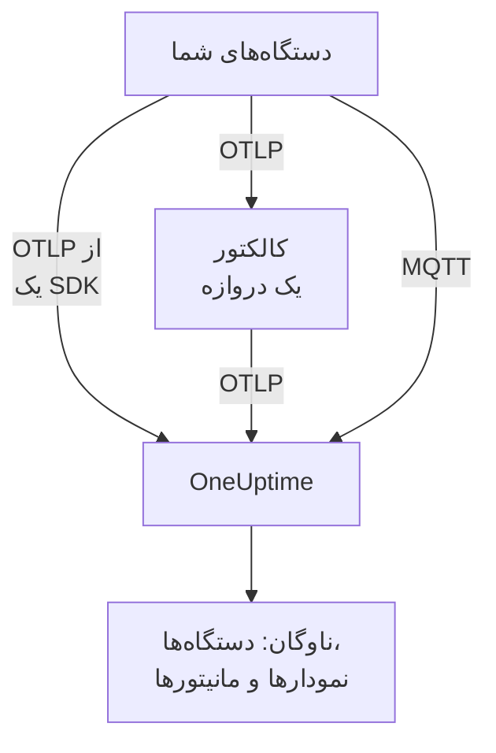

# دستگاه‌های اینترنت اشیا

OneUptime ناوگان‌هایی از دستگاه‌های اینترنت اشیا — حسگرها، دروازه‌ها، کنترلرها و جعبه‌های لبه — را بر پایه مجموعه کوچکی از متریک‌های `iot_*` که می‌فرستند پایش می‌کند. دستگاه‌ها را در ناوگان‌ها گروه‌بندی می‌کند، موجودی دستگاه‌های هر ناوگان را نگه می‌دارد و نمودار باتری، سیگنال، دما، CPU، حافظه و دسترس‌پذیری آن‌ها را می‌کشد. هیچ عامل OneUptime برای نصب روی دستگاه نیست: دستگاه‌ها OpenTelemetry استاندارد می‌فرستند، یا در نقطه پایانی MQTT در OneUptime منتشر می‌کنند. [مانیتورهای دستگاه اینترنت اشیا](/docs/monitor/iot-device-monitor) بر پایه آنچه می‌فرستند هشدار می‌دهند.

:::cards
- [برگزیدن روش فرستادن](#برگزیدن-روش-فرستادن): یک OpenTelemetry SDK، کالکتور یک دروازه، یا MQTT.
- [فرستادن متریک‌ها از راه MQTT](#فرستادن-متریکها-از-راه-mqtt): تاپیک‌ها، اعتبارنامه برای هر دستگاه و Last Will.
- [قراردادهای متریک](#قراردادهای-متریک): نام‌های `iot_*` که OneUptime برایشان نمودار می‌کشد و هشدار می‌دهد.
- [رفع اشکال](#رفع-اشکال): ناوگان‌های ناموجود، دستگاه‌های ناموجود، آفلاین شدن‌های نادرست.
:::

## چگونه کار می‌کند

هر خوانش به یک ناوگان و یک دستگاه تعلق دارد. OneUptime ناوگان را از نخستین خوانشش می‌سازد، هر دستگاه تازه را به موجودی ناوگان می‌افزاید و پس از آن با هر خوانش، واپسین مقدارهای دستگاه را به‌روز می‌کند. خوانش‌هایی که از راه OpenTelemetry و از راه MQTT فرستاده می‌شوند همان ناوگان‌ها، موجودی، نمودارها و مانیتورها را پر می‌کنند.



## OneUptime اینترنت اشیا را چگونه مدل می‌کند

- **ناوگان**: گروهی از دستگاه‌ها، مانند `building-a-sensors` یا `field-gateways`. از ویژگی منبع `iot.fleet.name` می‌آید و در OneUptime به‌صورت سرویس تله‌متری `iot/<fleet>` دیده می‌شود. `service.name=iot/<fleet>` را هم تنظیم کنید تا لاگ‌ها و متریک‌ها زیر همان سرویس کنار هم بنشینند.
- **دستگاه**: یک دستگاه در یک ناوگان، که با ویژگی `device.id` روی هر نقطه داده نام‌گذاری می‌شود. موجودی ناوگان بر پایه `device.id` کلیدگذاری شده است.

| ویژگی | روی | الزامی | توضیح |
| --- | --- | --- | --- |
| `iot.fleet.name` | منبع | بله | ناوگانی که دستگاه به آن تعلق دارد. به سرویس `iot/<fleet>` در OneUptime تبدیل می‌شود. |
| `device.id` | هر نقطه داده | بله | شناسه‌ای پایدار برای دستگاه، یکتا در ناوگانش. |
| `iot.device.kind` | هر نقطه داده | خیر | کلاس دستگاه، مانند `Device`، `Sensor` یا `Gateway`. پیش‌فرض آن `Device` است. |
| `iot.device.type` | هر نقطه داده | خیر | نوع یا مدلی دقیق‌تر برای پالایش مانیتورها، مانند `temp-sensor`. |
| `iot.device.firmware` | هر نقطه داده | خیر | نسخه میان‌افزاری که دستگاه گزارش می‌کند. |

از راه MQTT، تاپیک ناوگان و دستگاه را برایتان تعیین می‌کند.

## برگزیدن روش فرستادن

| روش | کی به کار ببرید | نیاز |
| --- | --- | --- |
| [OpenTelemetry SDK](#فرستادن-متریکها-از-راه-opentelemetry-sdk) | دستگاه یک OpenTelemetry SDK اجرا می‌کند و خودش به OneUptime می‌رسد. | یک کلید دریافت داده روی دستگاه. |
| [OpenTelemetry Collector](#فرستادن-متریکها-از-راه-یک-opentelemetry-collector) | دستگاه‌های بسیاری از راه یک دروازه گزارش می‌دهند. | دروازه‌ای که کالکتور را اجرا می‌کند. |
| [MQTT](#فرستادن-متریکها-از-راه-mqtt) | دستگاه از پیش با MQTT سخن می‌گوید، یا باید همان لحظه که قطع می‌شود آفلاین گزارش شود. | هر کلاینت MQTT که از راه WebSocket وصل شود. |

## پیش از شروع

- یک کلید دریافت داده. آن را زیر **تنظیمات پروژه** > **تله‌متری و APM** > **کلیدهای دریافت داده** بسازید و مقدارش را کپی کنید. دستگاه‌ها آن را در سرآیند `x-oneuptime-token` یا به‌عنوان گذرواژه MQTT می‌فرستند.
- دسترسی شبکه از دستگاه یا دروازه به نشانی OneUptime شما.
- یک نام ناوگان برای هر گروه از دستگاه‌ها، و یک شناسه پایدار برای هر دستگاه.

## فرستادن متریک‌ها از راه OpenTelemetry SDK

:::steps
### SDK را به OneUptime نشانه بگیرید

متغیرهای محیطی استاندارد OpenTelemetry را روی دستگاه تنظیم کنید. کلید، نام ناوگان و شناسه دستگاه را با مقدارهای خودتان جایگزین کنید:

```bash
export OTEL_EXPORTER_OTLP_ENDPOINT=https://oneuptime.com/otlp
export OTEL_EXPORTER_OTLP_PROTOCOL=http/protobuf
export OTEL_EXPORTER_OTLP_HEADERS=x-oneuptime-token=YOUR_TELEMETRY_INGESTION_TOKEN
export OTEL_RESOURCE_ATTRIBUTES=iot.fleet.name=building-a-sensors,device.id=sensor-001,service.name=iot/building-a-sensors
```

`iot.fleet.name` را ثابت نگه دارید: تغییر آن یک ناوگان تازه ثبت می‌کند.

### خوانش‌ها را به‌صورت متریک‌های اینترنت اشیا ثبت کنید

هر خوانش را به‌صورت یک متریک با یکی از [نام‌های قراردادی](#قراردادهای-متریک) بفرستید، و به هر نقطه داده یک ویژگی `device.id` بدهید:

| متریک | مقدار | ویژگی نقطه داده |
| --- | --- | --- |
| `iot_device_up` | `1` | `device.id=sensor-001` |
| `iot_battery_percent` | `87` | `device.id=sensor-001` |
| `iot_temperature_celsius` | `21.5` | `device.id=sensor-001` |

موجودی بر پایه `device.id` نقطه داده کلیدگذاری شده، نه منبع، پس آن را روی هر اندازه‌گیری و همچنین در `OTEL_RESOURCE_ATTRIBUTES` تنظیم کنید.
:::

سپس [بررسی کنید که ناوگان دیده می‌شود](#بررسی-کنید-که-ناوگان-دیده-میشود).

## فرستادن متریک‌ها از راه یک OpenTelemetry Collector

وقتی دستگاه‌های بسیاری از راه یک دروازه گزارش می‌دهند، یک OpenTelemetry Collector روی دروازه اجرا کنید. OTLP را از دستگاه‌های شما می‌گیرد، ناوگان را روی هر خوانش مُهر می‌زند و آن‌ها را به OneUptime می‌فرستد.

:::steps
### پیکربندی دروازه را ذخیره کنید

این را با نام `config.yaml` روی دروازه ذخیره کنید:

```yaml title="config.yaml"
receivers:
  otlp:
    protocols:
      grpc:
        endpoint: 0.0.0.0:4317
      http:
        endpoint: 0.0.0.0:4318

processors:
  batch:
    send_batch_size: 512
    timeout: 5s
  resource:
    attributes:
      - key: iot.fleet.name
        value: field-gateways
        action: upsert
      - key: service.name
        value: iot/field-gateways
        action: upsert

exporters:
  otlphttp:
    endpoint: "https://oneuptime.com/otlp"
    headers:
      "x-oneuptime-token": "YOUR_TELEMETRY_INGESTION_TOKEN"

service:
  pipelines:
    metrics:
      receivers: [otlp]
      processors: [resource, batch]
      exporters: [otlphttp]
```

- `otlp` از راه gRPC (`4317`) و HTTP (`4318`) از دستگاه‌های شما دریافت می‌کند. خوانش‌ها را به هر روش دیگری که کالکتور پشتیبانی می‌کند (یک پل MQTT، لاگ‌های فایل) دریافت کنید و از همان خط لوله بفرستید.
- `resource` هر خوانش را با ناوگان مُهر می‌زند. `iot.fleet.name` و `service.name=iot/<fleet>` متناظر را برای هر دروازه تنظیم کنید تا دستگاه‌های هر دروازه در ناوگان خودشان بنشینند.
- `device.id` و هر کدام از `iot.device.kind`، `iot.device.type` و `iot.device.firmware` را روی هر نقطه داده نگه دارید تا OneUptime بتواند دستگاه‌های ناوگان را از هم جدا کند.
- `otlphttp` با کلید دریافت داده از راه HTTPS به OneUptime می‌فرستد. هم کدگذاری پیش‌فرض protobuf و هم `encoding: json` پذیرفته می‌شوند.

### کالکتور را روی دروازه اجرا کنید

:::tabs
@tab Docker
آن را از پوشه‌ای که `config.yaml` در آن است اجرا کنید:

```bash
docker run -d \
  --name otel-collector \
  --restart unless-stopped \
  -p 4317:4317 \
  -p 4318:4318 \
  -v $(pwd)/config.yaml:/etc/otelcol-contrib/config.yaml:ro \
  otel/opentelemetry-collector-contrib:0.161.0 \
  --config /etc/otelcol-contrib/config.yaml
```
@tab otelcol-contrib
اگر دروازه از پیش `otelcol-contrib` دارد، آن را به این فایل نشانه بگیرید:

```bash
otelcol-contrib --config config.yaml
```
:::

سپس دستگاه‌ها OTLP را به دروازه می‌فرستند، برای نمونه با `OTEL_EXPORTER_OTLP_ENDPOINT=http://<gateway-host>:4318` در SDK هر دستگاه.
:::

سپس [بررسی کنید که ناوگان دیده می‌شود](#بررسی-کنید-که-ناوگان-دیده-میشود).

## فرستادن متریک‌ها از راه MQTT

OneUptime یک نقطه پایانی MQTT از آنِ خود دارد، پس دستگاه‌هایی که با MQTT سخن می‌گویند خوانش‌ها را مستقیم در آن منتشر می‌کنند، بدون SDK، کالکتور یا پل. آنچه از راه MQTT می‌رسد از همان خط لوله OTLP می‌گذرد: ناوگان‌ها ساخته می‌شوند، موجودی به‌روز می‌شود، و هر مانیتور اینترنت اشیا و الگوی هشدار به همان شیوه کار می‌کند.

### نقطه‌های پایانی

| انتقال | نشانی | یادداشت‌ها |
| --- | --- | --- |
| MQTT روی WebSocket | `wss://<your-host>/mqtt` | در هر استقراری، از راه پورت معمول HTTPS کار می‌کند. |
| MQTT روی TCP | `<app-host>:1883` | فقط خودمیزبان، و درون شبکه خوشه یا Compose تا وقتی آن را در دسترس بگذارید. پورت آن `MQTT_INGEST_PORT` است. |

### احراز هویت

- **با کلید دریافت داده**: آن را به‌عنوان گذرواژه MQTT بفرستید. نام کاربری نادیده گرفته می‌شود؛ اگر کلاینت شما فقط فیلد نام کاربری دارد، کلید را همان‌جا بگذارید. این برای دروازه‌ای مناسب است که برای دستگاه‌های بسیاری منتشر می‌کند.
- **با یک اعتبارنامه برای هر دستگاه**: برای دستگاه‌هایی که مستقیم وصل می‌شوند پیشنهاد می‌شود. صفحه **Device Registry** ناوگان را باز کنید و دستگاه را با **Device ID** که به‌عنوان `device.id` به کار می‌برد ثبت کنید. **MQTT Username** دستگاه نام کاربری آن و **MQTT Password (Secret)** آن گذرواژه‌اش است.

اعتبارنامه یک دستگاه فقط می‌تواند زیر تاپیک‌های `oneuptime/<fleet>/<device>/` خود آن منتشر کند. می‌توانید یک دستگاه را بدون دست زدن به بقیه ناوگان باطل کنید: کلید **فعال** آن را خاموش کنید یا آن را حذف کنید، و دستگاهی که وصل است در حدود یک دقیقه قطع می‌شود. دستگاه ثبت‌شده‌ای که ساکت شود به‌صورت آفلاین در موجودی می‌ماند و الگوی هشدار Device Offline برایش برانگیخته می‌شود، حتی اگر بدون Last Will از کار بیفتد.

OneUptime اعتبارنامه‌های نادرست را در CONNECT با کد بازگشت ۴ (نام کاربری یا گذرواژه نادرست) رد می‌کند، پس دستگاهی که بد پیکربندی شده آشکارا شکست می‌خورد. کلیدهای مرورگر از راه MQTT رد می‌شوند.

### تاپیک‌ها و محموله‌ها

زیر پیشوند ثابت `oneuptime/` منتشر کنید. بخش‌های ناوگان و دستگاه نباید `/`، `+` یا `#` داشته باشند، نباید با `$` آغاز شوند، و حداکثر ۱۰۰ نویسه دارند.

| تاپیک | محموله |
| --- | --- |
| `oneuptime/<fleet>/<device>/telemetry` | یک شیء JSON از خوانش‌ها: `{"metrics":{"iot_temperature_celsius":21.5}}`، یا یک شیء تخت که فیلدهای عددی‌اش همان متریک‌ها هستند. |
| `oneuptime/<fleet>/<device>/metrics/<metricName>` | یک مقدار: یک عدد خالی (`23.4`) یا `{"value":23.4}`. |
| `oneuptime/<fleet>/<device>/status` | `online` یا `offline` (و همچنین `1` یا `0`، `true` یا `false`، `up` یا `down`). `iot_device_up` را تنظیم می‌کند. |

محموله تله‌متری می‌تواند `"attributes"` هم داشته باشد، نگاشتی از رشته‌ها که روی هر نقطه داده مُهر زده می‌شود (آن را برای `iot.device.kind`، `iot.device.type`، `iot.device.firmware` یا برچسب‌های خودتان به کار ببرید)، و `"timestamp"` به‌صورت ISO 8601 یا ثانیه یا میلی‌ثانیه unix. هر دو اختیاری‌اند: بدون `timestamp`، زمانی که OneUptime خوانش را دریافت می‌کند به کار می‌رود.

### تشخیص آفلاین با Last Will

یک MQTT Last Will روی `oneuptime/<fleet>/<device>/status` با محموله `offline` ثبت کنید. اگر دستگاه از کار بیفتد یا از شبکه بیرون بیفتد، OneUptime همان لحظه که نشستش پایان می‌یابد `iot_device_up = 0` را برایش منتشر می‌کند، که الگوی هشدار آماده Device Offline را برمی‌انگیزد و دستگاه را بدون هیچ پرسشی در موجودی از کار افتاده علامت می‌زند. پس از وصل شدن، `online` را در همان تاپیک منتشر کنید تا دستگاه دوباره فعال نشان داده شود.

### نمونه‌ها

:::tabs
@tab mosquitto_pub
روی TCP خام، روی یک نمونه خودمیزبان:

```bash
mosquitto_pub -h YOUR-ONEUPTIME-APP-HOST -p 1883 \
  -u oneuptime -P "YOUR_TELEMETRY_INGESTION_TOKEN" \
  -t "oneuptime/building-a-sensors/sensor-001/telemetry" \
  -m '{"metrics":{"iot_device_up":1,"iot_battery_percent":87,"iot_temperature_celsius":21.5},"attributes":{"iot.device.type":"temp-sensor","iot.device.firmware":"1.4.2"}}'
```
@tab Node.js
با بسته `mqtt`، روی WebSocket، در برابر oneuptime.com یا هر نمونه خودمیزبان:

```javascript
const mqtt = require("mqtt");

const client = mqtt.connect("wss://oneuptime.com/mqtt", {
  username: "oneuptime", // ignored — the token below is what authenticates
  password: "YOUR_TELEMETRY_INGESTION_TOKEN",
  will: {
    topic: "oneuptime/building-a-sensors/sensor-001/status",
    payload: "offline",
  },
});

client.on("connect", () => {
  client.publish("oneuptime/building-a-sensors/sensor-001/status", "online");
  setInterval(() => {
    client.publish(
      "oneuptime/building-a-sensors/sensor-001/telemetry",
      JSON.stringify({
        metrics: {
          iot_device_up: 1,
          iot_battery_percent: readBattery(),
          iot_temperature_celsius: readTemperature(),
        },
      }),
    );
  }, 60 * 1000);
});
```
@tab Python
با `paho-mqtt`، روی WebSocket:

```python
import json
import paho.mqtt.client as mqtt

client = mqtt.Client(transport="websockets")
client.username_pw_set("oneuptime", "YOUR_TELEMETRY_INGESTION_TOKEN")
client.tls_set()
client.will_set("oneuptime/building-a-sensors/sensor-001/status", "offline")
client.ws_set_options(path="/mqtt")
client.connect("oneuptime.com", 443)

client.publish("oneuptime/building-a-sensors/sensor-001/status", "online")
client.publish(
    "oneuptime/building-a-sensors/sensor-001/telemetry",
    json.dumps({"metrics": {"iot_device_up": 1, "iot_temperature_celsius": 21.5}}),
)
```
:::

### محدودیت‌ها و تحویل

- نقطه پایانی فقط خوانش‌ها را می‌پذیرد: اشتراک‌ها رد می‌شوند (یک شکست SUBACK)، و پیام‌های retained نگه داشته نمی‌شوند.
- دریافت دست‌کم یک‌باره است. QoS 1 را به کار ببرید تا OneUptime هر انتشار را تأیید کند؛ فرستادن دوباره با QoS 1 یا 2 پس از گم شدن یک تأیید می‌تواند نقطه‌های داده تکراری بسازد.
- انتشاری بیش از 128 KB، یا با بیش از ۱۰۰ متریک، کنار گذاشته می‌شود، و بسته‌ای که بیش از این اعلام کند اتصال را می‌بندد.
- انتشاری بیرون از این تاپیک‌ها، یا با محموله بدشکل، پذیرفته و کنار گذاشته می‌شود، چون MQTT 3.1.1 خطایی برای هر پیام ندارد. OneUptime هشداری با دلیل آن در لاگ می‌نویسد (`MQTT: dropped publish to …`).
- روی نقطه پایانی WebSocket، keepalive در MQTT را زیر ۵ دقیقه نگه دارید. ingress یک WebSocket را که ۳۰۰ ثانیه بیکار بماند می‌بندد، که Last Will و یک هشدار نادرست Device Offline را برمی‌انگیزد. پیش‌فرض‌های کتابخانه‌های کلاینت (۶۰ ثانیه برای `mqtt` و `paho-mqtt`) مناسب‌اند، و نقطه پایانی TCP چنین محدودیتی ندارد.

## قراردادهای متریک

OneUptime این نام‌های متریک `iot_*` را می‌شناسد. فقط آن‌هایی را بفرستید که برای دستگاه شما معنا دارند: نام‌های ناموجود نمودار نمی‌شوند. هر نقطه داده `device.id` دستگاه را دارد (از راه MQTT، تاپیک دستگاه را نام می‌برد).

| نام متریک | معنا |
| --- | --- |
| `iot_device_up` | دسترس‌پذیری: `1` یعنی فعال و در دسترس، `0` یعنی از کار افتاده. مانیتور IoT Device آن را می‌خواند. |
| `iot_device_info` | فقط هویت. `device.id`، کلاس، نوع و میان‌افزار را دارد، تا دستگاه پیش از گزارش خوانش‌ها در موجودی دیده شود. |
| `iot_battery_percent` | شارژ باتری، از `0` تا `100` (٪). |
| `iot_signal_strength_dbm` | قدرت سیگنال بی‌سیم بر حسب dBm، مانند RSSI در Wi-Fi، LoRa یا شبکه همراه. |
| `iot_temperature_celsius` | دمای دستگاه یا حسگر بر حسب °C. |
| `iot_cpu_usage_ratio` | مصرف CPU به‌صورت نسبتی از `0` تا `1`. OneUptime آن را به‌صورت درصد ذخیره و نشان می‌دهد. |
| `iot_memory_usage_bytes` | حافظه در حال استفاده، بر حسب بایت. |
| `iot_memory_size_bytes` | کل حافظه دستگاه، بر حسب بایت. |
| `iot_uptime_seconds` | ثانیه‌ها از واپسین راه‌اندازی دستگاه. |

## بررسی کنید که ناوگان دیده می‌شود

1. بررسی کنید که دستگاه، کالکتور دروازه یا کلاینت MQTT بدون خطا می‌فرستد: در لاگ‌هایش دنبال شکست‌های صدور و پاسخ‌های HTTP `401` یا `422`، یا اتصالی که با کد بازگشت ۴ رد شده، بگردید.
2. **محصولات** > **زیرساخت** > **IoT** > **All Fleets** را باز کنید. ناوگان در حدود یک دقیقه پس از نخستین خوانش‌هایش به‌صورت `iot/<fleet>` دیده می‌شود.
3. صفحه **Devices** ناوگان را باز کنید. هر دستگاهی که از آن فرستاده‌اید باید با واپسین باتری، سیگنال، دما، CPU، حافظه و وضعیت فعال یا ازکارافتاده‌اش فهرست شده باشد.
4. صفحه **متریک‌ها** ناوگان را باز کنید تا نمودار هر کدام از سری‌های `iot_*` را بکشید.

## OneUptime خودمیزبان

نقطه پایانی را به نمونه خودتان نشانه بگیرید:

```bash
export OTEL_EXPORTER_OTLP_ENDPOINT=https://your-oneuptime-host.example.com/otlp
```

یا، در یک کالکتور:

```yaml
exporters:
  otlphttp:
    endpoint: https://your-oneuptime-host.example.com/otlp
    headers:
      "x-oneuptime-token": "YOUR_TELEMETRY_INGESTION_TOKEN"
```

برای MQTT، به `wss://your-oneuptime-host.example.com/mqtt` وصل شوید، یا پورت خام TCP برای MQTT در سرویس app (`MQTT_INGEST_PORT`، به‌طور پیش‌فرض `1883`) را برای دستگاه‌هایی که نمی‌توانند WebSocket به کار ببرند در دسترس بگذارید. `MQTT_INGEST_ENABLED=false` را روی سرویس app تنظیم کنید تا هر دو شنونده MQTT خاموش شوند. اگر نمونه فقط HTTP دارد، `http://` (و برای MQTT، `ws://`) و پورت آن را به کار ببرید.

## رفع اشکال

:::details ناوگان دیده نمی‌شود
1. بررسی کنید که `iot.fleet.name` یک ویژگی منبع است (نه برچسب نقطه داده) و `service.name` برابر `iot/<fleet>` است.
2. بررسی کنید که نقطه پایانی `https://oneuptime.com/otlp` است (یا `…/otlp` خودمیزبان شما) و سرآیند `x-oneuptime-token` یک کلید دریافت داده معتبر دارد.
3. از راه MQTT، بررسی کنید که تاپیک دقیقاً از `oneuptime/<fleet>/<device>/…` پیروی می‌کند: بخش ناوگان تاپیک همان چیزی است که ناوگان را می‌سازد.
:::

:::details دستگاه‌هایی در موجودی نیستند
1. به هر نقطه داده یک برچسب `device.id` بدهید: دستگاه‌ها بر پایه آن کلیدگذاری شده‌اند. از راه MQTT، همان بخش دستگاه تاپیک است.
2. برای دستگاهی که هنوز خوانشی گزارش نکرده، `iot_device_info` (یا از راه MQTT، یک پیام `status`) بفرستید تا در موجودی دیده شود.
3. مقدارهای `device.id` را ثابت نگه دارید: شناسه‌ای که تغییر کند دستگاه‌های تکراری می‌سازد.
:::

:::details HTTP 401 یا 422 از صادرکننده
`401` یعنی کلید دریافت داده نیست، نادرست است یا منقضی شده؛ `422` یعنی غیرفعال شده یا کلید مرورگر است که نمی‌تواند تله‌متری دستگاه بفرستد. کلید تازه‌ای زیر **تنظیمات پروژه** > **تله‌متری و APM** > **کلیدهای دریافت داده** بسازید و سرآیند `x-oneuptime-token` را به‌روز کنید.
:::

:::details اتصال MQTT با "bad username or password" رد می‌شود
OneUptime اعتبارنامه‌های نادرست را در CONNECT با کد بازگشت ۴ رد می‌کند. بررسی کنید که گذرواژه یک کلید دریافت داده معتبر است که غیرفعال یا منقضی نشده، یا برای یک دستگاه ثبت‌شده، راز اعتبارنامه است و **MQTT Username** آن نام کاربری است. کلیدهای مرورگر از راه MQTT رد می‌شوند.
:::

:::details دستگاه‌ها در حالی که کار می‌کنند آفلاین می‌شوند
روی نقطه پایانی WebSocket، ingress اتصالی را که ۳۰۰ ثانیه بیکار بماند می‌بندد، که Last Will و یک هشدار نادرست Device Offline را برمی‌انگیزد. keepalive در MQTT را زیر ۵ دقیقه نگه دارید: پیش‌فرض‌های ۶۰ ثانیه‌ای کتابخانه‌های کلاینت مناسب‌اند.
:::

:::details خوانش‌ها روی نمودارهای ناوگان دیده نمی‌شوند
1. نام‌های دقیق `iot_*` را از [قراردادهای متریک](#قراردادهای-متریک) به کار ببرید: نام‌های دیگر به‌صورت متریک‌های عمومی ذخیره می‌شوند و نمودارهای اینترنت اشیا را پر نمی‌کنند.
2. `iot_cpu_usage_ratio` را به‌صورت نسبتی از `0` تا `1` بفرستید؛ OneUptime آن را به‌صورت درصد نشان می‌دهد.
3. پس از آنکه دستگاهی شروع به گزارش کرد، تا یک دقیقه برای دیده شدن نخستین نقطه‌های داده صبر کنید.
:::

## گام‌های بعدی

:::cards
- [مانیتور دستگاه IoT](/docs/monitor/iot-device-monitor): وقتی دستگاهی آفلاین می‌شود، باتری‌اش کم می‌شود یا داغ می‌کند هشدار بگیرید.
- [OpenTelemetry](/docs/telemetry/open-telemetry): OneUptime چگونه OTLP را از هر SDK یا کالکتوری می‌پذیرد.
- [کالکتور OpenTelemetry روی میزبان](/docs/telemetry/host-otel-collector): خود دروازه Linux، macOS یا Windows را پایش کنید.
:::
