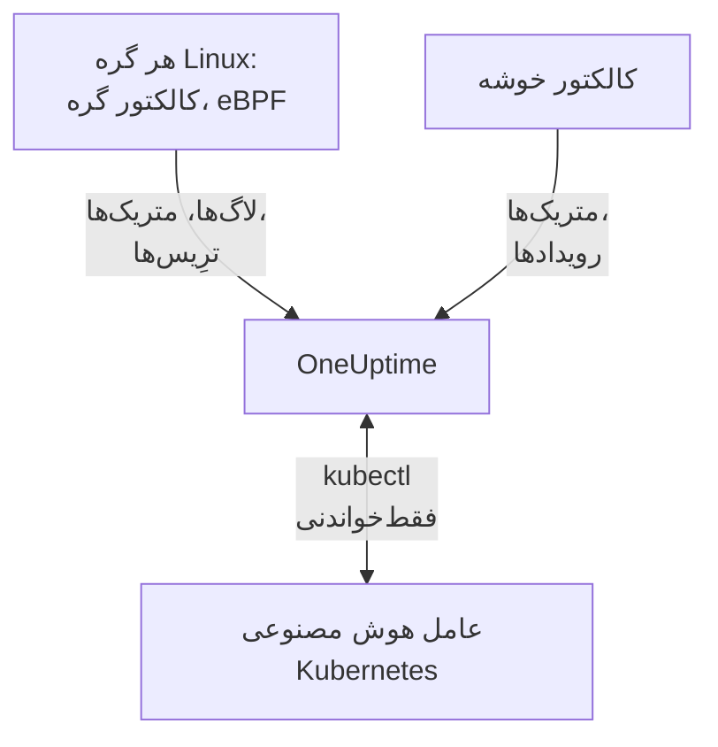

# عامل Kubernetes

عامل Kubernetes در OneUptime یک چارت Helm است که متریک‌ها، رویدادها و لاگ‌های پاد خوشه شما را، و با eBPF ترِیس‌ها، متریک‌های درخواست، گراف سرویس و جریان‌های شبکه هر پاد را، بدون تغییر کد و بدون SDK گردآوری می‌کند. [عامل هوش مصنوعی Kubernetes](#عامل-هوش-مصنوعی-kubernetes) را هم اجرا می‌کند که به OneUptime AI اجازه می‌دهد هنگام بررسی یک حادثه یا هشدار، `kubectl` فقط‌خواندنی اجرا کند. یک `helm install` آن را سر جایش می‌گذارد؛ [مانیتورهای Kubernetes](/docs/monitor/kubernetes-monitor) بر پایه آنچه می‌فرستد هشدار می‌دهند.

:::cards
- [نصب عامل](#نصب-عامل): چهار گام با Helm.
- [گزینه‌های پیکربندی](#گزینههای-پیکربندی): فیلترها، نمونه‌برداری، Control Plane، Service Mesh، هزینه‌ها و برچسب‌ها.
- [عامل هوش مصنوعی Kubernetes](#عامل-هوش-مصنوعی-kubernetes): `kubectl` فقط‌خواندنی برای OneUptime AI، و اصلاح‌ها وقتی اجازه دهید.
- [فرستادن داده کمتر](#کاهش-حجم-داده-گردآوریشده): اهرم‌ها، به ترتیب اثرشان.
:::

## چگونه کار می‌کند

چارت چند بار کاری را در namespace خودش اجرا می‌کند. هر کدام آنچه را گردآوری می‌کند با کلید دریافت داده‌ای که به آن می‌دهید از راه OTLP به نشانی OneUptime شما می‌فرستد، و خوشه با نامی که در `clusterName` به آن می‌دهید خود را ثبت می‌کند.



| بار کاری | نوع | چه می‌کند | اجرا |
| --- | --- | --- | --- |
| کالکتور خوشه | Deployment | متریک‌های خوشه، رویدادهای Kubernetes و مشخصات پادها، گره‌ها و بارهای کاری، از API در Kubernetes. | همیشه |
| کالکتور گره | DaemonSet | لاگ‌های پاد از `/var/log/pods`، متریک‌های kubelet و cAdvisor، و متریک‌های سیستم‌عامل گره. | همه‌جا جز EKS Fargate |
| ابزارگذاری eBPF (OBI) | DaemonSet | ترِیس‌ها و متریک‌های درخواست HTTP، gRPC، SQL و Redis از هر پاد، و نقشه سرویس. | به‌طور پیش‌فرض، جز روی GKE Autopilot و EKS Fargate |
| عامل هوش مصنوعی Kubernetes | Deployment | `kubectl` فقط‌خواندنی برای OneUptime AI هنگام بررسی یک حادثه یا هشدار. | به‌طور پیش‌فرض |
| دنبال‌کننده لاگ | Deployment | لاگ‌های پاد از راه API در Kubernetes، جایی که کالکتور گره نمی‌تواند آن‌ها را بخواند. | با پیش‌تنظیم‌های `gke-autopilot` و `eks-fargate` |
| موتور و پرسشگر هزینه | Deployments | خرج برای هر namespace، بار کاری و پاد. | با `cost.enabled=true` |

همه ایمیج‌های عامل فقط برای Linux ساخته شده‌اند، پس هر بار کاری به گره‌های Linux سنجاق شده است.

## پیش از شروع

- یک خوشه Kubernetes با نسخه v1.23 یا بعد از آن، و `kubectl` که برای رسیدن به آن پیکربندی شده باشد.
- Helm 3. به‌روزرسانی‌ها از `--reset-then-reuse-values` استفاده می‌کنند که به Helm 3.14 یا بعد از آن نیاز دارد.
- یک کلید دریافت داده. آن را زیر **تنظیمات پروژه** > **تله‌متری و APM** > **کلیدهای دریافت داده** بسازید. عامل آن را در سرآیند `x-oneuptime-token` می‌فرستد، پس کلید API پروژه اینجا کار نمی‌کند.
- نامی برای خوشه، یکتا در پروژه شما و پایدار، مانند `prod-us-east-1`: خوشه با همین نام در OneUptime دیده می‌شود.
- HTTPS خروجی از خوشه به نشانی OneUptime شما.

## نصب عامل

:::steps
### مخزن Helm را بیفزایید

```bash
helm repo add oneuptime https://helm-chart.oneuptime.com
helm repo update
```

### چارت را نصب کنید

`YOUR_ONEUPTIME_URL`، `YOUR_ONEUPTIME_API_KEY` (کلید دریافت داده) و نام خوشه را با مقدارهای خودتان جایگزین کنید و زبانه بستر خود را برگزینید (ببینید [برگزیدن پیش‌تنظیم](#برگزیدن-پیشتنظیم)).

:::tabs
@tab Standard
خوشه‌های خودمدیریت، EKS on EC2، GKE Standard، AKS، minikube، kind و k3s:

```bash
helm install kubernetes-agent oneuptime/kubernetes-agent \
  --namespace oneuptime-agent \
  --create-namespace \
  --set oneuptime.url="YOUR_ONEUPTIME_URL" \
  --set oneuptime.apiKey="YOUR_ONEUPTIME_API_KEY" \
  --set clusterName="my-cluster" \
  --set aiAgent.enabled=true
```
@tab GKE Autopilot
```bash
helm install kubernetes-agent oneuptime/kubernetes-agent \
  --namespace oneuptime-agent \
  --create-namespace \
  --set oneuptime.url="YOUR_ONEUPTIME_URL" \
  --set oneuptime.apiKey="YOUR_ONEUPTIME_API_KEY" \
  --set clusterName="my-cluster" \
  --set aiAgent.enabled=true \
  --set preset=gke-autopilot
```
@tab EKS Fargate
```bash
helm install kubernetes-agent oneuptime/kubernetes-agent \
  --namespace oneuptime-agent \
  --create-namespace \
  --set oneuptime.url="YOUR_ONEUPTIME_URL" \
  --set oneuptime.apiKey="YOUR_ONEUPTIME_API_KEY" \
  --set clusterName="my-cluster" \
  --set aiAgent.enabled=true \
  --set preset=eks-fargate
```
:::

**بررسی‌های هوش مصنوعی به‌طور پیش‌فرض روشن‌اند.** `aiAgent.enabled=true` [عامل هوش مصنوعی Kubernetes](#عامل-هوش-مصنوعی-kubernetes) را کنار کالکتور اجرا می‌کند: وقتی حادثه یا هشداری روی این خوشه رخ دهد، OneUptime AI آن را با `kubectl` فقط‌خواندنی (`get`، `describe`، `logs`، `events`، `top`) بررسی می‌کند و هیچ چیزی را تغییر نمی‌دهد. اصلاح‌ها تا وقتی اجازه ندهید خاموش می‌مانند. برای نصب بدون آن، به‌جایش از `--set aiAgent.enabled=false` استفاده کنید.

### بررسی کنید که پادها اجرا می‌شوند

```bash
kubectl get pods -n oneuptime-agent
```

هر پاد باید در یکی دو دقیقه به `Running` برسد:

:::tabs
@tab Standard
کالکتور خوشه، عامل هوش مصنوعی، و روی هر گره یک کالکتور گره و یک پاد eBPF:

```text
NAME                                          READY   STATUS    RESTARTS   AGE
kubernetes-agent-xxxxxxxxxx-xxxxx             1/1     Running   0          1m
kubernetes-agent-ai-agent-xxxxxxxxxx-xxxxx    1/1     Running   0          1m
kubernetes-agent-ebpf-xxxxx                   1/1     Running   0          1m
kubernetes-agent-logs-xxxxx                   1/1     Running   0          1m
```
@tab GKE Autopilot
کالکتور گره همچنان اجرا می‌شود و متریک‌های kubelet و cAdvisor را بدون `hostPath` می‌خواند، و یک Deployment دنبال‌کننده لاگ، لاگ‌های پاد را از راه API در Kubernetes می‌خواند:

```text
NAME                                          READY   STATUS    RESTARTS   AGE
kubernetes-agent-xxxxxxxxxx-xxxxx             1/1     Running   0          1m
kubernetes-agent-ai-agent-xxxxxxxxxx-xxxxx    1/1     Running   0          1m
kubernetes-agent-logs-yyyyyyyyyy-yyyyy        1/1     Running   0          1m
kubernetes-agent-logs-xxxxx                   1/1     Running   0          1m
```
@tab EKS Fargate
سه Deployment و هیچ DaemonSet: Fargate به هر پاد یک ریزماشین مجازی جداگانه می‌دهد و هرگز DaemonSet زمان‌بندی نمی‌کند، پس متریک‌های گره آنجا در دسترس نیستند:

```text
NAME                                          READY   STATUS    RESTARTS   AGE
kubernetes-agent-xxxxxxxxxx-xxxxx             1/1     Running   0          1m
kubernetes-agent-ai-agent-xxxxxxxxxx-xxxxx    1/1     Running   0          1m
kubernetes-agent-logs-yyyyyyyyyy-yyyyy        1/1     Running   0          1m
```
:::

### خوشه را در OneUptime پیدا کنید

به **محصولات** > **زیرساخت** > **Kubernetes** > **همه خوشه‌ها** بروید. خوشه در چند دقیقه با `clusterName` خود دیده می‌شود و گره‌ها، پادها و بارهای کاری‌اش پر می‌شوند. عامل هوش مصنوعی Kubernetes در صفحه **عامل** خوشه، زیر **هوش مصنوعی**، وصل‌شده نشان داده می‌شود.
:::

## برگزیدن پیش‌تنظیم

`preset` پیش‌فرض‌هایی را برمی‌گزیند که روی بستر شما کار می‌کنند: اینکه لاگ‌های پاد از راه `hostPath` از گره خوانده شوند یا از راه API در Kubernetes، و کدام بارهای کاری می‌توانند با امتیاز ویژه اجرا شوند.

| `preset` | برای | لاگ‌های پاد | متریک‌های گره |
| --- | --- | --- | --- |
| `standard` (پیش‌فرض) | خوشه‌های خودمدیریت، **EKS on EC2**، **GKE Standard**، **AKS**، minikube، kind، k3s | کالکتور گره `/var/log/pods` را از راه `hostPath` می‌خواند (کمترین سربار) | kubelet، cAdvisor و متریک‌های سیستم‌عامل گره |
| `gke-autopilot` | **GKE Autopilot** | دنبال‌کننده لاگ آن‌ها را از راه API در Kubernetes می‌خواند (بدون `hostPath`، بدون دسترسی به میزبان) | kubelet و cAdvisor، بدون `hostPath` |
| `eks-fargate` | **EKS Fargate** | دنبال‌کننده لاگ آن‌ها را از راه API در Kubernetes می‌خواند (بدون `hostPath`، بدون دسترسی به میزبان) | هیچ: Fargate هیچ DaemonSet اجرا نمی‌کند |

اگر مطمئن نیستید، با `standard` شروع کنید. اگر نصب با یک خطای Pod Security که `hostPath` را نام می‌برد شکست خورد، دوباره با `preset=gke-autopilot` (یا `eks-fargate` روی Fargate) نصب کنید. GKE Autopilot و EKS Fargate پادهای با امتیاز ویژه را هم که eBPF و پروفایلر به آن‌ها نیاز دارند رد می‌کنند، پس این دو پیش‌تنظیم هر دو را کنار می‌گذارند.

## چه چیزی گردآوری می‌شود

| دسته | داده |
| --- | --- |
| متریک‌های گره | مصرف CPU، حافظه، سامانه فایل و شبکه |
| متریک‌های پاد | CPU، حافظه، شبکه و راه‌اندازی‌های دوباره |
| متریک‌های کانتینر | CPU و حافظه برای هر کانتینر |
| متریک‌های خوشه | وضعیت گره‌ها، منابع قابل تخصیص، شمار پادها |
| رویدادهای Kubernetes | هشدارها، خطاها و رویدادهای زمان‌بندی |
| لاگ‌های پاد | stdout و stderr هر کانتینر (از راه `hostPath` روی خوشه‌های استاندارد، از راه API در Kubernetes روی Autopilot و Fargate) |
| ترِیس‌های برنامه (eBPF، به‌طور پیش‌فرض روشن) | اسپن‌های HTTP، gRPC، SQL و Redis از هر پاد، بدون SDK یا تغییر کد |
| متریک‌های RED برای HTTP (eBPF) | `http.server.request.duration`، و اندازه بدنه درخواست و پاسخ، برای هر سرویس |
| گراف سرویس (eBPF) | لبه‌های نرخ درخواست، تأخیر و خطا از فراخواننده به فراخوانده، که نقشه سرویس را می‌کشند |
| متریک‌های جریان شبکه (eBPF) | شمارنده‌های بایت و بسته TCP و UDP میان پادها، با فراداده Kubernetes |
| آمار TCP (eBPF) | زمان رفت‌وبرگشت، اتصال‌های ناموفق و شمارنده‌های ارسال دوباره در سطح گره |
| هزینه بارهای کاری (اختیاری، `cost.enabled=true`) | خرج برای هر namespace، بار کاری و پاد، با ظرفیت بیکار و کارایی، و هزینه ساعتی گره‌ها و حجم‌ها: ببینید [مشاهده‌پذیری هزینه Kubernetes](/docs/telemetry/kubernetes-cost) |

## گزینه‌های پیکربندی

هر گزینه زیر یک مقدار Helm است. آن را هنگام نصب تنظیم کنید، یا روی عاملی که نصب شده با `helm upgrade ... --reset-then-reuse-values --set <value>`.

### پالایش بر پایه namespace

`namespaceFilters.rules` الگوهای namespace را روی چهار دامنه، هر کدام جداگانه، اعمال می‌کند:

| دامنه | کجا پالایش می‌کند | روی چه اثر می‌گذارد |
| --- | --- | --- |
| `podLogs` | در گیرنده filelog روی hostPath یا در دنبال‌کننده لاگ API | فقط stdout و stderr پادها؛ رویدادهای Kubernetes و لاگ‌های ممیزی اثر نمی‌پذیرند |
| `ebpfDiscovery` | در کشف فرایند OBI | هم ترِیس‌های eBPF و هم متریک‌های eBPF از بارهای کاری جور |
| `metrics` | در کالکتور، پس از افزوده شدن فراداده Kubernetes | سری‌های متریکی که namespace دارند؛ سری‌های گره و خوشه بدون namespace نگه داشته می‌شوند |
| `traces` | در کالکتور، پس از افزوده شدن فراداده Kubernetes | هم اسپن‌های eBPF و هم اسپن‌هایی که برنامه‌ها از راه OTLP می‌فرستند |

یک الگو با نام کامل namespace مقایسه می‌شود و می‌تواند `*` داشته باشد (`team-*`). اگر دامنه‌ای هر قاعده `include` داشته باشد، فقط namespaceهای جور برای آن دامنه نگه داشته می‌شوند، و قاعده‌های `exclude` همیشه برنده‌اند. قاعده پیش‌فرض `kube-system` را فقط از `podLogs` و `ebpfDiscovery` کنار می‌گذارد.

برای محدود کردن لاگ‌های پاد و کشف eBPF به چند namespace:

```bash
helm install kubernetes-agent oneuptime/kubernetes-agent \
  --namespace oneuptime-agent \
  --create-namespace \
  --set oneuptime.url="YOUR_ONEUPTIME_URL" \
  --set oneuptime.apiKey="YOUR_ONEUPTIME_API_KEY" \
  --set clusterName="my-cluster" \
  --set-json 'namespaceFilters.rules=[{"action":"include","namespaces":["default","production","staging"],"scopes":["podLogs","ebpfDiscovery"]}]'
```

برای متوقف کردن لاگ‌های یک namespace پرسروصدا و نگه داشتن ترِیس‌های eBPF، نقشه سرویس و متریک‌هایش، کنار گذاشتن را به `podLogs` محدود کنید:

```bash
  --set-json 'namespaceFilters.rules=[{"action":"exclude","namespaces":["kube-system"],"scopes":["podLogs","ebpfDiscovery"]},{"action":"exclude","namespaces":["noisy-*"],"scopes":["podLogs"]}]'
```

قاعده‌های `podLogs` و `ebpfDiscovery` در سرچشمه پالایش می‌کنند: فایل‌های لاگ کنارگذاشته هرگز باز نمی‌شوند و بارهای کاری کنارگذاشته هرگز ابزارگذاری نمی‌شوند. قاعده‌های `metrics` و `traces` دیرتر، در کالکتور و پس از وصل شدن namespace به داده، اثر می‌کنند.

#### پالایش متریک‌ها و ترِیس‌ها بر پایه namespace

این دامنه‌ها را به یک قاعده بیفزایید تا متریک‌ها یا اسپن‌هایی هم که namespace دارند پالایش شوند:

```bash
  --set-json 'namespaceFilters.rules=[{"action":"exclude","namespaces":["kube-system","noisy-*"],"scopes":["podLogs","ebpfDiscovery","metrics","traces"]}]'
```

> [!NOTE]
> متریک‌های سطح گره و خوشه همیشه نگه داشته می‌شوند. namespace به یک پاد تعلق دارد، نه به یک گره، پس سری‌هایی مانند CPU گره، حافظه گره و مصرف سامانه فایل چیزی برای جور شدن ندارند و هرگز کنار گذاشته نمی‌شوند: قاعده‌ای با دامنه `metrics` سری‌های هر پاد را کم می‌کند بی‌آنکه گره‌ای را که خراب می‌شود پنهان کند.

رویدادهای Kubernetes را نمی‌توان در عامل بر پایه namespace پالایش کرد: از گیرنده `k8sobjects` بدون ویژگی `k8s.namespace.name` می‌رسند (namespace درون بدنه رویداد است)، پس چیزی برای جور شدن با فیلتر نیست. به‌جایش آن‌ها را در OneUptime با **لاگ‌ها** > **تنظیمات** > **فیلترهای حذف** کنار بگذارید.

### پالایش بر پایه شدت لاگ

`filters.logs.minSeverity` رکوردهای لاگ پاد زیر یک شدت را در عامل، پیش از فرستادن هر چیزی، کنار می‌گذارد:

```bash
  --set filters.logs.minSeverity=WARN
```

مقدارهای `TRACE`، `DEBUG`، `INFO`، `WARN`، `ERROR` و `FATAL` را می‌پذیرد. `WARN` سطح‌های WARN، ERROR و FATAL را نگه می‌دارد و INFO، DEBUG و TRACE را کنار می‌گذارد؛ پیش‌فرض (`""`) همه چیز را نگه می‌دارد. در هر دو حالت لاگ اعمال می‌شود (از راه کالکتور در حالت `daemonset`، و درون دنبال‌کننده لاگ در حالت `api`)، پس هیچ پیش‌تنظیمی آن را بی‌خبر خاموش نمی‌کند.

محیط‌های اجرای کانتینر هیچ شدتی ثبت نمی‌کنند، پس عامل شدت را از خود متن لاگ می‌خواند (`[ERROR]`، `WARN:`، `"level":"info"`، …). آنچه بر سر خطی بدون سطح قابل‌تشخیص می‌آید به حالت لاگ بستگی دارد، چون این دو حالت چیزهای متفاوتی می‌دانند:

| حالت | خطی بدون سطح | چرا |
| --- | --- | --- |
| `daemonset` | `stderr` به‌عنوان ERROR شمرده می‌شود (نگه داشته می‌شود)، `stdout` به‌عنوان INFO (با آستانه WARN کنار گذاشته می‌شود) | محیط اجرای کانتینر ثبت می‌کند هر خط از کدام جریان آمده است. |
| `api` | همیشه نگه داشته می‌شود | API در Kubernetes یعنی `pods/log` stdout و stderr را بدون نشانه‌ای برای هر خط در یک جریان ادغام می‌کند، پس عامل به‌جای حدس زدن، خط را نگه می‌دارد. |

پس حالت `api` عمداً کمتر از حالت `daemonset` کنار می‌گذارد: یک traceback پایتون یا یک `npm ERR!` هیچ کلیدواژه شدتی ندارد، و حذف بی‌صدای آن همان خطایی است که آستانه باید از آن محافظتتان کند. در حالت ترکیبی (`logs.windowsPods.enabled`) هر دو سطر، بر پایه سیستم‌عامل گره، اعمال می‌شوند: پادهای Linux از `daemonset` پیروی می‌کنند و پادهای Windows از `api`.

در هر دو حالت، رویدادهای چندخطی پیش از پالایش دوباره سرهم می‌شوند، پس یک رد پشته Java بر پایه خط نخستش سنجیده و یکجا نگه داشته یا کنار گذاشته می‌شود.

> [!IMPORTANT]
> رویدادهای Kubernetes و مشخصات منابع هرگز با این پالایش نمی‌شوند. این‌ها بدون شدتی از آنِ خود از API در Kubernetes می‌رسند، پس یک آستانه کل جریان را حذف می‌کرد، از جمله هشدارهای `FailedScheduling`، `BackOff` و `OOMKilling` که بیش از همه می‌خواهید. کم‌شمار و ارزشمندند، پس عامل همیشه آن‌ها را می‌فرستد؛ برای کم کردنشان در OneUptime از **لاگ‌ها** > **تنظیمات** > **فیلترهای حذف** استفاده کنید.

### گنجاندن یا کنار گذاشتن متریک‌ها بر پایه نام

`filters.metrics` در همه گیرنده‌ها تعیین می‌کند کدام متریک‌ها از خوشه بیرون بروند.

چند متریک پرسروصدا را کنار بگذارید (فهرست ممنوع، که معمولاً همان چیزی است که می‌خواهید):

```bash
  --set-json 'filters.metrics.exclude=["k8s.volume.available","k8s.volume.capacity"]'
```

فقط یک مجموعه ثابت را بفرستید (فهرست مجاز: بقیه کنار گذاشته می‌شوند):

```bash
  --set-json 'filters.metrics.include=["k8s.pod.cpu.utilization","k8s.pod.memory.usage"]'
```

به‌جای نام دقیق، بر پایه الگو جور کنید:

```bash
  --set filters.metrics.matchType=regexp \
  --set-json 'filters.metrics.exclude=["^container_network_"]'
```

| کلید | معنا |
| --- | --- |
| `filters.metrics.exclude` | نام متریک‌هایی که کنار گذاشته شوند. پس از `include` اعمال می‌شود، پس کنار گذاشتن همیشه برنده است. |
| `filters.metrics.include` | وقتی خالی نباشد، فقط همین متریک‌ها فرستاده می‌شوند. |
| `filters.metrics.matchType` | `strict` (نام دقیق، پیش‌فرض) یا `regexp` (RE2، بدون لنگر). |

- `regexp` لنگر ندارد: `system.cpu` با `system.cpu.time` هم جور می‌شود. وقتی دقیقاً یک متریک را در نظر دارید، آن را لنگر بزنید (`^system\.cpu$`).
- RE2 نگاه به جلو ندارد، پس `^(?!container_)` کامپایل نمی‌شود. «همه چیز جز» را با `include` بیان کنید، نه با الگوی منفی.
- `include` یکجا همه گیرنده‌ها را دربر می‌گیرد. فهرست مجازی که متریکی را فراموش کند، مانیتورهای ساخته‌شده بر آن را بی‌صدا حذف می‌کند، پس `exclude` را ترجیح دهید مگر آنکه مجموعه‌ای بسته بخواهید.
- برای فهرست‌ها از `--set-json` (یا یک فایل مقدارها) استفاده کنید: یک `--set` ساده فهرست را جایگزین می‌کند و به آن نمی‌افزاید.

> [!WARNING]
> پیش از گستردن یک الگو، آن را بیازمایید. کالکتور الگوها را هنگام شروع کامپایل می‌کند، پس الگوی نامعتبر بی‌صدا رفتار نادرست ندارد: کالکتور از شروع سر باز می‌زند و مدام از کار می‌افتد و لاگ‌های همان کالکتور را همراه متریک‌هایش از کار می‌اندازد. Helm نمی‌تواند RE2 را کامپایل کند، پس `helm upgrade` الگوی بد را بی‌اعتراض می‌پذیرد.

### نمونه‌برداری ترِیس

فیلترهای بالا یک دسته از تله‌متری را حذف می‌کنند: یک namespace، یک شدت، یک نام متریک. نمونه‌برداری همه دسته‌ها را نگه می‌دارد و به‌جایش جمعیت را کم‌پشت می‌کند. `sampling.traces.percentage` را روی سهم ترِیس‌هایی که نگه داشته شوند بگذارید:

```bash
helm upgrade kubernetes-agent oneuptime/kubernetes-agent \
  --namespace oneuptime-agent --reset-then-reuse-values \
  --set sampling.traces.percentage=10
```

این کار از هر ده ترِیس یکی را نگه می‌دارد و نه تای دیگر را در عامل، پیش از ترک خوشه شما، کنار می‌گذارد.

- **ترِیس‌های کامل می‌گیرید، نه تکه‌تکه.** تصمیم یک درهم‌سازی از شناسه ترِیس است، نه شیر یا خط برای هر اسپن، پس همه اسپن‌های یک ترِیس با هم نگه داشته یا کنار گذاشته می‌شوند و ترِیس‌هایی که می‌مانند از آغاز تا پایان خواندنی‌اند.
- **مانیتورهای متریک‌محور شما تکان نمی‌خورند.** OBI متریک‌های RED در eBPF (نرخ درخواست، نرخ خطا، مدت) را از هر درخواست حساب می‌کند و این‌ها از خط لوله متریک می‌گذرند که نمونه‌بردار در آن نیست. با ۱۰٪، یک‌دهم ترِیس‌ها و نرخ، خطا و تأخیر دقیق را می‌گیرید.
- **مانیتورهای اسپن‌محور شما تکان می‌خورند.** هر چیزی که OneUptime از خود اسپن‌ها می‌شمارد به نسبت نرخ پایین می‌آید: هشدار پایین را ببینید.

| کلید | معنا |
| --- | --- |
| `sampling.traces.percentage` | درصد ترِیس‌هایی که نگه داشته شوند، از ۰ تا ۱۰۰. پیش‌فرض `100` (همه نگه داشته شوند). |
| `sampling.traces.hashSeed` | دانه درهم‌سازی شناسه ترِیس. پیش‌فرض `22`. |

- `0` هیچ ترِیسی نگه نمی‌دارد. یک نرخ است، نه کلید خاموش: هر ترِیسی را حذف می‌کند در حالی که DaemonSet در eBPF همچنان اجرا می‌شود و هزینه دارد. برای نداشتن ترِیس، از `ebpf.enabled=false` استفاده کنید؛ برای نداشتن ترِیس ولی داشتن متریک‌های RED و نقشه سرویس، eBPF را روشن نگه دارید و عمداً `0` را بگذارید.
- فقط وقتی `ebpf.enabled` روشن است اعمال می‌شود: در غیر این صورت خط لوله ترِیسی نیست و این مقدار کاری نمی‌کند.
- فقط ترِیس‌ها را نمونه‌برداری می‌کند. عمداً هیچ `sampling.logs` یا `sampling.metrics` نیست: یادداشت پایین را ببینید.
- کسرها به `--set-json` نیاز دارند و کفی دارند. `--set sampling.traces.percentage=0.5` شکست می‌خورد، چون Helm `0.5` را رشته می‌خواند: از `--set-json 'sampling.traces.percentage=0.5'` یا یک فایل مقدارها استفاده کنید. زیر حدود `0.0061` نرخ به صفر گرد می‌شود و بی‌هیچ خطایی دقیقاً مانند `0` رفتار می‌کند؛ `0.01` (یک در ده هزار) کوچک‌ترین مقداری است که همان کاری را می‌کند که می‌گوید.
- چند خوشه به‌طور پیش‌فرض کار می‌کنند. دو عامل فقط وقتی یک ترِیس را نگه می‌دارند که هم بر `hashSeed` و هم بر `percentage` همداستان باشند، و هر دو همه‌جا پیش‌فرض یکسانی دارند، پس ترِیسی که از دو خوشه می‌گذرد کامل می‌ماند. `hashSeed` را فقط برای مستقل کردن دو لایه نمونه‌برداری تغییر دهید: با دانه یکسان، نرخ پایین‌تر زیرمجموعه‌ای از ترِیس‌های نرخ بالاتر را نگه می‌دارد.
- لاگ‌های پاد هرگز نمونه‌برداری نمی‌شوند، پس با `ebpf.logToTraceCorrelation: true` هر رکورد لاگ همچنان شناسه ترِیس دارد در حالی که فقط سهم نگه‌داشته‌شده از آن ترِیس‌ها وجود دارد. آنگاه تقریباً (۱۰۰ − `percentage`)٪ رکوردهای لاگ به ترِیسی پیوند دارند که نیست؛ رفتن از یک ترِیس به لاگ‌هایش اثری نمی‌پذیرد.

> [!WARNING]
> وقتی این را تنظیم می‌کنید، مانیتورهای اسپن‌محور خود را دوباره تنظیم کنید. نمونه‌برداری اسپن‌هایی را که به OneUptime می‌رسند کم می‌کند، پس هر چیزی که آن‌ها را بشمارد کمتر می‌شمارد: یک مانیتور **ترِیس‌ها** روی `Span Count` و یک مانیتور **استثناها** روی `Exception Count` تقریباً `percentage`٪ حجم دیروز را می‌بینند. آستانه‌ای که روی ترافیک بی‌نمونه‌برداری تنظیم شده بی‌صدا دیگر رد نمی‌شود: مانیتور خطا نمی‌دهد، فقط ساکت می‌شود. آن آستانه‌ها را بر همان ضریب تقسیم کنید؛ نرخ برای کل خوشه است، پس هیچ سرویسی را نمی‌توان مستثنا کرد. گروه‌بندی خطاها بدتر از خطی افت می‌کند: یک استثنای رایج هنوز دیده می‌شود، ولی یک رخداد نادر یک‌باره بیشتر احتمال دارد ناپدید شود تا اینکه یک‌دهم دفعات دیده شود.

> [!NOTE]
> چرا نمونه‌برداری لاگ یا متریک نیست: نمونه‌بردار کالکتور اصلاً نمی‌تواند متریک‌ها را نمونه‌برداری کند. لاگ‌ها را می‌تواند، ولی تصادف را از شناسه ترِیس می‌گیرد که لاگ‌های پاد ندارند، پس همه رکوردهای لاگ یکسان درهم‌سازی می‌شدند و نرخ لاگ، بسته به دانه، یا همه چیز را نگه می‌داشت یا همه چیز را حذف می‌کرد. چارت به‌جای پیشنهاد تنظیمی که بی‌صدا لاگ‌های شما را حذف کند، هیچ تنظیمی پیشنهاد نمی‌کند. لاگ‌ها را با [پالایش بر پایه شدت لاگ](#پالایش-بر-پایه-شدت-لاگ) و [پالایش بر پایه namespace](#پالایش-بر-پایه-namespace) کم کنید که دقیقاً می‌دانند چه چیزی را حذف می‌کنند.

### خاموش کردن گردآوری لاگ

اگر به لاگ‌های پاد نیاز ندارید:

```bash
helm install kubernetes-agent oneuptime/kubernetes-agent \
  --namespace oneuptime-agent \
  --create-namespace \
  --set oneuptime.url="YOUR_ONEUPTIME_URL" \
  --set oneuptime.apiKey="YOUR_ONEUPTIME_API_KEY" \
  --set clusterName="my-cluster" \
  --set logs.enabled=false
```

متریک‌های شما اثری نمی‌پذیرند: کالکتور گره برای متریک‌های kubelet، cAdvisor و میزبان همچنان اجرا می‌شود و فقط خواندن لاگ‌های پاد را متوقف می‌کند. هشدارهای مبتنی بر لاگ متوقف می‌شوند و هیچ چیز دیگری نه.

### اجبار یک حالت مشخص گردآوری لاگ

`logs.mode` انتخاب پیش‌تنظیم را بازنویسی می‌کند و همیشه بر آن برنده است:

- `logs.mode=daemonset`: DaemonSet روی hostPath (کمترین سربار؛ به `hostPath` نیاز دارد).
- `logs.mode=api`: Deployment دنبال‌کننده لاگ از راه API در Kubernetes (روی هر خوشه‌ای کار می‌کند).
- `logs.mode=disabled`: بدون لاگ پاد.

حالت فقط تعیین می‌کند لاگ‌های پاد از کجا بیایند: متریک‌های گره در هر حال گردآوری می‌شوند، پس `api` و `disabled` متریک‌های kubelet، cAdvisor و میزبان شما را نگه می‌دارند. استثنا بستر است: EKS Fargate اصلاً نمی‌تواند DaemonSet زمان‌بندی کند، پس هیچ کالکتور گره و هیچ متریک گره، پاد یا کانتینری ندارد. GKE Autopilot کالکتور گره را اجرا می‌کند ولی `hostPath` را مسدود می‌کند، پس متریک‌های kubelet و cAdvisor را بدون متریک‌های `hostmetrics` (ورودی/خروجی دیسک، inodeها، خطاهای کارت شبکه) که `/proc` و `/sys` میزبان را می‌خوانند گردآوری می‌کند.

روی خوشه‌هایی که استخر گره Windows دارند، حالت `daemonset` فقط گره‌های Linux را پوشش می‌دهد، چون همه ایمیج‌های عامل فقط برای Linux‌اند. `--set logs.windowsPods.enabled=true` را بیفزایید تا دنبال‌کننده لاگ API کنار آن فقط برای پادهای روی گره‌های Windows اجرا شود: پادهای Linux دنبال کردن فایل روی خود گره را نگه می‌دارند و این دو هرگز یک خط را دو بار نمی‌فرستند. این کار به ایمیج `kubernetes-log-tailer` دست‌کم هم‌تازه با چارت نیاز دارد: ایمیج قدیمی‌تر این محدودیت را نادیده می‌گیرد و لاگ‌های Linux را دو بار می‌فرستد.

### روشن کردن پایش Control Plane

صفحه **Control Plane** خوشه نمودارهای etcd، سرور API، زمان‌بند و مدیر کنترلرها را می‌کشد. وقتی `controlPlane.enabled` برابر `true` باشد، عامل هر چهار را برداشت می‌کند:

```bash
helm upgrade kubernetes-agent oneuptime/kubernetes-agent \
  --namespace oneuptime-agent \
  --reset-then-reuse-values \
  --set controlPlane.enabled=true
```

هر مؤلفه در نشانی‌های فهرست خودش برداشت می‌شود: `controlPlane.etcd.endpoints`، `controlPlane.apiServer.endpoints`، `controlPlane.scheduler.endpoints` و `controlPlane.controllerManager.endpoints`. برداشت در پاد عامل اجرا می‌شود که شبکه میزبان ندارد، پس پیش‌فرض‌ها (`https://localhost:<port>/metrics`) به خود همان پاد اشاره می‌کنند: هر فهرست را روی نشانی‌ای بگذارید که پاد بتواند به آن برسد. درون هر خوشه‌ای، سرور API در `https://kubernetes.default.svc:443/metrics` پاسخ می‌دهد:

```bash
helm upgrade kubernetes-agent oneuptime/kubernetes-agent \
  --namespace oneuptime-agent \
  --reset-then-reuse-values \
  --set controlPlane.enabled=true \
  --set "controlPlane.apiServer.endpoints={https://kubernetes.default.svc:443/metrics}"
```

`controlPlane.enabled` هر چهار برداشت را یکجا روشن می‌کند. جایی که مؤلفه‌ای در نقطه‌های پایانی‌اش در دسترس نباشد (etcd، زمان‌بند و مدیر کنترلرها روی یک خوشه مدیریت‌شده، یا در پیش‌فرض‌های `localhost` خود)، برداشتش در هر بازه شکست می‌خورد: کالکتور یک خطای برداشت در لاگ می‌نویسد و هدف را از کار افتاده گزارش می‌کند، و هیچ چیز دیگری تغییر نمی‌کند.

عامل فقط از راه HTTPS برداشت می‌کند، با توکن حساب سرویس و بدون گواهی کلاینت. پس:

- **etcd** به یک نشانی متریک HTTPS نیاز دارد که گواهی کلاینت نخواهد. پورت‌های معمول متریک etcd دست‌نیافتنی‌اند: HTTP ساده روی `2381` (`--listen-metrics-urls` در kubeadm) به‌صورت HTTPS برداشت می‌شود و شکست می‌خورد، و `2379` گواهی کلاینت می‌خواهد.
- **زمان‌بند** (`10259`) و **مدیر کنترلرها** (`10257`) روی HTTPS پاسخ می‌دهند و توکن را می‌پذیرند، ولی kubeadm آن‌ها را روی گره‌های control plane به `127.0.0.1` می‌بندد: به یک `--bind-address` نیاز دارند که پاد عامل بتواند به آن برسد.

سرویس‌های مدیریت‌شده Kubernetes (EKS، GKE، AKS) etcd، زمان‌بند یا مدیر کنترلرها را در دسترس نمی‌گذارند، پس آن زبانه‌ها آنجا خالی می‌مانند. تا متریک‌های یک زبانه برسند، صفحه **Control Plane** به‌جای نمودارهایش نشان می‌دهد چه چیزی باید تنظیم شود، همراه با فرمانی برای کپی.

### روشن کردن متریک‌های CoreDNS

زبانه **CoreDNS** در صفحه **Control Plane** نمودارهای پرس‌وجوهای DNS، تأخیر، حافظه نهان و ارسال را می‌کشد. گردآوری آن‌ها به‌طور پیش‌فرض خاموش است:

```bash
helm upgrade kubernetes-agent oneuptime/kubernetes-agent \
  --namespace oneuptime-agent \
  --reset-then-reuse-values \
  --set coreDns.enabled=true
```

عامل پورت `9153` پادهایی را که برچسب `k8s-app=kube-dns` در `kube-system` دارند برداشت می‌کند، که همان شیوه اجرای CoreDNS روی خوشه‌های kubeadm، EKS و AKS است. اگر CoreDNS شما جای دیگری اجرا می‌شود، `coreDns.namespace`، `coreDns.service` (برچسب `k8s-app`) و `coreDns.port` را هم تنظیم کنید. GKE به‌جای CoreDNS از kube-dns (dnsmasq) یا Cloud DNS استفاده می‌کند، پس آن زبانه آنجا خالی می‌ماند.

### روشن کردن متریک‌های Service Mesh

صفحه **Service Mesh** خوشه نمودارهای Istio و Linkerd را می‌کشد. عامل یک mesh را برداشت می‌کند، همانی که `serviceMesh.provider` نام می‌برد (`istio` یا `linkerd`):

```bash
helm upgrade kubernetes-agent oneuptime/kubernetes-agent \
  --namespace oneuptime-agent \
  --reset-then-reuse-values \
  --set serviceMesh.enabled=true \
  --set serviceMesh.provider=istio
```

برای Istio آمار Envoy هر sidecar از نوع `istio-proxy` (پورت `15090`) را می‌خواند؛ برای Linkerd، پورت مدیریت هر `linkerd-proxy` را. control plane هیچ‌کدام از meshها برداشت نمی‌شود: istiod (کارت **Pilot**) و مؤلفه‌های identity، destination و proxy-injector در Linkerd (کارت **Control Plane**) متریک‌هایشان را روی پورت‌های مدیریتی خودشان ارائه می‌کنند، پس آن کارت‌ها به‌جای نمودارهایشان همین را می‌گویند.

### متریک‌هایی که عامل گردآوری نمی‌کند

برخی نمودارها متریک‌هایی را نشان می‌دهند که عامل برداشتی برایشان ندارد: **kube-proxy** در صفحه **Control Plane**؛ **Cilium** (با Hubble) در صفحه **Service Mesh**؛ و در زبانه‌های Istio و Linkerd، control plane خود meshها (**istiod**، و مؤلفه‌های identity، destination و proxy-injector در Linkerd). این نمودارها وقتی پر می‌شوند که آن متریک‌ها از راه دیگری به OneUptime برسند، برای نمونه از [OpenTelemetry Collector](/docs/telemetry/open-telemetry) خودتان که آن‌ها را برداشت می‌کند، با ویژگی منبع `k8s.cluster.name` که روی نام خوشه (`clusterName` عامل) تنظیم شده باشد. خوشه‌هایی که بدون kube-proxy اجرا می‌شوند اصلاً متریک kube-proxy ندارند.

### روشن کردن مشاهده‌پذیری هزینه

ببینید هر namespace، بار کاری و پاد چقدر هزینه دارد، همراه با ظرفیت بیکار و اینکه چه مقدار از هر request مصرف می‌شود، در صفحه **Costs** خوشه:

```bash
helm upgrade kubernetes-agent oneuptime/kubernetes-agent \
  --namespace oneuptime-agent \
  --reset-then-reuse-values \
  --set cost.enabled=true
```

همین به‌تنهایی یک نصب کامل است: چارت موتور متن‌باز [OpenCost](https://opencost.io) را (همراه با Prometheus کوچکی که لازم دارد) با خود دارد و گره‌ها و حجم‌های شما را بر پایه قیمت‌های فهرست عمومی ارائه‌دهنده ابری‌تان و بدون هیچ اعتبارنامه‌ای قیمت‌گذاری می‌کند. دو پاد کوچک می‌افزاید و نخستین هزینه‌ها پس از نخستین ساعت بسته‌شده دیده می‌شوند. از پیش Kubecost یا OpenCost دارید؟ به‌جایش `--set cost.engine.url=<its service URL>` را بیفزایید، و هیچ چیزی همراه نمی‌شود. خوشه‌های درون‌سازمانی می‌توانند با `cost.opencost.customPricing` کارت نرخ تنظیم کنند. راهنمای کامل، با قیمت‌گذاری درون‌سازمانی و رفع اشکال، [مشاهده‌پذیری هزینه Kubernetes](/docs/telemetry/kubernetes-cost) است.

### برچسب‌گذاری خودکار با برچسب‌های پروژه

هر ویژگی منبعی که با `oneuptime.label.` آغاز شود، به یک برچسب پروژه تبدیل می‌شود و به خوشه و به سرویس‌ها و میزبان‌هایی که این عامل گزارش می‌کند وصل می‌شود: `oneuptime.label.<dimension>=<value>` همان برچسب `<dimension>:<value>` است. برچسب‌ها را هنگام نصب با `--set oneuptime.labels.<key>=<value>` بدهید:

```bash
helm install kubernetes-agent oneuptime/kubernetes-agent \
  --namespace oneuptime-agent \
  --create-namespace \
  --set oneuptime.url="YOUR_ONEUPTIME_URL" \
  --set oneuptime.apiKey="YOUR_ONEUPTIME_API_KEY" \
  --set clusterName="prod" \
  --set oneuptime.labels.team=payments \
  --set oneuptime.labels.env=production \
  --set oneuptime.labels.region=us-east-1
```

یا آن‌ها را در یک فایل مقدارها نگه دارید:

```yaml title="values.yaml"
oneuptime:
  url: YOUR_ONEUPTIME_URL
  apiKey: YOUR_ONEUPTIME_API_KEY
  labels:
    team: payments
    env: production
    region: us-east-1
clusterName: prod
```

برچسب‌ها بدون حساسیت به بزرگی و کوچکی حروف مقایسه می‌شوند، پس برچسب موجود `Production` که دستی ساخته‌اید دوباره به کار می‌رود و تکراری ساخته نمی‌شود، و عامل هرگز برچسب‌هایی را که در OneUptime افزوده شده‌اند حذف نمی‌کند.

## ترِیس‌های برنامه و متریک‌های HTTP با eBPF (به‌طور پیش‌فرض روشن)

چارت روی هر گره یک DaemonSet با [OpenTelemetry eBPF Instrumentation (OBI)](https://opentelemetry.io/docs/zero-code/obi/) اجرا می‌کند. برنامه‌های eBPF را در هسته بار می‌کند و ترافیک HTTP و HTTPS، gRPC، SQL و Redis همه محیط‌های اجرای پشتیبانی‌شده (Go، .NET، Java، Node.js، Python، Ruby، Rust) را بدون SDK و بدون sidecar می‌گیرد. سپس ترِیس‌ها و متریک‌های درخواست از راه کالکتور درون خوشه به OneUptime می‌روند.

به هسته Linux 5.8 یا بعد از آن با BTF نیاز دارد (پیش‌فرض روی Debian 11+، Ubuntu 20.10+، Fedora 34+، RHEL و Stream 9+)، و DaemonSet آن با امتیاز ویژه اجرا می‌شود، چون بار کردن برنامه‌های eBPF همین را لازم دارد.

### ترِیس‌های eBPF چه شکلی‌اند

eBPF فراخوانی‌های شبکه را می‌بیند، نه کد شما را، پس یک ترِیس از درخواست‌هایی که یک سرویس رسیدگی می‌کند و فراخوانی‌هایی که هنگام رسیدگی به آن‌ها انجام می‌دهد ساخته می‌شود:

- **یک درخواست و فراخوانی‌هایش یک ترِیس می‌سازند.** درخواستی که به یک سرویس می‌رسد اسپن ریشه است، با نام `<METHOD> <route>`، و فراخوانی‌های HTTP، gRPC، SQL و Redis که سرویس هنگام رسیدگی به آن انجام می‌دهد فرزندان آن‌اند. (برای Node.js این کار به عامل Node.js در OBI تکیه دارد که چارت با `ebpf.nodejs.enabled` روشنش می‌کند.) فراخوانی‌هایی که درخواست‌های هم‌زمان از یک اتصال مشترک می‌فرستند، که در کلاینت‌های Redis رایج است، همیشه از هم جداشدنی نیستند، پس برخی از آن‌ها در ترِیس درخواست خودشان قرار نمی‌گیرند.
- **فراخوانی سرویسی روی گره‌ای دیگر یک ترِیس تازه آغاز می‌کند**، مگر آنکه چیزی زمینه ترِیس را با خود ببرد: یک OpenTelemetry SDK، یا انتشار اختیاری زمینه که پایین‌تر آمده است. وقتی هر دو سر روی یک گره اجرا شوند، OBI هر دو را می‌بیند و خودش آن‌ها را پیوند می‌دهد.
- **کاری که هیچ درخواستی آغازش نکرده تنها می‌ماند.** کارگر صفی که از Redis می‌پرسد، یا یک کار cron، درخواستی ندارد که فراخوانی‌هایش به آن تعلق داشته باشند.
- **سرورهای پایگاه داده معمولاً تنها می‌مانند.** پروتکل‌های پایگاه داده زمینه ترِیس را با خود نمی‌برند، پس مگر آنکه فراخواننده روی همان گره اجرا شود، اسپنی که OBI درون سرور پایگاه داده برای هر فرمان ثبت می‌کند ترِیسی تک‌اسپنی است.

این فراخوانی‌های تنهای پایگاه داده به‌صورت ترِیس‌های تک‌اسپنی با نام یک فرمان خالی (`set`، `evalsha`، `SELECT`) می‌رسند و روی یک خوشه پرکار می‌توانند بیشتر چیزی باشند که OBI می‌گیرد. به‌طور پیش‌فرض عامل آن‌ها را پیش از ترک خوشه کنار می‌گذارد: اسپن خود سرور پایگاه داده که همیشه اسپن فراخواننده را تکرار می‌کند (`ebpf.dropDatabaseServerSpans=true`)، و فراخوانی برنامه‌ای که به هیچ ترِیسی تعلق ندارد (`ebpf.dropUnlinkedDatabaseCalls=true`). فراخوانی‌های پایگاه داده یک برنامه درون ترِیس یک درخواست نگه داشته می‌شوند، اسپن‌هایی که برنامه‌های شما از SDKهای خودشان می‌فرستند هرگز دست نمی‌خورند، و متریک‌های پایگاه داده همچنان هر فرمان را می‌شمارند.

یک بده‌بستان: OneUptime پایگاه‌های داده را از اسپن‌های کلاینت پایگاه داده کشف می‌کند و روی نقشه سرویس می‌کشد. پایگاه داده‌ای که فقط کار پس‌زمینه با آن سخن می‌گوید (صف یک کارگر، انبار داده یک کار cron) آنگاه دیگر از ترِیس‌ها کشف نمی‌شود و روی نقشه سرویس به‌صورت یک نقطه پایانی دوردست دیده می‌شود. متریک‌هایش اثری نمی‌پذیرند. برای نگه داشتن آن اسپن‌ها `ebpf.dropUnlinkedDatabaseCalls=false` را تنظیم کنید.

فراخوانی‌های HTTP و gRPC کار پس‌زمینه (کارگری که از راه HTTP از ClickHouse پرس‌وجو می‌کند، کنترلری که اجاره Kubernetes خود را تمدید می‌کند) هم به‌صورت ترِیس‌های تک‌اسپنی (`POST /`، `PUT /apis/*/...`) می‌رسند. `ebpf.dropUnlinkedClientCalls=true` را تنظیم کنید تا آن‌ها را هم، همراه با فراخوانی‌هایی که OBI نتوانست در ترِیس درخواستشان بگذارد و همین شکل را دارند، کنار بگذارد؛ این گزینه هرگز فراخوانی‌های پایگاه داده، پیام‌رسانی و GenAI (از جمله MCP) را کنار نمی‌گذارد. به‌طور پیش‌فرض خاموش است چون به بهای داده تمام می‌شود: وقتی سرویس فراخوانده روی همان گره اجرا شود، OBI درخواستی را که آن سرویس رسیدگی کرده زیر فراخوانی پیوند می‌دهد، پس فراخوانی ریشه آن ترِیس است و کنار گذاشتنش ترِیس را بی‌ریشه می‌گذارد. با روشن بودن `ebpf.contextPropagation` این روی هر گره‌ای رخ می‌دهد، و برای سرویسی که OpenTelemetry SDK خودش را دارد هم. نقشه سرویس هم این فراخوانی‌ها را می‌خواند: وابستگی‌ای که فقط کار پس‌زمینه آن را فرا می‌خواند آنگاه تنها از متریک‌های گراف سرویس OBI کشیده می‌شود، و لبه‌ای که درون درخواست‌ها هم دیده شود فقط همان فراخوانی‌ها را می‌شمارد. نمای کلی یک سرویس اسپن‌هایش را می‌شمارد، پس کارگر یا پروبی که بیشتر اسپن‌هایش از این دست فراخوانی‌هاست درخواست‌های بسیار کمتری نشان می‌دهد، با نرخ خطا و تأخیر p95 بر پایه اسپن‌های باقی‌مانده. متریک‌های درخواست کلاینت OBI همچنان هر فراخوانی را می‌شمارند.

روی یک OneUptime خودمیزبان، سرور را پیش از عامل به‌روز کنید: ردیاب eBPF که این چارت اجرا می‌کند (OBI v0.14)، سرویس‌های فراخوانده را نام‌گذاری می‌کند و اسپن‌های خود کارگزاران پیام را به شیوه‌هایی گزارش می‌کند که سرورهای قدیمی‌تر OneUptime نمی‌خوانند.

نام‌ها از ترافیک می‌آیند. اسپن‌های HTTP وقتی OBI بتواند الگوی مسیر برنامه را بخواند از آن استفاده می‌کنند، و در غیر این صورت از الگویی ساخته‌شده از URL که بخش‌های شناسه‌مانندش با `*` جایگزین شده‌اند؛ برای نام‌گذاری خودتان `ebpf.routes.patterns` را تنظیم کنید. OBI الگوهای مسیر برنامه‌های Go (net/http، Gorilla mux، Gin)، Java (Spring، JAX-RS)، Node.js (Express، Fastify، Koa، NestJS، Next.js)، Python (Django، FastAPI، Flask)، Ruby (Rails)، .NET (مسیرهای attribute در ASP.NET Core) و PHP (Symfony، Laravel، Slim) را می‌خواند. نام‌های سطح برنامه مانند `OrderService.charge` فقط در کد وجود دارند و به یک OpenTelemetry SDK نیاز دارند.

اگر برنامه‌ای از پیش با یک OpenTelemetry SDK ترِیس صادر کند، OBI متوجه می‌شود و فرستادن ترِیس‌های eBPF را برای آن متوقف می‌کند تا دو بار ترِیس نشود (`ebpf.excludeOtelInstrumentedServices=true`، پیش‌فرض OBI). اگر آن SDK به پروژه دیگری گزارش می‌دهد و ترِیس‌های eBPF برنامه را در این پروژه هم می‌خواهید، آن را `false` بگذارید.

### خاموش کردن ابزارگذاری خودکار eBPF

eBPF را خاموش کنید وقتی:

- روی **GKE Autopilot** یا **EKS Fargate** نصب می‌کنید: این بسترها پادهای با امتیاز ویژه را رد می‌کنند، پس `preset=gke-autopilot` و `preset=eks-fargate` از پیش eBPF را برایتان کنار می‌گذارند و پروفایلر را هم با آن.
- گره‌ها هسته‌ای قدیمی‌تر از 5.8 بدون پس‌آوردهای BTF اجرا می‌کنند.
- از پیش در هر برنامه از OpenTelemetry SDKها ترِیس می‌فرستید و متریک‌های eBPF را هم نمی‌خواهید. (فقط برای ترِیس‌ها لازم نیست: OBI برای برنامه‌ای که می‌بیند ترِیس‌های خودش را صادر می‌کند، فرستادن ترِیس‌های eBPF را متوقف می‌کند، همان‌طور که بالا آمد.)

```bash
helm install kubernetes-agent oneuptime/kubernetes-agent \
  --namespace oneuptime-agent \
  --create-namespace \
  --set oneuptime.url="YOUR_ONEUPTIME_URL" \
  --set oneuptime.apiKey="YOUR_ONEUPTIME_API_KEY" \
  --set clusterName="my-cluster" \
  --set ebpf.enabled=false
```

### روشن و خاموش کردن خانواده‌های سیگنال جداگانه

همه آن‌ها جز یکی به‌طور پیش‌فرض روشن‌اند. هر کدام را با `--set ebpf.features.<name>=false` خاموش کنید:

| `ebpf.features.*` | پیش‌فرض | چه می‌افزاید |
| --- | --- | --- |
| `httpMetrics` | روشن | متریک‌های RED برای HTTP و gRPC (نرخ درخواست، تأخیر، خطاها) برای هر سرویس |
| `spanMetrics` | روشن | شمار فراخوانی و مدت اسپن (`traces.span.metrics.*`) |
| `serviceGraph` | روشن | متریک‌های لبه از فراخواننده به فراخوانده، که نقشه سرویس را می‌کشند |
| `networkMetrics` | روشن | شمارنده‌های جریان TCP و UDP میان پادها |
| `networkInterZoneMetrics` | خاموش | گونه میان‌ناحیه‌ای متریک‌های شبکه (کاردینالیتی آن‌ها را دو برابر می‌کند) |
| `tcpStats` | روشن | زمان رفت‌وبرگشت TCP، اتصال‌های ناموفق و شمارنده‌های ارسال دوباره در سطح گره |

انتشار زمینه ترِیس میان سرویس‌ها، که در آن OBI یک `traceparent` از نوع W3C تزریق می‌کند تا درخواستی که از پاد A به پاد B می‌رود بدون هیچ SDK یک ترِیس دیده شود، به‌طور پیش‌فرض خاموش است. آن را با `--set ebpf.contextPropagation=true` روشن کنید. به هسته‌ای فراتر از آنچه بقیه عامل نیاز دارد نیاز ندارد، و هیچ نسخه هسته‌ای آن را بی‌اثر نمی‌کند.

خاموش است چون تزریق سرآیند یعنی بازنویسی ترافیکی که در راه است: درخواست‌های HTTP متن ساده درجا در هسته پهن‌تر می‌شوند، و به TLS و TCP خام یک گزینه TCP از یک قلاب Traffic Control افزوده می‌شود. اگر حساب بایت‌های اتصال دقیقاً اصلاح نشود، جریان از هماهنگی بیرون می‌افتد؛ نشانه گزارش‌شده این است که انتقال‌ها از راه یک پراکسی L7 مانند nginx، همین که پاسخ از حدود 64KB بگذرد، میانه بدنه گیر می‌کنند، در حالی که درخواست‌های کوچک کار می‌کنند. این را بر پایه سن هسته کنار نگذارید: زیر هسته 5.17، OBI به برنامه‌هایی با پیمایش محدود برمی‌گردد و ترافیک را به همان شیوه بازنویسی می‌کند. ترِیس‌ها، متریک‌های RED و نقشه سرویس به آن وابسته نیستند؛ برای پیوند دادن سرویس‌ها، یک OpenTelemetry SDK `traceparent` را در فضای کاربر و بدون بازنویسی در هسته منتشر می‌کند و انتخاب امن‌تری است.

## عامل هوش مصنوعی Kubernetes

وقتی حادثه یا هشداری روی این خوشه رخ می‌دهد، OneUptime AI آن را بررسی می‌کند. **عامل هوش مصنوعی Kubernetes** در چارت به آن یک ترمینال می‌دهد: `kubectl` فقط‌خواندنی را همان‌طور اجرا می‌کند که یک مهندس آماده‌به‌خدمت اجرا می‌کرد (پاد ناسالم را توصیف می‌کند، رویدادهایش را می‌خواند، لاگ‌های کانتینری را که از کار می‌افتد دنبال می‌کند، ظرفیت گره را بررسی می‌کند) و هر فرمان را در صفحه حادثه نقل می‌کند.

عامل **به‌طور پیش‌فرض روشن** و **فقط‌خواندنی** است: یک Deployment کوچک (`kubernetes-agent-ai-agent`، برچسب پاد `component=ai-agent`، ایمیج `oneuptime/kubernetes-ai-agent`) که ServiceAccount آن فقط می‌تواند بخواند. با همان `oneuptime.apiKey` و `clusterName` که کالکتور به کار می‌برد خود را ثبت می‌کند، پس چیزی برای راه‌اندازی در داشبورد نیست: صفحه **عامل هوش مصنوعی** خوشه (Kubernetes > خوشه > هوش مصنوعی > عامل) در یک دقیقه آن را وصل‌شده نشان می‌دهد، و **آزمایش اتصال** در منوی **⋯** کنار همان وضعیت، `kubectl version` و `kubectl auth can-i --list` را از راه آن اجرا می‌کند. هر کاری که هوش مصنوعی با آن کرده در صفحه **گزارش‌های هوش مصنوعی** خوشه (هوش مصنوعی > لاگ‌ها) است، و آنچه درباره خوشه دانستنی است — مشکلاتی که مدام برمی‌گردند و چرایی‌شان، گره یا بار کاری پشت بیشترشان، آنچه هوش مصنوعی اصلاح کرده — در صفحه **AI Insights** (هوش مصنوعی > Insights). عامل یک kubectl ثابت‌شده (v1.36.4) با خود دارد. Runner نیست و هرگز زیر Runbooks > Runners دیده نمی‌شود: OneUptime هرگز اعتبارنامه‌ای به آن نمی‌دهد، هرگز runbookی روی آن اجرا نمی‌کند، و هرگز به‌عنوان Runner فرمان یک قاعده اصلاح خودکار پذیرفته نمی‌شود.

روی عاملی که پیش از وجود عامل هوش مصنوعی نصب شده، نخست نمایه چارت خود را تازه کنید و سپس به‌روزرسانی کنید (روی OneUptime خودمیزبان، نخست OneUptime را به‌روز کنید — ببینید [به‌روزرسانی عامل](#بهروزرسانی-عامل)):

```bash
helm repo update
helm upgrade kubernetes-agent oneuptime/kubernetes-agent \
  --namespace oneuptime-agent --reset-then-reuse-values \
  --set aiAgent.enabled=true
```

اگر نام انتشار و namespace که عامل را با آن‌ها نصب کرده‌اید فرق دارند، همان‌ها را به کار ببرید (`helm list -A | grep kubernetes-agent` نشانشان می‌دهد). بدون `helm repo update`، Helm ممکن است همان چارتی را برگزیند که از آن نصب کرده‌اید، که `aiAgent` را نمی‌شناسد و با `Additional property aiAgent is not allowed` شکست می‌خورد. نسخه‌های منتشرشده چارت از نسخه OneUptime پیروی می‌کنند، پس اگر `helm show values oneuptime/kubernetes-agent | grep aiAgent` چیزی چاپ نکند، نمایه شما هنوز قدیمی است. برای اجرای چارت بدون عامل هوش مصنوعی، `--set aiAgent.enabled=false` را بدهید.

### کارهای مجاز هوش مصنوعی

آنچه OneUptime AI روی خوشه مجاز است انجام دهد در چارت و با دو مقدار تنظیم می‌شود، و صفحه عامل هوش مصنوعی خوشه آن‌ها را زیر **کارهای مجاز هوش مصنوعی** نشان می‌دهد بی‌آنکه راهی برای تغییرشان در آنجا باشد:

- `aiAgent.investigation` — `true`: هوش مصنوعی هنگام بررسی یک حادثه یا هشدار روی خوشه `kubectl` فقط‌خواندنی اجرا می‌کند. `false`: همچنان بررسی می‌کند، با داده‌هایی که OneUptime از پیش دارد.
- `aiAgent.fixes` — `off`، `ask-for-approval`، `automatic` یا `bypass-approval` (پایین). هر سطحی جز `off` به عامل هوش مصنوعی دسترسی نوشتن می‌دهد؛ `off` هیچ دسترسی‌ای نمی‌دهد و آنگاه خود عامل هر نوشتنی را رد می‌کند.

عامل هوش مصنوعی هر دو را به OneUptime گزارش می‌دهد، که آن‌ها را روی خوشه اعمال می‌کند و تغییری را که جای دیگری انجام شود رد می‌کند — صفحه عامل هوش مصنوعی، API یا Terraform. **تغییر** در آن صفحه فرمان گزینه‌ای را که برمی‌گزینید نشان می‌دهد. هر دو در `values.yaml` تنظیم‌نشده‌اند: انتشاری که هیچ‌کدام را تنظیم نکند می‌گذارد عامل از پیش‌فرض‌های خودش استفاده کند (بررسی روشن، اصلاح‌ها خاموش)، و OneUptime این‌ها را فقط روی خوشه‌ای اعمال می‌کند که کسی تنظیماتش را در صفحه عامل هوش مصنوعی‌اش برنگزیده باشد — تنظیماتی که کسی آنجا برگزیده همان‌طور می‌مانند و صفحه نشان می‌دهد چگونه آن‌ها را به چارت منتقل کنید.

### اجازه دهید هوش مصنوعی آنچه را پیدا می‌کند اصلاح کند

اصلاح‌ها تا وقتی با `aiAgent.fixes` روشنشان نکنید خاموش‌اند — گامی جداگانه و اختیاری که به عامل هوش مصنوعی دسترسی نوشتن هم می‌دهد. شکل پیشنهادی آن را فقط در namespaceهایی می‌دهد که هوش مصنوعی مجاز به اصلاحشان است، با عملیات گره خاموش:

```bash
helm repo update
helm upgrade kubernetes-agent oneuptime/kubernetes-agent \
  --namespace oneuptime-agent --reset-then-reuse-values \
  --set aiAgent.enabled=true \
  --set aiAgent.investigation=true \
  --set aiAgent.fixes=ask-for-approval \
  --set "aiAgent.remediation.namespaces={web,api}" \
  --set aiAgent.remediation.nodeOperations=false
```

یا برای کل خوشه:

```bash
helm repo update
helm upgrade kubernetes-agent oneuptime/kubernetes-agent \
  --namespace oneuptime-agent --reset-then-reuse-values \
  --set aiAgent.enabled=true \
  --set aiAgent.investigation=true \
  --set aiAgent.fixes=ask-for-approval \
  --set-json 'aiAgent.remediation.namespaces=[]'
```

هر namespace که فهرست می‌کنید باید از پیش وجود داشته باشد: چارت در هر کدام یک RoleBinding می‌سازد و هرگز namespace نمی‌سازد، پس namespace گم‌شده کل به‌روزرسانی را — از جمله کالکتور را — با `namespaces "api" not found` شکست می‌دهد. نخست آن را بسازید یا از فهرست بردارید، و پیش از حذف یک namespace آن را از فهرست بردارید. اگر پرچم را در یک به‌روزرسانی نیاورید، فهرست ذخیره‌شده می‌ماند؛ `--set-json 'aiAgent.remediation.namespaces=[]'` (Helm 3.10+) به حالت کل خوشه برمی‌گردد — نه `={}` که Helm آن را یک نام خالی می‌خواند. `--set aiAgent.remediation.namespaces=null` فهرست ذخیره‌شده را زیر `--reuse-values` بازنشانی نمی‌کند: Helm فهرست ذخیره‌شده را نگه می‌دارد. `aiAgent.remediation.nodeOperations=false` اصلاح‌ها را از گره‌ها دور نگه می‌دارد؛ آن را `true` بگذارید تا هوش مصنوعی بتواند گره‌ها را cordon، uncordon، drain و taint کند.

`aiAgent.fixes` تعیین می‌کند اصلاح‌ها چگونه اجرا شوند؛ برای خاموش کردن دوباره‌شان، با `--set aiAgent.fixes=off` به‌روزرسانی کنید، که دسترسی نوشتن را هم برمی‌دارد:

- **ask-for-approval** — OneUptime AI برنامه دقیق `kubectl` را می‌نویسد و یک انسان آن را با یک کلیک روی حادثه تأیید می‌کند؛
- **automatic** — تغییرهای امن خودشان اجرا می‌شوند؛ تغییر پرخطرتر هرگز. وقتی دور فقط اصلاح‌های پرخطرتر پیدا کرده باشد، با پیشنهاد دقیقاً همان‌ها برای تأیید با یک کلیک پایان می‌یابد؛ وقتی یک اصلاح امن را هم اجرا کرده باشد، اصلاح پرخطرتر فقط وقتی پیشنهاد می‌شود که راستی‌آزمایی نشان دهد اصلاح امن سیگنال را بازنگردانده است (دور پیگیری، که می‌پرسد)؛
- **bypass-approval** — هوش مصنوعی نمی‌پرسد: هر تغییری که سیاست اجازه دهد خودش اجرا می‌شود، از جمله دورهای پیگیری، جز اینکه یک دور وقتی می‌پرسد که قطع‌کننده مدار ساعتی فعال شود، وقتی یک دور بی‌نظارت دیگر OneUptime AI هنوز در حال تغییر یا راستی‌آزمایی همان خوشه باشد، یا وقتی پس از اصلاحی بیاید که بازگردانی‌اش کامل نشده است.

در هر حالتی، نوشتن در kube-system، kube-public یا kube-node-lease همیشه به یک انسان نیاز دارد، و همین‌طور یک `drain`، یک `taint` و یک `patch` روی گره (drain پادهای همه namespaceها، از جمله پاد خود عامل، را بیرون می‌کند، و یک taint از نوع `NoExecute` هم همین کار را می‌کند، چه `kubectl taint` آن را بگذارد چه یک `patch` روی گره)؛ یک منبع سفارشی بر پایه namespace خودش سنجیده می‌شود، حتی اگر نامی مانند یک نوع داخلی داشته باشد؛ و عامل هوش مصنوعی هرگز چیزی را در namespace خودش، بیرون از `aiAgent.remediation.namespaces`، یا روی گره‌ای با `aiAgent.remediation.nodeOperations=false` تغییر نمی‌دهد. OneUptime این دامنه را از آنچه عامل هوش مصنوعی گزارش می‌کند می‌خواند و چنین اصلاحی را هنگام پیشنهاد یا تأیید رد می‌کند، نه فقط در عامل. در هر دو حالت بی‌نظارت، وقتی قطع‌کننده مدار ساعتی فعال شود یا دور بی‌نظارت دیگری از پیش خوشه را در اختیار داشته باشد، یک دور به‌جای اجرای برنامه‌اش آن را برای تأیید پیشنهاد می‌کند. برای اینکه هر حالت چه چیزی می‌تواند اجرا کند و سیاست فرمان چه چیزی را یکسره رد می‌کند، ببینید [AI SRE — دسترسی به خوشه](/docs/ai/ai-sre).

**دسترسی نوشتن به چه معناست.** patch/update روی بارهای کاری، پادها و CronJobها، و create روی Jobها، در یک namespace برابر است با اجرای هر ایمیجی با هر ServiceAccount در آن namespace و خواندن Secretهای آن — قالب پاد می‌تواند هر ایمیج، ServiceAccount و حجم Secret را نام ببرد. پس RBAC چارت محدود می‌کند که عامل هوش مصنوعی *کجا* می‌تواند بنویسد، نه اینکه یک نوشتن چه می‌تواند بکند: سیاست فرمان وصله‌های امنیتی قالب پاد، وصله‌هایی که مشخصات پاد یا کل فهرست `containers` را جایگزین کنند، `set serviceaccount`، `create … --image`، `expose --overrides` (که می‌تواند به‌جای یک Service یک Job یا هر نوع شیء دیگری بسازد) و بدنه‌های وصله‌ای را که JSON نیستند رد می‌کند. `set image` یا وصله یک فیلد ایمیج را رد نمی‌کند: این تغییری پرخطرتر است — ایمیج تازه با ServiceAccount خود بار کاری و با Secretهایش اجرا می‌شود — که یک انسان تأییدش می‌کند، مگر آنکه خوشه از تأییدها بگذرد یا فهرست مجازش آن فرمان را نام ببرد. وقتی `aiAgent.remediation.namespaces` خالی باشد، نقش نوشتن برای کل خوشه بسته می‌شود، و RBAC نمی‌تواند آن را از kube-system، kube-public، kube-node-lease یا namespace خود عامل دور نگه دارد؛ آنجا سیاست و عامل هوش مصنوعی مرز را نگه می‌دارند. namespaceها را فهرست کنید تا چارت آن را فقط در همان‌ها ببندد، و نوشتن در هر جای دیگر هنگام پیشنهاد یا تأیید رد شود، و یک بار دیگر به دست عامل هوش مصنوعی.

### مقدارهای عامل هوش مصنوعی

`aiAgent.remediation.*` و `aiAgent.extraEnv` در `values.yaml` تنظیم‌نشده‌اند، پس مقداری که زیر کلید قدیمی `aiAccess` ذخیره شده تا وقتی آن‌ها را تنظیم نکنید اعمال می‌شود (ببینید [به‌روزرسانی عامل](#بهروزرسانی-عامل)). پیش‌فرض‌هایی که جدول برایشان می‌آورد فقط وقتی اعمال می‌شوند که نه کلید `aiAgent` و نه کلید `aiAccess` تنظیم شده باشد. `aiAgent.investigation` و `aiAgent.fixes` هم تنظیم‌نشده‌اند، پس تنظیمات هوش مصنوعی که در صفحه عامل هوش مصنوعی یک خوشه برگزیده شده‌اند تا وقتی یکی از آن‌ها را تنظیم کنید می‌مانند.

| مقدار | پیش‌فرض | چه می‌کند |
| --- | --- | --- |
| `aiAgent.enabled` | `true` | عامل هوش مصنوعی Kubernetes را با RBAC فقط‌خواندنی (برای کل خوشه) اجرا می‌کند. `false` آن را برمی‌دارد. |
| `aiAgent.investigation` | تنظیم‌نشده (`true`) | اینکه OneUptime AI هنگام بررسی `kubectl` فقط‌خواندنی اجرا کند. صفحه عامل هوش مصنوعی خوشه آن را فقط‌خواندنی نشان می‌دهد. |
| `aiAgent.fixes` | تنظیم‌نشده (`off`) | `off`، `ask-for-approval`، `automatic` یا `bypass-approval`. هر سطحی جز `off` فعل‌های نوشتن پایین را می‌دهد. صفحه عامل هوش مصنوعی خوشه آن را فقط‌خواندنی نشان می‌دهد. |
| `aiAgent.remediation.enabled` | `false` | با آمدن `aiAgent.fixes` منسوخ شده و فقط تا وقتی آن تنظیم‌نشده است خوانده می‌شود. فعل‌های نوشتنی را هم می‌دهد که اصلاح‌های OneUptime AI به کار می‌برند: patch/update روی Deployments، StatefulSets، DaemonSets، ReplicaSets (و زیرمنبع scale آن‌ها)، Jobs، CronJobs، Pods و HPAها؛ create روی Jobs و HPAها؛ delete فقط روی Pods و Jobs. هرگز Secrets، `exec`، `attach`، `port-forward`، CRDها یا نوشتن RBAC را نمی‌دهد، پس تغییر هر نوع دیگری — حذف یک Deployment، برچسب زدن به یک Service یا ConfigMap — حتی پس از تأیید با `Forbidden` شکست می‌خورد. |
| `aiAgent.remediation.namespaces` | `[]` | نقش نوشتن را فقط در این namespaceها می‌بندد، در هر کدام یک RoleBinding؛ نوشتن در جای دیگر هنگام پیشنهاد یا تأیید، و به دست عامل هوش مصنوعی، رد می‌شود. هر کدام باید از پیش وجود داشته باشد، وگرنه به‌روزرسانی شکست می‌خورد. فهرست خالی آن را برای کل خوشه می‌بندد؛ `--set-json 'aiAgent.remediation.namespaces=[]'` فهرست ذخیره‌شده را بازنشانی می‌کند (`--set aiAgent.remediation.namespaces=null` فهرست ذخیره‌شده را زیر `--reuse-values` بازنشانی نمی‌کند). namespace خود عامل را نمی‌توان فهرست کرد. |
| `aiAgent.remediation.nodeOperations` | `true` | همراه با `remediation.enabled`، cordon/uncordon/taint (patch روی گره‌ها) و drain (بیرون راندن پادها) را هم برای کل خوشه می‌دهد. برای دور نگه داشتن اصلاح‌ها از گره‌ها `false` بگذارید: هیچ RBAC گره‌ای نیست، عملیات گره هنگام پیشنهاد یا تأیید رد می‌شوند، و عامل هوش مصنوعی آن‌ها را رد می‌کند (`ONEUPTIME_KUBECTL_ALLOW_NODE_OPERATIONS=false`). |
| `aiAgent.image.repository` | `oneuptime/kubernetes-ai-agent` | ایمیج عامل. اگر گره‌ها نمی‌توانند از Docker Hub بکشند، آن را به آینه خود نشانه بگیرید. |
| `aiAgent.image.tag` | `release` | `release` با هر انتشار OneUptime جابه‌جا می‌شود؛ برای نگه داشتن یک نسخه آن را ثابت کنید. |
| `aiAgent.image.pullPolicy` | `Always` برای `release`، `IfNotPresent` برای یک برچسب ثابت‌شده | برای همین پیش‌فرض خالی بگذارید تا عامل ذخیره‌شده روی یک گره هرگز پس از یک به‌روزرسانی باقی نماند. |
| `aiAgent.imagePullSecrets` | `[]` | Secretهای کشیدن ایمیج برای یک رجیستری خصوصی یا آینه، به‌صورت `[{name: <secret>}]`. |
| `aiAgent.resources` | درخواست‌های `50m` / `64Mi`، محدودیت‌های `500m` / `256Mi` | عامل میان فرمان‌ها بیکار است. |
| `aiAgent.extraEnv` | `[]` | اشیای `EnvVar` اضافه برای کانتینر عامل — برای نمونه `HTTPS_PROXY` / `NO_PROXY` پشت یک پراکسی خروجی، که عامل رعایتشان می‌کند. نام‌هایی که خود چارت تنظیم می‌کند (مانند `ONEUPTIME_KUBECTL_ALLOW_WRITES`، `ONEUPTIME_KUBECTL_WRITE_NAMESPACES`، `ONEUPTIME_KUBECTL_ALLOW_NODE_OPERATIONS` یا `ONEUPTIME_KUBERNETES_CLUSTER_NAME`) به‌جای جایگزین کردن بی‌صدای مقدار چارت، رندر را شکست می‌دهند. |

### اگر عامل هوش مصنوعی وصل نمی‌شود

اگر پس از چند دقیقه صفحه عامل هوش مصنوعی هنوز می‌گوید عامل وصل نیست، لاگ آن را بخوانید:

```bash
kubectl logs -n oneuptime-agent -l component=ai-agent --tail=100
```

- **"This OneUptime server does not have the Kubernetes AI agent API"** — چارت از سرور OneUptime شما تازه‌تر است. OneUptime را به‌روز کنید، یا نسخه‌ای از چارت را نصب کنید که با سرور شما می‌خواند (`--version <your OneUptime version>`). عامل هر ۵ دقیقه دوباره تلاش می‌کند.
- **ردی که خودبه‌خود برطرف می‌شود** — پاد قبلی عاملی که هنوز گزارش می‌دهد (پادی که بدون خاموش شدن تمیز جایگزین شده)، یا Runner قدیمی درون خوشه که هنوز در میانه یک به‌روزرسانی در حال خاموش شدن است. عامل پس از زمان انتظاری که سرور می‌گوید دوباره تلاش می‌کند.
- **ردی که به شما نیاز دارد** — یک `clusterName` خالی یا بیش از اندازه بلند، یا پروژه‌ای که به سقف عامل‌های هوش مصنوعی‌اش رسیده؛ لاگ می‌گوید چه چیزی باید تغییر کند. اگر عاملی هرگز وصل نمی‌شود و لاگش می‌گوید `Another Kubernetes AI agent for cluster "<name>" is online`، دو نصب یک `clusterName` مشترک دارند (صفحه عامل هوش مصنوعی هم درباره‌اش هشدار می‌دهد): آنکه از پیش وصل است تا وقتی اجرا می‌شود آن را نگه می‌دارد، پس به هر خوشه `clusterName` خودش را بدهید یا انتشار اضافه را بردارید. کلید دریافت داده‌ای که **Pinned Service Name** دارد نمی‌تواند عامل را ثبت کند — به چارت کلیدی بدون آن بدهید.

**بازنشانی عامل**، در منوی **⋯** کنار وضعیت عامل در صفحه عامل هوش مصنوعی، پس از تأیید شما باعث می‌شود سرور کلید عامل را فراموش کند (مالک پروژه، مدیر پروژه یا **Edit Auto Remediation Rule** می‌تواند این کار را بکند)؛ پاد در چند دقیقه خودش دوباره وصل می‌شود. آمادگی عامل به OneUptime وابسته نیست، پس یک عامل هوش مصنوعی بدپیکربندی‌شده هرگز `helm upgrade --wait` را شکست نمی‌دهد — فقط پادی که نتواند ایمیجش را بکشد این کار را می‌کند.

## به‌روزرسانی عامل

وقتی عامل از OneUptime شما قدیمی‌تر باشد، یک نشانه هشدار کنار **نسخه عامل** در **جزئیات خوشه** خوشه دیده می‌شود. آن را برگزینید تا این فرمان را ببینید.

```bash
helm repo update
helm upgrade kubernetes-agent oneuptime/kubernetes-agent \
  --namespace oneuptime-agent \
  --reset-then-reuse-values
```

`--reset-then-reuse-values` (Helm 3.14+) مقدارهایی را که تنظیم کرده‌اید (پیش‌تنظیم، نام خوشه، فیلترها) نگه می‌دارد و هر مقدار دیگری را از چارت تازه می‌گیرد؛ هر بازنویسی تازه `--set` را روی آن بدهید. روی Helm 3.13 یا قدیمی‌تر، به‌جایش با مقدارهایی که تنظیم کرده‌اید به‌روزرسانی کنید:

```bash
helm repo update
helm get values kubernetes-agent --namespace oneuptime-agent -o yaml > values.yaml && \
  helm upgrade kubernetes-agent oneuptime/kubernetes-agent \
  --namespace oneuptime-agent -f values.yaml
```

از `--reuse-values` استفاده نکنید: پیش‌فرض‌های چارتی را هم که از آن به‌روزرسانی می‌کنید نگه می‌دارد، پس پیش‌فرض‌های یک چارت تازه‌تر (از جمله ایمیج eBPF آن) هرگز اعمال نمی‌شوند. وقتی انتشاری روی پیش‌فرض‌های یک چارت قدیمی‌تر اجرا شود، یادداشت‌هایی که Helm پس از نصب یا به‌روزرسانی چاپ می‌کند با یک هشدار و فرمانی که آن را درست می‌کند پایان می‌یابند.

اگر به‌روزرسانی با `namespaces "<name>" not found` شکست بخورد، `aiAgent.remediation.namespaces` (یا `aiAccess.remediation.namespaces` قدیمی‌تر) namespaceی را فهرست کرده که وجود ندارد (یا دیگر ندارد): چارت در هر namespace فهرست‌شده یک RoleBinding می‌گذارد و هرگز namespace نمی‌سازد. namespace را بسازید، یا با فهرستی بدون آن namespace به‌روزرسانی کنید (`--set "aiAgent.remediation.namespaces={web}"`)، یا با `--set-json 'aiAgent.remediation.namespaces=[]'` به بستن برای کل خوشه برگردید. `--set aiAgent.remediation.namespaces=null` فهرست ذخیره‌شده را زیر `--reuse-values` بازنشانی نمی‌کند، پس با همان خطا شکست می‌خورد.

> **متریک‌های اسپن eBPF نام‌های تازه دارند.** `ebpf.features.spanMetrics` اکنون به‌جای `traces_spanmetrics_calls_total` و `traces_spanmetrics_latency`، `traces.span.metrics.calls` و `traces.span.metrics.duration` (ثانیه) را می‌فرستد: همان سری‌ها، با نام‌هایی که OBI نگه می‌دارد (نام‌های قدیمی را منسوخ کرده است). داشبورد، نمودار یا مانیتور متریکی که روی یک نام قدیمی است، پس از به‌روزرسانی هیچ داده تازه‌ای نمی‌گیرد و هیچ خطایی هم نمی‌دهد — آن را به نام تازه منتقل کنید و هر ورودی `filters.metrics` را که نام قدیمی دارد به‌روز کنید.

### به‌روزرسانی به عامل هوش مصنوعی Kubernetes

چارت اکنون به‌طور پیش‌فرض [عامل هوش مصنوعی Kubernetes](#عامل-هوش-مصنوعی-kubernetes) را اجرا می‌کند. جای Runner درون خوشه (`component=ai-runner`) را می‌گیرد که `aiAccess.enabled=true` در نسخه‌های پیشین نصب می‌کرد. پیش از به‌روزرسانی:

- **OneUptime خودمیزبان: نخست سرور OneUptime را به‌روز کنید.** عامل هوش مصنوعی به APIی نیاز دارد که سرورهای قدیمی‌تر ندارند. در برابر چنین سروری در لاگ می‌نویسد "This OneUptime server does not have the Kubernetes AI agent API" و هر ۵ دقیقه دوباره تلاش می‌کند — و به‌روزرسانی Runner قدیمی درون خوشه را از پیش برداشته است، پس OneUptime AI تا به‌روز شدن سرور هیچ دسترسی kubectl ندارد. اگر هنوز نمی‌توانید سرور را به‌روز کنید، نسخه‌ای از چارت را نصب کنید که با آن می‌خواند (`--version <your OneUptime version>`).
- **به‌روزرسانی پادی می‌افزاید که `docker.io/oneuptime/kubernetes-ai-agent` را می‌کشد.** اگر گره‌های شما از راه یک آینه یا فهرست مجاز ایمیج می‌کشند و با `--wait` یا `--atomic`، با Terraform یا با Flux (که هر دو به‌طور پیش‌فرض صبر می‌کنند) به‌روزرسانی می‌کنید، نخست ایمیج را آینه کنید و `aiAgent.image.repository` را تنظیم کنید (و برای رجیستری خصوصی `aiAgent.imagePullSecrets` را) — یا `--set aiAgent.enabled=false` را بدهید. وگرنه پاد هرگز آماده نمی‌شود، زمان به‌روزرسانی سر می‌رسد و `--atomic` کل انتشار را، همراه با کالکتور، بازمی‌گرداند.

تنظیمات `aiAccess` شما منتقل می‌شوند:

- دسترسی نوشتن (`aiAccess.enabled` همراه با `aiAccess.remediation.enabled`)، `aiAccess.remediation.namespaces`، `aiAccess.remediation.nodeOperations` و `aiAccess.extraEnv` تا وقتی مقدار هم‌ارز `aiAgent.*` را تنظیم کنید اعمال می‌شوند، و آن مقدار همیشه برنده است. دسترسی نوشتن را با `--set aiAgent.fixes=off` پس بگیرید، با `--set-json 'aiAgent.remediation.namespaces=[]'` به حالت کل خوشه برگردید، و تنظیم پراکسی ذخیره‌شده را با `--set-json 'aiAgent.extraEnv=[]'` پاک کنید.
- `aiAccess.enabled=false` عامل هوش مصنوعی را خاموش نمی‌کند؛ `--set aiAgent.enabled=false` این کار را می‌کند.
- `aiAccess.image` و `aiAccess.resources` منتقل نمی‌شوند: عامل هوش مصنوعی ایمیج دیگری است، با `aiAgent.image` و `aiAgent.resources` خودش.
- در OneUptime هر خوشه تنظیمات هوش مصنوعی‌اش را نگه می‌دارد، با دو تغییر که هنگام به‌روزرسانی سرور انجام می‌شوند: خوشه‌ای که کسی Runner آن (Runner درون خوشه یا هر Runner دیگری) را جدا یا حذف کرده بود، با **بررسی با kubectl** و اصلاح‌های خاموش شروع می‌کند (آن‌ها را در صفحه عامل هوش مصنوعی‌اش دوباره روشن کنید)، و **خودکار** یا **رد شدن از تأیید** روی خوشه‌ای که پروژه‌اش هرگز **Enable AI Command Execution** را روشن نکرده بود به **درخواست تأیید** تبدیل می‌شود — آن کلید پیش‌تر جلوی آن اصلاح‌ها را می‌گرفت، و اصلاح‌ها از راه عامل هوش مصنوعی دیگر به آن نیازی ندارند.

برای بازگشت، از `helm rollback kubernetes-agent <revision> --namespace oneuptime-agent` استفاده کنید (`helm history` بازبینی‌ها را فهرست می‌کند)، نه از `helm upgrade --version <older version>`: طرح‌واره یک چارت قدیمی‌تر مقدارهای `aiAgent` ذخیره‌شده روی انتشار را رد می‌کند. تا یک هفته پس از به‌روزرسانی، بازگشت Runner درون خوشه را برمی‌گرداند و همین که عامل هوش مصنوعی متوقف شود، Runner خودش دوباره وصل می‌شود. پس از آن ممکن است OneUptime Runner قدیمی را برداشته باشد (**Feed** خوشه زمانش را می‌گوید). آنگاه Runner بازگردانده وصل می‌شود ولی تا وقتی دوباره آن را با API یا Terraform به خوشه نبندید (**AI Access Runner** خوشه؛ مالک پروژه، مدیر پروژه یا **Edit Auto Remediation Rule** می‌تواند این کار را بکند)، یا چارت را دوباره به‌روز نکنید، به کار گرفته نمی‌شود.

عامل هوش مصنوعی Kubernetes با AI Agent که در OneUptime 12 بازنشسته شد ارتباطی ندارد.

## حذف عامل

```bash
helm uninstall kubernetes-agent --namespace oneuptime-agent
kubectl delete namespace oneuptime-agent
```

خوشه با داده‌هایی که فرستاده در OneUptime می‌ماند و قطع‌شده نشان داده می‌شود. اگر دیگر به آن نیاز ندارید، آن را با **حذف خوشه** در منوی آن حذف کنید.

## کاهش حجم داده گردآوری‌شده

عامل در حالت پیش‌فرض برای پوشش تنظیم شده است: متریک‌ها، لاگ‌های پاد و ترِیس‌های eBPF را از کل خوشه می‌فرستد تا هر داشبورد و مانیتوری از روز نخست کار کند. روی یک خوشه بزرگ یا پرکار این می‌تواند بیش از نیازتان باشد، که به‌صورت دریافت بیشتر (و در OneUptime Cloud، هزینه بیشتر) دیده می‌شود. هیچ‌کدام از این‌ها الزامی نیست، ولی اگر خوشه‌ای بیش از آنچه می‌خواهید می‌فرستد، این‌ها تنظیماتی‌اند که باید تغییر دهید، تقریباً به ترتیب اثرشان. هر کدام یک مقدار Helm است: آن را با `--set` روی `helm upgrade --reset-then-reuse-values` اعمال کنید و به همان شیوه برگردانید.

### حجم از کجا می‌آید

| سیگنال | بزرگ‌ترین عامل | کاهش با |
| --- | --- | --- |
| لاگ‌های پاد | هر خط از هر کانتینر، در کل خوشه | `namespaceFilters`، `filters.logs.minSeverity`، `logs.enabled`، `logs.mode` |
| ترِیس‌های eBPF و متریک‌های اسپن | یک ترِیس برای هر درخواست از هر فرایند ابزارگذاری‌شده | `sampling.traces.percentage`، `ebpf.enabled`، `ebpf.features.*`، `ebpf.autoTargetExe`، `ebpf.excludeExePaths` |
| نقطه‌های داده متریک | بسامد برداشت عامل، ضرب در پادها و کانتینرها | `collectionInterval`، `hostMetrics.collectionInterval`، `cadvisor.scrapeInterval` |
| کاردینالیتی متریک | شمار سری‌های متمایز (برای هر کانتینر، برای هر PVC، …) | `filters.metrics.exclude`، `namespaceFilters.rules` با دامنه `metrics`، `cadvisor.metricsAllowlist`، `kubeletstats.volumeMetrics` |
| افزوده‌های اختیاری | پروفایل‌گیری، لاگ‌های ممیزی، control plane، متریک‌های میان‌ناحیه‌ای | خاموش گذاشتنشان، همان‌طور که به‌طور پیش‌فرض هستند |

سه راه برای کم کردن حجم هست، و ارزش دارد بدانید کدام را به کار می‌برید:

- **در گیرنده**: داده هرگز گردآوری نمی‌شود. `namespaceFilters` روی لاگ‌های پاد، `cadvisor.metricsAllowlist`، یک `collectionInterval` طولانی‌تر. اجرایش هزینه‌ای ندارد و CPU، ترافیک خروجی و دریافت را با هم صرفه‌جویی می‌کند، پس هر جا مورد شما را پوشش می‌دهد آن را ترجیح دهید.
- **در پردازنده filter**: داده گردآوری و سپس پیش از فرستادن کنار گذاشته می‌شود. `filters.logs.minSeverity`، `filters.metrics.*` و `namespaceFilters.rules` با دامنه `metrics` یا `traces`. کمی CPU بیشتر در کالکتور، ولی در همه گیرنده‌ها کار می‌کند و می‌تواند چیزی را بیان کند که یک گیرنده نمی‌تواند.
- **در نمونه‌بردار**: داده گردآوری و سپس سهمی نماینده از آن نگه داشته می‌شود. `sampling.traces.percentage`. دو راه دیگر یک دسته کامل از تله‌متری را حذف می‌کنند؛ نمونه‌برداری همه دسته‌ها را نگه می‌دارد و کم‌پشتشان می‌کند، پس آنچه می‌ماند همچنان کامل و نماینده است.

هر سه برگشت‌ناپذیرند: آنچه کنار می‌گذارید هرگز به OneUptime نمی‌رسد، و هر سه می‌توانند مانیتوری را ساکت کنند. دو راه نخست مانیتور را با حذف آنچه می‌پاید ساکت می‌کنند. نمونه‌برداری محدودتر است: متریک‌های RED در eBPF پیش از نمونه‌بردار حساب می‌شوند، پس مانیتورهای متریک دقیق می‌مانند، ولی مانیتورهایی که اسپن‌ها را می‌شمارند (**ترِیس‌ها** روی `Span Count`، **استثناها** روی `Exception Count`) به همان نسبت کمتر می‌بینند و آستانه‌هایشان باید دوباره تنظیم شود. برای اینکه تصمیم را به بعد بگذارید، داده را در OneUptime کنار بگذارید (**لاگ‌ها** > **تنظیمات** > **فیلترهای حذف**، **متریک‌ها** > **تنظیمات** > **قواعد خط لوله**): این کار همچنان هزینه ترافیک خروجی دارد، ولی بدون استقرار دوباره تغییرش می‌دهید.

### نخست لاگ‌های پاد را کم کنید

لاگ‌های کانتینر تقریباً همیشه بزرگ‌ترین سهم دریافت‌اند: یک رکورد برای هر خط، از هر کانتینر در خوشه.

- فقط لاگ‌های چند namespace را می‌خواهید؟ از یک قاعده include برای `podLogs` استفاده کنید. جور شدن در سرچشمه انجام می‌شود، پس namespaceهای پالایش‌شده هرگز خوانده نمی‌شوند و تله‌متری eBPF اثری نمی‌پذیرد:

```bash
helm upgrade kubernetes-agent oneuptime/kubernetes-agent \
  --namespace oneuptime-agent --reset-then-reuse-values \
  --set-json 'namespaceFilters.rules=[{"action":"include","namespaces":["default","production"],"scopes":["podLogs"]}]'
```

- برای نگه داشتن همه namespaceها جز یک خانواده پرسروصدا، از یک قاعده exclude با `"namespaces":["noisy-*"]` و `"scopes":["podLogs"]` استفاده کنید.
- فقط هشدارها و خطاها برایتان مهم‌اند؟ `filters.logs.minSeverity` بقیه را در عامل کنار می‌گذارد. روی یک خوشه پرحرف این اغلب بزرگ‌ترین کاهش تک است، چون INFO و DEBUG بیشتر چیزی‌اند که برنامه‌ها می‌نویسند (برای اینکه شدت چگونه خوانده می‌شود، ببینید [پالایش بر پایه شدت لاگ](#پالایش-بر-پایه-شدت-لاگ)):

```bash
helm upgrade kubernetes-agent oneuptime/kubernetes-agent \
  --namespace oneuptime-agent --reset-then-reuse-values \
  --set filters.logs.minSeverity=WARN
```

- اصلاً لاگ‌های پاد را در OneUptime لازم ندارید؟ خاموششان کنید:

```bash
helm upgrade kubernetes-agent oneuptime/kubernetes-agent \
  --namespace oneuptime-agent --reset-then-reuse-values \
  --set logs.enabled=false
```

این کار فقط لاگ‌های پاد را متوقف می‌کند. متریک‌های گره، پاد و کانتینر همچنان جریان دارند و مانیتورهایی که بر آن‌ها ساخته شده‌اند (OOM kill، محدودسازی CPU، کمبود فضای دیسک PVC) همچنان کار می‌کنند: کالکتور گره می‌ماند و فقط خواندن `/var/log/pods` را متوقف می‌کند. همین درباره `logs.mode: api` و `logs.mode: disabled` هم درست است.

### ابزارگذاری خودکار eBPF را کم کنید

eBPF بدون تغییر کد ترِیس‌ها، متریک‌های RED، نقشه سرویس و متریک‌های جریان شبکه را به شما می‌دهد، ولی دومین منبع بزرگ داده هم هست: یک اسپن برای هر درخواست، و چند خانواده متریک برای هر سرویس.

- از پیش از OpenTelemetry SDKها ترِیس می‌فرستید، یا ترِیس خودکار نمی‌خواهید؟ eBPF را خاموش کنید:

```bash
helm upgrade kubernetes-agent oneuptime/kubernetes-agent \
  --namespace oneuptime-agent --reset-then-reuse-values \
  --set ebpf.enabled=false
```

- ترِیس‌ها را نگه دارید و خانواده‌های سنگین متریک را کنار بگذارید. [جدول خانواده‌های سیگنال](#روشن-و-خاموش-کردن-خانوادههای-سیگنال-جداگانه) هر پرچم `ebpf.features.*` را فهرست می‌کند؛ متریک‌های شبکه و اسپن بزرگ‌ترین‌اند، و خاموش کردنشان ترِیس‌ها، متریک‌های RED برای HTTP و نقشه سرویس را نگه می‌دارد:

```bash
helm upgrade kubernetes-agent oneuptime/kubernetes-agent \
  --namespace oneuptime-agent --reset-then-reuse-values \
  --set ebpf.features.networkMetrics=false \
  --set ebpf.features.tcpStats=false \
  --set ebpf.features.spanMetrics=false
```

- `ebpf.features.networkInterZoneMetrics` را، همان‌طور که پیش‌فرض است، خاموش بگذارید: سری‌های جریان شبکه را دو برابر می‌کند.
- فقط محیط‌های اجرایی را که برایتان مهم‌اند ابزارگذاری کنید. به‌طور پیش‌فرض OBI به هر فرایندی که بشناسد وصل می‌شود (`ebpf.autoTargetExe: "*"`)؛ آن را محدود کنید، یا فایل‌های دودویی را به فهرست رد شدن بیفزایید (`ebpf.excludeExePaths` در مقدارهای چارت)، تا سرویس‌ها و ترِیس‌هایی که عامل می‌سازد کم شوند. `--set` بر پایه ویرگول جدا می‌کند، پس ویرگول میان دو الگو را escape کنید:

```bash
helm upgrade kubernetes-agent oneuptime/kubernetes-agent \
  --namespace oneuptime-agent --reset-then-reuse-values \
  --set 'ebpf.autoTargetExe=*/python\,*/java'
```

### کمتر برداشت کنید

حجم متریک با بسامد برداشت عامل متناسب است. دو برابر کردن یک بازه نقطه‌های داده آن متریک را تقریباً نصف می‌کند، با همان پوشش و وضوح درشت‌تر. اگر وضوح ۳۰ ثانیه‌ای بیش از نیاز شماست، ۶۰ یا ۱۲۰ ثانیه کاهشی بزرگ و امن است:

```bash
helm upgrade kubernetes-agent oneuptime/kubernetes-agent \
  --namespace oneuptime-agent --reset-then-reuse-values \
  --set collectionInterval=60s \
  --set hostMetrics.collectionInterval=60s \
  --set cadvisor.scrapeInterval=60s
```

- `collectionInterval` (پیش‌فرض `30s`) متریک‌های گره، پاد و کانتینر (`kubeletstats`) و متریک‌های وضعیت خوشه (`k8s_cluster`) را هدایت می‌کند: بیشتر حجم متریک.
- `hostMetrics.collectionInterval` و `cadvisor.scrapeInterval` متریک‌های سیستم‌عامل گره‌ها و شمارنده‌های محدودسازی و OOM را پوشش می‌دهند.
- `resourceSpecs.interval` (پیش‌فرض `300s`) تعیین می‌کند مشخصات کامل منابع (برچسب‌ها، حاشیه‌نویسی‌ها، وضعیت) هر چند وقت یک بار خوانده شوند: اگر لازم نیست تغییرات مشخصات زود دیده شوند، آن را بالا ببرید.
- خراشگرهای اختیاری بازه‌های خودشان را دارند: `kubeStateMetrics.scrapeInterval`، `serviceMesh.*.scrapeInterval`، `coreDns.scrapeInterval`، `csi.scrapeInterval`.

### کاردینالیتی متریک را محدود نگه دارید

کاردینالیتی، یعنی شمار سری‌های متمایز، به اندازه بسامد مهم است، چون هر سری جداگانه ذخیره و صورت‌حساب می‌شود.

- cAdvisor عمداً فهرست مجاز دارد. گیرنده cAdvisor (به‌طور پیش‌فرض روشن) می‌تواند صدها متریک بفرستد؛ چارت فقط همان چندتایی را می‌فرستد که مانیتورها به کار می‌برند (`cadvisor.metricsAllowlist`). فهرست را کوتاه نگه دارید: هر ورودی برای هر کانتینر نگه داشته می‌شود، پس یک متریک بیشتر در شمار کانتینرهای خوشه ضرب می‌شود. kube-state-metrics به‌طور پیش‌فرض خاموش است؛ اگر روشنش کنید (`kubeStateMetrics.enabled=true`)، `kubeStateMetrics.metricsAllowlist` آن به همان شیوه کار می‌کند.
- متریک‌های حجم برای هر PVC (`kubeletstats.volumeMetrics.enabled`، به‌طور پیش‌فرض روشن) برای هر PVC در هر پاد یک سری می‌فرستند: برای بیشتر خوشه‌ها خوب است، ولی روی بارهای کاری حالت‌دار (Kafka، پایگاه‌های داده) با هزاران PVC زیاد است. اگر فضای دیسک PVC را نمی‌پایید، آنجا با `--set kubeletstats.volumeMetrics.enabled=false` خاموششان کنید.
- متریک‌های اشباع (`kubeletstats.utilizationMetrics.enabled`، به‌طور پیش‌فرض روشن) ۸ خانواده مشتق از نوع «٪ از request یا limit» می‌افزایند. برداشت اضافه‌ای ندارند، ولی اگر از مانیتورهای CPU و حافظه در برابر limit استفاده نمی‌کنید، با `--set kubeletstats.utilizationMetrics.enabled=false` کنارشان بگذارید.
- متریک‌ها را با `filters.metrics.exclude` که همه گیرنده‌ها را دربر می‌گیرد بر پایه نام کنار بگذارید، برای هر چیزی که فهرست‌های مجاز گیرنده‌ها نمی‌توانند بیان کنند (ببینید [گنجاندن یا کنار گذاشتن متریک‌ها بر پایه نام](#گنجاندن-یا-کنار-گذاشتن-متریکها-بر-پایه-نام)):

```bash
helm upgrade kubernetes-agent oneuptime/kubernetes-agent \
  --namespace oneuptime-agent --reset-then-reuse-values \
  --set filters.metrics.matchType=regexp \
  --set-json 'filters.metrics.exclude=["^container_network_"]'
```

- همه متریک‌های یک namespace را با یک قاعده exclude با دامنه `metrics` کنار بگذارید. سری‌های هر پاد و هر کانتینر پالایش می‌شوند، و سری‌های گره و خوشه بدون namespace همیشه نگه داشته می‌شوند:

```bash
helm upgrade kubernetes-agent oneuptime/kubernetes-agent \
  --namespace oneuptime-agent --reset-then-reuse-values \
  --set-json 'namespaceFilters.rules=[{"action":"exclude","namespaces":["noisy-*"],"scopes":["metrics"]}]'
```

### ویژگی‌های اختیاری سنگین را خاموش بگذارید

این‌ها به‌طور پیش‌فرض خاموش‌اند چون بار می‌افزایند. هر کدام را فقط وقتی روشن کنید که از آنچه می‌دهد استفاده می‌کنید، و اگر فقط آزمایشش می‌کردید دوباره خاموشش کنید:

| مقدار | می‌افزاید |
| --- | --- |
| `profiling.enabled` | یک DaemonSet پروفایل‌گیری پیوسته CPU، سنگین‌تر از ترِیس‌های eBPF |
| `auditLogs.enabled` | هر درخواست به API در Kubernetes به‌صورت یک رکورد لاگ (حجم بالا) |
| `controlPlane.enabled` | متریک‌های etcd، سرور API، زمان‌بند و مدیر کنترلرها |
| `kubeStateMetrics.enabled` | متریک‌های CrashLoop، ImagePull و دلیل‌های زمان‌بندی (یک Deployment از kube-state-metrics و یک برداشت می‌افزاید) |
| `ebpf.features.networkInterZoneMetrics` | سری‌های جریان شبکه را دو برابر می‌کند |
| `serviceMesh.enabled` / `csi.enabled` / `coreDns.enabled` | کارهای برداشت Prometheus بیشتر |
| `cost.enabled` | هزینه بارهای کاری (OpenCost و یک Prometheus کوچک را همراه دارد؛ سطرهای هزینه ساعتی و یک برداشت متریک با فهرست مجاز تنگ؛ دریافت میانه، دو پاد بیشتر) |

### به‌جای کنار گذاشتن، ترِیس‌ها را نمونه‌برداری کنید

هر تنظیم بالا حجم را با از دست دادن چیزی می‌خرد: namespaceی که دیگر نمی‌پایید، شدتی که دیگر نگه نمی‌دارید، خانواده متریکی که دیگر گردآوری نمی‌کنید. نمونه‌برداری استثناست، و روی یک خوشه پرکار اغلب بزرگ‌ترین کاهش را با کمترین زیان می‌دهد:

```bash
helm upgrade kubernetes-agent oneuptime/kubernetes-agent \
  --namespace oneuptime-agent --reset-then-reuse-values \
  --set sampling.traces.percentage=10
```

این کاهش ۹۰٪ حجم ترِیس است، و ترِیس‌هایی که نگه می‌دارید کامل‌اند، در حالی که متریک‌های RED شما دقیق می‌مانند. آنچه از دست می‌دهید بیشتر ترِیس‌های نمونه است: وقتی مانیتوری برانگیخته شود، یک‌دهم ترِیس‌ها را برای باز کردن دارید. روی خوشه‌ای که در هر ثانیه هزاران درخواست یکسان را رسیدگی می‌کند این معمولاً معامله خوبی است؛ روی خوشه‌ای کم‌کار نه، چون ممکن است هیچ نمونه‌ای از همان درخواست نادری که خراب شد نداشته باشید. نخست مانیتورهایی را که اسپن‌ها را می‌شمارند بررسی کنید (ببینید [نمونه‌برداری ترِیس](#نمونهبرداری-ترِیس))، و وقتی می‌خواهید ابزارگذاری چیزی را یکسره متوقف کنید، خاموش کردن ویژگی‌های eBPF را ترجیح دهید.

### یک نقطه شروع کم‌حجم

برای فرستادن داده کمتر در حالی که هر مانیتوری همچنان کار کند، این نمایه پوشش کامل متریک را نگه می‌دارد و دو چیزی را که حجم را بالا می‌برند کم می‌کند، یعنی خط‌های لاگ و اسپن‌های eBPF:

```yaml title="lean-values.yaml"
# lean-values.yaml
oneuptime:
  url: YOUR_ONEUPTIME_URL
  apiKey: YOUR_ONEUPTIME_API_KEY
clusterName: my-cluster

# Halve the metric data points. Coarser resolution, same coverage.
collectionInterval: 60s
hostMetrics:
  collectionInterval: 60s
cadvisor:
  scrapeInterval: 60s

# Keep pod logs, but only ship the ones worth alerting on. (Metrics do
# not depend on this — the node collector runs either way.)
logs:
  enabled: true
  mode: daemonset

filters:
  logs:
    minSeverity: WARN # drop INFO / DEBUG / TRACE at the agent

namespaceFilters:
  rules:
    - action: exclude
      namespaces: [kube-system]
      scopes: [podLogs, ebpfDiscovery]
    - action: exclude
      namespaces: [noisy-*]
      scopes: [podLogs]

ebpf:
  enabled: true
  features:
    networkMetrics: false # the heaviest eBPF families
    tcpStats: false
    spanMetrics: false
```

```bash
helm upgrade --install kubernetes-agent oneuptime/kubernetes-agent \
  --namespace oneuptime-agent --create-namespace \
  -f lean-values.yaml
```

به اندازه نیاز سخت‌گیرتر شوید: `minSeverity` را به `ERROR` برسانید، `metrics` را به دامنه‌های یک قاعده namespace بیفزایید، یا اگر از پیش از OpenTelemetry SDKها ترِیس می‌فرستید `ebpf.enabled=false` را تنظیم کنید.

> [!CAUTION]
> مراقب باشید چه چیزی را کم می‌کنید. برخی مانیتورها به سیگنال‌های مشخصی وابسته‌اند: خاموش کردن `cadvisor` مانیتورهای OOM kill و محدودسازی CPU را برمی‌دارد، خاموش کردن `kubeletstats.volumeMetrics` مانیتور کمبود فضای دیسک PVC را برمی‌دارد، و خاموش کردن لاگ‌ها هشدارهای مبتنی بر لاگ را برمی‌دارد. `sampling.traces.percentage` هیچ مانیتوری را برنمی‌دارد ولی مانیتورهای اسپن‌محور (**ترِیس‌ها** روی `Span Count`، **استثناها** روی `Exception Count`) را پایین می‌آورد، پس آستانه‌هایشان را دوباره تنظیم کنید. سیگنال‌هایی را کم کنید که بر پایه‌شان کاری نمی‌کنید، نه آن‌هایی را که مانیتوری می‌پاید.

### اثر را بسنجید

مصرف تله‌متری روزانه شمرده می‌شود، پس روند را زیر **تنظیمات پروژه** > **تاریخچه مصرف** در یکی دو روز بررسی کنید: در همان لحظه‌ای که تغییری را اعمال می‌کنید تکان نمی‌خورد. هر بار یک تنظیم را تغییر دهید (لاگ‌ها خاموش، سپس بازه بالاتر، سپس eBPF کمتر) تا بفهمید هر کدام چه کرد، به‌جای اینکه همه چیز را یکجا پایین بیاورید و مانیتوری را که به آن تکیه داشتید از دست بدهید.

## رفع اشکال

با اسکریپت تشخیصی شروع کنید. سلامت پادها را بررسی می‌کند، کلید دریافت داده را رمزگشایی و اعتبارسنجی می‌کند، بررسی می‌کند که خوشه به OneUptime می‌رسد و از OneUptime می‌پرسد که آیا کلید شما را می‌پذیرد، سپس یک حکم با محتمل‌ترین علت چاپ می‌کند:

```bash
curl -fsSL https://raw.githubusercontent.com/OneUptime/oneuptime/master/HelmChart/Public/kubernetes-agent/troubleshoot.sh \
  | bash -s -- -n oneuptime-agent
```

فقط وضعیت خوشه را می‌خواند و چند پروب اجرا می‌کند؛ هیچ چیزی را تغییر نمی‌دهد. برای دقیق‌ترین آزمون ترافیک خروجی، نخست با `--set debug.enabled=true` نصب کنید: این کار یک sidecar کوچک ابزارهای شبکه به پادهای عامل می‌افزاید تا اسکریپت مسیر خروجی خود کالکتور را بیازماید.

:::details نصب با "hostPath volumes are not allowed" یا یک خطای Pod Security شکست می‌خورد
خوشه شما `hostPath` را رد می‌کند، همان‌طور که GKE Autopilot و EKS Fargate می‌کنند. به پیش‌تنظیم حالت API بروید. این پیش‌تنظیم eBPF و پروفایلر را هم که به پادهای با امتیاز ویژه نیاز دارند و آن بسترها ردشان می‌کنند کنار می‌گذارد:

```bash
helm repo update
helm upgrade kubernetes-agent oneuptime/kubernetes-agent \
  --namespace oneuptime-agent \
  --reset-then-reuse-values \
  --set preset=gke-autopilot   # or eks-fargate
```
:::

:::details خوشه قطع‌شده نشان داده می‌شود
وضعیت اتصال یک خوشه از تله‌متری‌ای که می‌رسد پیروی می‌کند: اگر حدود ۱۵ دقیقه هیچ داده‌ای نرسد، خوشه قطع‌شده نشان داده می‌شود. پس «قطع‌شده» و «بدون متریک» تقریباً همیشه یک علت دارند: OneUptime تله‌متری عامل را نمی‌پذیرد.

رایج‌ترین علت، به‌ویژه پس از نصب دوباره، یک کلید دریافت داده نادرست یا باطل‌شده است. OneUptime چنین کلیدی را رد می‌کند: نقطه‌های پایانی OTLP به کلید ناموجود، ناشناخته یا منقضی‌شده با HTTP `401` و به کلید غیرفعال یا کلید مرورگر با `422` پاسخ می‌دهند. هیچ‌کدام دوباره تلاش نمی‌شوند، پس کالکتور هر دسته را کنار می‌گذارد و برای هر دسته یک خطای `Exporting failed. Dropping data.` در لاگ می‌نویسد، در حالی که پادها در وضعیت Running و Ready می‌مانند، و همین دیدن این خط را دشوار می‌کند.

1. بررسی کنید که پادهای عامل اجرا می‌شوند: `kubectl get pods -n oneuptime-agent`
2. لاگ‌های کالکتور متریک را بررسی کنید: `kubectl logs -n oneuptime-agent -l component=metrics-collector -c otel-collector` (خط `Exporting failed` که `HTTP Status Code 401` یا `422` گزارش کند یعنی کلید رد شده است)
3. از OneUptime بپرسید که آیا کلید شما پذیرفته می‌شود (`200` یعنی معتبر، `401` یعنی ناشناخته یا باطل‌شده):

```bash
curl -i -H "x-oneuptime-token: <YOUR_API_KEY>" https://oneuptime.com/otlp/v1/validate
```

4. اگر پاسخ `401` بود، کلید انتشار شما نادرست است یا باطل شده. یک کلید زنده را از **تنظیمات پروژه** > **تله‌متری و APM** > **کلیدهای دریافت داده** کپی کنید و آن را مستقر کنید:

```bash
helm upgrade kubernetes-agent oneuptime/kubernetes-agent \
  --namespace oneuptime-agent --reset-then-reuse-values \
  --set oneuptime.apiKey=<LIVE_KEY>
```

5. بررسی کنید که `oneuptime.url` درست است و خوشه از راه شبکه به آن می‌رسد.
6. اگر هنگام نصب دوباره `clusterName` را تغییر دادید، عامل به‌صورت یک خوشه تازه دیده می‌شود و خوشه قدیمی قطع‌شده می‌ماند: این انتظار می‌رود، آن خوشه کهنه است.
:::

:::details هیچ متریکی دیده نمی‌شود
1. نخست یک کلید دریافت داده ردشده را کنار بگذارید: رایج‌ترین علت است و از سوی عامل دیدنش دشوار است. *خوشه قطع‌شده نشان داده می‌شود* را در بالا ببینید، یا اسکریپت تشخیصی را اجرا کنید.
2. بررسی کنید که **نام خوشه (clusterName)** خوشه با `clusterName` که داده‌اید یکی باشد. در صفحه **تنظیمات** خوشه، در **جزئیات خوشه** است؛ برای درست کردنش، **ویرایش جزئیات** را برگزینید و **فیلدهای بیشتر** را باز کنید.
3. دسترسی‌های RBAC را بررسی کنید: `kubectl get clusterrolebinding | grep kubernetes-agent`
4. در لاگ‌های کالکتور دنبال خطاهای صدور بگردید.
:::

:::details هیچ لاگ پادی دیده نمی‌شود (حالت API)
1. بررسی کنید که پاد دنبال‌کننده لاگ Ready باشد: `kubectl get pods -n oneuptime-agent -l component=log-collector`
2. `/healthz` آن را بررسی کنید: دنبال‌کننده لاگ روی پورت `13133` با شمار جریان‌های فعالش و واپسین خطای صدورش پاسخ می‌دهد.
3. لاگ‌هایش را بخوانید: `kubectl logs -n oneuptime-agent deployment/kubernetes-agent-logs`
4. روی یک خوشه بسیار بزرگ، یک نسخه می‌تواند گلوگاه شود: namespaceها را با قاعده‌های include با دامنه `podLogs` در `namespaceFilters.rules` میان چند انتشار پخش کنید.
:::

:::details پادهای eBPF مدام از کار می‌افتند یا شروع نمی‌شوند
لاگ‌هایشان را بخوانید:

```bash
kubectl logs -n oneuptime-agent -l component=ebpf-instrument --tail=200
```

- **هسته بیش از اندازه قدیمی است، یا BTF ندارد.** OBI به Linux 5.8 یا بعد از آن با BTF نیاز دارد؛ `uname -r` را روی یک گره اجرا کنید. اگر نمی‌توانید به‌روز کنید، eBPF را با `--set ebpf.enabled=false` خاموش کنید.
- **پادهای با امتیاز ویژه رد می‌شوند.** روی GKE Autopilot و EKS Fargate، پیش‌تنظیم‌هایشان از پیش eBPF را کنار می‌گذارند؛ روی خوشه‌های قفل‌شده دیگر، eBPF را خاموش کنید.
- **`debugfs` یا `tracefs` روی میزبان سوار نشده است.** خانواده `tcpStats` به tracepointهای هسته وصل می‌شود که به آن‌ها نیاز دارند. چارت هر دو را از راه `hostPath` سوار می‌کند؛ اگر میزبان‌های شما آن‌ها را ندارند، فقط همان خانواده را با `--set ebpf.features.tcpStats=false` خاموش کنید.
:::

:::details هیچ ترِیس برنامه‌ای دیده نمی‌شود
1. بررسی کنید که DaemonSet در eBPF سالم است: `kubectl get pods -n oneuptime-agent -l component=ebpf-instrument`
2. چاپگر ترِیس OBI را روشن کنید تا ببینید ترافیک را می‌گیرد یا نه: `--set ebpf.printTraces=true --set ebpf.logLevel=debug`، سپس `kubectl logs -n oneuptime-agent -l component=ebpf-instrument --tail=200` را بخوانید.
3. اگر OBI اسپن‌هایی چاپ می‌کند که داشبورد نشان نمی‌دهد، مشکل در صدور از کالکتور به OneUptime است: لاگ‌های کالکتور متریک را بخوانید.
:::

## گام‌های بعدی

:::cards
- [مانیتور Kubernetes](/docs/monitor/kubernetes-monitor): هشدار برای چرخه‌های از کار افتادن، OOM kill، محدودسازی CPU و دیسک‌های پر.
- [مشاهده‌پذیری هزینه Kubernetes](/docs/telemetry/kubernetes-cost): ببینید هر بار کاری چقدر هزینه دارد و کدام requestها را باید کوچک کرد.
- [پایگاه‌های داده](/docs/telemetry/databases): بارهای کاری پایگاه داده در خوشه پیدا می‌شوند و صفحه‌های خودشان را می‌گیرند.
- [کالکتور OpenTelemetry روی میزبان](/docs/telemetry/host-otel-collector): ماشین‌های Linux، macOS و Windows بیرون از Kubernetes را پایش کنید.
:::
