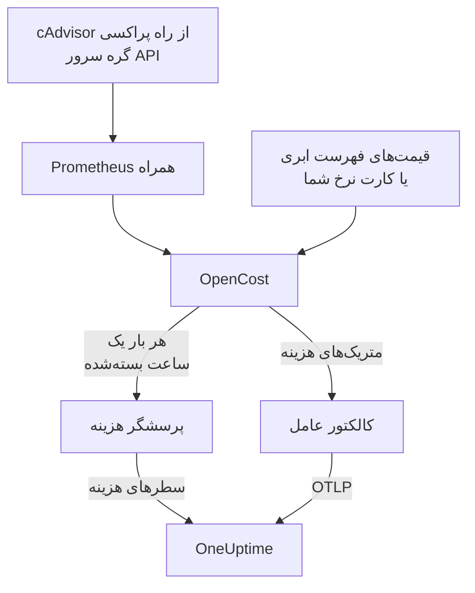

# مشاهده‌پذیری هزینه Kubernetes

ببینید هر بار کاری Kubernetes چقدر هزینه دارد — خرج برای هر namespace، بار کاری و پاد، ظرفیت بیکار، و اینکه چه مقدار از هر request مصرف می‌شود — کنار متریک‌ها، لاگ‌ها و ترِیس‌هایی که [عامل Kubernetes](/docs/telemetry/kubernetes-agent) از پیش گردآوری می‌کند. یک مقدار Helm آن را بدون هیچ اعتبارنامه ابری روشن می‌کند، و سپس صفحه **Costs** خوشه به شما می‌گوید کدام requestها را کوچک کنید.

:::cards
- [روشن کردن](#روشن-کردن-مشاهدهپذیری-هزینه): یک `helm upgrade`.
- [موتور خودتان را بیاورید](#از-پیش-kubecost-یا-opencost-دارید): عامل را به Kubecost یا OpenCost نشانه بگیرید.
- [Right-sizing](#right-sizing): پیشنهادهای request، و اینکه چگونه ساخته می‌شوند.
- [رفع اشکال](#رفع-اشکال): صفحه‌های خالی، پیشنهادهای ناموجود.
:::

## چگونه کار می‌کند

با `cost.enabled=true` چارت چهار چیز را کنار عامل اجرا می‌کند:



1. **OpenCost**، موتور هزینه متن‌باز (Apache-2.0، CNCF؛ همان [cost-model](https://github.com/kubecost/cost-model) که Kubecost هم بر آن کار می‌کند). خوشه را می‌پاید، گره‌ها، حجم‌ها و متعادل‌کننده‌های بار شما را قیمت‌گذاری می‌کند و حساب می‌کند هر بار کاری چقدر هزینه دارد.
2. **یک Prometheus کوچک**، که OpenCost برای تاریخچه مصرف و قیمت به آن نیاز دارد. یک نسخه اجرا می‌کند، تاریخچه ۷ روز را نگه می‌دارد و دقیقاً دو هدف را برداشت می‌کند: cAdvisor از راه پراکسی گره سرور API، و خود OpenCost (که متریک‌های request منابع را خودش منتشر می‌کند، پس kube-state-metrics در کار نیست). هرگز بیرون از خوشه در دسترس قرار نمی‌گیرد و داده‌اش هرگز از آن بیرون نمی‌رود.
3. **پرسشگر هزینه** (`cost.agent`). در هر ساعت بسته‌شده یک بار، Allocation API در OpenCost را می‌خواند و برای هر بار کاری یک سطر هزینه به OneUptime می‌فرستد: CPU، حافظه، GPU، حجم‌ها، شبکه، متعادل‌کننده‌های بار و بیکاری، همراه با کارایی. هر ساعت یک بار فرستاده می‌شود؛ سرور ساعتی را که از پیش دارد رد می‌کند، پس راه‌اندازی دوباره نمی‌تواند خرج را دو بار بشمارد.
4. **برداشت متریک‌های هزینه** (`cost.metrics`). کالکتور عامل متریک‌های هزینه OpenCost را برداشت می‌کند و آن‌ها را همراه بقیه متریک‌های خوشه می‌فرستد.

OpenCost گره‌ها را بر پایه قیمت‌های فهرست عمومی ارائه‌دهنده ابری شما (AWS، Google Cloud، Azure) و بدون هیچ اعتبارنامه‌ای قیمت‌گذاری می‌کند. خوشه‌هایی که قیمت فهرست ابری ندارند، به‌جایش یک [کارت نرخ](#قیمتگذاری-درونسازمانی-و-سختافزار-خالص) تنظیم می‌کنند.

## روشن کردن مشاهده‌پذیری هزینه

:::steps
### عامل را با cost.enabled به‌روز کنید

```bash
helm upgrade kubernetes-agent oneuptime/kubernetes-agent \
  --namespace oneuptime-agent \
  --reset-then-reuse-values \
  --set cost.enabled=true
```

همین یک نصب کامل است: دو پاد کوچک اضافه، OpenCost و Prometheus آن. اگر عامل را با نام انتشار یا namespace دیگری نصب کرده‌اید، همان‌ها را به کار ببرید (`helm list -A | grep kubernetes-agent` نشانشان می‌دهد).

### برای نخستین ساعت بسته‌شده صبر کنید

نخستین هزینه‌ها پس از بسته شدن نخستین ساعت کامل دیده می‌شوند، و OpenCost پس از شروع چند دقیقه زمان لازم دارد تا نخستین ساعتش را قیمت‌گذاری کند.

### صفحه‌های Costs را باز کنید

- **محصولات** > **زیرساخت** > **Kubernetes** > **Costs** خرج همه خوشه‌های پروژه را نشان می‌دهد.
- در یک خوشه، **Costs** روند خرج آن، **Spend by Namespace** با تفکیک CPU، حافظه و ذخیره‌سازی، **Spend by Workload**، خرج بیکاری، کارایی و کارت **Right-Sizing** را نشان می‌دهد.
:::

متریک‌های هزینه (`node_total_hourly_cost`، `pv_hourly_cost` و بقیه) متریک‌هایی معمولی‌اند: در کاوشگر متریک، در داشبوردهای سفارشی و در مانیتورهای متریک هستند. برای یک داشبورد آماده، به **محصولات** > **داشبوردها** بروید، **ساخت داشبورد** را برگزینید و **Kubernetes Cost Dashboard** را انتخاب کنید: روند هزینه ساعتی گره‌ها، هزینه واحد CPU و حافظه، و خرج حجم‌ها و متعادل‌کننده‌های بار.

## از پیش Kubecost یا OpenCost دارید؟

به‌جایش عامل را به موتور خودتان نشانه بگیرید، و هیچ چیزی همراه نمی‌شود:

```bash
helm upgrade kubernetes-agent oneuptime/kubernetes-agent \
  --namespace oneuptime-agent \
  --reset-then-reuse-values \
  --set cost.enabled=true \
  --set cost.engine.url=http://kubecost-cost-analyzer.kubecost.svc.cluster.local:9090
```

| موتور | نشانی معمول سرویس |
| --- | --- |
| OpenCost | `http://opencost.opencost.svc.cluster.local:9003` |
| Kubecost | `http://kubecost-cost-analyzer.kubecost.svc.cluster.local:9090` |

مسیر Allocation API خودبه‌خود پیدا می‌شود (`/model/allocation` برای Kubecost، `/allocation/compute` یا `/allocation` برای OpenCost). `cost.engine.allocationPath` را فقط برای یک نصب نامعمول تنظیم کنید. برای پیشنهادهای حافظه، `cost.engine.prometheusUrl` را هم تنظیم کنید (ببینید [داده‌های پشت آن](#دادههای-پشت-آن)).

## قیمت‌گذاری درون‌سازمانی و سخت‌افزار خالص

خوشه‌هایی که گره‌هایشان قیمت فهرست ابری عمومی ندارند می‌توانند یک کارت نرخ تنظیم کنند. آنگاه OpenCost هر منبع را بر پایه این رقم‌ها قیمت‌گذاری می‌کند، همه به دلار آمریکا برای هر منبع-ساعت:

```yaml title="values.yaml"
cost:
  enabled: true
  opencost:
    customPricing:
      enabled: true
      cpuPerCoreHour: "0.031611"       # ~$23 per core-month
      ramPerGiBHour: "0.004237"        # ~$3 per GiB-month
      storagePerGBHour: "0.00005479452" # ~$0.04 per GB-month
      gpuPerHour: "0.95"
```

## تنظیماتی که دانستنشان می‌ارزد

همه اختیاری‌اند؛ `values.yaml` چارت فهرست کامل را دارد:

```yaml title="values.yaml"
cost:
  agent:
    windowSeconds: 3600   # allocation window length (hourly = native)
    includeIdle: true     # ship the engine's __idle__ allocation
    currency: USD         # currency code shown in the UI (informational)
  prometheus:
    retention: 7d         # bundled TSDB history; right-sizing reads peaks back over days
    persistence:
      enabled: false      # set true for a small PVC; emptyDir otherwise
  metrics:
    enabled: true         # cost metrics for dashboards / Metric Explorer
    scrapeInterval: 60s
```

## Right-sizing

کارت **Right-Sizing** در صفحه **Costs** یک خوشه برای هر کانتینری که تاریخچه کافی از آن دارد یک request برای CPU و یک request برای حافظه پیشنهاد می‌کند و آن‌ها را بر پایه اینکه هر تغییر در ماه چقدر صرفه‌جویی می‌کند رتبه‌بندی می‌کند.

یک پیشنهاد، تقاضای مشاهده‌شده به‌علاوه ۲۵٪ حاشیه است، گردشده به مقداری که بتوانید در یک manifest بگذارید (10m برای CPU، 16Mi برای حافظه):

- CPU بر پایه صدک ۹۵ میانگین مصرف ساعتی اندازه‌گیری می‌شود: آن‌قدر بالا که بار واقعی را بپوشاند، و آن‌قدر پایین که یک جهش request را برای یک ماه باد نکند.
- حافظه بر پایه اوج working set اندازه‌گیری می‌شود، هرگز بر پایه یک میانگین (ببینید [داده‌های پشت آن](#دادههای-پشت-آن)).

requestها پیشنهاد می‌شوند؛ limitها نه. request همان چیزی است که زمان‌بند رزرو می‌کند و صورت‌حساب بر پایه آن حساب می‌شود، پس همان عددی است که هزینه را جابه‌جا می‌کند. limit تصمیمی است درباره اینکه یک کانتینر بدرفتار محدود شود یا کشته شود، و این تصمیمی است که داده مصرف نمی‌تواند به جای شما بگیرد.

هر کانتینر با request کنونی‌اش مقایسه می‌شود:

| داوری | چه معنایی دارد |
| --- | --- |
| بیش‌تخصیص | به‌روشنی بیش از آنچه مصرف می‌کند رزرو می‌کند. صرفه‌جویی‌ها از همین‌جا می‌آیند. |
| کم‌تخصیص | کمتر از آنچه مصرف می‌کند رزرو می‌کند، پس محدود می‌شود یا در خطر OOM kill است. درست کردنش هزینه دارد، و کارت آن را به‌صورت افزایش نشان می‌دهد. |
| بدون request | چیزی برای کوچک کردن نیست، ولی زمان‌بند نمی‌تواند کانتینر را با اطمینان جای دهد، و زیر فشار نخستین کانتینری است که بیرون رانده می‌شود. |

کانتینری که در ۱۵٪ پیشنهادش باشد درست‌اندازه شمرده و کنار گذاشته می‌شود: هیچ‌کس نباید یک manifest را برای تراشیدن ۳٪ از یک request ویرایش کند.

دو نگهبان پیشنهادها را صادق نگه می‌دارند. یک بار کاری پیش از هر اندازه‌گیری دست‌کم به ۲۴ ساعت پنجره هزینه نیاز دارد، چون یک پنجره چهارساعته ممکن است یک کار دسته‌ای شبانه را در حال استراحت بگیرد و پیشنهاد کند تا هیچ کوچکش کنید. و صرفه‌جویی‌ها بر پایه طول پنجره‌ای که به آن نگاه می‌کنید پیش‌بینی می‌شوند، نه بر پایه شمار سطرها، پس صرفه‌جویی یک Deployment در شمار نسخه‌هایش ضرب نمی‌شود. برآورد فرض می‌کند خرج با آنچه موتور تخصیص داده، یعنی `max(request, usage)`، تغییر می‌کند؛ برای یک کانتینر بیش‌تخصیص این همان request است، پس رقم صرفه‌جویی دقیق است.

### داده‌های پشت آن

پرسشگر کنار خرج، آنچه را یک پیشنهاد نیاز دارد هم گردآوری می‌کند: requestها، limitها و مصرف CPU و حافظه هر کانتینر.

حافظه به یک منبع دیگر نیاز دارد. Allocation API فقط یک میانگین برای هر پنجره گزارش می‌کند، و میانگین ساعتی جهشی را که یک کانتینر را با OOM kill از پا درمی‌آورد پنهان می‌کند، پس اندازه‌گیری حافظه بر پایه آن خطرناک بود. پرسشگر به‌جایش اوج حافظه هر کانتینر را از Prometheus می‌خواند و بر پایه `(namespace, pod, container)` پیوند می‌دهد:

- با موتور همراه (پیش‌فرض)، از Prometheus خود چارت استفاده می‌کند. چیزی برای تنظیم نیست.
- با موتور خودتان (`cost.engine.url`)، `cost.engine.prometheusUrl` را به Prometheusی نشانه بگیرید که cAdvisor را برداشت می‌کند، و اگر نام کار برداشت آن `kubernetes-nodes-cadvisor` نیست، `cost.engine.prometheusCadvisorJob` را تنظیم کنید.
- بدون Prometheus، پیشنهادهای CPU همچنان بر پایه میانگین‌های ساعتی ذخیره‌شده کار می‌کنند، و پیشنهادهای حافظه به‌جای حدس زده شدن کنار گذاشته می‌شوند.

قطعی Prometheus هرگز گردآوری خرج را متوقف نمی‌کند: اوج‌ها یک افزوده‌اند و یک ساعت بدون آن‌ها فرستاده می‌شود. CPU عمداً از Prometheus استفاده نمی‌کند: request بیش از اندازه بزرگ CPU فقط محدود می‌کند، در حالی که request بیش از اندازه کوچک حافظه کانتینر را می‌کشد، پس میانگین‌های ساعتی برای CPU امن‌اند، و پرس‌وجوی نرخ CPU هر کانتینر در سراسر یک خوشه آن‌قدر سنگین است که یک Prometheus کوچک را از پا درآورد.

## هشدار بر پایه هزینه

متریک‌های هزینه متریک‌هایی معمولی‌اند، پس یک [مانیتور متریک](/docs/monitor/metrics-monitor) می‌تواند مانند هر چیز دیگری بر پایه آن‌ها هشدار دهد: برای نمونه وقتی میانگین `node_total_hourly_cost` از یک بودجه بالاتر برود، یا وقتی `pv_hourly_cost` برای کلاس حجمی پیدا شود که نباید در یک خوشه باشد.

## مدل داده و نگهداشت

سطرهای هزینه در ClickHouse ذخیره می‌شوند، یکی برای هر خوشه، پنجره، namespace، کنترلر، پاد و کانتینر. از نگهداشت تله‌متری خوشه پیروی می‌کنند: `retainTelemetryDataForDays` خوشه، یا اگر آن تنظیم نشده باشد نگهداشت داده پروژه. ظرفیت بیکار و تخصیص‌نیافته به‌صورت سطرهای معمولی زیر namespaceهای `__idle__` و `__unallocated__` ذخیره می‌شوند، پس مانند خرج بارهای کاری گروه‌بندی و پالایش می‌شوند.

## رفع اشکال

:::details صفحه‌های Costs خالی‌اند
لاگ‌های پرسشگر هزینه را بخوانید: `kubectl logs -n oneuptime-agent deploy/kubernetes-agent-cost`. (وقتی نام انتشار `kubernetes-agent` را دربر ندارد، نام Deployment برابر `<release>-kubernetes-agent-cost` است؛ `kubectl get deploy -n oneuptime-agent` آن‌ها را فهرست می‌کند.) `HTTP 401` یعنی OneUptime کلید دریافت داده را رد کرده است. `did not answer any known allocation path` یعنی موتور هنوز بالا نیامده (OpenCost همراه چند دقیقه زمان لازم دارد تا نخستین ساعت‌هایش را قیمت‌گذاری کند) یا `cost.engine.url` نادرست است.
:::

:::details OpenCost همراه آماده نیست
لاگ‌هایش را بخوانید: `kubectl logs -n oneuptime-agent deploy/kubernetes-agent-opencost`. این لاگ‌ها می‌گویند کدام ارائه‌دهنده ابری را تشخیص داده و آیا داده‌های قیمتش بار شده‌اند.
:::

:::details لاگ OpenCost می‌گوید mkdir /var/configs: permission denied
یک چارت قدیمی‌تر OpenCost را بدون پوشه پیکربندی نوشتنی اجرا می‌کرد، پس `Error downloading default pricing data` باعث می‌شد Allocation API آن نتواند پاسخ دهد و پرسشگر بایستد، در حالی که پاد در `Running` می‌ماند، `/healthz` سبز می‌ماند و متریک‌های هزینه گره همچنان منتشر می‌شدند. چارت‌های کنونی این را درست کرده‌اند: `helm repo update` را اجرا کنید و سپس با `--reset-then-reuse-values` به‌روزرسانی کنید. سطرهای هزینه در پرسش بعدی دیده می‌شوند.
:::

:::details Kubernetes Cost Dashboard داده‌ای نشان نمی‌دهد
این الگو متریک‌های هزینه برداشت‌شده را می‌خواند: بررسی کنید که `cost.metrics.enabled` برابر `true` باشد.
:::

:::details کارت Right-Sizing خالی است
یا بازه زمانی کوتاه‌تر از ۲۴ ساعتی است که یک پیشنهاد نیاز دارد (آن را گسترده‌تر کنید)، یا هر کانتینر از پیش در ۱۵٪ request پیشنهادی‌اش است، که کارت همین را می‌گوید.
:::

:::details پیشنهادهای حافظه - نشان می‌دهند، ولی پیشنهادهای CPU کار می‌کنند
هیچ اوج حافظه‌ای به OneUptime نرسید، پس حافظه به‌جای حدس زده شدن از یک میانگین اندازه‌گیری‌نشده ماند. با موتور خودتان، `cost.engine.prometheusUrl` را تنظیم کنید. کارت می‌گوید این موضوع چند کانتینر را دربر می‌گیرد.
:::

:::details عددها با رابط کاربری خود موتور فرق دارند
OneUptime تعدیل‌های تطبیق موتور را در هر جزء هزینه می‌گنجاند و ساعت‌های کامل بسته‌شده را می‌فرستد: خرج ساعت کنونی پس از بسته شدنش دیده می‌شود.
:::

:::details Prometheus همراه دوباره راه‌اندازی شد
با ذخیره‌سازی پیش‌فرض `emptyDir`، یک راه‌اندازی دوباره چند ساعت از تاریخچه مصرف را از دست می‌دهد، پس هزینه آن ساعت‌ها ممکن است کمتر درآید. اگر این برایتان مهم است، `cost.prometheus.persistence.enabled=true` را تنظیم کنید.
:::

## گام‌های بعدی

:::cards
- [عامل Kubernetes](/docs/telemetry/kubernetes-agent): عامل را نصب کنید، و هر چیز دیگری که گردآوری می‌کند.
- [مانیتور متریک‌ها](/docs/monitor/metrics-monitor): وقتی خرج از یک بودجه می‌گذرد هشدار بگیرید.
- [مانیتور Kubernetes](/docs/monitor/kubernetes-monitor): برای سلامت خوشه هم هشدار بگیرید.
:::
