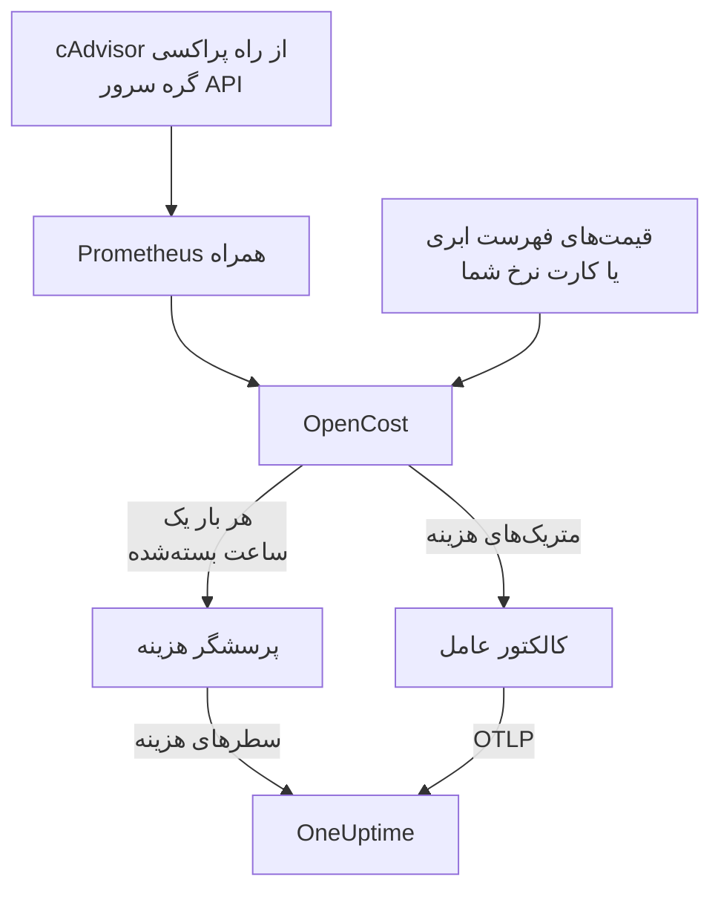

# مشاهده‌پذیری هزینه Kubernetes

ببینید هر بار کاری Kubernetes چقدر هزینه دارد — خرج برای هر namespace، بار کاری و پاد، ظرفیت بیکار، و اینکه چه مقدار از هر request مصرف می‌شود — کنار متریک‌ها، لاگ‌ها و ترِیس‌هایی که [عامل Kubernetes](/docs/telemetry/kubernetes-agent) از پیش گردآوری می‌کند. این قابلیت به‌طور پیش‌فرض و بدون هیچ اعتبارنامه ابری روشن است: نمای کلی خوشه می‌گوید چقدر هزینه دارد، صفحه **هزینه‌ها** آن به شما می‌گوید کدام requestها را کوچک کنید، و متریک‌های هزینه را می‌توان مانند هر متریک دیگری در نمودار نشان داد و برایشان هشدار گذاشت.

:::cards
- [روشن کردن](#روشن-کردن-مشاهدهپذیری-هزینه): به‌طور پیش‌فرض روشن است؛ هر جا نیست، یک `helm upgrade`.
- [هشدار بر پایه هزینه](#هشدار-بر-پایه-هزینه): هزینه هر خوشه، namespace و بار کاری، به‌صورت متریک.
- [موتور خودتان](#از-پیش-kubecost-یا-opencost-دارید): Kubecost یا OpenCostی که از پیش اجرا می‌کنید پیدا و خوانده می‌شود.
- [Right-sizing](#right-sizing): پیشنهادهای request، و اینکه چگونه ساخته می‌شوند.
- [رفع اشکال](#رفع-اشکال): صفحه‌های خالی، پیشنهادهای ناموجود.
:::

## چگونه کار می‌کند

وقتی پایش هزینه روشن باشد، که به‌طور پیش‌فرض هست (`cost.enabled: auto`)، چارت چهار چیز را کنار عامل اجرا می‌کند:



1. **OpenCost**، موتور هزینه متن‌باز (Apache-2.0، CNCF؛ همان [cost-model](https://github.com/kubecost/cost-model) که Kubecost هم بر آن کار می‌کند). خوشه را می‌پاید، گره‌ها، حجم‌ها و متعادل‌کننده‌های بار شما را قیمت‌گذاری می‌کند و حساب می‌کند هر بار کاری چقدر هزینه دارد.
2. **یک Prometheus کوچک**، که OpenCost برای تاریخچه مصرف و قیمت به آن نیاز دارد. یک نسخه اجرا می‌کند، تاریخچه ۷ روز را نگه می‌دارد و دقیقاً دو هدف را برداشت می‌کند: cAdvisor از راه پراکسی گره سرور API، که از آن فقط سری‌هایی را نگه می‌دارد که OpenCost می‌خواند، و خود OpenCost (که متریک‌های request منابع را خودش منتشر می‌کند، پس kube-state-metrics در کار نیست). هرگز بیرون از خوشه در دسترس قرار نمی‌گیرد و داده‌اش هرگز از آن بیرون نمی‌رود.
3. **پرسشگر هزینه** (`cost.agent`). در هر ساعت بسته‌شده یک بار، Allocation API در OpenCost را می‌خواند و برای هر بار کاری یک سطر هزینه به OneUptime می‌فرستد: CPU، حافظه، GPU، حجم‌ها، شبکه، متعادل‌کننده‌های بار و بیکاری، همراه با کارایی. هر ساعت یک بار فرستاده می‌شود؛ سرور ساعتی را که از پیش دارد رد می‌کند، پس راه‌اندازی دوباره نمی‌تواند خرج را دو بار بشمارد. OneUptime از روی همین سطرها [متریک‌های هزینه](#هشدار-بر-پایه-هزینه) را هم می‌نویسد.
4. **برداشت متریک‌های هزینه** (`cost.metrics`). کالکتور عامل متریک‌های قیمت OpenCost، یعنی هزینه ساعتی هر گره، حجم و متعادل‌کننده بار، را برداشت می‌کند و آن‌ها را همراه بقیه متریک‌های خوشه می‌فرستد.

OpenCost گره‌ها را بر پایه قیمت‌های فهرست عمومی ارائه‌دهنده ابری شما (AWS، Google Cloud، Azure) و بدون هیچ اعتبارنامه‌ای قیمت‌گذاری می‌کند. در جاهای دیگر از نرخ‌های پیش‌فرض خودش استفاده می‌کند، که یک [کارت نرخ](#قیمتگذاری-درونسازمانی-و-سختافزار-خالص) از خودتان جای آن‌ها را می‌گیرد.

سه پاد روی هم حدود 150m از CPU و 450Mi از حافظه درخواست می‌کنند. پایش هزینه روی پیش‌تنظیم‌های `gke-autopilot` و `eks-fargate` به‌طور پیش‌فرض خاموش است: این بسترها صورت‌حساب هر پاد را بر پایه آنچه درخواست می‌کند می‌نویسند، پس پادهای هزینه به همان صورت‌حسابی که اندازه می‌گیرند می‌افزودند، و OpenCost گره‌ها را قیمت‌گذاری می‌کند، در حالی که هیچ‌یک از این دو بستر بر پایه گره هزینه نمی‌گیرد.

## روشن کردن مشاهده‌پذیری هزینه

یک نصب تازه به هیچ کاری نیاز ندارد: پایش هزینه به‌طور پیش‌فرض روشن است. عاملی را که پیش از پیش‌فرض شدن آن نصب شده به‌روز کنید، یا آن را با پیش‌تنظیم `gke-autopilot` یا `eks-fargate` روشن کنید:

:::steps
### عامل را به‌روز کنید

```bash
helm upgrade kubernetes-agent oneuptime/kubernetes-agent \
  --namespace oneuptime-agent \
  --reset-then-reuse-values \
  --set cost.enabled=true
```

همین یک نصب کامل است: سه پاد کوچک اضافه، OpenCost، Prometheus آن و عامل هزینه. اگر عامل را با نام انتشار یا namespace دیگری نصب کرده‌اید، همان‌ها را به کار ببرید (`helm list -A | grep kubernetes-agent` نشانشان می‌دهد). برای خاموش کردن پایش هزینه، `--set cost.enabled=false` را به همین شیوه تنظیم کنید.

### برای نخستین ساعت بسته‌شده صبر کنید

نخستین هزینه‌ها پس از بسته شدن نخستین ساعت کامل دیده می‌شوند، و OpenCost پس از شروع چند دقیقه زمان لازم دارد تا نخستین ساعتش را قیمت‌گذاری کند.

### صفحه‌های هزینه‌ها را باز کنید

- **محصولات** > **زیرساخت** > **Kubernetes** > **هزینه‌ها** خرج همه خوشه‌های پروژه را نشان می‌دهد.
- در یک خوشه، نمای کلی خرج آن در ۲۴ ساعت گذشته، برآورد هزینه ماهانه، خرج بیکاری، کارایی و پرهزینه‌ترین namespaceها و بارهای کاری آن را نشان می‌دهد.
- در یک خوشه، **هزینه‌ها** روند خرج آن، **مخارج به تفکیک Namespace** با تفکیک CPU، حافظه و ذخیره‌سازی، **مخارج به تفکیک بار کاری**، خرج بیکاری، کارایی و کارت **تعیین اندازهٔ مناسب** را نشان می‌دهد.
:::

متریک‌های هزینه (`node_total_hourly_cost`، `pv_hourly_cost` و بقیه) متریک‌هایی معمولی‌اند: در کاوشگر متریک، در داشبوردهای سفارشی و در مانیتورهای متریک هستند. برای یک داشبورد آماده، به **محصولات** > **داشبوردها** بروید، **ساخت داشبورد** را برگزینید و **Kubernetes Cost Dashboard** را انتخاب کنید: روند هزینه ساعتی گره‌ها، هزینه واحد CPU و حافظه، و خرج حجم‌ها و متعادل‌کننده‌های بار.

زیر رقم‌ها، نمای کلی و صفحه **هزینه‌ها** می‌گویند قیمت‌هایشان از کجا می‌آید: قیمت‌های فهرست یک ابر، کارت نرخ شما، یا نرخ‌های پیش‌فرض OpenCost. کارایی همه‌جا یک رقم است، از جمله در متریک کارایی: اینکه چه مقدار از CPU و حافظه درخواستی مصرف شده، با وزن‌دهی هر ساعت هر کانتینر بر پایه هزینه CPU و حافظه‌اش، پس کاری ارزان که هیچ چیزی مصرف نمی‌کند نمی‌تواند کارایی خوشه‌ای را که منابعش خوب مصرف می‌شوند پایین بکشد، و ظرفیت بیکار شمرده نمی‌شود.

## از پیش Kubecost یا OpenCost دارید؟

عامل هزینه آن را پیدا می‌کند و آن را به‌جای OpenCost همراه می‌خواند، پس خوشه همان‌طور قیمت‌گذاری می‌شود که موتورتان را برپا کرده‌اید: با کارت نرخ شما، یا با صورت‌حساب ابری‌تان که Kubecost به آن وصل است. هنگام شروع و سپس هر ساعت، از راه Kubernetes API در هر namespace به دنبال سرویس‌هایی می‌گردد که چارت‌های خود موتورها می‌سازند (`cost-analyzer` یا `frontend` از Kubecost، سرویس چارت OpenCost، و سرویس `opencost` که manifest آن می‌سازد)، و نخست سراغ Kubecost می‌رود. موتوری را که پاسخ نمی‌دهد، نیاز به ورود دارد یا برای چند خوشه پاسخ می‌دهد کنار می‌گذارد، و آنگاه موتور همراه را می‌خواند.

آنگاه نمای کلی خوشه نام موتور شما را می‌آورد و می‌گوید OpenCost همراه لازم نیست. اجرای آن را متوقف کنید:

```bash
helm upgrade kubernetes-agent oneuptime/kubernetes-agent \
  --namespace oneuptime-agent \
  --reset-then-reuse-values \
  --set cost.engine.url=auto
```

با `cost.engine.url=auto` هیچ چیزی همراه نمی‌شود، و عامل موتور شما را هر جا که اجرا شود می‌خواند؛ اگر هیچ موتوری نصب نباشد، هیچ چیزی قیمت‌گذاری نمی‌شود. چارت خودش نمی‌تواند به دنبال موتور بگردد: `lookup` در Helm هنگام `helm template`، Argo CD یا یک اجرای آزمایشی چیزی نمی‌بیند. برای نگه داشتن OpenCost همراه در کنار موتور خودتان، `cost.engine.preferExisting=false` را تنظیم کنید؛ برای نام بردن موتوری که باید خوانده شود، `cost.engine.url` را روی سرویس آن تنظیم کنید:

| موتور | نشانی معمول سرویس |
| --- | --- |
| OpenCost | `http://opencost.opencost.svc.cluster.local:9003` |
| Kubecost 2 | `http://kubecost-cost-analyzer.kubecost.svc.cluster.local:9090` |
| Kubecost 3 | `http://kubecost-frontend.kubecost.svc.cluster.local:9090` |

مسیر Allocation API خودبه‌خود پیدا می‌شود (`/model/allocation` برای Kubecost، `/allocation/compute` یا `/allocation` برای OpenCost). `cost.engine.allocationPath` را فقط برای یک نصب نامعمول تنظیم کنید. با `auto` یا یک نشانی هیچ چیزی همراه نمی‌شود، پس برای پیشنهادهای حافظه `cost.engine.prometheusUrl` را هم تنظیم کنید (ببینید [داده‌های پشت آن](#دادههای-پشت-آن)). متریک‌های قیمت هم به همین شکل پیدا می‌شوند، پس هر کدام از سرویس‌های موتور را که بدهید فرقی نمی‌کند: عامل اول `/metrics` موتور را امتحان می‌کند، بعد `/model/metrics` را که فرانت‌اند Kubecost 2 یا رابط کاربری OpenCost به موتور می‌رساند، بعد عامل FinOps در Kubecost 3، و کالکتور اولین نشانی‌ای را برداشت می‌کند که سری‌های قیمت دارد. برای اینکه خودتان آن‌ها را مشخص کنید، `cost.metrics.endpoint` را تنظیم کنید.

## قیمت‌گذاری درون‌سازمانی و سخت‌افزار خالص

خوشه‌هایی که گره‌هایشان قیمت فهرست ابری عمومی ندارند می‌توانند یک کارت نرخ تنظیم کنند. بدون کارت نرخ، OpenCost گره‌هایشان را با نرخ‌های پیش‌فرض خودش قیمت‌گذاری می‌کند (درون‌سازمانی، سخت‌افزار خالص، kind، k3s)، که ممکن است با هزینه واقعی سخت‌افزار شما فاصله زیادی داشته باشند، و نمای کلی خوشه و صفحه **هزینه‌ها** آن همین را می‌گویند؛ روی ابری که آن را می‌شناسد، هر گره قیمت فهرستش را نگه می‌دارد و کارت نرخ فقط آنچه را قیمت‌گذاری می‌کند که فهرست ندارد. با کارت نرخ، OpenCost هر منبع را بر پایه این رقم‌ها قیمت‌گذاری می‌کند، همه به دلار آمریکا برای هر منبع-ساعت:

```yaml title="values.yaml"
cost:
  enabled: true
  opencost:
    customPricing:
      enabled: true
      cpuPerCoreHour: "0.031611"       # ~$23 per core-month
      ramPerGiBHour: "0.004237"        # ~$3 per GiB-month
      storagePerGBHour: "0.00005479452" # ~$0.04 per GB-month
      gpuPerHour: "0.95"
```

این‌ها نرخ‌های پیش‌فرض خود OpenCost هستند: رقم‌های خودتان را جایشان بگذارید، وگرنه صفحه **هزینه‌ها** همچنان می‌گوید خوشه با نرخ‌های پیش‌فرض OpenCost قیمت‌گذاری شده است.

## تنظیماتی که دانستنشان می‌ارزد

همه اختیاری‌اند؛ `values.yaml` چارت فهرست کامل را دارد:

```yaml title="values.yaml"
cost:
  enabled: auto           # on, except with the gke-autopilot and eks-fargate presets
  agent:
    windowSeconds: 3600   # allocation window length (hourly = native)
    includeIdle: true     # ship the engine's __idle__ allocation
    currency: USD         # currency code shown in the UI (informational)
  prometheus:
    retention: 7d         # bundled TSDB history; right-sizing reads peaks back over days
    persistence:
      enabled: false      # set true for a small PVC; emptyDir otherwise
  metrics:
    enabled: true         # cost metrics for dashboards / Metric Explorer
    scrapeInterval: 60s
```

## Right-sizing

کارت **تعیین اندازهٔ مناسب** در صفحه **هزینه‌ها** یک خوشه برای هر کانتینری که تاریخچه کافی از آن دارد یک request برای CPU و یک request برای حافظه پیشنهاد می‌کند و آن‌ها را بر پایه اینکه هر تغییر در ماه چقدر صرفه‌جویی می‌کند رتبه‌بندی می‌کند.

یک پیشنهاد، تقاضای مشاهده‌شده به‌علاوه ۲۵٪ حاشیه است، گردشده به مقداری که بتوانید در یک manifest بگذارید (10m برای CPU، 16Mi برای حافظه):

- CPU بر پایه صدک ۹۵ میانگین مصرف ساعتی اندازه‌گیری می‌شود: آن‌قدر بالا که بار واقعی را بپوشاند، و آن‌قدر پایین که یک جهش request را برای یک ماه باد نکند.
- حافظه بر پایه اوج working set اندازه‌گیری می‌شود، هرگز بر پایه یک میانگین (ببینید [داده‌های پشت آن](#دادههای-پشت-آن)).

requestها پیشنهاد می‌شوند؛ limitها نه. request همان چیزی است که زمان‌بند رزرو می‌کند و صورت‌حساب بر پایه آن حساب می‌شود، پس همان عددی است که هزینه را جابه‌جا می‌کند. limit تصمیمی است درباره اینکه یک کانتینر بدرفتار محدود شود یا کشته شود، و این تصمیمی است که داده مصرف نمی‌تواند به جای شما بگیرد.

هر کانتینر با request کنونی‌اش مقایسه می‌شود:

| داوری | چه معنایی دارد |
| --- | --- |
| بیش‌تخصیص | به‌روشنی بیش از آنچه مصرف می‌کند رزرو می‌کند. صرفه‌جویی‌ها از همین‌جا می‌آیند. |
| کم‌تخصیص | کمتر از آنچه مصرف می‌کند رزرو می‌کند، پس محدود می‌شود یا در خطر OOM kill است. درست کردنش هزینه دارد، و کارت آن را به‌صورت افزایش نشان می‌دهد. |
| بدون request | چیزی برای کوچک کردن نیست، ولی زمان‌بند نمی‌تواند کانتینر را با اطمینان جای دهد، و زیر فشار نخستین کانتینری است که بیرون رانده می‌شود. |

کانتینری که در ۱۵٪ پیشنهادش باشد درست‌اندازه شمرده و کنار گذاشته می‌شود: هیچ‌کس نباید یک manifest را برای تراشیدن ۳٪ از یک request ویرایش کند.

دو نگهبان پیشنهادها را صادق نگه می‌دارند. یک بار کاری پیش از هر اندازه‌گیری دست‌کم به ۲۴ ساعت پنجره هزینه نیاز دارد، چون یک پنجره چهارساعته ممکن است یک کار دسته‌ای شبانه را در حال استراحت بگیرد و پیشنهاد کند تا هیچ کوچکش کنید. و صرفه‌جویی‌ها بر پایه طول پنجره‌ای که به آن نگاه می‌کنید پیش‌بینی می‌شوند، نه بر پایه شمار سطرها، پس صرفه‌جویی یک Deployment در شمار نسخه‌هایش ضرب نمی‌شود. برآورد فرض می‌کند خرج با آنچه موتور تخصیص داده، یعنی `max(request, usage)`، تغییر می‌کند؛ برای یک کانتینر بیش‌تخصیص این همان request است، پس رقم صرفه‌جویی دقیق است.

### داده‌های پشت آن

پرسشگر کنار خرج، آنچه را یک پیشنهاد نیاز دارد هم گردآوری می‌کند: requestها، limitها و مصرف CPU و حافظه هر کانتینر.

حافظه به یک منبع دیگر نیاز دارد. Allocation API فقط یک میانگین برای هر پنجره گزارش می‌کند، و میانگین ساعتی جهشی را که یک کانتینر را با OOM kill از پا درمی‌آورد پنهان می‌کند، پس اندازه‌گیری حافظه بر پایه آن خطرناک بود. پرسشگر به‌جایش اوج حافظه هر کانتینر را از Prometheus می‌خواند و بر پایه `(namespace, pod, container)` پیوند می‌دهد:

- با موتور همراه (پیش‌فرض)، از Prometheus خود چارت استفاده می‌کند. چیزی برای تنظیم نیست.
- وقتی `cost.engine.url` تنظیم شده باشد (`auto` یا نشانی موتور شما)، `cost.engine.prometheusUrl` را به Prometheusی نشانه بگیرید که cAdvisor را برداشت می‌کند، و اگر نام کار برداشت آن `kubernetes-nodes-cadvisor` نیست، `cost.engine.prometheusCadvisorJob` را تنظیم کنید.
- بدون Prometheus، پیشنهادهای CPU همچنان بر پایه میانگین‌های ساعتی ذخیره‌شده کار می‌کنند، و پیشنهادهای حافظه به‌جای حدس زده شدن کنار گذاشته می‌شوند.

قطعی Prometheus هرگز گردآوری خرج را متوقف نمی‌کند: اوج‌ها یک افزوده‌اند و یک ساعت بدون آن‌ها فرستاده می‌شود. CPU عمداً از Prometheus استفاده نمی‌کند: request بیش از اندازه بزرگ CPU فقط محدود می‌کند، در حالی که request بیش از اندازه کوچک حافظه کانتینر را می‌کشد، پس میانگین‌های ساعتی برای CPU امن‌اند، و پرس‌وجوی نرخ CPU هر کانتینر در سراسر یک خوشه آن‌قدر سنگین است که یک Prometheus کوچک را از پا درآورد.

## هشدار بر پایه هزینه

OneUptime از سطرهای هزینه هر ساعت چهار متریک می‌نویسد که به پول قیمت‌گذاری شده‌اند و نامشان می‌گوید چه هستند، پس می‌توان هزینه را در نمودار نشان داد، روی داشبورد گذاشت و در یک [مانیتور Kubernetes](/docs/monitor/kubernetes-monitor) یا یک [مانیتور متریک](/docs/monitor/metrics-monitor) برایش هشدار گذاشت:

| متریک | چیست | ویژگی‌ها |
| --- | --- | --- |
| `oneuptime.kubernetes.cost.total` | هزینه خوشه در هر ساعت، با احتساب ظرفیت بیکار | `k8s.cluster.name` |
| `oneuptime.kubernetes.cost.idle` | بخشی از آن که هیچ بار کاری به کار نبرد: ظرفیت بیکار و تخصیص‌نیافته | `k8s.cluster.name` |
| `oneuptime.kubernetes.cost.workload` | هزینه هر بار کاری در هر ساعت؛ اگر به تفکیک namespace جمع زده شود، هزینه آن namespace | `k8s.cluster.name`، `k8s.namespace.name`، و نام بار کاری در ویژگی مربوط به نوع آن، مانند `k8s.deployment.name` |
| `oneuptime.kubernetes.cost.efficiency` | اینکه هر بار کاری چند درصد از CPU و حافظه درخواستی‌اش را مصرف کرده، وزن‌دهی‌شده بر پایه هزینه | همان ویژگی‌های بار کاری، مانند بالا |

هر نقطه هزینه یک ساعت است، به واحد پول عامل (به‌طور پیش‌فرض USD)، با برچسب زمانی آغاز آن ساعت، و حدود یک ساعت پس از پایان آن نوشته می‌شود: نقطه‌ها را روی پنجره‌ای از ساعت‌ها جمع بزنید تا نقطه‌های یک روز روی هم هزینه همان روز شوند. این نقطه‌ها از داده‌ای می‌آیند که خوشه پیش‌تر فرستاده، پس به‌عنوان متریک دریافتی در صورت‌حساب نمی‌آیند، و به اندازه بقیه متریک‌های خوشه نگه داشته می‌شوند.

مانیتور Kubernetes سه الگو برای آن‌ها دارد: Cluster Daily Cost Over Budget، Namespace Daily Cost Over Budget و High Idle Spend، هر کدام با بودجه‌ای که باید آن را با بودجه خودتان جایگزین کنید. متریک‌های قیمت OpenCost هم متریک‌هایی معمولی‌اند: یک مانیتور متریک می‌تواند وقتی میانگین `node_total_hourly_cost` از یک بودجه بالاتر برود، یا وقتی `pv_hourly_cost` برای کلاس حجمی پیدا شود که نباید در یک خوشه باشد، هشدار دهد.

## مدل داده و نگهداشت

سطرهای هزینه در ClickHouse ذخیره می‌شوند، یکی برای هر خوشه، پنجره، namespace، کنترلر، پاد و کانتینر. از نگهداشت تله‌متری خوشه پیروی می‌کنند: `retainTelemetryDataForDays` خوشه، یا اگر آن تنظیم نشده باشد نگهداشت داده پروژه. ظرفیت بیکار و تخصیص‌نیافته به‌صورت سطرهای معمولی زیر namespaceهای `__idle__` و `__unallocated__` ذخیره می‌شوند، پس مانند خرج بارهای کاری گروه‌بندی و پالایش می‌شوند.

## رفع اشکال

:::details صفحه‌های Costs خالی‌اند
روی پیش‌تنظیم‌های `gke-autopilot` و `eks-fargate` پایش هزینه به‌طور پیش‌فرض خاموش است: آن را با `--set cost.enabled=true` روشن کنید. در غیر این صورت، لاگ‌های پرسشگر هزینه را بخوانید: `kubectl logs -n oneuptime-agent deploy/kubernetes-agent-cost`. (وقتی نام انتشار `kubernetes-agent` را دربر ندارد، نام Deployment برابر `<release>-kubernetes-agent-cost` است؛ `kubectl get deploy -n oneuptime-agent` آن‌ها را فهرست می‌کند.) `HTTP 401` یعنی OneUptime کلید دریافت داده را رد کرده است. `did not answer any known allocation path` یعنی موتور هنوز بالا نیامده (OpenCost همراه چند دقیقه زمان لازم دارد تا نخستین ساعت‌هایش را قیمت‌گذاری کند) یا `cost.engine.url` نادرست است.
:::

:::details OpenCost همراه آماده نیست
لاگ‌هایش را بخوانید: `kubectl logs -n oneuptime-agent deploy/kubernetes-agent-opencost`. این لاگ‌ها می‌گویند کدام ارائه‌دهنده ابری را تشخیص داده و آیا داده‌های قیمتش بار شده‌اند.
:::

:::details نمای کلی می‌گوید OpenCost همراه لازم نیست
خوشه Kubecost یا OpenCost خودش را اجرا می‌کند و عامل هزینه همان را می‌خواند، پس OpenCost و Prometheusی که چارت همراه آورده هیچ چیزی را قیمت‌گذاری نمی‌کنند. برای متوقف کردن اجرای آن‌ها با `--set cost.engine.url=auto` به‌روزرسانی کنید، یا برای خواندن موتور همراه به‌جای آن، `cost.engine.preferExisting=false` را تنظیم کنید.
:::

:::details عامل هزینه موتور شما را نمی‌خواند
لاگ آن می‌گوید کدام موتور را می‌خواند و چرا بقیه را کنار گذاشت: `kubectl logs -n oneuptime-agent deploy/kubernetes-agent-cost`. موتوری را کنار می‌گذارد که پاسخ نمی‌دهد (مثلاً یک NetworkPolicy میان namespaceها)، نیاز به ورود دارد، یا برای چند خوشه پاسخ می‌دهد، مانند Kubecostی که داده‌های خوشه‌های دیگر را هم گرد می‌آورد. موتوری را که باید خوانده شود با `cost.engine.url` نام ببرید.
:::

:::details لاگ OpenCost می‌گوید mkdir /var/configs: permission denied
یک چارت قدیمی‌تر OpenCost را بدون پوشه پیکربندی نوشتنی اجرا می‌کرد، پس `Error downloading default pricing data` باعث می‌شد Allocation API آن نتواند پاسخ دهد و پرسشگر بایستد، در حالی که پاد در `Running` می‌ماند، `/healthz` سبز می‌ماند و متریک‌های هزینه گره همچنان منتشر می‌شدند. چارت‌های کنونی این را درست کرده‌اند: `helm repo update` را اجرا کنید و سپس با `--reset-then-reuse-values` به‌روزرسانی کنید. سطرهای هزینه در پرسش بعدی دیده می‌شوند.
:::

:::details Kubernetes Cost Dashboard داده‌ای نشان نمی‌دهد
این الگو متریک‌های هزینه برداشت‌شده را می‌خواند: بررسی کنید که `cost.metrics.enabled` برابر `true` باشد. وقتی `cost.engine.url` تنظیم شده باشد، عامل هزینه پیدا می‌کند موتور شما آن‌ها را کجا ارائه می‌دهد، و لاگ آن می‌گوید کجا، یا کدام نشانی‌ها را امتحان کرد: `kubectl logs -n oneuptime-agent deploy/kubernetes-agent-cost`. برای اینکه خودتان آن‌ها را مشخص کنید، `cost.metrics.endpoint` را تنظیم کنید.
:::

:::details کارت Right-Sizing خالی است
یا بازه زمانی کوتاه‌تر از ۲۴ ساعتی است که یک پیشنهاد نیاز دارد (آن را گسترده‌تر کنید)، یا هر کانتینر از پیش در ۱۵٪ request پیشنهادی‌اش است، که کارت همین را می‌گوید.
:::

:::details پیشنهادهای حافظه - نشان می‌دهند، ولی پیشنهادهای CPU کار می‌کنند
هیچ اوج حافظه‌ای به OneUptime نرسید، پس حافظه به‌جای حدس زده شدن از یک میانگین اندازه‌گیری‌نشده ماند. با موتور خودتان، `cost.engine.prometheusUrl` را تنظیم کنید. کارت می‌گوید این موضوع چند کانتینر را دربر می‌گیرد.
:::

:::details عددها با رابط کاربری خود موتور فرق دارند
OneUptime تعدیل‌های تطبیق موتور را در هر جزء هزینه می‌گنجاند و ساعت‌های کامل بسته‌شده را می‌فرستد: خرج ساعت کنونی پس از بسته شدنش دیده می‌شود.
:::

:::details Prometheus همراه دوباره راه‌اندازی شد
با ذخیره‌سازی پیش‌فرض `emptyDir`، یک راه‌اندازی دوباره چند ساعت از تاریخچه مصرف را از دست می‌دهد، پس هزینه آن ساعت‌ها ممکن است کمتر درآید. اگر این برایتان مهم است، `cost.prometheus.persistence.enabled=true` را تنظیم کنید.
:::

## گام‌های بعدی

:::cards
- [عامل Kubernetes](/docs/telemetry/kubernetes-agent): عامل را نصب کنید، و هر چیز دیگری که گردآوری می‌کند.
- [مانیتور متریک‌ها](/docs/monitor/metrics-monitor): وقتی خرج از یک بودجه می‌گذرد هشدار بگیرید.
- [مانیتور Kubernetes](/docs/monitor/kubernetes-monitor): برای سلامت خوشه هم هشدار بگیرید.
:::
