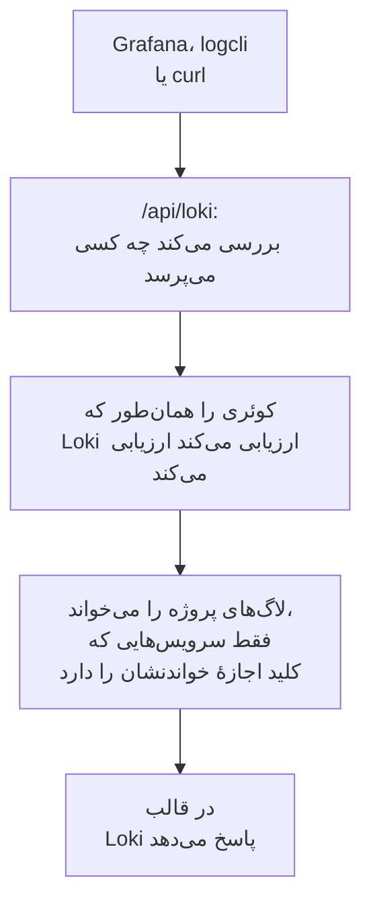

# کوئری گرفتن از لاگ‌ها با LogQL

LogQL زبان کوئری Grafana Loki است. OneUptime به API کوئری Loki روی لاگ‌های پروژهٔ شما پاسخ می‌دهد، بنابراین منبع دادهٔ Loki در Grafana، logcli یا هر کلاینت Loki آن‌ها را می‌خواند، و داشبوردها و کوئری‌های ذخیره‌شده‌ای که برای Loki نوشته‌اید همچنان کار می‌کنند.

:::cards
- [وصل کردن Grafana](#وصل-کردن-grafana): OneUptime را به‌عنوان منبع دادهٔ Loki بیفزایید.
- [برچسب‌های لاگ‌ها](#برچسبهای-لاگها): انتخابگر استریم با چه چیزی تطبیق دارد.
- [LogQL چه چیزهایی را پوشش می‌دهد](#logql-چه-چیزهایی-را-پوشش-میدهد): کوئری‌های لاگ، پارسرها و کوئری‌های متریک.
- [محدودیت‌ها](#محدودیتها): یک کوئری چه چیزی را و چند وقت یک بار می‌تواند بخواند.
:::

## چگونه کار می‌کند

Grafana از OneUptime همان‌طور می‌پرسد که از Loki می‌پرسد. OneUptime بررسی می‌کند که کلید API بتواند لاگ‌های پروژه را بخواند، فقط سرویس‌هایی را می‌خواند که آن کلید اجازهٔ خواندنشان را دارد، و کوئری را همان‌طور که Loki ارزیابی می‌کند ارزیابی می‌کند.



## پیش از شروع

- **لاگ‌هایی که می‌رسند.** آن‌ها را با [OpenTelemetry](/docs/telemetry/open-telemetry) بفرستید، یا از Promtail، Grafana Alloy، Fluent Bit یا Vector از طریق [API ارسال Loki](/docs/telemetry/compatible-endpoints).
- **یک کلید API پروژه که لاگ‌ها را بخواند**، با نقش مالک پروژه، مدیر پروژه، عضو پروژه، بیننده، مدیر تله‌متری، عضو تله‌متری یا بیننده تله‌متری، یا مجوز Read Logs. کلیدی که به برخی سرویس‌ها محدود است فقط لاگ‌های همان سرویس‌ها را می‌خواند. [یک کلید API بسازید](/docs/api-reference/api-reference#یک-کلید-api-بسازید) را ببینید. در OneUptime Cloud، کلیدهای API به طرح **Growth** نیاز دارند.
- **نه یک کلید دریافت داده.** کلید دریافت داده تله‌متری می‌فرستد و چیزی نمی‌خواند، پس Grafana نمی‌تواند با آن وارد شود.

## وصل کردن Grafana

:::steps
### یک کلید API بسازید

در OneUptime، **تنظیمات پروژه** > **پیشرفته** > **کلیدهای API** را باز کنید و روی **ساخت کلید API** کلیک کنید. به کلید نقشی بدهید که تله‌متری را بخواند، یا مجوز Read Logs را.

### یک منبع دادهٔ Loki بیفزایید

در Grafana، **Connections → Data sources → Add data source** را باز کنید و **Loki** را برگزینید.

### نشانی را وارد کنید

**URL** را برابر نشانی OneUptime خود و پس از آن `/api/loki` بگذارید. در OneUptime Cloud، این نشانی `https://oneuptime.com/api/loki` است.

### کلید API را بفرستید

زیر **HTTP headers**، سرآیند `Authorization` را با مقدار `Bearer` و پس از آن یک فاصله و کلید API خود بیفزایید. احراز هویت پایه (Basic) هم کار می‌کند: هر نام کاربری، با کلید API به‌عنوان رمز عبور.

### ذخیره کنید و بیازمایید

روی **Save & test** کلیک کنید. Grafana یک کوئری اجرا می‌کند و می‌گوید منبع داده کار می‌کند.
:::

پس از آن، Explore، حجم لاگ‌ها بالای خطوط، مرورگرهای برچسب و داشبوردها OneUptime را همان‌طور می‌خوانند که Loki را می‌خوانند. logcli و هر کلاینت Loki دیگری هم به همین شیوه کار می‌کند. با curl:

```bash title="Query OneUptime's Loki API"
curl -G -H "Authorization: Bearer $ONEUPTIME_API_KEY" \
  "https://oneuptime.com/api/loki/loki/api/v1/query_range" \
  --data-urlencode 'query={service_name="checkout"} |= "error"'
```

## برچسب‌های لاگ‌ها

انتخابگر استریم با ویژگی‌های یک لاگ تطبیق دارد، با همان نام‌هایی که Loki 3 به لاگ‌های OpenTelemetry می‌دهد:

| در OneUptime | در LogQL |
| --- | --- |
| ویژگی منبع `service.name` | برچسب `service_name` |
| ویژگی منبع `k8s.pod.name` | برچسب `k8s_pod_name` |
| ویژگی `http.method` | برچسب `http_method` |
| برچسبی که یک کلاینت Loki فرستاده، مانند `job` | برچسب `job` |
| شدت لاگ | برچسب `detected_level`: `trace`، `debug`، `info`، `warn`، `error`، `fatal` یا `unknown` |

- **هر ویژگی یک برچسب است.** کوئری لاگ برای هر مجموعهٔ برچسب یک استریم برمی‌گرداند، پس لاگ‌هایی با ویژگی‌های متفاوت استریم‌های متفاوت‌اند، همان‌طور که Loki 3 برای لاگ‌هایی با فرادادهٔ ساختاریافته پاسخ می‌دهد.
- **ویژگی خود لاگ مقدم است**، وقتی منبع آن ویژگی‌ای با همان نام دارد.
- **انتخابگر یک مقدار را نام می‌برد**، همان‌طور که Loki می‌خواهد: دست‌کم یک تطبیق‌دهنده که لاگِ بدون آن برچسب از آن رد شود، مانند `{service_name="checkout"}` یا `{service_name=~"check.+"}`.

چند کوئری برای شروع:

```text title="LogQL"
# The checkout service's lines that say error
{service_name="checkout"} |= "error"

# Requests slower than 250ms, read from JSON lines
{service_name="checkout"} | json | duration > 250ms

# Error logs per second, by service
sum by (service_name) (rate({detected_level="error"} [5m]))
```

## LogQL چه چیزهایی را پوشش می‌دهد

- **کوئری‌های لاگ**: انتخابگرهای استریم با `=`، `!=`، `=~` و `!~`؛ فیلترهای خط `|=`، `!=`، `|~` و `!~`، با `or`؛ پارسرهای `json` و `logfmt`؛ فیلترهای برچسب روی متن، عدد، مدت و اندازه، با `and`، `or` و `__error__`؛ `line_format` با `{{.label}}`؛ `drop`، `keep` و `decolorize`.
- **کوئری‌های متریک**: `count_over_time`، `rate`، `bytes_over_time`، `bytes_rate` و `absent_over_time`؛ روی برچسبی که با `unwrap` (با `duration()` یا `bytes()`) گرفته شده، `rate`، `sum_over_time`، `avg_over_time`، `min_over_time`، `max_over_time`، `first_over_time`، `last_over_time`، `stddev_over_time`، `stdvar_over_time` و `quantile_over_time`؛ و `offset`.
- **پیرامون آن‌ها**: `sum`، `avg`، `min`، `max`، `count`، `stddev`، `stdvar`، `topk` و `bottomk`، با `by` یا `without`؛ عملیات حسابی، مقایسه‌ها (با `bool`)، `and`، `or` و `unless`، با `on`، `ignoring`، `group_left` و `group_right`؛ `sort`، `sort_desc`، `label_replace` و `vector()`.

پارسرهای `pattern`، `regexp` و `unpack`، `label_format`، `json` با فیلدهای نام‌دار، فیلترهای `ip()` و قالب‌های `line_format` فراتر از `{{.label}}` هنوز در دسترس نیستند. کوئری‌ای که یکی از آن‌ها را به کار ببرد، با پیامی که نامش را می‌برد رد می‌شود.

## API

API به مسیرهای API ‏HTTP در Loki، با `GET` یا `POST`، زیر `/api/loki` پاسخ می‌دهد:

| مسیر | چه چیزی را برمی‌گرداند |
| --- | --- |
| `/loki/api/v1/query_range` | خطوط یک کوئری لاگ از `start` تا `end`، یا یک کوئری متریک در هر `step`. |
| `/loki/api/v1/query` | یک کوئری متریک در یک زمان (`time`، به‌طور پیش‌فرض اکنون). |
| `/loki/api/v1/labels` | نام برچسب‌ها، از لاگ‌هایی که `query` برمی‌گزیند یا از همهٔ لاگ‌ها. |
| `/loki/api/v1/label/<name>/values` | مقادیر یک برچسب. |
| `/loki/api/v1/series` | مجموعه‌های برچسب لاگ‌هایی که `match[]` برمی‌گزیند. |

زمان‌ها نانوثانیه از ۱۹۷۰، ثانیهٔ Unix یا RFC 3339 هستند، و بازه، اگر چیز دیگری گفته نشود، ساعتِ پیش از `end` است. کوئری لاگ `limit` خط برمی‌گرداند، به‌طور پیش‌فرض ۱۰۰، جدیدترین‌ها اول، مگر با `direction=forward`. پاسخ‌ها در قالب Loki هستند، و خطاها متن ساده‌اند، همان‌طور که Loki آن‌ها را می‌نویسد. `/loki/api/v1/status/buildinfo` مانند یک سرور Loki 3 پاسخ می‌دهد.

## محدودیت‌ها

هر کوئری محدود است، تا داشبوردی با پنل‌های بسیار نتواند OneUptime را بیش از حد بارگذاری کند:

| محدودیت | مقدار |
| --- | --- |
| خطوطی که یک کوئری لاگ برمی‌گرداند | ۵٬۰۰۰ |
| لاگ‌هایی که یک کوئری لاگ می‌خواند، وقتی فیلترهای پس از پارسرهایش برخی را کنار می‌گذارند | ۲۰٬۰۰۰ |
| لاگ‌هایی که یک کوئری متریک خودش می‌خواند، وقتی ClickHouse نمی‌تواند آن‌ها را بشمارد | ۱۰۰٬۰۰۰ |
| سری‌هایی که یک کوئری متریک برمی‌گرداند | ۵۰۰ |
| نقطه‌ها در یک سری از یک کوئری بازه‌ای | ۱۱٬۰۰۰ |
| لاگ‌هایی که یک خواندن برمی‌گرداند | ۶۴ مگابایت |
| زمانی که یک خواندن می‌تواند طول بکشد | ۳۰ ثانیه |
| کوئری‌هایی که یک پروژه در هر دقیقه می‌تواند بفرستد | ۱٬۲۰۰ |

کوئری متریکی که خط لولهٔ آن فقط فیلترهای خط است، مانند `sum(count_over_time({service_name="checkout"} |= "error" [5m]))`، همان‌جا که لاگ‌ها هستند شمرده می‌شود، پس اصلاً هیچ خطی نمی‌خواند.

## عیب‌یابی

:::details Grafana می‌گوید منبع داده کار نمی‌کند
بررسی کنید که URL به `/api/loki` ختم شود، و سرآیند `Authorization` شامل `Bearer`، یک فاصله و کلید API باشد. کلید دریافت داده، یا کلید API که هیچ نقشی برای خواندن لاگ‌ها ندارد، پذیرفته نمی‌شود: در **تنظیمات پروژه** > **پیشرفته** > **کلیدهای API** چنین نقشی به کلید بدهید.
:::

:::details "queries require at least one regexp or equality matcher that does not have an empty-compatible value"
انتخابگر بدون نام بردن از یک مقدار با لاگ‌ها تطبیق دارد، مانند `{service_name=~".*"}`. تطبیق‌دهنده‌ای بیفزایید که مقداری را نام ببرد، مانند `{service_name="checkout"}`.
:::

:::details "This project sent more queries this minute than OneUptime answers."
داشبوردها و کلاینت‌های پروژه در این دقیقه بیش از ۱٬۲۰۰ کوئری به API فرستادند. پنل‌ها در دقیقهٔ بعد دوباره بارگذاری می‌شوند؛ برای ماندن زیر این حد، داشبوردها را کمتر تازه کنید.
:::

## گام‌های بعدی

:::cards
- [کاوشگر لاگ](/docs/telemetry/logs-explorer): بدون نوشتن کوئری، لاگ‌ها را جستجو و فیلتر کنید.
- [PromQL](/docs/telemetry/promql): با PromQL از متریک‌ها کوئری بگیرید، از منبع دادهٔ Prometheus در Grafana هم.
- [مانیتور لاگ‌ها](/docs/monitor/logs-monitor): برای حجم و محتوای لاگ‌ها هشدار بگیرید.
:::
