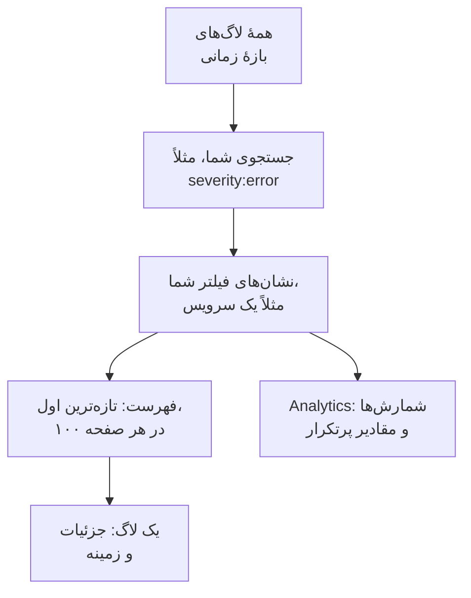

# کاوشگر لاگ

کاوشگر لاگ جایی است که لاگ‌هایی را که سرویس‌ها، میزبان‌ها و ایجنت‌هایتان به OneUptime می‌فرستند جستجو می‌کنید و می‌خوانید. میلیون‌ها خط را به همان چند خطی برسانید که اهمیت دارند، خط‌های تازه را همان‌طور که می‌رسند دنبال کنید، از آن‌ها نمودار بسازید، و نماهایی را که تیمتان بارها به آن‌ها برمی‌گردد ذخیره کنید.

:::cards
- [یافتن یک خط لاگ](#یافتن-یک-خط-لاگ): یک بازهٔ زمانی، یک جستجو و چند فیلتر.
- [خواندن یک لاگ](#خواندن-یک-لاگ): ویژگی‌هایش، ترِیسش و خط‌های پیرامونش.
- [دنبال کردن زندهٔ لاگ‌ها](#دنبال-کردن-زندهٔ-لاگها): خط‌های تازه هر ۱۰ ثانیه.
- [ذخیرهٔ یک نما](#ذخیرهٔ-یک-نما): یک جستجو، فیلترها و ستون‌هایش را برای همه نگه دارید.
- [بینش‌های لاگ](#بینشهای-لاگ): خطاهای پرتکرار، شدت‌ها و اینکه چه کسی چه چیزی لاگ می‌کند.
:::

## کاوشگر چگونه لاگ‌های شما را محدود می‌کند

همه‌چیز در زبانهٔ **بیننده** روی یک مجموعه از لاگ‌ها کار می‌کند: آن‌هایی که در بازهٔ زمانی هستند و با جستجوی شما و همهٔ نشان‌های فیلتر جور درمی‌آیند. هر کدام را تغییر دهید، فهرست، نمودار حجم و شمارش‌های نوار کناری با هم تغییر می‌کنند.

کاوشگر چهار زبانه دارد:

| زبانه | برای چیست |
| --- | --- |
| **بیننده** | لاگ‌ها را جستجو، فیلتر و مطالعه کنید. روی یک ساعت گذشته باز می‌شود، تازه‌ترین‌ها اول، ۱۰۰ لاگ در هر صفحه. |
| **بینش‌ها** | سرویس‌هایتان در یک بازهٔ زمانی چه چیزی لاگ کرده‌اند، و چه چیزی خراب شده است. |
| **راهنمای راه‌اندازی** | چگونه با یکی از [کلیدهای دریافت داده‌تان](/docs/telemetry/ingestion-keys) لاگ‌ها را با OpenTelemetry، Fluent Bit یا Fluentd بفرستید. |
| **تنظیمات** | با رسیدن لاگ‌ها چه بر سرشان می‌آید: **خطوط لوله**، **فیلترهای حذف**، **قواعد پالایش** و **قواعد ضبط**. |

## پیش از شروع

- **لاگ‌های در حال رسیدن.** آن‌ها را با [OpenTelemetry](/docs/telemetry/open-telemetry)، [Fluent Bit](/docs/telemetry/fluentbit)، [Fluentd](/docs/telemetry/fluentd) یا [Syslog](/docs/telemetry/syslog) بفرستید. زبانهٔ **راهنمای راه‌اندازی** پیکربندی زبان یا کالکتور شما را نشان می‌دهد.
- **نقشی که تله‌متری را بخواند.** Project Owner، Project Admin، Project Member، Viewer، Telemetry Admin، Telemetry Member یا Telemetry Viewer، یا یک نقش سفارشی با مجوز Read Telemetry Service Log. دامنهٔ آن تعیین می‌کند لاگ‌های چه کسانی را می‌بینید: [تله‌متری](/docs/permissions/index#تلهمتری) را ببینید.

## یافتن یک خط لاگ

:::steps
### بیننده را باز کنید

به **محصولات** > **مشاهده‌پذیری** > **لاگ‌ها** بروید. **بیننده** لاگ‌های یک ساعت گذشته را، تازه‌ترین‌ها اول، با **زمان**، **سرویس**، **شدت** و **پیام** آن‌ها فهرست می‌کند.

### بازهٔ زمانی را انتخاب کنید

بازه‌ای را در انتخابگر زمان برگزینید، یا روی نمودار حجم بالای فهرست بکشید تا روی یک جهش بزرگ‌نمایی کنید. برای کوچک‌نمایی دوباره روی نمودار دوبار کلیک کنید. [بزرگ‌نمایی یک بازه زمانی](/docs/telemetry/charts-and-time-ranges) را ببینید.

### جستجو کنید

پرس‌وجویی در جعبهٔ جستجو بنویسید و Enter را بزنید، مثلاً `severity:error service:checkout timeout`. واژه‌های تنها در پیام جستجو می‌کنند، و `@key:value` در یک ویژگی جستجو می‌کند. [نحو جستجو](/docs/telemetry/search-syntax#لاگها) را ببینید.

### با فیلترها محدودش کنید

روی مقداری در نوار کناری **فیلترها** کلیک کنید تا به‌صورت یک نشان افزوده شود: یک شدت، یک سرویس، یا میزبان، خوشه یا منبع دیگری که لاگ فرستاده است. کنار هر مقدار نشان داده می‌شود چند لاگ آن را دارند. روی تلفن، برای باز کردن نوار کناری روی **فیلترها** بزنید.

### یک لاگ را باز کنید

روی یک ردیف کلیک کنید. جزئیاتش کنار فهرست باز می‌شود.
:::

جستجو، نشان‌ها و بازهٔ زمانی شما در نشانی صفحه نگه داشته می‌شوند، پس تازه‌سازی، نشانک یا پیوندی که به اشتراک گذاشته‌اید همان لاگ‌ها را باز می‌کند.

## خواندن یک لاگ

پنل جزئیات دو زبانه دارد:

| زبانه | چه نشان می‌دهد |
| --- | --- |
| **جزئیات** | **بدنه لاگ**، **شناسه ترِیس**، **شناسه اسپن** و **Session** آن وقتی داشته باشد، و نیز **ویژگی‌ها**، به‌صورت فهرست یا JSON. |
| **Context** | لاگ در میان همسایه‌هایش. **Nearby (service + time)** پنج خط پیش و پس از آن را از همان سرویس نشان می‌دهد، و **This trace** تا ۱۰۰ لاگ از ترِیس آن را. |

- روی شناسهٔ ترِیس کلیک کنید تا کل درخواست در [کاوشگر ترِیس](/docs/telemetry/traces-explorer) باز شود.
- نشانگر را روی یک ویژگی ببرید و روی نماد فیلترش کلیک کنید تا آن مقدار جستجو شود، یا آن را کپی کنید. می‌توانید همهٔ ویژگی‌ها را یک‌جا به‌صورت JSON کپی کنید.
- **This trace** فقط برای لاگی نمایش داده می‌شود که درون یک ترِیس نوشته شده باشد.

## دنبال کردن زندهٔ لاگ‌ها

روی **Live** بالای فهرست کلیک کنید. کاوشگر به صفحهٔ نخست می‌پرد، با مرتب‌سازی تازه‌ترین‌ها اول، و هر ۱۰ ثانیه لاگ‌های تازه را بررسی می‌کند، پس خط‌ها همان‌طور که سرویس‌هایتان می‌نویسند نمایان می‌شوند.

حالت زنده وقتی جستجو، یک فیلتر یا بازهٔ زمانی را تغییر دهید، یا به صفحهٔ دیگری از نتایج بروید، خودبه‌خود خاموش می‌شود: فقط تازه‌ترین لاگ‌ها را نشان می‌دهد. برای ادامه، دوباره روی **Live** کلیک کنید.

## انتخاب ستون‌ها و خروجی گرفتن

- **ستون‌ها** انتخاب می‌کند فهرست چه چیزی نشان دهد. **زمان**، **سرویس**، **شدت** و **پیام** اول می‌آیند؛ **شناسه ترِیس**، **شناسه اسپن** یا هر ویژگی دیگری را بیفزایید، ستون‌ها را بالا و پایین ببرید، یا با **بازنشانی** به پیش‌فرض‌ها برگردید.
- **خروجی** لاگ‌های صفحه‌ای را که می‌بینید دانلود می‌کند. **Export as CSV** ستون‌هایی را که نشان می‌دهید می‌نویسد؛ **Export as JSON** همهٔ فیلدهای هر لاگ را با همهٔ ویژگی‌هایش می‌نویسد.

## ذخیرهٔ یک نما

یک نمای ذخیره‌شده جستجو، نشان‌های فیلتر، بازهٔ زمانی، ستون‌ها، ترتیب و اندازهٔ صفحه را زیر یک نام نگه می‌دارد.

:::steps
### نما را آماده کنید

جستجو کنید، فیلتر کنید و ستون‌هایی را که می‌خواهید نگه دارید انتخاب کنید.

### ذخیره‌اش کنید

**Saved Views** را باز کنید و روی **+ Save Current View** کلیک کنید. یک **نام** وارد کنید، اگر این نما باید هر بار که کسی لاگ‌ها را باز می‌کند باز شود **تنظیم به‌عنوان پیش‌فرض** را تیک بزنید، و روی **ذخیره نما** کلیک کنید.

### از آن استفاده کنید

نما را از **Saved Views** برگزینید تا اعمال شود، و **Clear view** را برای بازگشت به یک ساعت گذشته بدون فیلتر. نشانگر را روی یک نما در فهرست ببرید تا آن را **ویرایش** یا **حذف** کنید، یا وقتی اعمال شده است، آن را با تغییراتتان **به‌روزرسانی** کنید.
:::

نماهای ذخیره‌شده به پروژه تعلق دارند، پس همه در آن همان فهرست را می‌بینند. بازه‌ای غلتان مانند یک ساعت گذشته غلتان می‌ماند: نما ساعتِ پیش از باز کردنش را نشان می‌دهد، نه ساعتی را که ذخیره‌اش کردید. تا وقتی پروژه نمای پیش‌فرضی ندارد، نمای بعدی که ذخیره شود پیش‌فرض می‌شود، و هر پروژه در هر زمان یک پیش‌فرض دارد.

## نمودار گرفتن از لاگ‌ها

فهرست را به **Analytics** ببرید تا لاگ‌ها را بشمارید به‌جای آنکه بخوانید. یک سری زمانی، یک فهرست برترین‌ها یا یک جدول انتخاب کنید؛ همهٔ لاگ‌ها را بشمارید، یا مقادیر یکتای یک فیلد را؛ و بر اساس شدت، سرویس، ترِیس، اسپن یا هر ویژگی گروه کنید، سپس بر اساس یک فیلد دوم. یک فهرست برترین‌ها یا جدول ۵، ۱۰، ۲۵ یا ۵۰ گروه برتر را نشان می‌دهد.

برای بازگشت به خود خط‌ها روی **فهرست** کلیک کنید.

## باز کردن ترِیس‌ها و متریک‌های مرتبط

دکمه‌های **ترِیس‌ها** و **متریک‌ها** کنار **Saved Views**، [کاوشگر ترِیس](/docs/telemetry/traces-explorer) یا [کاوشگر متریک](/docs/telemetry/metrics-explorer) را برای همان پنجرهٔ زمانی باز می‌کنند، با هر اندازه از فیلترهای شما که آن کاوشگر بتواند به کار ببرد. نشانگر را روی یک دکمه ببرید تا ببینید چه چیزی را نمی‌تواند با خود ببرد.

## بینش‌های لاگ

زبانهٔ **بینش‌ها** نشان می‌دهد سرویس‌هایتان در یک بازهٔ زمانی چه چیزی لاگ کرده‌اند و چه چیزی خراب شده است. با فهرست کشویی کنار انتخابگر زمان آن را به برخی سرویس‌ها، میزبان‌ها یا خوشه‌ها محدود کنید.

| پنل | چه نشان می‌دهد |
| --- | --- |
| کارت‌های خلاصه | **کل لاگ‌ها**، **خطاها**، **Distinct errors** و **Reporting sources**. |
| **Severity distribution** | لاگ‌ها چگونه بر اساس شدت تقسیم می‌شوند. |
| **Top errors** | پیام‌های متمایزی که با شدت Error یا Fatal لاگ شده‌اند، پرتکرارترین‌ها اول. |
| **Sources reporting logs** | حجم و نشانهٔ خطای هر سرویس، میزبان یا منبع دیگر. |

یکی از خطاهای پرتکرار را برگزینید تا ببینید پیرامونش چه می‌گذشت: کی رخ داد، رخدادهایش چه چیز مشترکی دارند، کجا رخ می‌دهد، ترِیس‌هایی که آن را دارند و تازه‌ترین خط‌هایش. **Open matching logs** آن‌ها را در **بیننده** باز می‌کند، و **Explain with AI** [پرسش از هوش مصنوعی](/docs/ai/ask-ai) را با خطا و شواهدش به‌صورت پرامپتی که می‌توانید ویرایش کنید باز می‌کند.

## با رسیدن لاگ‌ها چه بر سرشان می‌آید

زبانهٔ **تنظیمات** قواعدی را در خود دارد که OneUptime پیش از ذخیرهٔ هر لاگ روی آن اعمال می‌کند. این قواعد روی لاگ‌هایی اثر می‌گذارند که پس از آن می‌رسند، نه روی لاگ‌های ذخیره‌شده. اینکه هر لاگ چه مدت نگه داشته شود هم هنگام رسیدنش تعیین می‌شود: [نگهداری داده](/docs/telemetry/data-retention) را ببینید.

| قاعده | چه می‌کند |
| --- | --- |
| **فیلترهای حذف** | لاگ‌هایی را که نمی‌خواهید نگه دارید دور بریزید، یا نمونه‌ای از آن‌ها را نگه دارید. [حذف یا نمونه‌برداری رکوردها](/docs/telemetry/drop-filters-and-scrub-rules#حذف-یا-نمونهبرداری-رکوردها) را ببینید. |
| **قواعد پالایش** | داده‌های حساس، مانند نشانی‌های ایمیل و شماره‌های کارت، را بپوشانید. [پالایش داده‌های حساس](/docs/telemetry/drop-filters-and-scrub-rules#پالایش-دادههای-حساس) را ببینید. |
| **خطوط لوله** | فیلدها را از پیام بیرون بکشید، شدت را درست کنید، نام ویژگی‌ها را تغییر دهید. [خط‌های لوله لاگ](/docs/telemetry/log-pipelines) را ببینید. |
| **قواعد ضبط** | لاگ‌های مطابق را به متریک تبدیل کنید. [قواعد ضبط لاگ](/docs/telemetry/log-recording-rules) را ببینید. |

## میان‌برهای صفحه‌کلید

برای دیدن این‌ها در بیننده `?` را بزنید.

| کلید | چه می‌کند |
| --- | --- |
| `j` / `k` | رفتن به لاگ بعدی یا قبلی. |
| Enter | باز یا بسته کردن لاگ انتخاب‌شده. |
| Esc | بستن پنل جزئیات. |
| `/` | پریدن به جعبهٔ جستجو. |
| ⌘ + Enter یا Ctrl + Enter | اعمال جستجو. |
| `?` | نمایش یا پنهان کردن میان‌برها. |

## عیب‌یابی

:::details هیچ لاگی نمایش داده نمی‌شود
اول بازهٔ زمانی را گسترش دهید: بیننده روی یک ساعت گذشته باز می‌شود. اگر فهرست هنوز خالی است، تنظیمات خود را با **راهنمای راه‌اندازی** مقایسه کنید، و بررسی کنید که دامنهٔ نقش شما سرویسی را که لاگ‌ها را می‌فرستد پوشش می‌دهد.
:::

:::details جستجو می‌گوید زمانش تمام شد
جستجویی که بیش از ۴۵ ثانیه طول بکشد متوقف می‌شود. بازهٔ زمانی کوتاه‌تری انتخاب کنید، یا یک مقدار دقیق مانند یک سرویس بیفزایید، تا OneUptime بتواند از نمایه‌اش استفاده کند. [نحو جستجو](/docs/telemetry/search-syntax#نکتهها) را ببینید.
:::

:::details Live مدام خودش خاموش می‌شود
حالت زنده فقط تازه‌ترین لاگ‌ها را دنبال می‌کند، پس تغییر جستجو، یک فیلتر، بازهٔ زمانی یا صفحه آن را خاموش می‌کند. وقتی فیلترهایتان آماده شد، دوباره روی **Live** کلیک کنید.
:::

## گام‌های بعدی

:::cards
- [نحو جستجو](/docs/telemetry/search-syntax): همهٔ فیلترهایی که جعبهٔ جستجو می‌فهمد.
- [مانیتور لاگ‌ها](/docs/monitor/logs-monitor): وقتی لاگ‌هایی که جستجو می‌کنید پیدا شدند هشدار بگیرید.
- [خط‌های لوله لاگ](/docs/telemetry/log-pipelines): بخش‌هایی از یک خط لاگ را به ویژگی‌هایی تبدیل کنید که بتوانید با آن‌ها فیلتر کنید.
- [کاوشگر ترِیس](/docs/telemetry/traces-explorer): درخواستِ یک لاگ را در میان سرویس‌هایتان دنبال کنید.
:::
