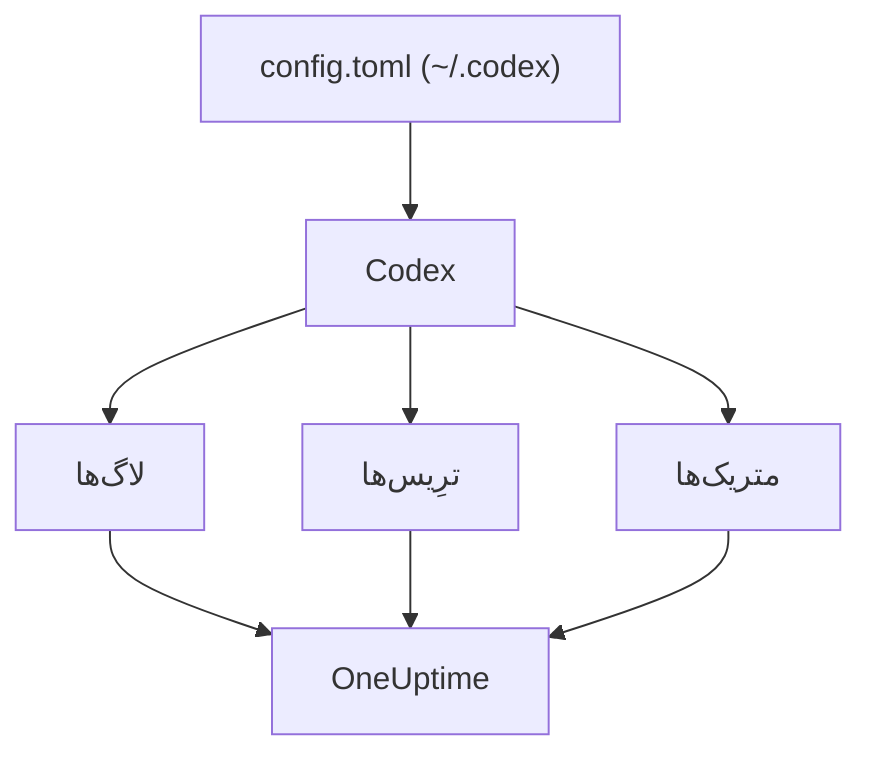

# OpenAI Codex

Codex CLI سه صادرکنندهٔ داخلی OpenTelemetry دارد، یکی برای هر کدام از لاگ‌ها، ترِیس‌ها و متریک‌ها. آن‌ها را در `~/.codex/config.toml` به سمت OneUptime بفرستید تا هر نوبت Codex با توکن‌ها و هزینه‌اش برسد، بدون هیچ wrapper یا پراکسی در میان.

:::cards
- [پیکربندی Codex](#پیکربندی-codex): یک بلوک `[otel]`، با یک نشانی کامل برای هر سیگنال.
- [انتساب مصرف به یک شخص](#انتساب-مصرف-codex-به-یک-شخص): Codex روی spanها یا متریک‌ها نام کسی را نمی‌آورد، پس شما این کار را می‌کنید.
- [توکن‌ها و هزینه](#توکنها-و-هزینه): OneUptime کدام سیگنال را می‌خواند، و این چه چیزی نشان می‌دهد.
- [عیب‌یابی](#عیبیابی): وقتی چیزی نمی‌رسد چه چیزی را بررسی کنید.
:::

## چگونه کار می‌کند

هر صادرکننده یک سیگنال را به نشانی خودش می‌فرستد. ترِیس‌ها و لاگ‌ها تا وقتی پیکربندی‌شان نکنید خاموش‌اند؛ متریک‌ها این‌طور نیستند.



> [!WARNING]
> Codex متریک‌هایش را به OpenAI می‌فرستد، مگر اینکه این را تغییر دهید. در یک نسخهٔ انتشار، `metrics_exporter` به‌طور پیش‌فرض `statsig` است که متریک‌ها را به `https://ab.chatgpt.com/otlp/v1/metrics` می‌فرستد. تنظیم `metrics_exporter` روی یک صادرکنندهٔ OTLP، مانند پایین، یا روی `none` آن را متوقف می‌کند. `[analytics]` با `enabled = false` هم پیش‌فرض Statsig را متوقف می‌کند، ولی صادرکنندهٔ متریک OTLP را که خودتان تنظیم کرده‌اید در حال کار نگه می‌دارد.

## پیش از شروع

1. یک کلید دریافت دادهٔ تله‌متری در **تنظیمات پروژه** > **تله‌متری و APM** > **کلیدهای دریافت داده** بسازید.
2. نقطهٔ پایانی OTLP شما `https://oneuptime.com/otlp` است، یا اگر OneUptime را خودتان میزبانی می‌کنید `https://YOUR-ONEUPTIME-HOST/otlp`.
3. هر صادرات کلید را در سرآیند `x-oneuptime-token` می‌فرستد.

## پیکربندی Codex

:::steps
### بلوک otel را اضافه کنید

این را در `~/.codex/config.toml` بگذارید. هر سه سیگنال را روشن می‌کند و در همین حال پیش‌فرض Statsig را جایگزین می‌کند:

```toml title="~/.codex/config.toml"
[otel]
environment = "prod"
log_user_prompt = false

[otel.exporter.otlp-http]
endpoint = "https://oneuptime.com/otlp/v1/logs"
protocol = "binary"
headers = { "x-oneuptime-token" = "YOUR_INGESTION_TOKEN" }

[otel.trace_exporter.otlp-http]
endpoint = "https://oneuptime.com/otlp/v1/traces"
protocol = "binary"
headers = { "x-oneuptime-token" = "YOUR_INGESTION_TOKEN" }

[otel.metrics_exporter.otlp-http]
endpoint = "https://oneuptime.com/otlp/v1/metrics"
protocol = "binary"
headers = { "x-oneuptime-token" = "YOUR_INGESTION_TOKEN" }

[otel.span_attributes]
"user.id" = "dev@example.com"
"user.email" = "dev@example.com"
"team" = "platform"
```

### به هر صادرکننده نشانی کاملش را بدهید

Codex هر `endpoint` را دقیقاً همان‌طور که نوشته شده به کار می‌برد: برخلاف بیشتر SDKها، `/v1/logs`، `/v1/traces` یا `/v1/metrics` را اضافه نمی‌کند. سه صادرکننده‌ای که فقط روی `https://oneuptime.com/otlp` تنظیم شده باشند هیچ چیزی به هیچ جا نمی‌فرستند، بی‌آنکه خطایی بدهند.

### یک نوبت اجرا کنید

یک نشست تعاملی `codex` آغاز کنید، چیز کوچکی بپرسید و بگذارید نوبت تمام شود. سپس **لاگ‌ها** را در OneUptime باز کنید: رویدادهای Codex، مانند `codex.conversation_starts`، `codex.api_request` و `codex.turn_cost`، آنجا نمایش داده می‌شوند.
:::

> [!IMPORTANT]
> Codex کلیدهایی را که زیر `[otel]` نمی‌شناسد، بدون هشدار نادیده می‌گیرد. کلیدهایش به شکل snake_case هستند (`trace_exporter`، `metrics_exporter`، `span_attributes`)، ولی نام صادرکننده‌ها و فیلدهای TLS آن به شکل kebab-case هستند (`otlp-http`، `ca-certificate`). یک `trace-exporter` ترِیس‌ها را بدون هیچ خطایی خاموش می‌کند.

## کلیدهای پیکربندی

| کلید | پیش‌فرض | چه می‌کند |
| --- | --- | --- |
| `environment` | `"dev"` | ویژگی منبع `env` را تنظیم می‌کند |
| `log_user_prompt` | `false` | متن پرامپت را روی `codex.user_prompt` می‌فرستد؛ وگرنه `[REDACTED]` نوشته می‌شود |
| `log_agent_responses` | `false` | پاسخ‌های نهایی عامل را به صادرکنندهٔ لاگ می‌فرستد |
| `exporter` | `none` | صادرکنندهٔ لاگ |
| `trace_exporter` | `none` | صادرکنندهٔ ترِیس |
| `metrics_exporter` | `statsig` | صادرکنندهٔ متریک: آن را تنظیم کنید |
| `span_attributes` | — | ویژگی‌هایی که به هر span صادرشده افزوده می‌شوند |
| `tracestate` | — | اعضای `tracestate` در W3C |
| `tool_result` | `{ max_bytes = 2048 }` | یک رکورد لاگ چه مقدار از نتیجهٔ یک ابزار را نگه می‌دارد، به بایت UTF-8 |

یک صادرکننده یکی از `none`، `statsig`، `otlp-http` یا `otlp-grpc` است. `otlp-http` این‌ها را می‌پذیرد: `endpoint`، `headers`، `protocol` (`"binary"` یا `"json"`، که OneUptime هر دو را می‌پذیرد) و `tls` (`ca-certificate`، `client-certificate`، `client-private-key`)؛ `otlp-grpc` همین‌ها را بدون `protocol` می‌پذیرد.

## انتساب مصرف Codex به یک شخص

Codex فقط در یک جا نام توسعه‌دهنده را می‌آورد:

- **رکوردهای لاگ** `user.account_id` و `user.email` را دارند.
- **spanها** ندارند: Codex عمداً هر دو را از ترِیس‌هایش بیرون نگه می‌دارد.
- **متریک‌ها** هم ندارند: آن‌ها `auth_mode`، `session_source`، `originator`، `service_name`، `model` و `app.version` را دارند، و هیچ شخصی را.

OneUptime اشخاص را از spanها و نقطه‌های دادهٔ متریک می‌خواند، هرگز از رکوردهای لاگ. پس هویت را خودتان روی هر span، در `[otel.span_attributes]`، بگذارید:

```toml title="~/.codex/config.toml"
[otel.span_attributes]
"user.id" = "dev@example.com"
"user.email" = "dev@example.com"
"team" = "platform"
"cost_center" = "eng-123"
```

`user.id` کلیدی است که OneUptime ترجیح می‌دهد، و `user.email` ستون ایمیل را پر می‌کند. Codex ویژگی منبع ندارد، پس کلیدهای تیم (`team.id`، `team`، `cost_center`، `department`) را هم همین‌جا تنظیم کنید. این بلوک در فایل پیکربندی هر توسعه‌دهنده قرار دارد: آن را برای هر توسعه‌دهنده جداگانه، از راه dotfileها یا یک پروفایل MDM، توزیع کنید. یک فایل مشترک با یک هویت، خرج همه را به حساب یک شخص می‌گذارد.

## توکن‌ها و هزینه

| سیگنال | آنچه Codex می‌فرستد | آنچه OneUptime با آن می‌کند |
| --- | --- | --- |
| ترِیس‌ها | `gen_ai.usage.input_tokens`، `gen_ai.usage.output_tokens` و توکن‌های cache، ولی هیچ مدلی | توکن‌ها را به تفکیک شخص می‌شمارد؛ نمی‌تواند قیمتشان را حساب کند |
| متریک‌ها | `codex.turn.token_usage` بر پایهٔ `token_type`، و `codex.turn.cost_microusd` به یک‌میلیونیم دلار | هزینه را به USD تبدیل می‌کند؛ متریک‌ها را فقط جایی می‌خواند که spanها چیزی گزارش نکرده‌اند |
| لاگ‌ها | `codex.turn_cost`، با `usage.estimated_usd` و شخص | آن را در کاوشگر **لاگ‌ها** ذخیره می‌کند؛ به خرج پیوند نمی‌دهد |

با پیکربندی بالا، نتیجه در زبانهٔ **مصرف** این است:

- توکن‌ها از spanها، به تفکیک شخص، می‌آیند و `codex.turn.token_usage` روی آن‌ها افزوده نمی‌شود: این دو هرگز با هم جمع نمی‌شوند ([چرا](/docs/telemetry/ai-llm-observability#نخست-spanها-متریکها-جای-خالی-را-پر-میکنند)).
- spanهای Codex نام هیچ مدلی را ندارند، پس OneUptime نمی‌تواند قیمتشان را حساب کند و هزینه‌شان ۰ است. آن‌گاه مجموع‌های هزینه، هزینهٔ Codex را از `codex.turn.cost_microusd` می‌گیرند و برایتان به USD تبدیل می‌کنند.
- جدول‌های **کارمند** ، **تیم** و **مدل** ردیف‌های spanها را نشان می‌دهند: توکن‌ها برای هر شخص، ولی هیچ هزینه‌ای برای هر شخص.
- بدون ترِیس‌ها، متریک‌ها به‌جای آن این جدول‌ها را پر می‌کنند، فقط با هزینه و همه زیر **بدون انتساب** ، چون متریک‌های Codex نام کسی را نمی‌آورند.

دقیق‌ترین هزینهٔ هر نوبت، همراه با شخص، رکورد لاگ `codex.turn_cost` است. OneUptime هنوز رکوردهای لاگ را به خرج پیوند نمی‌دهد، ولی صادرکنندهٔ لاگ را روشن نگه دارید: وقتی این کار انجام شود، تاریخچه آنجا خواهد بود.

## Codex در CI و به‌عنوان سرور MCP

`codex`، `codex exec` و `codex mcp-server` همه تله‌متری خود را از همان بلوک `[otel]` و با هر سه صادرکننده می‌سازند. اجراهای `codex exec` مقدار `originator` برابر `codex_exec` را دارند، و `codex mcp-server` به‌صورت `codex_mcp_server` صادر می‌کند، پس می‌توانید با این مقدارها اجراهای CI و MCP را از نشست‌های تعاملی جدا کنید.

## حریم خصوصی

`log_user_prompt` و `log_agent_responses` به‌طور پیش‌فرض `false` هستند: آن‌ها را خاموش بگذارید. رویداد `codex.user_prompt` همچنان می‌رسد، با پرامپتی که با `[REDACTED]` جایگزین شده، پس نوبت، توکن‌ها و هزینه‌اش را بدون متن پرامپت نگه می‌دارید. شخص (`user.email`، `user.account_id`) فارغ از این کلیدها روی رکوردهای لاگ هست.

اگر محتوا را برای یک بررسی روشن می‌کنید، **قواعد پالایش** و **فیلترهای حذف** ترِیس‌ها، در **ترِیس‌ها** > **تنظیمات**، آن را پیش از ذخیره می‌پوشانند یا حذف می‌کنند.

## استفاده از API در OpenAI به‌جای Codex

API پلتفرم OpenAI خودش هیچ OpenTelemetry نمی‌فرستد: هر span از ابزارگذاری کلاینت خود شما می‌آید. سه ابزارگذاری با OneUptime کار می‌کنند:

- **OpenTelemetry**: `opentelemetry-instrumentation-genai-openai` برای Python، که جایگزین `opentelemetry-instrumentation-openai-v2` می‌شود. `OTEL_INSTRUMENTATION_GENAI_CAPTURE_MESSAGE_CONTENT` تعیین می‌کند که آیا پیام‌ها ثبت شوند.
- **OpenLLMetry** (Traceloop): `opentelemetry-instrumentation-openai`.
- **OpenInference** (Arize): `openinference-instrumentation-openai`.

هر کدام را همان‌طور که [مشاهده‌پذیری هوش مصنوعی / LLM](/docs/telemetry/ai-llm-observability) نشان می‌دهد به سمت OneUptime بفرستید. هیچ‌کدام نمی‌داند کارمند شما کیست: `user.id` را خودتان تنظیم کنید.

**OpenAI Agents SDK** ترِیس‌ها را به نقطهٔ پایانی خود OpenAI می‌فرستد، نه از راه OTLP. آن را با `opentelemetry-instrumentation-openai-agents-v2` یا `openinference-instrumentation-openai-agents` پل بزنید، که spanهای SDK را به یک صادرکنندهٔ OTLP می‌سپارند.

## عیب‌یابی

:::details چیزی نمی‌رسد
نخست سه مقدار `endpoint` را بررسی کنید: هر کدام باید به `/v1/logs`، `/v1/traces` یا `/v1/metrics` ختم شود. سپس سرآیند `x-oneuptime-token` را بررسی کنید: OneUptime کلید نادرست را رد می‌کند.
:::

:::details ترِیس‌ها هرگز نمی‌رسند، ولی لاگ‌ها می‌رسند
دنبال کلیدی با املای نادرست زیر `[otel]` بگردید: Codex بی‌صدا آن را نادیده می‌گیرد. اشتباه رایج `trace-exporter` به‌جای `trace_exporter` است.
:::

:::details هزینهٔ Codex در مجموع‌ها نمایش داده می‌شود، ولی هر شخص $0 نشان می‌دهد
این مورد انتظار است: spanهای Codex توکن دارند ولی مدل ندارند، پس قیمتشان حساب نمی‌شود، و متریک هزینه نام کسی را نمی‌آورد. [توکن‌ها و هزینه](#توکنها-و-هزینه) را ببینید.
:::

:::details خرج همه زیر یک شخص نمایش داده می‌شود
همان هویت `[otel.span_attributes]` روی همهٔ دستگاه‌ها است. به هر توسعه‌دهنده هویت خودش را بدهید.
:::

## گام‌های بعدی

:::cards
- [دستیارهای کدنویسی هوش مصنوعی](/docs/telemetry/ai-coding-assistants): خرج در میان همهٔ دستیارهای کدنویسی چگونه منتسب می‌شود.
- [مشاهده‌پذیری هوش مصنوعی / LLM](/docs/telemetry/ai-llm-observability): گفتگوها، هشدارها، هزینه و بودجه‌ها برای فراخوانی‌های هوش مصنوعی خودتان.
- [دروازه‌های هوش مصنوعی](/docs/telemetry/ai-gateways): یک دروازه که هر فراخوانی مدل را ترِیس و قیمت‌گذاری می‌کند.
:::
