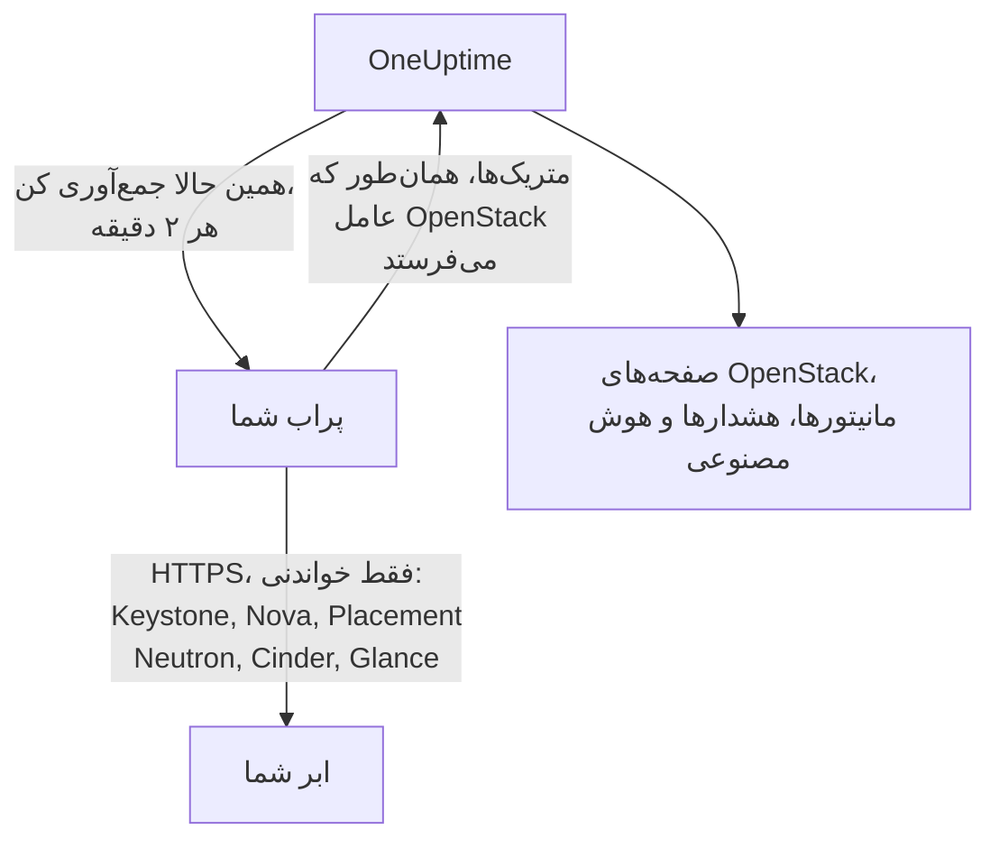

# OpenStack بدون عامل

یک ابر OpenStack را بدون نصب هیچ چیزی پایش کنید: آدرس Keystone و یک application credential را در OneUptime وارد کنید، پرابی را که به ابر دسترسی دارد انتخاب کنید، و پراب همان داده‌هایی را جمع می‌کند که [عامل OpenStack](/docs/telemetry/openstack) جمع می‌کرد. عاملی برای نصب، ارتقا یا روشن نگه داشتن وجود ندارد و لازم نیست ماشین جداگانه‌ای تهیه کنید.

> [!IMPORTANT]
> پراب فقط با HTTPS با ابر صحبت می‌کند. اعتبارنامه یا توکن آن هرگز روی HTTP ساده ارسال نمی‌شود، و DevStack و Kolla-Ansible به‌طور پیش‌فرض APIهای خود را روی HTTP ساده ارائه می‌دهند. برای چنین ابری TLS را برای APIهایش فعال کنید، یا از [عامل OpenStack](/docs/telemetry/openstack) استفاده کنید که در کنار آن اجرا می‌شود. آزمایش اتصال هنگام برخورد با آدرس HTTP ساده همین را اعلام می‌کند.

:::cards
- [پیش از شروع](#پیش-از-شروع): پرابی که به APIها دسترسی دارد، و یک اعتبارنامه.
- [اتصال یک ابر](#اتصال-یک-ابر): آدرس، یک اعتبارنامه، یک آزمایش و یک نام.
- [عیب‌یابی](#عیبیابی): معنی هر پیام و راه رفع آن.
:::

## نحوه کار



پراب هر دو دقیقه یک بار هر سرویس از هر منطقه‌ای را که انتخاب کرده‌اید می‌خواند و آنچه یافته است را به OneUptime می‌فرستد. این داده‌ها دقیقاً مثل داده‌های عامل OpenStack می‌رسند، پس هر صفحه OpenStack، هر [مانیتور OpenStack](/docs/monitor/openstack-monitor) و هر الگوی هشدار آن‌ها را به همان شکل می‌خواند.

هر سرویس جداگانه و هم‌زمان با بقیه خوانده می‌شود. Neutron که خراب شود یا قفل کند فقط سری‌های Neutron را از دست می‌دهد و داده‌های Nova طبق معمول می‌رسند، با یک استثنا که خود Nova ایجاد می‌کند: Nova برای هر اینستنسی که فهرست می‌کند از Neutron می‌پرسد. بنابراین تا وقتی Neutron از کار افتاده است، پراب اینستنس‌هایی را که آخرین بار خوانده نگه می‌دارد و فقط درباره آنچه تغییر کرده می‌پرسد. اگر اینستنسی تغییر کرده باشد، یا پراب تازه شروع به کار کرده باشد، Nova نمی‌تواند به آن فهرست هم پاسخ دهد: Nova خراب نشان داده می‌شود، سری‌های دیگرش همچنان می‌رسند، و هر اینستنس تا بازگشت Neutron در صفحه خود همان‌گونه که آخرین بار بود می‌ماند.

Heat، Magnum، Manila، Trove، Gnocchi، Designate، Swift و Barbican در جایی خوانده می‌شوند که کاتالوگ Keystone نامی از آن‌ها برده باشد. ابری که هیچ‌کدام را اجرا نمی‌کند هزینه‌ای برای آن‌ها نمی‌پردازد، آزمایش اتصال درباره آن‌ها چیزی نمی‌گوید و [هیچ ردی از آن‌ها نشان نمی‌دهد](/docs/telemetry/openstack#heat-و-magnum).

در ابری که کاتالوگش Octavia دارد، پراب متعادل‌کننده‌های بار، استخرها، listenerها و amphoraeهای آن را با یک درخواست فهرست برای هر کدام می‌خواند، سپس اعضای هر استخر و شمارنده‌های ترافیک هر متعادل‌کننده بار و هر listener با وضعیت `ACTIVE` را، با یک درخواست برای هر کدام. ابری با ۳ متعادل‌کننده بار، ۱ استخر و ۱ listener در هر جمع‌آوری ۹ درخواست هزینه دارد؛ DevStack واقعی که ثبت کردیم دقیقاً همین‌قدر هزینه داشت. در هر جمع‌آوری حداکثر اعضای ۲۵ استخر و ۵۰ شمارنده خوانده می‌شود، با اولویت قدیمی‌ترین خوانده‌نشده‌ها، و بقیه همان را می‌گویند که آخرین بار گفتند. شمارنده‌های Octavia تجمعی‌اند، بنابراین پراب آخرین مقدار هر کدام را نگه می‌دارد و تفاوت در ثانیه بین دو مقدار را رسم می‌کند: نمودار از جمع‌آوری دوم شروع می‌شود، و شمارنده‌ای که کاهش پیدا کند (listener بازسازی‌شده) برای آن بازه چیزی رسم نمی‌کند. ارائه‌دهنده OVN برای هر شمارنده 0 گزارش می‌کند، که یک خط صاف است و خطا نیست.

amphoraeها برای هر خواندن به قاعده admin در Octavia نیاز دارند. اعتبارنامه‌ای پایین‌تر از admin متعادل‌کننده‌های بار، استخرها، listenerها و اعضای پروژه خودش و شمارنده‌های خودش را می‌بیند، و هیچ amphora‌ای نمی‌بیند: صفحه متعادل‌کننده‌های بار همین را می‌گوید و هشداری داده نمی‌شود. نقش monitoring در پروژه‌ای که متعادل‌کننده بار ندارد چیزی نمی‌بیند. `load-balancer_global_observer` در `stable/2026.1`، انتشاری که این روی آن ثبت شد، از هر خواندنی رد می‌شد.

API متوقف‌شده Octavia برای پراب `up 0` است، که exporter عامل نمی‌تواند آن را بگوید.

## پراب یا عامل؟

| | پراب (این صفحه) | عامل OpenStack |
|---|---|---|
| آنچه اجرا می‌کنید | پرابی که از قبل دارید، یا یک پراب جدید | عامل، روی ماشینی جداگانه |
| محل نگهداری اعتبارنامه | رمزگذاری‌شده در OneUptime، فقط برای پراب ارسال می‌شود | در فایل `clouds.yaml` عامل |
| آنچه باید به آن دسترسی داشته باشد | Keystone و API هر سرویس، روی HTTPS | Keystone و API هر سرویس |
| APIها روی HTTP ساده | جمع‌آوری نمی‌شود: توکن هرگز بدون رمزگذاری ارسال نمی‌شود | جمع‌آوری می‌شود |
| بزرگ‌ترین ابر | آزمایش‌شده با [۲۰۰٬۰۰۰ اینستنس](/docs/telemetry/openstack-very-large-clouds) روی یک ابر شبیه‌سازی‌شده، نه واقعی، در حداکثر ده بارگذاری ۴۸ مبی‌بایتی | در مقیاس آزمایش نشده: [scrape آن](/docs/telemetry/openstack-very-large-clouds#از-طریق-عامل) خیلی پیش از آن زمانش تمام می‌شود |
| لاگ‌های سرویس و عامل هوش مصنوعی | شامل نمی‌شود | شامل می‌شود |
| آنچه ابر بر آن بنا شده: RabbitMQ، MariaDB، Memcached، HAProxy، OVN، libvirt | شامل نمی‌شود: پراب APIهای ابر را می‌خواند | شامل می‌شود، با ذکر هدف‌های آن |
| CPU، حافظه و دیسک واقعی هر اینستنس، از libvirt یا Ceilometer | شامل نمی‌شود | شامل می‌شود، با ذکر exporterهای آن |
| ورودها به Keystone | یکی برای عمر یک توکن، معمولاً یک ساعت | یکی برای هر scrape |
| یک `reader` ساده روی یک پروژه | اینستنس‌ها، حجم‌ها و شبکه‌های آن پروژه | حجم‌ها و شبکه‌های آن پروژه، و هیچ اینستنسی |

هر دو یک سری‌ها را می‌فرستند، پس صفحه‌ها و مانیتورها با هر کدام کار می‌کنند. پراب چیزهایی را هم می‌فرستد که فقط یک کلاینت بومی می‌تواند بخواند: آدرس‌های یک اینستنس، وضعیت task و پیام خطای آن، ایمیجی که از آن بوت شده، اینکه آیا اپراتور یک سرویس Nova را به‌اجبار پایین آورده، کدام شبکه‌ها را یک DHCP agent سرویس می‌دهد، کدام استخر یک حجم را نگه می‌دارد، آخرین زمان تغییر یک اینستنس، حجم یا ایمیج، و وضعیت هر snapshot و backup حجم. Cinder استخر یک حجم را فقط به اعتبارنامه‌ای می‌گوید که آن را admin بداند. در ابری که [Heat یا Magnum](/docs/telemetry/openstack#heat-و-magnum) اجرا می‌کند، پراب علت شکست یک stack یا cluster، اینستنس‌ها و حجم‌هایی که یک stack مالک آن‌هاست، پروژه، template و نسخه Kubernetes هر cluster، و اینکه هر موتور Heat و هر conductor در Magnum بالاست یا نه را هم می‌فرستد.

عامل را برای لاگ‌های سرویس، برای عامل هوش مصنوعی، برای آنچه ابر بر آن بنا شده و مصرف واقعی هر اینستنس، برای ابری که APIهایش فقط HTTP ساده می‌فهمند، همان‌طور که DevStack و Kolla-Ansible به‌طور پیش‌فرض چنین‌اند، یا برای ابری آن‌قدر بزرگ که باید [از پایگاه‌داده‌هایش خوانده شود](/docs/telemetry/openstack-very-large-clouds#مسیر-پایگاهداده) انتخاب کنید. برای بقیه موارد پراب را انتخاب کنید: چیزی برای نصب نیست و از آنچه Nova و Cinder می‌گویند بیشتر می‌خواند. [ابرهای OpenStack بسیار بزرگ](/docs/telemetry/openstack-very-large-clouds) می‌گوید هر کدام در هر اندازه چقدر هزینه دارد.

هر زمان که بخواهید می‌توانید در صفحه **تنظیمات** یک ابر آن را از یکی به دیگری تغییر دهید.

## پیش از شروع

- **پرابی که از طریق HTTPS به Keystone و API هر سرویس دسترسی دارد.** این معمولاً یک [پراب سفارشی](/docs/probe/custom-probe) در شبکه ابر است. کاتالوگ Keystone مشخص می‌کند هر سرویس کجا پاسخ می‌دهد و پراب به همان آدرس‌ها وصل می‌شود، پس هر کدام باید از پراب در دسترس باشد و هر کدام باید HTTPS باشد. در OneUptime Cloud پراب‌های مشترک هرگز اعتبارنامه OpenStack دریافت نمی‌کنند، پس پراب خودتان را اضافه کنید. در یک نمونه خودمیزبان، پراب‌های خود نمونه هم می‌توانند جمع‌آوری کنند.
- **یک اعتبارنامه.** application credential بهترین است، چون می‌توان آن را به خواندن محدود کرد و می‌تواند منقضی شود. نام کاربری و گذرواژه هم کار می‌کنند، و هر کاری را که حسابشان بتواند انجام می‌دهند.

OpenStack نقش سراسری فقط‌خواندنی ندارد، پس میزان دیدِ پراب به اعتبارنامه بستگی دارد:

| سطح | چه چیزی لازم دارد | پراب چه می‌خواند |
|---|---|---|
| دید کامل | یک application credential روی حسابی که `admin` را روی پروژه‌ای مخصوص خودش دارد، با قواعد دسترسی که آن را به خواندن محدود می‌کنند | همه چیز، جز کاربران و گروه‌های Keystone که قواعد عمداً آن‌ها را کنار می‌گذارند |
| فقط زیرساخت | نقش‌های `oneuptime_monitoring` و `reader` روی پروژه‌ای مخصوص خودش که چیزی ندارد و سهمیه‌اش صفر است، و فایل‌های policy که عامل OpenStack همراه خود دارد | هایپروایزرها، سرویس‌های Nova، agentهای Neutron، استخرهای آدرس، Placement، فهرست پروژه‌ها و اینستنس‌های هر پروژه. حجم‌ها، شبکه‌ها و routerها فقط جایی که نقش تخصیص داده شده باشد. وضعیت `cinder-volume` و `cinder-scheduler` یا استخرهای ذخیره‌سازی نه: کد خود Cinder admin می‌خواهد |
| دید پروژه | `reader` ساده روی یک پروژه | اینستنس‌ها، حجم‌ها و شبکه‌های آن پروژه، و هیچ زیرساختی |

آزمایش اتصال می‌گوید یک اعتبارنامه به کدام یک از این سطوح می‌رسد، و اگر پروژه خودش چیزی در بر داشته باشد هشدار می‌دهد: جایی که `enforce_new_defaults` در Cinder خاموش است، که پیش‌فرض خودش است، هر نقشی روی یک پروژه می‌تواند حجم‌های آن پروژه را بسازد، از جمله `reader`.

> [!IMPORTANT]
> application credential محدودشده با قواعد دسترسی، توسط هر سرویسی که `keystonemiddleware` آن `service_type` تنظیم‌شده ندارد، با `401` رد می‌شود. آزمایش اتصال این را برای هر خواندن می‌گوید. آن را در پیکربندی هر سرویس تنظیم کنید، سپس سرویس را ری‌استارت کنید. [ساخت اعتبارنامه](/docs/telemetry/openstack#اعتبارنامه-را-بسازید) قواعد، فایل‌های policy و تنظیمات هر سرویس را دارد، و [آنچه هر سطح می‌خواند](/docs/telemetry/openstack#هر-سطح-چه-چیزی-را-میخواند) همان است که ابرهای واقعی پاسخ دادند.

## اتصال یک ابر

:::steps
### ابرهای خود را باز کنید
در OneUptime به **OpenStack** > **همه ابرها** بروید و روی **اتصال ابر** کلیک کنید.

### آدرس و اعتبارنامه را وارد کنید
مقدار `auth_url` را از فایل `clouds.yaml` یا `openrc` خود، مانند `https://keystone.example.com:5000/v3`، و شناسه و secret مربوط به application credential را وارد کنید. پرابی را که به ابر دسترسی دارد انتخاب کنید.

### اتصال را آزمایش کنید
روی **آزمایش اتصال** کلیک کنید. پراب وارد می‌شود، هر خواندنی را که یک جمع‌آوری در هر منطقه انجام می‌دهد امتحان می‌کند و خارج می‌شود. می‌گوید کاتالوگ کدام منطقه‌ها را نام برده، اعتبارنامه چه چیزهایی را می‌تواند بخواند، از چه چیزهایی رد می‌شود، کدام صفحه‌ها بدون آن خالی می‌مانند، و خطی که آن را باز می‌کند. یک خواندن ناموفق آزمایش را متوقف نمی‌کند.

### گواهی ابر را مورد اعتماد قرار دهید
ابری که مرجع صدور گواهی مخصوص خودش را دارد گواهی‌ای ارائه می‌دهد که پراب به آن اعتماد ندارد. آزمایش در این حالت گواهی و میزبانی را که آن را ارائه کرده نشان می‌دهد. اثر انگشت آن را با اثر انگشت خود API مقایسه کنید، سپس روی **اعتماد به این گواهی** کلیک کنید. ابری که برای هر سرویس میزبانی جداگانه دارد می‌تواند برای هر سرویس گواهی جداگانه داشته باشد، و می‌توانید به حداکثر ۳۲ گواهی اعتماد کنید.

### منطقه‌ها را انتخاب کنید و متصل شوید
منطقه‌هایی را که باید خوانده شوند انتخاب کنید، به ابر نام بدهید و روی **اتصال ابر** کلیک کنید. صفحه ابر باز می‌شود.
:::

**نمای کلی** ابر کارت **جمع‌آوری داده** را نشان می‌دهد. تا اولین جمع‌آوری، که ظرف یک دقیقه شروع می‌شود، **در حال بررسی** را نشان می‌دهد، سپس **در حال جمع‌آوری**، و صفحه‌ها پر می‌شوند. وقتی بعضی سرویس‌ها خوانده شده و یکی دیگر نشده باشد، می‌گوید کدام. اگر تا ۱۵ دقیقه هیچ پرابی برای ابر نیاید، چون آفلاین است یا بیش از حد قدیمی است، **جمع‌آوری نمی‌شود** را نشان می‌دهد و همین را می‌گوید، صرف‌نظر از آنچه آخرین جمع‌آوری یافته است.

کارت **جمع‌آوری داده** در صفحه **تنظیمات** ابر آنچه را که ابر با آن متصل کرده‌اید نگه می‌دارد:


## اتصال ابر از طریق API یا Terraform

تنظیمات اتصال یک ابر فیلدهای معمولی [منبع OpenStack Cloud](/reference/open-stack-cloud) در API و در `/api/openstack-cloud` هستند، پس می‌توان ابری را بدون هیچ داشبوردی متصل کرد. با Terraform این `oneuptime_openstack_cloud` است:

```hcl
resource "oneuptime_openstack_cloud" "prod_eu" {
  name                      = "prod-eu"
  collection_method         = "Probe"
  auth_url                  = "https://keystone.example.com:5000/v3"
  credential_kind           = "applicationCredential"
  application_credential_id = var.openstack_application_credential_id
  credential_secret         = var.openstack_application_credential_secret
  collection_probe_id       = oneuptime_probe.eu_west.id
  collection_regions        = jsonencode(["RegionOne"])

  # A cloud with its own certificate authority: the fingerprints it presents.
  trusted_certificate_fingerprints = jsonencode(["AB:CD:EF:..."])
}
```

برای نام کاربری و گذرواژه، `credential_kind` را روی `password` بگذارید، همراه با `keystone_username`، `project_name` و، وقتی `Default` نیستند، `user_domain_name` و `project_domain_name`. `endpoint_interface`، `collection_interval_in_minutes` و `collection_options` همان‌هایی‌اند که فرم زیر **فیلدهای بیشتر** جمع می‌کند. فقط `name` الزامی است، چون ابری که عامل می‌فرستد هیچ‌یک از این‌ها را ندارد.

`credential_secret` فقط‌نوشتنی است، پس هیچ خواندنی آن را برنمی‌گرداند و Terraform آن را از plan و خروجی‌ها بیرون نگه می‌دارد. [قواعد اعتبارنامه ذخیره‌شده](#اعتبارنامه-ذخیرهشده) اینجا هم برقرارند: تغییر آدرس، پراب یا گواهی‌های مورد اعتماد نیازمند secret در همان درخواست است. آنچه پراب گزارش می‌کند، مانند `collection_status`، `collection_error` و `presented_certificate`، قابل خواندن است و قابل تنظیم نیست.

## هزینه آن برای ابر شما

پایش هرگز نباید چیزی باشد که ابر را از کار می‌اندازد، پس جمع‌آوری ذاتاً ملایم طراحی شده است:

- **یک ورود، نگه‌داشته‌شده.** توکن تا پنج دقیقه پیش از انقضایش استفاده می‌شود. ورود چیزی است که Keystone دچار مشکل کمتر از همه تحملش را دارد.
- **فهرست‌ها صفحه‌صفحه.** هر فهرست هزار ردیف هزار ردیف با `limit` و `marker` خوانده می‌شود.
- **اینستنس‌ها بر اساس آنچه تغییر کرده.** بین خواندن‌های کامل، هر نیم ساعت، پراب با `changes-since` فقط آنچه را از آخرین خواندن تغییر کرده از Nova می‌پرسد.
- **inventoryهای یک هایپروایزر فقط یک بار.** Placement هر بار که inventoryها تغییر کنند generation یک provider را جلو می‌برد، که یک فراخوانی فهرست درباره همه می‌گوید، پس فقط آن‌گاه دوباره خوانده می‌شوند.
- **بار مشخص.** آنچه یک فراخوانی برای هر چیز می‌خواهد، از ۲٬۰۰۰ در هر جمع‌آوری به بعد، و برای محدودیت‌ها از ۲۵۰ پروژه به بعد، نوبتی انجام می‌شود. آنچه این بار خوانده نشد همان‌طور که آخرین بار خوانده شد ارسال می‌شود، پس هیچ سری شکافی ندارد، و بار با بزرگ شدن ابر دیگر زیاد نمی‌شود.
- **فقط فیلدهایی که می‌خواند.** فهرست‌های Neutron فیلدهایشان را نام می‌برند، و از security groupها فقط شناسه‌هایشان خواسته می‌شود.
- **هرگز روی هم انباشته نمی‌شود.** جمع‌آوری‌ای که بیش از بازه‌اش طول بکشد رد می‌شود، نه اینکه کنار بعدی اجرا شود.
- **بودجه زمانی.** یک جمع‌آوری نه‌دهم بازه‌اش و حداکثر ده دقیقه وقت دارد. آنچه تا آن موقع خوانده شده ارسال می‌شود، و سرویسی که وقتش تمام شده این را می‌گوید.
- **عقب‌نشینی.** وقتی با `429` یا `Retry-After` از پراب خواسته شود صبر کند، صبر می‌کند. سرویسی که با `429`، `503` یا اصلاً جواب نمی‌دهد یک دقیقه، سپس دو، سپس چهار، تا نیم ساعت به حال خود رها می‌شود، و سری‌هایش در این مدت همچنان می‌گویند از کار افتاده است.
- **کند شدن.** پاسخی که سه برابر کندتر از معمول آن سرویس باشد و دست‌کم یک ثانیه، یا پنج ثانیه صرف‌نظر از معمول، درخواست بعدی آن سرویس را به همان اندازه عقب می‌اندازد. کارت **جمع‌آوری داده** می‌گوید چه زمانی این اتفاق افتاده است.
- **اعتبارنامه ردشده بیشتر از همه صبر می‌کند.** تکرار یکی از آن‌ها چیزی است که حساب را قفل می‌کند، پس پنج دقیقه، سپس ده، تا یک ساعت صبر می‌کند. اعتبارنامه‌ای که اصلاح کرده‌اید بلافاصله امتحان می‌شود.

- **کمتر از یک ابر بزرگ.** از ۵٬۰۰۰ اینستنس به بعد، ابر شمارش‌ها و اجزایش را نگه می‌دارد، و هیچ سری برای هر اینستنس یا هر حجم نه، مگر اینکه زیر **مصرف واقعی به‌ازای هر اینستنس** در صفحه **تنظیمات** آن غیر از این انتخاب کنید. آنچه تغییر کرده، آنچه نگه داشتن آن را انتخاب کرده‌اید و آنچه یک هشدار زیر نظر دارد همچنان در هر جمع‌آوری می‌رود. بقیه نوبتی می‌رود، و کارت **جمع‌آوری داده** می‌گوید هر نوبت چقدر طول می‌کشد.

در هر جمع‌آوری، با پیش‌فرض‌ها، یک منطقه ۷ فراخوانی به Nova، ۷ به Neutron و ۵ به Cinder، یک فراخوانی به Placement و دو فراخوانی دیگر به‌ازای هر هایپروایزر، تا ۴ فراخوانی دیگر برای پرسیدن از Placement [از هر flavor چندتا جا می‌شود](/docs/telemetry/openstack#ظرفیت)، و تقریباً هر پنج دقیقه ۵ به Keystone و ۱ به Glance هزینه دارد. inventory یک هایپروایزر یک بار خوانده می‌شود، و فقط وقتی دوباره که Placement بگوید تغییر کرده است. فهرستی طولانی‌تر از هزار ردیف به‌ازای هر هزار ردیف یک فراخوانی می‌برد. هر اینستنسی که تغییر کرده یک فراخوانی دیگر به Nova می‌برد، برای خواندن آنچه بر آن گذشته، و در یک جمع‌آوری حداکثر ۲۵ تا خوانده می‌شود: ابر آرام هیچ‌کدام را انجام نمی‌دهد. روی ML2/OVS، Neutron به‌ازای هر router یک فراخوانی دیگر می‌برد، برای پرسیدن اینکه کدام L3 agentها آن را نگه می‌دارند، و هر ده دقیقه یک فراخوانی به‌ازای هر DHCP agent، حداکثر ۲۰ تا، برای پرسیدن اینکه کدام شبکه‌ها را سرویس می‌دهد. ابری با DHCP agent بیشتر نوبتی میان آن‌ها می‌گردد، ابری که از اندازه خلاصه فراتر رفته این را کنار می‌گذارد، و از Neutron کند اصلاً پرسیده نمی‌شود. ابر روی OVN چیزی برای پرسیدن ندارد. [ابرهای OpenStack بسیار بزرگ](/docs/telemetry/openstack-very-large-clouds#بار-روی-control-plane-شما) می‌گوید این در هر اندازه چند درخواست در دقیقه می‌شود.

ابری که Manila اجرا می‌کند تقریباً هر پنج دقیقه ۲ فراخوانی به آن می‌پردازد، ابری که Trove اجرا می‌کند ۱، Gnocchi ۱ و Barbican ۳. Designate ۲ می‌برد، و یکی دیگر به‌ازای هر زُنی که `ACTIVE` نیست، حداکثر ۵۰ در هر جمع‌آوری. Swift برای پروژه خود اعتبارنامه ۱ می‌برد، و با `ResellerAdmin` یکی دیگر به‌ازای هر پروژه دیگر، حداکثر ۲۰۰ در هر جمع‌آوری. ابری که Heat یا Magnum اجرا می‌کند تقریباً هر پنج دقیقه ۲ فراخوانی به Heat و ۳ به Magnum می‌پردازد. هیچ‌یک از دو فهرست همه چیز را نمی‌گوید: فهرست Magnum نمی‌گوید یک cluster مال کیست یا چرا شکست خورده، و فهرست Heat نمی‌گوید یک stack مالک چیست. پس پراب هر cluster یا stack را وقتی وضعیتش جابه‌جا شده به‌تنهایی هم می‌خواند، حداکثر ۲۵ تا از هر کدام در هر جمع‌آوری. ابری که بیشتر دارد در جمع‌آوری‌های بعدی به پر کردن ادامه می‌دهد، و آنچه ثابت مانده هرگز دو بار خوانده نمی‌شود.

سه چیز مگر اینکه روشن‌شان کنید خاموش‌اند، زیر **آنچه فراتر از پیش‌فرض‌ها می‌خواند** در کارت **جمع‌آوری داده** در صفحه **تنظیمات** ابر، یا زیر **فیلدهای بیشتر** هنگام اتصال آن، چون هر کدام برای ابر شما هزینه بیشتری دارد:

| گزینه | چه به دست می‌آورید | چه هزینه‌ای دارد |
|---|---|---|
| Portها | یک سری برای هر port، و اینکه چندتا آدرس ندارند یا متعادل‌کننده باری دارند که پایین است | یک فهرست صفحه‌بندی‌شده برای هر شبکه یا پروژه‌ای که نام ببرید، یا از همه portها اگر هیچ‌کدام را نام نبرید. فهرست بدون دامنه از portها می‌تواند Neutron را در ابر بزرگ اشباع کند |
| محدودیت‌های پروژه | سهمیه‌ها و محدودیت‌ها به‌ازای هر پروژه | چهار فراخوانی به‌ازای هر پروژه، حداکثر ۲۵۰ پروژه در هر جمع‌آوری |
| سرورهای ذخیره‌سازی Swift | اینکه هر کدام پاسخ می‌دهد یا نه، replication آن و اینکه همه ringهای یکسان دارند یا نه، جایی که پورت `/recon` هر سرور را به شکل `host:port` نام می‌برید. فقط ابری که Swift اجرا می‌کند این را ارائه می‌دهد، در صفحه **تنظیمات** آن پس از آنکه اولین جمع‌آوری Swift را خوانده باشد | ۵ فراخوانی به‌ازای هر سرور در هر جمع‌آوری. هیچ اعتبارنامه‌ای به آن‌ها نمی‌رود |

## گواهی‌ها

پراب هرگز بررسی گواهی را رد نمی‌کند. هر اتصال یک TLS handshake کامل را کامل می‌کند، و سپس:

- وقتی هیچ گواهی‌ای مورد اعتماد نیست، گواهی یک API باید از مرجعی باشد که ماشین پراب به آن اعتماد دارد، برای آدرسی که روی آن پاسخ می‌دهد؛
- وقتی گواهی‌هایی مورد اعتماد هستند، یک API باید دقیقاً یکی از همان‌ها را ارائه دهد، که با اثر انگشت SHA-256 شناخته می‌شوند. هیچ چیز دیگری پذیرفته نمی‌شود، حتی گواهی معتبر عمومی.

برای بررسی یک اثر انگشت، این را از ماشین پراب اجرا کنید:

```bash
openssl s_client -connect keystone.example.com:5000 </dev/null | openssl x509 -noout -fingerprint -sha256
```

وقتی گواهی تمدید شود، جمع‌آوری با **گواهی API تغییر کرد** متوقف می‌شود و گواهی جدید نشان داده می‌شود. تا وقتی به آن اعتماد نکنید چیزی ارسال نمی‌شود، در صفحه **نمای کلی** یا **تنظیمات** ابر.

## اعتبارنامه ذخیره‌شده

secret رمزگذاری شده و فقط‌نوشتنی است: هیچ‌کس نمی‌تواند آن را دوباره بخواند، و API هرگز آن را برنمی‌گرداند. فقط برای پرابی ارسال می‌شود که ابر را جمع‌آوری می‌کند، و آن را در حافظه نگه می‌دارد.

اعتبارنامه ذخیره‌شده فقط به آدرسی ارسال می‌شود که برایش وارد شده، از طریق همان پراب و به همان گواهی‌ها. تغییر آدرس، پراب یا گواهی‌های مورد اعتماد دوباره secret را می‌خواهد، تا هیچ‌کس که می‌تواند ابر را ویرایش کند نتواند آن را جای دیگری بفرستد. اعتماد به گواهی‌ای که پراب در آدرس ذخیره‌شده یافته آن را نگه می‌دارد، و اعتماد به تعداد کمتر هم همین‌طور.

کاتالوگ تابع همان قواعد آدرسی است که تایپ کرده‌اید، چون توکن به هر جایی که کاتالوگ بگوید می‌رود. پراب به آدرس loopback، link-local یا metadata ابر وصل نمی‌شود، چه کاتالوگ آن را نام ببرد و چه نام میزبانی به آن resolve شود، و به آدرس‌هایی وصل می‌شود که بررسی کرده، نه به آنچه DNS لحظه‌ای بعد می‌گوید. ریدایرکت‌ها را دنبال نمی‌کند.

## جابه‌جایی بین عامل و پراب

صفحه **تنظیمات** ابر را باز کنید. کارت **جمع‌آوری داده** آن برای ابری که عامل می‌فرستد **جمع‌آوری با پراب** را پیشنهاد می‌کند، و برای ابری که پراب جمع‌آوری می‌کند **استفاده از عامل OpenStack** را. رفتن به عامل اعتبارنامه ذخیره‌شده را فراموش می‌کند.

> [!WARNING]
> عامل OpenStack را پس از موفقیت اولین جمع‌آوری پراب متوقف کنید. تا وقتی هر دو اجرا می‌شوند، هر متریک دو بار می‌رسد.

از [۵٬۰۰۰ اینستنس](/docs/telemetry/openstack-very-large-clouds#حالت-خلاصه) به بعد، اولین جمع‌آوری پراب کل ابر را می‌شناسد و سهمی از آن را می‌فرستد، پس فهرست‌های یک ابر جدید در اولین چرخه‌اش پر می‌شوند، و کارت **جمع‌آوری داده** می‌گوید همه چه زمانی آنجا خواهند بود.

## سرور بدون سیستم‌عامل (Bare metal)

در ابری که کاتالوگش Ironic دارد، پراب nodeهای آن را می‌خواند و هر فیلد را با نام می‌خواهد، پس `driver_info` یک node هرگز در جمع‌آوری خوانده نمی‌شود. آنچه exporter عامل ندارد را اضافه می‌کند: driver یک node، conductor آن، fault آن و علت شکستش. Ironic می‌تواند `last_error` را ظرف حدود یک دقیقه خالی کند، پس صفحه آخرین مقداری را که یک جمع‌آوری دیده نگه می‌دارد و می‌گوید چه زمانی بوده.

پراب ابتدا کاتالوگ را می‌خواند، پس می‌تواند بگوید API مربوط به Ironic پایین است، که exporter عامل نمی‌تواند. از ابر بدون Ironic چیزی درباره آن پرسیده نمی‌شود.

Ironic به یک پروژه فقط nodeهایی را نشان می‌دهد که مالکشان است و فهرست conductorها را از آن دریغ می‌کند. طبق policy پیش‌فرض Ironic فقط اعتبارنامه‌ای با دامنه system آن‌ها را می‌خواند، و اعتبارنامه پراب نمی‌تواند دامنه system داشته باشد، چون فهرست‌های Nova را با همان اعتبارنامه می‌خواند. پس مگر اینکه policy ابر `baremetal:node:list_all` و `baremetal:conductor:get` را به نقش آن بدهد، پراب nodeهای مالکیت پروژه‌اش را می‌بیند و هیچ conductor‌ای نمی‌بیند، و صفحه‌ها همین را می‌گویند. [سرور بدون سیستم‌عامل](/docs/telemetry/openstack#bare-metal) بقیه را دارد.

## مرجع

| تنظیم | پیش‌فرض | یادداشت‌ها |
|---|---|---|
| جمع‌آوری هر | ۲ دقیقه | از ۱ تا ۶۰ دقیقه. ابر بزرگ را کمتر جمع‌آوری کنید تا فشار کمتری بر آن بیاید. Keystone و Glance تقریباً هر پنج دقیقه خوانده می‌شوند، هر چند وقت یک بار که بقیه خوانده شوند. |
| رابط endpoint | public | از URLهای کاتالوگ کدام استفاده شود: public، internal یا admin. |
| جمع‌آوری‌های هم‌زمان | ۴ به‌ازای هر پراب | جمع‌آوری کندتر از بازه‌اش رد می‌شود، هرگز انباشته نمی‌شود. |
| بزرگ‌ترین بارگذاری | ۴۸ مبی‌بایت | یک جمع‌آوری در هر تعداد که لازم باشد می‌رود، تا ده. از [۵٬۰۰۰ اینستنس](/docs/telemetry/openstack-very-large-clouds#حالت-خلاصه) به بعد، آنچه تغییر نکرده نوبتی می‌رود. |
| درخواست‌ها به هر سرویس | یکی‌یکی | فراخوانی‌های هر provider در Placement چهارتا چهارتا انجام می‌شوند. |
| انتظار برای یک پاسخ | ۶۰ ثانیه | وقتی `429` یا خطای سرور باشد روی هم سه بار امتحان می‌شود. |
| آزمایش اتصال | ۹۰ ثانیه تا شروع | آزمایشی که هیچ پرابی به‌موقع برنمی‌دارد، یا بیش از ۳ دقیقه اجرا می‌شود، شکست‌خورده پاسخ داده می‌شود. پنج آزمایش می‌توانند هم‌زمان در یک پروژه منتظر بمانند یا اجرا شوند. |

## عیب‌یابی

:::details گواهی API مورد اعتماد نیست
ابر گواهی‌ای از مرجع خودش ارائه می‌دهد. اثر انگشت نشان‌داده‌شده را با گواهی API مقایسه کنید، سپس روی **اعتماد به این گواهی** کلیک کنید.
:::

:::details گواهی API تغییر کرد
گواهی تمدید شده، یا کسی در میانه راه است. تا وقتی به گواهی جدید اعتماد نکنید چیزی ارسال نمی‌شود. اثر انگشت آن را بررسی کنید، سپس به آن اعتماد کنید.
:::

:::details URL احراز هویت معتبر نیست
آدرس Keystone را روی HTTPS وارد کنید، مانند `https://keystone.example.com:5000/v3`. آدرس روی HTTP ساده پیش از ارسال هر چیزی رد می‌شود. برای ابری که APIهایش فقط HTTP ساده می‌فهمند، TLS را فعال کنید، یا از [عامل OpenStack](/docs/telemetry/openstack) استفاده کنید.
:::

:::details کاتالوگ یک endpoint با HTTP ساده را نام می‌برد
توکن یک اعتبارنامه هرگز بدون رمزگذاری ارسال نمی‌شود. TLS را برای آن API فعال کنید، رابط endpoint دیگری انتخاب کنید، یا برای این ابر از [عامل OpenStack](/docs/telemetry/openstack) استفاده کنید. آزمایش اتصال تا وقتی هر API که می‌خواند روی HTTPS نباشد شکست می‌خورد. در یک جمع‌آوری فقط سرویسی که آن endpoint را دارد بدون خوانده شدن می‌ماند: بقیه طبق معمول خوانده می‌شوند.
:::

:::details Keystone اعتبارنامه را رد کرد
شناسه، secret یا گذرواژه اشتباه است، منقضی یا حذف شده، یا حساب آن نقشش را روی پروژه از دست داده است. یکی جدید بسازید و آن را با **ویرایش اتصال** در صفحه **تنظیمات** ابر وارد کنید.
:::

:::details حساب در آن پروژه نقشی ندارد
نام کاربری و گذرواژه وارد شدند، و نه روی آن پروژه. نام پروژه و هر دو دامنه را بررسی کنید. application credential از این پیشگیری می‌کند: هنگام ساخته شدن دامنه‌اش مشخص می‌شود.
:::

:::details اعتبارنامه نمی‌تواند آنچه پایش لازم دارد را بخواند
آزمایش هر خواندنی را که رد شده، آنچه بدون آن از دست می‌رود، و خطی که آن را باز می‌کند فهرست می‌کند. `401` روی اعتبارنامه با قواعد دسترسی یعنی آن مسیر در قواعد نیست، یا `keystonemiddleware` آن سرویس `service_type` تنظیم‌شده ندارد و ری‌استارت نشده است.
:::

:::details پراب از ابر پاسخی نمی‌گیرد
شبکه پراب نمی‌تواند به آن API برسد. آن را در فایروال مجاز کنید، یا پرابی را در شبکه ابر انتخاب کنید. آدرس هر سرویس مخصوص خودش است: پیام سرویسی را که پاسخ نداد نام می‌برد.
:::

:::details هیچ چیز روی آن پورت پاسخ نمی‌دهد
آدرس و پورت را بررسی کنید. Keystone معمولاً روی 5000 سرویس می‌دهد، یا روی 443 پشت مسیری مانند `/identity`.
:::

:::details اتصال امن شکست خورد
آدرس احتمالاً به پورتی اشاره دارد که HTTPS نمی‌فهمد. آن را بررسی کنید. اگر APIهای ابر فقط HTTP ساده می‌فهمند، TLS را فعال کنید، یا از عامل OpenStack استفاده کنید.
:::

:::details OneUptime به این آدرس وصل نمی‌شود
آدرس، یا چیزی که کاتالوگ نام می‌برد، یک آدرس loopback، link-local یا metadata ابر است یا به آن resolve می‌شود. از آدرسی استفاده کنید که API در شبکه شما روی آن پاسخ می‌دهد.
:::

:::details این آدرس Keystone نیست
endpoint سرویس Identity را از فایل `clouds.yaml` یا `openrc` خود وارد کنید: مقدار `auth_url` آن.
:::

:::details منطقه در کاتالوگ نیست
از منطقه‌هایی که کاتالوگ نام می‌برد انتخاب کنید. آزمایش اتصال آن‌ها را فهرست می‌کند.
:::

:::details Keystone خراب است
Keystone با خطای سرور پاسخ داد. پراب تا بهبود، بین ورودها بیشتر صبر می‌کند، و بدون ورود چیز دیگری خوانده نمی‌شود. سرویس Keystone و پایگاه‌داده پشت آن را بررسی کنید.
:::

:::details سرویسی متوقف است یا برای پاسخ دادن بیش از حد شلوغ است
مدام با `429` یا خطای سرور پاسخ داد، پس پراب تا بهبود بین جمع‌آوری‌ها بیشتر صبر می‌کند. بررسی کنید که اجرا می‌شود، سپس بار آن را. جمع‌آوری کمتر برای سرویس شلوغ کمک می‌کند.
:::

:::details جمع‌آوری بیش از حد طول کشید
ابر برای این بازه خیلی کند پاسخ داد. کمتر جمع‌آوری کنید، یا بار آن را بررسی کنید.
:::

:::details پراب این را برنداشت
پراب آفلاین است، یا نسخه OneUptime آن قدیمی‌تر از جمع‌آوری OpenStack است. در صفحه **پراب‌ها** بررسی کنید که متصل است، و آن را به‌روز کنید. کارت یک ابر هم وقتی جمع‌آوری ۱۵ دقیقه عقب افتاده باشد این را می‌گوید، هر طور که آخرین جمع‌آوری‌اش گذشته باشد، و وقتی پراب برگردد خودش برمی‌گردد.
:::

:::details این ابر برای جمع‌آوری از طریق پراب بیش از حد بزرگ است
متریک‌های آن بیشتر از آن است که یک جمع‌آوری مجاز به ارسال باشد، و این ابر تنظیم شده سری‌های هر اینستنس را نگه دارد. به‌جای آن بگذارید شمارش‌ها را نگه دارد، زیر **مصرف واقعی به‌ازای هر اینستنس** در صفحه **تنظیمات** آن، یا از [عامل OpenStack](/docs/telemetry/openstack) استفاده کنید. [حالت خلاصه](/docs/telemetry/openstack-very-large-clouds#حالت-خلاصه) می‌گوید این چه چیزی را کنار می‌گذارد.
:::

## گام‌های بعدی

:::cards
- [مانیتور OpenStack](/docs/monitor/openstack-monitor): برای سرویس‌ها، هایپروایزرها، اینستنس‌ها، شبکه‌ها و حجم‌ها هشدار بگیرید.
- [پراب سفارشی](/docs/probe/custom-probe): پرابی را در شبکه ابر اجرا کنید.
- [عامل OpenStack](/docs/telemetry/openstack): به‌جای آن، ابر را با عامل جمع‌آوری کنید.
:::
