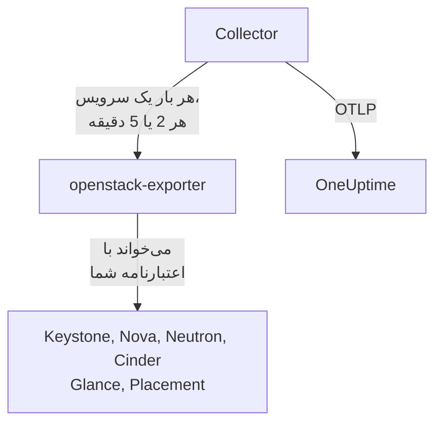

# عامل OpenStack

عامل OpenStack در OneUptime یک ابر OpenStack را پایش می‌کند: سرویس‌ها و عامل‌ها، هایپروایزرها، نمونه‌ها، شبکه‌ها، روترها، حجم‌ها، استخرهای ذخیره‌سازی، ایمیج‌ها و پروژه‌ها، در همه مناطق. این عامل APIهای ابر را با اعتبارنامه‌ای که شما انتخاب می‌کنید می‌خواند و یافته‌هایش را به OneUptime می‌فرستد، جایی که ابر همراه با مناطق، هایپروایزرها و پروژه‌هایش نمایش داده می‌شود. [پایشگرهای OpenStack](/docs/monitor/openstack-monitor) روی داده‌های رسیده هشدار می‌دهند، و یک [probe](/docs/telemetry/openstack-agentless) می‌تواند بدون نصب هیچ چیزی داده‌های ابر را جمع‌آوری کند.

:::cards
- [Probe یا عامل؟](/docs/telemetry/openstack-agentless#پراب-یا-عامل): برای ابری که با هر دو قابل پایش است، کدام را انتخاب کنید.
- [میزان دید را انتخاب کنید](#میزان-دید-عامل-را-انتخاب-کنید): OpenStack نقش فقط‌خواندنیِ سراسری ندارد، بنابراین سه سطح وجود دارد.
- [عامل را نصب کنید](#عامل-را-نصب-کنید): یک اعتبارنامه، سپس اسکریپت نصب، Docker Compose یا اجرا بدون Docker.
- [هزینه آن برای ابر شما](#هزینه-آن-برای-ابر-شما): هر تنظیم چه چیزی را می‌خواند و چگونه آن را تغییر دهید.
- [ظرفیت](#ظرفیت): از هر flavor چند نمونه دیگر جا می‌شود و تا پر شدن هر چیز چند روز مانده است.
- [مخارج](#مخارج): چه کسی چه چیزی مصرف می‌کند، با قیمت‌های شما یا با نرخ‌گذاری CloudKitty چقدر می‌شود و چه چیزی را می‌توان پس گرفت.
- [صفحات وضعیت و اطلاع‌رسانی به پروژه‌ها](#صفحات-وضعیت-و-اطلاعرسانی-به-پروژهها): یک صفحه برای هر منطقه در یک مرحله، و اطلاع‌رسانی فقط به پروژه‌هایی که خرابی به آن‌ها می‌رسد.
- [لاگ‌های سرویس](#لاگهای-سرویس): تجزیه‌شده، با دنبال کردن یک درخواست در میان سرویس‌ها.
- [رویدادهای چرخه عمر](#رویدادهای-چرخه-عمر): اقدامات روی نمونه‌ها در فید و نمودارها، از اعلان‌ها یا یک probe.
- [چه کسی چه کرد](#چه-کسی-چه-کرد): ردهای ممیزی در رویدادهای امنیتی.
- [ردیابی یک درخواست](#ردیابی-درخواستها-در-control-plane): یک درخواست امضاشده، دنبال‌شده در میان control plane.
- [بررسی از بیرون](#بررسی-ابر-از-بیرون): اینکه آیا کسی واقعاً می‌تواند یک نمونه بوت کند، از یک probe بیرون از ابر.
- [بدون اینترنت](#بدون-اینترنت): چهار ایمیج عامل و نحوه کپی آن‌ها به یک رجیستری از خودتان.
- [بر اساس ابزار استقرار](/docs/telemetry/openstack-deployment-tools): Kolla-Ansible، OpenStack-Ansible، OpenStack-Helm، Atmosphere، Sunbeam، Red Hat و Mirantis.
- [عیب‌یابی](#عیبیابی): یک اسکریپت تشخیصی و مشکلات رایج.
:::

## نحوه کار

عامل از دو برنامه بالادستیِ قفل‌شده روی یک نسخه و پیکربندی آن‌ها تشکیل شده و روی یک ماشین اجرا می‌شود: [openstack-exporter](https://github.com/openstack-exporter/openstack-exporter) APIهای ابر را می‌خواند و به سری‌های `openstack_*` تبدیل می‌کند، و یک OpenTelemetry Collector هر بار یک سرویس OpenStack را از آن می‌پرسد، روی هر سری ابر و منطقه مبدأ را درج می‌کند و آن‌ها را به OneUptime می‌فرستد. هیچ چیز روی کنترلرها یا نودهای compute شما اجرا نمی‌شود، مگر اینکه [پروفایل لاگ](#لاگهای-سرویس) اختیاری را اضافه کنید که لاگ‌های آن‌ها را می‌خواند.



ابر با نخستین داده‌اش و با نامی که عامل روی هر متریک به‌صورت `openstack.cloud.name` درج می‌کند، خود را ثبت می‌کند. هر عامل یک ابر را زیر نظر دارد: یک Keystone، با یک منطقه یا چند منطقه.

## پیش از شروع

- Docker Engine نسخه 20.10 یا بالاتر با افزونه Docker Compose v2، یا برای اجرا بدون Docker، یک ماشین لینوکسی (x86_64 یا arm64) با systemd نسخه 235 یا بالاتر، glibc نسخه 2.34 یا بالاتر (RHEL 9، Ubuntu 22.04، Debian 12) و دسترسی root.
- مسیر شبکه از آن ماشین به Keystone و به endpoint عمومی هر سرویس.
- خط فرمان `openstack`، به‌عنوان کسی که می‌تواند اعتبارنامه زیر را بسازد.
- یک کلید دریافت داده. آن را در **تنظیمات پروژه** > **تله‌متری و APM** > **کلیدهای دریافت داده** بسازید و مقدارش را کپی کنید.
- HTTPS خروجی از آن ماشین به نشانی OneUptime شما.

### عامل را کجا اجرا کنیم

عامل را بیرون از ابری که پایش می‌کند اجرا کنید: یک VM کوچک روی سخت‌افزار جداگانه، یک میزبان مدیریتی، یا ابری دیگر. عاملی که درون ابرِ از کار افتاده است همراه با آن ساکت می‌شود، و سکوت شبیه ابر سالمی است که فقط گزارش دادن را متوقف کرده.

## میزان دید عامل را انتخاب کنید

OpenStack نقش فقط‌خواندنیِ سراسری ندارد و این دشوارترین بخش پایش آن است:

- `reader` همه‌جا به یک پروژه محدود است، به‌جز Keystone و Ironic.
- هایپروایزرها، سرویس‌ها، عامل‌ها، استخرها و Placement به‌طور پیش‌فرض نیاز به admin دارند.
- یک بازنویسی سیاست نمی‌تواند فهرست‌های همه پروژه‌ها را در Neutron یا Cinder باز کند، چون این دو در کد خودشان آن‌ها را با زمینه admin محدود می‌کنند.
- سرویس‌ها و استخرهای ذخیره‌سازی Cinder به هر کسی جز admin با `403` پاسخ می‌دهند، از کد خود Cinder و پس از آنکه سیاست قبلاً رد شده است. هیچ بازنویسی‌ای این‌ها را هم باز نمی‌کند.
- Neutron و Cinder به یک reader ساده با `200` پاسخ می‌دهند و فقط پروژه خودِ آن reader را برمی‌گردانند. به نظر می‌رسد کار کرده، و کار نکرده است.
- جایی که `enforce_new_defaults` در Cinder خاموش است، که پیش‌فرض خود Cinder است، هر نقشی روی یک پروژه می‌تواند حجم‌های آن پروژه را بسازد، از جمله `reader` و `oneuptime_monitoring`. در Epoxy، Flamingo و Gazpacho هم یک reader ساده و هم نقش روی یک پروژه واقعی توانستند حجم بسازند (`202`). در Hibiscus هر دو رد شدند (`403`)، چون DevStack فقط آنجا `enforce_new_defaults` را روشن می‌کند. نقش فقط‌خواندنی روی یک پروژه واقعی فقط‌خواندنی نیست.

بنابراین سه سطح وجود دارد و هر کدام بهایی دارد. اگر می‌توانید، از اولی شروع کنید.

| سطح | به چه نیاز دارد | چه چیزی می‌بیند | چه چیزی نمی‌بیند |
| --- | --- | --- | --- |
| **1. Full view** | یک اعتبارنامه برنامه روی حسابی با `admin` روی پروژه‌ای مختص خودش، که با قواعد دسترسی به خواندن محدود شده و روی هر سرویس `service_type` تنظیم شده است | هر خواندنی که عامل انجام می‌دهد، و وضعیت `cinder-volume` و `cinder-scheduler` و استخرهای ذخیره‌سازی، که فقط این سطح می‌بیند | کاربران و گروه‌های Keystone، عمداً. نمی‌تواند بنویسد: هر نوشتن با `401` پاسخ داده شد |
| **2. Infrastructure only** | نقش‌های `oneuptime_monitoring` و `reader` روی پروژه‌ای مختص خودش که چیزی ندارد و سهمیه‌اش صفر است، و بازنویسی‌های سیاستی که عامل همراه دارد | همه پروژه‌ها، دامنه‌ها، سرویس‌ها و endpointهای Keystone، همه Nova از جمله سرورهای همه پروژه‌ها، همه Placement، و عامل‌ها و IP availabilityهای Neutron | شبکه‌ها، زیرشبکه‌ها، روترها، IPهای شناور و پورت‌های Neutron، و حجم‌ها و snapshotهای Cinder فقط مال پروژه خودش است، یعنی روی یک پروژه خالی فقط موارد اشتراکی و خارجی. نه وضعیت `cinder-volume` یا `cinder-scheduler` و نه استخرهای ذخیره‌سازی. نمی‌تواند بنویسد: هر نوشتن با `403` پاسخ داده شد، یا `409` و `413` به‌خاطر سهمیه |
| **3. Project view** | `reader` ساده روی یک پروژه واقعی، برای تیمی که بخش خودش از ابری را که دیگری اداره می‌کند پایش می‌کند | حجم‌ها، شبکه‌ها و روترهای آن پروژه، از Cinder و Neutron | همه زیرساخت: نه هایپروایزر، نه سرویس، نه عامل، نه استخر و نه ظرفیت. از طریق عامل، نمونه‌ای هم نه، چون خواندن همه پروژه‌ها توسط exporter رد می‌شود. و در بسیاری از ابرها `reader` آنجا می‌تواند بنویسد |

الگوهای **Block Storage Service Down**، **Storage Pool Warning** و **Storage Pool Critical** به سطح 1 نیاز دارند. **Compute Service Down**، **Network Agent Down** و الگوهای Placement و هایپروایزر به سطح 1 یا 2 نیاز دارند، و در سطح 3 هیچ چیز نمونه‌ای را نمی‌خواند.

### هر سطح چه چیزی را می‌خواند

این پاسخ پنج ابر واقعی است، روی Epoxy، Flamingo، Gazpacho (با OVN و OVS) و Hibiscus. هر خانه از روی همان ضبط‌ها نوشته شده است.

| خواندن | سطح 1: Full view | سطح 2: Infrastructure only | سطح 3: Project view |
| --- | --- | --- | --- |
| Keystone: پروژه‌ها | همه | همه | رد شد |
| Keystone: دامنه‌ها | همه | همه | رد شد |
| Keystone: مناطق | همه | آنچه هر کسی می‌بیند | آنچه هر کسی می‌بیند |
| Keystone: سرویس‌ها | همه | همه | رد شد |
| Keystone: endpointها | همه | همه | رد شد |
| Nova: سرورها، همه پروژه‌ها | همه | همه | رد شد |
| Nova: سرویس‌ها | همه | همه | رد شد |
| Nova: هایپروایزرها | همه | همه | رد شد |
| Nova: aggregateها | همه | همه | رد شد |
| Nova: زُن‌های دسترس‌پذیری، جزئیات | همه | همه | رد شد |
| Nova: flavorها | همه | آنچه هر کسی می‌بیند | آنچه هر کسی می‌بیند |
| Nova: مصرف هر پروژه | همه | همه | رد شد |
| Placement: resource providerها | همه | همه | رد شد |
| Neutron: عامل‌ها | همه | همه | هیچ |
| Neutron: شبکه‌ها | همه | فقط پروژه خودش | فقط پروژه خودش |
| Neutron: زیرشبکه‌ها | همه | فقط پروژه خودش | فقط پروژه خودش |
| Neutron: روترها | همه | فقط پروژه خودش | فقط پروژه خودش |
| Neutron: IPهای شناور | همه | فقط پروژه خودش | فقط پروژه خودش |
| Neutron: IP availabilityها | همه | همه | هیچ |
| Neutron: security groupها | همه | 409، مورد انتظار | فقط پروژه خودش |
| Neutron: پورت‌ها | همه | فقط پروژه خودش | فقط پروژه خودش |
| Neutron: سهمیه‌ها | همه | رد شد | رد شد |
| Cinder: حجم‌ها، همه پروژه‌ها | همه | فقط پروژه خودش | فقط پروژه خودش |
| Cinder: سرویس‌ها | همه | رد شد | رد شد |
| Cinder: استخرها | همه | رد شد | رد شد |
| Cinder: snapshotها، همه پروژه‌ها | همه | فقط پروژه خودش | فقط پروژه خودش |
| Cinder: پشتیبان‌ها، همه پروژه‌ها | همه | چیزی ثبت نشد | چیزی ثبت نشد |
| Cinder: نوع‌های حجم | همه | آنچه هر کسی می‌بیند | آنچه هر کسی می‌بیند |
| Glance: ایمیج‌ها | همه | آنچه هر کسی می‌بیند | آنچه هر کسی می‌بیند |

- **همه**: همان ردیف‌هایی که admin دید.
- **فقط پروژه خودش**: ردیف‌های همان پروژه، و هر چیز اشتراکی یا خارجی. روی پروژه‌ای که چیزی ندارد، فقط موارد اشتراکی و خارجی.
- **رد شد**: یک `401` یا `403`.
- **آنچه هر کسی می‌بیند**: هر اعتبارنامه‌ای همه ردیف‌ها را دید، در ابرهایی که فقط flavor، نوع حجم و ایمیج عمومی دارند. مورد خصوصی در پروژه‌ای دیگر سطح 1 می‌خواهد.
- **هیچ**: یک `200` بدون ردیف، روی پروژه‌ای که شبکه هم دارد. به نظر می‌رسد کار کرده، و کار نکرده است.
- **چیزی ثبت نشد**: یک `200` بدون ردیف، جایی که admin هم چیزی ندید، پس چیزی برای تشخیص نبود.
- **409، مورد انتظار**: Neutron هنگام فهرست کردن، تلاش می‌کند security group پیش‌فرض پروژه را بسازد و سهمیه صفر اجازه نمی‌دهد، پس با `409 Quota exceeded` پاسخ می‌دهد. این بی‌ضرر است و چیزی برای رفع ندارد.

Octavia، Ironic، Heat، Magnum، Manila، Designate، Barbican، Swift، Trove و Gnocchi اینجا نیستند چون آن ابرها این‌ها را اجرا نمی‌کردند. [اسکریپت تشخیصی](#عیبیابی) آن‌ها را هم می‌پرسد، اگر ابری آن‌ها را داشته باشد، و هر مسیر را با اعتبارنامه واقعی شما می‌خواند و می‌گوید آن اعتبارنامه چه چیزی را می‌بیند.

آنچه exporter عامل با هر کدام گرفت، بر حسب تعداد سری برای هر سرویس. تعدادها از آنچه ابر در لحظه پرسش دارد پیروی می‌کنند، پس آن‌ها را با یکدیگر مقایسه کنید و نه با ابر خودتان:

| سرویس exporter | Admin | سطح 1: Full view | سطح 2: Infrastructure only | سطح 3: Project view |
| --- | --- | --- | --- | --- |
| identity | 14 | 13 | 13 | 4 |
| compute | 33 | 33 | 33 | 15 |
| placement | 25 | 25 | 25 | 1 |
| network | 36 تا 40 | 36 تا 40 | 24 تا 26 | 14 |
| volume | 33 | 33 تا 41 | 23 | 29 تا 37 |
| image | 4 | 4 | 4 | 4 |

## عامل را نصب کنید

هر OneUptime اسکریپت نصب و فایل‌های عامل را برای نسخه خودش ارائه می‌دهد: دستورهای زیر آن‌ها را از `https://oneuptime.com` دانلود می‌کنند، پس در OneUptime خودمیزبان آن را با نشانی خودتان جایگزین کنید. اسکریپت نصب ابتدا با نام `install.sh` ذخیره می‌شود تا پیش از اجرا بتوانید آن را بخوانید.

:::steps
### اعتبارنامه را بسازید

سطحی را که انتخاب کرده‌اید برگزینید. هر کدام یک اعتبارنامه برنامه می‌سازد که یک `id` و یک `secret` چاپ می‌کند: secret فقط یک بار نمایش داده می‌شود. برایش تاریخ انقضا بگذارید و هرگز `--unrestricted` نزنید، چون به آن اجازه می‌دهد اعتبارنامه‌های بیشتری بسازد.

:::tabs
@tab Level 1: Full view
به‌عنوان admin، یک پروژه و یک حساب برای عامل بسازید:

```bash
openstack project create --domain default oneuptime-monitoring
openstack user create --domain default --password-prompt oneuptime-monitoring
openstack role add --project oneuptime-monitoring --user oneuptime-monitoring admin
```

سپس، با ورود به‌عنوان همان حساب روی همان پروژه، اعتبارنامه را بسازید. قواعد، همان مسیرهای `GET` دقیقی هستند که عامل استفاده می‌کند، و با ابر شما تطبیق داده شده‌اند:

```bash
curl -fsSLO https://oneuptime.com/install/openstack-agent/access/application-credential-access-rules.json
curl -fsSLO https://oneuptime.com/install/openstack-agent/access/access-rules-for-cloud.py
openstack catalog list -f json | python3 access-rules-for-cloud.py \
  application-credential-access-rules.json > access-rules-for-this-cloud.json
openstack application credential create oneuptime-agent \
  --role admin \
  --access-rules "$(cat access-rules-for-this-cloud.json)" \
  --expiration 2027-11-01T00:00:00
```

یک قاعده دسترسی با مسیری که سرویس می‌بیند مقایسه می‌شود. سرویسی پشت یک پیشوند مسیر، مثل `https://cloud.example/compute/v2.1`، مسیر `/compute/v2.1/servers` را می‌بیند و قاعده همراه برای `/v2.1/servers` را با `401` رد می‌کند. `access-rules-for-cloud.py` هر قاعده را یک بار دیگر زیر پیشوند سرویسش اضافه می‌کند، که از کاتالوگ شما خوانده می‌شود.

دو مورد از خواندن‌های exporter قواعدی می‌خواهند که با دست به‌راحتی از قلم می‌افتند. پیش از هر چیز ریشه Octavia را می‌خواند، و پشت Apache سرویس آن را به‌صورت `/load-balancer//` با دو اسلش می‌بیند. اگر رد شود، exporter با یک `200` خالی پاسخ می‌دهد، پس چنین به نظر می‌رسد که ابر Octavia را اجرا نمی‌کند. و account سرویس Swift را با اسلش پایانی فهرست می‌کند، که `/v1/*` با آن مطابقت ندارد. اگر رد شود، `openstack_object_store_up` مقدار `0` می‌گیرد. قواعد تطبیق‌یافته هر دو را دارند. قواعد یک اعتبارنامه قابل تغییر نیستند، پس اگر اعتبارنامه شما از نسخه قدیمی‌تر آن‌ها ساخته شده، یکی تازه بسازید.

قواعد دسترسی همچنین لازم دارند `service_type` برای keystonemiddleware روی هر سرویس تنظیم شود، و آن سرویس راه‌اندازی مجدد شود. بدون آن، سرویس اعتبارنامه را با `401` رد می‌کند:

```ini title="nova.conf"
[keystone_authtoken]
service_type = compute
```

| فایل پیکربندی | `service_type` |
| --- | --- |
| `nova.conf` | `compute` |
| `neutron.conf` | `network` |
| `cinder.conf` | `block-storage`. قواعد `volume` و `volumev3` را هم دارند، برای Cinder‌ای که به آن شکل پیکربندی شده |
| `glance-api.conf` | `image` |
| `placement.conf` | `placement` |
| `octavia.conf` | `load-balancer` |
| `ironic.conf` | `baremetal` |
| `heat.conf` | `orchestration` |
| `magnum.conf` | `container-infra` |
| `manila.conf` | `sharev2`. قواعد `shared-file-system` را هم دارند، برای Manila‌ای که به آن شکل پیکربندی شده |
| `designate.conf` | `dns` |
| `barbican.conf` | `key-manager` |
| `trove.conf` | `database` |
| `gnocchi.conf` | `metric` |
| `cloudkitty.conf` | `rating` |
| `proxy-server.conf`، زیر `[filter:authtoken]` | `object-store`، و `include_service_catalog = True` کنار آن. keystonemiddleware قواعد را با کاتالوگ توکن مقایسه می‌کند، پس با `False`، که DevStack تنظیم می‌کند، Swift به اعتبارنامه با `500` پاسخ می‌دهد |

فقط سرویس‌هایی که ابر شما اجرا می‌کند به یک خط نیاز دارند.

درباره سرویس‌هایی که ممکن است ابر اجرا نکند، آنچه هر سطح در ابرهای واقعی گرفت در چهار مورد با جدول‌های بالا فرق دارد:

- **Ironic** به اعتبارنامه یک پروژه، حتی اعتبارنامه admin، فقط با نودهایی که آن پروژه مالک آن‌هاست پاسخ می‌دهد و conductorها را رد می‌کند. فقط دامنه system همه نودها و conductorها را می‌خواند، و اعتبارنامه عامل روی یک پروژه است. برای خواندن یک نود با آن، پروژه‌اش را مالک کنید: `openstack baremetal node set --owner`.
- **Swift** کانتینرهای پروژه خودِ اعتبارنامه را فهرست می‌کند و نه پروژه دیگری را. account پروژه دیگر با `403` پاسخ می‌دهد، مگر اینکه اعتبارنامه `ResellerAdmin` داشته باشد.
- **Barbican** به اعتبارنامه فقط درباره پروژه خودش پاسخ می‌دهد و reader ساده را رد می‌کند. OneUptime هیچ secretای نمی‌خواند.
- **Gnocchi** به هر نقشی روی یک پروژه اجازه ساختن metric می‌دهد، پس در ابری که آن را اجرا می‌کند، سطح 2 و سطح 3 می‌توانند آنجا بنویسند.

Keystone به چیزی نیاز ندارد. با قواعد تطبیق‌یافته، `service_type` تنظیم‌شده و APIهای راه‌اندازی‌شده مجدد، هر خواندن با `200` و هر نوشتن با `401` پاسخ داده شد، در هر نسخه‌ای که ثبت کرده‌ایم. exporter همان چیزی را می‌گیرد که admin می‌گیرد، به‌جز کاربران و گروه‌های Keystone، عمداً. این درباره سرویس‌هایی که ممکن است ابر اجرا نکند هم صدق می‌کند: روی DevStack ثبت شد که سطح 1 از هر سرویسی که exporter می‌خواند همان سری‌های اعتبارنامه admin را گرفت، و هر نوشتن با `401` پاسخ داده شد.

اگر آن تغییر را انجام نمی‌دهید، همان اعتبارنامه را بدون `--access-rules` بسازید: یک اعتبارنامه برنامه admin ساده. کار می‌کند، و می‌تواند بنویسد، پس اسکریپت تشخیصی آن را به همین شکل برچسب می‌زند.
@tab Level 2: Infrastructure only
به‌عنوان admin، نقش، پروژه‌ای که چیزی ندارد و سهمیه‌اش صفر است، و یک حساب بسازید:

```bash
openstack role create oneuptime_monitoring
openstack project create --domain default --description "OneUptime monitoring: holds nothing" oneuptime-monitoring
openstack quota set --instances 0 --cores 0 --ram 0 --key-pairs 0 oneuptime-monitoring
openstack quota set --volumes 0 --gigabytes 0 --snapshots 0 --backups 0 --backup-gigabytes 0 oneuptime-monitoring
openstack quota set --networks 0 --subnets 0 --ports 0 --routers 0 --floating-ips 0 --secgroups 0 --secgroup-rules 0 oneuptime-monitoring
openstack user create --domain default --password-prompt oneuptime-monitoring
openstack role add --project oneuptime-monitoring --user oneuptime-monitoring oneuptime_monitoring
openstack role add --project oneuptime-monitoring --user oneuptime-monitoring reader
```

پروژه عمداً چیزی ندارد و سهمیه‌اش صفر است. جایی که `enforce_new_defaults` در Cinder خاموش است، هر نقشی روی یک پروژه می‌تواند حجم‌های آن پروژه را بسازد. وقتی چیزی برای دست زدن نباشد و سهمیه‌ای برای ساختن چیزی نباشد، چیزی برای نوشتن نمی‌ماند: در هر نسخه‌ای که ثبت کرده‌ایم، هر نوشتن با `403` پاسخ داده شد، یا `409` و `413` به‌خاطر سهمیه.

بازنویسی‌های سیاست را دانلود کنید، و هر فایل را روی هر کنترلر در فایلی ادغام کنید که `[oslo_policy] policy_file` در پیکربندی همان سرویس (`nova.conf`، `neutron.conf` و مانند آن) نام می‌برد. مگر اینکه استقرار شما چیز دیگری بگوید، آن فایل `/etc/nova/policy.yaml` و مانند آن است: DevStack می‌گوید `policy.json`. هر قاعده پیش‌فرض سرویس را نگه می‌دارد و نقش را اضافه می‌کند، و oslo.policy تغییر فایل را خودش متوجه می‌شود، پس راه‌اندازی مجدد لازم نیست.

```bash
curl -fsSLO https://oneuptime.com/install/openstack-agent/access/policy/nova.yaml
curl -fsSLO https://oneuptime.com/install/openstack-agent/access/policy/neutron.yaml
curl -fsSLO https://oneuptime.com/install/openstack-agent/access/policy/keystone.yaml
curl -fsSLO https://oneuptime.com/install/openstack-agent/access/policy/placement.yaml
```

برای Cinder فایلی وجود ندارد. `os-services` و `scheduler-stats/get_pools` آن به نقش با `403 User does not have admin privileges` پاسخ می‌دهند، در هر پنج ابری که ثبت کرده‌ایم. این از کد خود Cinder می‌آید که زمینه admin می‌خواهد، پس از آنکه سیاست قبلاً رد شده است، بنابراین هیچ بازنویسی‌ای نمی‌تواند آن‌ها را باز کند.

**برای برداشتن بازنویسی‌ها، فایل را خالی کنید (`{}`) و هرگز آن را پاک نکنید.** در Flamingo (2025.2) و Epoxy (2025.1)، وقتی فایل سیاستی که oslo.policy خوانده است ناپدید شود، در هر بررسی خطا می‌دهد، پس آن سرویس همه درخواست‌ها را شکست می‌دهد. اگر آن سرویس Keystone باشد، اعتبارسنجی توکن را متوقف می‌کند و کل ابر با `503` پاسخ می‌دهد. اگر این قبلاً رخ داده، سرویس را راه‌اندازی مجدد کنید.

سپس، با ورود به‌عنوان همان حساب روی همان پروژه، اعتبارنامه را بسازید:

```bash
openstack application credential create oneuptime-agent --expiration 2027-11-01T00:00:00
```

گذاشتن نقش روی یک پروژه واقعی برای دیدن حجم‌ها و روترهایش، در ابری که `enforce_new_defaults` در Cinder آن خاموش است، به حساب اجازه نوشتن در آنجا را هم می‌دهد. اسکریپت تشخیصی هشدار می‌دهد وقتی پروژه اعتبارنامه چیزی در خود داشته باشد.
@tab Level 3: Project view
نقش `reader` ساده را روی پروژه به یک حساب بدهید، سپس با ورود به‌عنوان همان حساب روی همان پروژه، اعتبارنامه را بسازید:

```bash
openstack role add --project my-team --user my-monitoring-account reader
openstack application credential create oneuptime-agent --expiration 2027-11-01T00:00:00
```

عامل ردیف‌های آن پروژه را از Cinder و Neutron می‌بیند و هیچ زیرساختی را نه. پیش از انتخاب این سطح سه چیز را بدانید:

- **از طریق عامل هیچ نمونه‌ای نشان نمی‌دهد.** exporter از Nova سرورهای همه پروژه‌ها را می‌خواهد، Nova reader ساده را رد می‌کند، و آن خواندن کامل شکست می‌خورد. فقط یک probe در OneUptime، که بدون این عامل داده جمع می‌کند، می‌تواند نمونه‌های یک پروژه را فهرست کند.
- **ممکن است بتواند بنویسد.** در ابری که `enforce_new_defaults` در Cinder خاموش است، `reader` ساده می‌تواند در پروژه‌اش حجم هم بسازد. در Epoxy، Flamingo و Gazpacho توانست (`202`)، و در Hibiscus رد شد (`403`)، چون DevStack فقط آنجا `enforce_new_defaults` را روشن می‌کند. پیش‌فرض خود Cinder خاموش است.
- **Placement پاسخ‌نده خوانده می‌شود.** هر فراخوانی که انجام می‌دهد رد می‌شود، و exporter آن را همان‌طور گزارش می‌کند که Placement متوقف را: `openstack_placement_up 0`، در هر پنج ابری که ثبت کرده‌ایم. صفحه‌ها می‌توانند از روی آنچه برای این اعتبارنامه بسته است تشخیص دهند و همین را بگویند. الگوی [Placement API Down](/docs/monitor/openstack-monitor#قالبهای-هشدار-آماده) نمی‌تواند، پس در این سطح آن را کنار بگذارید.
:::

### عامل را نصب و راه‌اندازی کنید

:::tabs
@tab install.sh
اسکریپت نصب را دانلود کنید و روی ماشینی که میزبان عامل خواهد بود اجرا کنید:

```bash
curl -fsSL https://oneuptime.com/install/openstack-agent -o install.sh
bash install.sh
```

اسکریپت نشانی OneUptime شما، کلید دریافت داده، یک نام ثابت برای ابر، نشانی auth Keystone، نام مناطق، اعتبارنامه برنامه (و اگر نه بگویید، یک نام کاربری و گذرواژه) و در صورتی که ابر مرجع صدور گواهی مخصوص خودش را دارد، یک فایل CA خصوصی را می‌پرسد. هیچ چیز محرمانه‌ای echo نمی‌شود یا روی خط فرمان نمی‌آید. پیش از آنکه چیزی بنویسد یا راه بیندازد، اعتبارنامه را با Keystone بررسی می‌کند، در `/opt/oneuptime-openstack-agent` نصب می‌کند، یا اگر روی `/opt` دسترسی ندارید در پوشه `oneuptime-openstack-agent` داخل پوشه home شما (فقط به گروه `docker` نیاز دارد)، فایل‌های `.env` و `clouds.yaml` را با مجوز `0600` می‌نویسد و عامل را با Docker Compose راه می‌اندازد. هر پاسخ به‌صورت متغیر محیطی هم کار می‌کند، و اجرای دوباره اسکریپت آن‌ها را به‌جای پرسیدن دوباره به کار می‌برد، که راه [ارتقای عامل](#ارتقای-عامل) همین است.
@tab Docker Compose
فایل‌های `docker-compose.yml` و `otel-collector-config.yaml` را از OneUptime خودتان در یک پوشه جدید دانلود کنید:

```bash
mkdir oneuptime-openstack-agent && cd oneuptime-openstack-agent
curl -fsSLO https://oneuptime.com/install/openstack-agent/docker-compose.yml
curl -fsSLO https://oneuptime.com/install/openstack-agent/otel-collector-config.yaml
```

کنار آن‌ها یک `clouds.yaml` بسازید، با یک ورودی برای هر منطقه که **به نام همان منطقه** باشد، چون سری‌های exporter نمی‌گویند از کدام منطقه‌اند و collector نام ورودی را به‌صورت `openstack.region.name` روی آن‌ها درج می‌کند:

```yaml title="clouds.yaml"
clouds:
  RegionOne:
    region_name: RegionOne
    identity_api_version: 3
    auth_type: v3applicationcredential
    auth:
      auth_url: https://keystone.example.com:5000/v3
      application_credential_id: your-credential-id
      application_credential_secret: your-credential-secret
```

سپس یک فایل `.env`:

```bash title=".env"
ONEUPTIME_URL=YOUR_ONEUPTIME_URL
ONEUPTIME_TELEMETRY_INGESTION_KEY=YOUR_TELEMETRY_INGESTION_TOKEN
OPENSTACK_CLOUD_NAME=my-cloud
OPENSTACK_EXPORTER_CLOUDS=[RegionOne,RegionTwo]
COMPOSE_PROFILES=openstack-exporter,openstack-ai-agent
```

`OPENSTACK_EXPORTER_CLOUDS` همه مناطق را در کروشه فهرست می‌کند و `COMPOSE_PROFILES` exporter همراه و [عامل هوش مصنوعی](#عامل-هوش-مصنوعی) را راه می‌اندازد. هر دو فایل رازهایی در خود دارند. exporter با uid 65532 اجرا می‌شود و باید تنها حسابی باشد که می‌تواند `clouds.yaml` را بخواند. عامل را راه بیندازید:

```bash
chmod 600 .env
sudo chown 65532:65532 clouds.yaml
sudo chmod 600 clouds.yaml
docker compose up -d
```
@tab Without Docker
روی لینوکس (x86_64 یا arm64) با systemd نسخه 235 یا بالاتر و glibc نسخه 2.34 یا بالاتر، اسکریپت نصب نسخه‌های بالادستی همان دو برنامه را به‌صورت سرویس‌های systemd اجرا می‌کند. RHEL 8 و خویشاوندانش glibc قدیمی‌تری دارند که نسخه exporter روی آن اجرا نمی‌شود: اسکریپت همین را می‌گوید و چیزی را تغییر نمی‌دهد، پس آنجا از Docker استفاده کنید.

```bash
curl -fsSL https://oneuptime.com/install/openstack-agent -o install.sh
sudo bash install.sh --without-docker
```

همان پرسش‌ها، همان بررسی با Keystone و همان فایل‌ها. هر آرشیو نسخه با یک sha256 که در `install.sh` ثبت شده سنجیده می‌شود، و دانلودی که مطابقت نداشته باشد نصب را پیش از هر تغییری متوقف می‌کند. collector با یک کاربر بدون امتیاز و یک‌بارمصرف اجرا می‌شود که هرگز اعتبارنامه OpenStack را نمی‌بیند، و exporter با کاربر سیستمی `oneuptime-openstack`، تنها حسابی که می‌تواند `clouds.yaml` را بخواند، و فقط روی `127.0.0.1:9180` گوش می‌دهد.

برای هر ابر یک عامل اجرا کنید: اگر از نصب Docker به این روش می‌روید، ابتدا `docker compose down` را اجرا کنید، وگرنه هر متریک دوبار می‌رسد.
:::

openstack-exporter را از قبل با `--multi-cloud` اجرا می‌کنید؟ عامل را به آن اشاره دهید تا exporter همراه هرگز راه نیفتد: `OPENSTACK_EXPORTER_ADDRESS=10.0.0.5:9180 bash install.sh`، یا `COMPOSE_PROFILES` را از `.env` حذف کنید و `OPENSTACK_EXPORTER_ADDRESS` را همان‌جا تنظیم کنید. `clouds.yaml` آن به یک ورودی به نام هر منطقه نیاز دارد، و باید آنچه را exporter همراه خاموش می‌کند خاموش کند: [هزینه آن برای ابر شما](#هزینه-آن-برای-ابر-شما) را ببینید. نشانی‌ای بدهید که کانتینر عامل بتواند به آن برسد: `localhost` همان کانتینر خودش است.

exporter در Kolla-Ansible بدون `--multi-cloud` اجرا می‌شود، پس `/probe` ندارد، و روی نسخه‌ای قفل شده که کمتر می‌گوید. [از exporter‌ای که از قبل دارید استفاده کنید](/docs/telemetry/openstack-deployment-tools#از-exporterی-که-از-قبل-اجرا-میکنید-استفاده-کنید) می‌گوید چگونه آن را بخوانید و صفحه‌ها دقیقاً چه چیزی را از دست می‌دهند. [OpenStack بر اساس ابزار استقرار](/docs/telemetry/openstack-deployment-tools) بقیه مراحل هر ابزار را دارد.

### بررسی کنید که عامل اجرا می‌شود

```bash
cd /opt/oneuptime-openstack-agent    # or the folder the script said it installed to
docker compose ps
docker logs oneuptime-openstack-agent
```

`docker compose ps` collector (`oneuptime-openstack-agent`)، exporter همراه (`oneuptime-openstack-exporter`) و [عامل هوش مصنوعی](#عامل-هوش-مصنوعی) (`oneuptime-openstack-ai-agent`) را فهرست می‌کند. لاگ‌های collector پس از راه‌اندازی باید این خط را نشان دهند:

```text
Everything is ready. Begin running and processing data.
```

بدون Docker، از `systemctl status oneuptime-openstack-agent oneuptime-openstack-exporter` و `journalctl -u oneuptime-openstack-agent` بپرسید.

### ابر را در OneUptime پیدا کنید

**محصولات** > **زیرساخت** > **OpenStack** را باز کنید. ابر پس از نخستین جمع‌آوری، ظرف چند دقیقه، با نام `OPENSTACK_CLOUD_NAME` ظاهر می‌شود. compute، network، volume و Placement هر 2 دقیقه خوانده می‌شوند، identity و ایمیج‌ها هر 5 دقیقه.
:::

**نمای کلی** ابر می‌گوید داده‌هایش به OneUptime می‌رسد یا نه، چه چیزی اول به توجه نیاز دارد و هر سرویس در چه حالی است:


**هایپروایزرها** می‌گوید Nova و Placement روی هر میزبان compute چه چیزی را تعهد کرده‌اند:


**نمونه‌ها** هر نمونه را با وضعیتش به زبان خود Nova، پروژه، flavor و هایپروایزرش فهرست می‌کند:


## متغیرهای محیطی

اسکریپت نصب این‌ها را در `/opt/oneuptime-openstack-agent/.env` می‌نویسد؛ نصب Docker Compose آن‌ها را از `.env` کنار `docker-compose.yml` می‌خواند. پس از تغییر یکی از آن‌ها، در همان پوشه `docker compose up -d` را اجرا کنید، یا بدون Docker `sudo systemctl restart oneuptime-openstack-agent` را. فقط `clouds.yaml` اعتبارنامه را در خود دارد.

| متغیر | الزامی | توضیح |
| --- | --- | --- |
| `ONEUPTIME_URL` | بله | نشانی OneUptime شما، مثل `https://oneuptime.com` یا نمونه خودمیزبان شما. |
| `ONEUPTIME_TELEMETRY_INGESTION_KEY` | بله | کلید دریافت داده از **تنظیمات پروژه** > **تله‌متری و APM** > **کلیدهای دریافت داده**. |
| `OPENSTACK_CLOUD_NAME` | بله | نام ابر در OneUptime، که روی هر متریک به‌صورت ویژگی منبع `openstack.cloud.name` درج می‌شود. آن را ثابت نگه دارید: تغییرش یک ابر جدید ثبت می‌کند. پیش‌فرض `openstack` است. |
| `OPENSTACK_AUTH_URL` | exporter همراه | پاسخی به اسکریپت نصب: نشانی auth Keystone. اگر `/v3` نباشد اضافه می‌شود. |
| `OPENSTACK_EXPORTER_CLOUDS` | بله | مناطق، در کروشه، مثل `[RegionOne,RegionTwo]`، هر کدام نام یک ورودی `clouds.yaml`. پیش‌فرض `[RegionOne]` است. |
| `OPENSTACK_EXPORTER_ADDRESS` | خیر | `host:port`، بدون scheme، مربوط به exporter خودتان. برای exporter همراه آن را نگذارید. |
| `OPENSTACK_CA_FILE` | خیر | یک فایل PEM با مرجع صدور گواهی ابری که مرجع خودش را دارد. اسکریپت نصب یک نسخه از آن را با نام `ca.pem` کنار `clouds.yaml` نگه می‌دارد. |
| `OPENSTACK_EXPORTER_USER` | خیر | `uid:gid`ای که کانتینر exporter با آن اجرا می‌شود و باید مالک `clouds.yaml` باشد. پیش‌فرض `65532:65532` است. |
| `COMPOSE_PROFILES` | exporter همراه | `openstack-exporter` exporter همراه را راه می‌اندازد، و `openstack-ai-agent` [عامل هوش مصنوعی](#عامل-هوش-مصنوعی) را. |
| `OPENSTACK_LIBVIRT_EXPORTER_TARGETS` | خیر | نودهای compute که [مصرف واقعی](#مصرف-واقعی) از آن‌ها از طریق `prometheus-libvirt-exporter` خوانده می‌شود، در کروشه، مثل `[compute-01:9177,compute-02:9177]`. پیش‌فرض هیچ است. |
| `OPENSTACK_CEILOMETER_EXPORTER_TARGETS` | خیر | همان کار از طریق exporter خود Ceilometer، مثل `[compute-01:9101]`. پیش‌فرض هیچ است. |
| `OPENSTACK_SINGLE_CLOUD_EXPORTER_TARGETS` | خیر | exporter‌ای که از قبل بدون `--multi-cloud` اجرا می‌شود، مثل exporter در Kolla-Ansible: `[10.0.0.254:9198]`. [از exporter‌ای که از قبل دارید استفاده کنید](/docs/telemetry/openstack-deployment-tools#از-exporterی-که-از-قبل-اجرا-میکنید-استفاده-کنید) را ببینید. |
| `OPENSTACK_RABBITMQ_TARGETS` | خیر | افزونه Prometheus در RabbitMQ روی هر نود، برای [آنچه ابر بر آن ایستاده](#آنچه-ابر-بر-آن-ایستاده-است): `[10.0.0.11:15692,10.0.0.12:15692]`. پیش‌فرض هیچ است. |
| `OPENSTACK_MARIADB_TARGETS` | خیر | mysqld_exporter کنار هر نود MariaDB، معمولاً روی `9104`. پیش‌فرض هیچ است. |
| `OPENSTACK_MEMCACHED_TARGETS` | خیر | memcached_exporter کنار هر Memcached، معمولاً روی `9150`. پیش‌فرض هیچ است. |
| `OPENSTACK_HAPROXY_TARGETS` | خیر | exporter Prometheus خود HAProxy. پیش‌فرض هیچ است. |
| `OPENSTACK_NETWORK_EXPORTER_TARGETS` | خیر | openstack-network-exporter روی هر نود، برای OVN و Open vSwitch، معمولاً روی `1981`. پیش‌فرض هیچ است. |
| `OPENSTACK_LIBVIRT_HEALTH_TARGETS` | خیر | prometheus-libvirt-exporter روی هر نود compute، معمولاً روی `9177`، برای اینکه libvirt پاسخ می‌دهد یا نه و نه چیزی به‌ازای هر نمونه. پیش‌فرض هیچ است. |
| `OPENSTACK_CONTROL_PLANE_REGION` | خیر | منطقه یکی از targetهای بالا که منطقه خودش را نمی‌گوید. یک target می‌تواند بگوید: `RegionTwo@10.1.0.11:15692`. پیش‌فرض اولین منطقه است. |
| `OPENSTACK_AGENT_SERVICES` | خیر | این عامل کدام سرویس‌ها را می‌خواند، برای [تقسیم یک ابر بین عامل‌ها](/docs/telemetry/openstack-very-large-clouds#اشتراک-یک-ابر-بین-چند-جمعآورنده)، مثل `compute\|placement`. پیش‌فرض همه آن‌هاست. |
| `OPENSTACK_AGENT_MEMORY_LIMIT_MIB` | خیر | مقدار حافظه‌ای که collector می‌تواند نگه دارد. scrape یک ابر بسیار بزرگ بیش از پیش‌فرض `512` می‌گیرد. |
| `OPENSTACK_DATABASE_EXPORTER_TARGETS` | خیر | `openstack_database_exporter`، برای [مسیر پایگاه داده](/docs/telemetry/openstack-very-large-clouds#مسیر-پایگاهداده): `[openstack-database-exporter:9180]`. پیش‌فرض هیچ است. بقیه تنظیم‌های آن مسیر همان‌جا فهرست شده‌اند. |

اسکریپت نصب اعتبارنامه را از محیط هم می‌خواند تا پرسش‌هایش را رد کند: `OPENSTACK_APPLICATION_CREDENTIAL_ID` و `OPENSTACK_APPLICATION_CREDENTIAL_SECRET`، یا `OPENSTACK_USERNAME`، `OPENSTACK_PASSWORD`، `OPENSTACK_PROJECT_NAME`، `OPENSTACK_USER_DOMAIN_NAME` و `OPENSTACK_PROJECT_DOMAIN_NAME`. این‌ها نام‌های خودشان را دارند و نه نام‌های `OS_*` که یک فایل openrc تنظیم می‌کند، تا openrc منبع‌شده یک admin بی‌آنکه کسی پرسیده شود هرگز اعتبارنامه عامل نشود. اعتبارنامه برنامه از نام کاربری و گذرواژه بهتر است: می‌توان آن را به خواندن محدود کرد و می‌تواند منقضی شود.

## آنچه ابر بر آن ایستاده است

بیشتر قطعی‌های OpenStack از زیر آن شروع می‌شوند: یک RabbitMQ از دست رفته، Galera بدون quorum، یک پایگاه داده OVN بدون leader. عامل می‌تواند exporterهایی را که این‌ها از قبل دارند هر دقیقه بخواند، و تا وقتی نامشان را نبرید خاموش است. هیچ چیز اینجا روی هیچ‌کدام از آن‌ها نمی‌نویسد، و از هر کدام فقط چند سری نگه داشته می‌شود.

هر کدام را در `.env` عامل نام ببرید، همه اعضای یک خوشه را، سپس `docker compose up -d` را اجرا کنید:

```bash
OPENSTACK_RABBITMQ_TARGETS=[10.0.0.11:15692,10.0.0.12:15692,10.0.0.13:15692]
OPENSTACK_MARIADB_TARGETS=[10.0.0.11:9104,10.0.0.12:9104,10.0.0.13:9104]
OPENSTACK_MEMCACHED_TARGETS=[10.0.0.11:9150,10.0.0.12:9150]
OPENSTACK_HAPROXY_TARGETS=[10.0.0.11:9101,10.0.0.12:9101]
OPENSTACK_NETWORK_EXPORTER_TARGETS=[10.0.0.21:1981,10.0.0.22:1981,RegionTwo@10.1.0.21:1981]
OPENSTACK_LIBVIRT_HEALTH_TARGETS=[10.0.0.21:9177,10.0.0.22:9177]
OPENSTACK_CONTROL_PLANE_REGION=RegionOne
```

یک target می‌تواند بگوید در کدام منطقه است، همان‌طور که آخری در آن فهرست می‌گوید. هر کدام که نگوید در `OPENSTACK_CONTROL_PLANE_REGION` است. در Kolla-Ansible، که Prometheus آن از قبل همه این‌ها را می‌شناسد، `control-plane-targets.py` این خط‌ها را برای شما چاپ می‌کند، و [OpenStack بر اساس ابزار استقرار](/docs/telemetry/openstack-deployment-tools) می‌گوید هر exporter در ابزارهای دیگر کجاست.

هر کدام چه چیزی را می‌خواند و عامل از آن چه می‌خواهد:

| تنظیم | می‌خواند | فعال‌سازی با |
| --- | --- | --- |
| `OPENSTACK_RABBITMQ_TARGETS` | افزونه خود RabbitMQ، `/metrics` و هر صف از `/metrics/detailed` | `rabbitmq-plugins enable rabbitmq_prometheus` روی هر نود |
| `OPENSTACK_MARIADB_TARGETS` | mysqld_exporter کنار هر نود. پیش‌فرض‌های آن از قبل Galera را گزارش می‌کنند | چیزی فراتر از exporter لازم نیست |
| `OPENSTACK_MEMCACHED_TARGETS` | memcached_exporter کنار هر Memcached | چیزی فراتر از exporter لازم نیست |
| `OPENSTACK_HAPROXY_TARGETS` | exporter خود HAProxy | `http-request use-service prometheus-exporter` روی یک `frontend` مخصوص خودش |
| `OPENSTACK_NETWORK_EXPORTER_TARGETS` | openstack-network-exporter روی هر ماشین با Open vSwitch یا پایگاه‌های داده OVN | collectorهای پیش‌فرضش. هر ماشین آنچه را اجرا می‌کند گزارش می‌دهد |
| `OPENSTACK_LIBVIRT_HEALTH_TARGETS` | prometheus-libvirt-exporter روی هر نود compute، و فقط اینکه libvirt پاسخ می‌دهد یا نه | چیزی فراتر از exporter لازم نیست |

سپس کارت **Control Plane** ابر برای هر کدام یک خط دارد، و یک صفحه برای هر وابستگی با یک خط برای هر ماشین. **پایش نمی‌شود** روی آن کارت یعنی آن را نام نبرده‌اید: هرگز سالم نشان داده نمی‌شود. مشکل آنجا به **نیاز به توجه** ابر می‌رود. صفحه **توصیه‌ها**ی ابر [الگوهای هشدار](/docs/monitor/openstack-monitor#آنچه-ابر-روی-آن-ایستاده) را پیشنهاد می‌کند، و `troubleshoot.sh` بررسی می‌کند که هر target پاسخ می‌دهد و همان چیزی است که گفته‌اید.

برای اطلاعات بیشتر از یک RabbitMQ یا پایگاه داده نسبت به آنچه سلامت ابر نیاز دارد، محصولات [صف‌ها](/docs/telemetry/queues) و [پایگاه‌های داده](/docs/telemetry/databases) آن‌ها را از طریق عامل‌های خودشان می‌خوانند، که داده‌ای بیش از این است و به شرایط خودش. صفحه‌های Control Plane به آن‌ها پیوند دارند. نصب آن‌ها جداست، چون آن محصولات سری‌های آن عامل‌ها را می‌خوانند و نه این‌ها را.

دو نکته درباره openstack-network-exporter نسخه 0.3.0، نسخه‌ای که این‌ها با آن ضبط شده‌اند:

- **فقط یک بار به پایگاه داده Open vSwitch وصل می‌شود.** پس از راه‌اندازی مجدد Open vSwitch، `ovs_build_info`، bridgeها، interfaceها و همه سری‌های ovn-controller تا راه‌اندازی مجدد exporter غایب می‌مانند، در حالی که سری‌های خود Open vSwitch فوراً برمی‌گردند. **Exporter Lost Open vSwitch's Database** می‌گوید این اتفاق افتاده است.
- **وضعیت خوشه یک پایگاه داده OVN را روی یک ماشین می‌خواند.** آنجا که یک ماشین هر دو سوکت را دارد، مثل ماشین‌های Kolla-Ansible، آن Southbound است. پس leader در Northbound فقط جایی دیده می‌شود که ماشین Southbound برای خواندن نداشته باشد.

## عامل چه چیزی را جمع می‌کند

collector برای هر سرویس OpenStack یک job اسکرپ می‌سازد، از طریق `/probe?cloud=<region>&include_services=<service>` در exporter، پس خراب بودن Nova فقط سری‌های Nova را از بین می‌برد:

| job اسکرپ | هر | timeout | سری‌ها |
| --- | --- | --- | --- |
| `oneuptime-openstack-compute` | 2 دقیقه | 110 s | `openstack_nova_agent_state`, `openstack_nova_running_vms`, `openstack_nova_vcpus_used`, `openstack_nova_memory_used_bytes`, `openstack_nova_local_storage_used_bytes`, `openstack_nova_total_vms`, `openstack_nova_server_status`, `openstack_nova_flavors`, `openstack_nova_availability_zones` |
| `oneuptime-openstack-network` | 2 دقیقه | 110 s | `openstack_neutron_agent_state`, `openstack_neutron_networks`, `openstack_neutron_subnets`, `openstack_neutron_routers`, `openstack_neutron_router`, `openstack_neutron_l3_agent_of_router`, `openstack_neutron_floating_ips`, `openstack_neutron_security_groups`, `openstack_neutron_network_ip_availabilities_total`, `openstack_neutron_network_ip_availabilities_used` |
| `oneuptime-openstack-volume` | 2 دقیقه | 110 s | `openstack_cinder_agent_state`, `openstack_cinder_volumes`, `openstack_cinder_volume_gb`, `openstack_cinder_snapshots`, `openstack_cinder_pool_capacity_free_gb`, `openstack_cinder_pool_capacity_total_gb` |
| `oneuptime-openstack-placement` | 2 دقیقه | 110 s | `openstack_placement_resource_total`, `openstack_placement_resource_usage`, `openstack_placement_resource_allocation_ratio`, `openstack_placement_resource_reserved` |
| `oneuptime-openstack-identity` | 5 دقیقه | 120 s | `openstack_identity_projects`, `openstack_identity_project_info`, `openstack_identity_domains`, `openstack_identity_regions` |
| `oneuptime-openstack-image` | 5 دقیقه | 120 s | `openstack_glance_images`, `openstack_glance_image_bytes`, `openstack_glance_image_created_at` |
| `oneuptime-openstack-load-balancer` | 5 دقیقه | 120 s | `openstack_loadbalancer_total_loadbalancers`, `openstack_loadbalancer_loadbalancer_status`, `openstack_loadbalancer_total_amphorae`, `openstack_loadbalancer_amphora_status`, `openstack_loadbalancer_total_pools`, `openstack_loadbalancer_pool_status` |
| `oneuptime-openstack-baremetal` | 5 دقیقه | 120 s | `openstack_ironic_node`, `openstack_ironic_node_updated_at`, `openstack_ironic_node_provision_updated_at` |
| `oneuptime-openstack-orchestration` | 5 دقیقه | 120 s | `openstack_heat_stack_status`, `openstack_heat_stack_status_counter` |
| `oneuptime-openstack-container-infra` | 5 دقیقه | 120 s | `openstack_container_infra_total_clusters`, `openstack_container_infra_cluster_masters`, `openstack_container_infra_cluster_nodes`, `openstack_container_infra_cluster_status` |
| `oneuptime-openstack-sharev2` | 5 دقیقه | 120 s | `openstack_sharev2_shares_counter`, `openstack_sharev2_share_gb`, `openstack_sharev2_share_status`, `openstack_sharev2_share_status_counter` |
| `oneuptime-openstack-dns` | 5 دقیقه | 120 s | `openstack_designate_zones`, `openstack_designate_zone_status`, `openstack_designate_recordsets`, `openstack_designate_recordsets_status` |
| `oneuptime-openstack-object-store` | 5 دقیقه | 120 s | `openstack_object_store_objects`, `openstack_object_store_bytes` |
| `oneuptime-openstack-database` | 5 دقیقه | 120 s | `openstack_trove_total_instances`, `openstack_trove_instance_status`, `openstack_trove_instance_volume_size_gb`, `openstack_trove_instance_volume_used_gb` |
| `oneuptime-openstack-gnocchi` | 5 دقیقه | 120 s | `openstack_gnocchi_status_metricd_processors`, `openstack_gnocchi_status_metric_having_measures_to_process`, `openstack_gnocchi_status_measures_to_process` |

نُه مورد آخر سرویس‌هایی هستند که ممکن است ابر اجرا نکند. وقتی درباره سرویسی که در کاتالوگ نیست پرسیده شود، exporter به Keystone وارد می‌شود، یک خط لاگ می‌کند (`No suitable endpoint could be found in the service catalog`) و بدون هیچ داده‌ای پاسخ می‌دهد، و آن ابر هیچ ردی از آن سرویس نشان نمی‌دهد. این به‌ازای هر سرویس و منطقه یک ورود در هر 5 دقیقه است، و برای همین همه این‌ها 5 دقیقه‌ای‌اند. برای پرسیدن فقط از سرویس‌هایی که اجرا می‌کنید، `OPENSTACK_AGENT_SERVICES` را تنظیم کنید، مثل `identity|compute|placement|network|volume|image`.

هر سرویس همچنین `openstack_<service>_up` را گزارش می‌کند، مثل `openstack_nova_up`. [پایشگر OpenStack](/docs/monitor/openstack-monitor#متریکهای-جمعآوریشده) هر سری را با معنایش فهرست می‌کند. هر سری این‌ها را دارد:

| ویژگی | چه می‌گوید |
| --- | --- |
| `openstack.cloud.name` | نام ابر، یک ویژگی منبع |
| `oneuptime.agent.version` | نسخه فایل‌های عامل، یک ویژگی منبع: نسخه collector که قفل کرده‌اند، با آخرین عدد که هر بار فایل‌ها روی آن collector تغییر کنند بالا می‌رود |
| `openstack.region.name` | منطقه، از نام ورودی `clouds.yaml`، روی هر datapoint |
| `openstack_service` | سرویس OpenStack مربوط به job (`compute`, `network`, ...)، روی هر datapoint |

فیلترهای پایشگر با برابری تطبیق می‌دهند، پس اگر پیکربندی را سفارشی می‌کنید، پردازشگر `transform/openstack-identity` و دو حذف `service.name` و `service.instance.id` را در پردازشگر `resource` نگه دارید: بدون این حذف‌ها داده به‌جای رسیدن به ابر، یک Service شبح ثبت می‌کند.

## هزینه آن برای ابر شما

پایش هرگز نباید چیزی باشد که ابر را از کار می‌اندازد، پس پیش‌فرض‌ها ملایم‌اند. هر scrape دوباره به Keystone وارد می‌شود و فراخوانی‌های واقعی API انجام می‌دهد. [ابرهای بسیار بزرگ OpenStack](/docs/telemetry/openstack-very-large-clouds) می‌گوید در هر اندازه این چقدر می‌شود، بر حسب درخواست در دقیقه و گیگابایت در روز.

| تنظیم | پیش‌فرض | روشن کردن یا تغییر آن چه می‌دهد | هزینه |
| --- | --- | --- | --- |
| سهمیه‌های پروژه | خاموش | هر پروژه چقدر از هر سهمیه را مصرف کرده، در صفحه‌اش و زیر **نیاز به توجه**، و هشدار Project Quota Nearly Reached | چهار فراخوانی API به‌ازای هر پروژه، در هر منطقه، یک بار در ساعت (یکی Nova، دو تا Cinder، یکی Neutron)، از exporter مخصوص خودش |
| متریک‌های کند | خاموش | فهرست‌های سهمیه خود Nova و مصرف هر سرور | یک فراخوانی به‌ازای هر پروژه در هر scrape، پس با تعداد پروژه‌ها رشد می‌کند |
| سری‌های هر پورت | خاموش | `openstack_neutron_port`, `openstack_neutron_ports`, `openstack_neutron_ports_no_ips`, `openstack_neutron_ports_lb_not_active` | فهرست بدون محدوده از همه پورت‌ها. در ابر بزرگ آن [می‌تواند Neutron را اشباع کند و خرابی زنجیره‌ای بسازد](https://github.com/openstack-exporter/openstack-exporter/issues/540)، پس خاموشش بگذارید مگر اینکه بدانید تعداد پورت‌هایتان کم است |
| سرویس‌هایی که ابر ممکن است اجرا نکند | روشن | متعادل‌کننده‌های بار، bare metal، stackها، clusterها، اشتراک‌های فایل، DNS، ذخیره‌سازی شیء، پایگاه‌های داده و Gnocchi، جایی که ابر آن‌ها را دارد | ابری که یکی را ندارد در هر 5 دقیقه یک ورود هزینه می‌دهد. Designate به‌ازای هر زُن در هر scrape یک فراخوانی هزینه دارد، پس با تعداد زُن‌ها رشد می‌کند |
| فاصله scrape | 2 و 5 دقیقه | داده تازه‌تر، یا بار کمتر | دو برابر بیشتر یعنی دو برابر فراخوانی API. هر `scrape_timeout` را کمتر از `scrape_interval` خودش نگه دارید تا یک scrape کند هرگز روی قبلی انباشته نشود |

**سهمیه‌های پروژه:** `install.sh` را دوباره با `OPENSTACK_COLLECT_QUOTAS=true` اجرا کنید. در نصب Docker Compose، `openstack-quotas` را به `COMPOSE_PROFILES` در `.env` اضافه کنید، و `OPENSTACK_QUOTA_CLOUDS` را برابر آنچه `OPENSTACK_EXPORTER_CLOUDS` می‌گوید قرار دهید. هر کدام exporter دومی به نام `openstack-quota-exporter` راه می‌اندازد که چیز دیگری نمی‌خواند، و collector هر ساعت یک بار از آن `openstack_nova_limits_*`، `openstack_neutron_quota_*`، `openstack_cinder_limits_*` و `openstack_cinder_volume_type_quota_gigabytes` را می‌خواهد. این‌ها آهسته تغییر می‌کنند، و یک exporter هر چیز را یکسان می‌خواند، هر jobی که بپرسد، پس کمتر خواندن آن‌ها exporter مخصوص خودش را می‌خواهد. exporter خودتان چنین چیزی ندارد: عامل آنچه را می‌گوید در هر scrape می‌خواند.

**متریک‌های کند:** خط `--disable-metric` مربوط به چیزی که می‌خواهید را حذف کنید، از `command` در exporter داخل `docker-compose.yml`، یا بدون Docker از `ExecStart` در `oneuptime-openstack-exporter.service`. هزینه آن یک فراخوانی به‌ازای هر پروژه در هر scrape است.

| حذف کنید | برای جمع‌آوری |
| --- | --- |
| `--disable-metric=nova-quota_cores` | `openstack_nova_quota_*` |
| `--disable-metric=nova-server_local_gb` | `openstack_nova_server_local_gb`، مصرف هر سرور. این یکی یک گزارش مصرف واحد است که همه سرورها را می‌گردد و نه یک فراخوانی به‌ازای هر پروژه، و با این حال روی ابر بزرگ کند است |

سه خطی که سهمیه‌های پروژه را از این exporter بیرون نگه می‌دارند (`--disable-metric=nova-limits_vcpus_max`, `--disable-metric=neutron-quota_network`, `--disable-metric=cinder-limits_volume_max_gb`) بمانند. حذفشان آن‌ها را هر دو دقیقه هم می‌خواند.

هر پرچم نام سری‌ای را می‌برد که بقیه ردیفش را می‌خواند، و برای همین یک خط همه را خاموش می‌کند. به‌جای آن از `--disable-slow-metrics` خود exporter استفاده نکنید: آن `openstack_glance_image_*` را هم می‌برد، فهرست ایمیج‌هایی که صفحه ایمیج‌ها با یک فراخوانی می‌خواند. فهرست سهمیه‌های Neutron در همه سطح‌ها جز سطح 1 فقط مال admin است، پس `openstack_neutron_quota_*` آن سطح را می‌خواهد.

**سری‌های هر پورت:** چهار خط `--disable-metric=neutron-port*` را در همان جا حذف کنید.

**فاصله‌ها:** `scrape_interval` و `scrape_timeout` را زیر یک job در `otel-collector-config.yaml` تغییر دهید.

سپس `docker compose up -d --force-recreate` را اجرا کنید، یا بدون Docker `sudo systemctl daemon-reload` را اجرا کنید و هر دو سرویس را راه‌اندازی مجدد کنید. ارتقا این فایل‌ها را جایگزین می‌کند و نسخه شما را با نام `<file>.bak.<timestamp>` نگه می‌دارد، پس ویرایش خود را بعد از آن دوباره انجام دهید.

سه خط دیگر هم می‌مانند، چون جایشان را حس نخواهید کرد. `--disable-metric=neutron-subnets_total` سری‌های بسیاری را کنار می‌گذارد که همان را می‌گویند که استخرهای نشانی از قبل می‌گویند (`openstack_neutron_subnets_total`, `openstack_neutron_subnets_used`, `openstack_neutron_subnets_free`). `--disable-metric=nova-security_groups` خواندن مسیری را کنار می‌گذارد که Nova دیگر ندارد و فقط لاگ exporter را پر می‌کرد. `--disable-metric=gnocchi-total_metrics` خواندن همه metricهای Gnocchi، صفحه به صفحه، برای یک شمارش (`openstack_gnocchi_total_metrics`) را کنار می‌گذارد: یک Gnocchi می‌تواند میلیون‌ها داشته باشد.

برای خواندن endpointهای داخلی به‌جای عمومی، `--endpoint-type=internal` را در همان جا اضافه کنید.

سه issue باز بالادستی همه این‌ها را شکل می‌دهند، و پروژه همچنین [نگهدارنده خواسته است](https://github.com/openstack-exporter/openstack-exporter/issues/443):

- [Issue 660](https://github.com/openstack-exporter/openstack-exporter/issues/660): یک سرویس خراب کل scrape را خالی می‌کند. برای همین برای هر سرویس یک job اسکرپ هست. آن‌ها را ادغام نکنید.
- [Issue 540](https://github.com/openstack-exporter/openstack-exporter/issues/540): فهرست بدون محدوده پورت‌ها می‌تواند Neutron را اشباع کند. برای همین سری‌های هر پورت خاموش‌اند، و اسکریپت تشخیصی یک صفحه کوچک از پورت‌ها را می‌خواهد.
- [Issue 244](https://github.com/openstack-exporter/openstack-exporter/issues/244): scrapeها در ابرهای بزرگ‌تر timeout می‌شوند. برای همین فاصله‌ها دقیقه‌ای‌اند نه ثانیه‌ای، هر کدام با timeouti کمتر از خودش. اگر `openstack_*_up` برای یک سرویس در ابر بزرگ غایب شد، پیش از هر چیز فاصله و timeout آن job را بالا ببرید.

## Bare metal

اگر ابر شما Ironic را اجرا می‌کند، بخش **Bare Metal** می‌گیرد با هر نودی که Ironic به اعتبارنامه نشان می‌دهد: در کجای ماشین حالت Ironic است، وضعیت برقش، اینکه کسی آن را در maintenance گذاشته و چرا، resource class آن، و آخرین باری که Ironic دید حرکتی کرد. ابر بدون Ironic چنین بخشی ندارد، هشداری درباره‌اش نیست و در هیچ صفحه‌ای خطی از آن نیست.

نود یک هایپروایزر نیست، با اینکه Nova و Placement هر دو آن را زیر UUID خودش به‌عنوان هایپروایزر فهرست می‌کنند، پس به‌عنوان جایی برای اجرای ماشین مجازی شمرده نمی‌شود. اینکه از هر resource class چند نود می‌تواند یک نمونه بپذیرد در صفحه Bare Metal است، برای نودهایی که Ironic به این اعتبارنامه نشان می‌دهد، و در صفحه [ظرفیت](#ظرفیت)، برای همه نودهایی که Placement دارد.

آنچه به کسی نیاز دارد، در همان خط‌های [الگوهای هشدار](/docs/monitor/openstack-monitor#قالبهای-هشدار-آماده):

| می‌خواند | یعنی |
| --- | --- |
| یک حالت ناموفق، مثل `clean failed` یا `deploy failed`، یا `error` | تا وقتی کسی اقدام نکند ناموفق می‌ماند: Ironic هیچ‌کدام از این‌ها را دوباره تلاش نمی‌کند، و همیشه نود را در maintenance نمی‌گذارد |
| همان حالت گذرا، مثل `wait call-back`، برای 2 ساعت | Ironic به‌طور پیش‌فرض پس از 30 دقیقه از انتظار دست می‌کشد، پس چیز دیگری آن را نگه داشته است. پاک کردن طولانی دیسک واقعاً می‌تواند این‌قدر طول بکشد: صفحه زمان خود Ironic را می‌خواند، که heartbeatهای پاک‌سازی آن را جلو می‌برند، و هشدار فقط خود کلمه را می‌خواند |
| در maintenance برای 7 روز | تا آن زمان برنامه‌ریزی‌شده است، مثل سرویسی که کسی غیرفعال کرده، پس پیش از آن چیزی نمی‌گوید که نیاز به توجه دارد |
| `active` با برق خاموش | هر چیزی که روی آن اجرا می‌شد متوقف شده است. اگر مالکش نمونه روی آن را متوقف کرده باشد، صفحه نود می‌گوید برنامه‌ریزی‌شده است. هشدار یک سری را می‌خواند و نمی‌تواند تشخیص دهد |

### آنچه نمی‌تواند ببیند

هر کدام از این‌ها روی یک DevStack واقعی ثبت شده است، و هر صفحه جایی که اهمیت دارد همین را می‌گوید:

- **Ironic به یک پروژه فقط نودهایی را نشان می‌دهد که مالک آن‌هاست.** Placement به همه پاسخ می‌دهد، پس جایی که نودی دارد که Ironic فهرست نکرد، صفحه می‌گوید فهرست مال کل ابر نیست. طبق سیاست پیش‌فرض Ironic فقط اعتبارنامه با دامنه system همه نودها را می‌خواند، یا اعتبارنامه‌ای که نقشش `baremetal:node:list_all` دارد.
- **exporter دلیل شکست یک نود را حمل نمی‌کند.** دلیل maintenance را دارد و `last_error` ندارد، و Ironic در هر حال می‌تواند `last_error` را ظرف حدود یک دقیقه خالی کند، در حالی که نود هنوز ناموفق است: درباره clean ناموفق چنین کرد، و مال deploy ناموفق را گذاشت. پس فوراً با `openstack baremetal node show <node> -c last_error` یا در لاگ conductor نگاه کنید. یک [probe](/docs/telemetry/openstack-agentless) `last_error` را می‌خواند و آخرین موردی را که دیده نگه می‌دارد.
- **exporter conductor ندارد.** فقط probe آن‌ها را می‌خواند، و Ironic فهرست را به اعتبارنامه یک پروژه نمی‌دهد مگر اینکه سیاستش چیز دیگری بگوید (`baremetal:conductor:get`).
- **Ironic متوقف مثل نبودن Ironic خوانده می‌شود.** وقتی درباره Ironic‌ای که متوقف است پرسیده شود، exporter با یک 200 خالی پاسخ می‌دهد، همان‌طور که برای ابری که هرگز آن را نداشته. پس صفحه فقط می‌گوید از Ironic خبری نرسیده و نودها همان‌طور هستند که آخرین بار خوانده شدند. هرگز نمی‌گوید خاموش است. دو هفته پس از آخرین باری که بقیه ابر بدون آن گزارش داد، آن ردیف‌ها حذف می‌شوند، و اگر برگردد برمی‌گردند.

## ظرفیت

«این جا می‌شود؟» سؤالی است که بیشتر از همه از اپراتور OpenStack پرسیده می‌شود، و شمارش‌های آزاد Nova به آن پاسخ نمی‌دهند: نسبت‌های تخصیص، رزروها و تکه‌تکه شدن همه مهم‌اند، پس ابری می‌تواند هزاران vCPU آزاد داشته باشد و جایی برای یک نمونه بزرگ نداشته باشد. صفحه **ظرفیت** یک ابر می‌گوید از هر flavor چند نمونه دیگر جا می‌شود و چه چیزی کم است، زودترین اول. یک خلاصه را می‌خواند که هر دو دقیقه محاسبه می‌شود، پس آنچه بارگذاری می‌کند با تعداد میزبان‌ها زیاد نمی‌شود. **خروجی CSV** روی جدول flavor آن هر چیز صفحه را دانلود می‌کند.

هر چیز آن تخصیص است: آنچه وعده داده شده، نه آنچه مشغول است. یک نمونه بیکار همه آن را نگه می‌دارد.

**ظرفیت چیست.** برای هر resource provider و resource class، ظرفیت `(total - reserved) x allocation_ratio` است، و تخصیص‌یافته آن چیزی است که Placement وعده داده. این به تفکیک زُن، aggregate، منطقه و ابر جمع می‌شود. میزبانی که `nova-compute` آن از کار افتاده آخرین اعداد خود را گزارش می‌دهد، و میزبان غیرفعال چیزی تازه نمی‌پذیرد، پس هیچ‌کدام جا حساب نمی‌شوند. آنچه نگه داشته‌اند هنوز آنجاست، و پیش‌بینی آن را می‌شمارد.

**Bare metal.** یک نود یک نمونه را کامل می‌پذیرد، پس ابری با Ironic جدول مخصوص خودش را می‌گیرد، به تفکیک resource class: چند نود، چند تا می‌توانند نمونه‌ای بپذیرند، چند تا در حال استفاده‌اند، و چند تا نگه داشته شده‌اند چون درایور Ironic در Nova فعلاً نمی‌تواند از آن‌ها استفاده کند. این‌ها اعداد خود Placement هستند، پس مال کل ابرند حتی جایی که Ironic به یک پروژه فقط آنچه را مالک است نشان می‌دهد، و در vCPUها و حافظه بالا نیستند. یک probe می‌خواند flavor کدام class را می‌خواهد و آن را با این‌ها می‌شمارد. exporter عامل نمی‌گوید، پس روی عامل یک flavor بارمتال به‌صورت vCPUها، حافظه و دیسکش، روی میزبان‌ها شمرده می‌شود.

**چند تای دیگر جا می‌شود.** هر flavor میزبان به میزبان شمرده می‌شود، چون یک نمونه همه آنچه می‌خواهد را روی یک میزبان لازم دارد. کنار شمارش، عددی است که اگر همه آزادها روی یک میزبان بودند می‌شد، و ابر پر از ابر تکه‌تکه با همین عدد تشخیص داده می‌شود. flavor‌ای که هیچ میزبانی حتی خالی هم نتواند نگه دارد **برای هر میزبان خیلی بزرگ است** می‌گوید، و هرگز برای آن هشدار داده نمی‌شود. شمارش‌ها برای نمونه‌ای است که از ایمیج بوت شده: نمونه‌ای که از حجم بوت شده دیسک root نمی‌خواهد.

صفحه می‌گوید هر شمارش از کجا آمده:

| | از طریق probe | از طریق عامل |
| --- | --- | --- |
| **شمارش‌شده از** | `GET /allocation_candidates`، که زمان‌بند Nova می‌پرسد، همان‌طور که [os-capacity از StackHPC](https://github.com/stackhpc/os-capacity) می‌کند. inventoryها پر می‌شوند تا نوبت یک flavor برسد | سری‌های Placement که exporter از قبل می‌فرستد: `openstack_placement_resource_{total,reserved,allocation_ratio,usage}` |
| **traitها و providerهای تو در تو را می‌بیند** | بله. extra specهای یک flavor هم پرسیده می‌شوند، پس `trait:` و `resources:` شمرده می‌شوند | خیر: سری flavor در exporter extra spec ندارد، پس flavor‌ای که trait می‌خواهد همه میزبان‌ها را می‌شمارد، و صفحه همین را می‌گوید |
| **`max_unit` یک میزبان** | مال خود Placement | کل میزبان فرض می‌شود، که Nova همین را تنظیم می‌کند |

probe ملایم می‌پرسد، چون این تنها خواندنی است که Placement را به کار وامی‌دارد. هر بار درباره یک شکل flavor می‌پرسد، پس flavorهایی که یک چیز می‌خواهند یک پرسش‌اند، و در هر جمع‌آوری حداکثر 4 تا، نوبتی، هر قدر flavor باشد. پس ابری با 40 flavor که هر 2 دقیقه جمع‌آوری می‌شود در دقیقه 2 فراخوانی هزینه دارد و در 20 دقیقه یک دور می‌زند. هر پاسخ به 1,000 میزبان محدود است، که `max_placement_results` خود Nova است: کار یک بوت. شمارش از پاسخی به این درازی کف است، و صفحه **دست‌کم** می‌گوید. در نخستین جمع‌آوری چیزی نمی‌پرسد، در جمع‌آوری‌ای که Placement کند بوده چیزی نمی‌پرسد، و برای یک ساعت پس از رد شدن اعتبارنامه چیزی نمی‌پرسد، چون شمارش از inventoryها به هر حال هست. اعتبارنامه برنامه یا نقش `oneuptime_monitoring` نیاز دارد `/allocation_candidates` مجاز باشد: در `access/application-credential-access-rules.json` و `access/policy/placement.yaml` هست.

**کنار آنچه میزبان‌ها واقعاً مصرف می‌کنند.** جایی که [مصرف واقعی](#مصرف-واقعی) به OneUptime می‌رسد، صفحه نسبتی را که شما تنظیم کرده‌اید کنار آنچه میزبان‌ها در اوج یک روز واقعاً مصرف می‌کنند می‌گذارد، و نسبتی که با آن به خط 90% می‌رسند، خطی که **Hypervisor CPU Saturated** و **Hypervisor Memory Pressure** می‌کشند. این یک خط مستقیم از یک روز یک بار کاری است، پس می‌گوید یک نسبت چقدر می‌تواند جابه‌جا شود، نه اینکه باید جابه‌جا شود. تا وقتی بیش از نیمی از میزبان‌های یک زُن گزارش ندهند چیزی نمی‌گوید.

**چه زمانی چیزها پر می‌شوند.** resource classهای هر زُن، نشانی‌های IPv4 هر شبکه خارجی و هر استخر ذخیره‌سازی یک پیش‌بینی دارند: خط مستقیمی از آنچه در هفته گذشته تخصیص یافته بود، در برابر آنچه امروز هست. ابر تازه **تاریخچه کافی نیست** می‌گوید تا وقتی یک روز از آن را داشته باشد.

**آیا یک زُن می‌تواند یک میزبان را از دست بدهد.** آنچه در زُن تخصیص یافته، از میزبان از دست رفته هم، در برابر آنچه میزبان‌های دیگرش می‌توانند وعده دهند وقتی بزرگ‌ترین حذف شده باشد، همان‌طور که Host failure در VMware از یک cluster می‌پرسد. مقدارها را مقایسه می‌کند و نه اینکه هر نمونه کجا می‌نشیند، پس زُنی که قبول شود برای تخلیه جا دارد، نه اینکه هر نمونه تضمین شده میزبانی بیابد: جدول flavor نشان می‌دهد چه چیزی تکه‌تکه است. زُن با یک میزبان چیزی برای گفتن ندارد، و زُن با میزبانی که کسی غیرفعال کرده هم ندارد، چون آن کار برنامه‌ریزی‌شده است.

**تخصیص‌هایی که هیچ اینستنسی توضیح نمی‌دهد.** وقتی Placement بیش از مجموع flavor نمونه‌ها روی یک میزبان نگه می‌دارد، بیش از نیم ساعت، صفحه میزبان را نام می‌برد. این معمولاً یک [allocation یتیم](https://docs.openstack.org/nova/latest/admin/troubleshooting/orphaned-allocations.html) است، که یک حذف یا انتقال نیمه‌کاره بر جا گذاشته، و بی‌صدا ظرفیت را می‌خورد. vCPUها و حافظه را مقایسه می‌کند، چون نمونه‌ای که از حجم بوت شده هیچ‌یک از دیسک flavor را نگه نمی‌دارد. درباره میزبانی که چیزی روی آن در حال جابه‌جایی است، یا نمونه‌ای از flavor‌ای که ابر دیگر فهرست نمی‌کند، چیزی نمی‌گوید. برای دیدن اینکه چه هستند، و برای حذف آن‌ها پس از اینکه بررسی کردید هر کدام واقعاً مال هیچ نمونه یا مهاجرتی نیست:

```bash
nova-manage placement audit --verbose
nova-manage placement audit --verbose --delete
```

**هشدارها.** **Flavor Can No Longer Be Placed**، **Capacity Forecast Under 14 Days** و **Reserved Headroom Gone** سری‌هایی را می‌خوانند که OneUptime از همین خلاصه می‌نویسد. آن‌ها در [الگوهای پایشگر](/docs/monitor/openstack-monitor#قالبهای-هشدار-آماده) و در صفحه **توصیه‌ها**ی ابر هستند.

**هزینه آن.** روی عامل هیچ. probe فراخوانی‌های بالا را اضافه می‌کند. OneUptime برای resource class هر زُن، شبکه خارجی و استخر ذخیره‌سازی حدود 2 سری می‌نویسد، و یکی برای هر flavor که مردم می‌توانند بخواهند، هر دو دقیقه، که مثل هر متریک دیگری صورتحساب می‌شود.

## مخارج

ابرهای خصوصی هم هزینه دارند، و از هر کس که یکی را اداره می‌کند پرسیده می‌شود چه کسی چه چیزی مصرف می‌کند و چه چیزی را می‌توان پس گرفت. صفحه **مخارج** یک ابر به هر دو پاسخ می‌دهد، و بدون هیچ تنظیمی کار می‌کند. مصرف و برآوردهایی برای برنامه‌ریزی نشان می‌دهد. OneUptime برای کسی صورتحساب صادر نمی‌کند، و هیچ‌چیز اینجا مبلغی نیست که مستأجری بدهکار باشد.

**این ماه در برابر ماه قبل** بالای صفحه است، سپس چه کسی در حال رشد است، سپس هر پروژه، بزرگ‌ترین اول، با **خروجی CSV**. دامنه‌ها و اینکه چه چیزی روی کدام flavor و نوع حجم مصرف شده، زیر آن‌اند. صفحه خود هر پروژه ماه آن را خط به خط دارد و ماه‌های قبل از آن را.

### مصرف چگونه محاسبه می‌شود

هر 15 دقیقه، یک worker می‌خواند هر پروژه در inventory ابر چه چیزی دارد و آن را برای زمان از خواندن قبلی جمع می‌کند: vCPU-ساعت و حافظه-ساعت به تفکیک flavor، GB-ساعت حجم به تفکیک نوع، floating IP-ساعت، و ذخیره‌سازی ایمیج و snapshot. هیچ سری به‌ازای هر نمونه خوانده یا نوشته نمی‌شود، پس برای مخزن متریک و صورتحساب telemetry هزینه‌ای ندارد، و روی ابری در [حالت خلاصه](/docs/telemetry/openstack-very-large-clouds#حالت-خلاصه) همان‌طور کار می‌کند.

معنای آن برای اعداد:

- **تغییر اندازه ساعت‌ها را از یک flavor به دیگری می‌برد**، و حذف آن‌ها را متوقف می‌کند. تغییر از نخستین خواندنی که آن را نشان می‌دهد شمرده می‌شود، پس هر کدام می‌تواند تا 15 دقیقه اختلاف داشته باشد. نمونه‌ای که کمتر از آن زندگی کرده شاید هرگز دیده نشود.
- **یک قطعه تا وقتی inventory آن را رها نکند شمرده می‌شود،** که تا 15 دقیقه پس از رفتنش است. روی ابر بزرگ که نوبتی خوانده می‌شود، رسیدن یک تغییر به‌اندازه نوبتش طول می‌کشد.
- **نمونه flavor خود را از زمان جایگذاری تا زمان حذف نگه می‌دارد.** نمونه خاموش‌شده هنوز شمرده می‌شود، در خط خودش، چون Nova vCPUها و حافظه‌اش را روی میزبانش کنار گذاشته نگه می‌دارد. نمونه‌ای که هرگز به میزبان نرسید شمرده نمی‌شود، و نمونه shelve‌شده از میزبان هم نه.
- **حجم یا snapshot در حالت خطا، یا هنوز در حال ساخته شدن، شمرده نمی‌شود،** چون در مجموع فضایی پشتش نیست.
- **ساعت‌هایی که OneUptime نمی‌خواند حدس زده نمی‌شوند.** فاصله بیش از یک ساعت، آخرین ساعتش را می‌شمارد، و صفحه می‌گوید چند ساعت شمرده نشده است.
- **exporter عامل تعداد snapshotها را گزارش می‌کند، نه اینکه کدام‌اند،** پس ذخیره‌سازی snapshot فقط روی ابری شمرده می‌شود که [بدون عامل وصل شده](/docs/telemetry/openstack-agentless).

### قیمت‌ها

قیمت‌ها مال شماست و اختیاری‌اند. بدون آن‌ها صفحه مصرف را نشان می‌دهد. زیر **قیمت‌ها**، یک واحد پول و یک قیمت به‌ازای هر ساعت برای یک vCPU، یک GB حافظه، یک GB حجم، یک IP شناور، یک GB ایمیج و یک GB snapshot تنظیم کنید. **پیشرفته** قیمت به‌ازای هر نمونه-ساعت برای هر flavor دارد، که آنگاه کل قیمت آن flavor است، یک قیمت برای هر نوع حجم، و یک کلید برای کنار گذاشتن نمونه‌های خاموش. یک ماه حدود 730 ساعت است.

قیمت صفر یعنی بدون قیمت، نه ابر رایگان. چیزی که قیمت ندارد گفته می‌شود که ندارد، و پروژه‌ای که چیز بی‌قیمتی مصرف کرده در صفحه شمرده می‌شود، پس جمع آنچه قیمت دارد هرگز به‌جای همه آن جا زده نمی‌شود. قیمت‌های امروز روی همه دوره‌های نشان‌داده‌شده اعمال می‌شود، ماه قبل هم، پس تغییر قیمت مثل جابه‌جا شدن مصرف یک پروژه خوانده نمی‌شود. قیمتی که اکنون تغییر کند ظرف 15 دقیقه نشان داده می‌شود.

### CloudKitty

اگر ابر [CloudKitty](https://github.com/openstack/cloudkitty) را اجرا می‌کند، آنچه آن نرخ‌گذاری کرده جایگزین محاسبه می‌شود، پروژه به پروژه، و صفحه می‌گوید کدام را به کار برده. probe هر ساعت یک بار می‌پرسد، برای این ماه و ماه قبل، و از `GET /v2/summary` پرسیده می‌شود، یا `GET /v1/report/summary` روی CloudKitty‌ای که برای آن خیلی قدیمی است. این حداکثر دو درخواست به‌ازای هر 1,000 پروژه در ساعت است، به‌علاوه یک درخواست برای نسخه‌اش هر بار که خوانده می‌شود.

- **فقط یک [probe](/docs/telemetry/openstack-agentless) می‌تواند آن را بخواند.** exporter عامل برای CloudKitty سری ندارد، پس ابری که از طریق عامل وصل شده محاسبه می‌کند، و همین را می‌گوید.
- **آنچه می‌بیند همان است که اعتبارنامه اجازه دیدنش را دارد.** سیاست خود CloudKitty به اعتبارنامه admin هر پروژه را نشان می‌دهد، با قواعد دسترسی یا بدون آن، و به هر چیز کمتر فقط پروژه خودش را. پروژه‌هایی که نرخ‌گذاری نمی‌کند از روی قیمت‌های شما محاسبه می‌شوند.
- **یک CloudKitty برای هر منطقه جمع می‌شود.** هر کدام در زمان خودش خوانده می‌شود، و رقم یک پروژه آن چیزی است که میان‌شان نرخ‌گذاری کرده‌اند. یک CloudKitty که کاتالوگ برای چند منطقه فهرست می‌کند یک بار پرسیده می‌شود.
- **ارقام آن تنها بخش این‌ها است که telemetry است.** به‌صورت `openstack_cloudkitty_rated` به OneUptime می‌رسند، یک datapoint برای هر پروژه و ماه، هر ساعت یک بار: 20,000 در ساعت در 10,000 پروژه، که کنار بقیه ابری به آن اندازه تقریباً هیچ است.
- **واحد پول نمی‌گوید.** یک نرخ با واحد پول فهرست قیمت شما نشان داده می‌شود اگر تنظیم کرده باشید، و در غیر این صورت فقط به‌صورت یک عدد.
- **اگر پاسخ دادن را متوقف کند،** آنچه برای هر پروژه نرخ‌گذاری شده بود همان‌جا می‌ماند، و صفحه می‌گوید آخرین بار چه زمانی خوانده شد. **Rating API Down** برای همین هشدار می‌دهد.
- **یک CloudKitty واقعی به این پاسخ داده است،** روی `stable/2026.1`، با InfluxDB پشت آن، که آنچه Ceilometer در Gnocchi نوشت را نرخ‌گذاری می‌کرد. این تنها آرایشی است که روی آن خوانده شده. بدون هیچ قاعده فعال، هر پروژه را `0` نرخ‌گذاری می‌کند، و وقتی هنوز چیزی نرخ‌گذاری نشده بدون ردیف پاسخ می‌دهد. در هر دو حالت آن پروژه‌ها از روی قیمت‌های شما محاسبه می‌شوند.

### بودجه‌ها

بودجه می‌گوید یک پروژه، یا کل یک ابر، در یک ماه تا چه مبلغی مجاز است، به واحد پول قیمت‌های شما. مثل [بودجه‌های یک ابر متصل](/docs/telemetry/cloud-costs)، نخستین بار در یک ماه که برآورد از هر سهم آن عبور کند (80% و 100% مگر اینکه چیز دیگری بگویید) هشداری می‌دهد، و هشداری وقتی نگه داشتن آنچه اکنون نگه داشته شده پیش از پایان ماه از آن عبور کند. ماه تازه از صفر شروع می‌شود، و هشدارهای ماه قبل حل می‌شوند. بودجه فقط هشدار می‌دهد: چیزی را متوقف نمی‌کند. بدون قیمت یا CloudKitty چیزی برای مقایسه نیست، پس ساکت می‌ماند و ردیفش می‌گوید بررسی نشده است.

### چه چیزی را می‌توان پس گرفت

صفحه **توصیه‌ها**ی ابر آنچه را بی‌استفاده مانده فهرست می‌کند، اینکه هر کدام چه چیزی آزاد می‌کند، و دستوری که آن را فهرست می‌کند، هر ساعت یک بار. OneUptime هرگز چیزی را حذف نمی‌کند، و هر کدام از این‌ها پرسشی است برای کسی که مالک آن است.

| چه چیزی | چه زمانی نام برده می‌شود | چه چیزی آزاد می‌کند | دستوری که آن‌ها را فهرست می‌کند |
|---|---|---|---|
| هایپروایزرهایی که می‌توان خالی‌شان کرد | 20% یا کمتر از vCPUها و حافظه‌اش تخصیص یافته، هر چه روی آن است در میزبان‌های دیگر زُن و aggregateهایش جا می‌شود، و زُن پس از آن هنوز می‌تواند یک میزبان را از دست بدهد | کل میزبان | `openstack hypervisor list --long` |
| نمونه‌هایی که مدت طولانی خاموش‌اند | 30 روز خاموش | vCPUها، حافظه و دیسک محلی‌شان | `openstack server list --all-projects --status SHUTOFF --long` |
| حجم‌های وصل‌نشده به چیزی | 30 روز available، وصل به چیزی نیست، و یکی از حجم‌های `image-<id>` خود Cinder نیست، که دستور آن‌ها را هم فهرست می‌کند | ذخیره‌سازی‌شان | `openstack volume list --all-projects --status available --long` |
| snapshotهای قدیمی حجم | 90 روز پیش ساخته شده. فقط probe | ذخیره‌سازی‌شان | `openstack volume snapshot list --all-projects --long` |
| ایمیج‌هایی که از آن‌ها چیزی بوت نشد | خصوصی یا اشتراکی، 30 روزه، محافظت‌نشده، و هیچ نمونه یا حجمی از آن نیامده. فقط probe | ذخیره‌سازی‌شان | `openstack image list --long` |
| IPهای شناوری که چیزی استفاده نمی‌کند | 7 روز associate نشده | یک نشانی | `openstack floating ip list --status DOWN --long` |

چیزی که در حال استفاده است هرگز نام برده نمی‌شود. اینکه چیزی چه مدت چنین بوده از ساعت خود ابر می‌آید جایی که probe آن را گزارش می‌کند. از طریق عامل، همان مدتی است که OneUptime آن را چنین دیده، پس در روزی که ابری را وصل می‌کنید هنوز چیزی قدیمی نیست. قاعده‌ای که مطمئن نباشد به‌جای حدس زدن همین را می‌گوید: عامل نمی‌تواند بگوید نمونه از کدام ایمیج بوت شده، پس ایمیج در حال استفاده بی‌استفاده به نظر می‌رسد، و نمی‌تواند snapshotها را فهرست کند، پس آن دو قاعده منتظر probe می‌مانند. میزبان بر اساس آنچه تخصیص یافته نام برده می‌شود نه میزان مشغول بودنش، هرگز در زُنی که میزبانی از دست رفته یا غیرفعال دارد نام برده نمی‌شود، و میزبان‌ها از خالی‌ترین گرفته می‌شوند تا آنچه نام برده می‌شود همه انجام‌شدنی باشد. traitها یا هر چیز دیگری را که نمونه از میزبان می‌خواهد نمی‌بیند.

### در هر اندازه

هزینه یک خواندن به اینکه نمونه‌ها چند بار تغییر کنند بستگی ندارد، و هزینه‌اش با آنچه اینجا نام برده شده رشد می‌کند. این‌ها روی Postgres آزمایش شده‌اند، با دستورها که دقیقاً شمرده شده و زمان بزرگ‌ترین اندازه در یک بودجه نگه داشته شده.

| هایپروایزرها | نمونه‌ها | پروژه‌ها | دستور در هر خواندن | ردیف‌های نگه‌داشته | صفحه چه می‌خواند |
|---|---|---|---|---|---|
| 10 | 100 | 10 | 13 | 750 | یک ردیف ابر، یک صفحه پروژه‌ها |
| 500 | 20,000 | 1,000 | 14 | 75,000 | یک ردیف ابر، یک صفحه پروژه‌ها |
| 5,000 | 200,000 | 10,000 | 37 | 750,000 | یک ردیف ابر، یک صفحه پروژه‌ها |

وقتی ابر ماه قبلی دارد، یک خواندن آن را هم می‌خواند، یک دستور برای هر 2,000 پروژه. قاعده‌های ساعتی پنج فهرست با حداکثر 5,000 ردیف می‌خوانند، و از ردیف هر نمونه یک بار می‌گذرند تا ببینند چه چیزی در حال استفاده است.

در بزرگ‌ترین اندازه، آنچه هر پروژه دارد در کمتر از 5 ثانیه خوانده می‌شود، یک خواندن کامل کمتر از 30 ثانیه طول می‌کشد، و ردیفی که صفحه می‌خواند زیر 2 MB می‌ماند. ردیف‌های نگه‌داشته یکی برای هر پروژه در هر یک از 13 ماه‌اند، و یکی برای هر پروژه در هر یک از 62 روز اخیر. به تعداد نمونه‌ها بستگی ندارند، و هیچ‌کدام به‌عنوان telemetry شمرده نمی‌شود.

## مصرف واقعی

Nova و Placement می‌گویند روی یک هایپروایزر چه چیزی وعده داده شده، نه چه چیزی مشغول است: نمونه بیکار همه vCPUهای خود را نگه می‌دارد. پس هیچ چیز در OneUptime آن اعداد را مصرف نمی‌نامد. برای دیدن اینکه واقعاً چه چیزی مشغول است، عامل را به هر کدام از این‌ها که ابر شما از قبل اجرا می‌کند اشاره دهید. OpenTelemetry Collector گیرنده libvirt مخصوص خودش را ندارد.

| منبع | کجا اجرا می‌شود | روشن کردن |
| --- | --- | --- |
| [`prometheus-libvirt-exporter`](https://github.com/inovex/prometheus-libvirt-exporter) | پورت 9177 روی هر نود compute. Kolla-Ansible آن را وقتی Prometheus و KVM روشن‌اند اجرا می‌کند. | `OPENSTACK_LIBVIRT_EXPORTER_TARGETS=[compute-01:9177,compute-02:9177]` را تنظیم کنید |
| exporter خود Ceilometer، از 2025.1 | پورت 9101 روی هر نود compute، کنار عامل polling آن. | در `ceilometer.conf`، زیر `[polling]`، `enable_prometheus_exporter = true` را تنظیم کنید، `prometheus_listen_addresses` را به نشانی‌ای که عامل بتواند به آن برسد، و `batch_size` را بیشتر از بیشترین نمونه‌ها روی یک نود. سپس `OPENSTACK_CEILOMETER_EXPORTER_TARGETS=[compute-01:9101]` را تنظیم کنید |

پس از تغییر هر کدام، `docker compose up -d` را اجرا کنید. هر exporter از یک نود compute می‌گوید، پس هر نودی را که می‌خواهید خوانده شود نام ببرید.

Ceilometer فقط آنچه `polling.yaml` آن می‌خواهد را می‌گوید، و فایلی که همراه دارد بخشی از این‌ها را کنار می‌گذارد. برای تصویر کامل این meterها را به آن اضافه کنید:

| Meter | بدون آن |
| --- | --- |
| `vcpus` | CPU یک نمونه در برابر آنچه flavor می‌گوید سنجیده می‌شود. Epoxy چنین meterی ندارد. |
| `memory.resident` | چیزی نمی‌گوید نمونه‌ها روی هایپروایزر خود چه نگه داشته‌اند، پس **Hypervisor Memory Pressure** نیست |
| `disk.device.read.latency`, `disk.device.write.latency` | تأخیر دیسک نیست، پس **Instance Disk Latency High** نیست |

OneUptime هر دو را هنگام رسیدن به یک مجموعه سری تبدیل می‌کند، کنار اصل‌ها: `openstack.instance.*` برای هر نمونه، با UUID آن، و `openstack.hypervisor.instances.*` برای مجموع نمونه‌های یک هایپروایزر. [پایشگر OpenStack](/docs/monitor/openstack-monitor#متریکهای-جمعآوریشده) آن‌ها را فهرست می‌کند. پس صفحه‌ها و هشدارها هر منبعی که ابر داشته باشد یک معنا دارند:

| چه چیزی را می‌خواند | libvirt | Ceilometer |
| --- | --- | --- |
| CPU در حال استفاده | چقدر زمان CPU گذشته، در زمان میان دو خواندن | همان، از یک عدد تجمعی به نانوثانیه |
| CPU در انتظار، آنچه guest steal می‌نامد | `libvirt_domain_vcpu_delay_seconds_total` | `ceilometer_cpu_delay`، وقتی نسخه‌ای آن را داشته باشد. هنوز هیچ Ceilometer منتشرشده‌ای ندارد، از Epoxy تا Hibiscus، پس این‌ها خواندنی نشان نمی‌دهند |
| حافظه در حال استفاده | آنچه درایور balloon در guest می‌گوید: available منهای usable | `ceilometer_memory_usage`، که همان مجموع است. بدون درایور balloon هیچ‌کدام این را ندارند، و به‌جای حدس زدن کنار گذاشته می‌شود |
| حافظه روی هایپروایزر | `libvirt_domain_memory_stats_rss_bytes` | `ceilometer_memory_resident`. بیش از اندازه flavor دارد، چون خود QEMU در آن است |
| دیسک و شبکه | نرخ‌ها برای هر دیسک و interface، و تأخیر به‌صورت زمانی که درخواست‌ها گرفتند بر تعداد آن‌ها | همان |

خواندن‌های Ceilometer فقط یک بار در هر چرخه polling تغییر می‌کنند، به‌طور پیش‌فرض پنج دقیقه، هر چند وقت یک بار خوانده شوند. نرخ بین لحظه‌هایی که خواندن تغییر کرد محاسبه می‌شود، پس 0، 0، سپس پنج برابر حقیقت خوانده نمی‌شود، و خواندنی که تغییر نکرد داده‌ای اضافه نمی‌کند. نخستین مقدار دیده‌شده چیزی درباره زمان polling خود نمی‌گوید، پس نخستین نرخ دو poll می‌گیرد. وقتی یک poll چیزی از نمونه را جابه‌جا کرد، آنچه را که بر حال خود گذاشته 0 می‌خواند، و خواندن روی نمونه‌ای که چیزی در آن حرکت نمی‌کند پس از 11 دقیقه 0 می‌خواند. شمارنده‌ای که به عقب می‌رود دوباره راه افتاده است، پس از راه‌اندازی مجدد یا جابه‌جایی نمونه، و از صفر می‌شمارد. `libvirt_domain_info_memory_usage_bytes` به‌عنوان مصرف خوانده نمی‌شود: اندازه balloon است، که روی نمونه بیکار حافظه flavor آن است.

نمونه خاموش از هیچ‌کدام از دو منبع خواندنی ندارد: libvirt زمان CPU برابر 0 گزارش می‌کند و Ceilometer چیزی نمی‌گوید، و هیچ‌کدام به معنای نمونه‌ای که کاری نمی‌کند نیست. config drive یک CD-ROM است که exporter در libvirt کنار می‌گذارد و Ceilometer نمی‌گذارد، پس با Ceilometer نمونه‌ای که یکی دارد یک دیسک بیشتر نشان می‌دهد، معمولاً `hda`، که چیزی نمی‌خواند.

صفحه یک نمونه CPU، حافظه، دیسک و شبکه را کنار اندازه flavor آن نشان می‌دهد، با نمودارهایشان زیر **مصرف**. صفحه یک هایپروایزر آنچه نمونه‌هایش مصرف می‌کنند را نشان می‌دهد، در برابر آنچه دارد پیش از هر نسبت تخصیص، و مشغول‌ترین‌ها را کنار آنچه به هر کدام داده شده نام می‌برد، با نمودارهایشان زیر **متریک‌ها**. از یک خط که بگذرد می‌گوید کدام نمونه‌ها مسئول‌اند، و کدام مجبور به انتظارند. بدون منبع هر صفحه همین را می‌گوید، و اینکه چه چیزی اضافه شود. جایی که [عامل میزبان](/docs/telemetry/hosts) OneUptime روی هایپروایزر اجرا می‌شود، صفحه‌اش CPU، حافظه، دیسک و شبکه خود آن ماشین را از آنجا می‌خواند، که فرایندهای خود میزبان را هم شامل می‌شود، پس می‌تواند از خط بگذرد در حالی که نمونه‌هایش نگذشته‌اند.

اسکریپت عیب‌یابی عامل هر exporter را که نام برده‌اید می‌خواند، می‌گوید چند نمونه می‌شناسد و Ceilometer کدام meterها را poll نمی‌کند، و هر کدام چقدر برای شما هزینه دارد.

چهار [الگوی هشدار](/docs/monitor/openstack-monitor#قالبهای-هشدار-آماده) این‌ها را می‌خوانند: **Hypervisor CPU Saturated**، **Hypervisor Memory Pressure**، **Instance CPU Saturated** و **Instance Disk Latency High**. بدون منبع ساکت می‌مانند.

### هزینه آن

سری‌های هر نمونه سریع ضرب می‌شوند، پس نگه داشتن آن‌ها یک انتخاب است، زیر **تنظیمات** ابر، در **مصرف واقعی به‌ازای هر اینستنس**:

| انتخاب | چه چیزی را نگه می‌دارد |
| --- | --- |
| خودکار، پیش‌فرض | هر نمونه تا وقتی ابر 500 یا کمتر دارد، و هیچ‌کدام فراتر از آن |
| هر نمونه | هر نمونه، در هر اندازه |
| فقط پروژه‌ها و aggregateهایی که انتخاب می‌کنم | نمونه‌های آن پروژه‌ها، و آن‌هایی که روی هایپروایزرهای آن aggregateها هستند |
| هیچ | سری هیچ نمونه‌ای |

نمونه‌ای که نگه داشته نشود سری اصلی‌اش را هم از دست می‌دهد، پس این انتخاب کل هزینه را متوقف می‌کند، و هنوز در مجموع هایپروایزرش حساب می‌شود، که هر چه انتخاب کنید پنج سری برای هر هایپروایزر است. jobهای scrape عامل فقط آنچه OneUptime از هر exporter می‌خواند را نگه می‌دارند. فراتر از 5,000 نمونه همین انتخاب تعیین می‌کند چه کسی [سری وضعیت](/docs/telemetry/openstack-very-large-clouds#حالت-خلاصه) را نگه می‌دارد.

هزینه یک نمونه، با دو vCPU، یک دیسک و یک interface شبکه:

| منبع | سری به‌ازای هر نمونه | ردیف در ساعت | ردیف در ماه، 100 نمونه | ردیف در ماه، 1,000 نمونه |
| --- | --- | --- | --- | --- |
| `prometheus-libvirt-exporter`، هر دقیقه خوانده می‌شود | 30 | 1,800 | 131,400,000 | 1,314,000,000 |
| exporter در Ceilometer، هر دقیقه خوانده و هر 5 poll می‌شود | 24 | 864 | 63,072,000 | 630,720,000 |

هر دیسک بیشتر 12 سری به هر کدام اضافه می‌کند، و هر interface بیشتر 4. هر vCPU بیشتر از libvirt 1 اضافه می‌کند. collector عامل این‌ها را در مسیر خروج در حافظه نگه می‌دارد، پس ابر بزرگ ممکن است بیش از پیش‌فرض 512 MiB بخواهد. ماشین‌حساب راهنما، زیر **OpenStack** > **مستندات**، برای ابری هم‌اندازه شما برای این‌ها قیمت می‌گذارد.

## پروژه‌ها و دامنه‌ها

یک ابر مستأجران بسیاری دارد، پس OneUptime پیگیری می‌کند هر چیز مال کیست.

- **پروژه‌ها** هر پروژه را فهرست می‌کند با دامنه‌اش، آنچه اجرا می‌کند، آنچه در آن نیاز به توجه دارد و incidentها و هشدارهای باز روی بخش‌هایش. صفحه یک پروژه همین را کامل می‌گوید، و هر میزبانی را که زیر آن خاموش است نام می‌برد.
- **دامنه‌ها** می‌گوید هر دامنه چند پروژه دارد.
- **هر فهرست از آنچه یک پروژه مالک آن است** را می‌توان به یک پروژه محدود کرد، و در ابری با بیش از یک دامنه به یک دامنه. هر دو با ID کار می‌کنند، پس تغییر نام یک پروژه یا دامنه چیزی را خراب نمی‌کند.

### هشدارهای یک پروژه را به تیمش بفرستید

در صفحه یک پروژه، زیر **چه کسی از این مطلع می‌شود** یا **برچسب‌های آنچه درباره این باز می‌شود** یک قاعده اضافه کنید. **دامنه‌ها** همین دو را برای یک دامنه کامل دارد. از آن پس، هر هشدار و incident که به آن پروژه یا دامنه برسد آن مالکان یا برچسب‌ها را می‌گیرد.

قاعده اینجا یک **قاعده مالک ابر OpenStack** یا **قاعده برچسب ابر OpenStack** است که ID پروژه یا دامنه روی آن است، پس زیر تنظیمات **قواعد مالکیت** یا **قواعد برچسب** ابر هم ظاهر می‌شود، جایی که می‌توانید یکی را با دست بنویسید زیر **یک پروژه یا دامنه**. قاعده‌ای با هر یک از دو ID چیزی به خود ابر اضافه نمی‌کند. شرط‌های روی ابر هنوز اعمال می‌شوند، و قاعده‌ای که از **دامنه‌ها** ساخته شود ابرش را نام می‌برد، چون هر ابر دامنه‌ای به نام `default` دارد. اگر نام آن ابر را تغییر دهید، شرط نام قاعده را به‌روز کنید.

هشدار یا incident روی بخشی از ابر به هر پروژه‌ای می‌رسد که چیزی روی آن بخش دارد، هر چند تا که باشند. فقط پایشگر می‌تواند بگوید به چه چیزی می‌رسد، پس چنین قاعده‌ای به incidentی که کسی دستی اعلام کند نمی‌رسد. برچسب‌ها هنگام باز شدن هشدار گذاشته می‌شوند، و مالکان بلافاصله بعد از آن.

قاعده‌هایی که پیشتر به‌صورت یک جفت قاعده هشدار و incident نوشته شده بودند، و در توضیح با ``OpenStack project `<id>` `` or ``OpenStack domain `<id>` `` مطابقت می‌دهند، همچنان کار می‌کنند و اینجا هم فهرست می‌شوند. یک توضیح حداکثر 50 پروژه از آنچه به آن‌ها می‌رسد را نام می‌برد، پس چنین جفتی همان‌جا متوقف می‌شود. آن را حذف کنید و قاعده را دوباره اضافه کنید تا آن محدودیت برداشته شود.

### سهمیه‌ها

با روشن بودن سهمیه‌ها، صفحه یک پروژه نشان می‌دهد از هر کدام چقدر مصرف کرده: نمونه‌ها، هسته‌ها، RAM، گیگابایت حجم‌ها، شبکه‌ها، پورت‌ها و IPهای شناور. پروژه‌ای در 90% یکی از آن‌ها، یا فراتر، زیر **نیاز به توجه** ظاهر می‌شود. حد -1 یعنی بدون حد، پس هرگز در هیچ نقطه‌ای نیست. هر ساعت یک بار خوانده می‌شوند. خواندنی که بیش از سه ساعت قدمت دارد نشان داده می‌شود ولی دیگر داوری نمی‌شود، چون ممکن است سهمیه‌ها خاموش شده باشند.

به‌خاطر هزینه‌شان به‌طور پیش‌فرض خاموش‌اند: [هزینه آن برای ابر شما](#هزینه-آن-برای-ابر-شما) را ببینید. سهمیه OpenStack برای اینکه یک پروژه چند حجم می‌تواند داشته باشد نشان داده نمی‌شود، چون exporter فقط گیگابایت‌های آن را می‌خواند.

### برچسب‌ها از metadata در Nova

برای دیدن یک کلید metadata در Nova به‌عنوان برچسب، `--nova.metadata-extra-labels=team` را به command در exporter اضافه کنید، با کلیدهای بیشتر پس از یک کاما. صفحه یک پروژه مقدارهایی را نشان می‌دهد که نمونه‌هایش دارند.

## توپولوژی و دامنه تأثیر

صفحه **توپولوژی** یک ابر آن را منطقه به منطقه می‌کشد: زُن‌های دسترس‌پذیری، هایپروایزرها و نمونه‌های روی آن‌ها، استخرهای ذخیره‌سازی و حجم‌ها، شبکه‌ها، روترها و IPهای شناور، و APIها و سرویس‌ها. هر بخش با همان قواعد **نیاز به توجه** رنگ می‌شود، پس هایپروایزری که `nova-compute` آن متوقف شده قرمز است، با نمونه‌هایش زیر آن.

فراتر از 5,000 بخش، نقشه به‌جای همه چیز، آنچه شکست خورده و آنچه با خود می‌برد را می‌خواند، روی میزبان‌هایی که شکست خورده‌اند باز می‌شود و می‌گوید چه چیزی را کنار گذاشته. **نیاز به توجه** آن را به همه بقیه محدود می‌کند. [زیرساخت](/docs/telemetry/topology) ابر را کنار میزبان‌ها و خوشه‌های شما می‌کشد.

وقتی `nova-compute` روی میزبانی متوقف است، میزبان قرمز می‌شود با نمونه‌هایش زیر آن، و صفحه incident و هشدار باز را می‌شمارد:


دامنه تأثیر یک بخش آن چیزی است که با خود می‌برد، به تعداد و به پروژه:

| وقتی این شکست بخورد | به این می‌رسد |
| --- | --- |
| یک هایپروایزر، یا `nova-compute` آن | نمونه‌هایش |
| یک استخر ذخیره‌سازی | حجم‌هایش، و نمونه‌هایی که به آن‌ها وصل‌اند |
| یک L3 agent | روترهایی که هیچ عامل دیگری نمی‌تواند تحویل بگیرد، و IPهای شناورشان |
| API یک منطقه | هر چیزی که آن API در منطقه سرویس می‌دهد، در هر پروژه |

صفحه یک بخش آن را نشان می‌دهد. هشدار یا incident روی بخش آن را در توضیحش می‌گوید، مثل «3 نمونه در 2 پروژه»، با نام‌هایشان.

exporter نمی‌گوید نمونه روی کدام شبکه است، یا حجم در کدام استخر است، پس هیچ‌کدام برای ابری که عامل جمع می‌کند کشیده نمی‌شود. نقشه همین را می‌گوید، و دامنه تأثیر یک استخر ذخیره‌سازی می‌گوید نمی‌تواند تشخیص دهد به‌جای اینکه بگوید هیچ. یک [probe](/docs/telemetry/openstack-agentless) هر دو را می‌گوید. آنگاه نقشه حجم را به استخرش وصل می‌کند، وقتی Cinder اعتبارنامه آن را admin می‌شمارد، و دامنه تأثیر یک استخر حجم‌هایش و نمونه‌های وصل به آن‌ها را می‌شمارد. همچنین نمونه را به هر شبکه‌ای وصل می‌کند که نشانی‌ای روی آن دارد. Nova آن شبکه‌ها را فقط با نام می‌گوید، و Neutron اجازه دو شبکه با یک نام را می‌دهد، پس نقشه یکی را در پروژه نمونه می‌جوید، سپس یکی اشتراکی با آن، سپس هر کدام با آن نام، و وقتی دو مورد به یک اندازه محتمل‌اند اتصالی نمی‌کشد. آنچه هنوز ناشناخته است در اعلان نقشه می‌ماند.

## صفحات وضعیت و اطلاع‌رسانی به پروژه‌ها

بسیاری از ابرها برای دیگران اداره می‌شوند. وقتی میزبانی شکست می‌خورد، می‌خواهند دقیقاً به پروژه‌هایی که تأثیر می‌گیرند اطلاع دهند، و منتشر کنند هر منطقه در چه حالی است. هر چیز اینجا از آنچه OneUptime از قبل دارد ساخته می‌شود، و هر چیزی که می‌سازد همان‌جایی که همیشه بوده قابل ویرایش می‌ماند. برای شروع صفحه **صفحات وضعیت** یک ابر را باز کنید.

### صفحه وضعیت در یک مرحله

**ساخت صفحه وضعیت** ابتدا نشان می‌دهد چه می‌سازد، پایشگر به پایشگر، و تا نگویید چیزی نمی‌سازد. هر منطقه یک گروه است، و هر سرویسی که منطقه اجرا می‌کند یک ردیف: Compute، Networking، Block Storage، Images، Identity و Load Balancing، هر کدام با پایشگرهایی پشتش که می‌گویند کار می‌کند یا نه. سرویسی که ابر شما اجرا نمی‌کند ردیف ندارد.

پایشگری که از قبل یک ردیف را زیر نظر دارد همان‌طور که هست استفاده می‌شود، پس یک شکست هنوز یک incident باز می‌کند. در ابر با چند منطقه، پایشگری که برای کل ابر ساخته‌اید نمی‌تواند ردیف یک منطقه باشد، چون شکستی جای دیگر آن را قرمز می‌کند. آن ردیف پایشگر مخصوص خودش را می‌گیرد، که فقط می‌گوید ردیف چگونه خوانده می‌شود، و پایشگر شما همچنان incident را باز می‌کند.

صفحه تا وقتی چیز دیگری نگویید خصوصی است. یک صفحه وضعیت معمولی است: گروه‌ها، ردیف‌ها و اینکه چه کسی می‌تواند آن را بخواند همه در صفحه‌های خود آن است.

**ساخت اهداف** برای هر ردیف یک هدف می‌سازد، در [Service Level Objectives](/docs/slo/introduction): 99.9% از 30 روز گذشته، از uptime پایشگرهایش و، جایی که [بررسی از بیرون](#بررسی-ابر-از-بیرون) روشن است، پایشگر آن بررسی هم. دوباره اجرایش کنید و آنهایی را که از قبل ساخته دست‌نخورده می‌گذارد.

### یک incident چه کسی را نام می‌برد

incident روی بخشی از ابر [دامنه تأثیر](#توپولوژی-و-دامنه-تأثیر) آن را می‌گیرد و، از طریق [قواعد مالکیت روی یک پروژه](#هشدارهای-یک-پروژه-را-به-تیمش-بفرستید)، تیم‌های مالک پروژه‌های تحت‌تأثیر را اضافه می‌کند. هایپروایزر خراب می‌گوید «42 نمونه در 7 پروژه» و آن‌ها را نام می‌برد.

همه این‌ها زیر خط **در این ابر** در توضیح incident قرار دارد، و همیشه فقط برای تیم شماست. صفحه وضعیت و مشترکانش توضیح را تا همان خط می‌خوانند، پس نام یک مشتری هرگز به صفحه مشتری دیگر نمی‌رسد.

### اطلاع‌رسانی به یک پروژه

یک **اعلان پروژه** یک نشانی ایمیل یا webhook است که وقتی بخشی که آن پروژه را تحت تأثیر می‌گذارد incident یا تعمیر و نگهداری برنامه‌ریزی‌شده دارد مطلع می‌شود. یکی را در صفحه **صفحات وضعیت** ابر یا در صفحه خود پروژه اضافه کنید.

اعلان خاموش شروع می‌شود. روشن کردنش همیشه از پیش‌نمایش آن است، که نشان می‌دهد به چه کسی اطلاع می‌دهد، درباره کدام پروژه است و یک شکست چه می‌گوید. نشانی را عوض کنید و دوباره خاموش می‌شود، چون دیگر آن کسی نیست که دیدید.

آنچه گفته می‌شود فقط درباره همان پروژه است: آنچه روی آن بخش دارد، با کلمات خودمان. اعلان هرگز نام یک میزبان را نمی‌گوید، که خود OpenStack از پروژه پنهان می‌دارد، و هرگز چیزی درباره پروژه دیگر نمی‌گوید. هر کلمه‌ای از ابر شما متن به حساب می‌آید، پس پروژه‌ای با نام عجیب در یک ایمیل‌خوان یا برای هر چه webhook را می‌خواند کاری نمی‌کند، و ایمیل چیزی از بیرون بارگذاری نمی‌کند.

| ردیف | چه کسی مطلع می‌شود |
| --- | --- |
| سه پروژه روی یک میزبان، یکی روشن | همان یکی، با آنچه آنجا دارد |
| پروژه‌ای با اعلان‌های خاموش | هیچ‌کس، و فید incident همین را می‌گوید |
| بخشی که به 500 پروژه می‌رسد | هر کدام که روشن‌اند، فراتر از 50 تایی که توضیح یک incident نام می‌برد |
| نمونه‌ای بدون پروژه | هیچ‌کس. در مجموع شمرده می‌شود، و پیش‌نمایش همین را می‌گوید |
| پروژه‌ای که حذف شد و نمونه‌ای از آن مانده | هیچ‌کس، اعلانش هر طور تنظیم شده باشد |
| incident دوم روی بخشی که قبلاً اطلاع داده شده | هیچ‌کس، تا هر دو تمام شوند. آنگاه یک بار اطلاع داده می‌شود که تمام شده است |
| اعلانی که یک دقیقه پیش از ارسال خاموش شد | هیچ‌کس، و **آنچه فرستاده شد** دلیلش را می‌گوید |
| میزبانی که کسی غیرفعال کرده، بدون رویداد تعمیر و نگهداری | هیچ‌کس. به تیم شما page می‌دهد، و آنچه پروژه آنجا اجرا می‌کند ادامه می‌یابد |

هر اعلان حداکثر یک بار فرستاده می‌شود. اگر worker وسط ارسال متوقف شود، آن اعلان دوباره فرستاده نمی‌شود، و **آنچه فرستاده شد** می‌گوید ممکن است رفته باشد یا نرفته باشد. webhook یک POST از JSON با یک `id` است که تغییر نمی‌کند، و فقط پاسخی که بگوید پذیرفته نشد (`429` یا `5xx`) دوباره تلاش می‌شود.

### صفحه خصوصی خود یک پروژه

**ساخت صفحه خصوصی**، در صفحه یک پروژه، یک صفحه وضعیت خصوصی برای کسانی که از آن پروژه استفاده می‌کنند می‌سازد: یک ردیف برای هر سرویسی که استفاده می‌کند، در هر منطقه‌ای که در آن است. ردیف فقط وقتی قرمز می‌شود که شکستی به آن پروژه برسد، و یک اطلاعیه می‌گوید چه شد، با همان کلماتی که اعلان به کار می‌برد.

تا وقتی آن‌ها را زیر **کاربران خصوصی** آن اضافه نکنید کسی نمی‌تواند آن را بخواند، و نشست در صفحه یک پروژه صفحه هیچ پروژه دیگری را نمی‌خواند. صفحه فقط پایشگرهای خودش را فهرست می‌کند، که هیچ incidentی هرگز روی آن‌ها نیست، پس چیزی درباره پروژه دیگر از طریق آن خوانده نمی‌شود، نه در صفحه و نه از طریق API آن.

### کار برنامه‌ریزی‌شده روی یک میزبان یا یک زُن

**زمان‌بندی تعمیر و نگهداری**، در صفحه یک هایپروایزر یا زُن دسترس‌پذیری، یک رویداد تعمیر و نگهداری فقط روی همان می‌سازد. ابتدا نشان می‌دهد به چه کسی اطلاع می‌دهد. وقتی ساخته شود، فیدش پروژه‌هایی را که به آن‌ها می‌رسد نام می‌برد، و هر کسی که خواسته درباره آن پروژه‌ها بشنود مطلع می‌شود. تا وقتی روشن است، آنچه آن میزبان یا میزبان‌های آن زُن می‌گویند ساکت می‌ماند، از جمله در ردیف یک صفحه وضعیت، و هر بخش دیگر به page دادن ادامه می‌دهد.

رویدادی که به ابر وصل است و میزبان یا زُنی نام نبرده درباره کل ابر است.

`openstack compute service set --disable` در طول رویدادی روی آن میزبان مورد انتظار است، و صفحه هایپروایزر همین را می‌گوید. بیرون از آن، کسی نگفته چرا، پس الگوی **Compute Service Disabled** درباره آن page می‌دهد. اگر میزبانی که با دست غیرفعال شده چیزی است که می‌خواهید درباره‌اش بشنوید، آن پایشگر را اضافه کنید. به شما page می‌دهد و به هیچ پروژه‌ای اطلاع نمی‌دهد، چون آنچه پروژه از قبل آنجا اجرا می‌کند ادامه می‌یابد. `nova-compute`‌ای که چون libvirt رفت خود را غیرفعال کرد یک شکست و یک incident است: **libvirt Service Down** آن را می‌گوید، و این تا وقتی آن باز است ساکت می‌ماند.

## یکپارچه با بقیه OneUptime

یک incident به‌ندرت در OpenStack می‌ماند. یک pod کند است چون نمونه نود آن روی هایپروایزری پر نشسته که حجم‌هایش روی استخر Ceph تنزل‌یافته‌ای هستند. هر کدام از این‌ها خودش به OneUptime گزارش می‌دهد، و این‌ها اتصال‌ها هستند.

هیچ پیوندی بر اساس حدس ساخته نمی‌شود. نامی که با دو بخش مطابقت دارد به هیچ‌کدام وصل نمی‌شود، از هر سر که بخوانید: میزبانی به نام `compute-01` کنار دو هایپروایزر به نام‌های `compute-01.east.example` و `compute-01.west.example` به هیچ‌کدام نمی‌پیوندد، و هایپروایزری که دو میزبان می‌توانند باشند میزبان ندارد. همان UUID در دو ابر، مثل یک نسخه بازیابی‌شده، به هیچ‌کدام وصل نمی‌شود، مگر اینکه یکی از آن‌ها بایگانی شده باشد.

| چه چیزی | به چه وصل می‌شود | چگونه |
| --- | --- | --- |
| یک [میزبان](/docs/telemetry/hosts) که عامل OneUptime روی یک نود compute اجرا می‌کند | هایپروایزرش | با نام، جایی که دقیقاً یک میزبان و یک هایپروایزر مطابقت دارند. نام کوتاه با نام کامل مطابقت می‌کند، و دو نام کامل در دامنه‌های مختلف دو ماشین‌اند |
| میزبانی درون یک guest | نمونه‌اش | `host.id` آن UUID نمونه است، که detector منبع `nova` در collector گزارش می‌کند. آن را اول بگذارید تا بر `system` غلبه کند: `detectors: [nova, system, env]`. `host.name` را با `nova: { resource_attributes: { host.name: { enabled: false } } }` به `system` واگذارید، وگرنه نام میزبان به نام نمونه تغییر می‌کند |
| یک نود Kubernetes | نمونه‌اش | `spec.providerID` آن، `openstack:///<uuid>` یا `openstack://<region>/<uuid>`، که `openstack-cloud-controller-manager` تنظیم می‌کند |
| یک سرویس | نمونه یا هایپروایزری که روی آن اجرا می‌شود | میزبانی که telemetry آن نام می‌برد، یا نود Kubernetes که podهایش روی آن‌اند |
| یک استخر ذخیره‌سازی Cinder | خوشه Ceph آن | پایین را ببینید |

هر صفحه به بعدی پیوند می‌دهد: یک میزبان، یک نود Kubernetes و یک سرویس می‌گویند کجا اجرا می‌شوند، یک نمونه می‌گوید چه چیز دیگری هم هست، و [زیرساخت](/docs/telemetry/topology) سرویس‌های یک میزبان وصل‌شده را زیر نمونه‌شان می‌کشد. پیوند یک میزبان یک بار ساخته می‌شود و دست‌نخورده می‌ماند. هر پنج دقیقه بررسی می‌شود تا ساخته شود، و هرگز رویش نوشته نمی‌شود. وقتی بیش از یک ابر می‌تواند آن باشد، یکی را زیر **ابر OpenStack** در صفحه تنظیمات میزبان انتخاب کنید.

صفحه‌های RabbitMQ و MariaDB زیر **بر چه چیز ایستاده** به [صف‌ها](/docs/telemetry/queues) و [پایگاه‌های داده](/docs/telemetry/databases) می‌رسند، که وقتی عامل خودشان آن‌ها را بخواند عمیق‌تر می‌شوند.

وقتی یک هایپروایزر شکست می‌خورد، دامنه تأثیرش فراتر از ابر می‌رود، و توضیح یک هشدار و هوش مصنوعی OneUptime همان پاسخ را می‌خوانند: نمونه‌هایش، خود ماشین، میزبان‌ها و نودهای Kubernetes که نمونه‌هایش هستند، خوشه‌هایی که آن‌ها در آن‌اند، و سرویس‌های روی آن میزبان‌ها و نودها. بررسی‌ای که از یک سرویس کند شروع شود می‌تواند تا هایپروایزرش پایین برود.

### یک استخر ذخیره‌سازی و Ceph

آنچه هر منبع درباره یک استخر می‌گوید تعیین می‌کند چگونه وصل شود:

| منبع | چه می‌گوید | چه می‌شود |
| --- | --- | --- |
| یک [probe](/docs/telemetry/openstack-agentless) در سطح Full view | درایور RBD در Cinder fsid و استخر خوشه Ceph را در `location_info` نام می‌برد | خودش وصل می‌شود، وقتی یک [خوشه Ceph](/docs/telemetry/ceph) اینجا آن fsid را گزارش کند. خوشه Ceph آن را فقط با `ceph.cluster.fsid` تنظیم‌شده در پیکربندی عاملش گزارش می‌کند |
| exporter عامل | نام استخر، نام backend آن و فروشنده‌اش، که برای LVM و RBD هر دو `Open Source` می‌خواند | هیچ چیز نمی‌گوید روی Ceph است. استخر Ceph با همان نام در دقیقاً یک خوشه پیشنهاد می‌شود، تا کسی یک بار در صفحه استخر تأیید کند، مگر اینکه استخر Cinder دیگری هم آن نام را داشته باشد. بدون چنین تطابقی می‌توانند خوشه‌ای انتخاب کنند، یا بگویند روی Ceph نیست |

پس از اتصال، صفحه استخر می‌گوید خوشه‌اش چگونه خوانده می‌شود، و `HEALTH_WARN` یا `HEALTH_ERR` در **نیاز به توجه** ابر ظاهر می‌شود. پیشنهادی که کسی تأیید نکرده چیزی بالا نمی‌آورد. پاسخی که کسی داده را می‌توان در صفحه استخر تغییر داد. فقط اعتبارنامه Full view اصلاً استخرها را می‌بیند: [میزان دید عامل را انتخاب کنید](#میزان-دید-عامل-را-انتخاب-کنید) را ببینید.

## Heat و Magnum

اگر ابر شما Heat یا Magnum را اجرا می‌کند، خودشان ظاهر می‌شوند: چیزی برای روشن کردن نیست. ابری که هیچ‌کدام را اجرا نمی‌کند هیچ ردی از آن‌ها نشان نمی‌دهد، نه ورودی منو، نه کارتی در **سرویس‌ها** و نه هشداری برای انتخاب. آنچه این را می‌گوید پاسخ خود ابر است، نه یک تنظیم: عامل در هر جمع‌آوری درباره هر کدام می‌پرسد، و سرویسی که کاتالوگ Keystone نام نمی‌برد بدون هیچ چیز پاسخ می‌دهد.

ابر با Heat **پشته‌ها** را زیر **Orchestration** می‌گیرد، و ابر با Magnum **خوشه‌های Kubernetes** را. هر کدام هر stack یا cluster را با وضعیتش به کلمه خود سرویس فهرست می‌کند، و هر کدام صفحه‌ای دارد. stack یا cluster در حالت ناموفق با نام به **نیاز به توجه** می‌رسد، و همین‌طور آنکه پس از دو ساعت هنوز در جریان است، که دو برابر چیزی است که هر کدام از آن دو سرویس خودشان می‌دهند. Magnum یک cluster را با stack در Heat می‌سازد، پس cluster ناموفق و stack ناموفقش یک خط خوانده می‌شوند، با نام cluster، و هر صفحه به دیگری پیوند می‌دهد.

### هر روش جمع‌آوری چه چیزی را می‌بیند

exporter درباره این سرویس‌ها کمتر از خواندن APIهایشان می‌گوید، و هیچ‌کدام از دو سرویس کل ابر را به کسی جز admin نشان نمی‌دهد. پس هر صفحه می‌گوید collector ابر شما چه چیزی را نمی‌بیند.

| چه چیزی | عامل، Full view | Probe، Full view | هر چیز کمتر |
| --- | --- | --- | --- |
| stackهای هر پروژه و وضعیتشان | بله | بله | حداکثر مال پروژه خودش، بدون پروژه روی آن‌ها، و هیچ خطایی نمی‌گوید |
| یک stack مال کیست | بله | بله | خیر |
| چرا یک stack شکست خورد | خیر. `openstack stack failures list` را اجرا کنید | بله | خیر |
| clusterهای Kubernetes هر پروژه و وضعیتشان | بله | بله | هیچ‌کدام از پروژه دیگر، و هیچ خطایی نمی‌گوید |
| یک cluster مال کیست | از stack در Heat | از Magnum | خیر |
| چرا یک cluster شکست خورد، قالبش و نسخه Kubernetes آن | خیر. `openstack coe cluster show` را اجرا کنید | بله | خیر |
| engineهای Heat و conductorهای Magnum در **سرویس‌ها** | خیر | بله | خیر |
| یک stack مالک کدام نمونه‌ها و حجم‌هاست | خیر | بله | حداکثر مال پروژه خودش |

دو شکست متفاوت خوانده می‌شوند، و هر دو همان کاری است که یک ابر واقعی می‌کند:

- **`heat-engine` متوقف** به‌صورت **Orchestration API Down** خوانده می‌شود، روی هر دو collector. API در Heat فهرست‌هایش را از یک engine می‌پرسد، پس وقتی هیچ‌کدام نمانده نمی‌تواند پاسخ دهد، پس از یک دقیقه انتظار برای timeout در RPC. stackای که engine آن را در جریان رها کرده ممکن است پس از بازگشت engine هم در جریان بماند، و پس از گذشت دو ساعت **Stack Stuck In Progress** می‌خواند.
- **`magnum-conductor` متوقف** در ابری که عامل جمع می‌کند هیچ‌جا نشان داده نمی‌شود، چون API در Magnum بدون آن به پاسخ دادن ادامه می‌دهد و exporter conductorها را نمی‌خواند. clusterهایش فقط حرکت نمی‌کنند. probe با اعتبارنامه Full view آن‌ها را می‌خواند، که تنها راه دیدن این است، یا `openstack coe service list` را اجرا کنید.

اینکه یک stack مالک کدام نمونه‌ها و حجم‌هاست روی یک خواندن بیشتر از آن stack است، که exporter عامل انجام نمی‌دهد. در ابری که probe جمع می‌کند، صفحه یک stack آن‌ها را فهرست می‌کند، و صفحه و هشدارهای یک نمونه یا حجم stack را نام می‌برند. به اعتبارنامه Full view درباره stackهای هر پروژه پاسخ داده می‌شود. هر چیز کمتر stack پروژه دیگر را رد می‌کند، و صفحه یک stack می‌گوید وقتی هیچ چیز آن را نخوانده. در ابری که عامل جمع می‌کند، `openstack stack resource list` را اجرا کنید.

### clusterی که عامل Kubernetes روی آن است

[عامل Kubernetes](/docs/telemetry/kubernetes-agent) را روی clusterی که Magnum ساخته نصب کنید و این دو به هر دو سو وصل می‌شوند، بدون چیزی برای تنظیم: صفحه cluster در Magnum خوشه Kubernetes را نام می‌برد، و صفحه خوشه Kubernetes cluster در Magnum و ابری که در آن است را نام می‌برد. صفحه هر نود از قبل می‌گوید کدام نمونه و هایپروایزر است.

آنچه آن را پیوند می‌کند این است که `spec.providerID` نودها نمونه‌ها را نام می‌برد، و نام آن نمونه‌ها همان است که درایور Heat در Magnum به سرورهای stack آن cluster می‌دهد: `<stack>-master-0`, `<stack>-node-0`. پس سه چیز می‌خواهد، و بدون هر کدام پیوندی نیست و خطایی هم نیست:

- ارائه‌دهنده ابر OpenStack روی cluster، که `spec.providerID` را تنظیم می‌کند، و Magnum به‌طور پیش‌فرض روشنش می‌کند.
- اعتبارنامه‌ای که بتواند Heat را بخواند، چون نام stack از آنجا می‌آید.
- clusterی که با درایور Heat ساخته شده. درایوری که stack در Heat نمی‌سازد چیزی برای پیوستن ندارد.

پیوند هرگز حدس نیست. عاملی که دوبار با دو نام نصب شده، یا یک cluster که سرورهای دو cluster در Magnum را دارد، به هیچ‌کدام وصل نمی‌شود. ماشینی که با دست به cluster پیوستید، یا node groupی با stack مخصوص خودش، در هر دو حال چیزی نمی‌گوید.

سرور یک cluster در Magnum cluster خود را در صفحه‌اش و در هر هشدار درباره‌اش نام می‌برد، و **آنچه با خود می‌برد** در یک هایپروایزر هر cluster در Magnum را که سروری روی آن دارد نام می‌برد.

اگر سرویسی از کاتالوگ Keystone برود، ردیف‌هایش حدود 15 دقیقه پس از اینکه exporter با هیچ چیز درباره‌اش پاسخ می‌دهد حذف می‌شوند، به شرطی که بقیه ابر هنوز پاسخ دهد. جمع‌آوری ناموفق، یا Keystone‌ای که کسی نمی‌تواند وارد آن شود، چیزی را نمی‌برد. incidentی که پایشگر روی آن باز کرده بود باز می‌ماند تا کسی آن را حل کند، چون سکوت هرگز incident را نمی‌بندد.

## Manila

اگر ابر شما Manila را اجرا می‌کند، ابر خودش **اشتراک‌های فایل** را زیر **ذخیره‌سازی** می‌گیرد، و ابری که ندارد هیچ ردی از آن نشان نمی‌دهد. هر اشتراک فایل وضعیتش را به کلمه خود Manila دارد، اینکه برای چه مقدار جا دارد، پروتکلش و مال کیست، و صفحه‌ای مخصوص خودش. اشتراک فایل در حالت خطا با نام به **نیاز به توجه** می‌رسد، و همین‌طور آنکه پس از یک ساعت هنوز در راه است: Manila برای backend کند timeout مخصوص خودش را ندارد، پس تا آن زمان آنکه گیر کرده با آنکه کند است یکسان خوانده می‌شود. اشتراک فایل در حال مهاجرت یا پشتیبان‌گیری به حال خود گذاشته می‌شود، چون آن‌ها به‌اندازه زمان کپی داده‌اش طول می‌کشند.

| چه چیزی | عامل، Full view | Probe، Full view | هر چیز کمتر |
| --- | --- | --- | --- |
| اشتراک‌های فایل هر پروژه و وضعیتشان | بله | بله | حداکثر مال پروژه خودش، و نقش پایش هیچ، و هیچ خطایی نمی‌گوید |
| کدام backend یک اشتراک فایل را نگه می‌دارد، و آیا قواعد دسترسی آن اعمال شده‌اند | خیر. `openstack share show` را اجرا کنید | بله | خیر |
| چرا یک اشتراک فایل شکست خورد | خیر. `openstack share message list` را اجرا کنید | خیر. همان را اجرا کنید | خیر |
| چقدر از یک اشتراک فایل استفاده شده | خیر: فقط backend آن می‌داند | خیر | خیر |
| `manila-share`، `manila-scheduler` و `manila-data` در **سرویس‌ها** | خیر. `openstack share service list` را اجرا کنید | بله | خیر |

API در Manila بدون سرویس‌های دیگرش به پاسخ دادن ادامه می‌دهد، پس در ابری که عامل جمع می‌کند `manila-share` متوقف هیچ‌جا نشان داده نمی‌شود: اشتراک‌های فایلش فقط تغییر نمی‌کنند، و **Share Stuck** چیزی است که سرانجام می‌گوید. probe با اعتبارنامه Full view آن‌ها را می‌خواند، و **Manila Service Down** آنگاه می‌گوید. Manila برای سرویسی که تمیز خاموش شده `stopped` می‌گوید، و `down` فقط برای سرویسی که مرده، پس از آنکه heartbeat آن کهنه شده.

ابر بدون Manila برایش هزینه‌ای ندارد: exporter بدون هیچ چیز پاسخ می‌دهد، و این ردیفی نمی‌سازد. اگر Manila از کاتالوگ Keystone برود، ردیف‌هایش حدود 15 دقیقه پس از آغاز آن حذف می‌شوند، همان‌طور که [مال Heat و Magnum](#heat-و-magnum).

## Octavia

اگر ابر شما Octavia را اجرا می‌کند، ابر خودش **متعادل‌کننده‌های بار** را زیر **شبکه** می‌گیرد، و ابری که ندارد هیچ ردی از آن نشان نمی‌دهد. هر متعادل‌کننده بار وضعیت provisioning و وضعیت operating خود را به کلمات خود Octavia دارد، provider آن (`amphora` یا `ovn`)، IP مجازی‌اش و مال کیست. استخرها و amphoraeها صفحه‌های مخصوص خود را دارند، و amphora به نمونه‌ای که در آن اجرا می‌شود وصل می‌شود.

متعادل‌کننده بار در `ERROR`، یکی که یک ساعت در `PENDING_UPDATE` یا `PENDING_CREATE` گیر کرده، استخری که همه اعضایش health check را رد می‌کنند، amphora در `ERROR`، جفت active-standby با دو master، و amphoraای که گواهی‌اش کمتر از 14 روز مانده، همه با نام به **نیاز به توجه** می‌رسند. گواهی amphora دقیقاً 30 روز از روزی که ساخته شده دوام دارد (ثبت‌شده)، و housekeeping در Octavia به‌طور پیش‌فرض آن را با 14 روز مانده تمدید می‌کند، پس خطی در 30 روز برای هر amphora در تمام عمرش فعال می‌شد.

| چه چیزی | عامل، Full view | هر چیز کمتر |
| --- | --- | --- |
| متعادل‌کننده‌های بار و استخرهای هر پروژه، با هر دو وضعیت | بله | حداکثر مال پروژه خودش، و نقش پایش هیچ |
| amphoraeها، نقش، نمونه و گواهی‌شان | بله | خیر: Octavia فقط به admin اجازه فهرست کردن آن‌ها را می‌دهد |
| listenerها و memberها | خیر: exporter برایشان سری ندارد. یک [probe](/docs/telemetry/openstack-agentless) آن‌ها را می‌خواند | probe: مال پروژه خودش |
| ترافیک: اتصال‌ها، بایت‌ها، خطاهای درخواست | خیر: exporter سری `stats_*` ندارد، و API در Octavia تنها جایی است که می‌گوید. probe آن را می‌خواند و نرخ بین دو خواندن را نمودار می‌کند | probe: مال پروژه خودش |
| workerهای خود Octavia در **سرویس‌ها** | خیر: چیزی که عامل می‌خواند آن‌ها را فهرست نمی‌کند | خیر |

استخری که همه اعضایش health check را رد می‌کنند در operating status برابر `ERROR` است در حالی که خودش و متعادل‌کننده بار آن در provisioning `ACTIVE` می‌مانند، ثبت‌شده، پس صفحه‌ای که فقط provisioning را بخواند چیز بدی نشان نمی‌دهد. متعادل‌کننده بار در provisioning `ERROR` operating برابر `OFFLINE` می‌خواند. provider در OVN برای هر شمارنده ترافیک 0 گزارش می‌کند، که خطا نیست.

API متوقف در Octavia به exporter پاسخ خالی می‌دهد به‌جای `openstack_loadbalancer_up 0`، همان‌طور که ابر بدون Octavia. پس در ابری که عامل جمع می‌کند، الگوی Load Balancers API Down ساکت می‌ماند و صفحه‌ها می‌گویند آخرین بار چه زمانی از Octavia خبر رسید. اگر Octavia از کاتالوگ Keystone برود، ردیف‌هایش بسیار دیرتر از Heat حذف می‌شوند، چون پاسخ خالی نمی‌تواند سرویسی که رفته را از سرویسی که متوقف شده تشخیص دهد.

## Designate

ابری که Designate را اجرا می‌کند خودش **زُن‌های DNS** را زیر **شبکه** می‌گیرد، و ابری که ندارد هیچ ردی از آن نشان نمی‌دهد. هر زُن وضعیتش را به کلمه خود Designate دارد، اینکه چند مجموعه‌رکورد دارد و مال کیست، و صفحه‌ای مخصوص خودش، که هر مجموعه‌رکورد آن را که `ACTIVE` نیست فهرست می‌کند. فقط آن‌ها ردیف دارند: زُن می‌تواند هر تعداد مجموعه‌رکورد داشته باشد، و پرسش این است که کدام‌شان خراب شد. وقتی دوباره `ACTIVE` بخواند، در جاروی بعدی inventory از فهرست می‌رود.

زُن در `ERROR` با نام به **نیاز به توجه** می‌رسد، و همین‌طور آنکه نیم ساعت `PENDING` باشد. worker در Designate خودش خیلی پیش از آن دست می‌کشد، پس آنچه `PENDING` می‌ماند چیزی روی آن کار نمی‌کند. `SOA` و `NS` خود زُن همراه آن `ERROR` می‌خوانند، پس این یک بار، توسط زُن گفته می‌شود.

| چه چیزی | عامل، Full view | Probe، Full view | هر چیز کمتر |
| --- | --- | --- | --- |
| زُن‌های هر پروژه و وضعیتشان | بله | بله | هیچ: پایین را ببینید |
| مجموعه‌رکوردهایی که `ACTIVE` نیستند | بله | بله، از حداکثر 50 زُن در هر جمع‌آوری | خیر |
| هر زُن چند مجموعه‌رکورد دارد | بله | فقط از زُنی که `ACTIVE` نیست | خیر |
| چرا یک زُن شکست خورد | خیر: لاگ `designate-worker` را بررسی کنید | خیر | خیر |
| سرویس‌های Designate | خیر. `openstack dns service list` را اجرا کنید | بله | خیر |

دو چیز با هر سرویس دیگر اینجا فرق دارد، و هر دو ثبت شده‌اند:

- **API متوقف در Designate اصلاً چیزی نمی‌گوید.** exporter ابتدا نسخه‌هایش را می‌خواند، پاسخی نمی‌گیرد، و با `200` خالی پاسخ می‌دهد، دقیقاً مثل ابر بدون Designate. پس هیچ چیز از exporter نمی‌تواند این دو را از هم جدا کند، و OneUptime ادعایش را نمی‌کند. ابری که Designate داشت پس از 20 دقیقه ساکت‌شده خوانده می‌شود، در **سرویس‌ها** و در **نیاز به توجه**. ردیف‌هایش پس از دو هفته از آن حذف می‌شوند، و اگر برگردد برمی‌گردند. هیچ هشداری نمی‌تواند این را در ابری که عامل جمع می‌کند بگوید. probe کاتالوگ Keystone را خودش می‌خواند، پس **DNS API Down** می‌تواند.
- **`openstack_designate_up` با خواندن 0 یعنی رد شدن.** exporter زُن‌های هر پروژه را می‌خواهد، که فقط admin مجاز است. پس به اعتبارنامه‌ای که هرگز آن‌ها را نخوانده همین گفته می‌شود، نه اینکه Designate از کار افتاده، و هشدارهای Designate به آن پیشنهاد نمی‌شود.

`designate-worker` متوقف API در Designate را پاسخ‌گو می‌گذارد و فهرست خودش را برای مدتی `UP` می‌خواند، چون با heartbeat کار می‌کند. تغییرها پذیرفته می‌شوند و اجرا نمی‌شوند، و **DNS Zone Stuck Pending** چیزی است که می‌گوید.

## Trove

ابری که Trove را اجرا می‌کند خودش **پایگاه‌های داده** را می‌گیرد، و ابری که ندارد هیچ ردی از آن نشان نمی‌دهد. هر پایگاه داده وضعیتش را به کلمه خود Trove دارد، آنچه اجرا می‌کند، حجمش و مال کیست، و صفحه‌ای مخصوص خودش. یکی در حالت خطا با نام به **نیاز به توجه** می‌رسد، و همین‌طور آنکه پس از یک ساعت هنوز در راه است، یا آنکه از 85% حجمش گذشته.

| چه چیزی | عامل، Full view | Probe، Full view | هر چیز کمتر |
| --- | --- | --- | --- |
| پایگاه‌های داده هر پروژه و وضعیتشان | بله | بله | اصلاً هیچ: پایین را ببینید |
| حجم یک پایگاه داده در حال اجرا چقدر پر است | بله | بله | خیر |
| چرا یک پایگاه داده شکست خورد، و چه می‌کرد | خیر. `openstack database instance show` را اجرا کنید | بله | خیر |
| `trove-taskmanager` و `trove-conductor` | خیر: Trove فهرستی از آن‌ها ندارد | خیر | خیر |

exporter mgmt API در Trove را می‌خواند، که فقط admin مجاز است. Trove هر چیز کمتر را رد می‌کند، و exporter رد شدن را همان‌طور می‌خواند که Trove متوقف را: `openstack_trove_up` برابر 0 می‌خواند و چیز دیگری گفته نمی‌شود. پس به اعتبارنامه‌ای که هرگز Trove را نخوانده همین گفته می‌شود، نه اینکه Trove از کار افتاده، و هشدارهای Trove به آن پیشنهاد نمی‌شود. probe همان فهرست را می‌خواند و این دو را از هم جدا می‌کند: Trove پاسخ داد، پس API آن بالا خوانده می‌شود، و آزمایش اتصال می‌گوید رد شد. پس از آنکه Trove را خواند، 0 به‌صورت از کار افتاده خوانده می‌شود، که همان چیزی است که اعتبارنامه‌ای که بعداً دسترسی‌اش را از دست داده هم به آن خوانده می‌شود.

`trove-taskmanager` متوقف هیچ‌جا نشان داده نمی‌شود، چون فهرست‌های Trove بدون آن پاسخ می‌دهند و فهرستی از workerها ندارد: آنچه روی آن کار می‌کرد فقط حرکت نمی‌کند، و **Database Instance Stuck** چیزی است که می‌گوید. Trove خودش خیلی پیش از آن یک ساعت از guest دست می‌کشد.

هیچ چیز از رسیدن یک پایگاه داده به `ACTIVE` ثبت نشده، چون Nova در هر بار اجرای آزمایش guest را رد کرد، پس پر بودن یک حجم فقط روی اعداد ساختگی بررسی شده است. نمونه‌ای که در حال اجرا نیست 0 مصرف‌شده می‌خواند، و این به‌جای خالی به‌صورت هیچ خوانده می‌شود.

## Gnocchi

ابری که Gnocchi را اجرا می‌کند API آن را خودش در **سرویس‌ها** می‌گیرد، و ابری که ندارد هیچ ردی از آن نشان نمی‌دهد. Gnocchi بخش‌هایی که کسی یک‌به‌یک باز کند ندارد، پس آنچه می‌گوید در صفحه خود آن API می‌رود: چند measure و metric منتظرند، و چند processor دارد.

نبودن processor به **نیاز به توجه** می‌رسد، و همین‌طور backlog بیش از 10,000 measure. API در Gnocchi با `gnocchi-metricd` متوقف به پاسخ دادن و گرفتن measureها ادامه می‌دهد، ثبت‌شده، پس processorهایش تنها جایی هستند که این را نشان می‌دهد. تا وقتی ادامه دارد چیزی از دست نمی‌رود، اما چیز تازه‌تری قابل خواندن نیست.

| چه چیزی | عامل، Full view | Probe، Full view | هر چیز کمتر |
| --- | --- | --- | --- |
| آیا API آن پاسخ می‌دهد | بله | بله | هیچ: پایین را ببینید |
| چند measure و metric منتظرند، و چند processor دارد | بله | بله | خیر |

exporter وضعیت Gnocchi را می‌خواند، که فقط admin مجاز است. Gnocchi هر چیز کمتر را رد می‌کند، و exporter رد شدن را همان‌طور می‌خواند که Gnocchi متوقف را: `openstack_gnocchi_up` برابر 0 می‌خواند. پس به اعتبارنامه‌ای که هرگز Gnocchi را نخوانده همین گفته می‌شود، نه اینکه Gnocchi از کار افتاده، و هشدارهایش به آن پیشنهاد نمی‌شود. probe این دو را از هم جدا می‌کند: Gnocchi پاسخ داد، پس API آن بالا خوانده می‌شود، و آزمایش اتصال می‌گوید رد شد.

**Gnocchi Backlog Growing** خطی را در دو ساعت گذشته می‌خواند. backlog ابر پرمشغله هرگز 0 نمی‌خواند، پس backlog بزرگی که در حال کم شدن است مشکلی ندارد، و آنکه کم نمی‌شود همان چیزی است که می‌گوید. ابرهای آزمایشی ما فقط به backlog حدود 10 measure رسیدند، پس خط آن فقط روی اعداد ساختگی بررسی شده است.

## Swift

ابری که Swift را اجرا می‌کند خودش **Object Storage** را زیر **ذخیره‌سازی** می‌گیرد، و ابری که ندارد هیچ ردی از آن نشان نمی‌دهد. کانتینرهای پروژه خود اعتبارنامه، اینکه هر کدام چقدر دارد و چند شیء، را فهرست می‌کند، و هر کدام صفحه‌ای مخصوص خود دارد.

| چه چیزی | عامل، Full view | Probe، Full view | Probe، با `ResellerAdmin` | هر چیز کمتر |
| --- | --- | --- | --- | --- |
| کانتینرهای پروژه خود این اعتبارنامه، و هر کدام چقدر دارد | بله، بدون پروژه | بله | بله | هیچ: پایین را ببینید |
| آیا proxy آن پاسخ می‌دهد | بله | بله | بله | خیر |
| کانتینرهای پروژه دیگر | خیر | خیر | بله، تا 200 پروژه در هر جمع‌آوری | خیر |
| سرور object، container یا account متوقف | خیر | خیر | خیر | خیر |

Swift account هر پروژه را از اعتبارنامه‌های هر پروژه دیگر نگه می‌دارد، ثبت‌شده، پس بدون `ResellerAdmin` این فهرست هرگز مال کل ابر نیست. exporter در هر دو حال فقط account خودش را می‌پرسد. probe که اعتبارنامه‌اش آن نقش را دارد هر پروژه را به نوبت می‌خواند، یک خواندن برای هر account، و می‌گوید هر کانتینر مال کیست.

اعتبارنامه‌ای که Swift رد کند `openstack_object_store_up` برابر 0 می‌خواند، درست مثل proxy متوقف. پس به اعتبارنامه‌ای که هرگز Swift را نخوانده همین گفته می‌شود، نه اینکه Swift از کار افتاده، و هشدارهایش به آن پیشنهاد نمی‌شود. probe این دو را از هم جدا می‌کند: Swift پاسخ داد، پس API آن بالا خوانده می‌شود، و آزمایش اتصال می‌گوید رد شد. اعتبارنامه برنامه با قواعد دسترسی همچنین به `include_service_catalog = True` در `proxy-server.conf` نیاز دارد.

سرور object متوقف چیزی را که exporter می‌گوید تغییر نمی‌دهد، ثبت‌شده: فهرست‌های Swift از سرورهای account و container آن می‌آیند، و proxy آن به پاسخ دادن ادامه می‌دهد. فقط آنچه هر سرور ذخیره‌سازی از طریق `/recon` خودش می‌گوید این را می‌گوید، و آن در کاتالوگ Keystone نیست.

پس probe آن را جایی می‌خواند که نامشان ببرید: زیر **آنچه فراتر از پیش‌فرض‌ها می‌خواند** در کارت **جمع‌آوری داده**، پورت `/recon` هر سرور ذخیره‌سازی را به‌صورت `host:port` فهرست کنید. در هر جمع‌آوری برای هر سرور 5 فراخوانی می‌گیرد، و هیچ اعتبارنامه‌ای به آن‌ها نمی‌رود. آنگاه **Swift Storage Server Not Answering**، **Swift Rings Differ** و **Swift Replication Stale** را می‌گیرید، و مجموعشان را در صفحه خود Swift. یک ضبط فقط یک سرور برای خواندن داشت، پس ringهای متفاوت فقط روی اعداد ساختگی بررسی شده‌اند. replication کهنه‌شده هم همین‌طور، که روی ابر آزمایشی هر چند دقیقه تمام می‌شود.

**Object Container Growth Forecast** خطی را در هفته گذشته هر کانتینر می‌خواند، و یک هفته به جلو نگاه می‌کند. Swift اینجا چیزی درباره اینکه ابر چقدر جا دارد نمی‌گوید، پس خط 1 TiB آن خطی است که باید درباره‌اش شنید نه جایی که چیزی خراب شود. آن را متناسب با ابر خود تغییر دهید. هیچ ابر آزمایشی یک هفته رشد ندارد، پس فقط روی اعداد ساختگی بررسی شده است.

## Barbican

exporter خواننده‌ای برای Barbican ندارد: خواستن `key-manager` از آن `400` است، ثبت‌شده. پس ابری که عامل جمع می‌کند هیچ ردی از آن نشان نمی‌دهد، چه آن را اجرا کند چه نکند، و فقط یک [probe](/docs/telemetry/openstack-agentless) چیزی می‌گوید.

probe Barbican را جایی که کاتالوگ Keystone نام می‌برد می‌خواند، و آن را در **سرویس‌ها** می‌گذارد: اینکه API آن پاسخ می‌دهد یا نه، و پروژه خود این اعتبارنامه چند secret، order و container دارد. Barbican هر بار درباره یک پروژه پاسخ می‌دهد، به admin هم، پس این‌ها هرگز مال ابر نیستند. OneUptime هیچ secretای نمی‌خواند: فهرست فقط می‌گوید یکی هست، و برای گرفتن مجموع یک ردیف می‌خواهد.

Barbican reader ساده را رد می‌کند، و این همان چیزی که هست خوانده می‌شود: API آن پاسخ داد، پس بالا خوانده می‌شود، و شمارش‌ها چیزی نمی‌گویند.

## لاگ‌های سرویس

عامل بالا APIهای ابر را از بیرون می‌خواند. اینکه چرا ساخت یک نمونه شکست خورد جای دیگری است: در `nova-api`، `nova-conductor`، `nova-scheduler`، `nova-compute`، Neutron و Cinder، روی چند ماشین. یک پروفایل لاگ اختیاری آن خط‌ها را تجزیه‌شده به OneUptime می‌فرستد، با stack trace به‌صورت یک رکورد. بر خلاف عامل، روی کنترلرها و نودهای compute خود ابر اجرا می‌شود، و فقط می‌خواند.

:::cards
- [پروفایل لاگ را نصب کنید](#پروفایل-لاگ-را-نصب-کنید): یک دستور برای هر ماشین، یا یک مقدار chart.
- [یک درخواست را دنبال کنید](#یک-درخواست-را-دنبال-کنید): از صفحه یک نمونه تا خط زمان‌بندش در دو کلیک.
- [هشدارهای لاگ](#هشدارهای-لاگ): شکست‌هایی که هر اپراتور از روی کلماتشان می‌شناسد.
- [چه چیزی نگه می‌دارد و هزینه آن](#چه-چیزی-نگه-میدارد-و-هزینه-آن): فیلترهایی که با آن‌ها شروع می‌کند، و چه چیزی صرفه‌جویی می‌کنند.
- [رازها](#رازها-در-لاگها): چه چیزی هرگز ذخیره نمی‌شود، و چگونه.
:::

### پروفایل لاگ را نصب کنید

اینکه سرویس‌های ابر کجا لاگ می‌کنند به آنچه آن را مستقر کرده بستگی دارد:

| مستقر شده با | سرویس‌هایش کجا لاگ می‌کنند | چه چیزی اجرا کنیم |
| --- | --- | --- |
| Kolla-Ansible | فایل‌ها در `/var/log/kolla`، در volume داکر `kolla_logs` | `install-logs.sh files` روی هر نود. کانتینری که می‌تواند آن فایل‌ها را بخواند و هیچ چیز دیگر |
| OpenStack-Ansible | journal، که کانتینرهایش به میزبان منتقل می‌شود | `install-logs.sh journald` روی هر میزبان. یک سرویس systemd در گروه `systemd-journal` |
| DevStack | journal، زیر unitهای `devstack@*` | `install-logs.sh journald` |
| OpenStack-Helm، Atmosphere، توزیع Red Hat | Podها | [عامل Kubernetes](/docs/telemetry/kubernetes-agent)، با مقدارهای chart زیر |

```bash
curl -fsSLO https://oneuptime.com/install/openstack-agent/install-logs.sh
sudo bash install-logs.sh
```

بدون آرگومان، اسکریپت به ماشین نگاه می‌کند، و اگر نتواند تشخیص دهد می‌پرسد. نشانی OneUptime شما، کلید دریافت داده، نام ابر که باید همان نامی باشد که ابر در OneUptime دارد، و منطقه‌ای که این ماشین به آن سرویس می‌دهد را می‌پرسد. هر پاسخ به‌صورت متغیر محیطی هم کار می‌کند، پس اجرا روی یک ناوگان چیزی نمی‌پرسد: `ONEUPTIME_URL`، `ONEUPTIME_TELEMETRY_INGESTION_KEY`، `OPENSTACK_CLOUD_NAME`، `OPENSTACK_REGION_NAME`، `OPENSTACK_NODE_NAME` و `OPENSTACK_LOGS_PROFILE`. اجرای دوباره همان ارتقاست، و هر پاسخ را نگه می‌دارد.

| متغیر | برای چیست |
| --- | --- |
| `OPENSTACK_REGION_NAME` | منطقه‌ای که این ماشین به آن سرویس می‌دهد، که صفحه لاگ‌های ابر بر اساس آن محدود می‌کند. پیش‌فرض `RegionOne`. ماشینی که پیش از این راه‌اندازی شده منطقه‌ای نمی‌گوید، پس لاگ‌هایش فقط زیر **همه مناطق** نشان داده می‌شود تا اسکریپت را دوباره اجرا کنید |
| `OPENSTACK_NODE_NAME` | نام این ماشین، که صفحه‌های یک هایپروایزر و یک سرویس لاگ‌ها را با آن می‌خوانند. پیش‌فرض نام خود ماشین |
| `OPENSTACK_LOGS_DIRECTORY` | جایی که لاگ‌های Kolla-Ansible هستند، اگر در volume داکر معمول آن نیست |
| `OPENSTACK_LOGS_TIMEZONE` | منطقه زمانی که oslo.log زمان‌هایش را در آن می‌نویسد. پیش‌فرض `UTC` |
| `OPENSTACK_LOGS_UNITS` | unitهای journal که خوانده شوند، در کروشه. پیش‌فرض همه سرویس‌های OpenStack |

پروفایل فایل‌ها سرویس‌های OpenStack را با نام می‌خواند، پس RabbitMQ، MariaDB، HAProxy و libvirt در همان پوشه به حال خود گذاشته می‌شوند. collectorی که بعداً دوباره راه بیفتد از خطی که به آن رسیده ادامه می‌دهد.

روی یک cluster، ابر را در مقدارهای عامل Kubernetes نام ببرید، با namespaceهایی که سرویس‌هایش در آن‌ها اجرا می‌شوند. آنگاه stack traceهای podها در آن namespaceها به هم می‌پیوندند، و لاگ‌هایشان هم زیر ابر می‌رود و هم زیر cluster. این به حالت لاگ DaemonSet عامل نیاز دارد: log tailer‌ای که presetهای محدود استفاده می‌کنند آن را نمی‌خواند.

```yaml title="values.yaml"
logs:
  openStack:
    cloudName: my-cloud
    namespaces:
      - openstack
```

### یک درخواست را دنبال کنید

هر خطی که OneUptime می‌خواند سطح، سرویس، ماشین، درخواست، کاربر، پروژه و نمونه خود را به‌صورت ویژگی دارد، سرویس هر طور پیکربندی شده باشد: قالب پیش‌فرض oslo.log، قالب journal در DevStack، `use_json` و `use_journal` همه به یک شکل خوانده می‌شوند. پس:

- تب **لاگ‌ها**ی یک نمونه آنچه UUID آن را نام می‌برد نشان می‌دهد، با درخواست‌هایی که آن خط‌ها به آن‌ها تعلق دارند شروع می‌کند، ناموفق‌ها اول. صفحه هایپروایزر آنچه از آن ماشین آمده را نشان می‌دهد، و صفحه سرویس مال خودش را.
- هر خطی که شناسه درخواست دارد **پیگیری درخواست** می‌گوید، که آن درخواست را در صفحه لاگ‌های ابر باز می‌کند: هر خطی که شناسه یا شناسه سراسری آن را دارد، در همه سرویس‌ها، به ترتیب زمان.

سرویس‌ها وقتی به هم می‌پیوندند که سرویس فراخواننده یک شناسه درخواست سراسری بفرستد. Nova یکی به Neutron، Cinder و Glance می‌فرستد، و چیزی که شما نوشته‌اید ممکن است نفرستد. پس صفحه می‌گوید کدام سرویس‌ها پیوستند، و آن‌هایی را که در همان لحظه‌ها خط‌های درخواست‌های دیگر نوشتند نام می‌برد، که OneUptime نمی‌تواند تشخیص دهد شرکت داشتند یا نه.

### هشدارهای لاگ

صفحه **توصیه‌ها**ی ابر این‌ها را کنار [الگوهای هشدار](/docs/monitor/openstack-monitor#سرویسها-چه-میگویند) دیگر پیشنهاد می‌کند:

| هشدار | روی چه فعال می‌شود |
| --- | --- |
| **No Valid Host** | `No valid host was found` |
| **RabbitMQ Connection Lost** | `AMQP server on <host> is unreachable`، یا `MessagingTimeout` |
| **Database Connection Lost** | `DBConnectionError`، یا `Lost connection` و `Can't connect` در MySQL |
| **Too Many Errors from a Service** | یک سرویس روی یک ماشین که خط‌های `ERROR` بسیاری می‌نویسد |
| **Token Validation Failing** | سرویسی که `Authorization failed for token` می‌گوید، یا Keystone که `not a recognized Fernet token` می‌گوید: ظاهر کنترلری که کلیدهای Fernet آن با بقیه فرق دارد |

### چه چیزی نگه می‌دارد و هزینه آن

ابر چیزهای بسیاری می‌نویسد که کسی نمی‌خواند. نخستین باری که لاگ‌های OpenStack یک پروژه می‌رسند، این‌ها را به‌صورت [فیلترهای حذف](/docs/telemetry/drop-filters-and-scrub-rules) می‌گیرد، جایی که می‌توان آن‌ها را شمرد، تغییر داد یا خاموش کرد. خاموش‌شده خاموش می‌مانند، و همین‌طور یکی که حذف کنید تا وقتی هر یک از دو تای دیگر مانده است. هر سه را حذف کنید و لاگ‌های بعدی هر سه را برمی‌گردانند، پس آنچه نمی‌خواهید را خاموش کنید.

| فیلتر | چه چیزی را حذف می‌کند | چه چیزی صرفه‌جویی می‌کند | برای شما چه هزینه‌ای دارد |
| --- | --- | --- | --- |
| **OpenStack: DEBUG lines** | هر خط `DEBUG`. جایی است که رازهای یک ابر نشت کرده‌اند | با `debug = True`، بیشتر آنچه ابر می‌نویسد: 85 تا 87% خط‌ها و 70 تا 76% بایت‌ها در ابرهای آزمایشی ما، در سه نسخه. با `debug = False` هیچ | جزئیاتی که `debug` را برای خواندنش روشن می‌کنید. این را در طول عیب‌یابی یک سرویس خاموش کنید |
| **OpenStack: health checks** | متعادل‌کننده باری که از هر API می‌خواهد `/` یا `/healthcheck` را بدهد: هر چند ثانیه یک خط، برای هر API، روی هر کنترلر | با یک بررسی در هر 2 ثانیه، 43,200 خط در روز برای هر API روی هر کنترلر. با 220 تا 490 بایتی که این خط‌ها در ابرهای آزمایشی ما بودند، 10 تا 21 MB در روز است. این حساب از اندازه یک خط است: ابرهای آزمایشی ما متعادل‌کننده بار ندارند | هیچ چیزی که کسی بخواند. همان خط از یک آدم همان‌طور به نظر می‌رسد |
| **OpenStack: routine notifications** | `metrics.update`، و هر `*.exists` و `*.usage`. [رویدادهای چرخه عمر](#رویدادهای-چرخه-عمر) را ببینید | اندازه‌گیری نشده: ضبط‌های ما برای نگه داشتن بسیاری از آن‌ها کوتاه‌اند. با تعداد نمونه‌ها رشد می‌کند | هیچ چیزی که بگوید چیزی تغییر کرده. این را خاموش کنید تا هر اعلان نگه داشته شود |

این فیلترها فقط با آنچه OneUptime از لاگ‌های ابر خوانده تطبیق می‌دهند، پس به چیز دیگری در پروژه دست نمی‌زنند.

### رازها در لاگ‌ها

لاگ‌های debug در OpenStack توکن‌ها و گذرواژه‌ها را نشت داده‌اند، و یک توکن Fernet در لاگ یک ورود است. پیش از ذخیره شدن خط یک ابر، هر قاعده‌ای که پروژه گذاشته باشد، OneUptime توکن‌های Fernet، JWS و PKI را از روی شکلشان، مقدار هر چیزی که به‌عنوان راز نام‌گذاری شده (`password`، `token`، `X-Auth-Token`، `adminPass` و مانند آن)، گذرواژه در یک URL مثل `transport_url`، و کلیدهای خصوصی را برمی‌دارد. خطی که برای نگه داشتن کامل خیلی بلند است ابتدا بریده می‌شود، و رازی که برش در آن افتاده هم می‌رود. هیچ چیز این را خاموش نمی‌کند. چهار [قاعده scrub](/docs/telemetry/drop-filters-and-scrub-rules) همین شکل‌ها را روی لاگ‌های دیگر پروژه می‌پوشانند، مثل لاگ یک pod که ابری نام نبرده است. آن‌ها مال شما هستند که تغییر دهید.

oslo.log خودش بسیاری را پنهان می‌کند، نه همه را: Cinder در ابرهای آزمایشی ما `connection_info` را آشکار نوشت، از جمله گذرواژه CHAP. OneUptime آن را هم برمی‌دارد، هرچند هر کسی که لاگ خود سرویس را بتواند بخواند هنوز می‌تواند آنجا بخواند.

## رویدادهای چرخه عمر

«درست پیش از این چه تغییر کرد؟» نخستین پرسش در هر incident است، و OpenStack آن را از طریق اعلان‌هایش می‌گوید: نمونه‌های مهاجرت‌یافته، هایپروایزر غیرفعال‌شده، حجم جداشده. این‌ها به message busای می‌روند که کسی نمی‌خواند، و وصل کردن یک consumer به RabbitMQ تولیدی خطری است که اپراتورها به‌حق رد می‌کنند. پس OneUptime هیچ consumerای نمی‌خواهد. درایور `log` در oslo.messaging هر اعلان را به‌صورت JSON، با گذرواژه‌های پنهان‌شده، در لاگ خود سرویس می‌نویسد، و [پروفایل لاگ](#پروفایل-لاگ-را-نصب-کنید) آن را حمل می‌کند.

هر کدام تبدیل می‌شود به:

- یک خط در **فید** آن بخش، و در فید ابر.
- یک نشانگر روی نمودارهای آن بخش، و یک مظنون وقتی هوش مصنوعی OneUptime incidentی روی آن را بررسی می‌کند.
- زمان واقعی که وضعیت یک بخش تغییر کرد، نه زمانی که جمع‌آوری بعدی متوجه شد.
- برای آنچه شکست خورد، هشدارهای **Instance Action Failed** و **Scheduling Failed**، هر کدام با دلیلی که می‌دهد.

### اعلان‌ها را روشن کنید

هر سرویس همین تنظیم را می‌گیرد، و Nova یکی بیشتر، چون پیش‌فرضش `unversioned` است:

```ini title="nova.conf"
[oslo_messaging_notifications]
driver = log

[notifications]
notification_format = versioned
```

`driver = log` را در `neutron.conf`، `cinder.conf` و `glance-api.conf` هم تنظیم کنید. هر سرویس برای خواندن آن راه‌اندازی مجدد می‌خواهد، و اینکه چه چیزی این را انجام می‌دهد به آنچه آن را مستقر کرده بستگی دارد:

| مستقر شده با | کجا می‌رود | چه چیزی راه‌اندازی مجدد می‌کند |
| --- | --- | --- |
| Kolla-Ansible | `/etc/kolla/config/global.conf` برای هر سرویس، و `/etc/kolla/config/nova.conf` برای مال خود Nova | `kolla-ansible reconfigure -i <inventory> -t nova,neutron,cinder,glance` |
| OpenStack-Ansible | `nova_nova_conf_overrides`، `neutron_neutron_conf_overrides`، `cinder_cinder_conf_overrides` و `glance_glance_api_conf_overrides` در `user_variables.yml` | `openstack-ansible openstack.osa.nova`، و همین برای هر سرویس. نسخه قدیمی‌تر playbookهایش را `os-nova-install.yml` می‌نامد |
| OpenStack-Helm | `conf.nova.oslo_messaging_notifications.driver` و `conf.nova.notifications.notification_format` در مقدارهای chart، و همین برای chart هر سرویس | `helm upgrade`، که podهایی را که پیکربندی‌شان تغییر کرده راه‌اندازی مجدد می‌کند |
| توزیع Red Hat | `customServiceConfig` برای هر سرویس در منبع `OpenStackControlPlane`. این از مستندات Red Hat است: ما آن را اجرا نکرده‌ایم | operatorهایش، وقتی منبع تغییر کند |
| DevStack | فایل هر سرویس در `/etc`. `iniset` این کار را می‌کند | `sudo systemctl restart "devstack@n-*" "devstack@q-*" "devstack@c-*" "devstack@g-*"` |

ابری که این‌ها را به Ceilometer هم می‌فرستد می‌تواند دو تا نام ببرد: `driver` را می‌توان بیش از یک بار تنظیم کرد. اگر آن Ceilometer شکل قدیمی‌تر Nova را می‌خواند، از `notification_format = both` استفاده کنید. OneUptime نسخه versioned هر جفت را می‌خواند، پس هیچ چیز دوبار ظاهر نمی‌شود.

`notify_on_state_change` را همان‌طور که هست بگذارید. فقط خط‌های `instance.update` اضافه می‌کند، که [گام‌های میانه راه](#چه-چیزی-نگه-داشته-میشود) هستند، و رویدادهای دیگر Nova از قبل می‌گویند وضعیت یک بخش کی تغییر کرد.

### بدون اعلان‌ها

ابری که پیکربندی‌اش مال شما نیست باز هم می‌تواند اقدام‌های ناموفق داشته باشد. یک [probe](/docs/telemetry/openstack-agentless) `os-instance-actions` را برای نمونه‌هایی که از آخرین نگاهش تغییر کرده‌اند می‌خواند، و هر چیز را به شکل اعلانی که Nova می‌فرستاد می‌گوید، با دلیلی که Nova می‌دهد. برای هر نمونه که تغییر کرده یک فراخوانی هزینه دارد، حداکثر چند تا در هر جمع‌آوری، و ابر ساکت هیچ. وقتی اعلان‌های خود ابر برسند ساکت می‌ماند، پس چیزی دوبار گفته نمی‌شود.

Nova این‌ها را فقط برای هر نمونه نگه می‌دارد، و بدون رکوردی که تغییر کرده باشد چیزی آن را بالا نمی‌آورد. attach ناموفق یک حجم می‌تواند نمونه‌اش را همان‌طور که بود رها کند، پس probe نمی‌تواند آن را ببیند. اعلان‌ها می‌توانند.

Nova می‌تواند یک build را بدون چیزی روی action آن هم رد کند: در ابرهای آزمایشی ما، buildی که روی میزبان compute خود شکست خورد action را سالم نشان داد و دلیل را در fault نمونه گذاشت. پس جدیدترین action نمونه‌ای در `ERROR` ناموفق شمرده می‌شود، با آن fault به‌عنوان دلیل.

### چه چیزی نگه داشته می‌شود

سه سطح رویداد، همان‌طور که [فیلتر حذف](#چه-چیزی-نگه-میدارد-و-هزینه-آن) می‌خواند:

| سطح | چه چیزی | کجا می‌رود |
| --- | --- | --- |
| روتین | `metrics.update`، `*.exists` و `*.usage`، که می‌گویند چیزی نشده | حذف می‌شود، یک تنظیم تا نگه داشتن. اگر نگه داشته شود، لاگ‌اند و جای دیگری نمی‌روند |
| ردپا | گام‌های میانه راه: `*.start`، یک پورت که هنگام بوت نمونه به‌روز می‌شود، `instance.update` | لاگ‌ها، برای دنبال کردن یک درخواست |
| تغییر | چیزی رخ داد | لاگ‌ها، فید، نشانگرهای نمودار و هوش مصنوعی OneUptime |

## چه کسی چه کرد

تیم‌های امنیت باید بدانند چه کسی در ابر چه چیزی را تغییر داد: اعطای نقش‌ها، ورودهای ناموفق و اقدام‌های admin. OpenStack می‌تواند همه آن را بنویسد، و مثل هر چیز بالا می‌رود: به لاگ‌ها، بدون bus. OneUptime آن را به‌عنوان منبعی برای [رویدادهای امنیتی](/docs/telemetry/security-events) می‌خواند.

هر کدام را روشن کنید، OneUptime آن را وقتی می‌خواند که **یافتن رویدادهای امنیتی در لاگ‌های شما** روشن باشد، زیر **رویدادهای امنیتی** > **اتصال‌ها**. [راهنمای هر ابزار](/docs/telemetry/openstack-deployment-tools) می‌گوید این تنظیم‌ها روی آن کجا می‌روند.

### ردپای ممیزی Keystone را روشن کنید

```ini title="keystone.conf"
[DEFAULT]
notification_format = cadf
notification_opt_out = identity.authenticate.pending

[oslo_messaging_notifications]
driver = log
```

`notification_opt_out` را خودتان نام ببرید. مستندات Keystone می‌گوید هر ورود به‌طور پیش‌فرض کنار گذاشته می‌شود. در Epoxy، Flamingo و Hibiscus پیش‌فرض خودش ورودهای ناموفق را می‌فرستد و آن‌هایی را که کار کردند کنار می‌گذارد: 24 ورود اشتباه 24 اعلان فرستاد، چه کاربر وجود داشت چه نه، و ورودهای درست هیچ نفرستادند. نام بردن `pending` به‌تنهایی برای هر ورود، ناموفق یا نه، یک خط می‌فرستد. **OpenStack admin credential used from a new address** آن‌هایی را که کار کردند می‌خواند. برای فرستادن فقط ورودهای ناموفق، `identity.authenticate.success` را اضافه کنید، و آن تشخیص آنگاه آنچه فیلتر ممیزی دید را می‌خواند.

### فیلتر ممیزی را روشن کنید

اعلان‌های Keystone هویت را می‌پوشانند. برای اینکه چه کسی از طریق Nova، Neutron، Cinder و Glance چه کرد، فیلتر ممیزی keystonemiddleware هر فراخوانی را ثبت می‌کند. در فایل paste سرویس می‌رود، با یک فایل map از pyCADF، در `etc/pycadf` زیر محیط Python که سرویس در آن اجرا می‌شود:

```ini title="api-paste.ini"
[filter:audit]
paste.filter_factory = keystonemiddleware.audit:filter_factory
audit_map_file = /path/to/venv/etc/pycadf/nova_api_audit_map.conf
```

```ini title="nova.conf"
[audit_middleware_notifications]
driver = log
```

در هر pipeline، `audit` درست بعد از `authtoken` و فیلتر context که بعد از آن می‌آید قرار می‌گیرد. نه در آخر: فیلتر `extensions` در Neutron به routerها و security groupهایش پاسخ می‌دهد، و فیلتری بعد از آن هرگز آن‌ها را نمی‌بیند.

فیلتر برای هر فراخوانی دو خط می‌نویسد، و بیشتر فراخوانی‌ها خواندن‌اند. خواندن چیزی نمی‌گوید مگر اینکه رد شده باشد، پس OneUptime آنچه چیزی را تغییر داد و آنچه رد شد را نگه می‌دارد، که ظاهر کسی است که ابر را وارسی می‌کند. `ignore_req_list = GET, HEAD` در بخش فیلتر خواندن‌ها را از لاگ‌ها هم کنار می‌گذارد، و خواندن‌های ردشده را هم با آن‌ها.

### چه چیزی به رویدادهای امنیتی می‌رسد

| چه چیزی | چه کسی، چه چیزی، و روی چه |
| --- | --- |
| یک ورود، ناموفق یا نه | چه کسی، از کدام نشانی، به Keystone |
| نقشی اعطا یا گرفته شد | چه کسی، کدام نقش، به چه کسی، روی کدام پروژه یا دامنه |
| تغییر در رکوردهای Keystone | چه کسی، کدام تغییر، و کدام پروژه، کاربر یا اعتبارنامه برنامه |
| فراخوانی از طریق فیلتر ممیزی | چه کسی، کدام اقدام، روی کدام بخش، و آیا رد شد |
| security groupی که به روی جهان باز شد | چه کسی، کدام گروه، کدام پروژه، و پورت حساسی که باز کرد |
| ایمیجی که عمومی شد | چه کسی، کدام ایمیج، و مال چه کسی بود |

Keystone برای نقشی که روی system داده شود چیزی نمی‌فرستد، پس هیچ چیز اینجا آن را نمی‌بیند. وقتی کاربری به گروهی می‌پیوندد فقط می‌گوید گروه تغییر کرد، نه اینکه چه کسی پیوست. ورود برای کاربری که وجود ندارد آنچه را تایپ شده نام می‌برد، که ممکن است کسی گذرواژه‌ای را در آن اشتباه تایپ کند. برای بیرون نگه داشتن آن، یک [قاعده scrub](/docs/telemetry/drop-filters-and-scrub-rules) برای `user_name` در آن خط‌ها اضافه کنید.

پروژه و بخش از inventory ابر نام‌گذاری می‌شوند جایی که OneUptime می‌شناسد، پس یک case `project payments` و `instance web-1` می‌خواند و نه IDهایشان. پروژه یک بخش همان است که ردیفش می‌گوید، هر پروژه‌ای که توکن لمس‌کننده‌اش برای آن بود. کاربران Keystone در inventory نیستند، چون دسترسی‌ای که عامل می‌خواهد آن‌ها را عمداً کنار می‌گذارد. کاربر وقتی نام برده می‌شود که یکی از رویدادهای ابر نامش را گفته باشد، و تا آن زمان با ID. نقش با ID نام برده می‌شود، چون هیچ رویدادی نامش را نمی‌گوید.

صفحه ابر می‌گوید رویدادهای امنیتی درباره‌اش چه یافته‌اند، case ابر را نام می‌برد، و صفحه هر بخش **چه کسی این را تغییر داد** دارد: چه کسی در اطراف لحظه آخرین تغییر وضعیتش چه کرد. ردپای ممیزی را می‌خواند، و بدون آن بازیگر خود اعلان را، و وقتی هیچ‌کدام چیزی نگویند آنجا نیست.

این شش [تشخیص](/docs/telemetry/security-events) از کتابخانه قواعد می‌آیند:

| تشخیص | چه می‌گوید |
| --- | --- |
| **OpenStack failed logins burst** | ده ورود ناموفق یا بیشتر از یک نشانی در پنج دقیقه |
| **OpenStack role granted on a protected project** | نقشی روی `admin` یا `service` داده شد. پروژه‌های خودتان را به فهرست قاعده اضافه کنید. نام یک پروژه را می‌خواند، پس inventory ابر را می‌خواهد |
| **OpenStack admin credential used from a new address** | حساب `admin` از نشانی‌ای استفاده شد که سی روز استفاده نکرده بود: یک ورود، یک تغییر یا یک فراخوانی از طریق فیلتر ممیزی. پشت متعادل‌کننده باری که نشانی کلاینت را عبور نمی‌دهد، هر نشانی مال متعادل‌کننده بار است |
| **OpenStack application credential created** | یکی ساخته شد. اعلان Keystone برای اعتبارنامه‌ای که محدود نشده هم همین‌طور می‌خواند، پس این برای هر کدام فعال می‌شود و همین را می‌گوید. `openstack application credential show` می‌گوید کدام بود |
| **OpenStack security group opened to the world** | `0.0.0.0/0`، `::/0` یا هیچ نشانی، ورودی، روی پورت حساس یا هر پورت |
| **OpenStack public image published** | ایمیجی که برای نخستین بار در سی روز عمومی دیده شد. ویرایش ایمیجی که از قبل شناخته شده ساکت می‌ماند، چون Glance می‌گوید ایمیج چیست نه چه بود. پس ایمیجی که در آن سی روز خصوصی و دوباره عمومی شود دوبار گفته نمی‌شود |

### چه چیزی هرگز ذخیره نمی‌شود

رویداد CADF می‌تواند چیزی را داشته باشد که نباید نگه داشته شود: اعتبارنامه initiator آن بخشی از یک توکن دارد، پیوست یک گذرواژه نامعتبر بخشی از hash آن را دارد، و درخواست API می‌تواند هر چیزی داشته باشد. OneUptime فهرستی از فیلدهای نام‌برده نگه می‌دارد، و هیچ چیز دیگری از رویداد، پس آنچه نسخه جدید اضافه می‌کند بیرون می‌ماند تا کسی آن را بخواند و اضافه کند. مسیر درخواست هیچ query string نگه نمی‌دارد. بدنه درخواست و پاسخ بیرون می‌مانند: فیلتر ممیزی آن‌ها را نمی‌نویسد، و اگر می‌نوشت نگه داشته نمی‌شدند. رکوردهای ممیزی نگهداری خود [رویدادهای امنیتی](/docs/telemetry/security-events) را دارند، و یک خط پیش از خوانده شدن از قواعد scrub لاگ پروژه می‌گذرد.

## ردیابی درخواست‌ها در control plane

«چرا بوت یک نمونه چهار دقیقه طول می‌کشد؟» از Nova، Neutron، Keystone و Glance می‌گذرد، و لاگ‌ها فقط تکه‌ها را نشان می‌دهند. یک trace نشان می‌دهد زمان کجا رفت. راه OpenStack برای ساختن آن [OSProfiler](https://docs.openstack.org/osprofiler/latest/) است، و OneUptime آنچه می‌فرستد را در [Traceها](/docs/telemetry/traces-explorer) نشان می‌دهد، متصل به بخش‌های ابر و به لاگ‌هایش. در 2026.2 [ردیابی خود OpenStack](#ردیابی-خود-openstack) هم هست، که به چیز امضاشده‌ای نیاز ندارد.

روشن باشید که چه چیزی را روشن می‌کنید:

- **تا نخواهید خاموش است، و برای هر درخواست است.** span فقط برای درخواستی وجود دارد که [با یک کلید HMAC امضا شده](https://docs.openstack.org/osprofiler/latest/user/integration.html) که سرویس‌های شما دارند. بدون چیز امضاشده چیزی فرستاده نمی‌شود، پس این هرگز یک فید همیشه‌روشن نیست.
- **[درایور OTLP](https://github.com/openstack/osprofiler/blob/master/osprofiler/drivers/otlp.py) آن** توسط OpenStack **آزمایشی** علامت‌گذاری شده، پس ابتدا روی ابری امتحان کنید که تحملش را دارد.
- **فقط می‌تواند HTTP ساده بفرستد**، و برای همین یک collector روی هر ماشین spanهایش را می‌گیرد و از طریق TLS به OneUptime می‌فرستد.
- **در هر سرویس به `opentelemetry-sdk` و `opentelemetry-exporter-otlp` نیاز دارد**، که ایمیج‌های هیچ ابزار استقراری ندارند.

> [!WARNING]
> زیر نسخه 1.44 از SDK در OpenTelemetry بمانید. آن نسخه وقتی یک subprocess شروع می‌کند سرویس را هنگ می‌کند ([باگ آن](https://github.com/open-telemetry/opentelemetry-python/issues/5789)). روی ابر آزمایشی 2026.2 ما، که pinهایش 1.44.0 را نام می‌برند، API در Neutron را بدون پاسخ گذاشت و cinder-volume از کار افتاد. دستورهای اینجا کمتر از 1.44 می‌خواهند، و روی همان ابر جواب داد: با 1.43.0 هر سرویس با روشن بودن درایور برگشت، و Neutron در trace است. فایل constraints در 2026.2 نسخه 1.44.0 را نام می‌برد، پس آن را رد می‌کند: آن را از این یک نصب کنار بگذارید.

:::cards
- [یک trace چه چیزی نشان می‌دهد](#یک-trace-چه-چیزی-نشان-میدهد): چه چیزی ردیابی می‌شود، و چه چیزی نه، روی ابر پیش‌فرض.
- [traceها را روشن کنید](#traceها-را-روشن-کنید): collector، کتابخانه‌ها و پیکربندی.
- [یک درخواست را ردیابی کنید](#ردیابی-یک-درخواست): دستور برای ابر شما، و اینکه trace آن کجاست.
- [هزینه ردیابی](#هزینه-ردیابی): چه چیزی شمرده شد، و چه چیزی را کسی اندازه نگرفته.
- [ردیابی خود OpenStack](#ردیابی-خود-openstack): هر درخواست API بدون امضای چیزی، در 2026.2.
:::

### یک trace چه چیزی نشان می‌دهد

هر چیز اینجا از آنچه درایور واقعاً برای یک بوت امضاشده روی DevStack فرستاد خوانده شده، روی OpenStack 2025.2 و 2026.2، نه از مستندات آن. یک درخواست یک trace است، از هر سرویسی که بگذرد، و Trace ID آن همانی است که کلاینت چاپ می‌کند. هر سرویس با نامی که می‌شناسید نام برده می‌شود، و به صفحه‌اش وصل است. یک trace همچنین به آنچه درخواست‌هایش نام بردند گره می‌خورد: بوت به نمونه‌ای که ساخت، ایمیج و شبکه‌اش.

| سرویس | روی ابر پیش‌فرض | چه می‌توانید بکنید |
| --- | --- | --- |
| `nova-api`, `nova-compute`, `neutron-server`, `keystone`, `glance-api`, `cinder-api`, `cinder-scheduler` | در trace هست | |
| Placement | چیزی نمی‌فرستد. پیکربندی مخصوص خودش را بدون `[profiler_otlp]` نگه می‌دارد، پس درایور همان لحظه شروع می‌ایستد، با `no such option profiler_otlp` در لاگش | [یک خط](#placement-یک-خط) از کد آن. با `trace_requests` روشن، `nova-compute` فراخوانی‌های خودش به Placement را بدون آن نشان می‌دهد |
| `nova-conductor`, `nova-scheduler` | در 2025.2 تا وقتی بیش از یک worker اجرا می‌کنند چیزی نمی‌فرستند: درایور را می‌سازند و سپس روی eventlet fork می‌کنند، و چیزی که workerی forkشده ساخت نرسید. در 2026.2 روی threadها اجرا می‌شوند و در trace هستند | در 2025.2، [یک worker برای هر کدام](#conductor-و-scheduler-در-nova-یک-worker-برای-هر-کدام) |
| `cinder-volume` | چیزی نمی‌فرستد: همیشه هر backend را در workerی forkشده اجرا می‌کند، در 2026.2 هم | چیزی برای تنظیم نیست |
| سرور RPC در Neutron | چیزی نمی‌فرستد. هرگز نمی‌گوید OSProfiler را شروع کرده، و API در Neutron می‌گوید | چیزی برای تنظیم نیست |

پس روی ابر پیش‌فرض 2025.2، spanای که یکی از آن‌ها فراخوانده با parentی می‌رسد که هرگز نمی‌رسد. `build_and_run_instance` در `nova-compute` را `nova-conductor` فرا می‌خواند، پس هر کاری که `nova-compute` برای یک بوت کرد زیر spanای است که parent آن غایب است. trace در غیر این صورت کامل است، بالای waterfall **در این trace نیست** می‌گوید، و خط‌های آن سرویس‌ها هنوز در [لاگ‌های آن درخواست](#از-trace-تا-لاگهایش) هستند.

در 2026.2 یک trace می‌تواند چیزی را هم داشته باشد که مال درخواستش نیست، و چیزی را که هست از دست بدهد. workerهای Nova آنجا context درخواست امضاشده را روی threadهایشان نگه می‌دارند، پس بخش `nova-compute` از attach کردن یک حجم زیر بوتِ پیش از آن رسید، بیش از یک دقیقه پس از آن بوت، و نه زیر attach. spanهای conductor در بوت ناموفق همین را کردند. زمان‌های یک trace را همراه سرویس‌هایش بخوانید.

### traceها را روشن کنید

صفحه **ترِیس‌ها**ی ابرتان را باز کنید. این مراحل را برای هر ابزاری که ابر شما را مستقر کرده دارد، با مسیرها و متغیرهایش. راهنمای هیچ‌کدام از آن ابزارها روی یک استقرار واقعی آن ابزار دنبال نشده است: آنچه اجرا شده همان پیکربندی روی DevStack است، و هر راهنما همین را می‌گوید.

:::steps
#### collector را روی هر ماشین اجرا کنید

روی هر کنترلر و نود compute که می‌خواهید سرویس‌هایش ردیابی شود. فقط روی همین ماشین گوش می‌دهد، آنچه به یک فراخوانی داده شده را حذف می‌کند، می‌گوید span از کدام ابر و ماشین است، و بقیه را از طریق TLS می‌فرستد.

```bash
curl -fsSLO https://oneuptime.com/install/openstack-agent/install-traces.sh
sudo -E bash install-traces.sh
```

#### به هر سرویس کتابخانه‌ها را بدهید

در محیطی که هر سرویس از آن اجرا می‌شود. بدون آن‌ها سرویس در لاگش همین را می‌گوید و بدون ردیابی ادامه می‌دهد. در 2026.2، فایل constraints آن را از این یک نصب کنار بگذارید، چون 1.44.0 را نام می‌برد.

```bash
pip install 'opentelemetry-sdk<1.44' 'opentelemetry-exporter-otlp<1.44'
```

#### OSProfiler را روشن کنید

یک کلید با `openssl rand -hex 32` بسازید، و همان کلید را به هر سرویس بدهید. هر کس آن را داشته باشد می‌تواند هر درخواستی را ردیابی‌شده کند، پس آن را مثل گذرواژه نگه دارید. `hmac_keys` را تنظیم‌نشده بگذارید و OSProfiler از مقدار لفظی `SECRET_KEY` استفاده می‌کند. این را به `nova.conf`، `neutron.conf`، `cinder.conf`، `glance-api.conf` و `keystone.conf` اضافه کنید، و آن‌ها را راه‌اندازی مجدد کنید.

```ini
[profiler]
enabled = True
hmac_keys = <your key>
connection_string = otlp://127.0.0.1:4318
trace_sqlalchemy = False
```

#### بررسی کنید که هر سرویس آن را شروع کرده

لاگ خود هر سرویس باید هنگام شروع این خط را داشته باشد، و `Could not initialize driver` نه:

```text
osprofiler is enabled with connection string: otlp://127.0.0.1:4318
```
:::

### Placement، یک خط

بدون این، درخواست امضاشده هنوز به Placement می‌رسد و کار می‌کند، و بخش خود Placement از آن در trace نیست. با آن، یک بوت از Placement می‌گذرد، از جمله `allocation_candidates` و allocationهای نمونه: این روی 2025.2 و 2026.2 اجرا شد. این تغییری در کد OpenStack روی ماشین‌های شماست، پس نگه داشتنش در ارتقاها با شماست. آن را با Python در محیط Placement اجرا کنید، همان بخش `[profiler]` را به `placement.conf` اضافه کنید، و آن را راه‌اندازی مجدد کنید:

```bash
sed -i '/profiler\.set_defaults(config)/a\        config.register_opts(profiler._OTLP_OPTS, group="profiler_otlp")' "$(python3 -c 'import placement.wsgi as module; print(module.__file__)')"
```

### conductor و scheduler در Nova، یک worker برای هر کدام

در 2026.2 این‌ها روی threadها اجرا می‌شوند و spanها را همان‌طور که هست می‌فرستند، پس این برای 2025.2 است. با یک worker برای هر کدام در فرایندی اجرا می‌شوند که درایور را ساخته. این روی 2025.2 اجرا شد: با خط Placement هم، trace یک بوت هیچ spanای بدون parent نداشت، از `nova-api` از طریق هر دو تا `nova-compute`، و زمان‌بندی ناموفق به‌صورت span ناموفق نشان داده شد، `No valid host was found`. یک worker همچنین همه ظرفیتی است که هر کدام از آن فرایندها آنگاه دارند، پس این برای ابر آزمایشی است، یا یک ساعت آرام بررسی چیزی، و نه برای اجرا روی ابر پرمشغله.

```ini title="nova.conf"
[conductor]
workers = 1

[scheduler]
workers = 1
```

chart مربوط به Nova در OpenStack-Helm هر دو را از قبل 1 می‌گذارد و با podها مقیاس می‌دهد.

### ردیابی یک درخواست


**ردیابی یک درخواست**، در صفحه **ترِیس‌ها**ی ابر شما، دستورهای این ابر را دارد. کلید شما را بدون echo می‌پرسند، که آن را از تاریخچه shell و فهرست فرایندهای ماشین بیرون نگه می‌دارد:

```bash
read -rs OS_PROFILE && export OS_PROFILE
openstack server list
openstack server create --wait --flavor <flavor> --image <image> --network <network> oneuptime-trace-test
openstack server delete --wait oneuptime-trace-test
unset OS_PROFILE
```

`openstack --os-profile <key> server create ...` همین کار را می‌کند، با کلید در تاریخچه شما. هر دستور `Trace ID: ...` چاپ می‌کند، چیزی ردیابی شده باشد یا نه، پس آن را در صفحه بچسبانید تا آن trace باز شود. چند ثانیه صبر کنید، چون spanها دسته‌ای فرستاده می‌شوند. در 2025.2 spanهای یک API می‌توانند منتظر درخواست بعدی آن worker بمانند: 15 ثانیه پس از `server list` امضاشده، مال `nova-api` روی ابر آزمایشی ما نرسیده بود، و با درخواست بعدی آمدند.

`server list` امضاشده از `nova-api`، `keystone`، `neutron-server` و `glance-api` می‌گذرد. بوت امضاشده `nova-compute` را اضافه می‌کند، گره‌خورده به نمونه‌ای که ساخت. اگر این‌ها آنجا هستند، کار می‌کند.

| آنچه می‌بینید | یعنی چه |
| --- | --- |
| خط `Trace ID` نیست | کلاینت OSProfiler ندارد، و بدون آن کلید شما را نادیده می‌گیرد. `pip install osprofiler` را جایی که `openstack` را اجرا می‌کنید اجرا کنید |
| یک `Trace ID`، و هیچ trace | کلید اشتباه خطا نیست: درخواست فقط بدون ردیابی می‌رود. کلید، اینکه سرویس راه‌اندازی مجدد شده، لاگش، و اینکه collector به `curl -i -X POST http://127.0.0.1:4318/v1/traces` پاسخ می‌دهد را بررسی کنید |
| spanای بدون parent | سرویسی که چیزی نمی‌فرستد آن را فراخوانده. [یک trace چه چیزی نشان می‌دهد](#یک-trace-چه-چیزی-نشان-میدهد) را ببینید |
| سرویسی پس از راه‌اندازی مجدد هنگ می‌کند یا پاسخ نمی‌دهد | `pip list \| grep opentelemetry-sdk` را جایی که اجرا می‌شود اجرا کنید. نسخه 1.44 به محض اجرای یک دستور آن را هنگ می‌کند. زیر آن نصب کنید، یا `[profiler]` را از آن سرویس بردارید. `py-spy dump --pid <worker>` آن را گیرکرده در `TracerProvider._handle_fork` نشان می‌دهد. اگر قبلاً هنگ کرده بود، پس از نصب زیر آن دوباره راه‌اندازی مجدد کنید: روی ابر آزمایشی ما نخستین راه‌اندازی مجدد هنوز پاسخ نداد، چون API در Nova منتظر workerهای هنگ‌کرده Neutron بود، و بعدی پاسخ داد. آنچه هنگ کرده می‌تواند پس از راه‌اندازی مجدد هم بماند، پس باقی‌مانده را بکشید |

traceهای شما در صفحه **ترِیس‌ها**ی ابر هستند، trace یک نمونه، یک حجم و یک شبکه در تب **ترِیس‌ها**ی آن، و trace یک سرویس و یک API در مال خودشان. نمونه‌ای که یک درخواست ساخت از روی درخواست‌هایی که آن را نام بردند پیدا می‌شود: `POST` خود بوت نمی‌تواند آن را نام ببرد، و آنچه پس از آن می‌آید می‌تواند.

### control plane

صفحه **ترِیس‌ها**ی ابر control plane را از جدیدترین traceهای شما می‌کشد: کدام سرویس کدام را فراخوانده، چند بار و چقدر طول کشید. فقط همان چیزی است که آن درخواست‌ها از آن گذشتند و نه بیشتر، پس سرویسی که هیچ درخواست ردیابی‌شده‌ای به آن نرسید در آن نیست، و فراخوانی از سرویسی که چیزی نمی‌فرستد کشیده نمی‌شود.

### از trace تا لاگ‌هایش

هیچ span شناسه درخواست ندارد، و هیچ خط لاگ شناسه trace ندارد، چون OSProfiler و oslo.log یکدیگر را نمی‌شناسند. با روشن بودن [پروفایل لاگ](#لاگهای-سرویس)، کارت بالای یک trace درخواست‌هایش را از روی وجه مشترک آن دو پیدا می‌کند، و می‌گوید هر کدام چقدر مطمئن است:

| چه می‌گوید | یعنی چه |
| --- | --- |
| خط‌هایش نمونه‌ای را نام می‌برند که این trace لمس کرد | به خوبی یک شناسه: در یک بوت واقعی، این همان شناسه درخواستی را می‌دهد که actionهای نمونه در خود Nova می‌دهند |
| یک API همان فراخوانی را در همان لحظه لاگ کرد | مطمئن، مگر اینکه کسی دیگر همان فراخوانی را در آن لحظه کرده باشد |
| فقط همان سرویس‌ها در همان لحظه | در ابر آرام آن همان درخواست است، و در ابر پرمشغله ممکن است نباشد |

هر کدام [آن درخواست](#یک-درخواست-را-دنبال-کنید) را باز می‌کند، در همه سرویس‌ها، از جمله آن‌هایی که spanای نمی‌فرستند.

### هزینه ردیابی

با OSProfiler به‌تنهایی، تا وقتی درخواستی امضا نشده هیچ. با روشن بودن OSProfiler و بدون امضا، یک درخواست یک بررسی ناموفق یک header هزینه دارد. OpenStack [رقمی نمی‌دهد](https://docs.openstack.org/osprofiler/latest/user/integration.html) برای هزینه درخواست امضاشده، و ما هم نمی‌دهیم، چون کسی اندازه نگرفته. درخواست امضاشده در هر سرویسی که از آن می‌گذرد کار بیشتری می‌کند، هر span را از هر کدام با HTTP می‌فرستد، و کلید شما را در context خودش در message bus حمل می‌کند. آنچه را بررسی می‌کنید امضا کنید، نه ترافیک را.

آنچه شمرده شده چیزی است که یک بوت امضاشده می‌فرستد، روی DevStack یک ماشین:

| تنظیم‌ها | در 2025.2: spanها، و آنچه collector ادامه می‌دهد | در 2026.2: spanها، و آنچه collector ادامه می‌دهد |
| --- | --- | --- |
| پیش‌فرض‌های بالا | حدود 100، 50 KB | حدود 180، 80 KB |
| `trace_requests = True` | حدود 150، 90 KB | حدود 320، 170 KB |
| `trace_sqlalchemy = True` | حدود 900، 1 MB | حدود 1,000، 1 MB |

در 2026.2 `nova-conductor` هم می‌فرستد، و کار بعدی در trace می‌نشیند، پس از آن 180، حدود 130 تا 15 ثانیه پس از بوت رسیده بود.

با collector متوقف، بوت امضاشده هنوز کار کرد و spanهایش از دست رفتند، پس ردیابی سر راه درخواست نیامد.

در 2026.2 `cinder-volume`، که هنوز روی eventlet اجرا می‌شود، گاهی پس از restart یک هسته کامل را مشغول نگه داشت، بیشتر با روشن بودن درایور OSProfiler و یک بار بدون آن. restart دیگری آن را برطرف کرد. نمی‌دانیم چرا، پس اگر ماشینی داغ شد اول آنجا را نگاه کنید.

### یک span چه چیزی دارد

درایور OSProfiler آنچه به فراخوانی ردیابی‌شده داده شده را در span خود کپی می‌کند، همان‌طور که Python چاپش می‌کند: گذرواژه admin و user data یک نمونه، و connection info یک حجم. collector `args`، `kwargs`، `result` و `db.params` را پیش از ترک ماشین حذف می‌کند، و OneUptime آن‌ها را هنگام رسیدن برای spanای که از راه دیگری آمده حذف می‌کند. هیچ چیز این را خاموش نمی‌کند. دستوری از `trace_sqlalchemy` با placeholderهایش نگه داشته می‌شود، و مقدارهایش نه.

کلید شما در هیچ‌کدام نیست. بین بخش‌های خود یک سرویس می‌گردد، در context هر پیام روی message bus شما، تا وقتی درخواست امضاشده دوام دارد.

### traceها طبق برنامه

با OSProfiler به‌تنهایی، trace فقط وقتی هست که درخواستی امضا شود، پس هیچ چیز اینجا ابر را خودش ردیابی نمی‌کند. [بررسی چرخه عمر](#بررسی-چرخه-عمر) نوشتن‌های خودش را امضا می‌کند وقتی کلید به آن داده شود، هر گام در trace خودش، پس بوت کندی که می‌بیند trace دارد. کلید تنها جایی است که OneUptime یکی را نگه می‌دارد: رمزگذاری‌شده، فقط‌نوشتنی، و فقط برای همان بررسی.

### ردیابی خود OpenStack

در 2026.2، oslo.messaging نسخه 18.3.1 و oslo.middleware نسخه 8.2.0 هر درخواست API را بدون امضای چیزی ردیابی می‌کنند. نسخه‌های قدیمی‌تر آن‌ها را ندارند. [گام‌های بالا](#traceها-را-روشن-کنید) را نگه دارید: درایور OSProfiler به هر سرویس ردیاب می‌دهد تا از طریق آن بفرستد، و بدون آن oslo.messaging در هر فراخوانی با `has no attribute 'trace_exporter'` شکست می‌خورد.

این را به پیکربندی هر سرویس اضافه کنید، کنار `[profiler]`:

```ini
[oslo_messaging_tracing]
tracing_enabled = True
```

این را به `nova.conf`، `neutron.conf`، `cinder.conf` و `glance-api.conf` اضافه کنید، با `service_name` برابر نام خود آن API و `otlp_endpoint` همان collectorی که `connection_string` نام می‌برد:

```ini
[oslo_middleware_tracing]
enabled = True
otlp_endpoint = http://127.0.0.1:4318
service_name = nova-api
```

این فیلتر را به فایل paste هر کدام از آن APIها اضافه کنید، و `otel_tracing` را به هر pipeline، درست پیش از `osprofiler`. سپس آن‌ها را restart کنید:

```ini
[filter:otel_tracing]
paste.filter_factory = oslo_middleware:TracingMiddleware.factory
```

حالا trace یک درخواست را روی RPC دنبال می‌کند: یک بوت یک trace است از `nova-api` از طریق `nova-conductor` و `nova-scheduler` تا `nova-compute`، و آن spanها همان شناسه درخواستی را دارند که لاگ‌هایش دارند، پس [لاگ‌هایش](#از-trace-تا-لاگهایش) نیازی به حدس ندارند. از یک فراخوانی HTTP نمی‌گذرد، پس درخواست Nova از Neutron یک trace مستقل است. `keystone` و Placement pipelineای برای اضافه کردن فیلتر ندارند، `cinder-volume` هم اینجا چیزی نمی‌فرستد، و صفحه **ترِیس‌ها** می‌گوید یک ابر کدام‌یک را می‌فرستد.

برای عبور trace از فراخوانی‌های HTTP، یک خط به keystoneauth اضافه کنید، جایی که هر سرویس اجرا می‌شود. این تغییری در کد OpenStack روی ماشین‌های شماست، پس نگه داشتنش در ارتقاها با شماست:

```bash
sed -i '/headers\.update(osprofiler_web\.get_trace_id_headers())/a\        if "opentelemetry.propagate" in sys.modules: sys.modules["opentelemetry.propagate"].inject(headers)' "$(python3 -c 'import keystoneauth1.session as module; print(module.__file__)')"
```

حالا trace یک بوت از Neutron و Glance هم می‌گذرد، برای آنچه `nova-api` از آن‌ها می‌خواهد. `nova-compute` یک نمونه را روی thread مخصوص خودش می‌سازد، که زیر همان شناسه درخواست trace تازه شروع می‌کند، پس آنچه از Neutron می‌خواهد بیرون trace بوت می‌ماند.

آنچه روی DevStack یک ماشین هزینه داشت، با یک compute node و یک خواننده. این ابر پرکار نیست، و سه API پاسخ کندتری ندادند که بتوانیم از نویز تشخیص دهیم:

| 40 بار خوانده یا اندازه‌گیری شد | خاموش | روشن |
| --- | --- | --- |
| `GET /servers`، نیمی پاسخ داده شدند در | 48 ms | 32 ms |
| `GET /v2.0/networks`، نیمی پاسخ داده شدند در | 16 ms | 18 ms |
| `GET /v2/images`، نیمی پاسخ داده شدند در | 5 ms | 8 ms |
| CPU در دو دقیقه آرام، همه سرویس‌ها با هم | 3.0 s | 3.9 s |

یک بوت حدود 220 span می‌سازد، و collector حدود 110 تای آن‌ها را می‌فرستد، حدود 75 KB. یک دقیقه بیکار حدود 33 می‌سازد، و حدود 2 تا می‌فرستد، چون خواندن یا ذخیره یک شیء توسط `nova-compute` از conductor خودش را حذف می‌کند مگر اینکه یکی شکست خورده باشد. این‌ها بیشتر spanهای RPC یک بوت و تقریباً همه spanهای یک ابر بیکارند. `filter/nova-object-calls` را از pipeline مربوط به collector بردارید تا نگهشان دارید.

این روی DevStack در 2026.2 اجرا شد، از یک بوت واقعی تا یک OneUptime در حال اجرا، و جای دیگری نه.

## بررسی ابر از بیرون

هر سرویس می‌تواند سالم گزارش دهد در حالی که هیچ‌کس نمی‌تواند یک نمونه بوت کند، پس درست‌ترین آزمون انجام دادن کاری است که کاربران می‌کنند، از جایی که هستند. یک probe آن را از بیرون ابر انجام می‌دهد، چون بررسی درون ابر ازکارافتاده چیزی نمی‌گوید. این‌ها را روی [probe مخصوص خودتان](/docs/probe/custom-probe) اجرا کنید، جایی که به endpointهای عمومی ابر همان‌طور برسد که کاربرانتان می‌رسند. در OneUptime Cloud، probeهای اشتراکی هرگز اعتبارنامه OpenStack دریافت نمی‌کنند.

هر دو در صفحه **بررسی‌ها**ی ابر هستند. [الگوهای پایشگر OpenStack](/docs/monitor/openstack-monitor#بررسیها-از-بیرون) آنچه می‌یابند را به incident تبدیل می‌کنند.

### بررسی‌های API

به‌طور پیش‌فرض هر دقیقه، و فقط‌خواندنی. Keystone یک توکن صادر می‌کند، هر سرویس در کاتالوگ به یک خواندن یک‌ردیفی احرازشده پاسخ می‌دهد، و گواهی هر endpoint برای زمان انقضایش خوانده می‌شود. آنچه کاتالوگ نام می‌برد همان است که پرسیده می‌شود، پس فهرستی برای نگه داشتن نیست.

ابری که probe از قبل جمع می‌کند یک کلیک می‌خواهد: **روشن کردن بررسی‌های API** از همان probe، نشانی و اعتبارنامه استفاده می‌کند. ابری که عامل جمع می‌کند هیچ‌کدام از این‌ها را روی probe ندارد، پس آن‌ها را می‌خواهد. هر اعتبارنامه‌ای که بتواند وارد شود کافی است، چون سرویسی که آن را رد کند هم پاسخ داده است.

برای هر سرویس و منطقه، هر دقیقه، یک ورود و یک خواندن کوچک هزینه دارد، بدون تلاش دوباره. اعتبارنامه‌ای که Keystone رد کند بعداً دوباره پرسیده می‌شود نه هر دقیقه، چون تکرار آن چیزی است که حساب را قفل می‌کند.

### بررسی چرخه عمر

به‌طور پیش‌فرض هر 30 دقیقه، و فقط اگر انتخاب کنید. در پروژه‌ای که فقط برای خودش دارد، با اعتبارنامه‌ای مخصوص خودش، یک سرور می‌سازد، منتظر `ACTIVE` می‌ماند، اختیاری یک IP شناور وصل می‌کند و آن را ping می‌کند، اختیاری یک حجم می‌سازد و وصل می‌کند، سپس همه چیز را حذف می‌کند. مدت هر گام یک سری است، و اجرای ناموفق گامش و خطایی که Nova یا Cinder داد را نام می‌برد.

:::warning
این بررسی در ابر شما می‌نویسد. هر چیز زیر آن چیزی است که این را به یک پروژه محدود می‌کند، و پیش از هر اجرا بررسی می‌شود.
:::

پروژه را بسازید، با جا برای سه اجرا هم‌زمان، چون آنچه اجرایی که مرده بر جا گذاشته تا وقتی janitor حذفش کند از سهمیه حساب می‌شود:

```bash
openstack project create --domain default --description "OneUptime lifecycle check" oneuptime-checks
openstack quota set --instances 3 --cores 3 --ram 2048 --volumes 3 --gigabytes 3 \
  --floating-ips 3 --secgroups 6 --secgroup-rules 20 --ports 8 oneuptime-checks
openstack user create --domain default --password-prompt oneuptime-check
openstack role add --project oneuptime-checks --user oneuptime-check member
```

به پروژه شبکه‌ای برای بوت بدهید، به‌عنوان همان کاربر روی همان پروژه. روتر فقط برای بخش IP شناور است:

```bash
openstack network create oneuptime-check-net
openstack subnet create --network oneuptime-check-net --subnet-range 192.168.250.0/24 oneuptime-check-subnet
openstack router create oneuptime-check-router
openstack router set --external-gateway public oneuptime-check-router
openstack router add subnet oneuptime-check-router oneuptime-check-subnet
```

سپس اعتبارنامه‌اش را بسازید، هنوز به‌عنوان همان کاربر:

```bash
openstack application credential create --role member oneuptime-check
```

در صفحه **بررسی‌ها**، **روشن کردن بررسی چرخه عمر** را انتخاب کنید، پروژه را نام ببرید، و ID و secret اعتبارنامه را بچسبانید. flavor، ایمیج و شبکه را خالی بگذارید و هر اجرا آن‌ها را انتخاب می‌کند: ایمیج آزمایشی کوچک اگر باشد، کوچک‌ترین flavor که با آن جور باشد، و تنها شبکه پروژه. اگر نتواند تشخیص دهد کدام را می‌گویید، به‌جای حدس زدن همین را می‌گوید.

#### چه چیزی می‌سازد

هر چیز نامی دقیقاً به این شکل دارد، در پروژه بررسی، و هرگز چیز دیگری ساخته نمی‌شود:

```text
oneuptime-check-<key>-<when>-<random>-<part>
```

`<key>` دوازده کاراکتر hex از hash این بررسی است، پس دو بررسی که پروژه‌ای را مشترک دارند هرگز به مال یکدیگر دست نمی‌زنند. `<when>` زمان شروع اجراست، به UTC. `<part>` می‌گوید چیست:

| بخش | چیست | چه زمانی |
| --- | --- | --- |
| `server` | یک سرور، از کوچک‌ترین flavor که جور باشد | هر اجرا |
| `sg` | یک security group که ICMP را از هر جا می‌پذیرد | با بخش IP شناور |
| `fip` | یک IP شناور. IP شناور نام ندارد، پس این توضیح آن است | با بخش IP شناور |
| `volume` | یک حجم، 1 GiB مگر اینکه چیز دیگری بگویید | با بخش حجم |

Nova پورت سرور را هم می‌سازد، و با سرور حذفش می‌کند.

#### به چه چیزی ممکن است دست بزند

آنچه اجرا همین الان ساخته و آنچه janitor می‌یابد را حذف می‌کند. janitor چیزی را فقط وقتی حذف می‌کند که همه این‌ها برقرار باشد، و چیزی که فقط شبیه باشد حذف نمی‌شود:

- نامش دقیقاً به شکل بالاست، برای کلید این بررسی، و برای آنچه هست: `oneuptime-check-web`، نسخه‌ای به نام `...-server-old` یا حجمی با نام یک سرور همه به حال خود گذاشته می‌شوند.
- هیچ پروژه دیگری را نام نمی‌برد.
- از دو فاصله بزرگ‌تر است، هم از روی آنچه نامش می‌گوید و هم آنچه سرویس می‌گوید. اجرایی که هنوز ادامه دارد جوان‌تر از یکی است.
- برای حجم، به چیزی که این بررسی نساخته وصل نیست.

هر اجرا با janitor شروع می‌شود، پس آنچه crash بر جا گذاشته ظرف دو فاصله و یک اجرا می‌رود. تا آن زمان اجرا خودش را رد می‌کند اگر چیزی به نام بررسی از آنچه یک اجرا می‌تواند بگیرد جوان‌تر باشد، چون ممکن است اجرایی هنوز ادامه داشته باشد، و اجرا هرگز وقتی یکی در جریان است شروع نمی‌شود.

#### چه چیزی را رد می‌کند

پیش از هر اجرا، و دوباره پیش از هر نوشتن، ادامه با اعتبارنامه‌ای را که می‌تواند از پروژه‌ای که به آن داده شده دورتر برسد رد می‌کند. اجرای ردشده چیزی نمی‌نویسد، و صفحه چرایی را می‌گوید.

- توکنش به پروژه محدود نیست، یا به پروژه دیگری محدود است. پس از اجرای نخست ID پروژه پین می‌شود، پس پروژه جدیدی با همان نام هم رد می‌شود.
- هر یک از نقش‌هایش `admin` یا `service` در نام دارد، یا Keystone این را پروژه admin خود می‌نامد.
- اعتبارنامه برنامه‌ای است که `--unrestricted` ساخته شده، که می‌تواند اعتبارنامه‌های بیشتری بسازد.
- می‌تواند آنچه را فقط admin می‌تواند بخواند بخواند: هر پروژه، هر هایپروایزر یا هر عامل شبکه. نقش می‌تواند هر نامی داشته باشد، پس این هم پرسیده می‌شود و هم نام‌ها.

اعتبارنامه برنامه اینجا از گذرواژه بهتر است، چون نمی‌تواند به هیچ پروژه دیگری محدود شود.

#### یک بوت کند را ردیابی کنید

کلید [OSProfiler](#ردیابی-درخواستها-در-control-plane) خود را در صفحه **بررسی‌ها** ذخیره کنید و نوشتن‌های هر گام امضا می‌شوند، هر گام trace خودش، پس بوت کند traceای دارد که بوت را در خود دارد و چیز دیگری نه. انتظارها امضا نمی‌شوند، چون درخواست امضاشده در هر سرویسی که از آن می‌گذرد کار بیشتری می‌کند. کلید رمزگذاری‌شده و فقط‌نوشتنی است، مثل اعتبارنامه: به این probe و به هر امضا می‌رود، و از هیچ‌جا برنمی‌گردد.

#### خاموش کردن آن

بررسی را خاموش کنید و اجرای دیگری شروع نمی‌شود. تا وقتی چیزی به نام آن نمانده، probe janitor را به‌تنهایی اجرا می‌کند، و برای همین اعتبارنامه تا آن زمان نگه داشته می‌شود. سپس OneUptime اعتبارنامه و کلید را فراموش می‌کند، و می‌توانید پروژه را حذف کنید. حذف ابر در OneUptime آن‌ها را فوراً فراموش می‌کند و چیزی را پاک نمی‌کند، پس ابتدا بررسی را خاموش کنید و صبر کنید تا صفحه دیگر نگوید در حال پاکسازی است. اگر اعتبارنامه زودتر رفت، باقی‌مانده را با نام پیدا کنید:

```bash
openstack server list --name '^oneuptime-check-'
openstack volume list --name 'oneuptime-check-'
```

## عامل هوش مصنوعی

`docker-compose.yml` عامل همچنین **عامل هوش مصنوعی OpenStack**، یعنی `oneuptime-openstack-ai-agent` (ایمیج `oneuptime/resource-ai-agent:release`)، را اجرا می‌کند. وقتی هوش مصنوعی OneUptime incident یا هشداری روی این ابر را بررسی می‌کند، دستورهای فقط‌خواندنی `openstack` را از طریق آن اجرا می‌کند — `openstack compute service list --host compute-01`، `openstack server list --all-projects --limit 50 --host compute-01`، `openstack server event list ID`، `openstack network agent list`، `openstack volume service list` — و آنچه اجرا کرده را ذکر می‌کند. در عامل هیچ باینری `openstack` و هیچ shellی نیست: هر دستور به یک `GET` به سرویسی تبدیل می‌شود که به آن پاسخ می‌دهد، با اعتبارنامه خود عامل. عامل با همان `OPENSTACK_CLOUD_NAME` که collector گزارش می‌دهد ثبت می‌شود، پس به همین ابر سرویس می‌دهد.

- **بررسی‌های هوش مصنوعی به‌طور پیش‌فرض روشن‌اند.** وقتی عامل وصل شود، هوش مصنوعی OneUptime با آن incidentها و هشدارهای این ابر را بررسی می‌کند، و **نمای کلی** ابر وضعیت عامل را نشان می‌دهد. برای متوقف کردن، `ONEUPTIME_AI_INVESTIGATION=false` را جایی که عامل اجرا می‌شود تنظیم کنید. **هوش مصنوعی** > **عامل هوش مصنوعی** وضعیت عامل، **آزمایش اتصال**، **بازنشانی عامل** و دستورالعمل نصب را دارد، **هوش مصنوعی** > **بینش‌ها** آنچه انجام داده، و **هوش مصنوعی** > **لاگ‌ها** دستورهایی که اجرا کرده.
- **تا وقتی چیز دیگری نگویید می‌خواند.** fixها تا وقتی دو بار انتخاب نکنید خاموش‌اند، و از اعتبارنامه مخصوص خودشان استفاده می‌کنند: [Fixها](#fixها) را ببینید. کاربران، اعتبارنامه‌ها و تخصیص نقش‌های Keystone، کنسول‌ها، آنچه guest چاپ کرد و secretهای Barbican برای آن ممنوع‌اند، چه برای خواندن چه برای تغییر.
- **اعتبارنامه حد سخت است.** از اعتبارنامه‌ای در `clouds.yaml` استفاده می‌کند که exporter می‌خواند، پس همان چیزی را می‌بیند که سطحی که در [میزان دید عامل را انتخاب کنید](#میزان-دید-عامل-را-انتخاب-کنید) برگزیدید اجازه می‌دهد. اگر آن اعتبارنامه را با قواعد دسترسی ساخته‌اید، یکی تازه از [قواعد](https://oneuptime.com/install/openstack-agent/access/application-credential-access-rules.json) کنونی بسازید: چند مسیر `GET` برای عامل اضافه کرده‌اند (actionهای یک نمونه، یک شبکه، زیرشبکه، روتر، IP شناور، پورت یا ایمیج)، و قدیمی‌ها برای بقیه هنوز کار می‌کنند. برای استفاده از اعتبارنامه مخصوص خودش، `ONEUPTIME_AI_OPENSTACK_APPLICATION_CREDENTIAL_ID`، `ONEUPTIME_AI_OPENSTACK_APPLICATION_CREDENTIAL_SECRET` و `OPENSTACK_AUTH_URL` را تنظیم کنید، و `OPENSTACK_AI_CLOUDS_FILE=/dev/null` اگر `clouds.yaml`ای کنار عامل نیست، مثل exporter خودتان.
- **رازها بیرون می‌مانند.** `user_data` یک نمونه، گذرواژه admin آن، `direct_url` یک ایمیج و `provider_auth` یک حجم، و رازهای عمومی که هر عامل هوش مصنوعی پنهان می‌کند، پیش از رسیدن به مدل یا لاگ از خروجی حذف می‌شوند.
- `install.sh` آن را با exporter همراهش راه می‌اندازد (پروفایل Compose با نام `openstack-ai-agent`). با exporter خودتان `clouds.yaml`ای کنارش نیست، پس اعتبارنامه مخصوص خودش را می‌خواهد و وقتی آن پروفایل را به `COMPOSE_PROFILES` در `.env` اضافه کنید شروع می‌شود. `install.sh --without-docker` آن را اجرا نمی‌کند: اگر می‌خواهید هوش مصنوعی OneUptime این ابر را بخواند از نصب Docker استفاده کنید.
- با مالک `clouds.yaml` اجرا می‌شود، بدون capabilityای و با فایل‌سیستم root فقط‌خواندنی. اگر از هوش مصنوعی OneUptime استفاده نمی‌کنید، سرویس `oneuptime-openstack-ai-agent` را از `docker-compose.yml` حذف کنید. اجرای دوباره `install.sh` آن را برمی‌گرداند و فایل ویرایش‌شده شما را با نام `docker-compose.yml.bak.<timestamp>` نگه می‌دارد، پس پس از یک [ارتقا](#ارتقای-عامل) دوباره حذفش کنید.

آنچه می‌تواند اجرا کند و عیب‌یابی آن: [عامل‌های هوش مصنوعی زیرساخت](/docs/ai/infrastructure-ai-agents#ابرهای-openstack). بررسی‌های هوش مصنوعی OneUptime، جایی که روشن کرده باشید، نیاز به توجه این ابر، دامنه تأثیر، لاگ‌های سرویس و رویدادهای چرخه عمر را هم می‌خوانند.

### Fixها

هوش مصنوعی OneUptime می‌تواند ده تغییر در ابر ایجاد کند، و فقط ده. هرگز چیزی را حذف نمی‌کند، و هرگز به Keystone، سهمیه‌ها یا security groupها دست نمی‌زند.

| سطح | تغییر |
| --- | --- |
| امن | `openstack server start SERVER-ID`, `openstack server reboot --soft SERVER-ID`, `openstack compute service set --enable HOST nova-compute`, `openstack network agent set --enable AGENT-ID` |
| پرخطرتر | `openstack server reboot --hard SERVER-ID`, `openstack server migrate SERVER-ID [--host HOST]`, `openstack server migrate live SERVER-ID [--host HOST]`, `openstack compute service set --disable --disable-reason "REASON" HOST nova-compute`, `openstack network agent set --disable AGENT-ID` |
| همیشه از یک انسان می‌پرسد | `openstack server evacuate SERVER-ID... [--host HOST]`، در هر حالت، فهرست مجاز هر چه بگوید. تعداد نمونه‌هایی که evacuation می‌تواند بدون پرسیدن لمس کند صفر است: Nova فقط وقتی میزبان از کار افتاده یکی را می‌پذیرد، پس هر evacuation که بتواند اجرا شود مال هایپروایزر مرده است |
| رد می‌شود، هر کس تأیید کند | هر چیزی که حذف می‌کند (`server delete`، `volume delete`، `project delete`...)، هر چیز در Keystone، سهمیه‌ها، security groupها، `--state` و `--down`، و هر دستوری که در این جدول نیست |

هر تغییر یک املا دارد، به همان ترتیب: ترتیب دیگر پرچم‌ها، یک مخفف یا پرچمی که کلاینت واقعی هم می‌پذیرد رد می‌شود. پس آنچه انسان تأیید می‌کند، آنچه ورودی فهرست مجاز نام می‌برد و آنچه اجرا می‌شود یک کلمات‌اند. `server migrate` سرد نمونه را در `VERIFY_RESIZE` رها می‌کند تا انسانی تأیید کند، که هوش مصنوعی OneUptime هرگز نمی‌کند.

**fixها تا وقتی دو بار انتخاب نکنید خاموش‌اند.** روی عامل، `ONEUPTIME_AI_ALLOW_WRITES=true` و یک اعتبارنامه برای تغییرها. روی ابر، **کارهای مجاز هوش مصنوعی** غیر از Off، یا `ONEUPTIME_AI_FIXES` روی عامل. نخستین اتصال آن‌ها را خاموش می‌گذارد، بر خلاف انواع دیگر منبع.

**پیش از آنکه انسان تغییری را تأیید کند،** عامل آنچه را لمس می‌کند می‌خواند، و کارت می‌گوید چند نمونه و پروژه، و کدام‌ها. کارت evacuation همچنین می‌گوید میزبان در چه وضعیتی است، و چه چیز دیگری دارد که طرح نام نمی‌برد. evacuationای که عامل نتواند کامل بخواند پیشنهاد نمی‌شود. هر fix یک رویداد تغییر در فید هر بخشی است که لمس کرد، و در فید ابر، با اینکه چه کسی تأیید کرد.

**تغییر کجا ممکن است فرود بیاید.** هر دو تنظیم `project:ID`، `host:NAME` و `instance:ID` می‌گیرند، با کاما جدا شده، که هر کدام می‌تواند `*` داشته باشد. پروژه و نمونه با ID مشخص می‌شوند، چون نام می‌تواند دوباره استفاده شود: ورودی‌ای که یکی را به شکل دیگری نام ببرد عامل را فقط‌خواندنی نگه می‌دارد تا اصلاح شود.

- `ONEUPTIME_AI_PROTECTED_TARGETS` آن چیزی است که هرگز لمس نمی‌شود. بر هر تنظیم دیگر غلبه می‌کند، از جمله هدف نوشتنی که همان چیز را نام ببرد و تأیید انسان. نمونه‌ای که این عامل روی آن اجرا می‌شود را اینجا بگذارید، اگر روی همین ابر اجرا می‌شود.
- `ONEUPTIME_AI_WRITE_TARGETS` جایی که تغییرها می‌توانند فرود بیایند را محدود می‌کند. جابه‌جایی که `--host` نام نبرد رد می‌شود وقتی میزبانی در هر یک از آن دو فهرست شده باشد: زمان‌بند می‌تواند آن را هر جا بگذارد.

عامل درست پیش از تغییر یک نمونه می‌خواند که در کدام پروژه و میزبان است، با اعتبارنامه خواندنش. آنچه نتواند بخواند را تغییر نمی‌دهد.

#### اعتبارنامه برای تغییرها

تغییرها از اعتبارنامه مخصوص خودشان استفاده می‌کنند، و هرگز آنی که عامل با آن می‌خواند: عامل از اجرا با یکی در هر دو جا خودداری می‌کند.

Nova نمونه پروژه دیگر را فقط به زمینه admin می‌دهد، در کد خودش پس از گذشتن سیاست، پس هیچ نقش باریک‌تری نمی‌تواند نمونه‌ای را در پروژه دیگری راه‌اندازی مجدد کند. پس نقش این اعتبارنامه `admin` است، و آنچه آن را محدود می‌کند هر چیز پیرامون آن نقش است:

1. **حساب مخصوص خودش، روی پروژه‌ای خالی و بدون سهمیه.** آنجا چیزی برای دست زدن نیست، و سهمیه‌ای برای ساختن چیزی.

   ```bash
   openstack role create oneuptime_remediation
   openstack project create --domain default --description "OneUptime fixes: holds nothing" oneuptime-remediation
   openstack quota set --instances 0 --cores 0 --ram 0 --key-pairs 0 oneuptime-remediation
   openstack quota set --volumes 0 --gigabytes 0 --snapshots 0 --backups 0 --backup-gigabytes 0 oneuptime-remediation
   openstack quota set --networks 0 --subnets 0 --ports 0 --routers 0 --floating-ips 0 --secgroups 0 --secgroup-rules 0 oneuptime-remediation
   openstack user create --domain default --password-prompt oneuptime-remediation
   openstack role add --project oneuptime-remediation --user oneuptime-remediation admin
   openstack role add --project oneuptime-remediation --user oneuptime-remediation oneuptime_remediation
   ```

2. **قواعد دسترسی: چهار مسیر، و هیچ چیز دیگر.** با ورود به‌عنوان آن حساب روی آن پروژه، تطبیق‌یافته با ابر شما:

   ```bash
   curl -fsSLO https://oneuptime.com/install/openstack-agent/access/write-application-credential-access-rules.json
   curl -fsSLO https://oneuptime.com/install/openstack-agent/access/access-rules-for-cloud.py
   openstack catalog list -f json | python3 access-rules-for-cloud.py \
     write-application-credential-access-rules.json > write-access-rules-for-this-cloud.json
   openstack application credential create oneuptime-agent-fixes \
     --role admin --role oneuptime_remediation \
     --access-rules "$(cat write-access-rules-for-this-cloud.json)" \
     --expiration 2027-11-01T00:00:00
   ```

   قواعد دسترسی نیاز دارند `service_type` برای keystonemiddleware روی Nova (`compute`) و Neutron (`network`) تنظیم شود، و راه‌اندازی مجدد هر کدام.

3. **یک فایل سیاست، برای آنچه قواعد دسترسی نمی‌بینند.** `POST /servers/{id}/action` یک مسیر برای start و حذف اجباری است. `https://oneuptime.com/install/openstack-agent/access/policy/write-nova.yaml` از نقش `oneuptime_remediation` هر actionای روی آن مسیر را که عامل هرگز انجام نمی‌دهد می‌گیرد، و پیش‌فرض‌های بقیه را همان‌طور می‌گذارد. اعتبارنامه دزدیده‌شده آنگاه start می‌کند، reboot می‌کند، جابه‌جا می‌کند و evacuate می‌کند، و چیز دیگری نه.

سپس ID و secret آن را در `.env` عامل بگذارید، و `docker compose up -d` را اجرا کنید:

```bash
ONEUPTIME_AI_ALLOW_WRITES=true
ONEUPTIME_AI_OPENSTACK_WRITE_APPLICATION_CREDENTIAL_ID=...
ONEUPTIME_AI_OPENSTACK_WRITE_APPLICATION_CREDENTIAL_SECRET=...
```

اینکه هر روش استقرار ابر آن دو تنظیم را کجا نگه می‌دارد. فقط ردیف اول اجرا شده، روی یک DevStack واقعی، جایی که این اعتبارنامه یک `nova-compute` واقعی را دوباره فعال کرد و Nova evacuation نمونه‌های میزبانی مرده را پذیرفت، و هر چیز دیگری که امتحان شد رد شد: خواندن‌ها و سرویس‌های دیگر با 401، و actionهای دیگر روی سرور با 403. بقیه همان را می‌گویند که مستندات خود هر ابزار می‌گوید، و روی استقرار واقعی دنبال نشده‌اند:

| استقرار | `service_type` | فایل سیاست |
| --- | --- | --- |
| دستی، بسته‌ها، یا DevStack | `[keystone_authtoken] service_type` در `/etc/nova/nova.conf` و `/etc/neutron/neutron.conf`، سپس APIهایشان را راه‌اندازی مجدد کنید | در `/etc/nova/policy.yaml` ادغام کنید |
| Kolla-Ansible | همان بخش در `/etc/kolla/config/nova.conf` و `/etc/kolla/config/neutron.conf`، سپس `kolla-ansible reconfigure -t nova,neutron` | `/etc/kolla/config/nova/policy.yaml`، با همان `reconfigure` |
| OpenStack-Ansible | `nova_nova_conf_overrides` و `neutron_neutron_conf_overrides` در `user_variables.yml`، سپس playbook هر سرویس را اجرا کنید | `nova_policy_overrides` در `user_variables.yml` |
| OpenStack-Helm | `conf.nova.keystone_authtoken.service_type` و `conf.neutron.keystone_authtoken.service_type` در مقدارهای هر chart، سپس `helm upgrade` | `conf.policy` در مقدارهای Nova |
| Atmosphere | همان مقدارها، از طریق `openstack_helm_nova_values` و `openstack_helm_neutron_values` | `conf.policy`، از طریق `openstack_helm_nova_values` |
| Canonical Sunbeam | charmها ارائه نمی‌دهند، پس قواعد دسترسی هم نیست: این اعتبارنامه ساده زیر است | charmها ارائه نمی‌دهند |
| Red Hat OpenStack on OpenShift | `customServiceConfig` قالب‌های API در Nova و Neutron در `OpenStackControlPlane` | `defaultConfigOverwrite` قالب API در Nova، به‌صورت `policy.yaml` |
| Mirantis MOSK | مقدارهای `services` برای Nova و Neutron در `OpenStackDeployment` | `features.policies` در `OpenStackDeployment` |

ابری که هیچ‌کدام از این تغییرها را در آن نمی‌کنید باز هم می‌تواند از اعتبارنامه برنامه روی آن حساب بدون `--access-rules` استفاده کند. کار می‌کند، و می‌تواند هر کاری که admin می‌تواند بکند، با هیچ چیز جز سیاست خود عامل میان آن و این. وقتی تصمیم می‌گیرید چه کسی می‌تواند `.env` عامل را بخواند این را در نظر داشته باشید.

### Runbookهای شکست‌های رایج

صفحه **عامل هوش مصنوعی** ابر برای هر کدام از این‌ها یک runbook پیشنهاد می‌کند، تا اضافه کنید و مال تیم خودتان کنید: چه چیزی بررسی شود، با خواندنی که با آن بررسی می‌شود، و به کدام fix ممکن است برسد و آن fix در چه سطحی است. هر کدام رشته‌ای از گام‌های دستی است، تا انسان تیک بزند. هیچ‌چیز در آن‌ها خودش اجرا نمی‌شود، چون تغییر در ابر از طریق یک fix و سیاستش می‌گذرد.

| شکست | fixای که ممکن است به آن برسد |
| --- | --- |
| سرویس compute از کار افتاده | امن: فعال کردن آن. پرخطرتر: غیرفعال کردن آن. همیشه از یک انسان می‌پرسد: evacuate کردن آنچه نگه داشته بود |
| نمونه گیرکرده | امن: start کردن، یا reboot نرم. پرخطرتر: reboot سخت، یا جابه‌جا کردن |
| حجم گیرکرده | دستی: چیزی اینجا حجم را تغییر نمی‌دهد، و بازنشانی وضعیتش برای انسانی است که لاگ‌ها را خوانده |
| روتر بدون عامل | امن: فعال کردن عامل. پرخطرتر: غیرفعال کردن آن |
| partition در RabbitMQ | دستی، روی ماشین‌ها: RabbitMQ زیر OpenStack است، و هیچ دستوری که هوش مصنوعی OneUptime دارد به آن نمی‌رسد |
| Galera کورم را از دست داد | دستی، روی ماشین‌ها، از نودی با بالاترین `wsrep_last_committed` |

### fixها از یک workflow

یک workflow می‌تواند از هشداری در OpenStack شروع شود و fixی پیشنهاد دهد: گام **Propose an OpenStack fix** هشدار یا incident و دستور را می‌گیرد. از همان سیاست، همان محدوده نوشتن و همان خواندن آنچه تغییر لمس می‌کند می‌گذرد که fixای که هوش مصنوعی OneUptime پیشنهاد می‌دهد، مدل هوش مصنوعی نمی‌خواهد، و انسان آن را روی هشدار تأیید می‌کند. workflow نمی‌تواند خودش تغییر را انجام دهد یا آنچه پیشنهاد می‌دهد را تأیید کند، حالت fix ابر هر چه باشد. الگوی **Propose taking a failing OpenStack compute service out of scheduling** جای شروع است.

## اجرا به‌صورت سرویس systemd

برای شروع عامل با ماشین و راه‌اندازی مجددش وقتی شکست می‌خورد، unit مربوط به systemd آن را نصب کنید. فرض می‌کند عامل در `/opt/oneuptime-openstack-agent` است، جایی که اسکریپت نصب می‌گذارد. نصب بدون Docker از قبل یک سرویس systemd است.

```bash
sudo curl -fsSL https://oneuptime.com/install/openstack-agent/systemd/oneuptime-openstack-agent.service -o /etc/systemd/system/oneuptime-openstack-agent.service
sudo systemctl daemon-reload
sudo systemctl enable --now oneuptime-openstack-agent
```

## ارتقای عامل

عامل نسخه فایل‌هایش را به‌عنوان **نسخه عامل** گزارش می‌کند: نسخه collector که قفل کرده‌اند، با آخرین عدد که هر بار فایل‌ها روی آن collector تغییر کنند بالا می‌رود. وقتی این از نسخه‌ای که این نسخه OneUptime قفل می‌کند قدیمی‌تر باشد، کنار آن علامت هشدار ظاهر می‌شود. آن را انتخاب کنید تا این دستورها را ببینید.

ایمیج collector در `docker-compose.yml` قفل شده و پیکربندی‌اش فایلی کنار آن است، پس pull به‌تنهایی عامل را جلو نمی‌برد. `install.sh` را دوباره اجرا کنید، با `sudo` اگر بدون Docker نصب کردید: هر مقدار در `.env` موجود شما و اعتبارنامه در `clouds.yaml` را دوباره به کار می‌برد (چیزی دوباره پرسیده نمی‌شود)، اعتبارنامه را با Keystone بررسی می‌کند، فایل‌های عامل را تازه می‌کند (فایلی که ویرایش کرده‌اید با نام `<file>.bak.<timestamp>` نگه داشته می‌شود)، ایمیج‌ها را pull می‌کند و عامل را دوباره می‌سازد تا collector پیکربندی تازه‌اش را بخواند.

```bash
curl -fsSL https://oneuptime.com/install/openstack-agent -o install.sh
bash install.sh
```

به‌جای آن با Docker Compose نصب کرده‌اید؟ در پوشه عامل، هر دو فایل را دوباره دانلود کنید (و هر تغییری که در آن‌ها داده بودید را دوباره بدهید)، سپس ایمیج‌ها را pull کنید و عامل را دوباره بسازید:

```bash
curl -fsSLO https://oneuptime.com/install/openstack-agent/docker-compose.yml
curl -fsSLO https://oneuptime.com/install/openstack-agent/otel-collector-config.yaml
docker compose pull
docker compose up -d --force-recreate
```

برای تغییر آنچه در `clouds.yaml` است، فایل را کنار بگذارید و اسکریپت را دوباره اجرا کنید، که فقط اعتبارنامه را می‌پرسد. یا آنچه تغییر می‌کند را export کنید، مثل `OPENSTACK_EXPORTER_CLOUDS=RegionOne,RegionTwo` برای اضافه کردن یک منطقه. فایل قدیمی با نام `clouds.yaml.bak.<timestamp>` نگه داشته می‌شود، به همان اندازه خصوصی که بود. اعتبارنامه قدیمی را دارد، پس وقتی عامل با اعتبارنامه جدید گزارش داد آن را حذف کنید. برای جایگزینی یک اعتبارنامه، دومی را پیش از حذف اولی بسازید، تا عامل هرگز بدون یکی نماند.

## حذف عامل

```bash
cd /opt/oneuptime-openstack-agent
docker compose down
cd /
sudo rm -r /opt/oneuptime-openstack-agent
```

اگر در پوشه home شما نصب شده، `~/oneuptime-openstack-agent` را در آن دستورها به کار ببرید، بدون `sudo`. اگر [آن را به‌صورت سرویس systemd اجرا می‌کنید](#اجرا-بهصورت-سرویس-systemd)، ابتدا unit را بردارید:

```bash
sudo systemctl disable --now oneuptime-openstack-agent
sudo rm -f /etc/systemd/system/oneuptime-openstack-agent.service
sudo systemctl daemon-reload
```

بدون Docker:

```bash
sudo systemctl disable --now oneuptime-openstack-agent oneuptime-openstack-exporter
sudo rm -f /etc/systemd/system/oneuptime-openstack-agent.service /etc/systemd/system/oneuptime-openstack-exporter.service
sudo systemctl daemon-reload
sudo rm -r /opt/oneuptime-openstack-agent
sudo userdel oneuptime-openstack
```

سپس اعتبارنامه را حذف کنید: `openstack application credential delete oneuptime-agent`. اگر از بازنویسی‌های سیاست استفاده کردید، آن‌ها را از فایل هر سرویس بردارید، یا فایل را خالی کنید (`{}`). هرگز فایل را حذف نکنید.

## بدون اینترنت

عاملی پشت air gap از بیرون آن دو چیز لازم دارد: اسکریپت نصب و فایل‌هایش، که OneUptime خودتان ارائه می‌دهد، و ایمیج‌هایی که `docker-compose.yml` آن اجرا می‌کند، که به رجیستری سمت خودتان کپی می‌کنید. عامل فقط به نشانی OneUptime شما می‌فرستد و ابر شما را می‌خواند.

ایمیج‌ها در `docker-compose.yml` قفل شده‌اند، پس آنچه mirror می‌کنید دقیقاً همان است که عامل اجرا می‌کند:

| ایمیج | از کجا می‌آید | برای چه |
| --- | --- | --- |
| `otel/opentelemetry-collector-contrib:0.161.0` | Docker Hub | collector. همیشه، و پروفایل‌های [لاگ‌ها](#لاگهای-سرویس) و [traceها](#ردیابی-درخواستها-در-control-plane) همان را اجرا می‌کنند |
| `ghcr.io/openstack-exporter/openstack-exporter:2.0.0-alpha@sha256:2a864f41db28a1656a5034e8a17831fb37986e8856fd3f5361586a05f928950a` | GitHub Container Registry | exporter همراه، و آنکه سهمیه‌های پروژه را می‌خواند. اگر [exporter خودتان را اجرا می‌کنید](#عامل-را-نصب-و-راهاندازی-کنید) لازم نیست |
| `oneuptime/resource-ai-agent:release` | Docker Hub | [عامل هوش مصنوعی](#عامل-هوش-مصنوعی). اگر سرویسش را از `docker-compose.yml` بردارید لازم نیست. tag با نام `release` با هر انتشار OneUptime جلو می‌رود، پس هنگام ارتقا دوباره کپی کنید |
| `ghcr.io/vexxhost/openstack-database-exporter:v1.2.0@sha256:cae2c794f14f84f697d802a60b866ce69a99ebcffade7dd5e6e0e46f44457508` | GitHub Container Registry | فقط [مسیر پایگاه داده](/docs/telemetry/openstack-very-large-clouds#مسیر-پایگاهداده) |

دو موردی که digest دارند با digest کپی می‌شوند، پس mirrorی که digest را نگه دارد همان بایت‌ها را دارد. روی ماشینی که به اینترنت و رجیستری شما می‌رسد، `crane copy` آن را نگه می‌دارد (`skopeo copy --all --preserve-digests` هم همین‌طور). یا آن‌ها را با `docker save` در فایلی ذخیره کنید، از آن طرف ببرید، و با `docker load` روی ماشین عامل بارگذاری کنید.

```bash
crane copy otel/opentelemetry-collector-contrib:0.161.0 registry.example.com/otel/opentelemetry-collector-contrib:0.161.0
crane copy ghcr.io/openstack-exporter/openstack-exporter:2.0.0-alpha@sha256:2a864f41db28a1656a5034e8a17831fb37986e8856fd3f5361586a05f928950a registry.example.com/openstack-exporter/openstack-exporter:2.0.0-alpha
crane copy oneuptime/resource-ai-agent:release registry.example.com/oneuptime/resource-ai-agent:release
```

سپس، روی ماشین عامل، [اسکریپت نصب](#عامل-را-نصب-و-راهاندازی-کنید) را مثل همیشه از OneUptime خودتان اجرا کنید. تلاش می‌کند ایمیج‌ها را pull کند، وقتی نتواند همین را می‌گوید، و با آنچه ماشین دارد شروع می‌کند. با رجیستری، هر `image:` در `docker-compose.yml` را به نسخه خودتان تغییر دهید و `docker compose up -d` را اجرا کنید. `install.sh` هر بار که اجرا شود `docker-compose.yml` را جایگزین می‌کند و فایل ویرایش‌شده شما را با نام `docker-compose.yml.bak.<timestamp>` نگه می‌دارد، پس پس از یک [ارتقا](#ارتقای-عامل) ویرایش را دوباره انجام دهید.

پشت gap از `--without-docker` استفاده نکنید. آرشیوهای انتشار collector و exporter را از GitHub دانلود می‌کند، بدون گزینه‌ای برای دانلود از mirror.

ایمیج‌های خود OneUptime از راه دیگری از gap می‌گذرند: [نصب Air-Gapped](/docs/installation/air-gapped) مال پلتفرم را می‌پوشاند و نه مال عامل را. ایمیج‌های عامل در آن bundle نیستند.

## عیب‌یابی

:::details ابتدا اسکریپت تشخیصی را اجرا کنید
عامل با اسکریپتی به نام [`troubleshoot.sh`](https://oneuptime.com/install/openstack-agent/troubleshoot.sh) می‌آید که کل زنجیره را روی مسیر شبکه‌ای که عامل استفاده می‌کند بررسی می‌کند: کانتینرها یا سرویس‌ها، `clouds.yaml`، exporter، DNS، TLS، Keystone، هر سرویس در کاتالوگ، نام ابر، و اینکه OneUptime کلید دریافت داده را می‌پذیرد یا نه. OneUptime کلید بد را با `401` رد می‌کند (`422` برای کلید غیرفعال یا کلید مرورگر)، و collector هر دسته ردشده را با یک خط لاگ `Exporting failed` دور می‌اندازد که به‌آسانی از قلم می‌افتد.

```bash
curl -fsSL https://oneuptime.com/install/openstack-agent/troubleshoot.sh -o troubleshoot.sh
sudo bash troubleshoot.sh    # add -d <dir> if you installed outside /opt/oneuptime-openstack-agent
```

هر مسیری را که عامل نیاز دارد با اعتبارنامه واقعی می‌خواند، هر بار یک صفحه کوچک، و هر کدام را به‌صورت **همه را می‌خواند**، **ممکن است فقط پروژه خودش باشد**، **رد شد** یا **مستقر نشده** گزارش می‌کند، با اینکه کدام صفحه‌ها و هشدارها بدون آن می‌مانند و چه باید کرد. سپس می‌گوید پاسخ‌ها به کدام سطح می‌رسند، هشدار می‌دهد وقتی پروژه خود اعتبارنامه چیزی در خود دارد، و با حکمی که محتمل‌ترین علت را نام می‌برد پایان می‌یابد.
:::

:::details هیچ ابری در OneUptime ظاهر نمی‌شود
1. لاگ‌های collector را بخوانید: `docker logs oneuptime-openstack-agent`، یا بدون Docker `journalctl -u oneuptime-openstack-agent`. `401` هنگام export یعنی کلید دریافت داده بد است؛ connection refused یعنی `ONEUPTIME_URL` اشتباه است.
2. بررسی کنید exporter پاسخ می‌دهد. exporter همراه پورتش را روی میزبان منتشر نمی‌کند، پس از درون شبکه‌اش بپرسید: `docker run --rm --network container:oneuptime-openstack-exporter curlimages/curl -s "http://localhost:9180/probe?cloud=RegionOne&include_services=identity" | head` باید خط‌های `openstack_identity_*` چاپ کند.
3. یک فاصله scrape به آن بدهید: 2 دقیقه برای compute، 5 برای identity.
:::

:::details exporter مدام راه‌اندازی مجدد می‌شود، یا می‌گوید نمی‌تواند پیکربندی‌اش را بخواند
exporter باید مالک `clouds.yaml` باشد. ایمیجش با uid 65532 اجرا می‌شود. با root، `install.sh` فایل را به آن کاربر می‌دهد؛ با هر کس دیگر، به‌جای آن exporter را با همان کاربر اجرا می‌کند، و در `OPENSTACK_EXPORTER_USER` همین را می‌گوید. `install.sh` را دوباره اجرا کنید تا درست شود، یا وقتی متغیر تنظیم نشده `sudo chown 65532:65532 clouds.yaml`.
:::

:::details خطاهای x509 یا TLS از Keystone
ایمیج exporter به مراجع صدور گواهی عمومی اعتماد می‌کند، نه مال ماشین شما. مرجع خود ابر را به آن بدهید: `OPENSTACK_CA_FILE=/path/to/ca.pem bash install.sh`.
:::

:::details هر خواندن با اعتبارنامه قواعد دسترسی 401 پاسخ می‌دهد
سرویس پشت پیشوند مسیر قواعد همراه را رد می‌کند: آن‌ها را با `access-rules-for-cloud.py` با ابر خود تطبیق دهید. هر سرویس همچنین `service_type` برای keystonemiddleware و یک راه‌اندازی مجدد می‌خواهد. هر دو زیر [اعتبارنامه را بسازید](#عامل-را-نصب-کنید) هستند، در سطح 1.
:::

:::details هایپروایزرها یا سرویس‌ها خالی‌اند
اعتبارنامه سطح 3 نمی‌تواند آن‌ها را بخواند، و نقشی بدون بازنویسی‌های سیاست هم نمی‌تواند. از سطح 1 استفاده کنید، یا سطح 2 با فایل‌های سیاست ادغام‌شده در فایلی که `[oslo_policy] policy_file` نام می‌برد. فایلی که سرویس نمی‌خواند چیزی را تغییر نمی‌دهد: اسکریپت تشخیصی می‌گوید کدام خواندن‌ها رد شدند.
:::

:::details سرویس‌ها یا استخرهای ذخیره‌سازی Cinder خالی‌اند
فقط سطح 1 وضعیت `cinder-volume` و `cinder-scheduler` و استخرهای ذخیره‌سازی را می‌بیند. کد خود Cinder به هر چیز دیگر با `403 User does not have admin privileges` پاسخ می‌دهد، پس از آنکه سیاست قبلاً گذشته، پس هیچ بازنویسی‌ای آن‌ها را باز نمی‌کند.
:::

:::details security groupها 409 Quota exceeded پاسخ می‌دهند
این در سطح 2 مورد انتظار و بی‌ضرر است. Neutron هنگام فهرست کردن تلاش می‌کند security group پیش‌فرض یک پروژه را بسازد، و پروژه با سهمیه صفر نمی‌تواند یکی داشته باشد. چیزی برای رفع نیست.
:::

:::details حجم‌ها و روترها فقط یک پروژه را نشان می‌دهند
Neutron و Cinder به هر کسی جز admin با `200` و فقط پروژه خودش پاسخ می‌دهند، که به نظر می‌رسد کار کرده. دیدن هر پروژه سطح 1 می‌خواهد. نقش روی یک پروژه واقعی آن پروژه را نشان می‌دهد، و در بسیاری از ابرها به حساب اجازه نوشتن آنجا را هم می‌دهد.
:::

:::details در سطح 3 هیچ نمونه‌ای نیست
exporter از Nova سرورهای همه پروژه‌ها را می‌خواهد، Nova reader ساده را رد می‌کند، و آن خواندن کامل شکست می‌خورد. از سطح 1 یا 2 استفاده کنید، یا یک [probe](/docs/telemetry/openstack-agentless)، که می‌تواند نمونه‌های یک پروژه را فهرست کند.
:::

:::details داده یک سرویس غایب است
این طراحی است که کار می‌کند: بقیه به گزارش دادن ادامه می‌دهند. اسکریپت تشخیصی می‌گوید سرویس پاسخ می‌دهد یا نه. سپس لاگ exporter را بخوانید: `docker logs oneuptime-openstack-exporter`، یا بدون Docker `journalctl -u oneuptime-openstack-exporter`. اعتبارنامه قواعد دسترسی که از نسخه قدیمی‌تر قواعد ساخته شده این را روی Swift و روی Octavia پشت یک مسیر می‌کند، هرچند خواندن‌های خود اسکریپت می‌گذرند: یکی تازه بسازید.
:::

:::details پس از برداشتن فایل سیاست، هر سرویس OpenStack شکست می‌خورد
در Flamingo و Epoxy، وقتی فایل سیاستی که oslo.policy خوانده ناپدید شود، در هر بررسی خطا می‌دهد، و وقتی آن سرویس Keystone است کل ابر با `503` پاسخ می‌دهد. سرویس را راه‌اندازی مجدد کنید. برای برداشتن بازنویسی‌ها، فایل را خالی کنید (`{}`) و هرگز آن را حذف نکنید.
:::

:::details لاگ‌های سرویس یک ابر نمی‌رسند
لاگ collector را بخوانید: `docker logs oneuptime-openstack-logs` برای پروفایل فایل‌ها، یا `journalctl -u oneuptime-openstack-logs` برای مال journal. `401` یعنی کلید دریافت داده بد است. اگر خط‌ها زیر هیچ ابری برسند، `OPENSTACK_CLOUD_NAME` همان نامی نیست که ابر در OneUptime دارد: `install-logs.sh` را دوباره با نام درست اجرا کنید.
:::

:::details خط‌ها بدون سطح، درخواست یا سرویس می‌رسند
OneUptime قالب‌های خود oslo.log را می‌خواند. ابری که `logging_context_format_string` یا `logging_default_format_string` را تغییر داده چیز دیگری می‌نویسد، و آن خط‌ها همان‌طور که هستند نگه داشته می‌شوند، بدون چیزی خوانده‌شده از آن‌ها. قالب را برگردانید، یا `use_json` را روشن کنید، که هر قالبی بگوید یکسان می‌خواند.
:::

:::details فید خالی می‌ماند
هر سرویس `driver = log` و یک راه‌اندازی مجدد می‌خواهد، و Nova `notification_format = versioned` هم: [اعلان‌ها را روشن کنید](#اعلانها-را-روشن-کنید) را ببینید. برای بررسی یک سرویس، در لاگش دنبال `oslo.messaging.notification` بگردید. اگر چیزی نیست، به `default_log_levels` نگاه کنید: سطحی بالاتر از `INFO` برای `oslo.messaging` بیشتر آن‌ها را ساکت می‌کند. ابری که پیکربندی‌اش مال شما نیست می‌تواند از یک [probe](#بدون-اعلانها) استفاده کند.
:::

## گام‌های بعدی

:::cards
- [پایشگر OpenStack](/docs/monitor/openstack-monitor): برای سرویس‌ها، هایپروایزرها، نمونه‌ها، شبکه‌ها و استخرهای ذخیره‌سازی هشدار بدهید.
- [OpenStack بدون عامل](/docs/telemetry/openstack-agentless): ابر را از یک probe جمع‌آوری کنید، بدون نصب هیچ چیز.
- [OpenTelemetry Collector میزبان](/docs/telemetry/host-otel-collector): نمای سطح سیستم‌عامل از هر کنترلر و هایپروایزر.
:::
