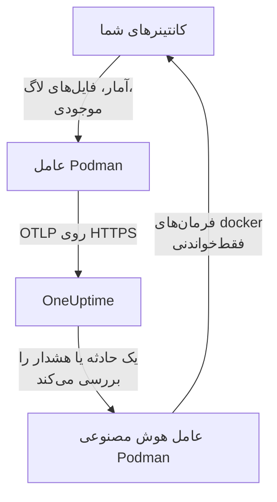

# عامل Podman

عامل Podman در OneUptime یک کانتینر است که روی یک میزبان Podman اجرا می‌کنید. آمار و فایل‌های لاگ هر کانتینر روی میزبان را می‌خواند و آن‌ها را به OneUptime می‌فرستد، جایی که میزبان با کانتینرها، متریک‌ها و لاگ‌هایش دیده می‌شود. کانتینر دوم، یعنی عامل هوش مصنوعی Podman، به OneUptime AI اجازه می‌دهد میزبان را بررسی کند. [مانیتورهای Podman](/docs/monitor/podman-monitor) بر پایه آنچه عامل می‌فرستد هشدار می‌دهند.

:::cards
- [نصب عامل](#نصب-عامل): دو کانتینر، با `podman run` یا Podman Compose.
- [آنچه عامل گردآوری می‌کند](#آنچه-عامل-گردآوری-میکند): متریک‌ها، لاگ‌ها و موجودی هر کانتینر.
- [لاگ‌های کانتینر به k8s-file نیاز دارند](#لاگهای-کانتینر-به-درایور-لاگ-k8s-file-نیاز-دارند): Podman مگر آنکه عوضش کنید در journald لاگ می‌نویسد.
- [رفع اشکال](#رفع-اشکال): چرخه‌های راه‌اندازی دوباره، متریک‌های ناموجود، لاگ‌های ناموجود.
:::

## چگونه کار می‌کند

عامل یک OpenTelemetry Collector است که پیکربندی OneUptime درونش ساخته شده است. از راه سوکت API سازگار با Docker در Podman، آمار هر کانتینر را هر ۳۰ ثانیه می‌خواند و هر ۵ دقیقه همه کانتینرها، ایمیج‌ها، شبکه‌ها و حجم‌ها را فهرست می‌کند. فایل‌های لاگ کانتینرها را دنبال می‌کند و همه چیز را با کلید دریافت داده‌ای که به آن می‌دهید از راه OTLP به نشانی OneUptime شما می‌فرستد.



میزبان با نخستین داده‌هایش، با نامی که در `PODMAN_HOST_NAME` به آن می‌دهید، خود را ثبت می‌کند. عامل هوش مصنوعی اختیاری است: کنارش بگذارید و کالکتور همان‌طور کار می‌کند.

## پیش از شروع

- Podman 4.0 یا بعد از آن، و دسترسی root روی میزبان.
- سوکت API در Podman در `/run/podman/podman.sock`. آن را با `sudo systemctl enable --now podman.socket` روشن کنید.
- یک کلید دریافت داده. آن را زیر **تنظیمات پروژه** > **تله‌متری و APM** > **کلیدهای دریافت داده** بسازید و مقدارش را کپی کنید.
- HTTPS خروجی از میزبان به نشانی OneUptime شما.
- برای لاگ‌های کانتینر، کانتینرهایی که از درایور لاگ `k8s-file` استفاده می‌کنند. Podman در حالت rootful به‌طور پیش‌فرض در `journald` لاگ می‌نویسد که عامل نمی‌تواند بخواند. ببینید [لاگ‌های کانتینر به درایور لاگ k8s-file نیاز دارند](#لاگهای-کانتینر-به-درایور-لاگ-k8s-file-نیاز-دارند).

## نصب عامل

:::steps
### عامل را اجرا کنید

`YOUR_ONEUPTIME_URL` را با نشانی OneUptime خود، `YOUR_TELEMETRY_INGESTION_TOKEN` را با کلید دریافت داده، و `my-podman-host` را با نامی برای این میزبان مانند `prod-podman-01` جایگزین کنید. میزبان با همین نام در OneUptime دیده می‌شود، پس آن را ثابت نگه دارید: نام تازه یک میزبان تازه ثبت می‌کند.

:::tabs
@tab Podman CLI
```bash
podman run -d \
  --name oneuptime-podman-agent \
  --user 0:0 \
  --restart unless-stopped \
  -v /run/podman/podman.sock:/run/podman/podman.sock:ro \
  -v /var/lib/containers/storage:/var/lib/containers/storage:ro \
  -e ONEUPTIME_URL="YOUR_ONEUPTIME_URL" \
  -e ONEUPTIME_SERVICE_TOKEN="YOUR_TELEMETRY_INGESTION_TOKEN" \
  -e PODMAN_HOST_NAME="my-podman-host" \
  oneuptime/podman-agent:release
```

سپس [عامل هوش مصنوعی](#عامل-هوش-مصنوعی) را با همان مقدارها کنار آن اجرا کنید. **بررسی‌های هوش مصنوعی به‌طور پیش‌فرض روشن‌اند**: هنگامی که OneUptime AI یک حادثه یا هشدار را روی این میزبان بررسی می‌کند، فرمان‌های فقط‌خواندنی `docker` را از راه عامل هوش مصنوعی و در برابر API سازگار با Docker در Podman اجرا می‌کند و تا اصلاح‌ها را مجاز نکنید هیچ چیزی را تغییر نمی‌دهد. برای نصب بدون بررسی‌های هوش مصنوعی، از این فرمان بگذرید.

```bash
podman run -d \
  --name oneuptime-podman-ai-agent \
  --user 0:0 \
  --restart unless-stopped \
  --read-only --tmpfs /tmp \
  -v /run/podman/podman.sock:/run/podman/podman.sock:ro \
  -e ONEUPTIME_URL="YOUR_ONEUPTIME_URL" \
  -e ONEUPTIME_SERVICE_TOKEN="YOUR_TELEMETRY_INGESTION_TOKEN" \
  -e ONEUPTIME_AI_AGENT_RESOURCE_TYPE=podman \
  -e PODMAN_HOST_NAME="my-podman-host" \
  oneuptime/resource-ai-agent:release
```
@tab Podman Compose
این را با نام `docker-compose.yml` در پوشه‌ای روی میزبان ذخیره کنید. سرویس دوم [عامل هوش مصنوعی](#عامل-هوش-مصنوعی) است: برای اجرای کالکتور بدون بررسی‌های هوش مصنوعی آن را کنار بگذارید.

```yaml title="docker-compose.yml"
services:
  oneuptime-podman-agent:
    image: oneuptime/podman-agent:release
    container_name: oneuptime-podman-agent
    user: "0:0"
    restart: unless-stopped
    volumes:
      - /run/podman/podman.sock:/run/podman/podman.sock:ro
      - /var/lib/containers/storage:/var/lib/containers/storage:ro
    environment:
      - ONEUPTIME_URL=YOUR_ONEUPTIME_URL
      - ONEUPTIME_SERVICE_TOKEN=YOUR_TELEMETRY_INGESTION_TOKEN
      - PODMAN_HOST_NAME=my-podman-host
    logging:
      driver: json-file
      options:
        max-size: "10m"
        max-file: "3"
  oneuptime-podman-ai-agent:
    image: oneuptime/resource-ai-agent:release
    container_name: oneuptime-podman-ai-agent
    user: "0:0"
    restart: unless-stopped
    read_only: true
    tmpfs:
      - /tmp
    volumes:
      - /run/podman/podman.sock:/run/podman/podman.sock:ro
    environment:
      - ONEUPTIME_URL=YOUR_ONEUPTIME_URL
      - ONEUPTIME_SERVICE_TOKEN=YOUR_TELEMETRY_INGESTION_TOKEN
      - ONEUPTIME_AI_AGENT_RESOURCE_TYPE=podman
      - PODMAN_HOST_NAME=my-podman-host
```

آن را در همان پوشه اجرا کنید:

```bash
podman compose up -d
```
:::

### بررسی کنید که عامل اجرا می‌شود

```bash
podman ps --filter name=oneuptime-podman-agent
podman logs -f oneuptime-podman-agent
```

پس از شروع کالکتور، لاگ‌ها باید این خط را نشان دهند:

```text
Everything is ready. Begin running and processing data.
```

### میزبان را در OneUptime پیدا کنید

به **محصولات** > **زیرساخت** > **Podman** > **همه میزبان‌ها** بروید. میزبان در حدود یک دقیقه با `PODMAN_HOST_NAME` خود، همراه با کانتینرها، متریک‌ها و لاگ‌هایش دیده می‌شود. عامل هوش مصنوعی در صفحه **عامل هوش مصنوعی** میزبان، و پایین **نمای کلی** آن، وصل‌شده نشان داده می‌شود.
:::

## متغیرهای محیطی

| متغیر | الزامی | توضیح |
| --- | --- | --- |
| `ONEUPTIME_URL` | بله | نشانی OneUptime شما، مانند `https://oneuptime.com` یا نمونه خودمیزبان شما. اگر نمونه فقط HTTP دارد، از `http://` و پورتش استفاده کنید. |
| `ONEUPTIME_SERVICE_TOKEN` | بله | کلید دریافت داده از **تنظیمات پروژه** > **تله‌متری و APM** > **کلیدهای دریافت داده**. |
| `PODMAN_HOST_NAME` | خیر | نام میزبان در OneUptime. پیش‌فرض آن `podman-host` است، پس به هر میزبان نام خودش را بدهید. |
| `DOCKER_API_VERSION` | خیر | نسخه Docker API که عامل با سوکت Podman با آن سخن می‌گوید. پیش‌فرض آن `1.44` است. اگر سوکت بیشینه قدیمی‌تری گزارش می‌کند پایینش بیاورید، یا مقدار خالی بگذارید تا بر سر آن مذاکره شود (ببینید [رفع اشکال](#رفع-اشکال)). |

برای تغییر یک مقدار، عامل را بردارید و فرمانش را دوباره اجرا کنید (Podman CLI)، یا `docker-compose.yml` را ویرایش کنید و `podman compose up -d` را اجرا کنید (Podman Compose).

## آنچه عامل گردآوری می‌کند

| داده | چیست |
| --- | --- |
| متریک‌های کانتینر | CPU (مصرف، درصد، محدودسازی)، حافظه (مصرف، حد، درصد)، ورودی/خروجی شبکه و بلوک، مدت کارکرد، راه‌اندازی‌های دوباره و شمار فرایندها، برای هر کانتینر، هر ۳۰ ثانیه. |
| لاگ‌های کانتینر | stdout و stderr هر کانتینر، از فایل `ctr.log` که درایور لاگ `k8s-file` می‌نویسد. |
| موجودی | هر کانتینر در هر وضعیتی، و هر ایمیج، شبکه و حجم، هر ۵ دقیقه. |

متریک‌ها و لاگ‌های هر کانتینر زیر سرویسی به نام همان کانتینر ثبت می‌شوند. هر خط لاگ شدتی را از سطحی که نام می‌برد می‌گیرد، مانند `[ERROR]`، `level=warn` یا `{"level":"info"}`؛ خطی که هیچ سطحی نام نبرد شدت جریانش را می‌گیرد: stderr برابر `ERROR` و stdout برابر `INFO` است. خط‌هایی که با فاصله یا یک کروشه بسته آغاز شوند به خط پیشین می‌پیوندند، پس یک رد پشته به‌صورت یک رکورد می‌رسد. لاگ‌های خود عامل کنار گذاشته می‌شوند.

[مانیتور Podman](/docs/monitor/podman-monitor#متریکهای-جمعآوریشده) هر متریک و معنایش را فهرست می‌کند.

## لاگ‌های کانتینر به درایور لاگ k8s-file نیاز دارند

عامل `/var/lib/containers/storage/overlay-containers/*/userdata/ctr.log` را دنبال می‌کند، فایل‌هایی که درایور لاگ `k8s-file` در Podman می‌نویسد (`json-file` در Podman همان درایور است). درایور پیش‌فرض Podman در حالت rootful `journald` است که فایلی برای خواندن به جا نمی‌گذارد، و یک درایور دوردست مانند `syslog` هم همین‌طور. متریک‌های چنین کانتینری همچنان می‌رسند؛ لاگ‌هایش نه.

درایور لاگ یک کانتینر، و پیش‌فرض Podman، را بررسی کنید:

```bash
podman inspect <container> --format '{{.HostConfig.LogConfig.Type}}'
podman info --format '{{.Host.LogDriver}}'
```

یک کانتینر را با `k8s-file` اجرا کنید، یا یک سرویس Compose را به آن ببرید:

```bash
podman run --log-driver k8s-file --log-opt max-size=100m ... <image>
```

```yaml
services:
  my-app:
    image: my-app:latest
    logging:
      driver: "k8s-file"
      options:
        max-size: "100m"
```

یا آن را در `containers.conf` (برای rootful در `/etc/containers/containers.conf` و برای rootless در `~/.config/containers/containers.conf`) پیش‌فرض هر کانتینری کنید که پس از این ساخته می‌شود:

```toml title="containers.conf"
[containers]
log_driver = "k8s-file"
log_size_max = 104857600
```

سپس کانتینرها را دوباره بسازید. یک کانتینر درایور لاگی را که با آن ساخته شده نگه می‌دارد، پس راه‌اندازی دوباره‌اش کافی نیست.

## به‌روزرسانی عامل

وقتی عامل از OneUptime شما قدیمی‌تر باشد، یک نشانه هشدار کنار **نسخه عامل** در **نمای کلی** میزبان دیده می‌شود. آن را برگزینید تا این فرمان‌ها را ببینید.

:::tabs
@tab Podman CLI
```bash
podman pull oneuptime/podman-agent:release
podman pull oneuptime/resource-ai-agent:release
podman rm -f oneuptime-podman-agent oneuptime-podman-ai-agent
```

سپس هر دو فرمان `podman run` را از [عامل را اجرا کنید](#عامل-را-اجرا-کنید) دوباره اجرا کنید.
@tab Podman Compose
```bash
podman compose pull
podman compose up -d
```
:::

برچسب `release` همیشه به تازه‌ترین انتشار اشاره می‌کند. برای ثابت کردن یک نسخه، از `oneuptime/podman-agent:<version>` استفاده کنید، مانند `oneuptime/podman-agent:10.0.31`. همین ایمیج در GitHub Container Registry با نام `ghcr.io/oneuptime/podman-agent:release` هست.

## حذف عامل

:::tabs
@tab Podman CLI
```bash
podman rm -f oneuptime-podman-agent
podman rm -f oneuptime-podman-ai-agent
```
@tab Podman Compose
```bash
podman compose down
```
:::

میزبان با داده‌هایی که فرستاده در OneUptime می‌ماند. اگر دیگر به آن نیاز ندارید، آن را با **حذف میزبان** در منوی آن حذف کنید.

## عامل هوش مصنوعی

فرمان‌ها و فایل Compose بالا، `install.sh` عامل Podman و `docker-compose.yml` در [پوشه PodmanAgent](https://github.com/OneUptime/oneuptime/tree/master/agents/PodmanAgent) آن، همه **عامل هوش مصنوعی Podman** را اجرا می‌کنند: کانتینر دومی به نام `oneuptime-podman-ai-agent` (ایمیج `oneuptime/resource-ai-agent:release`) که فرمان‌های فقط‌خواندنی‌ای را که OneUptime AI هنگام بررسی یک حادثه یا هشدار روی این میزبان می‌خواهد اجرا می‌کند — از راه API سازگار با Docker در Podman و با CLI در `docker`: `docker ps -a`، `docker logs --tail 200 web`، `docker container inspect web` — و فقط اگر اجازه دهید اصلاح‌هایی مانند راه‌اندازی دوباره یک کانتینر نام‌برده را اعمال می‌کند. همان `ONEUPTIME_URL`، `ONEUPTIME_SERVICE_TOKEN` و `PODMAN_HOST_NAME` کالکتور را می‌خواند، پس دقیقاً به همین میزبان خدمت می‌کند و در صفحه **عامل هوش مصنوعی** میزبان در OneUptime دیده می‌شود.

- **بررسی‌های هوش مصنوعی به‌طور پیش‌فرض روشن‌اند.** همین که عامل وصل شود، OneUptime AI حادثه‌ها و هشدارهای این میزبان را با آن بررسی می‌کند و **نمای کلی** میزبان وضعیت عامل را نشان می‌دهد. برای توقف، `ONEUPTIME_AI_INVESTIGATION=false` را جایی که عامل اجرا می‌شود تنظیم کنید (**تغییر** زیر **کارهای مجاز هوش مصنوعی** در صفحه عامل هوش مصنوعی روشش را نشان می‌دهد)، یا عامل را کنار بگذارید.
- فقط‌خواندنی است مگر آنکه آن را با `ONEUPTIME_AI_ALLOW_WRITES=true` اجرا کنید؛ `ONEUPTIME_AI_WRITE_TARGETS` (برای نمونه `web-*,api-*`) محدود می‌کند که یک اصلاح به کدام کانتینرها دست بزند. آن را با `ONEUPTIME_AI_FIXES` هم اجرا کنید تا بگویید اصلاح‌ها چگونه اجرا شوند — `ask-for-approval` (یک نفر هر کدام را تأیید می‌کند)، `automatic` یا `bypass-approval` — و صفحه عامل هوش مصنوعی آن را فقط‌خواندنی نشان می‌دهد ([کارهای مجاز هوش مصنوعی، تنظیم‌شده به دست عامل](/docs/ai/infrastructure-ai-agents#what-ai-may-do-set-by-the-agent)).
- به همان سوکتی نیاز دارد که کالکتور دارد و با آن سوکت سوارشده به‌عنوان root اجرا می‌شود، چون مالک سوکت root است — و در Podman با حالت rootful هر کس بتواند از سوکت استفاده کند روی این میزبان root است، چه با `:ro` چه بدون آن. مرز را سیاست فرمان عامل تعیین می‌کند: هرگز `exec`، `run`، `rm` یا `prune` را اجرا نمی‌کند و هرگز خودش، کالکتور یا هر چیزی در `ONEUPTIME_AI_PROTECTED_TARGETS` (الگوهای glob نام کانتینر) را تغییر نمی‌دهد.
- `install.sh --no-ai-agent` آن را کنار می‌گذارد؛ `podman rm -f oneuptime-podman-ai-agent` آن را برمی‌دارد. آن را مانند کالکتور به‌روز کنید: `podman pull oneuptime/resource-ai-agent:release`، برش دارید و دوباره اجرایش کنید.

چه چیزی می‌تواند اجرا کند، اصلاح‌ها چگونه کار می‌کنند و چگونه اشکالش را رفع کنید: [عامل‌های AI زیرساخت](/docs/ai/infrastructure-ai-agents#docker-and-podman-hosts).

## رفع اشکال

:::details عامل با "client version is too new" دوباره راه‌اندازی می‌شود
لاگ‌های عامل نشان می‌دهند:

```text
Error: cannot start pipelines: failed to start "docker_stats" receiver:
Error response from daemon: client version 1.44 is too new.
Maximum supported API version is 1.41
```

سرور Docker API که بیشینه‌ای برای نسخه کلاینت اعمال می‌کند، نسخه تازه‌تر را رد می‌کند، پس گیرنده هرگز شروع نمی‌شود و کالکتور هم با آن بیرون می‌رود. نسخه API را که سوکت Podman گزارش می‌کند بررسی کنید:

```bash
curl -s -o /dev/null -D - --unix-socket /run/podman/podman.sock http://localhost/_ping | grep -i '^api-version'
```

سپس `-e DOCKER_API_VERSION=1.41` (یا مقداری که گرفتید) را به `podman run` بیفزایید، یا `DOCKER_API_VERSION` را در Compose تنظیم کنید. سرورهای تازه‌تر همچنان نسخه‌های قدیمی‌تر API را پشتیبانی می‌کنند، پس این تنظیم پس از به‌روزرسانی هم معتبر می‌ماند.

نمی‌خواهید عدد را پیدا کنید؟ `DOCKER_API_VERSION` را روی رشته خالی بگذارید. آنگاه عامل به‌جای ثابت کردن یک نسخه، آن را با سوکت مذاکره می‌کند (یک `HEAD /_ping`، سپس بیشینه‌ای که سوکت گزارش می‌کند):

```bash
podman run -d ... -e DOCKER_API_VERSION= ...
```
:::

:::details دسترسی به سوکت Podman رد می‌شود، یا سوکتی نیست
عامل برای خواندن `/run/podman/podman.sock` باید با root اجرا شود. بررسی کنید که `--user 0:0` در فرمان `podman run` شما، یا `user: "0:0"` در Compose، باشد و سوکت روشن باشد: `sudo systemctl enable --now podman.socket`. Podman در حالت rootless سوکتش را به‌جای آن در `/run/user/<uid>/podman/podman.sock` دارد (`systemctl --user enable --now podman.socket`): آن مسیر را به‌جای `/run/podman/podman.sock` سوار کنید.
:::

:::details میزبان قطع‌شده نشان داده می‌شود
1. بررسی کنید که عامل اجرا می‌شود: `podman ps --filter name=oneuptime-podman-agent`
2. در لاگ‌هایش دنبال خطا بگردید: `podman logs oneuptime-podman-agent 2>&1 | grep -i error`
3. `ONEUPTIME_URL` و `ONEUPTIME_SERVICE_TOKEN` را بررسی کنید: کلید باید یک کلید دریافت داده معتبر باشد که غیرفعال نشده است.
4. بررسی کنید که میزبان از راه شبکه به نشانی OneUptime شما می‌رسد.
:::

:::details هیچ متریکی دیده نمی‌شود
1. بررسی کنید که سوکت Podman در عامل سوار شده است. ایمیج آن پوسته ندارد، پس از یک کانتینر یک‌بارمصرف که سوارشده‌های آن را به اشتراک می‌گیرد نگاه کنید: `podman run --rm --volumes-from oneuptime-podman-agent alpine:3.19 ls -la /run/podman/podman.sock`
2. در لاگ‌هایش دنبال خطاهای صدور بگردید: `podman logs oneuptime-podman-agent 2>&1 | tail -100`
3. بررسی کنید که کلید دریافت داده معتبر است و منقضی نشده.
:::

:::details متریک‌ها می‌رسند ولی هیچ لاگ کانتینری نمی‌رسد
کانتینرهای شما به احتمال زیاد `journald` را به کار می‌برند که درایور لاگ پیش‌فرض Podman است. بررسی کنید عامل کدام فایل‌ها را می‌پاید و یک کانتینر کدام درایور را به کار می‌برد:

```bash
podman logs oneuptime-podman-agent 2>&1 | grep -E "Started watching file|no files match"
podman inspect <container> --format '{{.HostConfig.LogConfig.Type}}'
```

اگر عامل `no files match the configured criteria` را گزارش می‌کند، کانتینرها را به `k8s-file` ببرید و دوباره بسازید، همان‌طور که [لاگ‌های کانتینر به درایور لاگ k8s-file نیاز دارند](#لاگهای-کانتینر-به-درایور-لاگ-k8s-file-نیاز-دارند) نشان می‌دهد.
:::

:::details لاگ‌ها روی میزبان دیگری می‌نشینند، یا نام میزبان podman-host است
نام میزبان از `PODMAN_HOST_NAME` می‌آید. عاملی که بدون آن اجرا شود `podman-host` را گزارش می‌کند، پس هر میزبانی که این‌گونه راه‌اندازی شده مانند همان یکی دیده می‌شود؛ اگر بعداً نام را تغییر دهید، OneUptime میزبان دومی ثبت می‌کند که داده‌های تازه را دارد. `PODMAN_HOST_NAME` را روی هر میزبان نامی از آنِ خودش بگذارید و عامل را دوباره بسازید. برای بررسی نامی که عامل گزارش می‌کند:

```bash
podman inspect oneuptime-podman-agent --format '{{range .Config.Env}}{{println .}}{{end}}' | grep PODMAN_HOST_NAME
```
:::

## گام‌های بعدی

:::cards
- [مانیتور Podman](/docs/monitor/podman-monitor): هشدار بر پایه CPU، حافظه و راه‌اندازی‌های دوباره کانتینر.
- [پایگاه‌های داده](/docs/telemetry/databases): کانتینرهای پایگاه داده روی میزبان پیدا می‌شوند و صفحه‌های خودشان را می‌گیرند.
- [عامل Kubernetes](/docs/telemetry/kubernetes-agent): به‌جایش یک خوشه Kubernetes را پایش کنید.
- [کالکتور OpenTelemetry روی میزبان](/docs/telemetry/host-otel-collector): خود ماشین را پایش کنید: CPU، دیسک‌ها، فرایندها و لاگ‌ها.
:::
