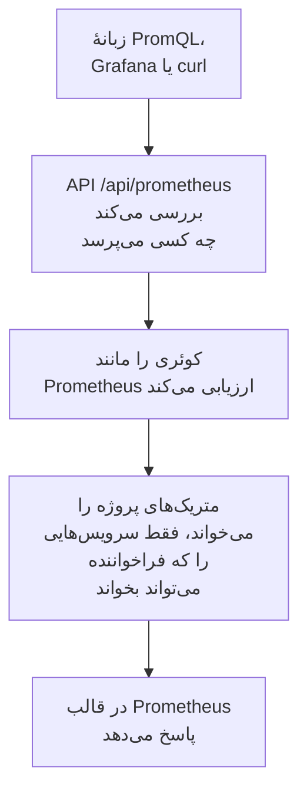

# پرس‌وجوی متریک‌ها با PromQL

PromQL زبان پرس‌وجوی Prometheus است و بیشتر کسانی که از متریک‌ها نمودار می‌سازند آن را از پیش می‌شناسند. OneUptime متریک‌های پروژهٔ شما را با آن می‌خواند: در زبانهٔ **PromQL** در بخش متریک‌ها، و از راه یک API سازگار با Prometheus که Grafana، یا هر ابزاری که منبع دادهٔ Prometheus دارد، می‌تواند به آن وصل شود.

:::cards
- [نوشتن یک کوئری](#نوشتن-یک-کوئری): PromQL را در صفحهٔ متریک‌ها اجرا کنید و یک نمودار یا یک جدول ببینید.
- [متریک‌ها چگونه نام‌گذاری می‌شوند](#متریکها-چگونه-نامگذاری-میشوند): نام‌ها و ویژگی‌های OpenTelemetry در PromQL چگونه خوانده می‌شوند.
- [وصل کردن Grafana](#وصل-کردن-grafana): OneUptime را به‌عنوان یک منبع دادهٔ Prometheus بیفزایید.
- [محدودیت‌ها](#محدودیتها): یک کوئری چه چیزی را و تا چه مدت می‌تواند بخواند.
:::

## چگونه کار می‌کند

زبانهٔ PromQL و Grafana هر دو از همان API می‌پرسند. OneUptime بررسی می‌کند که فراخواننده اجازهٔ خواندن متریک‌های پروژه را دارد، فقط سرویس‌هایی را می‌خواند که او اجازهٔ خواندنشان را دارد، و کوئری را همان‌طور ارزیابی می‌کند که Prometheus ارزیابی می‌کند.



## پیش از شروع

- **متریک‌های در حال رسیدن.** آن‌ها را با [OpenTelemetry](/docs/telemetry/open-telemetry) بفرستید، یا از یک ایجنت مانند [کالکتور OpenTelemetry میزبان](/docs/telemetry/host-otel-collector).
- **نقشی که متریک‌ها را بخواند.** Project Owner، Project Admin، Project Member، Viewer، Telemetry Admin، Telemetry Member یا Telemetry Viewer، یا یک نقش سفارشی با مجوز Read Metrics. نقشی که به برخی سرویس‌ها محدود است فقط متریک‌های همان سرویس‌ها را می‌خواند.
- **برای Grafana یا یک اسکریپت: یک کلید API پروژه** با یکی از این نقش‌ها یا مجوز Read Metrics. [یک کلید API بسازید](/docs/api-reference/api-reference#یک-کلید-api-بسازید) را ببینید. در OneUptime Cloud، کلیدهای API به طرح **Growth** نیاز دارند.

## نوشتن یک کوئری

:::steps
### PromQL را باز کنید

**متریک‌ها** را باز کنید و روی زبانهٔ **PromQL** کلیک کنید.

### کوئری را بنویسید

آن را در ویرایشگر تایپ کنید، نمونه‌ای را زیر **نمونه‌ها** برگزینید، یا از **افزودن نام یک متریک** شروع کنید، که متریک‌های پروژه‌تان را با نام‌هایی که PromQL به آن‌ها می‌دهد فهرست می‌کند.

### آن را اجرا کنید

روی **اجرای پرس‌وجو** کلیک کنید، یا Ctrl+Enter (در Mac، ‏⌘+Enter) را بزنید. **نمودار** کوئری را در طول بازهٔ زمانی رسم می‌کند؛ **جدول** مقدار هر سری را در پایان بازه نشان می‌دهد.
:::

چند کوئری برای شروع:

```text title="PromQL"
# Requests per second, by service
sum by (job) (rate(http_requests_total[5m]))

# The 95th percentile of a latency histogram
histogram_quantile(0.95, sum by (le) (rate(http_server_request_duration_bucket[5m])))

# The five hosts using the most memory
topk(5, system_memory_usage)
```

ویرایشگر نشان می‌دهد در کوئری‌ای که اجرا نمی‌شود چه چیزی و کجا اشتباه است: برای نمونه، `rate(http_requests_total)` می‌گوید تابع به بازه‌ای مانند `[5m]` نیاز دارد.

## متریک‌ها چگونه نام‌گذاری می‌شوند

OneUptime متریک‌ها را به شیوهٔ OpenTelemetry ذخیره می‌کند. PromQL آن‌ها را با همان نام‌هایی می‌خواند که پشتیبانی خود Prometheus از OpenTelemetry به آن‌ها می‌دهد، پس کوئری‌ای که برای Prometheus نوشته شده اینجا هم کار می‌کند:

| در OneUptime | در PromQL |
| --- | --- |
| یک گِیج `system.cpu.utilization` | `system_cpu_utilization` |
| یک شمارنده `http.requests` | `http_requests`، یا `http_requests_total` |
| یک هیستوگرام `http.server.request.duration` | `http_server_request_duration_bucket` (با `le`)، `_count` و `_sum` |
| یک summary `rpc.latency` | `rpc_latency` (با `quantile`)، `_count` و `_sum` |
| یک ویژگی `http.route` | برچسب `http_route` |
| یک ویژگی منبع `service.name` | برچسب `resource_service_name`، و `job` |
| یک ویژگی منبع `service.instance.id` | برچسب `resource_service_instance_id`، و `instance` |

- **نقطه‌ها و خط‌تیره‌ها به زیرخط تبدیل می‌شوند**، هم در نام متریک‌ها و هم در نام برچسب‌ها. برای نام بردن از یک متریک یا یک برچسب دقیقاً همان‌طور که ذخیره شده، نامش را مانند Prometheus 3 در نقل‌قول بگذارید: `{"http.server.request.duration", "http.route"="/checkout"}`.
- **شمارنده‌های دلتا جمع زده می‌شوند**، از آغاز بازهٔ زمانی کوئری، پس `rate()` و `increase()` آن‌ها را مانند هر شمارندهٔ دیگری می‌خوانند.
- **هیستوگرام‌های نمایی** `_count` و `_sum` دارند، اما باکت ندارند.

## وصل کردن Grafana

:::steps
### یک کلید API بسازید

در OneUptime، **تنظیمات پروژه** > **پیشرفته** > **کلیدهای API** را باز کنید و روی **ساخت کلید API** کلیک کنید. به کلید نقشی بدهید که تله‌متری را بخواند، یا مجوز Read Metrics را.

### یک منبع دادهٔ Prometheus بیفزایید

در Grafana، **Connections → Data sources → Add data source** را باز کنید و **Prometheus** را برگزینید.

### نشانی سرور را وارد کنید

**Prometheus server URL** را برابر نشانی OneUptime خود و پس از آن `/api/prometheus` بگذارید. در OneUptime Cloud، این نشانی `https://oneuptime.com/api/prometheus` است. زبانهٔ **PromQL** نشانی سرور خودتان را همراه با یک دکمهٔ کپی نشان می‌دهد.

### کلید API را بفرستید

زیر **HTTP headers**، سرآیند `Authorization` را با مقدار `Bearer` و پس از آن یک فاصله و کلید API خود بیفزایید. احراز هویت پایه (Basic) هم کار می‌کند: هر نام کاربری، با کلید API به‌عنوان رمز عبور.

### ذخیره کنید و بیازمایید

روی **Save & test** کلیک کنید. Grafana یک کوئری اجرا می‌کند و می‌گوید منبع داده کار می‌کند.
:::

هر کلاینت Prometheus دیگری هم به همین شیوه کار می‌کند. با curl:

```bash title="Query OneUptime's Prometheus API"
curl -H "Authorization: Bearer $ONEUPTIME_API_KEY" \
  "https://oneuptime.com/api/prometheus/api/v1/query?query=up"
```

## API

API به مسیرهای HTTP API در Prometheus، با `GET` یا `POST`، زیر `/api/prometheus` پاسخ می‌دهد:

| مسیر | چه پاسخی می‌دهد |
| --- | --- |
| `/api/v1/query` | یک کوئری در یک زمان (`time`، به‌طور پیش‌فرض اکنون). |
| `/api/v1/query_range` | یک کوئری در هر `step` از `start` تا `end`. |
| `/api/v1/series` | سری‌هایی که `match[]` برمی‌گزیند. |
| `/api/v1/labels` | نام برچسب‌ها، از سری‌هایی که `match[]` برمی‌گزیند یا از همهٔ متریک‌ها. |
| `/api/v1/label/<name>/values` | مقدارهای یک برچسب. `__name__` نام متریک‌ها را فهرست می‌کند. |
| `/api/v1/metadata` | نوع، راهنما و واحد هر متریک. |

زمان‌ها بر حسب ثانیهٔ Unix یا RFC 3339 هستند، مدت‌ها بر حسب ثانیه یا مدتی مانند `15s`، و پاسخ‌ها در قالب Prometheus هستند. `/api/v1/status/buildinfo` مانند یک سرور Prometheus 3 پاسخ می‌دهد؛ قواعد و هشدارها خالی‌اند، چون OneUptime با [مانیتورها](/docs/monitor/metrics-monitor) هشدار می‌دهد.

## PromQL چه چیزهایی را پوشش می‌دهد

- **انتخابگرها** با همهٔ matcherها (`=`، `!=`، `=~`، `!~`)، بازه‌ها، `offset`، `@` (با `start()` و `end()`) و زیرکوئری‌ها.
- **عملگرها**: حسابی، مقایسه‌ای (با `bool`)، `and`، `or`، `unless`، و تطبیق برداری با `on`، `ignoring`، `group_left` و `group_right`.
- **تجمیع‌ها**: `sum`، `avg`، `min`، `max`، `count`، `group`، `stddev`، `stdvar`، `topk`، `bottomk`، `quantile` و `count_values`، با `by` یا `without`.
- **تابع‌ها**: `rate`، `irate`، `increase`، `delta`، `idelta`، `deriv`، `predict_linear`، `histogram_quantile`، همهٔ تابع‌های `*_over_time`، `changes`، `resets`، `absent`، `label_replace`، `label_join`، `sort`، `clamp`، `round`، تابع‌های ریاضی و تاریخ، و بیشتر.

تابع‌های هیستوگرام بومی (native) در Prometheus، مانند `histogram_count()`، در دسترس نیستند: OneUptime هیستوگرام‌ها را با باکت ذخیره می‌کند، که `histogram_quantile()` و سری‌های `_count` و `_sum` آن‌ها را می‌خوانند.

## محدودیت‌ها

هر کوئری محدود است، تا داشبوردی با پنل‌های بسیار نتواند بار بیش از اندازه‌ای بر OneUptime بگذارد:

| محدودیت | مقدار |
| --- | --- |
| نقطه‌ها در یک سری از یک کوئری بازه‌ای | ۱۱٬۰۰۰ |
| نمونه‌هایی که یک کوئری می‌تواند بخواند و نگه دارد | ۵٬۰۰۰٬۰۰۰ |
| نقطه‌های متریکی که یک انتخابگر می‌تواند بخواند | ۱٬۰۰۰٬۰۰۰ |
| زمانی که یک خواندن می‌تواند طول بکشد | ۳۰ ثانیه |
| زمانی که ارزیابی می‌تواند طول بکشد | ۳۰ ثانیه |
| یک انتخابگر برای آخرین نمونهٔ یک سری تا چه اندازه به عقب نگاه می‌کند | ۵ دقیقه |
| گام یک زیرکوئری، وقتی کوئری آن را تعیین نمی‌کند | ۱ دقیقه |

## عیب‌یابی

:::details Grafana می‌گوید منبع داده کار نمی‌کند
بررسی کنید که URL به `/api/prometheus` ختم شود، و سرآیند `Authorization` شامل `Bearer`، یک فاصله و کلید API باشد. کلیدی که هیچ نقشی برای خواندن متریک‌ها ندارد پذیرفته نمی‌شود: در **تنظیمات پروژه** > **پیشرفته** > **کلیدهای API** چنین نقشی به آن بدهید.
:::

:::details متریکی از کاوشگر هیچ چیزی پیدا نمی‌کند
نام PromQL آن جایی زیرخط دارد که نام ذخیره‌شده نقطه دارد، و یک هیستوگرام از راه `_bucket`، `_count` یا `_sum` خوانده می‌شود. **افزودن نام یک متریک** در زبانهٔ PromQL همهٔ نام‌ها را همان‌طور که PromQL می‌نویسد فهرست می‌کند.
:::

:::details "The query reads more than 1,000,000 metric points"
کوئری بیش از آنچه یک خواندن می‌تواند نگه دارد درخواست می‌کند. matcherهای برچسب بیفزایید، بازهٔ زمانی را کوتاه‌تر کنید، یا گام بزرگ‌تری به کار ببرید.
:::

## گام‌های بعدی

:::cards
- [کاوشگر متریک](/docs/telemetry/metrics-explorer): بدون نوشتن کوئری از متریک‌ها نمودار بسازید.
- [مانیتور متریک‌ها](/docs/monitor/metrics-monitor): وقتی یک متریک از آستانه‌ای گذشت هشدار بگیرید.
- [منابع داده خارجی](/docs/dashboards/data-sources): روی داشبوردهایتان از یک Prometheus بیرونی نمودار بسازید.
:::
