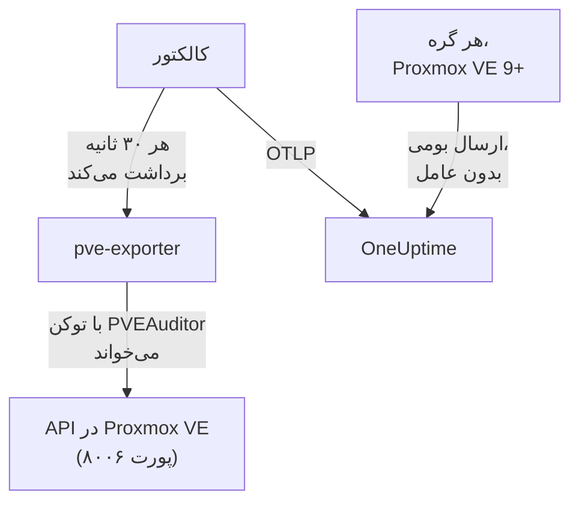

# عامل Proxmox

عامل Proxmox در OneUptime یک خوشه Proxmox VE را پایش می‌کند: گره‌ها، ماشین‌های مجازی QEMU، کانتینرهای LXC، ذخیره‌سازی، وضعیت HA، پوشش پشتیبان‌گیری و همتاسازی آن. خوشه را با یک توکن فقط‌خواندنی از راه API در Proxmox VE می‌خواند و آنچه می‌یابد را به OneUptime می‌فرستد، جایی که خوشه با گره‌ها، مهمان‌ها و ذخیره‌سازی‌اش دیده می‌شود. روی Proxmox VE 9 و بعد از آن، گره‌ها می‌توانند متریک‌های خودشان را هم خودشان بفرستند، بی‌آنکه چیزی نصب شود. [مانیتورهای Proxmox](/docs/monitor/proxmox-monitor) بر پایه آنچه می‌رسد هشدار می‌دهند.

:::cards
- [برگزیدن روش اتصال](#برگزیدن-روش-اتصال): عامل، یا ارسال خود Proxmox VE 9.
- [نصب عامل](#نصب-عامل): یک توکن API، سپس اسکریپت نصب یا Docker Compose.
- [ارسال بومی](#جایگزین-بدون-نصب-ارسال-بومی-opentelemetry-در-proxmox-ve-9): Proxmox VE 9 متریک‌هایش را خودش می‌فرستد.
- [رفع اشکال](#رفع-اشکال): یک اسکریپت تشخیصی، و مشکلات معمول.
:::

## چگونه کار می‌کند

عامل مجموعه‌ای از کانتینرهاست که با Docker Compose روی یک ماشین اجرا می‌کنید: [prometheus-pve-exporter](https://github.com/prometheus-pve/prometheus-pve-exporter) API در Proxmox VE را روی پورت ۸۰۰۶ می‌خواند، یک OpenTelemetry Collector صادرکننده را هر ۳۰ ثانیه برداشت می‌کند و هر متریک را با نام خوشه شما مُهر می‌زند، و عامل هوش مصنوعی Proxmox به OneUptime AI اجازه می‌دهد هنگام بررسی خوشه را بخواند. ارسال بومی Proxmox VE 9 به‌جای این، متریک‌های هر گره را مستقیم به OneUptime می‌فرستد.



خوشه با نخستین داده‌هایش، با نامی که عامل به‌صورت `proxmox.cluster.name` روی هر متریک مُهر می‌زند، خود را ثبت می‌کند.

## برگزیدن روش اتصال

| | عامل | ارسال بومی |
| --- | --- | --- |
| Proxmox VE | هر نسخه پشتیبانی‌شده | 9.0 یا بعد از آن |
| آنچه نصب می‌شود | Docker Compose روی یک ماشین | هیچ: یک سرور متریک در رابط وب Proxmox |
| گره‌ها، مهمان‌ها و ذخیره‌سازی | بله | بله |
| وضعیت HA، شروع هنگام بوت، پوشش پشتیبان‌گیری و همتاسازی | بله | خیر |
| عامل هوش مصنوعی Proxmox | بله | خیر |

الگوهای **HA Resource in Error State**، **Guest Down**، **Guest Not Backed Up** و **Replication Failing** به عامل نیاز دارند. برای یک خوشه یکی از این دو را به کار ببرید: اجرای هر دو هر منبع را دو بار گزارش می‌کند.

## پیش از شروع

- Docker Engine 20.10 یا بعد از آن با افزونه Docker Compose v2، روی ماشینی که بتواند به API در Proxmox VE روی پورت ۸۰۰۶ برسد.
- یک پوسته root روی هر گره Proxmox VE، یا رابط وب Proxmox، برای ساختن یک توکن API.
- یک کلید دریافت داده. آن را زیر **تنظیمات پروژه** > **تله‌متری و APM** > **کلیدهای دریافت داده** بسازید و مقدارش را کپی کنید.
- HTTPS خروجی از آن ماشین به نشانی OneUptime شما.

### عامل را کجا اجرا کنید

عامل از راه شبکه از API در Proxmox VE پرس‌وجو می‌کند، پس لازم نیست روی یک گره خوشه باشد، و بهتر است نباشد: آن را روی ماشینی اجرا کنید که از کار افتادن یک گره را تاب بیاورد (یک ماشین مجازی پایش کوچک روی سخت‌افزار جدا، یک میزبان مدیریتی)، یا `PVE_HOST` را به‌جای نشانی یک گره به یک IP مجازی یا یک نام DNS چرخشی نشانه بگیرید. اگر هدف API عامل همان گرهی باشد که تازه از کار افتاده، پایش شما هم با آن از کار می‌افتد. تنها استثنا خط لوله اختیاری لاگ journald است که باید روی یک گره Proxmox VE اجرا شود (ببینید [فرستادن لاگ‌های سرویس Proxmox](#اختیاری-فرستادن-لاگهای-سرویس-proxmox)).

## نصب عامل

:::steps
### یک توکن API فقط‌خواندنی بسازید

عامل خوشه را با یک توکن API می‌خواند که نقش **PVEAuditor** را دارد، که می‌تواند بخواند و هیچ کار دیگری نه.

:::tabs
@tab Shell
به‌عنوان root روی هر گره Proxmox VE:

```bash
pveum user add monitoring@pam
pveum acl modify / --roles PVEAuditor --users monitoring@pam
pveum user token add monitoring@pam oneuptime --privsep 1
pveum acl modify / --roles PVEAuditor --tokens 'monitoring@pam!oneuptime'
```

فرمان نخست فقط وقتی شکست می‌خورد، بی‌آنکه آسیبی بزند، که `monitoring@pam` از پیش وجود داشته باشد: توکن‌های API راز خودشان را دارند، پس کاربر به گذرواژه یا حساب سیستمی نیاز ندارد. `pveum user token add` راز توکن را یک بار چاپ می‌کند؛ شناسه توکن `monitoring@pam!oneuptime` است.
@tab Proxmox web UI
1. به *Datacenter → Permissions → API Tokens* بروید و روی **Add** کلیک کنید.
2. یک کاربر را برگزینید (یا بسازید)، به توکن شناسه‌ای مانند `oneuptime` بدهید، و **Privilege Separation** را علامت‌خورده بگذارید.
3. شناسه توکن (`user@realm!tokenname`) و راز را کپی کنید: راز فقط یک بار نشان داده می‌شود.
4. زیر *Datacenter → Permissions*، نقش **PVEAuditor** را دو بار روی مسیر `/` بیفزایید: یک بار به‌صورت **API Token Permission** برای توکن، و یک بار به‌صورت **User Permission** برای کاربر آن.
:::

نقش هم روی کاربر و هم روی توکن می‌نشیند، چون توکنی که امتیازهایش جداشده است فقط دسترسی‌هایی را می‌گیرد که کاربرش هم دارد. باید روی مسیر ریشه `/` باشد، چون صادرکننده هر شیء گره، مهمان و ذخیره‌سازی را می‌خواند: مسیر محدودتر بقیه خوشه را پنهان می‌کند و با `401`/`403 Permission check failed (/, Sys.Audit)` شکست می‌خورد.

### عامل را نصب و اجرا کنید

:::tabs
@tab install.sh
اسکریپت نصب را دانلود کنید و روی ماشینی که میزبان عامل خواهد بود اجرا کنید:

```bash
curl -sSL https://raw.githubusercontent.com/OneUptime/oneuptime/master/agents/ProxmoxAgent/install.sh -o install.sh
bash install.sh
```

اسکریپت نشانی OneUptime شما، کلید دریافت داده، نامی برای خوشه، میزبان API در Proxmox VE، اینکه صادرکننده همراه اجرا شود یا نه، و شناسه و راز توکن را می‌پرسد — و اینکه آیا [عامل هوش مصنوعی](#عامل-هوش-مصنوعی) می‌تواند اصلاح اعمال کند، و اگر آری، یک توکن جداگانه برای آن و مهمان‌هایی که هرگز نباید تغییرشان دهد. در `/opt/oneuptime-proxmox-agent` نصب می‌کند، یک فایل `.env` با `0600` می‌نویسد و عامل را با Docker Compose اجرا می‌کند. اجرای دوباره اسکریپت به‌جای پرسیدن دوباره، همه چیز را از همان `.env` دوباره به کار می‌برد، و [به‌روزرسانی عامل](#بهروزرسانی-عامل) هم همین‌گونه است.
@tab Docker Compose
`docker-compose.yml` و `otel-collector-config.yaml` را از [پوشه ProxmoxAgent](https://github.com/OneUptime/oneuptime/tree/master/agents/ProxmoxAgent) در یک پوشه تازه دانلود کنید:

```bash
mkdir oneuptime-proxmox-agent && cd oneuptime-proxmox-agent
curl -fsSLO https://raw.githubusercontent.com/OneUptime/oneuptime/master/agents/ProxmoxAgent/docker-compose.yml
curl -fsSLO https://raw.githubusercontent.com/OneUptime/oneuptime/master/agents/ProxmoxAgent/otel-collector-config.yaml
```

یک فایل `.env` کنار آن‌ها بسازید. این فایل راز توکن را دارد، پس آن را با `chmod 600 .env` خصوصی نگه دارید:

```bash title=".env"
ONEUPTIME_URL=YOUR_ONEUPTIME_URL
ONEUPTIME_TELEMETRY_INGESTION_KEY=YOUR_TELEMETRY_INGESTION_TOKEN
PROXMOX_CLUSTER_NAME=my-proxmox-cluster
PVE_HOST=192.168.1.10
PVE_API_TOKEN_ID=monitoring@pam!oneuptime
PVE_API_TOKEN_SECRET=your-token-secret
COMPOSE_PROFILES=pve-exporter
```

`COMPOSE_PROFILES=pve-exporter` صادرکننده همراه را هم اجرا می‌کند. عامل را اجرا کنید:

```bash
docker compose up -d
```
:::

از پیش prometheus-pve-exporter را اجرا می‌کنید؟ وقتی اسکریپت می‌پرسد صادرکننده همراه اجرا شود یا نه، **n** را پاسخ دهید، یا `COMPOSE_PROFILES` را از `.env` بردارید، و عامل را به صادرکننده خودتان نشانه بگیرید (`host:port`، بدون طرح، نشانی‌ای که کانتینر عامل بتواند به آن برسد: `localhost` خود کانتینر است). اگر [عامل هوش مصنوعی](#عامل-هوش-مصنوعی) را به کار می‌برید، که API را با همان توکن فرا می‌خواند، `PVE_API_TOKEN_ID` و `PVE_API_TOKEN_SECRET` را نگه دارید:

```bash
PVE_EXPORTER_URL=your-exporter-host:9221
```

### بررسی کنید که عامل اجرا می‌شود

```bash
docker compose ps
docker logs -f oneuptime-proxmox-agent
```

`docker compose ps` کالکتور (`oneuptime-proxmox-agent`)، صادرکننده همراه (`oneuptime-pve-exporter`، مگر آنکه صادرکننده خودتان را به کار ببرید) و عامل هوش مصنوعی (`oneuptime-proxmox-ai-agent`) را فهرست می‌کند. پس از شروع کالکتور، لاگ‌هایش باید این خط را نشان دهند:

```text
Everything is ready. Begin running and processing data.
```

### خوشه را در OneUptime پیدا کنید

به **محصولات** > **زیرساخت** > **Proxmox** > **همه خوشه‌ها** بروید. خوشه حدود یک دقیقه پس از نخستین برداشت با `PROXMOX_CLUSTER_NAME` خود، همراه با گره‌ها، مهمان‌ها و ذخیره‌سازی‌اش، دیده می‌شود.
:::

## متغیرهای محیطی

اسکریپت نصب این‌ها را در `/opt/oneuptime-proxmox-agent/.env` می‌نویسد؛ نصب با Docker Compose آن‌ها را از `.env` کنار `docker-compose.yml` می‌خواند. پس از تغییر یکی از آن‌ها، `docker compose up -d` را در همان پوشه اجرا کنید.

| متغیر | الزامی | توضیح |
| --- | --- | --- |
| `ONEUPTIME_URL` | بله | نشانی OneUptime شما، مانند `https://oneuptime.com` یا نمونه خودمیزبان شما. اگر نمونه فقط HTTP دارد، از `http://` و پورتش استفاده کنید. |
| `ONEUPTIME_TELEMETRY_INGESTION_KEY` | بله | کلید دریافت داده از **تنظیمات پروژه** > **تله‌متری و APM** > **کلیدهای دریافت داده**. |
| `PROXMOX_CLUSTER_NAME` | بله | نام خوشه در OneUptime، که به‌صورت ویژگی منبع `proxmox.cluster.name` روی هر متریک مُهر زده می‌شود. ثابتش نگه دارید: تغییرش در آینده خوشه دومی ثبت می‌کند. پیش‌فرض آن `proxmox-cluster` است. |
| `PVE_HOST` | بله | میزبان API در Proxmox VE (هر گره خوشه) که صادرکننده و عامل هوش مصنوعی از آن پرس‌وجو می‌کنند، مانند `192.168.1.10`. |
| `PVE_EXPORTER_URL` | خیر | نشانی (`host:port`، بدون طرح) prometheus-pve-exporter. پیش‌فرض آن صادرکننده همراه است، یعنی `pve-exporter:9221`. |
| `PVE_API_TOKEN_ID` | صادرکننده همراه یا عامل هوش مصنوعی | شناسه کامل توکن API در Proxmox، مانند `monitoring@pam!oneuptime`. عامل هوش مصنوعی API را با آن می‌خواند، مگر آنکه توکن خودش را داشته باشد (`ONEUPTIME_AI_PVE_API_TOKEN_ID` / `ONEUPTIME_AI_PVE_API_TOKEN_SECRET`). |
| `PVE_API_TOKEN_SECRET` | صادرکننده همراه یا عامل هوش مصنوعی | راز توکن API در Proxmox. |
| `PVE_VERIFY_SSL` | خیر | گواهی TLS در API در Proxmox را راستی‌آزمایی می‌کند (صادرکننده و عامل هوش مصنوعی). پیش‌فرض آن `false` است، چون Proxmox با گواهی‌های خودامضا عرضه می‌شود. |
| `COMPOSE_PROFILES` | خیر | برای اجرای کانتینر صادرکننده همراه، آن را روی `pve-exporter` بگذارید. |

## آنچه عامل گردآوری می‌کند

کالکتور صادرکننده را هر ۳۰ ثانیه با گردآورنده‌های خوشه و گره روشن برداشت می‌کند، که گردآورنده‌های `backup-info` (سطح خوشه) و `replication` (سطح گره) صادرکننده را هم که به‌طور پیش‌فرض روشن‌اند پوشش می‌دهد. هر سری یک برچسب `id` دارد که منبع را نام می‌برد: `node/<name>`، `qemu/<vmid>`، `lxc/<vmid>` یا `storage/<node>/<storage>`.

| دسته | متریک‌ها |
| --- | --- |
| در دسترس بودن | `pve_up`، `pve_uptime_seconds` |
| گره | `pve_node_info`، `pve_cpu_usage_ratio`، `pve_cpu_usage_limit`، `pve_memory_usage_bytes`، `pve_memory_size_bytes` |
| مهمان (ماشین مجازی یا LXC) | `pve_guest_info`، و سری‌های CPU، حافظه و شبکه روی شناسه‌های `qemu/*` و `lxc/*` (`pve_network_receive_bytes`، `pve_network_transmit_bytes`) |
| ذخیره‌سازی | `pve_disk_usage_bytes`، `pve_disk_size_bytes`، `pve_storage_info` |
| HA | `pve_ha_state` |
| پوشش پشتیبان‌گیری | `pve_not_backed_up_total` (مهمان‌هایی که هیچ کار پشتیبان‌گیری‌ای پوششان نمی‌دهد؛ یک سری در سطح خوشه، بدون برچسب `id`) و `pve_not_backed_up_info` (یک سری برای هر مهمان بی‌پوشش، با `id` آن). پوشش‌یافته یعنی دست‌کم یک کار آن مهمان را برمی‌گزیند: اینکه پشتیبان‌گیری‌ها به‌تازگی اجرا شده یا موفق بوده‌اند را صادرکننده در دسترس نمی‌گذارد. |
| همتاسازی | `pve_replication_failed_syncs`، `pve_replication_duration_seconds`، `pve_replication_last_sync_timestamp_seconds`، `pve_replication_last_try_timestamp_seconds`، `pve_replication_next_sync_timestamp_seconds`، `pve_replication_info`، برای هر کار همتاسازی ذخیره‌سازی. برچسب `id` آن‌ها شناسه کار است (مانند `100-0`)، نه یک منبع. |

معیارهای مانیتور و فیلترهای ویژگی بر پایه برابری جور می‌شوند، نه پیشوند، پس پردازنده `transform/pve-identity` کالکتور `id` را به سه ویژگی هم می‌شکند. الگوهای هشدار داخلی Proxmox بر پایه همین‌ها پالایش می‌کنند، پس اگر پیکربندی را سفارشی می‌کنید پردازنده را نگه دارید:

| ویژگی | مقدارها | برای `qemu/100` |
| --- | --- | --- |
| `pve.scope` | `node`، `guest`، `storage`، `cluster` (`qemu` و `lxc` هر دو `guest`اند) | `guest` |
| `pve.type` | `node`، `qemu`، `lxc`، `storage` | `qemu` |
| `pve.id` | هر چیزی پس از نخستین `/` در `id` (`pve1`، `100`، `pve1/local`) | `100` |

برچسب اصلی `id` همان‌طور که هست نگه داشته می‌شود.

## اختیاری — فرستادن لاگ‌های سرویس Proxmox

به‌طور پیش‌فرض عامل فقط متریک می‌فرستد، پس صفحه **لاگ‌ها** خوشه خالی می‌ماند. سرویس‌های Proxmox VE در ژورنال systemd زیر هشت واحد لاگ می‌نویسند: `pveproxy`، `pvedaemon`، `pve-firewall`، `pve-ha-crm`، `pve-ha-lrm`، `pvescheduler`، `pvestatd` و `qmeventd`. `otel-collector-config.yaml` همراه یک گیرنده `journald` درون توضیح برای دقیقاً همین واحدها دارد که به یک خط لوله `logs` درون توضیح وصل است و `proxmox.cluster.name` را مُهر می‌زند تا لاگ‌ها در خوشه شما بنشینند.

:::steps
### عامل را روی یک گره اجرا کنید

ژورنال برای هر میزبان جداست، پس عامل دوردست نمی‌تواند آن را بخواند. این تنها چیدمانی است که با [عامل را کجا اجرا کنید](#عامل-را-کجا-اجرا-کنید) ناسازگار است: برای اینکه عامل متریک بیرون از خوشه بماند، به‌جایش یک کالکتور دوم فقط برای لاگ روی گره اجرا کنید (پیکربندی را کپی کنید، سپس گیرنده `prometheus` و خط لوله `metrics` را حذف کنید).

### گیرنده را روشن کنید

گیرنده `journald` و خط لوله `logs` را در `otel-collector-config.yaml`، و حجم‌های ژورنال را در `docker-compose.yml`، از حالت توضیح بیرون بیاورید تا کانتینر بتواند ژورنال میزبان را بخواند:

```yaml
- /var/log/journal:/var/log/journal:ro
- /etc/machine-id:/etc/machine-id:ro
```

### ایمیج کالکتور را عوض کنید

ایمیج استاندارد `otel/opentelemetry-collector-contrib` با `FROM scratch` ساخته شده است: `journalctl` را که گیرنده journald اجرا می‌کند ندارد، و با کاربری اجرا می‌شود که نمی‌تواند ژورنال را بخواند. این پوشش را بسازید و `image:` را در `docker-compose.yml` به آن نشانه بگیرید:

```dockerfile title="Dockerfile"
FROM otel/opentelemetry-collector-contrib:0.161.0 AS otelcol
FROM debian:stable-slim
RUN apt-get update \
    && apt-get install -y --no-install-recommends systemd \
    && rm -rf /var/lib/apt/lists/*
COPY --from=otelcol /otelcol-contrib /otelcol-contrib
ENTRYPOINT ["/otelcol-contrib"]
CMD ["--config", "/etc/otelcol-contrib/config.yaml"]
```

بسته `systemd` فقط برای `journalctl` آنجاست، و این ایمیج با root اجرا می‌شود که همان کاربری است که می‌تواند ژورنال را بخواند. یا برای لاگ‌ها از Docker بگذرید و `.deb` انتشار `otelcol-contrib` را روی خود گره اجرا کنید، جایی که `journalctl` از پیش هست.
:::

هر گره فقط ژورنال خودش را می‌فرستد: برای لاگ‌های سرویس از همه گره‌ها، کالکتور فقط‌لاگ را روی هر گره اجرا کنید.

### جایگزین بدون ایمیج سفارشی: filelog روی /var/log/syslog

برای نگه داشتن ایمیج استاندارد، به‌جایش syslog را دنبال کنید. rsyslog را روی گره نصب کنید (`apt install rsyslog`؛ Debian 12 و Proxmox VE 8 و بعد از آن دیگر آن را همراه ندارند)، پوشه `/var/log` را در کانتینر سوار کنید (`- /var/log:/var/log:ro`؛ خود پوشه، نه فایل، تا چرخش لاگ فایل کهنه‌ای را نگه ندارد)، و یک گیرنده `filelog` را به‌جای گیرنده journald به کار ببرید:

```yaml
receivers:
  filelog:
    include:
      - /var/log/syslog
    start_at: end
```

پالایش بر پایه واحد را از دست می‌دهید (syslog همه چیز را دارد، نه فقط هشت سرویس را)، و کاربر ایمیج استاندارد باید بتواند فایل را بخواند. آن را به همان خط لوله `logs` درون توضیح وصل کنید (`receivers: [filelog]`).

## جایگزین بدون نصب: ارسال بومی OpenTelemetry در Proxmox VE 9+

Proxmox VE 9.0 و بعد از آن یک سرور متریک OpenTelemetry دارند که متریک‌های گره، مهمان و ذخیره‌سازی را به هر نقطه پایانی OTLP/HTTP می‌فرستد، بی‌آنکه عامل یا صادرکننده‌ای نصب شود. در رابط وب Proxmox، به *Datacenter → Metric Server → Add → OpenTelemetry* بروید و این‌ها را پر کنید:

| فیلد | مقدار |
| --- | --- |
| Server | میزبان OneUptime شما، مانند `oneuptime.com`، یا میزبان خودمیزبان شما |
| Port | `443` |
| Protocol | `https` |
| Path | `/otlp/v1/metrics` |
| Headers | `{"x-oneuptime-token": "YOUR_TELEMETRY_INGESTION_TOKEN"}` |

آن را یک بار بیفزایید: هر گره خوشه متریک‌های خودش را می‌فرستد. OneUptime این ارسال را می‌شناسد و آن را به همان سری‌های `pve_*` که عامل می‌فرستد ترجمه می‌کند، پس:

- خوشه با نام خوشه Proxmox شما (و یک گره تنها با نام گره‌اش) ثبت می‌شود، و `proxmox.cluster.name` که زیر *Resource Attributes* تنظیم کنید به‌جای آن به کار می‌رود؛
- صفحه‌های گره‌ها، مهمان‌ها و ذخیره‌سازی، نمودارهای نمای کلی، فهرست متریک‌ها و الگوهای هشدار CPU، حافظه و ذخیره‌سازی همان‌طور کار می‌کنند که با عامل؛
- سری‌های اصلی `proxmox_node_*`، `proxmox_vm_*` و `proxmox_storage_*` برای هر چیز دیگری که Proxmox VE گزارش می‌کند (load average، swap، pressure stall، ترافیک هر کارت شبکه) در [Metrics Explorer](/docs/monitor/metrics-monitor) می‌مانند.

### گره‌ای که دیگر گزارش نمی‌دهد

هر گره فقط وضعیت خودش را می‌فرستد، پس گره‌ای که از کار می‌افتد نمی‌تواند خودش این را بگوید. گره‌هایی که هنوز زنده‌اند آن را به جایش گزارش می‌کنند:

- حدود ۲ دقیقه پس از واپسین گزارشش، گره در صفحه گره‌ها **آفلاین** نشان داده می‌شود. **آخرین مشاهده** در صفحه خود گره زمان واپسین گزارش خودش را نگه می‌دارد.
- پس از حدود ۵ دقیقه، **Node Offline** برایش برانگیخته می‌شود. **Cluster Quorum at Risk** هم آن را آفلاین می‌شمارد؛ چون این الگو به یک پنجره کامل ۵ دقیقه‌ای از گزارش‌ها نیاز دارد، حدود ۷ تا ۹ دقیقه پس از ساکت شدن گره برانگیخته می‌شود.
- با گزارش بعدی‌اش دوباره **Online** است و هشدارش برطرف می‌شود.

آفلاین در اینجا یعنی گره دیگر گزارش نمی‌دهد، نه لزوماً اینکه از کار افتاده است. گرهی که روشن است ولی `pvestatd` آن گیر کرده یا کشته شده، سامانه فایل خوشه‌اش (`pmxcfs`) از کار افتاده، یا شبکه‌اش به OneUptime قطع شده، به همین شیوه گزارش می‌شود.

آنچه این روش نمی‌تواند پوشش دهد:

- یک میزبان تنها، یا کل خوشه‌ای که یکجا ساکت شود: کسی نمی‌ماند که آن را گزارش کند، پس هیچ هشدار گره‌به‌گره‌ای برانگیخته نمی‌شود. به‌جایش خوشه **قطع‌شده** می‌شود، مانند وقتی که عامل متوقف می‌شود.
- گرهی که بیش از ۷ روز ساکت باشد دیگر گزارش نمی‌شود: هشدارش برطرف می‌شود و از صفحه گره‌ها کنار می‌رود. OneUptime خودمیزبان این ۷ روز را با `PVE_SILENT_NODE_RETENTION_HOURS` تغییر می‌دهد.
- گرهی که از خوشه بیرون می‌آورید درست مانند گرهی از کار افتاده دیده می‌شود. **Remove Node** را در صفحه آن به کار ببرید: کنار می‌رود و هشدارش برطرف می‌شود. وگرنه تا ۷ روز آفلاین می‌ماند.
- مهمان‌ها و ذخیره‌سازی گره: فقط خود گره به‌صورت آفلاین نگه داشته می‌شود. ماشین‌های مجازی، کانتینرها و ذخیره‌سازی آن حدود ۱۵ دقیقه پس از واپسین گزارشش از صفحه‌هایشان کنار می‌روند، و مهمان‌هایی که HA روی گره دیگری دوباره راه می‌اندازد زیر همان گره برمی‌گردند.

پس از قطعی دریافت در OneUptime، گرهی که تازه ساکت شده فقط وقتی گزارش می‌شود که یکی از گره‌های دیگر دوباره ۲ دقیقه فرستاده باشد، پس خود قطعی هرگز برای همه گره‌ها هشدار نمی‌دهد. گرهی که از پیش آفلاین بوده در طول یک قطعی کوتاه آفلاین می‌ماند و هشدارش را نگه می‌دارد؛ پس از قطعی بلندتر از ۵ دقیقه، همین که دیگران ۲ دقیقه فرستاده باشند دوباره گزارش می‌شود.

در [Metrics Explorer](/docs/monitor/metrics-monitor) این گزارش‌ها همان نقطه‌های `pve_up` = 0 با برچسب `oneuptime.proxmox.inferred` = `not-reporting` هستند، پس همیشه می‌توانید آن‌ها را از آنچه یک گره درباره خودش گفته جدا کنید.

### آنچه ارسال بومی نمی‌تواند

ارسال بومی فقط چیزی را می‌فرستد که هر گره درباره خودش می‌داند، پس بخشی از آنچه عامل گردآوری می‌کند هم‌ارز بومی ندارد:

| به عامل نیاز دارد | چرا |
| --- | --- |
| وضعیت HA | فرستاده نمی‌شود: الگوی **HA Resource in Error State** به عامل نیاز دارد. |
| پرچم شروع هنگام بوت | فرستاده نمی‌شود: **Guest Down**، که فقط برای مهمان‌هایی هشدار می‌دهد که برای شروع هنگام بوت تنظیم شده‌اند، به عامل نیاز دارد. |
| پوشش پشتیبان‌گیری و همتاسازی | فرستاده نمی‌شوند: **Guest Not Backed Up** و **Replication Failing** به عامل نیاز دارند. |

اگر به این‌ها نیاز دارید، به‌جایش عامل را اجرا کنید و سرور متریک را بردارید: اجرای هر دو هر منبع را دو بار گزارش می‌کند.

## اجرا به‌صورت یک سرویس systemd

برای اینکه عامل همراه ماشین شروع شود و اگر از کار افتاد دوباره راه‌اندازی شود، واحد systemd آن را نصب کنید. این واحد فرض می‌کند عامل در `/opt/oneuptime-proxmox-agent` است، جایی که اسکریپت نصب آن را می‌گذارد:

```bash
sudo cp systemd/oneuptime-proxmox-agent.service /etc/systemd/system/
sudo systemctl daemon-reload
sudo systemctl enable --now oneuptime-proxmox-agent
```

## به‌روزرسانی عامل

عامل نسخه کالکتوری را که فایل‌هایش روی آن ثابت شده‌اند به‌عنوان **نسخه عامل** خود گزارش می‌کند. وقتی این نسخه از نسخه‌ای که این انتشار OneUptime روی آن ثابت شده قدیمی‌تر باشد، یک نشانه هشدار کنارش در **نمای کلی** خوشه دیده می‌شود. آن را برگزینید تا این فرمان‌ها را ببینید. عاملی که پیش از آنکه فایل‌هایش نسخه‌ای گزارش کنند نصب شده، تا وقتی به این شیوه به‌روز نشود نسخه‌ای نشان نمی‌دهد.

ایمیج کالکتور در `docker-compose.yml` ثابت شده و پیکربندی‌اش فایلی کنار آن است، پس فقط کشیدن ایمیج‌ها عامل را جلو نمی‌برد. `install.sh` را دوباره اجرا کنید: هر مقداری را در `.env` موجود شما دوباره به کار می‌برد (هیچ چیزی دوباره پرسیده نمی‌شود)، `docker-compose.yml` و `otel-collector-config.yaml` را تازه می‌کند (فایلی که ویرایش کرده‌اید به‌صورت `<file>.bak.<timestamp>` نگه داشته می‌شود)، ایمیج‌ها را می‌کشد و عامل را دوباره می‌سازد تا کالکتور پیکربندی تازه‌اش را بخواند.

```bash
curl -sSL https://raw.githubusercontent.com/OneUptime/oneuptime/master/agents/ProxmoxAgent/install.sh -o install.sh
bash install.sh
```

به‌جایش با Docker Compose نصبش کرده‌اید؟ در پوشه عامل، هر دو فایل را دوباره دانلود کنید (و هر تغییری را که در آن‌ها داده بودید دوباره اعمال کنید)، سپس ایمیج‌ها را بکشید و عامل را دوباره بسازید:

```bash
curl -fsSLO https://raw.githubusercontent.com/OneUptime/oneuptime/master/agents/ProxmoxAgent/docker-compose.yml
curl -fsSLO https://raw.githubusercontent.com/OneUptime/oneuptime/master/agents/ProxmoxAgent/otel-collector-config.yaml
docker compose pull
docker compose up -d --force-recreate
```

## حذف عامل

```bash
cd /opt/oneuptime-proxmox-agent
docker compose down
```

سپس اگر دیگر به توکن API نیاز ندارید، آن را زیر *Datacenter → Permissions → API Tokens* حذف کنید.

## عامل هوش مصنوعی

`docker-compose.yml` عامل، **عامل هوش مصنوعی Proxmox** را هم اجرا می‌کند، یعنی `oneuptime-proxmox-ai-agent` (ایمیج `oneuptime/resource-ai-agent:release`). هنگامی که OneUptime AI یک حادثه یا هشدار را روی این خوشه بررسی می‌کند، فرمان‌های فقط‌خواندنی `pvesh` را از راه آن اجرا می‌کند — `pvesh get /cluster/status`، `pvesh get /nodes/pve1/qemu/101/status/current`، `pvesh get /nodes/pve1/tasks --errors 1 --limit 20` — و فقط اگر اجازه دهید اصلاح‌هایی مانند روشن کردن یا راه‌اندازی دوباره یک مهمان را اعمال می‌کند. هیچ فایل دودویی `pvesh` در آن نیست: هر فرمان دقیقاً به یک فراخوانی API در Proxmox VE روی `PVE_HOST` تبدیل می‌شود، با توکنی از همان `.env`. مانند کالکتور، به‌صورت خوشه‌ای با نام `PROXMOX_CLUSTER_NAME` ثبت می‌شود و در صفحه **عامل هوش مصنوعی** خوشه در OneUptime دیده می‌شود.

- **بررسی‌های هوش مصنوعی به‌طور پیش‌فرض روشن‌اند.** همین که عامل وصل شود، OneUptime AI حادثه‌ها و هشدارهای این خوشه را با آن بررسی می‌کند و **نمای کلی** خوشه وضعیت عامل را نشان می‌دهد. برای توقف، `ONEUPTIME_AI_INVESTIGATION=false` را جایی که عامل اجرا می‌شود تنظیم کنید (**تغییر** زیر **کارهای مجاز هوش مصنوعی** در صفحه عامل هوش مصنوعی روشش را نشان می‌دهد)، یا عامل را کنار بگذارید.
- توکن API مرز سخت است. بررسی‌ها از توکن PVEAuditor کالکتور (`PVE_API_TOKEN_ID` / `PVE_API_TOKEN_SECRET`) استفاده می‌کنند که می‌تواند بخواند و هیچ کار دیگری نه؛ اگر صادرکننده خودتان را اجرا می‌کنید و هیچ توکنی در `.env` ندارید، یکی بیفزایید. اصلاح‌ها به توکنی از آنِ خود عامل هوش مصنوعی نیاز دارند که بتواند مهمان‌ها را روشن و خاموش کند (`VM.PowerMgmt`، برای نمونه نقش `PVEVMUser` روی `/vms` یا روی یک استخر)، که به‌صورت `ONEUPTIME_AI_PVE_API_TOKEN_ID` / `ONEUPTIME_AI_PVE_API_TOKEN_SECRET` تنظیم می‌شود.
- فقط‌خواندنی است مگر آنکه `ONEUPTIME_AI_ALLOW_WRITES=true` را تنظیم کنید؛ `ONEUPTIME_AI_WRITE_TARGETS` (VMIDهایی مانند `100,101`، و `<node>/<service>` برای سرویس‌های گره) محدود می‌کند که یک اصلاح به چه چیزی دست بزند. اگر عامل درون یک مهمان همین خوشه اجرا می‌شود، VMID آن مهمان را در `ONEUPTIME_AI_PROTECTED_TARGETS` بگذارید. `ONEUPTIME_AI_FIXES` در همان `.env` می‌گوید اصلاح‌ها چگونه اجرا شوند — `ask-for-approval` (یک نفر هر کدام را تأیید می‌کند)، `automatic` یا `bypass-approval` — و صفحه عامل هوش مصنوعی آن را فقط‌خواندنی نشان می‌دهد ([کارهای مجاز هوش مصنوعی، تنظیم‌شده به دست عامل](/docs/ai/infrastructure-ai-agents#what-ai-may-do-set-by-the-agent)).
- مانند صادرکننده، گواهی خودامضای API را راستی‌آزمایی نمی‌کند مگر آنکه `PVE_VERIFY_SSL=true` را تنظیم کنید یا `PVE_CA_FILE` را به CA خوشه نشانه بگیرید (`/etc/pve/pve-root-ca.pem`، سوارشده در کانتینر).
- با UID 1000، بدون هیچ capability و با سامانه فایل ریشه فقط‌خواندنی اجرا می‌شود، و هرگز `/access` را نمی‌خواند، کنسولی باز نمی‌کند یا پیکربندی را تغییر نمی‌دهد. اگر از OneUptime AI استفاده نمی‌کنید، سرویس `oneuptime-proxmox-ai-agent` را از `docker-compose.yml` حذف کنید.

چه چیزی می‌تواند اجرا کند، اصلاح‌ها چگونه کار می‌کنند و چگونه اشکالش را رفع کنید: [عامل‌های AI زیرساخت](/docs/ai/infrastructure-ai-agents#proxmox-clusters). README عامل فرمان‌های دقیق `pveum` را برای یک توکن اصلاح دارد.

## رفع اشکال

:::details نخست اسکریپت تشخیصی را اجرا کنید
عامل با یک اسکریپت، [`troubleshoot.sh`](https://github.com/OneUptime/oneuptime/blob/master/agents/ProxmoxAgent/troubleshoot.sh)، عرضه می‌شود که کل زنجیره را بررسی می‌کند: محیط اجرای کانتینر، برداشت صادرکننده، نام خوشه‌ای که روی هر متریک مُهر زده می‌شود، شکل توکن، متریک‌های خود کالکتور، و اینکه آیا OneUptime کلید دریافت داده را می‌پذیرد. این بررسی آخر از همه مهم‌تر است. OneUptime کلید بد را با `401` رد می‌کند (`422` برای کلید غیرفعال یا کلید مرورگر)، و کالکتور هر دو را دائمی می‌داند: دسته را کنار می‌گذارد و یک خطای `Exporting failed` در لاگ می‌نویسد، که در حالی که کانتینر سالم می‌ماند آسان از چشم می‌افتد. اسکریپت از درون شبکه عامل `GET <url>/otlp/v1/validate` را می‌پرسد تا یک `200` (معتبر) یا `401` (نامعتبر) مستقیم بگیرد، و روی سرورهای قدیمی‌تر به `POST /fluentd/v1/logs` برمی‌گردد.

```bash
curl -sSL https://raw.githubusercontent.com/OneUptime/oneuptime/master/agents/ProxmoxAgent/troubleshoot.sh -o troubleshoot.sh
bash troubleshoot.sh    # add -d <dir> if you installed outside /opt/oneuptime-proxmox-agent
```

در پایان، حکمی با محتمل‌ترین علت می‌دهد.
:::

:::details هیچ خوشه‌ای در OneUptime دیده نمی‌شود
1. لاگ‌های کالکتور را بخوانید: `docker logs oneuptime-proxmox-agent`. یک `401` هنگام صدور یعنی کلید دریافت داده بد است؛ اتصال ردشده یعنی `ONEUPTIME_URL` نادرست است.
2. بررسی کنید که صادرکننده پاسخ می‌دهد. صادرکننده همراه پورتش را روی میزبان منتشر نمی‌کند، پس از درون شبکه‌اش بپرسید: `docker run --rm --network container:oneuptime-pve-exporter curlimages/curl -s "http://localhost:9221/pve?target=YOUR_PVE_HOST" | head` باید خط‌های `pve_*` را چاپ کند. برای صادرکننده خودتان، مستقیم از `host:9221` آن بپرسید.
3. بررسی کنید که `PROXMOX_CLUSTER_NAME` تنظیم شده است: خوشه با ویژگی منبع `proxmox.cluster.name` خود پیدا می‌شود.
:::

:::details صادرکننده خطای 401 یا 595 برمی‌گرداند
توکن API نادرست است یا دسترسی کافی ندارد. شکل شناسه توکن (`user@realm!tokenname`)، راز، و اینکه نقش **PVEAuditor** روی مسیر `/` برای توکن و برای کاربرش باشد را بررسی کنید. لاگ‌های خود صادرکننده پاسخ API را نشان می‌دهند: `docker logs oneuptime-pve-exporter`.
:::

:::details فقط متریک‌های گره، بدون متریک‌های مهمان
سری‌های مهمان (شناسه‌های `qemu/*` و `lxc/*`) از گردآورنده خوشه صادرکننده می‌آیند که پیکربندی همراه با پارامتر برداشت `cluster=1` روشنش می‌کند. اگر `otel-collector-config.yaml` را سفارشی کرده‌اید، پارامتر `cluster: ["1"]` را برگردانید.
:::

:::details متریک‌ها زیر خوشه نادرست می‌نشینند
OneUptime یک خوشه Proxmox را بر پایه `proxmox.cluster.name` آن ثبت می‌کند، که عامل از `PROXMOX_CLUSTER_NAME` می‌گیرد. تغییر آن پس از نخستین داده‌ها خوشه دومی می‌سازد، نه اینکه نام نخستین را عوض کند.
:::

:::details با ارسال بومی، یک گره آفلاین نشان داده می‌شود
دیگر گزارش نمی‌دهد: گرهی که از کار افتاده، یک `pvestatd` گیرکرده، یک `pmxcfs` متوقف‌شده یا شبکه قطع‌شده به OneUptime همه یک‌جور دیده می‌شوند. گزارش بعدی‌اش آن را برمی‌گرداند. اگر گره را از خوشه بیرون آورده‌اید، **Remove Node** را در صفحه آن به کار ببرید؛ وگرنه تا ۷ روز آفلاین می‌ماند. ببینید [گره‌ای که دیگر گزارش نمی‌دهد](#گرهای-که-دیگر-گزارش-نمیدهد).
:::

:::details با ارسال بومی، هشدارهای Guest Down، HA یا پشتیبان‌گیری هرگز برانگیخته نمی‌شوند
ارسال بومی وضعیت HA، شروع هنگام بوت، پوشش پشتیبان‌گیری یا همتاسازی را نمی‌فرستد. برای این‌ها [عامل را نصب کنید](#نصب-عامل) و سرور متریک را بردارید: اجرای هر دو هر منبع را دو بار گزارش می‌کند.
:::

## گام‌های بعدی

:::cards
- [مانیتور Proxmox](/docs/monitor/proxmox-monitor): هشدار بر پایه گره‌ها، مهمان‌ها، ذخیره‌سازی، HA، پشتیبان‌ها و همتاسازی.
- [عامل Ceph](/docs/telemetry/ceph): ذخیره‌سازی Ceph زیر خوشه Proxmox خود را پایش کنید.
- [عامل‌های AI زیرساخت](/docs/ai/infrastructure-ai-agents): عامل هوش مصنوعی Proxmox چه چیزی می‌تواند اجرا کند، و اصلاح‌ها چگونه کار می‌کنند.
- [کالکتور OpenTelemetry روی میزبان](/docs/telemetry/host-otel-collector): نمای سطح سیستم‌عامل هر گره.
:::
