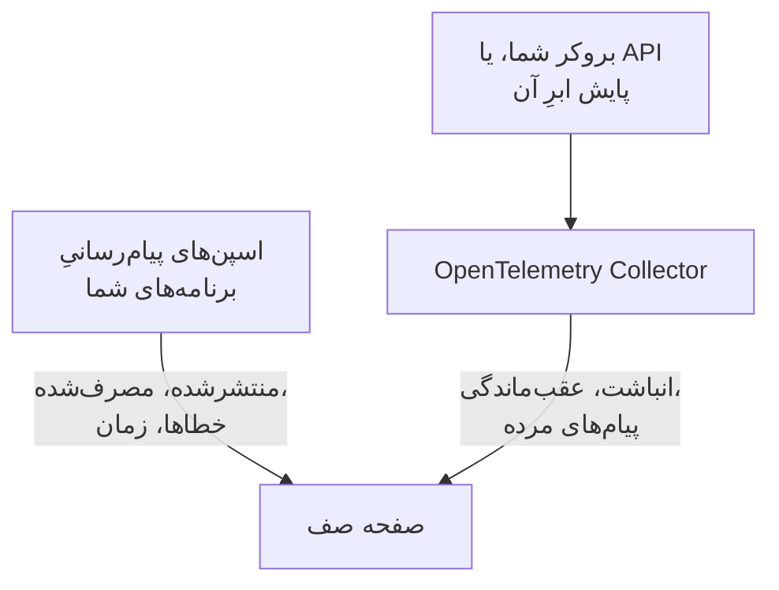

# صف‌ها

**Queues** به هر صف پیام، تاپیک و اشتراکی که برنامه‌های شما به کار می‌برند صفحه‌ای از آنِ خودش می‌دهد: کدام سرویس‌ها در آن منتشر می‌کنند و کدام از آن مصرف می‌کنند، چند پیام از آن می‌گذرد، چندتا شکست می‌خورند و پردازش چقدر طول می‌کشد، ترِیس‌ها و متریک‌هایش — و وقتی متریک‌های خودِ بروکر به OneUptime برسند، انباشت پیام، عقب‌ماندگی مصرف‌کننده، پیام‌های مرده و محدودسازی نرخ آن. صف‌ها هم مانند هر منبع دیگری برچسب، مالک، قاعده‌های برچسب و مالک و بایگانی دارند. آن‌ها را از **محصولات** > **منابع** > **صف‌ها** باز کنید.

:::cards
- [ابزارگذاری برنامه‌ها](#ابزارگذاری-برنامهها): اسپن‌های پیام‌رسانی که ابزارگذاری OpenTelemetry شما از پیش می‌فرستد.
- [متریک‌های سلامت بروکر](#متریکهای-سلامت-بروکر): انباشت، عقب‌ماندگی و پیام‌های مرده از بروکر شما، سیستم به سیستم.
- [هشداردهی](#هشداردهی): قالب‌های آماده، و متریک‌های دیررس یا شمارشی.
- [رفع اشکال](#رفع-اشکال): صفی که ساخته نشد، یا سلامت بروکری که خالی می‌ماند.
:::

## چگونه کار می‌کند

برای هر بروکری به یک شکل کار می‌کند — Apache Kafka، RabbitMQ، Apache ActiveMQ و دیگر بروکرهای JMS، Amazon SQS و SNS، Google Cloud Pub/Sub، Azure Service Bus، Event Hubs و Event Grid، Apache Pulsar، Apache RocketMQ، NATS و BullMQ (ببینید [سیستم‌های پیام‌رسانی پشتیبانی‌شده](#سیستمهای-پیامرسانی-پشتیبانیشده)) — و برای هر بروکر دیگری که اسپن‌های شما در `messaging.system` نامش را می‌برند. بیشتر صف‌ها خودشان از دو منبع ظاهر می‌شوند:

| منبع | چه چیزی از شما لازم دارد | چه چیزی به صفحه صف می‌افزاید |
| --- | --- | --- |
| **ترِیس‌های برنامه** | برنامه‌های ابزارگذاری‌شده (OpenTelemetry) — ببینید [ابزارگذاری برنامه‌ها](#ابزارگذاری-برنامهها) | پیام‌های منتشرشده و مصرف‌شده، خطاها و زمان پردازش، سرویس‌های دو سو، و خودِ ترِیس‌ها |
| **متریک‌های بروکر** (یک OpenTelemetry Collector) | گیرنده یا خراش (scrape) کالکتور برای بروکر شما — ببینید [متریک‌های سلامت بروکر](#متریکهای-سلامت-بروکر) | **Broker health**: انباشت، عقب‌ماندگی مصرف‌کننده، پیام‌های مرده، سن قدیمی‌ترین پیام، محدودسازی نرخ و نرخ‌های پیام خودِ بروکر |



ترِیس‌ها به OneUptime می‌گویند که صفی وجود دارد و برنامه‌ها چگونه از آن استفاده می‌کنند، اما نمی‌گویند چقدر پر است. این را خودِ بروکر یا API پایش ارائه‌دهنده ابری آن می‌گوید — یا، برای [BullMQ](#bullmq) که کارهایش را در Redis نگه می‌دارد و بروکری برای پرسیدن ندارد، گِیجی که برنامه گزارش می‌کند.

می‌توانید صف را دستی هم اضافه کنید: **Queues** > **ساخت Queue**، با سیستم پیام‌رسانی و نام مقصد آن — و برای Azure Service Bus و Event Hubs، فضای نام آن. فرم این‌ها را در گام نخست خود، **سیستم پیام‌رسانی**، می‌پرسد، سپس یک نام و توضیح اختیاری، و برچسب‌ها زیر **فیلدهای بیشتر** (**اطلاعات صف**) هستند. فضای نام را فقط برای صفی خالی بگذارید که برنامه‌هایتان از راه یک شبیه‌ساز یا نام دامنه سفارشی به آن می‌رسند: اسپن‌های آن‌ها نام هیچ فضای نامی را نمی‌برند، و متریک‌های Azure Monitor هرگز به چنین صفی نمی‌رسند (ببینید [محدودیت‌ها](#محدودیتها)).

## شروع کنید

:::steps
### ترِیس‌های برنامه‌هایتان را بفرستید

برنامه‌هایی را که منتشر و مصرف می‌کنند ابزارگذاری کنید و ترِیس‌هایشان را به OneUptime بفرستید (ببینید [ابزارگذاری برنامه‌ها](#ابزارگذاری-برنامهها)). به هیچ کار ویژه OneUptime نیازی نیست: اسپن‌های پیام‌رسانی که ابزارگذاری شما از پیش می‌سازد نام صف‌ها را می‌برند.

### متریک‌های بروکرتان را بفرستید

سیستم پیام‌رسانی خود را زیر [متریک‌های سلامت بروکر](#متریکهای-سلامت-بروکر) پیدا کنید و پیکربندی کالکتور آن را با کلید دریافت داده خود اجرا کنید. زبانه **مستندات** هر صف، پیکربندی همان صف را آماده کپی دارد.

### صف را باز کنید

**محصولات** > **منابع** > **صف‌ها** را باز کنید. کشف هر ۱۰ دقیقه اجرا می‌شود: صف وقتی ظاهر می‌شود که دست‌کم ۳ اسپن آن در ۱۵ دقیقه رسیده باشد، یا یک متریک بروکر نامش را برده باشد.
:::

## سیستم‌های پیام‌رسانی پشتیبانی‌شده

OneUptime سیستم‌های پیام‌رسانی زیر را به نام می‌شناسد. آنچه ابزارگذاری‌ها در `messaging.system` می‌گذارند را، بدون توجه به کوچکی و بزرگی حروف، به مقدار ستون دوم یکدست می‌کند — همان مقدار شناخته‌شده OpenTelemetry، هر جا که باشد — پس `AmazonSQS`، `aws.sqs` و `aws_sqs` یک سیستم‌اند. `nats` و `bullmq` مقدارهای شناخته‌شده OpenTelemetry نیستند: `nats` همان چیزی است که ابزارگذاری NATS عامل Java گزارش می‌کند، و `bullmq` مقداری است که باید برای BullMQ تنظیم کنید (ببینید [BullMQ](#bullmq)).

سیستمی که OneUptime نمی‌شناسد هم کار می‌کند: مقدارِ خوش‌ساخت (`ibmmq`، `solace`، `mqtt` — حروف کوچک، رقم‌ها، `.`، `_` و `-`، تا ۶۴ نویسه) همان‌طور که آمده نگه داشته می‌شود، پس صف‌های آن بروکر کشف می‌شوند و زیر همان نام نشان داده می‌شوند؛ فقط متریک‌های خودِ بروکر به سیستمی از این جدول نیاز دارند. `spring_integration` نادیده گرفته می‌شود: کانال‌های Spring Integration فراخوانی متدها درون یک فرایندند، نه یک بروکر.

**متریک‌های بروکر** می‌گوید متریک‌های سلامت یک سیستم از کجا می‌آیند: یک گیرنده collector-contrib، یک نقطه پایانی Prometheus (`:port/path`، که با گیرنده `prometheus` کالکتور خراش داده می‌شود)، API پایش ارائه‌دهنده ابری، یا برنامه‌ای بیرون از کالکتور که آن‌ها را روی OTLP می‌فرستد. هر سیستم به راه‌اندازی خودش در پایین پیوند دارد، و زبانه **مستندات** هر صف آن را به پیکربندی همان صف تبدیل می‌کند.

| سیستم | `messaging.system` | این‌ها هم پذیرفته می‌شوند | متریک‌های بروکر |
| --- | --- | --- | --- |
| [Amazon SNS](#amazon-sns) | `aws.sns` | `aws_sns`, `amazonsns`, `sns` | گیرنده `aws_cloudwatch` یا `awsfirehose` (پایش ابری) |
| [Amazon SQS](#amazon-sqs) | `aws_sqs` | `aws.sqs`, `amazonsqs`, `sqs` | گیرنده `aws_cloudwatch` یا `awsfirehose` (پایش ابری) |
| [Apache ActiveMQ](#apache-activemq) | `activemq` | `artemis`, `activemq_artemis` | OpenTelemetry JMX Scraper (روی OTLP می‌فرستد) |
| [Apache Kafka](#apache-kafka) | `kafka` | — | گیرنده `kafka_metrics` |
| [Apache Pulsar](#apache-pulsar) | `pulsar` | `apache_pulsar` | Prometheus (بروکر Pulsar)، `:8080/metrics/` |
| [Apache RocketMQ](#apache-rocketmq) | `rocketmq` | — | Prometheus (بروکر RocketMQ)، `:5557/metrics` |
| [Azure Event Grid](#azure-event-grid) | `eventgrid` | `azure_eventgrid`, `azure.eventgrid`, `microsoft.eventgrid` | گیرنده `azure_monitor` (پایش ابری) |
| [Azure Event Hubs](#azure-event-hubs) | `eventhubs` | `azure_eventhubs`, `azure.eventhubs`, `microsoft.eventhub` | گیرنده `azure_monitor` (پایش ابری) |
| [Azure Service Bus](#azure-service-bus) | `servicebus` | `azure_servicebus`, `azure.servicebus`, `microsoft.servicebus` | گیرنده `azure_monitor` (پایش ابری) |
| [BullMQ](#bullmq) | `bullmq` | — | چیزی داخلی نیست |
| [Google Cloud Pub/Sub](#google-cloud-pubsub) | `gcp_pubsub` | `gcp.pubsub`, `pubsub`, `google_pubsub` | گیرنده `googlecloudmonitoring` (پایش ابری) |
| [JMS](#jms) | `jms` | — | چیزی داخلی نیست |
| [NATS](#nats) | `nats` | `jetstream` | Prometheus (prometheus-nats-exporter)، `:7777/metrics` |
| [RabbitMQ](#rabbitmq) | `rabbitmq` | — | گیرنده `rabbitmq` |

یک صف، یک مقصدِ یک سیستم است. برای **Azure Service Bus** و **Azure Event Hubs** فضای نام آن هم بخشی از آن است، چون دو فضای نام می‌توانند هر کدام صفی به نام `orders` داشته باشند. **JMS** و **Apache ActiveMQ** صف‌هایشان را با هم شریک‌اند: برنامه‌های Java از راه JMS API به ActiveMQ می‌رسند، که اسپن‌هایش، هر بروکری که پشتش باشد، `jms` می‌گویند، در حالی که متریک‌های خودِ بروکر فقط می‌توانند `activemq` بگویند — پس هر دو روی یک صف می‌نشینند (ببینید [چه چیزی دو مشاهده را یک صف می‌کند](#چه-چیزی-دو-مشاهده-را-یک-صف-میکند)).

## صف‌ها چگونه کشف می‌شوند

هر صف ثبت می‌کند که ترِیس‌ها، متریک‌های بروکر یا یک شخص آن را ساخته‌اند. هر چیزی که بعداً نام همان صف را ببرد، به جای ساختن صفی دیگر به همان افزوده می‌شود (ببینید [چه چیزی دو مشاهده را یک صف می‌کند](#چه-چیزی-دو-مشاهده-را-یک-صف-میکند)).

### از ترِیس‌های برنامه

OneUptime هر ۱۰ دقیقه اسپن‌هایی را که برنامه‌های شما در ۱۵ دقیقه گذشته فرستاده‌اند و یکی از `messaging.system`، `messaging.destination.name`، `messaging.destination`، `message_bus.destination`، `az.namespace`، `azure.resource_provider.namespace`، `aws.sqs.queue.url`، `aws.queue_url` یا `aws.sns.topic.arn` را دارند، خلاصه می‌کند. همه اسپن‌ها به جز اسپن SERVER شمرده می‌شوند: اسپن‌های PRODUCER، CONSUMER، CLIENT و INTERNAL، و اسپن‌هایی که **Span Kind Remapper** یک پایپ‌لاین ترِیس نوع دیگری (مانند Unspecified) یا هیچ نوعی به آن‌ها داده است؛ اسپن SERVER هرگز نام صفی را نمی‌برد.

اسپن‌های خودِ بروکر هم اسپن SERVER هستند. ردیاب eBPF [عامل Kubernetes](/docs/telemetry/kubernetes-agent#ترِیسهای-ebpf-چه-شکلیاند) سوی بروکر Kafka، MQTT یا NATS را در هر تبادل ثبت می‌کند — پیامی که دریافت می‌کند، پیامی که تحویل می‌دهد — و بیشتر آن‌ها را به‌صورت PRODUCER یا CONSUMER می‌فرستد؛ OneUptime آن‌ها را به‌صورت SERVER ذخیره می‌کند، پس یک بروکر در میان تولیدکنندگان یا مصرف‌کنندگان تاپیک‌هایی که جابه‌جا می‌کند فهرست نمی‌شود. بروکر MQTT که پیامی را به یک مشترک می‌رساند همان PUBLISH را می‌نویسد که یک کلاینت می‌نویسد، و ردیاب هر دو را یکسان گزارش می‌کند، پس برای انتشارهای MQTT و NATS، OneUptime بر پایه پورت سوی دیگر اتصال تصمیم می‌گیرد: از پورت 32768 به بالا — جایی که سیستم‌عامل‌ها پورت کلاینتِ وصل‌شونده را برمی‌گزینند (بازه پیش‌فرض Linux از آن‌جا آغاز می‌شود؛ Windows و macOS از 49152–65535 استفاده می‌کنند) — پورتِ یک مشترک است، و اسپن از آنِ بروکر است. بنابراین برنامه‌ای که در بروکر MQTT یا NATS منتشر می‌کند که خودش روی پورتی از 32768 به بالا گوش می‌دهد، مانند پورت Docker که تصادفی منتشر شده، به‌عنوان تولیدکننده تاپیک‌هایش فهرست نمی‌شود، و تاپیکی که فقط چنین برنامه‌هایی به کار می‌برند شاید اصلاً از اسپن‌های ردیاب کشف نشود. برای مشترکی که از پورتی پایین‌تر از 32768 به بروکر وصل می‌شود (بازه پورتِ تنگ‌شده، یا پورتی که NAT بازنویسی کرده)، بروکر همچنان به‌عنوان تولیدکننده تاپیک‌هایی که به او تحویل داده می‌شوند فهرست می‌شود.

هر ویژگی پیام‌رسانی در OpenTelemetry هنوز «در حال توسعه» نشانه‌گذاری شده است، پس برنامه‌های یک پروژه چیزهای یکسان را با حداکثر پنج نسل از نام‌ها گزارش می‌کنند. OneUptime همه را می‌خواند، تازه‌ترین را نخست، و هرگز نام اسپن‌ها را تجزیه نمی‌کند، که قالبشان در قراردادهای معنایی 1.27 عوض شد و فروشندگان آزادانه انتخابش می‌کنند:

- **سیستم**: `messaging.system`، که مانند [سیستم‌های پیام‌رسانی پشتیبانی‌شده](#سیستمهای-پیامرسانی-پشتیبانیشده) یکدست می‌شود. بدون آن، `az.namespace` یا `azure.resource_provider.namespace` در SDKهای Azure (`Microsoft.ServiceBus`، `Microsoft.EventHub`)، کلید قدیمی‌تر `component` در SDK Azure، یک اسپن AWS SDK (`rpc.system` = `aws-api`) که SQS یا SNS را فرا می‌خواند — اسپن‌های SNS عامل Java هیچ `messaging.system` ندارند — یا کلید نشانی صف SQS یا ARN تاپیک SNS.
- **مقصد**: نخستین مورد از `messaging.destination.template`، `messaging.destination.name`، `messaging.source.template`، `messaging.source.name`، `messaging.destination` و `message_bus.destination` که اسپن داشته باشد. اسپنی که هیچ‌کدام را ندارد به کلیدهای خودِ سیستمش برمی‌گردد: نشانی صف SQS (`aws.sqs.queue.url`، `aws.queue_url`، یا نشانی صفی در `messaging.url`، `server.address` یا `net.peer.name`)، ARN تاپیک SNS (`aws.sns.topic.arn`)، و برای RabbitMQ کلید مسیریابی (`messaging.rabbitmq.destination.routing_key` یا `messaging.rabbitmq.routing_key`)، که وقتی پیامی از تبادل‌گر پیش‌فرض می‌گذرد، همان نام صف است.
- **جهت**: نخست `messaging.operation.type`، سپس نوع اسپن — PRODUCER منتشر می‌کند، CONSUMER مصرف می‌کند — سپس `messaging.operation` قدیمی‌تر، سپس `messaging.operation.name`، و برای SQS و SNS عملیات AWS SDK در `rpc.method` (`SendMessage`، `ReceiveMessage`، …). نوع اسپن بر کلیدهای قدیمی‌تر مقدم است، چون برخی ابزارگذاری‌ها آن‌ها را نادرست پر کرده‌اند: confluent-kafka برای Python روی اسپن‌های تولیدکننده‌اش `receive` می‌نوشت.

صف وقتی از ترِیس‌ها **ساخته می‌شود** که اسپن‌هایش در پنجره ۱۵ دقیقه‌ای که هر اجرا نگاه می‌کند دست‌کم ۳ باشند (`MESSAGE_QUEUE_MIN_SPANS`)، تا یک اسکریپت یک‌باره صفی نسازد، و فقط تا وقتی که پروژه زیر [سقف ساخت خودکار](#سقف-ساخت-خودکار) خود باشد. اسپن‌هایی که صفی نمی‌سازند همچنان برای صفی که وجود دارد شمرده می‌شوند.

هر اسپن پیام‌رسانی هنگام دریافت هم با صف خودش برچسب می‌خورد، پس زبانه **ترِیس‌ها** هر صف هر اسپنی را که نام آن را می‌برد نشان می‌دهد — از جمله اسپن‌هایی که پیش از ساخته شدن صف فرستاده شده‌اند.

### از متریک‌های بروکر

یک متریک بروکر از فهرست‌های زیر [متریک‌های سلامت بروکر](#متریکهای-سلامت-بروکر) نام صفش را در ویژگی خودِ بروکر می‌برد — `topic` در Kafka، `rabbitmq.queue.name` در RabbitMQ، بُعد `EntityName` در Azure Monitor، `QueueName` در CloudWatch — و OneUptime آن را هنگام دریافت با همان صف تطبیق می‌دهد. متریک‌های بروکر هیچ `messaging.system` ندارند: هر کدام از روی نامش (`kafka.consumer_group.lag_sum`) شناخته می‌شود و، هر جا دو سیستم یک نام را به کار ببرند — Azure Monitor متریک‌های Service Bus و Event Hubs را یکسان نام می‌گذارد — از روی نوع منبعی که نقطه داده با خود دارد.

اگر صف هنوز وجود نداشته باشد، اجرای بعدی کشف آن را می‌سازد: در محدوده [سقف ساخت خودکار](#سقف-ساخت-خودکار)، یک متریک بروکر کافی است. پس صفی که هیچ برنامه ابزارگذاری‌شده‌ای به آن دست نمی‌زند، همین که بروکرش گزارشش کند، ظاهر می‌شود.

APIهای پایش ابری — CloudWatch، Azure Monitor و Cloud Monitoring — هر عدد را چند دقیقه پس از زمانی که می‌سنجد منتشر می‌کنند، و آن عدد زیر همان زمان ذخیره می‌شود. پس هر اجرا متریک‌های آن‌ها را از یک ساعت گذشته می‌خواند، نه از ۱۵ دقیقه گذشته که اسپن‌ها و دیگر متریک‌ها را از آن می‌خواند: نقطه داده‌ای که دیر می‌رسد همچنان صفش را دیده‌شده ثبت می‌کند، یا آن را می‌سازد.

### از متریک‌های کلاینت پیام‌رسانی

کلاینت‌های ابزارگذاری‌شده هم می‌توانند متریک گزارش کنند: متریک‌های کلاینت پیام‌رسانی OpenTelemetry یعنی `messaging.client.sent.messages`، `messaging.client.consumed.messages`، `messaging.client.operation.duration` و `messaging.process.duration`، نام‌های قدیمی‌ترشان `messaging.publish.duration`، `messaging.receive.duration`، `messaging.publish.messages`، `messaging.receive.messages`، `messaging.process.messages` و `messaging.client.published.messages`، و متریک‌های SDK Azure برای Java یعنی `messaging.servicebus.messages.sent`، `messaging.servicebus.receiver.lag`، `messaging.servicebus.settlement.request.duration` و `messaging.servicebus.settlement.sequence_number`. هر نقطه داده سیستم و مقصدش را همان‌طور نام می‌برد که یک اسپن می‌برد — متریک‌های Service Bus در SDK Azure نام هیچ سیستمی را نمی‌برند، پس نامشان جای آن را می‌گیرد — و هنگام دریافت با همان صف تطبیق داده می‌شود، پس روی زبانه **متریک‌ها** صف نشان داده می‌شود. هر متریکِ خودتان هم که روی هر نقطه داده `messaging.system` و `messaging.destination.name` داشته باشد — نه روی منبع، که آن‌جا خوانده نمی‌شوند — همین‌طور است، مانند گِیج عمق صف (ببینید [BullMQ](#bullmq)).

متریک‌های کلاینت پیام‌رسانی هرگز صف نمی‌سازند: ترِیس‌ها، متریک‌های بروکر یا یک شخص می‌سازند. متریک کلاینتی که نام صفی موجود را می‌برد، **آخرین دیده‌شدن** آن را مانند اسپن‌هایش به‌روز نگه می‌دارد. متریکِ خودتان هیچ‌کدام از این دو را نمی‌کند: فقط روی زبانه **متریک‌ها** صف نشان داده می‌شود.

### چه چیزی دو مشاهده را یک صف می‌کند

هویت یک صف، **سیستم** و **مقصد** آن است که بدون توجه به کوچکی و بزرگی حروف مقایسه می‌شوند: `Orders` و `orders` یک صف‌اند، که با نامی که نخستین بار دیده شد نشان داده می‌شود. برای Azure Service Bus و Event Hubs، هویت **فضای نام** را هم در بر دارد:

- روی یک اسپن، نخستین برچسب DNS میزبانی که SDK به آن وصل شد، به ترتیب از `server.address`، `net.peer.name`، `peer.address` یا `network.peer.address`، وقتی آن میزبان یک میزبان فضای نام باشد: `<namespace>.servicebus.windows.net`، یا `.servicebus.usgovcloudapi.net`، `.servicebus.chinacloudapi.cn` یا `.servicebus.cloudapi.de` در یک ابر مستقل. Event Hubs دامنه Service Bus را به کار می‌برد؛
- روی یک متریک Azure Monitor، `name` فضای نامی که درباره‌اش گزارش می‌دهد.

هیچ چیز دیگری بخشی از آن نیست، پس هیچ‌کدام از این‌ها هرگز یک صف را دو تکه نمی‌کند: نشانی بروکر (کلاینت‌های Kafka به‌ندرت گزارشش می‌کنند، و یک فضای نام Azure روی نشانی‌های بسیاری پاسخ می‌دهد)، گروه مصرف‌کننده یا اشتراک (مصرف‌کنندگان یک تاپیک صف‌های جداگانه نیستند)، پارتیشن، و زیرصف پیام‌های مرده. از میان این‌ها، صف فقط نشانی بروکر را نگه می‌دارد، برای نمایش.

**JMS و ActiveMQ یک خانواده‌اند.** هر اسپن JMS، هر بروکری که پشتش باشد، `jms` می‌گوید، و متریک‌های خودِ بروکر ([OpenTelemetry JMX Scraper](#apache-activemq)) فقط می‌توانند `activemq` بگویند، پس OneUptime صف ActiveMQ را بر پایه خانواده JMS آن شناسایی می‌کند: اسپن‌ها و متریک‌های بروکرِ `orders` روی یک صف می‌نشینند. تا رسیدن متریک‌های بروکر به‌صورت JMS نشان داده می‌شود، و از آن پس به‌صورت Apache ActiveMQ — هرگز برعکس. صفی که شما دستی به‌صورت Apache ActiveMQ می‌سازید همان صف است.

### نام مقصدها چگونه خوانده می‌شود

ابزارگذاری‌ها یک صف را به شکل‌های بسیار نام می‌برند، و OneUptime آنچه گزارش می‌کنند را به نامِ خودِ صف کاهش می‌دهد:

| سیستم | آنچه گزارش می‌شود | صف |
| --- | --- | --- |
| Amazon SQS | `https://sqs.us-east-1.amazonaws.com/123456789012/orders`، یک نشانی صف (`otelaws` در Go آن را در `server.address` می‌گذارد) | `orders` |
| Amazon SNS | `arn:aws:sns:us-east-1:123456789012:order-events`، یک ARN تاپیک | `order-events` |
| Google Cloud Pub/Sub | `projects/shop/topics/orders`، یک نام منبع | `orders` |
| Azure Service Bus | `orders/Subscriptions/billing`، مسیر موجودیت اشتراک `billing` تاپیک | `orders` |
| Azure Service Bus | `orders/$DeadLetterQueue`، مسیر موجودیت زیرصف پیام‌های مرده صف | `orders` |
| Azure Event Hubs | `telemetry/ConsumerGroups/$Default/Partitions/3`، مسیر موجودیت یک گیرنده، برای گروه مصرف‌کننده `$Default` | `telemetry` |
| Apache Pulsar | `orders-partition-3`، پارتیشنی از یک تاپیک با نام کوتاه | `persistent://public/default/orders` |
| Apache Pulsar | `acme/shop/orders`، تاپیکی بدون دامنه‌اش | `persistent://acme/shop/orders` |
| JMS | `queue://orders`، با پیشوند نوع مقصد | `orders` |
| RabbitMQ | `shop:new-order:orders`، تبادل‌گر، کلید مسیریابی و صف روی یک مصرف‌کننده (قراردادهای معنایی 1.30 به بعد) | `orders` |
| RabbitMQ | `amq.default`، تبادل‌گر پیش‌فرض، با کلید مسیریابی `orders` | `orders` |
| RabbitMQ | `,orders`، `{exchange},{routing key}` در aio-pika از راه تبادل‌گر پیش‌فرض | `orders` |
| RabbitMQ | `shop,new-order`، `{exchange},{routing key}` در aio-pika | `shop` |

پارتیشن Pulsar در تاپیکش ادغام می‌شود، و نامی بدون دامنه همان‌طور کامل می‌شود که خودِ Pulsar کاملش می‌کند — نام کوتاه در فضای نام `public/default` — تا نام‌های عامل Java به برچسب‌های متریکِ کاملِ بروکرها بپیوندند. اسپن RabbitMQ معمولاً نام تبادل‌گری را می‌برد که پیام از آن گذشته است، چه در سوی انتشار و چه در سوی مصرف؛ تبادل‌گر پیش‌فرض (`amq.default`، `<default>` یا نام خالی) جای کلید مسیریابی‌اش را می‌گیرد، که نام صف است. قراردادهای معنایی 1.30 تبادل‌گر، کلید مسیریابی و صف را با `:` به هم می‌پیوندند — نام‌های اختیاری عامل Java — و OneUptime از نام پیوسته یک مصرف‌کننده صف را و از نام پیوسته یک منتشرکننده تبادل‌گر را نگه می‌دارد. aio-pika در سوی انتشار تبادل‌گر و کلید مسیریابی را با ویرگول به هم می‌پیوندد، و OneUptime آن را به همان شکل جدا می‌کند.

### چه چیزی نادیده گرفته می‌شود

OneUptime به سوی نساختن صف خطا می‌کند: نامی که برای هر درخواست یا هر مصرف‌کننده ساخته می‌شود، وگرنه برای هر پیام صفی بی‌صاحب می‌ساخت. این‌ها هرگز صف نمی‌شوند:

- **اسپن‌های SERVER**، و اسپن‌هایی که `messaging.system` آن‌ها `spring_integration` است.
- **مقصدهایی که موقت یا بی‌نام نشانه‌گذاری شده‌اند**: `messaging.destination.temporary`، `messaging.destination.anonymous`، `messaging.source.temporary` یا `messaging.source.anonymous` برابر `true`. به `messaging.temp_destination` قدیمی‌تر اعتماد نمی‌شود: ابزارگذاری‌های pika و aio-pika در Python آن را روی هر انتشار تنظیم می‌کنند.
- **جانگهدارهایی که ابزارگذاری‌ها به جای نام گزارش می‌کنند**: `(temporary)`، `(anonymous)`، `<generated>`، `unknown` (یک دسته Kafka روی چند تاپیک)، `aws:sqs` (رویدادهای Lambda SQS عامل Java)، `-NamespaceOnlyMetric-` در Azure Monitor، و مقداری که پاک‌سازی داده خودِ OneUptime آن را یکجا جایگزین کرده است (`[REDACTED]`).
- **مقصدهای تولیدشده و مقصدهای پاسخ**: صف‌هایی به سبک `amq.gen-JzTY20BRgKO-HjmUJj0wLg` در RabbitMQ که سرور نامشان را گذاشته، صف‌های `spring.gen-…` در Spring و صف‌های `<destination>.anonymous.<id>` در Spring Cloud Stream برای مصرف‌کنندگان بدون گروه، و پاسخ مستقیم (`amq.rabbitmq.reply-to…`)؛ مقصدهای موقت JMS (`temp-queue://…`، `temp-topic://…`) و `$TMP$…` در TIBCO؛ تاپیک‌های مشورتی ActiveMQ (`ActiveMQ.Advisory.…`)؛ صندوق‌های ورودی NATS (`_INBOX.…`) و subjectهای تأیید JetStream (`$JS.ACK.…`)؛ تاپیک‌های سیستمی Pulsar (`__change_events`، `__transaction_…`، و هر چیزی زیر یک بخش `/__`)؛ و مقصدی که چیزی جز یک UUID نیست.
- **پیامک‌های SNS و اعلان‌های موبایل**: یک شماره تلفن (`+15555550123`، یا `phone_number:**` در botocore) یا ARN یک نقطه پایانی پلتفرم (`arn:aws:sns:us-east-1:123456789012:endpoint/GCM/shop-app/1234`) یک دستگاه است، نه یک تاپیک.
- **نام‌هایی که نمی‌توانند یک صف باشند**: فهرستی از مقصدها در یک دسته (`["orders","payments"]`)، نامی که نویسه کنترلی دارد، و نامی بلندتر از ۲۵۵ نویسه.

**UUIDها قالب‌بندی می‌شوند.** هر UUID درون یک مقصد با `{uuid}` جایگزین می‌شود، پس نام‌های هر درخواست مانند `reply-7f1c2a9e-4b1d-4c3e-9f1a-2b3c4d5e6f70` به جای آن‌که هر کدام صفی باشند، یک صف می‌شوند: `reply-{uuid}`.

### سقف ساخت خودکار

ترِیس‌ها و متریک‌های بروکر فقط تا وقتی خودشان صف می‌سازند که پروژه کمتر از ۵۰۰ صف کشف‌شده فعال و بایگانی‌نشده داشته باشد (`MESSAGE_QUEUE_AUTO_CREATE_BUDGET`، ببینید [تنظیم برای نصب خودمیزبان](#تنظیم-برای-نصب-خودمیزبان)). صف‌هایی که دستی می‌سازید هرگز شمرده نمی‌شوند و هرگز مسدود نمی‌شوند؛ صف‌های بایگانی‌شده شمرده نمی‌شوند، پس [بایگانی خودکار](#چرخه-عمر-و-بایگانی) سقف را آزاد می‌کند؛ و صف‌هایی که از پیش وجود دارند همچنان تطبیق داده و به‌روز می‌شوند.

### چرخه عمر و بایگانی

- **آخرین دیده‌شدن** زمانی است که کشف آخرین بار صف را در ترِیس‌ها، متریک‌های کلاینت پیام‌رسانی یا متریک‌های بروکر دید.
- **برای کنار گذاشتن، بایگانی کنید.** حذف یک صف کشف‌شده فقط تا دیده شدن دوباره‌اش آن را برمی‌دارد: دیده شدن بعدی آن را به‌صورت صفی تازه برمی‌گرداند. برای کنار گذاشتن همیشگی، آن را **بایگانی** کنید. صف بایگانی‌شده هویتش را نگه می‌دارد، پس هر چیزی که نامش را ببرد به جای ساختن صفی تازه به صف بایگانی‌شده وصل می‌ماند.
- **بایگانی خودکار.** صف کشف‌شده‌ای که ۷ روز (`MESSAGE_QUEUE_AUTO_ARCHIVE_DAYS`) دیده نشده باشد خودکار بایگانی می‌شود، مگر آن‌که شخصی نامش را عوض کرده، توضیحی برایش نوشته، برچسبی به آن زده یا مالکی برایش گذاشته باشد. برچسب‌ها و مالک‌هایی که قاعده‌های برچسب یا مالک خودشان افزوده‌اند شمرده نمی‌شوند.
- **بازگردانی.** صفی که خودکار بایگانی شده، با دیده شدن دوباره خودکار بازگردانده می‌شود. صف‌هایی که دستی ساخته‌اید، و صف‌هایی که یک شخص بایگانی کرده، هرگز به دست کشف بایگانی یا بازگردانده نمی‌شوند. صفی که یک شخص بازمی‌گرداند ۳۰ روز (یا به اندازه پنجره بایگانی، اگر بلندتر باشد) بازگردانده می‌ماند حتی اگر چیزی آن را نبیند؛ از دیده شدن بعدی‌اش، قاعده ۷ روزه دوباره به کار می‌افتد.

## ابزارگذاری برنامه‌ها

صف‌ها از اسپن‌های پیام‌رسانی می‌آیند که ابزارگذاری OpenTelemetry شما از پیش تولید می‌کند؛ به هیچ کار ویژه OneUptime نیازی نیست. ترِیس‌ها را همان‌طور که [OpenTelemetry](/docs/telemetry/open-telemetry) شرح می‌دهد به OneUptime بفرستید، سپس فهرست زبان خود را بررسی کنید.

:::tabs
@tab Java
عامل Java در OpenTelemetry کلاینت‌های Kafka، RabbitMQ، JMS (ActiveMQ، Artemis، IBM MQ و هر بروکر JMS دیگر)، Amazon SQS و SNS، Pulsar، RocketMQ و NATS را بدون تغییر کد ردیابی می‌کند. OneUptime هم نام‌های ویژگی‌ای را که به‌طور پیش‌فرض می‌فرستد و هم نام‌های تازه‌تری را که با `OTEL_SEMCONV_STABILITY_OPT_IN=messaging` می‌فرستد (عامل 2.31.0 به بعد) می‌خواند. اسپن‌های JMS، هر بروکری که پشتشان باشد، `jms` می‌گویند (ببینید [JMS](#jms)).

- **Azure Service Bus و Event Hubs**: SDK Azure برای Java خودش را ردیابی می‌کند، و عامل Java آن ردیابی را به OpenTelemetry وصل می‌کند.
- **Google Cloud Pub/Sub**: کلاینت وقتی خودش را ردیابی می‌کند که سازنده‌های `Publisher` و `Subscriber` آن یک نمونه OpenTelemetry و کلید ردیابی را بگیرند — `setOpenTelemetry(GlobalOpenTelemetry.get())` و `setEnableOpenTelemetryTracing(true)`. هر کدام از این دو فراخوانی به‌تنهایی هیچ چیزی را ردیابی نمی‌کند.
@tab .NET
- **Azure Service Bus و Event Hubs** (`Azure.Messaging.ServiceBus`، `Azure.Messaging.EventHubs`): اسپن‌های OpenTelemetry آن‌ها در SDK Azure آزمایشی‌اند. آن‌ها را با متغیر محیطی `AZURE_EXPERIMENTAL_ENABLE_ACTIVITY_SOURCE=true` (یا کلید `Azure.Experimental.EnableActivitySource` در پایین) روشن کنید، و مشترک منبع‌های `Azure.*` شوید.
- **RabbitMQ.Client** 7 خودش را ردیابی می‌کند: مشترک `RabbitMQ.Client.*` شوید.
- **MassTransit** خودش را ردیابی می‌کند: مشترک `MassTransit` شوید (برای آنچه اسپن‌هایش جا می‌اندازند ببینید [محدودیت‌ها](#محدودیتها)).
- **Confluent.Kafka**: بسته `OpenTelemetry.Instrumentation.ConfluentKafka`.
- **Amazon SQS و SNS**: بسته `OpenTelemetry.Instrumentation.AWS`، با `.AddAWSInstrumentation(opt => opt.SemanticConventionVersion = SemanticConventionVersion.Latest)`. مجموعه ویژگی‌های پیش‌فرض آن (`V1_28_0`) صف SQS را فقط با نشانی‌اش نام می‌برد (`aws.queue_url`، که OneUptime آن را می‌خواند) و تاپیک SNS را اصلاً نام نمی‌برد.

```csharp
// Before any Azure client is created; or set AZURE_EXPERIMENTAL_ENABLE_ACTIVITY_SOURCE=true.
AppContext.SetSwitch("Azure.Experimental.EnableActivitySource", true);

builder.Services.AddOpenTelemetry()
    .WithTracing(tracing => tracing
        .AddSource("Azure.*")
        .AddSource("RabbitMQ.Client.*")
        .AddSource("MassTransit")
        .AddOtlpExporter());
```
@tab Node.js
- `@opentelemetry/auto-instrumentations-node`، `amqplib` (RabbitMQ)، `kafkajs` و AWS SDK (SQS و SNS) را ردیابی می‌کند.
- **Azure Service Bus و Event Hubs**: `createAzureSdkInstrumentation()` را از `@azure/opentelemetry-instrumentation-azure-sdk` ثبت کنید.
- **Google Cloud Pub/Sub**: `new PubSub({ enableOpenTelemetryTracing: true })`.
- **BullMQ**: ببینید [BullMQ](#bullmq) — تله‌متری خودش به دو ویژگی افزوده نیاز دارد.
@tab Python
- Kafka: `opentelemetry-instrumentation-kafka-python`، `opentelemetry-instrumentation-confluent-kafka` یا `opentelemetry-instrumentation-aiokafka`. RabbitMQ: `opentelemetry-instrumentation-pika` یا `opentelemetry-instrumentation-aio-pika`. SQS و SNS: `opentelemetry-instrumentation-botocore`، یا `opentelemetry-instrumentation-boto3sqs` برای SQS. `opentelemetry-bootstrap -a install` آن‌هایی را برمی‌گزیند که کتابخانه‌های نصب‌شده شما لازم دارند.
- **Azure Service Bus و Event Hubs**: `azure-core-tracing-opentelemetry` را نصب کنید و `settings.tracing_implementation = "opentelemetry"` را تنظیم کنید (از `azure.core.settings`).
- **Google Cloud Pub/Sub**: `PublisherOptions(enable_open_telemetry_tracing=True)` و `SubscriberOptions(enable_open_telemetry_tracing=True)`.
- اسپن‌های Celery هیچ `messaging.system` ندارند و نام هیچ بروکری را نمی‌برند، پس صفی نمی‌سازند.
@tab Go
- **Amazon SQS و SNS**: `otelaws` (`go.opentelemetry.io/contrib/instrumentation/github.com/aws/aws-sdk-go-v2/otelaws`)، که با `otelaws.AppendMiddlewares(&cfg.APIOptions)` افزوده می‌شود. اسپن‌های SQS آن نشانی صف را در `server.address` دارند، که OneUptime آن را به‌عنوان صف می‌خواند.
- **Google Cloud Pub/Sub**: `pubsub.ClientConfig{EnableOpenTelemetryTracing: true}`.
- **Kafka** با `segmentio/kafka-go`: ابزارگذاری خودکار OpenTelemetry برای Go (`go.opentelemetry.io/auto`، eBPF، روی Linux) تولیدکنندگان و مصرف‌کنندگان آن را بدون تغییر کد ردیابی می‌کند.
- کتابخانه‌های contrib در OpenTelemetry برای Go هیچ ابزارگذاری برای Kafka، RabbitMQ یا NATS ندارند. برای کلاینت‌های دیگر، از پشتیبانی OpenTelemetry خودِ کتابخانه کلاینت استفاده کنید، یا `messaging.system`، `messaging.destination.name` و نوع اسپن را روی اسپن‌های پیرامون ارسال‌ها و گرداننده‌هایتان تنظیم کنید.
:::

## متریک‌های سلامت بروکر

بروکر چیزی را می‌داند که هیچ برنامه‌ای نمی‌تواند ببیند: چند پیام در انتظارند، هر گروه مصرف‌کننده چقدر عقب است، چه چیزی به صف پیام‌های مرده رفته است. هر بخش زیر پیکربندی کالکتور یک سیستم را دارد — پیکربندی کامل یک OpenTelemetry Collector که به صادرکننده OTLPِ فرستنده به OneUptime ختم می‌شود. یک کلید دریافت داده تله‌متری (**تنظیمات پروژه** > **تله‌متری و APM** > **کلیدهای دریافت داده**) را در `x-oneuptime-token` بگذارید، اگر خودتان میزبانی می‌کنید `https://oneuptime.com` را با میزبان خودتان جایگزین کنید، و آن را با `otel/opentelemetry-collector-contrib` 0.161.0 یا بالاتر اجرا کنید (هر پیکربندی این‌جا با 0.161.0 اعتبارسنجی شده است). کالکتورهای تازه ثبت می‌کنند که `otlphttp` به نفع `otlp_http` منسوخ شده است؛ هر دو نام یک صادرکننده‌اند. برای جمع‌آوری چند سیستم، گیرنده‌هایشان را در یک کالکتور ادغام کنید.

بخش **Broker health** هر صف، متریک‌هایی را که برای سیستمش فهرست شده‌اند نمودار می‌کند — گِیج به‌صورت مقدارش، شمارش هر دوره با جمع در هر بازه، شمارنده به‌صورت نرخ در ثانیه — و سری‌های یک صف را همان‌طور که هر متریک لازم دارد ترکیب می‌کند (پیام‌های آماده و تأییدنشده یک صف RabbitMQ با هم جمع می‌شوند؛ عقب‌ترین گروه مصرف‌کننده همان عقب‌ماندگی است). هر آنچه کالکتور می‌فرستد در کاوشگر **متریک‌ها** هم هست. تا وقتی هیچ متریک فهرست‌شده‌ای برای یک صف نرسیده، این بخش نشان می‌دهد متریک‌های آن سیستم از کجا می‌آیند، با پیوندی به بخش آن در این‌جا.

### Amazon SNS

متریک‌های CloudWatch تاپیک‌ها را با گیرنده `aws_cloudwatch` کالکتور بخوانید، یا آن‌ها را از راه یک CloudWatch Metric Stream و Amazon Data Firehose به گیرنده `awsfirehose` آن جریان دهید.

گیرنده `aws_cloudwatch`، API `GetMetricData` در CloudWatch را پیمایش می‌کند، یک فضای نام برای هر گیرنده، پس SNS نمونه خودش را کنار نمونه [Amazon SQS](#amazon-sqs) می‌گیرد. از اعتبارنامه‌های پیش‌فرض AWS SDK (محیط، پروفایل مشترک یا نقش نمونه) استفاده می‌کند، که به `cloudwatch:ListMetrics` و `cloudwatch:GetMetricData` نیاز دارند:

```yaml
receivers:
  aws_cloudwatch/sns:
    region: us-east-1
    metrics:
      collection_interval: 5m
      period: 1m
      delay: 10m
      discovery:
        filters:
          namespace: AWS/SNS
        limit: 500

processors:
  batch: {}

exporters:
  otlphttp:
    endpoint: https://oneuptime.com/otlp
    headers:
      x-oneuptime-token: YOUR_TELEMETRY_INGESTION_TOKEN

service:
  pipelines:
    metrics:
      receivers: [aws_cloudwatch/sns]
      processors: [batch]
      exporters: [otlphttp]
```

`stats` را تنظیم نکنید، همان‌طور که در [Amazon SQS](#amazon-sqs). یک Metric Stream، SNS و SQS را با هم می‌برد: در راه‌اندازی [Amazon SQS](#amazon-sqs)، `AWS/SNS` را به فضاهای نام جریان بیفزایید.

یک تاپیک از هر دو سو به یک شکل نام‌گذاری می‌شود: اسپن‌ها ARN یا نام آن را گزارش می‌کنند، و OneUptime نامِ پس از آخرین `:` در ARN را نگه می‌دارد.

| متریک | به این شکل نشان داده می‌شود | نوع |
| --- | --- | --- |
| `amazonaws.com/aws/sns/numberofmessagespublished` (جریان JSON: `numberofmessagespublished`) | Messages published | شمارش هر دوره |
| `amazonaws.com/aws/sns/numberofnotificationsdelivered` (جریان JSON: `numberofnotificationsdelivered`) | Notifications delivered | شمارش هر دوره |
| `amazonaws.com/aws/sns/numberofnotificationsfailed` (جریان JSON: `numberofnotificationsfailed`) | Notifications failed | شمارش هر دوره |
| `amazonaws.com/aws/sns/numberofnotificationsredriventodlq` (جریان JSON: `numberofnotificationsredriventodlq`) | Redriven to dead-letter queue | شمارش هر دوره |

### Amazon SQS

متریک‌های CloudWatch صف‌ها را با گیرنده `aws_cloudwatch` کالکتور بخوانید، یا آن‌ها را از راه یک CloudWatch Metric Stream و Amazon Data Firehose به گیرنده `awsfirehose` آن جریان دهید.

**پیمایش CloudWatch** در سوی AWS به چیزی جز اعتبارنامه نیاز ندارد. گیرنده از اعتبارنامه‌های پیش‌فرض AWS SDK (محیط، پروفایل مشترک یا نقش نمونه) استفاده می‌کند، که به `cloudwatch:ListMetrics` و `cloudwatch:GetMetricData` نیاز دارند:

```yaml
receivers:
  aws_cloudwatch/sqs:
    region: us-east-1
    metrics:
      collection_interval: 5m
      period: 1m
      delay: 10m
      discovery:
        filters:
          namespace: AWS/SQS
        # Metrics per scrape: about nine per queue. Must be set.
        limit: 500

processors:
  batch: {}

exporters:
  otlphttp:
    endpoint: https://oneuptime.com/otlp
    headers:
      x-oneuptime-token: YOUR_TELEMETRY_INGESTION_TOKEN

service:
  pipelines:
    metrics:
      receivers: [aws_cloudwatch/sqs]
      processors: [batch]
      exporters: [otlphttp]
```

- **`stats` را تنظیم نکنید.** بدون آن، هر متریک به‌صورت یک خلاصه برای هر دوره می‌رسد، که همان چیزی است که OneUptime می‌خواند؛ با آن، هر آماره سری جداگانه‌ای می‌شود و نمودارها آن‌ها را درهم می‌کنند.
- `discovery.limit` باید تنظیم شود، و سقف متریک‌هایی است که در هر خراش خوانده می‌شوند — حدود نُه تا برای هر صف. هر کدام در هر خراش چهار زیرکوئری `GetMetricData` هزینه دارد، که AWS صورت‌حسابش را می‌دهد.
- `delay` منتظر می‌ماند تا CloudWatch یک دوره را منتشر کند (چند دقیقه طول می‌کشد)، پس با این پیکربندی متریک‌های بروکرِ یک صف ۱۱ تا ۱۷ دقیقه دیرتر می‌رسند: مانیتوری روی آن‌ها به پنجره بلندتری نیاز دارد (ببینید **متریک‌های دیررس** زیر [هشداردهی](#هشداردهی)).
- یک گیرنده یک منطقه و یک فضای نام را می‌خواند: برای هر منطقه یک نمونه بیفزایید.

**جریان‌دهی** متریک‌ها را همان وقتی که CloudWatch منتشرشان می‌کند می‌فرستد. یک CloudWatch Metric Stream برای فضاهای نام `AWS/SQS` (و `AWS/SNS`) با قالب خروجی **OpenTelemetry 1.0** بسازید که به جریانی در Amazon Data Firehose تحویل دهد که مقصدش یک نقطه پایانی HTTP است: کالکتور شما، با یک کلید دسترسی. Firehose فقط به `https://` روی پورت 443 تحویل می‌دهد، پس کالکتور به یک گواهی و یک پورت 443 عمومی نیاز دارد (برای نمونه پشت یک متعادل‌کننده بار):

```yaml
extensions:
  awscloudwatchmetricstreams_encoding:
    format: opentelemetry1.0

receivers:
  awsfirehose:
    # Firehose delivers to HTTPS on port 443 only: expose this port as 443,
    # for example behind a load balancer.
    endpoint: 0.0.0.0:4433
    encoding: awscloudwatchmetricstreams_encoding
    access_key: ${env:FIREHOSE_ACCESS_KEY}
    tls:
      cert_file: /etc/otelcol/tls/server.crt
      key_file: /etc/otelcol/tls/server.key

processors:
  batch: {}

exporters:
  otlphttp:
    endpoint: https://oneuptime.com/otlp
    headers:
      x-oneuptime-token: YOUR_TELEMETRY_INGESTION_TOKEN

service:
  extensions: [awscloudwatchmetricstreams_encoding]
  pipelines:
    metrics:
      receivers: [awsfirehose]
      processors: [batch]
      exporters: [otlphttp]
```

جریانی با قالب خروجی **JSON** (`format: json`) هم کار می‌کند: هر متریک را با نام خامش می‌فرستد، و OneUptime متریک‌های SQS را از SNS با `service.name`ی که جریان روی آن‌ها می‌زند (`SQS`، `SNS`) تشخیص می‌دهد.

صف پیام‌های مرده یک صف SQS معمولی با متریک‌های خودش است، پس در OneUptime صفی جداگانه است. صف‌ها فقط با نامشان نام‌گذاری می‌شوند، نه با حساب یا منطقه‌شان (ببینید [محدودیت‌ها](#محدودیتها)).

| متریک | به این شکل نشان داده می‌شود | نوع |
| --- | --- | --- |
| `amazonaws.com/aws/sqs/approximatenumberofmessagesvisible` (جریان JSON: `approximatenumberofmessagesvisible`) | Messages visible | گِیج |
| `amazonaws.com/aws/sqs/approximateageofoldestmessage` (جریان JSON: `approximateageofoldestmessage`) | Oldest message age | گِیج |
| `amazonaws.com/aws/sqs/approximatenumberofmessagesnotvisible` (جریان JSON: `approximatenumberofmessagesnotvisible`) | Messages in flight | گِیج |
| `amazonaws.com/aws/sqs/numberofmessagessent` (جریان JSON: `numberofmessagessent`) | Messages sent | شمارش هر دوره |
| `amazonaws.com/aws/sqs/numberofmessagesreceived` (جریان JSON: `numberofmessagesreceived`) | Messages received | شمارش هر دوره |
| `amazonaws.com/aws/sqs/numberofmessagesdeleted` (جریان JSON: `numberofmessagesdeleted`) | Messages deleted | شمارش هر دوره |

### Apache ActiveMQ

کالکتور گیرنده JMX ندارد، پس OpenTelemetry JMX Scraper را با `OTEL_JMX_TARGET_SYSTEM=activemq` کنار یک بروکر ActiveMQ Classic اجرا کنید؛ متریک‌های مقصدِ بروکر را روی OTLP می‌فرستد.

1. بگذارید بروکر اتصال‌های JMX را بپذیرد. با ایمیج `apache/activemq-classic` یا اسکریپت `bin/activemq`، پیش از راه‌اندازی آن `ACTIVEMQ_SUNJMX_START` را تنظیم کنید. این نمونه احراز هویت را خاموش می‌کند: پورت را روی یک شبکه خصوصی نگه دارید، یا `jmxremote.authenticate` را با یک فایل گذرواژه روشن کنید و `OTEL_JMX_USERNAME` و `OTEL_JMX_PASSWORD` را به خراشگر بدهید.

```bash
ACTIVEMQ_SUNJMX_START="-Dcom.sun.management.jmxremote.port=1099 -Dcom.sun.management.jmxremote.rmi.port=1099 -Dcom.sun.management.jmxremote.authenticate=false -Dcom.sun.management.jmxremote.ssl=false -Djava.rmi.server.hostname=activemq"
```

2. خراشگر را جایی اجرا کنید که به آن پورت دسترسی داشته باشد، با یک محیط اجرای Java. مستقیم به OneUptime می‌فرستد؛ برای آن‌که به جای آن از کالکتور خودتان بگذرد، `OTEL_EXPORTER_OTLP_ENDPOINT` را به گیرنده OTLP کالکتور اشاره دهید.

```bash
curl -fsSLo opentelemetry-jmx-scraper.jar https://github.com/open-telemetry/opentelemetry-java-contrib/releases/latest/download/opentelemetry-jmx-scraper.jar

export OTEL_JMX_SERVICE_URL=service:jmx:rmi:///jndi/rmi://activemq:1099/jmxrmi
export OTEL_JMX_TARGET_SYSTEM=activemq
export OTEL_JMX_TARGET_SOURCE=instrumentation
export OTEL_METRIC_EXPORT_INTERVAL=30000
export OTEL_SERVICE_NAME=activemq-prod
export OTEL_EXPORTER_OTLP_PROTOCOL=http/protobuf
export OTEL_EXPORTER_OTLP_ENDPOINT=https://oneuptime.com/otlp
export OTEL_EXPORTER_OTLP_HEADERS=x-oneuptime-token=YOUR_TELEMETRY_INGESTION_TOKEN
java -jar opentelemetry-jmx-scraper.jar
```

`OTEL_JMX_TARGET_SOURCE=instrumentation` نام‌های متریکی را نگه می‌دارد که خراشگر از 1.53.0-alpha به کار برده است (`activemq.message.queue.size`، با مقصد در `messaging.destination.name`). OneUptime نام‌های خراشگرهای قدیمی‌تر و `OTEL_JMX_TARGET_SOURCE=legacy` را هم می‌خواند (`activemq.message.current`، با مقصد در `destination`).

متریک‌های بروکر به صفی می‌پیوندند که اسپن‌های کلاینت‌های JMS آن ساخته‌اند — و از آن پس صف به‌صورت Apache ActiveMQ نشان داده می‌شود (ببینید [چه چیزی دو مشاهده را یک صف می‌کند](#چه-چیزی-دو-مشاهده-را-یک-صف-میکند)). خراشگر هر مقصدی را گزارش می‌کند: OneUptime تاپیک‌های مشورتی را نادیده می‌گیرد، در حالی که صف‌های پیام‌های مرده (`ActiveMQ.DLQ`، یا `DLQ.<destination>` با راهبرد جداگانه پیام‌های مرده) صف‌هایی جداگانه‌اند. ActiveMQ Artemis MBeanهای دیگری دارد که این قاعده‌ها نمی‌خوانند: صف‌های Artemis همچنان از اسپن‌های JMS خود می‌آیند، بدون سلامت بروکر.

| متریک | به این شکل نشان داده می‌شود | نوع |
| --- | --- | --- |
| `activemq.message.queue.size` | Queue size | گِیج |
| `activemq.message.current` | Queue size (legacy names) | گِیج |
| `activemq.message.enqueued` | Enqueued | شمارنده، نمودار در ثانیه |
| `activemq.message.dequeued` | Dequeued | شمارنده، نمودار در ثانیه |
| `activemq.message.expired` | Expired | شمارنده، نمودار در ثانیه |
| `activemq.consumer.count` | Consumers | گِیج |
| `activemq.message.enqueue.average_duration` | Average time in queue | گِیج |
| `activemq.message.wait_time.avg` | Average time in queue (legacy names) | گِیج |

### Apache Kafka

گیرنده `kafka_metrics` کالکتور، عقب‌ماندگی گروه‌های مصرف‌کننده و آفست‌های پارتیشن‌ها را از بروکرها می‌خواند؛ خراشگرهای `topics` و `consumers` آن را روشن کنید.

```yaml
receivers:
  kafka_metrics:
    brokers: ["kafka-1:9092", "kafka-2:9092"]
    # topics: each partition's log-end offset; consumers: each group's
    # committed offsets and lag. brokers: the broker count.
    scrapers: [brokers, topics, consumers]
    collection_interval: 30s
    # auth:
    #   sasl:
    #     mechanism: SCRAM-SHA-512
    #     username: ${env:KAFKA_USERNAME}
    #     password: ${env:KAFKA_PASSWORD}
    # tls:
    #   ca_file: /etc/kafka/ca.pem

processors:
  batch: {}

exporters:
  otlphttp:
    endpoint: https://oneuptime.com/otlp
    headers:
      x-oneuptime-token: YOUR_TELEMETRY_INGESTION_TOKEN

service:
  pipelines:
    metrics:
      receivers: [kafka_metrics]
      processors: [batch]
      exporters: [otlphttp]
```

برای خوشه‌ای با SASL یا TLS، `auth` و `tls` را از حالت توضیح درآورید. گیرنده هر تاپیک را در `topic` نام می‌برد، و متریک‌ها از همین راه صف تاپیک را پیدا می‌کنند. عقب‌ماندگی و آفست‌های ثبت‌شده یک گروه مصرف‌کننده را فقط روی تاپیک‌هایی گزارش می‌کند که گروه در آن‌ها آفستی ثبت کرده باشد، و از تاپیک‌هایی که نامشان با `_` آغاز می‌شود می‌گذرد — تاپیک‌های درونی Kafka (`topic_match` به‌طور پیش‌فرض `^[^_].*$` است).

| متریک | به این شکل نشان داده می‌شود | نوع |
| --- | --- | --- |
| `kafka.consumer_group.lag_sum` | Consumer lag | گِیج |
| `kafka.consumer_group.lag` | Partition lag | گِیج |
| `kafka.consumer_group.offset_sum` | Consumed | شمارنده، نمودار در ثانیه |
| `kafka.partition.current_offset` | Produced | شمارنده، نمودار در ثانیه |

### Apache Pulsar

هر بروکر متریک‌های تاپیک‌ها و اشتراک‌هایش را روی پورت سرویس وب خود ارائه می‌دهد؛ هر بروکر را خراش دهید، چون هر بروکر فقط تاپیک‌هایی را گزارش می‌کند که اکنون در اختیار دارد.

```yaml
receivers:
  prometheus:
    config:
      scrape_configs:
        - job_name: pulsar-broker
          scrape_interval: 30s
          metrics_path: /metrics/
          # Every broker: each one reports only the topics it owns.
          static_configs:
            - targets: ["pulsar-broker-0:8080", "pulsar-broker-1:8080"]
          # Keeps the families the queue page charts; remove it to keep all.
          metric_relabel_configs:
            - source_labels: [__name__]
              regex: "pulsar_(msg_backlog|subscription_back_log|storage_backlog_age_seconds|in_messages_total|out_messages_total)"
              action: keep

processors:
  batch: {}

exporters:
  otlphttp:
    endpoint: https://oneuptime.com/otlp
    headers:
      x-oneuptime-token: YOUR_TELEMETRY_INGESTION_TOKEN

service:
  pipelines:
    metrics:
      receivers: [prometheus]
      processors: [batch]
      exporters: [otlphttp]
```

- سری‌های تاپیک و اشتراک به `exposeTopicLevelMetricsInPrometheus=true` در `broker.conf` نیاز دارند، که پیش‌فرض است.
- Pulsar هر سری را با نام کامل تاپیک (`persistent://public/default/orders`) برچسب می‌زند، و سری یک پارتیشن را با نام پارتیشن (`persistent://public/default/orders-partition-3`): پارتیشن‌ها در تاپیکشان جمع می‌شوند.
- انباشت بر حسب ورودی‌ها شمرده می‌شود، و Pulsar یک دسته پیام را یک ورودی می‌شمارد.
- Pulsar وقتی `exposeConsumerLevelMetricsInPrometheus=true` باشد، `pulsar_out_messages_total` را برای هر مصرف‌کننده تکرار می‌کند؛ آن سری‌های هر مصرف‌کننده از نمودارها کنار گذاشته می‌شوند، تا هیچ پیامی دو بار شمرده نشود.
- `pulsar_storage_backlog_age_seconds` تا وقتی بروکر نتواند تشخیص دهد `-1` است.
- متریک‌های بومی OpenTelemetry در Pulsar 3.3 به بعد (آزمایشی، به‌طور پیش‌فرض خاموش) نام‌های دیگری دارند، که نمودار نمی‌شوند.

| متریک | به این شکل نشان داده می‌شود | نوع |
| --- | --- | --- |
| `pulsar_msg_backlog` | Backlog | گِیج |
| `pulsar_subscription_back_log` | Subscription backlog | گِیج |
| `pulsar_storage_backlog_age_seconds` | Backlog age | گِیج |
| `pulsar_in_messages_total` | Messages in | شمارنده، نمودار در ثانیه |
| `pulsar_out_messages_total` | Messages out | شمارنده، نمودار در ثانیه |

### Apache RocketMQ

`metricsExporterType=PROM` را در `broker.conf` بروکر تنظیم کنید تا بروکر متریک‌های عقب‌ماندگی و توان عملیاتی خود را ارائه دهد.

```text
metricsExporterType=PROM
metricsPromExporterPort=5557
metricsPromExporterHost=0.0.0.0
```

سپس هر بروکر را خراش دهید:

```yaml
receivers:
  prometheus:
    config:
      scrape_configs:
        - job_name: rocketmq-broker
          scrape_interval: 30s
          metrics_path: /metrics
          static_configs:
            - targets: ["rocketmq-broker-a:5557", "rocketmq-broker-b:5557"]

processors:
  batch: {}

exporters:
  otlphttp:
    endpoint: https://oneuptime.com/otlp
    headers:
      x-oneuptime-token: YOUR_TELEMETRY_INGESTION_TOKEN

service:
  pipelines:
    metrics:
      receivers: [prometheus]
      processors: [batch]
      exporters: [otlphttp]
```

این صادرکننده داخلی RocketMQ 5 است. RocketMQ 4 چنین چیزی ندارد؛ `rocketmq-exporter` جداگانه‌ای که به کار می‌برد نام‌های متریک دیگری گزارش می‌کند، که نمودار نمی‌شوند. تاپیک پیام‌های مرده یک گروه مصرف‌کننده (`%DLQ%<group>`) صفی جداگانه است.

| متریک | به این شکل نشان داده می‌شود | نوع |
| --- | --- | --- |
| `rocketmq_consumer_lag_messages` | Consumer lag | گِیج |
| `rocketmq_consumer_ready_messages` | Ready messages | گِیج |
| `rocketmq_send_to_dlq_messages_total` | Sent to dead-letter queue | شمارنده، نمودار در ثانیه |
| `rocketmq_messages_in_total` | Messages in | شمارنده، نمودار در ثانیه |

### Azure Event Grid

Azure Monitor متریک‌های تحویل و پیام‌های مرده تاپیک‌ها را دارد، که گیرنده `azure_monitor` کالکتور می‌خواند؛ این‌ها هنوز روی صفحه صف نمودار نمی‌شوند، پس آن‌ها را در متریک‌ها بکاوید.

گیرنده از راه افزونه `azure_auth` وارد می‌شود. نقش **Monitoring Reader** را روی اشتراک Azure به service principal بدهید:

```yaml
extensions:
  azure_auth:
    service_principal:
      tenant_id: ${env:AZURE_TENANT_ID}
      client_id: ${env:AZURE_CLIENT_ID}
      client_secret: ${env:AZURE_CLIENT_SECRET}

receivers:
  azure_monitor/eventgrid:
    subscription_ids: ["${env:AZURE_SUBSCRIPTION_ID}"]
    auth:
      authenticator: azure_auth
    collection_interval: 60s
    services:
      - Microsoft.EventGrid/topics
      - Microsoft.EventGrid/systemTopics
      - Microsoft.EventGrid/domains
    maximum_number_of_records_per_resource: 1000

processors:
  batch: {}

exporters:
  otlphttp:
    endpoint: https://oneuptime.com/otlp
    headers:
      x-oneuptime-token: YOUR_TELEMETRY_INGESTION_TOKEN

service:
  extensions: [azure_auth]
  pipelines:
    metrics:
      receivers: [azure_monitor/eventgrid]
      processors: [batch]
      exporters: [otlphttp]
```

OneUptime متریک‌های Event Grid را روی صفحه صف نمودار نمی‌کند: Azure Monitor آن‌ها را برای هر منبع Event Grid و اشتراک رویداد گزارش می‌کند، نه به شکلی که نام یکی از صف‌های شما را ببرد. آن‌ها در کاوشگر **متریک‌ها** می‌رسند — `azure_publishsuccesscount_total`، `azure_deliverysuccesscount_total`، `azure_deadletteredcount_total` و بقیه. برای فضاهای نام Event Grid، `Microsoft.EventGrid/namespaces` را به `services` بیفزایید.

### Azure Event Hubs

متریک‌های فضای نام را با گیرنده `azure_monitor` کالکتور از Azure Monitor بخوانید، که آن‌ها را بر پایه بُعد EntityName برای هر Event Hub جدا می‌کند.

گیرنده از راه افزونه `azure_auth` وارد می‌شود. نقش **Monitoring Reader** را روی اشتراک Azure به service principal بدهید:

```yaml
extensions:
  azure_auth:
    service_principal:
      tenant_id: ${env:AZURE_TENANT_ID}
      client_id: ${env:AZURE_CLIENT_ID}
      client_secret: ${env:AZURE_CLIENT_SECRET}

receivers:
  azure_monitor/eventhubs:
    subscription_ids: ["${env:AZURE_SUBSCRIPTION_ID}"]
    auth:
      authenticator: azure_auth
    collection_interval: 60s
    services: [Microsoft.EventHub/namespaces]
    maximum_number_of_records_per_resource: 1000
    metrics:
      "Microsoft.EventHub/namespaces":
        IncomingMessages: [Total]
        OutgoingMessages: [Total]
        ServerErrors: [Total]
        UserErrors: [Total]
        QuotaExceededErrors: [Total]
        ThrottledRequests: [Total]

processors:
  batch: {}

exporters:
  otlphttp:
    endpoint: https://oneuptime.com/otlp
    headers:
      x-oneuptime-token: YOUR_TELEMETRY_INGESTION_TOKEN

service:
  extensions: [azure_auth]
  pipelines:
    metrics:
      receivers: [azure_monitor/eventhubs]
      processors: [batch]
      exporters: [otlphttp]
```

متریک‌ها Event Hub خود را با فضای نام (`name`) و Event Hub (`EntityName`) پیدا می‌کنند — فضای نامی که اسپن‌ها به‌صورت `<namespace>.servicebus.windows.net` گزارش می‌کنند. `maximum_number_of_records_per_resource` تعداد سری‌هایی است که Azure برای هر متریک و فضای نام برمی‌گرداند، ۱۰ مگر آن‌که بالاترش ببرید: آن را بالاتر از تعداد Event Hubهایتان نگه دارید، وگرنه بقیه گزارش نمی‌شوند. `use_batch_api` را خاموش بگذارید، همان‌طور که به‌طور پیش‌فرض هست: API دسته‌ای از کالکتور 0.155.0 برای فضاهای نام Event Hubs شکست خورده است.

Azure Monitor هیچ متریک عقب‌ماندگی مصرف‌کننده برای Event Hubs ندارد: `ConsumerLag` آن فقط در لاگ‌های متریک‌های برنامه در لایه‌های Premium و Dedicated هست، که این گیرنده نمی‌خواند.

| متریک | به این شکل نشان داده می‌شود | نوع |
| --- | --- | --- |
| `azure_incomingmessages_total` | Incoming messages | شمارش هر دوره |
| `azure_outgoingmessages_total` | Outgoing messages | شمارش هر دوره |
| `azure_servererrors_total` | Server errors | شمارش هر دوره |
| `azure_usererrors_total` | User errors | شمارش هر دوره |
| `azure_quotaexceedederrors_total` | Quota exceeded errors | شمارش هر دوره |
| `azure_throttledrequests_total` | Throttled requests | شمارش هر دوره |

### Azure Service Bus

متریک‌های فضای نام را با گیرنده `azure_monitor` کالکتور از Azure Monitor بخوانید، که آن‌ها را بر پایه بُعد EntityName برای هر صف و تاپیک جدا می‌کند.

گیرنده از راه افزونه `azure_auth` وارد می‌شود. نقش **Monitoring Reader** را روی اشتراک Azure به service principal بدهید:

```yaml
extensions:
  azure_auth:
    service_principal:
      tenant_id: ${env:AZURE_TENANT_ID}
      client_id: ${env:AZURE_CLIENT_ID}
      client_secret: ${env:AZURE_CLIENT_SECRET}

receivers:
  azure_monitor/servicebus:
    subscription_ids: ["${env:AZURE_SUBSCRIPTION_ID}"]
    auth:
      authenticator: azure_auth
    collection_interval: 60s
    services: [Microsoft.ServiceBus/namespaces]
    # Series Azure returns per metric and namespace (default 10): keep it
    # above your number of queues and topics.
    maximum_number_of_records_per_resource: 1000
    metrics:
      "Microsoft.ServiceBus/namespaces":
        ActiveMessages: [Average]
        DeadletteredMessages: [Average]
        IncomingMessages: [Total]
        OutgoingMessages: [Total]
        CompleteMessage: [Total]
        AbandonMessage: [Total]
        ServerErrors: [Total]
        UserErrors: [Total]
        ThrottledRequests: [Total]

processors:
  batch: {}

exporters:
  otlphttp:
    endpoint: https://oneuptime.com/otlp
    headers:
      x-oneuptime-token: YOUR_TELEMETRY_INGESTION_TOKEN

service:
  extensions: [azure_auth]
  pipelines:
    metrics:
      receivers: [azure_monitor/servicebus]
      processors: [batch]
      exporters: [otlphttp]
```

- متریک‌ها صف یا تاپیک خود را با فضای نام (`name`) و موجودیت (`EntityName`) پیدا می‌کنند؛ اسپن‌های SDKها همان فضای نام را به‌صورت `<namespace>.servicebus.windows.net` نام می‌برند. اسپنی روی `orders/Subscriptions/billing` یا `orders/$DeadLetterQueue` مانند متریک‌ها از آنِ `orders` است.
- `maximum_number_of_records_per_resource` تعداد سری‌هایی است که Azure برای هر متریک و فضای نام برمی‌گرداند، ۱۰ مگر آن‌که بالاترش ببرید: آن را بالاتر از تعداد صف‌ها و تاپیک‌هایتان نگه دارید — متریک‌های خطا هر موجودیت را بر پایه نتیجه بیشتر هم جدا می‌کنند — وگرنه بقیه گزارش نمی‌شوند.
- Azure Monitor بر پایه اشتراکِ تاپیک جدا نمی‌کند: شمارش‌های یک تاپیک همه اشتراک‌هایش را در بر می‌گیرد.
- فهرست `metrics` دقیقاً همان چیزی را جمع می‌کند که صفحه صف نمودار می‌کند، هر کدام با همان یک تجمیعی که نمودار می‌کند؛ برای جمع‌آوری یک متریک دیگر (`ScheduledMessages`، `Size`، …) آن را بیفزایید.
- گیرنده فضاهای نام شما را روزی یک بار فهرست می‌کند، پس ظاهر شدن یک فضای نام تازه ممکن است تا ۲۴ ساعت طول بکشد.

| متریک | به این شکل نشان داده می‌شود | نوع |
| --- | --- | --- |
| `azure_activemessages_average` | Active messages | گِیج |
| `azure_deadletteredmessages_average` | Dead-lettered messages | گِیج |
| `azure_incomingmessages_total` | Incoming messages | شمارش هر دوره |
| `azure_outgoingmessages_total` | Outgoing messages | شمارش هر دوره |
| `azure_completemessage_total` | Completed messages | شمارش هر دوره |
| `azure_abandonmessage_total` | Abandoned messages | شمارش هر دوره |
| `azure_servererrors_total` | Server errors | شمارش هر دوره |
| `azure_usererrors_total` | User errors | شمارش هر دوره |
| `azure_throttledrequests_total` | Throttled requests | شمارش هر دوره |

### BullMQ

BullMQ کارهایش را در Redis نگه می‌دارد و بروکری برای خراش دادن ندارد؛ عمق صف را از برنامه به‌صورت متریکی گزارش کنید که `messaging.system` و `messaging.destination.name` را دارد، همان‌طور که کارگرهای خودِ OneUptime با `queue.size` می‌کنند.

تله‌متری خودِ BullMQ — گزینه `telemetry` آن، که بسته `bullmq-otel` پیاده‌اش می‌کند — نام صف را در `bullmq.queue.name` می‌برد و هیچ `messaging.system`ی تنظیم نمی‌کند، پس به‌تنهایی صفی نمی‌سازد. یک پردازنده `transform` در کالکتوری که برنامه‌هایتان به آن می‌فرستند، دو کلیدی را که OneUptime می‌خواند روی اسپن‌هایی که کارها را می‌افزایند و پردازش می‌کنند و روی متریک‌های خودِ BullMQ می‌افزاید:

```yaml
receivers:
  otlp:
    protocols:
      grpc:
        endpoint: 0.0.0.0:4317
      http:
        endpoint: 0.0.0.0:4318

processors:
  # BullMQ names the queue in bullmq.queue.name and sets no
  # messaging.system: copy it into the keys OneUptime reads, on the spans
  # that publish (add) and process jobs, and on BullMQ's own metrics.
  transform/bullmq:
    error_mode: ignore
    trace_statements:
      - set(span.attributes["messaging.system"], "bullmq") where span.attributes["bullmq.queue.name"] != nil and span.attributes["messaging.system"] == nil and (span.kind == SPAN_KIND_PRODUCER or span.kind == SPAN_KIND_CONSUMER)
      - set(span.attributes["messaging.destination.name"], span.attributes["bullmq.queue.name"]) where span.attributes["messaging.system"] == "bullmq" and span.attributes["messaging.destination.name"] == nil
    metric_statements:
      - set(datapoint.attributes["messaging.system"], "bullmq") where datapoint.attributes["bullmq.queue.name"] != nil and datapoint.attributes["messaging.system"] == nil
      - set(datapoint.attributes["messaging.destination.name"], datapoint.attributes["bullmq.queue.name"]) where datapoint.attributes["messaging.system"] == "bullmq" and datapoint.attributes["messaging.destination.name"] == nil
  batch: {}

exporters:
  otlphttp:
    endpoint: https://oneuptime.com/otlp
    headers:
      x-oneuptime-token: YOUR_TELEMETRY_INGESTION_TOKEN

service:
  pipelines:
    traces:
      receivers: [otlp]
      processors: [transform/bullmq, batch]
      exporters: [otlphttp]
    metrics:
      receivers: [otlp]
      processors: [transform/bullmq, batch]
      exporters: [otlphttp]
```

فقط اسپن‌های PRODUCER که کار می‌افزایند و اسپن‌های CONSUMER که آن‌ها را پردازش می‌کنند برچسب می‌خورند: اسپن‌های درونی BullMQ (برداشتن کار بعدی، تمدید قفل‌ها) هم نام صف را می‌برند، اما پیام نیستند. برای عمق صف، شمار کارها را در برنامه مشاهده کنید؛ گِیجی که خودش دو کلید را دارد به هیچ transformی نیاز ندارد:

```ts
import { metrics } from "@opentelemetry/api";
import { Queue } from "bullmq";

const queue = new Queue("orders", { connection: { host: "redis" } });

metrics
  .getMeter("bullmq-queues")
  .createObservableGauge("queue.size", { unit: "{job}" })
  .addCallback(async (result) => {
    const counts = await queue.getJobCounts("waiting", "active", "delayed", "failed");
    for (const [state, count] of Object.entries(counts)) {
      result.observe(count, {
        "messaging.system": "bullmq",
        "messaging.destination.name": queue.name,
        state,
      });
    }
  });
```

روی زبانه **متریک‌ها** صف نشان داده می‌شود. OneUptime هیچ متریک BullMQ از آنِ خودش ندارد که زیر **Broker health** نمودار کند.

### Google Cloud Pub/Sub

متریک‌های تاپیک‌ها و اشتراک‌ها را با گیرنده `googlecloudmonitoring` کالکتور از Cloud Monitoring بخوانید، و هر نوع متریک را زیر `metrics_list` فهرست کنید.

گیرنده با Application Default Credentials (`GOOGLE_APPLICATION_CREDENTIALS`، یا حساب سرویسی که کالکتور با آن اجرا می‌شود) وارد می‌شود، که به نقش **Monitoring Viewer** روی پروژه نیاز دارند:

```yaml
receivers:
  googlecloudmonitoring:
    project_id: my-gcp-project
    collection_interval: 2m
    # Only the metric types listed here are read.
    metrics_list:
      - metric_name: pubsub.googleapis.com/subscription/num_undelivered_messages
      - metric_name: pubsub.googleapis.com/subscription/oldest_unacked_message_age
      - metric_name: pubsub.googleapis.com/subscription/dead_letter_message_count
      - metric_name: pubsub.googleapis.com/subscription/ack_message_count
      - metric_name: pubsub.googleapis.com/topic/send_request_count

processors:
  batch: {}

exporters:
  otlphttp:
    endpoint: https://oneuptime.com/otlp
    headers:
      x-oneuptime-token: YOUR_TELEMETRY_INGESTION_TOKEN

service:
  pipelines:
    metrics:
      receivers: [googlecloudmonitoring]
      processors: [batch]
      exporters: [otlphttp]
```

- نوع متریکی که در `metrics_list` نباشد هرگز خوانده نمی‌شود، و فهرست هنگام راه‌اندازی کالکتور خوانده می‌شود: پس از هر تغییر آن را دوباره راه‌اندازی کنید.
- `collection_interval` دست‌کم یک دقیقه است. Cloud Monitoring متریک‌های Pub/Sub را دو تا چهار دقیقه دیرتر منتشر می‌کند.
- متریک‌های اشتراک به صفِ اشتراک (`subscription_id`) وصل می‌شوند، متریک‌های تاپیک به صفِ تاپیک (`topic_id`) — که اسپن‌های کتابخانه‌های کلاینت هم آن‌ها را همین‌طور نام می‌برند (ببینید [محدودیت‌ها](#محدودیتها)).

| متریک | به این شکل نشان داده می‌شود | نوع |
| --- | --- | --- |
| `pubsub.googleapis.com/subscription/num_undelivered_messages` | Undelivered messages | گِیج |
| `pubsub.googleapis.com/subscription/oldest_unacked_message_age` | Oldest unacked message age | گِیج |
| `pubsub.googleapis.com/subscription/dead_letter_message_count` | Dead-lettered messages | شمارش هر دوره |
| `pubsub.googleapis.com/subscription/ack_message_count` | Acknowledged messages | شمارش هر دوره |
| `pubsub.googleapis.com/topic/send_request_count` | Publish requests | شمارش هر دوره |

### JMS

JMS یک API است و اسپن‌هایش نام بروکرِ پشت آن را نمی‌برند؛ وقتی بروکر Apache ActiveMQ باشد، OpenTelemetry JMX Scraper را روی آن اجرا کنید تا متریک‌هایش به همان صف بپیوندند، که سپس به‌صورت یک صف ActiveMQ نشان داده می‌شود، در حالی که بروکرهای JMS دیگر مانند IBM MQ هیچ راه آماده‌ای برای متریک ندارند.

صف‌های برنامه‌های JMS، هر بروکری که باشد، از اسپن‌هایشان ظاهر می‌شوند: برای خراشگر ببینید [Apache ActiveMQ](#apache-activemq). برای هر بروکر دیگری، متریک‌هایش را طوری بفرستید که روی هر نقطه داده `messaging.system` برابر `jms` و `messaging.destination.name` برابر نام صف باشد: آن‌گاه به همان صفِ اسپن‌ها وصل می‌شوند، و روی زبانه **متریک‌ها** آن نشان داده می‌شوند.

### NATS

prometheus-nats-exporter را با `-jsz=all` روی پورت پایش سرور اجرا کنید. متریک‌های JetStream آن برای هر جریان و مصرف‌کننده‌اند، نه برای هر subject، پس به صف‌های سطح subject وصل نمی‌شوند.

پورت پایش سرور را با `-m 8222` (یا `http_port: 8222` در پیکربندی آن) روشن کنید، سپس صادرکننده را اجرا کنید:

```bash
prometheus-nats-exporter -varz -jsz=all http://nats:8222
```

و آن را خراش دهید:

```yaml
receivers:
  prometheus:
    config:
      scrape_configs:
        - job_name: nats
          scrape_interval: 30s
          metrics_path: /metrics
          static_configs:
            - targets: ["nats-exporter:7777"]

processors:
  batch: {}

exporters:
  otlphttp:
    endpoint: https://oneuptime.com/otlp
    headers:
      x-oneuptime-token: YOUR_TELEMETRY_INGESTION_TOKEN

service:
  pipelines:
    metrics:
      receivers: [prometheus]
      processors: [batch]
      exporters: [otlphttp]
```

صف‌های NATS همان subjectها هستند (`orders.created`)، که اسپن‌های عامل Java نامشان را می‌برند، و جریان‌ها و مصرف‌کنندگان JetStream به یک subject نگاشت نمی‌شوند، پس OneUptime هیچ‌کدام از این‌ها را روی صفحه صف نمودار نمی‌کند. آن‌ها در کاوشگر **متریک‌ها** می‌رسند: `jetstream_consumer_num_pending`، `jetstream_consumer_num_ack_pending`، `jetstream_stream_total_messages` و بقیه.

### RabbitMQ

گیرنده `rabbitmq` کالکتور عمق، مصرف‌کنندگان و نرخ پیام هر صف را از API HTTP افزونه مدیریت می‌خواند، به‌عنوان کاربری با برچسب `monitoring` که به هر میزبان مجازی دسترسی دارد.

افزونه مدیریت را روشن کنید و آن کاربر را بسازید. برچسب `monitoring` به‌تنهایی هیچ صفی را به او نشان نمی‌دهد: API مدیریت فقط صف‌های میزبان‌های مجازی‌ای را برای یک کاربر فهرست می‌کند که به آن‌ها دسترسی دارد، پس به او دسترسی به هر میزبان مجازی‌ای که باید پایش شود بدهید. الگوهای خالی آن دسترسی را بدون هیچ حقی برای پیکربندی، انتشار یا مصرف می‌دهند:

```bash
rabbitmq-plugins enable rabbitmq_management
rabbitmqctl add_user otel 'a-strong-password'
rabbitmqctl set_user_tags otel monitoring
# Once per virtual host to monitor; "/" is the default one.
rabbitmqctl set_permissions -p / otel "" "" ""
```

```yaml
receivers:
  rabbitmq:
    endpoint: http://rabbitmq:15672
    username: ${env:RABBITMQ_USERNAME}
    password: ${env:RABBITMQ_PASSWORD}
    collection_interval: 30s

processors:
  batch: {}

exporters:
  otlphttp:
    endpoint: https://oneuptime.com/otlp
    headers:
      x-oneuptime-token: YOUR_TELEMETRY_INGESTION_TOKEN

service:
  pipelines:
    metrics:
      receivers: [rabbitmq]
      processors: [batch]
      exporters: [otlphttp]
```

- گیرنده هر صف را زیر نام RabbitMQ آن گزارش می‌کند. اسپن‌های بیشتر ابزارگذاری‌ها به جای آن نام تبادل‌گر را می‌برند، چه روی منتشرکنندگان و چه روی مصرف‌کنندگان، پس در OneUptime روی صفی جداگانه می‌نشینند. اسپن‌ها برای پیام‌هایی که از راه تبادل‌گر پیش‌فرض فرستاده می‌شوند، و روی مصرف‌کنندگانی که عامل Java با `OTEL_SEMCONV_STABILITY_OPT_IN=messaging` ردیابی می‌کند، نامِ خودِ صف را می‌برند (ببینید [محدودیت‌ها](#محدودیتها)).
- بدون دسترسی به یک میزبان مجازی، گیرنده هیچ‌کدام از صف‌های آن را نمی‌بیند: برایشان چیزی نمی‌فرستد و هیچ خطایی ثبت نمی‌کند.
- شمارنده‌های منتشرشده، تحویل‌شده، تأییدشده و دورریخته فقط وقتی ظاهر می‌شوند که صف آن فعالیت را دیده باشد: تا آن هنگام گیرنده چیزی نمی‌فرستد، نه ۰.

| متریک | به این شکل نشان داده می‌شود | نوع |
| --- | --- | --- |
| `rabbitmq.message.current` | Queue depth | گِیج |
| `rabbitmq.message.published` | Published | شمارنده، نمودار در ثانیه |
| `rabbitmq.message.delivered` | Delivered | شمارنده، نمودار در ثانیه |
| `rabbitmq.message.acknowledged` | Acknowledged | شمارنده، نمودار در ثانیه |
| `rabbitmq.message.dropped` | Dropped | شمارنده، نمودار در ثانیه |
| `rabbitmq.consumer.count` | Consumers | گِیج |

## هشداردهی

صف‌ها با مانیتورهای **متریک‌ها** روی متریک‌های بروکرشان پایش می‌شوند (ببینید [مانیتور متریک‌ها](/docs/monitor/metrics-monitor)).

**از صفحه صف.** هر گِیج و هر شمارش هر دوره در **Broker health** یک **Create monitor** دارد: یک مانیتور متریک‌های تازه روی آن متریک باز می‌کند، که روی همان مقدارهای ویژگی‌ای فیلتر شده که در آن متریک نام این صف را می‌برند، با یک آستانه آغازین هر جا که متریک چیزی با جهت بدِ روشن را می‌سنجد — انباشت، پیام‌های مرده، عقب‌ماندگی مصرف‌کننده، سن قدیمی‌ترین پیام، محدودسازی نرخ یا خطاها. چهار تا از آن‌ها بی‌آستانه آغاز می‌شوند، چون آستانه ثابت روی آن‌ها گمراه می‌کند: عقب‌ماندگی پارتیشن در Kafka (`kafka.consumer_group.lag`)، که عقب‌ماندگی گروه مصرف‌کننده‌اش از پیش آن را پوشش می‌دهد؛ میانگین زمان در صف در ActiveMQ (`activemq.message.enqueue.average_duration`، `activemq.message.wait_time.avg`)، میانگینی از زمان راه‌اندازی بروکر که مدت‌ها پس از یک توقف بالا می‌ماند؛ و سن انباشت در Pulsar (`pulsar_storage_backlog_age_seconds`)، که تا وقتی بروکر نتواند تشخیص دهد `-1` است. شمارنده‌ها مانیتوری نمی‌گیرند: نمودارشان یک نرخ را نشان می‌دهد، و مانیتور تابع نرخ ندارد.

**شمارنده‌ها.** شمارنده‌های RabbitMQ، Apache ActiveMQ و Apache RocketMQ به‌صورت جمع‌های انباشتی به کالکتور می‌رسند، که یک پردازنده `cumulative_to_delta` (در کالکتورهای قدیمی‌تر `cumulativetodelta`) آن‌ها را به دلتاهایی تبدیل می‌کند که مانیتور می‌تواند روی آن‌ها هشدار دهد. یک رونوشت را زیر نامی از آنِ خودش تبدیل کنید، هرگز خودِ شمارنده را: صفحه صف هر کدام از این شمارنده‌ها را به‌صورت یک جمع جاری می‌خواند و سرعت رشدش را نمودار می‌کند، پس شمارنده‌ای که به دلتا تبدیل شده زیر **Broker health** و روی زبانه **متریک‌ها** نمودار بی‌معنایی می‌کشد — ترافیک پایدار ۰ پیام در ثانیه خوانده می‌شود. آفست‌های Apache Kafka (`kafka.consumer_group.offset_sum`، `kafka.partition.current_offset`) و `pulsar_in_messages_total` و `pulsar_out_messages_total` در Apache Pulsar به‌صورت گِیج می‌رسند، که `cumulative_to_delta` به آن‌ها دست نمی‌زند: به جای آن روی گِیج‌های عقب‌ماندگی و انباشت آن سیستم‌ها هشدار بگذارید.

پیکربندی [RabbitMQ](#rabbitmq) با رونوشتی از `rabbitmq.message.published` برای هشدار:

```yaml
receivers:
  rabbitmq:
    endpoint: http://rabbitmq:15672
    username: ${env:RABBITMQ_USERNAME}
    password: ${env:RABBITMQ_PASSWORD}
    collection_interval: 30s

processors:
  # A copy of each counter to alert on, under a name of its own: the queue
  # page keeps charting the original.
  transform/alerting:
    error_mode: ignore
    metric_statements:
      - copy_metric(name="rabbitmq.message.published.delta") where metric.name == "rabbitmq.message.published"
  # Turns only the copies into deltas. `drop` keeps back each copy's first
  # point after a start, which would otherwise be the counter's whole total.
  cumulative_to_delta/alerting:
    initial_value: drop
    include:
      metrics:
        - rabbitmq.message.published.delta
      match_type: strict
  batch: {}

exporters:
  otlphttp:
    endpoint: https://oneuptime.com/otlp
    headers:
      x-oneuptime-token: YOUR_TELEMETRY_INGESTION_TOKEN

service:
  pipelines:
    metrics:
      receivers: [rabbitmq]
      processors: [transform/alerting, cumulative_to_delta/alerting, batch]
      exporters: [otlphttp]
```

هر نقطه `rabbitmq.message.published.delta` تعداد پیام‌هایی است که از خراش قبلی منتشر شده‌اند، پس یک مانیتور متریک‌ها روی آن، که روی `resource.rabbitmq.queue.name` فیلتر و در پنجره‌اش جمع شده باشد، آنچه را در آن پنجره منتشر شده می‌شمارد: کمتر از ۱ در ۱۵ دقیقه، یعنی کسی منتشر نمی‌کند. پس از هر راه‌اندازی کالکتور، پردازنده هیچ مقدار پیشینی ندارد که نخستین نقطه یک صف را از آن کم کند، و به‌طور پیش‌فرض آن نقطه را همان‌طور که هست می‌فرستد: کل جمع جاری شمارنده، گویی هر پیامی که صف تاکنون داشته در یک خراش منتشر شده است. `initial_value: drop` آن نقطه را نگه می‌دارد، پس رونوشتِ یک صف با دومین خراشی آغاز می‌شود که شمارنده‌اش را گزارش می‌کند. شمارنده دیگری را هم به همین شکل رونویسی کنید، هر کدام با یک دستور `copy_metric` و یک مدخل `include`. آن‌گاه JMX Scraper در ActiveMQ باید از راه چنین کالکتوری بفرستد، به یک گیرنده `otlp` به جای `rabbitmq`؛ شمارنده‌های RocketMQ همین دو پردازنده را در پایپ‌لاین گیرنده `prometheus` خود می‌گیرند.

**به‌صورت دستی**، روی ویژگی‌ای فیلتر کنید که در آن متریک نام صف را می‌برد — برای هر صف یک سیستم یکسان‌اند:

| کی هشدار دهد | متریک | فیلتر | تجمیع |
| --- | --- | --- | --- |
| یک گروه مصرف‌کننده Kafka عقب می‌افتد | `kafka.consumer_group.lag_sum` | `topic` = `orders` | Max |
| قدیمی‌ترین پیام یک صف SQS کهنه می‌شود | `amazonaws.com/aws/sqs/approximateageofoldestmessage` | `Dimensions.QueueName` = `orders` | Max |
| پیام‌ها به صف پیام‌های مرده Service Bus می‌رسند | `azure_deadletteredmessages_average` | `name` = `shop-prod`, `metadata_entityname` = `orders` | Max |
| انباشت یک اشتراک Pub/Sub بزرگ می‌شود | `pubsub.googleapis.com/subscription/num_undelivered_messages` | `resource.subscription_id` = `orders-billing` | Max |
| هیچ‌کس از یک صف RabbitMQ مصرف نمی‌کند | `rabbitmq.consumer.count` | `resource.rabbitmq.queue.name` = `orders` | Min |

برای پایش همه صف‌های یک سیستم با یک مانیتور، به جای فیلتر کردن روی آن ویژگی بر پایه آن گروه‌بندی کنید: آن‌گاه هر صف جداگانه هشدار می‌دهد (ببینید [هشدار به تفکیک سری](/docs/monitor/metrics-monitor#هشدار-به-تفکیک-سری-group-by)). عمق یک صف RabbitMQ (`rabbitmq.message.current`) به‌صورت دو سری می‌رسد، `state` = `ready` و `state` = `unacknowledged`. مانیتوری که **Create monitor** می‌سازد آن‌ها را همان‌طور جمع می‌کند که صفحه صف: یک کوئری برای هر وضعیت، `a_ready` و `a_unacknowledged`، و فرمول `a_ready + a_unacknowledged`، که آستانه آغازینش روی نام مستعار `a` آن اعمال می‌شود. مانیتوری که دستی ساخته می‌شود هم باید همین کار را بکند، با معیارهایش روی فرمول.

**متریک‌های دیررس.** APIهای پایش ابری عددهایشان را چند دقیقه پس از رخداد منتشر می‌کنند: تازه‌ترین نقطه گیرنده `aws_cloudwatch` با پیکربندی این صفحه ۱۱ تا ۱۷ دقیقه کهنه است، و با `period` پیش‌فرض پنج‌دقیقه‌ای گیرنده تا ۲۵ دقیقه؛ نقطه گیرنده `googlecloudmonitoring` تا ۹ دقیقه. پس مانیتوری روی متریک‌های SQS، SNS یا Pub/Sub به پنجره‌ای بلندتر از این نیاز دارد، وگرنه هیچ داده‌ای نمی‌بیند و هرگز فعال نمی‌شود؛ **Create monitor** آن مانیتورها را با ۳۰ و ۱۵ دقیقه آغاز می‌کند.

## محدودیت‌ها

- **مقصدهای هم‌نام روی دو خوشه یا دو حساب یک صف‌اند.** یک تاپیک Kafka، یک صف RabbitMQ یا یک صف SQS فقط با نامش شناسایی می‌شود: اسپن‌ها به‌ندرت نام خوشه‌شان را می‌برند (عامل Java، kafkajs و کلاینت .NET شرکت Confluent هیچ نشانی بروکری گزارش نمی‌کنند)، پس اگر خوشه در هویت بود، هر تاپیک بر پایه ابزارگذاری دو تکه می‌شد. دو خوشه با تاپیکی به نام `orders`، یا دو حساب یا منطقه AWS با صفی به نام `orders`، در یک پروژه یک صف مشترک دارند. Azure Service Bus و Event Hubs استثنا هستند: فضای نامشان بخشی از هویت است.
- **کلاینت‌های Kafka روی Event Hubs همان Kafka هستند.** کلاینت Kafka که به نقطه پایانی Kafka در Event Hubs وصل است `kafka` گزارش می‌کند، پس تاپیکش یک صف Kafka است، جدا از صف Azure Event Hubsِ خودِ Event Hub و متریک‌های Azure Monitor آن.
- **اسپن‌های Service Bus بدون میزبان فضای نام جدا شناسایی می‌شوند.** فضای نام از میزبانی می‌آید که SDK به آن وصل شد. اسپن‌هایی که به شبیه‌ساز Service Bus یا از راه نام دامنه سفارشی فرستاده می‌شوند نام هیچ فضای نامی را نمی‌برند، پس صفشان با صفی که متریک‌های Azure Monitor به آن وصل می‌شوند فرق دارد.
- **اسپن‌های RabbitMQ معمولاً نام تبادل‌گرها را می‌برند؛ متریک‌های بروکر نام صف‌ها را.** بیشتر ابزارگذاری‌ها — عامل Java به‌طور پیش‌فرض، amqplib برای Node.js، pika و aio-pika برای Python، RabbitMQ.Client برای .NET — نام تبادل‌گری را می‌برند که پیام از آن گذشته است، چه در سوی انتشار و چه در سوی مصرف. اسپن‌هایشان روی صفی به نام تبادل‌گر می‌نشینند، و متریک‌های گیرنده `rabbitmq` روی خودِ صف. این دو برای پیام‌هایی که از راه تبادل‌گر پیش‌فرض فرستاده می‌شوند به هم می‌رسند، که کلید مسیریابی‌شان نام صف است، و برای مصرف‌کنندگانی که عامل Java نسخه 2.31.0 به بعد با `OTEL_SEMCONV_STABILITY_OPT_IN=messaging` ردیابی می‌کند، که اسپن‌هایشان تبادل‌گر، کلید مسیریابی و صف را نام می‌برند (`shop:new-order:orders`)، و OneUptime صف را از آن برمی‌دارد. MassTransit برای هر نوع پیام یک تبادل‌گر نام می‌برد (`Namespace:Type`)، که کامل نگه داشته می‌شود، و اسپن‌های دریافتش هیچ `messaging.system`ی تنظیم نمی‌کنند، پس صفی نمی‌سازند و به‌عنوان مصرف‌کنندگان آن نشان داده نمی‌شوند.
- **منتشرکنندگان Pub/Sub نام تاپیک‌ها را می‌برند؛ مشترکان نام اشتراک‌ها را.** هر کتابخانه کلاینت Google در سوی انتشار تاپیک و در سوی مصرف اشتراک را گزارش می‌کند، پس یک تاپیک و هر کدام از اشتراک‌هایش صف‌هایی جداگانه‌اند: اسپن‌های انتشار و متریک‌های تاپیک روی یکی، اسپن‌های مصرف و متریک‌های اشتراک روی بقیه.
- **سری‌های هر مصرف‌کننده در Pulsar از نمودارها کنار گذاشته می‌شوند**، تا پیام‌هایی که به یک اشتراک تحویل داده می‌شوند دو بار شمرده نشوند.
- **Azure Storage Queues متریک جداگانه برای هر صف ندارند.** Azure Monitor فقط شمار پیام کل یک حساب ذخیره‌سازی را گزارش می‌کند، ساعتی یک بار، پس آن‌ها سلامت بروکر ندارند.
- **تاپیک‌های تلاش دوباره و سیستمی RocketMQ از متریک‌های بروکر فیلتر نمی‌شوند.** سری‌هایی که RocketMQ با `is_retry` یا `is_system` نشانه‌گذاری می‌کند مانند هر سری دیگری شمرده می‌شوند.

## تنظیم برای نصب خودمیزبان

نصب‌های خودمیزبان می‌توانند کشف را با این متغیرهای محیطی روی برنامه OneUptime تنظیم کنند:

| متغیر | پیش‌فرض | چه چیزی را کنترل می‌کند |
| --- | --- | --- |
| `MESSAGE_QUEUE_MIN_SPANS` | `3` | تعداد اسپن‌هایی که یک مقصد در پنجره ۱۵ دقیقه‌ای که هر اجرای ۱۰ دقیقه‌ای نگاه می‌کند لازم دارد تا ترِیس‌ها برایش صفی بسازند |
| `MESSAGE_QUEUE_AUTO_CREATE_BUDGET` | `500` | صف‌های کشف‌شده فعال و بایگانی‌نشده‌ای که یک پروژه می‌تواند داشته باشد پیش از آن‌که ترِیس‌ها و متریک‌های بروکر ساختن صف تازه را متوقف کنند. صف‌هایی که دستی ساخته می‌شوند معاف‌اند؛ `0` ساخت خودکار را خاموش می‌کند |
| `MESSAGE_QUEUE_AUTO_ARCHIVE_DAYS` | `7` | روزهای دیده‌نشدن پیش از آن‌که یک صف کشف‌شده دست‌نخورده بایگانی شود (دست‌کم ۱) |

## رفع اشکال

### صفی که برنامه‌هایم به کار می‌برند ساخته نشده است

- اسپن‌هایش نام هیچ سیستم پیام‌رسانی‌ای را که OneUptime بتواند تشخیص دهد نمی‌برند: اسپن‌های Celery، تله‌متری خودِ BullMQ (ببینید [BullMQ](#bullmq)) یا کلاینتی که خودتان نوشته‌اید. `messaging.system` و `messaging.destination.name` را بیفزایید، و به اسپن‌ها نوع PRODUCER یا CONSUMER بدهید.
- نامش از نام‌هایی است که OneUptime نادیده می‌گیرد (ببینید [چه چیزی نادیده گرفته می‌شود](#چه-چیزی-نادیده-گرفته-میشود))، یا فقط اسپن‌های SERVER نامش را می‌برند.
- کمتر از ۳ اسپن آن در ۱۵ دقیقه گذشته رسیده است، یا پروژه به [سقف ساخت خودکار](#سقف-ساخت-خودکار) خود رسیده است.

وقتی اسپن‌هایش واقعاً نامش را می‌برند، آن را دستی با همان سیستم و مقصد بسازید (**Queues** > **ساخت Queue**): زبانه **ترِیس‌ها** آن از اسپن‌هایی که از پیش ذخیره شده‌اند پر می‌شود.

### سلامت بروکر خالی می‌ماند

- لاگ کالکتور را بررسی کنید. OneUptime کلید دریافت داده نادرست را با `401` رد می‌کند (`422` برای کلید غیرفعال یا کلید مرورگر)، و کالکتور برای هر دسته‌ای که دور می‌اندازد `Exporting failed` ثبت می‌کند.
- متریک نام صف را متفاوت با اسپن‌ها می‌برد. اسپن‌های RabbitMQ معمولاً نام تبادل‌گر را می‌برند، در حالی که متریک‌های بروکر صف‌ها را توصیف می‌کنند؛ یک تاپیک Pub/Sub متریک‌های تاپیک را دارد و اشتراک‌هایش متریک‌های اشتراک را؛ اسپن‌های Service Bus و Event Hubs بدون میزبان فضای نام روی صفی جدا از متریک‌های Azure Monitor هستند (ببینید [محدودیت‌ها](#محدودیتها)).
- گیرنده آن را گزارش نمی‌کند. Kafka عقب‌ماندگی یک گروه مصرف‌کننده را فقط پس از آن‌که گروه آفستی ثبت کند گزارش می‌کند؛ RabbitMQ فقط صف‌های میزبان‌های مجازی‌ای را گزارش می‌کند که کاربرش به آن‌ها دسترسی دارد، و برای بقیه هیچ خطایی ثبت نمی‌کند (ببینید [RabbitMQ](#rabbitmq))؛ شمارنده‌های RabbitMQ با نخستین فعالیت ظاهر می‌شوند؛ Azure Monitor برای هر متریک و فضای نام ۱۰ صف برمی‌گرداند مگر آن‌که `maximum_number_of_records_per_resource` بالاتر برده شود؛ Cloud Monitoring فقط نوع‌های درون `metrics_list` را می‌خواند.
- دیر رسیده است. `aws_cloudwatch` برای انتشار CloudWatch به اندازه `delay` (۱۰ دقیقه) صبر می‌کند، پس نقطه‌هایش ۱۱ تا ۱۷ دقیقه دیرتر می‌رسند، و متریک‌های Pub/Sub چند دقیقه دیرتر می‌رسند.
- سیستم هیچ متریک نمودارشده‌ای ندارد: Azure Event Grid، NATS، بروکرهای JMS به جز ActiveMQ، و BullMQ (بخش‌های آن‌ها را ببینید). متریک‌هایشان در کاوشگر **متریک‌ها** است.

### دو صف برای یک مقصد

- دو سیستم نامش را می‌برند: کلاینت Kafka روی نقطه پایانی Kafka در Event Hubs `kafka` گزارش می‌کند، و SDK Event Hubs `eventhubs`.
- یکی از مشاهده‌های Service Bus یا Event Hubs فضای نام ندارد: شبیه‌ساز یا یک دامنه سفارشی.
- اسپن‌های RabbitMQ معمولاً نام تبادل‌گر را می‌برند، و متریک‌های بروکر نام صف را: در OneUptime دو صف، مگر آن‌که تبادل‌گر و صف هم‌نام باشند (ببینید [محدودیت‌ها](#محدودیتها)).

آن را که نمی‌خواهید بایگانی کنید: صف بایگانی‌شده بایگانی می‌ماند، و آنچه نامش را می‌برد دیگر صف تازه‌ای نمی‌سازد.

### یک صف تازه برای هر درخواست

مقصدی که برای هر درخواست یا هر مصرف‌کننده نام‌گذاری شده و OneUptime آن را نمی‌شناسد — یک پسوند عددی، یک هش — برای هر نام یک صف می‌سازد. UUIDها از پیش یکی می‌شوند (ببینید [چه چیزی نادیده گرفته می‌شود](#چه-چیزی-نادیده-گرفته-میشود)). چنین مقصدهایی را در ابزارگذاری خود با `messaging.destination.temporary=true` نشانه‌گذاری کنید، یا به آن‌ها نامی پایدار بدهید، سپس صف‌هایی را که از پیش ساخته شده‌اند بایگانی کنید.

## گام‌های بعدی

:::cards
- [مانیتور متریک‌ها](/docs/monitor/metrics-monitor): روی انباشت، عقب‌ماندگی یا پیام‌های مرده یک صف هشدار بگذارید.
- [OpenTelemetry](/docs/telemetry/open-telemetry): ترِیس‌های برنامه‌هایتان را بفرستید تا صف‌هایشان ظاهر شوند.
- [توابع بدون سرور](/docs/telemetry/serverless-functions#azure-functions): Azure Functions که Service Bus یا Event Hubs آن‌ها را راه می‌اندازد.
:::
