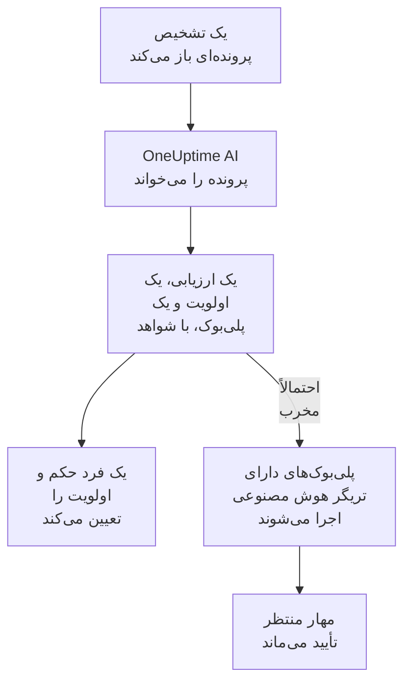

# OneUptime AI در امنیت

OneUptime AI هر پروندهٔ امنیتی را همان‌طور می‌خواند که یک تحلیلگر می‌خواند: تشخیص‌ها، رویدادها، موجودیت‌ها و هوش تهدید آن، و میزبان‌ها و افرادی که پیرامون آن هستند. می‌گوید چه اتفاقی افتاده و آیا واقعی به نظر می‌رسد، یک اولویت و یک پلی‌بوک پیشنهاد می‌دهد، و برای هر ادعا شواهد پشت آن را می‌آورد. خودش چیزی را تغییر نمی‌دهد: حکم و اولویت را یک فرد تعیین می‌کند، و پلی‌بوک را هم او اجرا می‌کند. همچنین از روی یک جمله پیش‌نویس قاعدهٔ تشخیص می‌نویسد، و در Ask AI به پرسش‌های شما دربارهٔ داده‌های امنیتی پاسخ می‌دهد.

:::cards
- [بررسی اولیهٔ یک پرونده](#بررسی-اولیهٔ-یک-پرونده): OneUptime AI چه می‌خواند، به چه نتیجه‌ای می‌رسد، و چه کاری را هرگز نمی‌کند.
- [بررسی اولیهٔ خودکار پرونده‌های تازه](#بررسی-اولیهٔ-خودکار-پروندههای-تازه): هر پرونده‌ای که یک تشخیص باز می‌کند، همان هنگام باز شدن بررسی می‌شود.
- [اجرای پلی‌بوک پس از بررسی اولیه](#اجرای-پلیبوک-پس-از-بررسی-اولیه): واکنش به پرونده‌ای که احتمالاً مخرب خوانده شده است.
- [پیش‌نویس یک قاعدهٔ تشخیص](#پیشنویس-یک-قاعدهٔ-تشخیص): بگویید چه چیزی باید گرفته شود، و قاعدهٔ Sigma را بخوانید.
- [Ask AI در صفحه‌های امنیت](#ask-ai-در-صفحههای-امنیت): پرسش دربارهٔ پرونده‌ها و رویدادها، با زبان ساده.
:::

## چگونه کار می‌کند

بررسی اولیه فقط می‌خواند. با هوش مصنوعی خود پروژه اجرا می‌شود: **فعال کردن هوش مصنوعی**، ارائه‌دهندهٔ LLM پروژه، اعتبار هوش مصنوعی آن و محدودیت‌های روزانهٔ هوش مصنوعی آن.

## پیش از شروع

- **فعال کردن هوش مصنوعی** روشن باشد، در **تنظیمات پروژه** > **هوش مصنوعی** > **AI Features**. اگر خاموش باشد، امنیت هیچ چیزی از OneUptime AI نشان نمی‌دهد و هیچ چیزی اجرا نمی‌شود.
- یک ارائه‌دهندهٔ LLM که OneUptime AI بتواند از آن استفاده کند، در **تنظیمات پروژه** > **هوش مصنوعی** > **ارائه‌دهندگان LLM**. OneUptime Cloud یکی فراهم می‌کند.
- برای شروع بررسی اولیه، نقشی که بتواند روی پرونده‌های امنیتی کار کند: Project Owner، Project Admin، Security Admin یا Security Member. Security Viewer هر بررسی اولیه را می‌خواند، اما نمی‌تواند یکی را شروع کند. [نقش‌ها](/docs/permissions/reference#نقشها) را ببینید.

## بررسی اولیهٔ یک پرونده

یک پرونده را باز کنید: کارت **OneUptime AI** بالای صفحهٔ آن است.

| کارت چه می‌گوید | معنی آن |
| --- | --- |
| **هنوز بررسی اولیه نشده** | هنوز هیچ بررسی اولیه‌ای اجرا نشده است. **بررسی اولیه با هوش مصنوعی** یکی را شروع می‌کند. |
| **در حال بررسی اولیهٔ این پرونده** | OneUptime AI در حال خواندن پرونده است. هر بررسی هنگام اجرا نشان داده می‌شود. |
| یک ارزیابی، مانند **احتمالاً مخرب** | بررسی اولیه تمام شد. **بررسی اولیهٔ دوباره** پرونده را از نو می‌خواند. |
| **بررسی اولیه تمام نشد** | اجرا متوقف شد. **تلاش دوباره** اجرای دیگری را شروع می‌کند. |

Security Viewer همان کارت را می‌بیند: **بررسی اولیه با هوش مصنوعی** و **تلاش دوباره** خاکستری می‌مانند و کنارشان سطری می‌گوید چه کسی می‌تواند بررسی اولیه را شروع کند، و **بررسی اولیهٔ دوباره** و **تعیین اولویت** پیشنهاد نمی‌شوند.

بررسی اولیه این‌ها را می‌خواند:

- خود پرونده: عنوان، اولویت، وضعیت، موجودیت‌ها و نگاشت ATT&CK آن؛
- تشخیص‌های آن، جدیدترین اول، با یک رویداد نمونه برای هر کدام؛
- رویدادهای امنیتی و هوش تهدید دربارهٔ کاربران، میزبان‌ها و نشانی‌های آن؛
- ریسک کاربران، میزبان‌ها و نشانی‌های آن، و آنچه این هفته به آن افزود؛
- میزبان‌هایی در OneUptime که میزبان‌ها و نشانی‌های پرونده با آن‌ها می‌خوانند، و مالک آن‌ها؛
- رخدادی که پرونده اعلام کرده، یادداشت‌ها، موجودیت‌های محافظت‌شده، و پلی‌بوک‌هایی که روشن‌اند.

همچنین می‌تواند بقیهٔ OneUptime را همان‌طور بخواند که بررسی یک رخداد می‌خواند: لاگ‌ها، ردها، متریک‌ها، میزبان‌ها، و ابزارهای فقط‌خواندنی سرورهای MCP پروژه.

### به چه نتیجه‌ای می‌رسد

| ارزیابی | معنی | پیشنهاد بستن با حکم |
| --- | --- | --- |
| احتمالاً مخرب | شواهد به فعالیتی مخرب یا غیرمجاز اشاره دارند | True Positive |
| احتمالاً بی‌خطر | فعالیت واقعی اما مورد انتظار به نظر می‌رسد، مانند یک کار مدیریتی یا اسکنی که تیم شما اجرا می‌کند | Benign Positive |
| احتمالاً هشدار نادرست | به نظر می‌رسد تشخیص، فعالیتی عادی را اشتباه خوانده است | False Positive |
| نامشخص | شواهد برای تصمیم کافی نبود، و یک فرد باید نگاه کند | هیچ |

این ارزیابی از آنِ OneUptime AI است و هرگز حکم پرونده نیست: **بستن پرونده** با حکمی که پیشنهاد می‌دهد شروع می‌شود، و یک فرد انتخاب می‌کند. زیر ارزیابی، کارت این‌ها را نشان می‌دهد:

- **اولویت پیشنهادی**، همراه با **تعیین اولویت** وقتی پرونده اولویت دیگری دارد.
- **پلی‌بوک پیشنهادی**، همراه با **اجرای پلی‌بوک**، که آن را از طرف شما و با هر تأییدی که لازم دارد اجرا می‌کند. وقتی آن پلی‌بوک از پیش روی پرونده در حال اجراست، وضعیت اجرای آن، مانند **در انتظار تأیید**، جای **اجرای پلی‌بوک** را می‌گیرد: اجرا در **پلی‌بوک‌ها** پرونده است، و اجرای دوم دوباره همان تأیید را می‌خواست.
- گزارش: چه اتفاقی افتاده، ارزیابی چقدر مطمئن است و قدم بعدی چیست، و پس از هر ادعا ارجاعی مانند C1 می‌آید.
- **Evidence checked**: هر کوئری که بررسی اولیه اجرا کرد. یک ارجاع کوئری خودش را باز می‌کند، و باز کردن یک کوئری آن را دوباره با مجوزهای شما، روی همان بازهٔ زمانی که بررسی اولیه خواند، اجرا می‌کند.
- **پرسش دربارهٔ این پرونده**، که Ask AI را روی پرونده باز می‌کند.

هر فهرست پرونده‌ها ارزیابی را کنار عنوان هر پرونده نشان می‌دهد، و با **ارزیابی هوش مصنوعی** بر اساس آن فیلتر می‌کند.

### چه کاری را هرگز نمی‌کند

بررسی اولیه هیچ چیزی را در پرونده تغییر نمی‌دهد: نه وضعیت، نه اولویت، نه مسئول، نه حکم و نه یادداشت‌ها. هیچ پلی‌بوکی اجرا نمی‌کند و کسی را مهار نمی‌کند. پلی‌بوکی که پیشنهاد می‌دهد وقتی اجرا می‌شود که یک فرد آن را اجرا کند، یا از راه تریگری که در ادامه آمده است.

### متنی که برای هدایت هوش مصنوعی نوشته شده

رویدادها، هشدارها و مقدارهای موجودیت‌ها از بیرون پروژه می‌آیند، و یک مهاجم می‌تواند آن‌ها را بنویسد. OneUptime AI همهٔ آن‌ها را داده می‌خواند، نه دستور. وقتی بخشی از داده‌های یک پرونده مانند دستورهایی برای یک هوش مصنوعی خوانده شود، کارت اول همین را می‌گوید، ارزیابی احتمالاً بی‌خطر یا احتمالاً هشدار نادرست به نامشخص تبدیل می‌شود، و آن بررسی اولیه هیچ پلی‌بوکی را شروع نمی‌کند.

## بررسی اولیهٔ خودکار پرونده‌های تازه

**محصولات** > **رویدادهای امنیتی** > **هوش مصنوعی** > **تنظیمات** را باز کنید و **بررسی اولیهٔ پرونده‌های جدید** را روشن کنید: از آن پس هر پرونده‌ای که یک تشخیص باز می‌کند، همان هنگام باز شدن بررسی می‌شود. کلید به محض جابه‌جا کردن ذخیره می‌شود. Project Owner و Project Admin می‌توانند آن را تغییر دهند.

پروژه‌های تازه با این گزینهٔ روشن شروع می‌شوند؛ پروژه‌ای که پیش‌تر ساخته شده آن را خاموش نگه می‌دارد تا کسی روشنش کند. پرونده‌ای که دستی باز شده، و پروندهٔ حملهٔ آزمایشی **ارسال حمله آزمایشی**، وقتی بررسی می‌شوند که کسی روی **بررسی اولیه با هوش مصنوعی** کلیک کند.

## اجرای پلی‌بوک پس از بررسی اولیه

پلی‌بوکی که **تریگر** آن **بررسی‌شده به‌عنوان احتمالاً مخرب** است، وقتی یک بررسی اولیه پرونده را احتمالاً مخرب بخواند، یک بار روی آن پرونده اجرا می‌شود. **برای پرونده‌های دست‌کم**، **فقط برای تشخیص‌های برآمده از** و **فقط برای این قواعد تشخیص** آن را مانند هر تریگر دیگری محدود می‌کنند، و گام‌های مهار آن مثل همیشه منتظر تأیید می‌مانند. اجرا نمی‌شود:

- پس از بررسی اولیه‌ای که متنی نوشته‌شده برای هدایت هوش مصنوعی پیدا کرده است؛
- برای بار دوم روی همان پرونده، هر چند بار هم که پرونده بررسی شود؛
- روی پروندهٔ حملهٔ آزمایشی، مگر اینکه هر گام پلی‌بوک درون OneUptime بماند.

این تریگر فقط تا وقتی هوش مصنوعی پروژه روشن است به پلی‌بوک تازه پیشنهاد می‌شود.

## پیش‌نویس یک قاعدهٔ تشخیص

در **قواعد تشخیص**، زیر فیلد **قاعده Sigma (YAML)**، روی **پیش‌نویس با هوش مصنوعی** کلیک کنید و بگویید قاعده باید چه چیزی را بگیرد، مثلاً ده ورود ناموفق از یک نشانی IP در پنج دقیقه. **پیش‌نویس قانون** یک قاعدهٔ Sigma را در فیلد می‌گذارد، که مانند یک قاعدهٔ ذخیره‌شده بررسی شده است. آن را بخوانید، در صورت نیاز تغییر دهید، و مثل همیشه ذخیره کنید: تا شما ذخیره نکنید، چیزی ذخیره نمی‌شود. اگر از قبل قاعده‌ای در فیلد باشد، دکمه **پیش‌نویس دوباره با هوش مصنوعی** نام دارد، و پیش‌نویس جای آن قاعده را می‌گیرد.

پیش‌نویس به نقشی نیاز دارد که بتواند قاعدهٔ تشخیص بسازد.

## Ask AI در صفحه‌های امنیت

**Ask AI** می‌داند روی کدام صفحهٔ امنیت هستید. روی یک پرونده، اول پرونده را می‌خواند و پرسش‌هایی مانند **واقعی است؟** پیشنهاد می‌دهد. در صفحه‌های دیگر رویدادهای امنیتی، پرسشی با زبان ساده در رویدادهای امنیتی شما جست‌وجو می‌کند. همچنین می‌تواند مقدارها را با هوش تهدید شما مقایسه کند، ببیند یک کاربر، میزبان یا نشانی چقدر فعال بوده است، و پلی‌بوک‌هایی را که برای یک پرونده مناسب‌اند فهرست کند.

Ask AI می‌تواند به یک پرونده یادداشت اضافه کند و روی آن پلی‌بوک اجرا کند، از طرف شما، و پیش از هر کار می‌پرسد. پلی‌بوکی که اجرا می‌کند مانند هر پلی‌بوک دیگری منتظر تأیید می‌ماند.

وقتی یک پرونده رخدادی را اعلام می‌کند، بررسی هوش مصنوعی آن رخداد هم پرونده را می‌خواند: چه چیزی تشخیص داده شد، دربارهٔ چه کسی، و بررسی اولیهٔ OneUptime AI از آن.

## هزینه‌ها و محدودیت‌ها

بررسی اولیه کاری از OneUptime AI است، مانند بررسی یک رخداد. در OneUptime Cloud هزینهٔ آن از اعتبار هوش مصنوعی پروژه پرداخت می‌شود، و در محدودیت‌های روزانهٔ هوش مصنوعی خود پروژه حساب می‌شود (**محدودیت‌های روزانه**، در **تنظیمات پروژه** > **هوش مصنوعی** > **AI Features**). محدودیت‌های روزانهٔ رخدادها و هشدارها اعمال نمی‌شوند. هر پرونده در هر زمان فقط یک بررسی اولیه دارد، و گزارش‌های هوش مصنوعی (**تنظیمات پروژه** > **هوش مصنوعی** > **گزارش‌های هوش مصنوعی**) فراخوانی‌های آن را فهرست می‌کنند.

وقتی اعتبار هوش مصنوعی پروژه تمام شده یا به یکی از محدودیت‌های روزانهٔ هوش مصنوعی رسیده باشد، پرونده‌های تازه بررسی نمی‌شوند: کارت دلیلش را می‌گوید، و **بررسی اولیه با هوش مصنوعی** به محض افزودن اعتبار یا بازنشانی محدودیت دوباره کار می‌کند.

## عیب‌یابی

:::details یک پروندهٔ تازه بررسی اولیه نشد
بررسی کنید که **فعال کردن هوش مصنوعی** روشن باشد، و **بررسی اولیهٔ پرونده‌های جدید** در **محصولات** > **رویدادهای امنیتی** > **هوش مصنوعی** > **تنظیمات** هم. پرونده‌ای که دستی باز شده و پروندهٔ حملهٔ آزمایشی فقط وقتی بررسی می‌شوند که کسی بخواهد. پرونده را باز کنید: وقتی چیزی جلوی بررسی اولیه را بگیرد، کارت می‌گوید چه چیزی، و کجا می‌شود درستش کرد.
:::

:::details کارت می‌گوید اعتبار هوش مصنوعی پروژه تمام شده، یا به محدودیت روزانهٔ هوش مصنوعی رسیده است
مالک پروژه یا کسی که Manage Billing دارد می‌تواند در **تنظیمات پروژه** > **هوش مصنوعی** > **اعتبار هوش مصنوعی** اعتبار اضافه کند، یا در **تنظیمات پروژه** > **هوش مصنوعی** > **AI Features** محدودیت را بالا ببرد یا حذف کند. سپس روی پرونده، روی **بررسی اولیه با هوش مصنوعی** کلیک کنید.
:::

:::details کارت می‌گوید متنی در پرونده مانند دستور برای یک هوش مصنوعی خوانده می‌شود
بخشی از داده‌های پرونده، مانند پیام یک رویداد یا یک نام کاربری، برای هدایت یک هوش مصنوعی نوشته شده بود. OneUptime AI آن را داده خواند و تصمیم را به شما سپرد: پیش از بستن پرونده، تشخیص‌ها و شواهد را خودتان بخوانید.
:::

:::details پلی‌بوکی با تریگر هوش مصنوعی اجرا نشد
بررسی کنید که پلی‌بوک فعال باشد، بررسی اولیه پرونده را احتمالاً مخرب خوانده باشد، و تنظیمات **برای پرونده‌های دست‌کم**، **فقط برای تشخیص‌های برآمده از** و **فقط برای این قواعد تشخیص** آن با پرونده جور باشند. برای هر پرونده یک بار اجرا می‌شود، و نه پس از بررسی اولیه‌ای که متنی نوشته‌شده برای هدایت هوش مصنوعی پیدا کرده است.
:::

## گام‌های بعدی

:::cards
- [پرونده‌های امنیتی و پلی‌بوک‌ها](/docs/telemetry/security-cases): روی پرونده‌ها کار کنید، آن‌ها را با یک حکم ببندید، و پلی‌بوک بسازید.
- [AI SRE](/docs/ai/ai-sre): OneUptime AI چگونه رخدادها و هشدارها را بررسی می‌کند، و محدودیت‌های آن.
- [پرسش از هوش مصنوعی](/docs/ai/ask-ai): دربارهٔ پروژهٔ خود با زبان ساده بپرسید.
- [ارائه‌دهندگان LLM](/docs/ai/llm-provider): مدلی را که OneUptime AI به کار می‌برد انتخاب کنید.
:::
