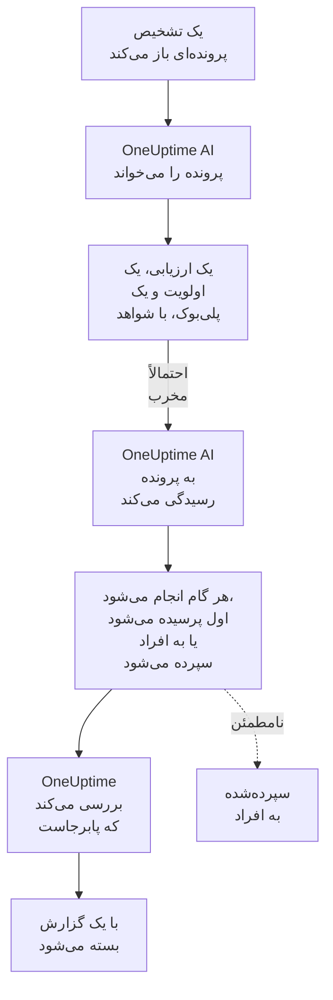

# OneUptime AI در امنیت

OneUptime AI هر پروندهٔ امنیتی را همان‌طور می‌خواند که یک تحلیلگر می‌خواند: تشخیص‌ها، رویدادها، موجودیت‌ها و هوش تهدید آن، و میزبان‌ها و افرادی که پیرامون آن هستند. می‌گوید چه اتفاقی افتاده و آیا واقعی به نظر می‌رسد، یک اولویت و یک پلی‌بوک پیشنهاد می‌دهد، و برای هر ادعا شواهد پشت آن را می‌آورد. اگر اجازه دهید، سپس از ابتدا تا انتها به پرونده رسیدگی می‌کند: پرونده را برعهده می‌گیرد، تهدید را مهار می‌کند، بررسی می‌کند که کاری که کرده پابرجا مانده است، ترتیب اصلاح کد را می‌دهد، و پرونده را با یک گزارش می‌بندد. هر نوع گام را، همان‌طور که شما تنظیم کرده‌اید، خودبه‌خود انجام می‌دهد، اول از یک نفر می‌پرسد، یا به یک نفر می‌سپارد، و هر گام را از راه همان موتور پلی‌بوکی انجام می‌دهد که افراد به کار می‌برند، پس هر گام به‌عنوان گام OneUptime AI در خط زمانی پرونده می‌آید و می‌توان آن را واگرد کرد. همچنین از روی یک جمله پیش‌نویس قاعدهٔ تشخیص می‌نویسد، و در Ask AI به پرسش‌های شما دربارهٔ داده‌های امنیتی پاسخ می‌دهد.

:::cards
- [بررسی اولیهٔ یک پرونده](#بررسی-اولیهٔ-یک-پرونده): OneUptime AI چه می‌خواند، به چه نتیجه‌ای می‌رسد، و چه کاری را هرگز نمی‌کند.
- [بررسی اولیهٔ خودکار پرونده‌های تازه](#بررسی-اولیهٔ-خودکار-پروندههای-تازه): هر پرونده‌ای که یک تشخیص باز می‌کند، همان هنگام باز شدن بررسی می‌شود.
- [رسیدگی به یک پرونده از ابتدا تا انتها](#رسیدگی-به-یک-پرونده-از-ابتدا-تا-انتها): مهار، بررسی، اصلاح و بستن، با تأیید یک نفر برای آنچه انتخاب می‌کنید.
- [آنچه OneUptime AI اجازه دارد روی یک پرونده انجام دهد](#آنچه-oneuptime-ai-اجازه-دارد-روی-یک-پرونده-انجام-دهد): خاموش، اول بپرسد یا خودبه‌خود، برای هر نوع گام.
- [چه زمانی پرونده را به افراد می‌سپارد](#چه-زمانی-پرونده-را-به-افراد-میسپارد): چرا متوقف می‌شود، و چه کسی باخبر می‌شود.
- [اجازه دهید OneUptime AI اول پاسخ دهد](#اجازه-دهید-oneuptime-ai-اول-پاسخ-دهد): به افراد فقط وقتی هشدار داده می‌شود که OneUptime AI به آن‌ها نیاز داشته باشد.
- [اجرای پلی‌بوک پس از بررسی اولیه](#اجرای-پلیبوک-پس-از-بررسی-اولیه): واکنش به پرونده‌ای که احتمالاً مخرب خوانده شده است.
- [پیش‌نویس یک قاعدهٔ تشخیص](#پیشنویس-یک-قاعدهٔ-تشخیص): بگویید چه چیزی باید گرفته شود، و قاعدهٔ Sigma را بخوانید.
- [Ask AI در صفحه‌های امنیت](#ask-ai-در-صفحههای-امنیت): پرسش دربارهٔ پرونده‌ها و رویدادها، با زبان ساده.
:::

## چگونه کار می‌کند

بررسی اولیه فقط می‌خواند. رسیدگی به پرونده، در چارچوب آنچه اجازه می‌دهید، اقدام می‌کند و همین که مطمئن نباشد پرونده را به افراد می‌سپارد. هر دو با هوش مصنوعی خود پروژه اجرا می‌شوند: **فعال کردن هوش مصنوعی**، ارائه‌دهندهٔ LLM پروژه، اعتبار هوش مصنوعی آن و محدودیت‌های روزانهٔ هوش مصنوعی آن.

## پیش از شروع

- **فعال کردن هوش مصنوعی** روشن باشد، در **تنظیمات پروژه** > **هوش مصنوعی** > **قابلیت‌های هوش مصنوعی**. اگر خاموش باشد، امنیت هیچ چیزی از OneUptime AI نشان نمی‌دهد و هیچ چیزی اجرا نمی‌شود.
- یک ارائه‌دهندهٔ LLM که OneUptime AI بتواند از آن استفاده کند، در **تنظیمات پروژه** > **هوش مصنوعی** > **ارائه‌دهندگان LLM**. OneUptime Cloud یکی فراهم می‌کند.
- برای شروع بررسی اولیه، نقشی که بتواند روی پرونده‌های امنیتی کار کند: مالک پروژه، مدیر پروژه، مدیر امنیت یا عضو امنیت. بیننده امنیت هر بررسی اولیه را می‌خواند، اما نمی‌تواند یکی را شروع کند. [نقش‌ها](/docs/permissions/reference#نقشها) را ببینید.

## بررسی اولیهٔ یک پرونده

یک پرونده را باز کنید: کارت **OneUptime AI** بالای صفحهٔ آن است.

| کارت چه می‌گوید | معنی آن |
| --- | --- |
| **هنوز بررسی اولیه نشده** | هنوز هیچ بررسی اولیه‌ای اجرا نشده است. **بررسی اولیه با هوش مصنوعی** یکی را شروع می‌کند. |
| **در حال بررسی اولیهٔ این پرونده** | OneUptime AI در حال خواندن پرونده است. هر بررسی هنگام اجرا نشان داده می‌شود. |
| یک ارزیابی، مانند **احتمالاً مخرب** | بررسی اولیه تمام شد. **بررسی اولیهٔ دوباره** پرونده را از نو می‌خواند. |
| **بررسی اولیه تمام نشد** | اجرا متوقف شد. **تلاش دوباره** اجرای دیگری را شروع می‌کند. |

بیننده امنیت همان کارت را می‌بیند: **بررسی اولیه با هوش مصنوعی** و **تلاش دوباره** خاکستری می‌مانند و کنارشان سطری می‌گوید چه کسی می‌تواند بررسی اولیه را شروع کند، و **بررسی اولیهٔ دوباره** و **تعیین اولویت** پیشنهاد نمی‌شوند.

بررسی اولیه این‌ها را می‌خواند:

- خود پرونده: عنوان، اولویت، وضعیت، موجودیت‌ها و نگاشت ATT&CK آن؛
- تشخیص‌های آن، جدیدترین اول، با یک رویداد نمونه برای هر کدام؛
- رویدادهای امنیتی و هوش تهدید دربارهٔ کاربران، میزبان‌ها و نشانی‌های آن؛
- ریسک کاربران، میزبان‌ها و نشانی‌های آن، و آنچه این هفته به آن افزود؛
- میزبان‌هایی در OneUptime که میزبان‌ها و نشانی‌های پرونده با آن‌ها می‌خوانند، و مالک آن‌ها؛
- رخدادی که پرونده اعلام کرده، یادداشت‌ها، موجودیت‌های محافظت‌شده، و پلی‌بوک‌هایی که روشن‌اند.

همچنین می‌تواند بقیهٔ OneUptime را همان‌طور بخواند که بررسی یک رخداد می‌خواند: لاگ‌ها، ردها، متریک‌ها، میزبان‌ها، و ابزارهای فقط‌خواندنی سرورهای MCP پروژه.

همهٔ کسانی که اجازهٔ دیدن پرونده را دارند بررسی اولیهٔ آن را می‌خوانند، پس بررسی اولیه فقط چیزی را می‌خواند که همهٔ آن‌ها اجازهٔ خواندنش را دارند. تیم، نقش سفارشی یا کلید API که نوعی از رکورد را فقط بر پایهٔ مالک یا برچسب می‌خواند، تنها وقتی به حساب می‌آید که آن کلید API یا کسی در آن تیم اجازهٔ خواندن پرونده‌های امنیتی یا گزارش ممیزی را داشته باشد. نوعی از رکورد که هیچ‌کدام از آن‌ها آن را فقط بر پایهٔ مالک یا برچسب نمی‌خواند، کامل خوانده می‌شود؛ جایی که برخی چنین می‌کنند، میزبان، خوشه، سرویس یا رکورد دیگری که یک مالک یا یک برچسب آن را جدا کرده است کنار گذاشته می‌شود و هرگز نام برده یا شمرده نمی‌شود. اینکه چه کسی اجازهٔ خواندن پرونده‌های امنیتی را دارد، هر بار که بررسی اولیه اجرا می‌شود مشخص می‌شود، پس بررسی اولیه‌ای که پیش از گرفتن این دسترسی نوشته شده است ممکن است رکوردهایی را نام ببرد که از آن شخص جدا شده‌اند. خود پرونده همیشه خوانده می‌شود، و رخدادی که اعلام کرده نیز، مگر اینکه آن رخداد خصوصی باشد. رخدادها و هشدارهای خصوصی هرگز خوانده نمی‌شوند.

### به چه نتیجه‌ای می‌رسد

| ارزیابی | معنی | پیشنهاد بستن با حکم |
| --- | --- | --- |
| احتمالاً مخرب | شواهد به فعالیتی مخرب یا غیرمجاز اشاره دارند | True Positive |
| احتمالاً بی‌خطر | فعالیت واقعی اما مورد انتظار به نظر می‌رسد، مانند یک کار مدیریتی یا اسکنی که تیم شما اجرا می‌کند | Benign Positive |
| احتمالاً هشدار نادرست | به نظر می‌رسد تشخیص، فعالیتی عادی را اشتباه خوانده است | False Positive |
| نامشخص | شواهد برای تصمیم کافی نبود، و یک فرد باید نگاه کند | هیچ |

این ارزیابی از آنِ OneUptime AI است و هرگز حکم پرونده نیست: **بستن پرونده** با حکمی که پیشنهاد می‌دهد شروع می‌شود، و یک فرد انتخاب می‌کند. زیر ارزیابی، کارت این‌ها را نشان می‌دهد:

- **اولویت پیشنهادی**، همراه با **تعیین اولویت** وقتی پرونده اولویت دیگری دارد.
- **پلی‌بوک پیشنهادی**، همراه با **اجرای پلی‌بوک**، که آن را از طرف شما و با هر تأییدی که لازم دارد اجرا می‌کند. وقتی آن پلی‌بوک از پیش روی پرونده در حال اجراست، وضعیت اجرای آن، مانند **در انتظار تأیید**، جای **اجرای پلی‌بوک** را می‌گیرد: اجرا در **پلی‌بوک‌ها** پرونده است، و اجرای دوم دوباره همان تأیید را می‌خواست.
- گزارش: چه اتفاقی افتاده، ارزیابی چقدر مطمئن است و قدم بعدی چیست، و پس از هر ادعا ارجاعی مانند C1 می‌آید.
- **شواهد بررسی‌شده**: هر کوئری که بررسی اولیه اجرا کرد. یک ارجاع کوئری خودش را باز می‌کند، و باز کردن یک کوئری آن را دوباره با مجوزهای شما، روی همان بازهٔ زمانی که بررسی اولیه خواند، اجرا می‌کند.
- **پرسش دربارهٔ این پرونده**، که Ask AI را روی پرونده باز می‌کند.

هر فهرست پرونده‌ها ارزیابی را کنار عنوان هر پرونده نشان می‌دهد، و با **ارزیابی هوش مصنوعی** بر اساس آن فیلتر می‌کند.

### چه کاری را هرگز نمی‌کند

بررسی اولیه هیچ چیزی را در پرونده تغییر نمی‌دهد: نه وضعیت، نه اولویت، نه مسئول، نه حکم و نه یادداشت‌ها. هیچ پلی‌بوکی اجرا نمی‌کند و کسی را مهار نمی‌کند. پلی‌بوکی که پیشنهاد می‌دهد وقتی اجرا می‌شود که یک فرد آن را اجرا کند، یا از راه تریگری که در ادامه آمده است. اقدام روی پرونده یعنی رسیدگی OneUptime AI به آن، که تنظیم جداگانه‌ای دارد: [رسیدگی به یک پرونده از ابتدا تا انتها](#رسیدگی-به-یک-پرونده-از-ابتدا-تا-انتها) را ببینید.

### متنی که برای هدایت هوش مصنوعی نوشته شده

رویدادها، هشدارها و مقدارهای موجودیت‌ها از بیرون پروژه می‌آیند، و یک مهاجم می‌تواند آن‌ها را بنویسد. OneUptime AI همهٔ آن‌ها را داده می‌خواند، نه دستور. وقتی بخشی از داده‌های یک پرونده مانند دستورهایی برای یک هوش مصنوعی خوانده شود، کارت اول همین را می‌گوید، ارزیابی احتمالاً بی‌خطر یا احتمالاً هشدار نادرست به نامشخص تبدیل می‌شود، آن بررسی اولیه هیچ پلی‌بوکی را شروع نمی‌کند، و OneUptime AI به پرونده رسیدگی نمی‌کند: آن را به افراد می‌سپارد.

## بررسی اولیهٔ خودکار پرونده‌های تازه

**محصولات** > **رویدادهای امنیتی** > **هوش مصنوعی** > **تنظیمات** را باز کنید و **بررسی اولیهٔ پرونده‌های جدید** را روشن کنید: از آن پس هر پرونده‌ای که یک تشخیص باز می‌کند، همان هنگام باز شدن بررسی می‌شود. کلید به محض جابه‌جا کردن ذخیره می‌شود. مالک پروژه و مدیر پروژه می‌توانند آن را تغییر دهند.

پروژه‌های تازه با این گزینهٔ روشن شروع می‌شوند؛ پروژه‌ای که پیش‌تر ساخته شده آن را خاموش نگه می‌دارد تا کسی روشنش کند. پرونده‌ای که دستی باز شده، و پروندهٔ حملهٔ آزمایشی **ارسال حمله آزمایشی**، وقتی بررسی می‌شوند که کسی روی **بررسی اولیه با هوش مصنوعی** کلیک کند.

## رسیدگی به یک پرونده از ابتدا تا انتها

در همان صفحه، **رسیدگی به پرونده‌ها از ابتدا تا انتها** را روشن کنید: از آن پس OneUptime AI هر پرونده‌ای را که بررسی اولیه‌اش آن را احتمالاً مخرب بخواند برعهده می‌گیرد و در چارچوب آنچه زیر **آنچه OneUptime AI اجازه دارد روی یک پرونده انجام دهد** اجازه می‌دهید به آن رسیدگی می‌کند. پروژه‌های تازه با این گزینهٔ روشن شروع می‌شوند؛ پروژه‌ای که پیش‌تر ساخته شده آن را خاموش نگه می‌دارد تا کسی روشنش کند. مالک پروژه و مدیر پروژه می‌توانند آن را تغییر دهند.

تا وقتی روشن است، یک نفر هم می‌تواند آن را روی یک پرونده شروع کند: **پاسخ با هوش مصنوعی**، روی کارت **OneUptime AI** پرونده، به پرونده‌ای رسیدگی می‌کند که بررسی اولیهٔ OneUptime AI آن را احتمالاً مخرب، احتمالاً بی‌خطر یا احتمالاً هشدار نادرست خوانده است. روی پرونده‌ای که بررسی اولیه‌اش نامشخص بود، داده‌هایش مانند دستورهایی برای یک هوش مصنوعی خوانده می‌شود، یا در بالاترین اولویت شماست، پیشنهاد نمی‌شود: این‌ها کار یک فرد است. به نقشی نیاز دارد که بتواند روی پرونده‌های امنیتی کار کند.

### چه کاری انجام می‌دهد

OneUptime AI **برنامهٔ پاسخ** پرونده را پیش می‌برد، فوری‌ترین‌ها اول: **مطمئن شوید واقعی است**، **مهارش کنید**، **آنچه را باعث آن شد برطرف کنید** و **پرونده را ببندید**. هر گام، همان‌طور که ردیف نوع آن در **آنچه OneUptime AI اجازه دارد روی یک پرونده انجام دهد** می‌گوید، انجام می‌شود، از یک نفر پرسیده می‌شود، یا به یک نفر سپرده می‌شود.

| گام | OneUptime AI چه می‌کند |
| --- | --- |
| برعهده گرفتن پرونده | آن را برعهده می‌گیرد و اولویتش را تا همانی که بررسی اولیه پیشنهاد داد بالا می‌برد. هرگز اولویتی را پایین نمی‌آورد، و پرونده‌ای که آن را تا بالاترین اولویت شما بالا ببرد به افراد سپرده می‌شود |
| رد احتمال هشدار نادرست | فقط وقتی آن را انجام‌شده علامت می‌زند که واقعیت‌های خود OneUptime جای تردیدی نگذارند: نشانی از آنِ شما نیست و کسی از آن وارد نشده است. در غیر این صورت گام را به یک نفر می‌سپارد |
| مسدود کردن نشانی | آن را از راه [فهرست مسدودسازی](/docs/telemetry/security-cases#فهرست-مسدودسازی) شما به مدت ۲۴ ساعت مسدود می‌کند، سپس منتظر بررسی OneUptime می‌ماند که نشان دهد مسدودسازی پابرجاست. اگر چیزی فهرست مسدودسازی شما را اعمال نکند، گام را به یک نفر می‌سپارد |
| تعلیق کاربر، مهار میزبان | گامی از یکی از پلی‌بوک‌های شما را که این کار را می‌کند، از راه ارائه‌دهندهٔ هویت یا EDR شما اجرا می‌کند. اگر چنین پلی‌بوکی نباشد، گام را به یک نفر می‌سپارد |
| اعلام یک حادثه | همیشه اول می‌پرسد: یک حادثه افراد را فرامی‌خواند |
| بردن پرونده به مهارشده | وقتی OneUptime همهٔ گام‌هایی را که تهدید را مهار می‌کنند تأیید کرده باشد |
| اصلاح مسیری که حمله به آن رسید | از «رفع با هوش مصنوعی» می‌خواهد یک pull request باز کند. یک نفر آن را ادغام می‌کند. وقتی OneUptime اصلاح را در محیط عملیاتی تأیید کند پرونده را می‌بندد، وقتی اصلاح فقط انجام‌شده به نظر برسد از یک نفر می‌پرسد، و تا وقتی اصلاح پابرجا نیست به رسیدگی به پرونده ادامه می‌دهد |
| روشن کردن MFA، بازبینی تغییرهای حساب | به یک نفر سپرده می‌شود: هیچ محصولی به OneUptime نمی‌گوید که این‌ها پابرجا هستند یا نه |
| بستن پرونده | وقتی همهٔ گام‌های دیگر انجام شده و تشخیص پرونده ۲۴ ساعت آرام بوده است، با حکم True Positive، همراه با یک [گزارش بستن](#گزارش-بستن) |

گامی که قاعدهٔ تشخیص پرونده از خودش می‌افزاید، و هر کاری که OneUptime راهی برای انجامش ندارد، مانند مسدود کردن یک دامنه در فیلتر DNS شما، با گفتن دلیلش به یک نفر سپرده می‌شود.

هر گامی که OneUptime AI برمی‌دارد از موتور پلی‌بوک می‌گذرد، به‌صورت اجرایی تک‌گامی در صفحهٔ **پلی‌بوک‌ها**ی پرونده که تریگر آن **OneUptime AI** است. پس منتظر تأیید می‌ماند، به موجودیت‌های محافظت‌شده دست نمی‌زند، در خط زمانی پرونده نشان داده می‌شود، در گزارش ممیزی نگه داشته می‌شود و قابل واگرد است، درست مانند گامی که هر کسی اجرا کند، و خط زمانی می‌گوید که از آنِ OneUptime AI بوده است. گامی که دربارهٔ آن می‌پرسد منتظر تأیید یک نفر می‌ماند: روی پرونده، در صفحهٔ **پلی‌بوک‌ها**ی آن، یا با یک ضربه در Slack یا Microsoft Teams.

### گزارش کار آن روی پرونده

زیر بررسی اولیه، کارت **OneUptime AI**، زیر **رسیدگی به پرونده**، می‌گوید OneUptime AI چگونه به پرونده رسیدگی می‌کند:

| کارت چه می‌گوید | معنی آن |
| --- | --- |
| **OneUptime AI در حال رسیدگی به این پرونده نیست** | **پاسخ با هوش مصنوعی** آن را برعهده می‌گیرد. |
| **در حال رسیدگی به این پرونده** | OneUptime AI برنامه را پیش می‌برد. **در دست گرفتن** آن را متوقف می‌کند و پرونده از آنِ شما می‌شود. |
| **منتظر یک نفر** | از کسی خواسته است گامی را تأیید کند، و همین که کسی پاسخ دهد ادامه می‌دهد. |
| **سپرده‌شده به افراد** | متوقف شده است و دلیلش را می‌گوید. |
| **پرونده بسته شده است** | پرونده را بسته است، یا یک نفر آن را بسته است. **گزارش بستن** آن بالای گام‌هایش است. |

زیر آن، هر گامی که برداشته، دربارهٔ آن پرسیده یا واگذاشته است، جدیدترین اول، هر کدام با دلیلش: **خودبه‌خود انجام شد: تنظیمات شما اجازه می‌دهند.**، **تنظیمات شما این را منتظر تأیید یک نفر نگه می‌دارند.**، **OneUptime راهی برای انجام این گام ندارد، پس یک نفر آن را انجام می‌دهد.** گامی که دربارهٔ آن پرسیده **تأیید** و **رد کردن** دارد؛ گامی که برداشته به اجرای خودش پیوند دارد، که آنجا می‌توان آن را واگرد کرد. گامی که OneUptime بررسی می‌کند می‌گوید بررسی چه یافت، و گامی که پیش‌تر روی پرونده‌های همان قاعده برداشته می‌گوید چند بار پابرجا ماند: «در ۱۴ مورد از ۱۵ پروندهٔ مشابه پابرجا ماند.»

### پرونده‌ای که آن را بی‌خطر یا هشدار نادرست می‌خواند

**پاسخ با هوش مصنوعی** روی پرونده‌ای که بررسی اولیه آن را احتمالاً بی‌خطر یا احتمالاً هشدار نادرست خوانده است، آن را با حکم Benign Positive یا False Positive می‌بندد، تا جایی که **پرونده را ببندید** اجازه دهد. پس از بسته شدن، OneUptime AI مسدودسازی‌هایی را که پرونده ایجاد کرده رفع می‌کند، این هم تا جایی که **پرونده را ببندید** اجازه دهد، و برای مقداری که پرونده را به راه انداخت استثنایی به قاعدهٔ پرونده پیشنهاد می‌دهد. این استثنا همیشه منتظر یک نفر می‌ماند: **تأیید** آن را از طرف شما اضافه می‌کند.

## آنچه OneUptime AI اجازه دارد روی یک پرونده انجام دهد

زیر **آنچه OneUptime AI اجازه دارد روی یک پرونده انجام دهد**، در **محصولات** > **رویدادهای امنیتی** > **هوش مصنوعی** > **تنظیمات**، هر نوع گام ردیف خودش را دارد که همان لحظهٔ انتخاب ذخیره می‌شود:

- **خاموش**: OneUptime AI این را به یک نفر می‌سپارد و روی پرونده هم همین را می‌گوید.
- **اول بپرسد**: از یک نفر، همراه با شواهد، می‌پرسد و پس از تأیید کسی آن را انجام می‌دهد.
- **خودبه‌خود**: بدون پرسیدن انجامش می‌دهد و این را در خط زمانی پرونده می‌گوید.

| ردیف | چه چیزی را در بر می‌گیرد | پروژه‌های تازه با این شروع می‌کنند |
| --- | --- | --- |
| **رسیدگی به پرونده** | برعهده گرفتن پرونده، افزایش اولویت آن، علامت‌گذاری گام‌ها به‌عنوان انجام‌شده همراه با شواهدشان، بردن آن به مهارشده | خودبه‌خود |
| **مسدود کردن نشانی‌ها** | مسدود کردن نشانی پرونده در لبهٔ شبکهٔ شما، به مدت ۲۴ ساعت | اول بپرسد |
| **مهار حساب‌ها** | تعلیق کاربر پرونده یا پایان دادن به نشست‌هایش | اول بپرسد |
| **مهار میزبان‌ها** | مهار یا جدا کردن میزبان پرونده | اول بپرسد |
| **رفع اشکال کد** | واداشتن «رفع با هوش مصنوعی» به باز کردن یک pull request برای مسیری که حمله به آن رسید | خودبه‌خود |
| **پرونده را ببندید** | بستن پرونده با گزارش بستن آن، و رفع مسدودسازی‌های پرونده وقتی به‌عنوان بی‌خطر بسته شود | اول بپرسد |

این تنظیمات تا وقتی **رسیدگی به پرونده‌ها از ابتدا تا انتها** روشن است اعمال می‌شوند، و تا وقتی خاموش است کارت همین را می‌گوید. مالک پروژه و مدیر پروژه می‌توانند آن‌ها را تغییر دهند.

تنظیم **مسدود کردن نشانی‌ها**، **مهار حساب‌ها** یا **مهار میزبان‌ها** روی **خودبه‌خود** به اختیار یک مدیر امنیت نیاز دارد، که مالکان پروژه و مدیران پروژه هم آن را دارند، و OneUptime نگه می‌دارد چه کسی و کی این کار را کرد، همان‌طور که برای گامی از پلی‌بوک که تأییدش خاموش است نگه می‌دارد. **مسدود کردن نشانی‌ها** اول می‌پرسد: **تأیید و روشن کردن** تأیید یک مدیر امنیت است، و ردیف سپس می‌گوید کی داده شد. تا وقتی یک مدیر امنیت آن را تأیید نکرده است، OneUptime AI پیش از مسدود کردن می‌پرسد.

هر چه ردیف‌ها بگویند، OneUptime AI:

- هرگز روی کاربر، میزبان یا نشانی محافظت‌شده اقدام نمی‌کند: پرونده را به افراد می‌سپارد؛
- در هر ساعت، در همهٔ پرونده‌های شما روی هم، حداکثر ۱۰ اقدام را خودبه‌خود انجام می‌دهد، و سپس پروندهٔ بعدی را به افراد می‌سپارد؛
- حداکثر به مدت ۲۴ ساعت مسدود می‌کند؛
- هرگز کد را ادغام نمی‌کند: هر pull request را یک نفر ادغام می‌کند؛
- همیشه پیش از اعلام یک حادثه یا افزودن یک استثنای قاعده می‌پرسد؛
- در هر زمان فقط با یک اجرا روی یک پرونده کار می‌کند، و سروری که دوباره راه‌اندازی شود هرگز اجرایی را که اقدام می‌کند از دست نمی‌دهد.

## چه زمانی پرونده را به افراد می‌سپارد

OneUptime AI هرگز بی‌سروصدا کنار نمی‌کشد. پرونده را به افراد می‌سپارد و دلیلش را روی کارت و در خط زمانی می‌گوید، وقتی:

- بخشی از داده‌های پرونده مانند دستورهایی برای یک هوش مصنوعی خوانده شود؛
- پرونده در بالاترین اولویت شما باشد؛
- آنچه گام بعدی‌اش روی آن اقدام می‌کند محافظت‌شده باشد؛
- به اندازهٔ سقف مجازش در یک ساعت خودبه‌خود اقدام کرده باشد؛
- هوش مصنوعی برای پروژه یا برای پرونده‌های امنیتی خاموش باشد، ارائه‌دهندهٔ LLM وجود نداشته باشد، یا اعتبار هوش مصنوعی پروژه تمام شده یا به سقف روزانهٔ هوش مصنوعی رسیده باشد؛
- بررسی اولیه‌اش نتوانسته باشد تشخیص دهد پرونده واقعی است یا نه؛
- گامی که برداشته پابرجا نباشد، گامی که شروع کرده تمام نشده باشد، یا یک نفر گامی را که برداشته رد یا واگرد کرده باشد؛
- نتواند تشخیص دهد قدم بعدی چیست، یا هر چه روی پرونده مانده کار یک نفر باشد.

افرادی که روی پرونده هستند فوراً باخبر می‌شوند، یا اگر کسی روی آن نباشد، افرادی که از پرونده‌های آن اولویت باخبر می‌شوند: **OneUptime AI یک پرونده امنیتی را به افراد سپرد**، در **تنظیمات کاربر** > **تنظیمات اعلان**. یک قاعدهٔ اعلان فضای کاری برای پرونده‌های امنیتی آن را زیر **سپرده‌شده به افراد توسط OneUptime AI** به کانال Slack یا Microsoft Teams خود می‌فرستد. **در دست گرفتن** پرونده را بدون خبر دادن به کسی واگذار می‌کند، چون کسی که آن را زده پرونده را در دست دارد.

**پاسخ با هوش مصنوعی** از OneUptime AI می‌خواهد دوباره، از جایی که پرونده هست، به آن رسیدگی کند.

پرونده‌ای که تا وقتی OneUptime AI اول پاسخ می‌دهد نگه داشته شده است، یک بار به افراد می‌رسد، همراه با اعلان پروندهٔ تازه و دلیل توقف OneUptime AI: [اجازه دهید OneUptime AI اول پاسخ دهد](#اجازه-دهید-oneuptime-ai-اول-پاسخ-دهد) را ببینید.

## اجازه دهید OneUptime AI اول پاسخ دهد

زیر **اجازه دهید OneUptime AI اول پاسخ دهد**، در **محصولات** > **رویدادهای امنیتی** > **هوش مصنوعی** > **تنظیمات**، **اول پاسخ دادن** را روشن کنید: از آن پس هر پروندهٔ تازه‌ای که یک تشخیص با اولویتی پایین‌تر از اولویت انتخابی شما باز کند، پیش از آنکه به کسی هشدار داده شود منتظر OneUptime AI می‌ماند. تا وقتی **بررسی اولیهٔ پرونده‌های جدید** و **رسیدگی به پرونده‌ها از ابتدا تا انتها** روشن باشند پیشنهاد می‌شود. خاموش شروع می‌شود و به محض تغییر دادن ذخیره می‌شود. مالک پروژه و مدیر پروژه می‌توانند آن را تغییر دهند.

- **برای پرونده‌های پایین‌تر از**: اولویتی که پرونده باید پایین‌تر از آن باشد تا نگه داشته شود. تا وقتی اولویت دیگری انتخاب نکنید، High است.
- **در هر صورت هشدار به افراد پس از**: حداکثر مدتی که یک پرونده نگه داشته می‌شود، ۵، ۱۰، ۱۵، ۲۰ یا ۳۰ دقیقه. از ۱۰ دقیقه شروع می‌شود.

تا وقتی پرونده‌ای نگه داشته شده است، اعلان پروندهٔ تازه منتظر می‌ماند، و گام‌های **فراخوانی آنکال** پلی‌بوک‌هایی که خودشان روی آن شروع می‌شوند نیز. پرونده **OneUptime AI در حال رسیدگی است** را نشان می‌دهد، همراه با زمانی که به افراد هشدار داده می‌شود، و **اکنون فرابخوان** فوراً به آن‌ها هشدار می‌دهد. اجرای پلی‌بوکی که فراخوانی‌اش منتظر مانده است **در انتظار OneUptime AI** است.

نگه‌داشتن همین که یکی از این‌ها رخ دهد پایان می‌یابد:

| وقتی | آنگاه |
| --- | --- |
| OneUptime AI پرونده را مهار می‌کند و OneUptime همهٔ گام‌هایی را که آن را مهار می‌کنند بررسی می‌کند، یا پرونده بسته می‌شود | به هیچ‌کس هشدار داده نمی‌شود. کانال‌هایی که پرونده‌های تازه در آن‌ها ارسال می‌شوند یک خلاصه از کاری که OneUptime AI کرد دریافت می‌کنند، و گام‌های فراخوانی که منتظر مانده بودند نادیده گرفته می‌شوند |
| OneUptime AI به یک نفر نیاز دارد: از کسی می‌خواهد گامی را تأیید کند، پرونده را به افراد می‌سپارد، یا نمی‌تواند رسیدگی به آن را شروع کند | فوراً به همهٔ کسانی که پرونده از آن‌ها نگه داشته شده بود هشدار داده می‌شود، همراه با دلیلش و کاری که OneUptime AI تاکنون کرده است، و گام‌های فراخوانی که منتظر مانده بودند فرا می‌خوانند |
| بررسی اولیه‌اش پرونده را احتمالاً مخرب نمی‌خواند، پرونده پیش از آنکه OneUptime بتواند همهٔ گام‌ها را بررسی کند مهارشده علامت می‌خورد، یا زمان نگه‌داشتن تمام می‌شود | فوراً به همه هشدار داده می‌شود، همراه با دلیلش |
| کسی **اکنون فرابخوان** را می‌زند، پرونده به اولویتی که انتخاب کرده‌اید می‌رسد، یا **اول پاسخ دادن** یا **رسیدگی به پرونده‌ها از ابتدا تا انتها** خاموش می‌شود | فوراً به همه هشدار داده می‌شود |
| یک نفر پرونده را برعهده می‌گیرد: **در دست گرفتن**، واگذار کردن آن یا بردنش به وضعیت بعدی | پرونده در دست اوست. به هیچ‌کس دیگری هشدار داده نمی‌شود، کانال‌ها از پروندهٔ تازه باخبر می‌شوند، و گام‌های فراخوانی که منتظر مانده بودند نادیده گرفته می‌شوند |

پرونده هرگز نگه داشته نمی‌شود، و مثل همیشه به افراد هشدار داده می‌شود، وقتی:

- در بالاترین اولویت شما باشد، یا در اولویتی که انتخاب کرده‌اید یا بالاتر از آن؛
- ۳ پروندهٔ دیگر در ۵ دقیقهٔ پیش از آن باز شده باشند، که شبیه حمله‌ای در جریان است: پرونده‌هایی که در آن هنگام نگه داشته شده‌اند هم به افراد می‌رسند؛
- بخشی از داده‌هایش مانند دستورهایی برای یک هوش مصنوعی خوانده شود؛
- دربارهٔ نشانی، کاربر یا میزبان پرونده‌ای باشد که OneUptime AI در ۲۴ ساعت گذشته حل کرده است، چون کاری که کرد پابرجا نماند؛
- OneUptime AI نتواند آن را بررسی اولیه کند یا به آن رسیدگی کند، مثلاً وقتی اعتبار هوش مصنوعی پروژه تمام شده باشد؛
- یک نفر آن را باز کرده باشد، یا پروندهٔ حملهٔ آزمایشی باشد.

خط زمانی پرونده می‌گوید چرا نگه داشته نشد، جز برای پرونده‌ای در اولویتی که انتخاب کرده‌اید یا بالاتر از آن، پرونده‌ای که یک نفر باز کرده و پروندهٔ حملهٔ آزمایشی. اعلان‌های یک هدف پاسخ هرگز نگه داشته نمی‌شوند.

مسدود کردن نشانی‌ها و مهار حساب‌ها و میزبان‌ها اول می‌پرسند تا وقتی آن‌ها را زیر **آنچه OneUptime AI اجازه دارد روی یک پرونده انجام دهد** روی **خودبه‌خود** بگذارید، و پرونده همین که OneUptime AI بپرسد به افراد می‌رسد. با **مسدود کردن نشانی‌ها** روی **خودبه‌خود**، که یک مدیر امنیت آن را تأیید کرده باشد، OneUptime AI می‌تواند یک اسکنر را بدون هشدار به کسی مهار کند.

### ایمیل هفتگی

هر دوشنبه، مالکان پروژه و مدیران امنیت که می‌توانند پرونده‌های امنیتی را بخوانند یک ایمیل دریافت می‌کنند از کاری که OneUptime AI در هفتهٔ پیش روی پرونده‌های امنیتی پروژه انجام داد: پرونده‌هایی که اول به آن‌ها پاسخ داد و اینکه چگونه پایان یافتند، پرونده‌هایی که به آن‌ها رسیدگی کرد چه زود مهار شدند، نشانی‌هایی که مسدود کرد و مسدودسازی‌هایی که دوباره رفع شدند، گام‌هایی که از افراد خواست تأییدشان کنند و اینکه چه زود پاسخ دادند، و گام‌هایی که افراد واگرد کردند. فقط شامل اعداد است، و یک پیوند به **محصولات** > **رویدادهای امنیتی** > **نمای کلی**. برای هفته‌ای که OneUptime AI در آن کاری نکرده باشد ایمیلی فرستاده نمی‌شود.

## گزارش بستن

وقتی OneUptime AI پرونده‌ای را می‌بندد، یا از یک نفر می‌خواهد آن را ببندد، گزارش بستن را از آنچه پرونده در خود دارد می‌نویسد، نه از حرف‌های بررسی اولیه: چه اتفاقی افتاد، اثر آن، چه کاری انجام شد، چه چیزی اصلاح شد و چه چیزی را باید زیر نظر داشت. این گزارش یادداشت بستن پرونده است، در خط زمانی می‌آید، و کارت آن را زیر **گزارش بستن** نشان می‌دهد. وقتی **پرونده را ببندید** روی **اول بپرسد** باشد، پرونده منتظر می‌ماند تا یک نفر بستن را تأیید کند، و گزارش را می‌توان پیش از آن خواند.

## چگونه سنجیده می‌شود

**محصولات** > **رویدادهای امنیتی** > **نمای کلی** نشان می‌دهد OneUptime AI در ۳۰ روز گذشته چگونه به پرونده‌ها رسیدگی کرده است، همین که به یکی رسیدگی کرده یا دربارهٔ یکی پرسیده باشد: **حل‌شده توسط OneUptime AI**، از پرونده‌هایی که به آن‌ها رسیدگی کرد؛ **زمان تا مهار با هوش مصنوعی** و **زمان تا بستن با هوش مصنوعی**، هر کدام کنار زمان بدون آن؛ و **تأییدهای درخواست‌شده**، اینکه افراد چه زود پاسخ دادند، و افراد چند گام آن را واگرد کردند.

## اجرای پلی‌بوک پس از بررسی اولیه

پلی‌بوکی که **تریگر** آن **بررسی‌شده به‌عنوان احتمالاً مخرب** است، وقتی یک بررسی اولیه پرونده را احتمالاً مخرب بخواند، یک بار روی آن پرونده اجرا می‌شود. **برای پرونده‌های دست‌کم**، **فقط برای تشخیص‌های برآمده از** و **فقط برای این قواعد تشخیص** آن را مانند هر تریگر دیگری محدود می‌کنند، و گام‌های مهار آن مثل همیشه منتظر تأیید می‌مانند. اجرا نمی‌شود:

- پس از بررسی اولیه‌ای که متنی نوشته‌شده برای هدایت هوش مصنوعی پیدا کرده است؛
- برای بار دوم روی همان پرونده، هر چند بار هم که پرونده بررسی شود؛
- روی پروندهٔ حملهٔ آزمایشی، مگر اینکه هر گام پلی‌بوک درون OneUptime بماند.

این تریگر فقط تا وقتی هوش مصنوعی پروژه روشن است به پلی‌بوک تازه پیشنهاد می‌شود.

## پیش‌نویس یک قاعدهٔ تشخیص

در **قواعد تشخیص**، زیر فیلد **قاعده Sigma (YAML)**، روی **پیش‌نویس با هوش مصنوعی** کلیک کنید و بگویید قاعده باید چه چیزی را بگیرد، مثلاً ده ورود ناموفق از یک نشانی IP در پنج دقیقه. **پیش‌نویس قانون** یک قاعدهٔ Sigma را در فیلد می‌گذارد، که مانند یک قاعدهٔ ذخیره‌شده بررسی شده است. آن را بخوانید، در صورت نیاز تغییر دهید، و مثل همیشه ذخیره کنید: تا شما ذخیره نکنید، چیزی ذخیره نمی‌شود. اگر از قبل قاعده‌ای در فیلد باشد، دکمه **پیش‌نویس دوباره با هوش مصنوعی** نام دارد، و پیش‌نویس جای آن قاعده را می‌گیرد.

پیش‌نویس به نقشی نیاز دارد که بتواند قاعدهٔ تشخیص بسازد.

## Ask AI در صفحه‌های امنیت

**پرسش از هوش مصنوعی** می‌داند روی کدام صفحهٔ امنیت هستید. روی یک پرونده، اول پرونده را می‌خواند و پرسش‌هایی مانند **واقعی است؟** پیشنهاد می‌دهد. در صفحه‌های دیگر رویدادهای امنیتی، پرسشی با زبان ساده در رویدادهای امنیتی شما جست‌وجو می‌کند. همچنین می‌تواند مقدارها را با هوش تهدید شما مقایسه کند، ببیند یک کاربر، میزبان یا نشانی چقدر فعال بوده است، و پلی‌بوک‌هایی را که برای یک پرونده مناسب‌اند فهرست کند.

Ask AI می‌تواند به یک پرونده یادداشت اضافه کند و روی آن پلی‌بوک اجرا کند، از طرف شما، و پیش از هر کار می‌پرسد. پلی‌بوکی که اجرا می‌کند مانند هر پلی‌بوک دیگری منتظر تأیید می‌ماند.

وقتی یک پرونده رخدادی را اعلام می‌کند، بررسی هوش مصنوعی آن رخداد هم پرونده را می‌خواند: چه چیزی تشخیص داده شد، دربارهٔ چه کسی، و بررسی اولیهٔ OneUptime AI از آن.

## هزینه‌ها و محدودیت‌ها

بررسی اولیه کاری از OneUptime AI است، مانند بررسی یک رخداد. در OneUptime Cloud هزینهٔ آن از اعتبار هوش مصنوعی پروژه پرداخت می‌شود، و در محدودیت‌های روزانهٔ هوش مصنوعی خود پروژه حساب می‌شود (**محدودیت‌های روزانه**، در **تنظیمات پروژه** > **هوش مصنوعی** > **قابلیت‌های هوش مصنوعی**). محدودیت‌های روزانهٔ رخدادها و هشدارها اعمال نمی‌شوند. هر پرونده در هر زمان فقط یک بررسی اولیه دارد، و گزارش‌های هوش مصنوعی (**تنظیمات پروژه** > **هوش مصنوعی** > **گزارش‌های هوش مصنوعی**) فراخوانی‌های آن را فهرست می‌کنند.

وقتی اعتبار هوش مصنوعی پروژه تمام شده یا به یکی از محدودیت‌های روزانهٔ هوش مصنوعی رسیده باشد، پرونده‌های تازه بررسی نمی‌شوند: کارت دلیلش را می‌گوید، و **بررسی اولیه با هوش مصنوعی** به محض افزودن اعتبار یا بازنشانی محدودیت دوباره کار می‌کند. رسیدگی OneUptime AI به یک پرونده، به‌جای پرسیدن از LLM، برنامه و بررسی‌های خود پرونده را می‌خواند، و در همان محدودیت‌ها متوقف می‌شود: پرونده را به افراد می‌سپارد و دلیلش را می‌گوید.

## عیب‌یابی

:::details یک پروندهٔ تازه بررسی اولیه نشد
بررسی کنید که **فعال کردن هوش مصنوعی** روشن باشد، و **بررسی اولیهٔ پرونده‌های جدید** در **محصولات** > **رویدادهای امنیتی** > **هوش مصنوعی** > **تنظیمات** هم. پرونده‌ای که دستی باز شده و پروندهٔ حملهٔ آزمایشی فقط وقتی بررسی می‌شوند که کسی بخواهد. پرونده را باز کنید: وقتی چیزی جلوی بررسی اولیه را بگیرد، کارت می‌گوید چه چیزی، و کجا می‌شود درستش کرد.
:::

:::details OneUptime AI به یک پرونده رسیدگی نکرد
بررسی کنید که **رسیدگی به پرونده‌ها از ابتدا تا انتها** در **محصولات** > **رویدادهای امنیتی** > **هوش مصنوعی** > **تنظیمات** روشن باشد. فقط وقتی خودش پرونده‌ای را برعهده می‌گیرد که بررسی اولیه آن را احتمالاً مخرب بخواند. پرونده را باز کنید: زیر **رسیدگی به پرونده**، کارت می‌گوید چرا به آن رسیدگی نمی‌کند، و **پاسخ با هوش مصنوعی** از آن می‌خواهد رسیدگی کند.
:::

:::details با اینکه «مسدود کردن نشانی‌ها» روی «خودبه‌خود» است، پیش از مسدود کردن می‌پرسد
**خودبه‌خود** برای **مسدود کردن نشانی‌ها** فقط وقتی به حساب می‌آید که یک مدیر امنیت آن را تأیید کرده باشد: ردیف می‌گوید کی، یا اینکه هنوز کسی تأیید نکرده است. نشانی‌ای که محافظت‌شده است، یا یکی از نشانی‌های خود شما، هرگز مسدود نمی‌شود: OneUptime AI پرونده را به افراد می‌سپارد. تا وقتی چیزی فهرست مسدودسازی شما را اعمال نمی‌کند، گام را به یک نفر می‌سپارد.
:::

:::details کارت می‌گوید اعتبار هوش مصنوعی پروژه تمام شده، یا به محدودیت روزانهٔ هوش مصنوعی رسیده است
مالک پروژه یا کسی که Manage Billing دارد می‌تواند در **تنظیمات پروژه** > **هوش مصنوعی** > **اعتبار هوش مصنوعی** اعتبار اضافه کند، یا در **تنظیمات پروژه** > **هوش مصنوعی** > **قابلیت‌های هوش مصنوعی** محدودیت را بالا ببرد یا حذف کند. سپس روی پرونده، روی **بررسی اولیه با هوش مصنوعی** کلیک کنید.
:::

:::details کارت می‌گوید متنی در پرونده مانند دستور برای یک هوش مصنوعی خوانده می‌شود
بخشی از داده‌های پرونده، مانند پیام یک رویداد یا یک نام کاربری، برای هدایت یک هوش مصنوعی نوشته شده بود. OneUptime AI آن را داده خواند و تصمیم را به شما سپرد: پیش از بستن پرونده، تشخیص‌ها و شواهد را خودتان بخوانید.
:::

:::details در حالی که OneUptime AI اول پاسخ می‌داد به افراد هشدار داده شد
خط زمانی پرونده می‌گوید چرا نگه‌داشتن پایان یافت: OneUptime AI از کسی خواست گامی را تأیید کند، پرونده را به افراد سپرد یا در مدت **در هر صورت هشدار به افراد پس از** کارش را تمام نکرد، یا کسی **اکنون فرابخوان** را زد. گامی که اول می‌پرسد همین که OneUptime AI بپرسد به افراد می‌رسد: **آنچه OneUptime AI اجازه دارد روی یک پرونده انجام دهد** را ببینید.
:::

:::details یک پروندهٔ تازه نگه داشته نشد
بررسی کنید که **اول پاسخ دادن** روشن باشد، و پرونده پایین‌تر از اولویتی باشد که زیر **برای پرونده‌های پایین‌تر از** آمده است. پرونده‌ای در بالاترین اولویت شما، پرونده‌ای که یک نفر باز کرده و پروندهٔ حملهٔ آزمایشی هرگز نگه داشته نمی‌شوند. برای هر دلیل دیگری، خط زمانی پرونده دلیلش را می‌گوید.
:::

:::details پلی‌بوکی با تریگر هوش مصنوعی اجرا نشد
بررسی کنید که پلی‌بوک فعال باشد، بررسی اولیه پرونده را احتمالاً مخرب خوانده باشد، و تنظیمات **برای پرونده‌های دست‌کم**، **فقط برای تشخیص‌های برآمده از** و **فقط برای این قواعد تشخیص** آن با پرونده جور باشند. برای هر پرونده یک بار اجرا می‌شود، و نه پس از بررسی اولیه‌ای که متنی نوشته‌شده برای هدایت هوش مصنوعی پیدا کرده است.
:::

## گام‌های بعدی

:::cards
- [پرونده‌های امنیتی و پلی‌بوک‌ها](/docs/telemetry/security-cases): روی پرونده‌ها کار کنید، آن‌ها را با یک حکم ببندید، و پلی‌بوک بسازید.
- [AI SRE](/docs/ai/ai-sre): OneUptime AI چگونه رخدادها و هشدارها را بررسی می‌کند، و محدودیت‌های آن.
- [پرسش از هوش مصنوعی](/docs/ai/ask-ai): دربارهٔ پروژهٔ خود با زبان ساده بپرسید.
- [ارائه‌دهندگان LLM](/docs/ai/llm-provider): مدلی را که OneUptime AI به کار می‌برد انتخاب کنید.
:::
