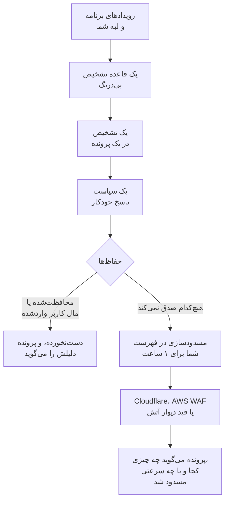

# پاسخ خودکار

سیاست‌های پاسخ خودکار، همان لحظه که تشخیص انجام می‌شود و پیش از آنکه کسی پرونده را بررسی کند، نشانی مهاجم را با چالش روبه‌رو یا مسدود می‌کنند: اسکنرهایی که برنامه شما را می‌کاوند و ربات‌هایی که گذرواژه پشت گذرواژه امتحان می‌کنند، چند دقیقه پس از نخستین درخواستشان برگردانده می‌شوند. هر پروژه سه سیاست آماده دارد که هر کدام تا وقتی روشنش نکنید خاموش است و هر کدام با یک هفته دوره آزمایشی شروع می‌شود که فقط ثبت می‌کند چه می‌کرد. حفاظ‌ها روشن نگه داشتن یک سیاست را بی‌خطر می‌کنند: هرگز به نشانی‌های خودتان یا نشانی‌ای که کاربران واردشده شما از آن استفاده می‌کنند دست نمی‌زند، و وقتی حمله‌ای بزرگ‌تر از آن باشد که باید به‌تنهایی از پسش برآید، متوقف می‌شود و یک نفر را فرا می‌خواند.

:::cards
- [روشن کردن یک سیاست](#روشن-کردن-یک-سیاست): نخست یک هفته دوره آزمایشی، سپس یک کلیک.
- [حفاظ‌ها](#حفاظها): کاری که یک سیاست هرگز نمی‌کند، و زمانی که متوقف می‌شود.
- [زمان تا مسدودسازی](#زمان-تا-مسدودسازی): هر سیاست با چه سرعتی مسدود می‌کند، روی کارتش و در پرونده.
- [سیاست خودتان](#سیاست-خودتان): به تکنیک‌ها، قواعد یا اطلاعات تهدیدی که انتخاب می‌کنید واکنش نشان دهید.
:::

## چگونه کار می‌کند

یک سیاست همان لحظه که تشخیص در پرونده‌اش ثبت می‌شود، چند ثانیه پس از فعال شدن قاعده، واکنش نشان می‌دهد. مسدودسازی آن مانند گام پلی‌بوک **مسدود کردن نشانی** به [فهرست مسدودسازی](/docs/telemetry/security-cases#فهرست-مسدودسازی) شما اضافه می‌شود، با نام سیاست به‌عنوان سازنده: مقصدهایی که فهرست مسدودسازی شما را اعمال می‌کنند آن را نگه می‌دارند، در خط زمانی پرونده و در گزارش ممیزی نمایش داده می‌شود، و خودبه‌خود منقضی می‌شود. به تأیید کسی نیاز ندارد: کسی که سیاست را روشن کرد، مسدودسازی‌هایش را تأیید کرده است.

## پیش از شروع

- مقصدی که فهرست مسدودسازی شما را اعمال کند: Cloudflare، AWS WAF، یا دیوار آتش یا پراکسی‌ای که یک [فید فهرست مسدودسازی](/docs/telemetry/blocklist-feeds) را می‌خواند. تا وقتی چیزی آن را اعمال نکند، صفحه این را می‌گوید و مسدودسازی‌های یک سیاست هیچ‌جا برقرار نمی‌شوند.
- رویدادهایی که قواعد یک سیاست می‌خوانند: گزارش‌های دسترسی یا ردگیری‌های برنامه شما، یا رویدادهای لبه شما، مانند رویدادهای دیوار آتش Cloudflare، و ورودهای شما. [رویدادهای امنیتی](/docs/telemetry/security-events) را ببینید.
- نقشی که بتواند یک سیاست را روشن کند: مدیر امنیت، مدیر پروژه یا مالک پروژه. عضو امنیت و بیننده امنیت سیاست‌ها و کارهایشان را می‌بینند. [نقش‌ها](/docs/permissions/reference#نقشها) را ببینید.

## سیاست‌های آماده

| سیاست | واکنش به | کار | نخستین مسدودسازی |
| --- | --- | --- | --- |
| **اسکنرها** | اسکن‌های وب و تلاش‌های بهره‌برداری (ATT&CK T1595، T1190): تلاش‌های تزریق SQL، پیمایش مسیر و Log4Shell، و بسیاری از تطبیق‌های قواعد مدیریت‌شده Cloudflare از یک نشانی، تا وقتی همه درخواست‌های آن نشانی رد شده باشد | چالش | ۱ ساعت |
| **حدس زدن گذرواژه** | حمله جست‌وجوی فراگیر و پاشش گذرواژه (ATT&CK T1110): ورودهای ناموفق از یک نشانی، و ورودهای ناموفق و سپس یک ورود موفق از همان نشانی | مسدود کردن | ۱ ساعت |
| **نشانی‌های شناخته‌شده مخرب** | هر تشخیصی درباره نشانی‌ای که [اطلاعات تهدید](/docs/telemetry/threat-intelligence) شما فهرست کرده است | مسدود کردن | ۲۴ ساعت |

انسان‌ها از چالش عبور می‌کنند، اسکریپت‌ها و ربات‌ها نه. اسکنرها فقط تا وقتی نشانی‌ای را با چالش روبه‌رو می‌کند که هیچ‌کدام از درخواست‌هایش به برنامه شما نرسیده باشد: نشانی‌ای که درخواست‌هایش رد نشده‌اند، پرونده‌ای برای یک انسان است.

روشن کردن اسکنرها یا حدس زدن گذرواژه، در دوره آزمایشی یا به‌طور کامل، قواعد **کتابخانه قواعد** را که سیاست به آن‌ها واکنش نشان می‌دهد به‌صورت بی‌درنگ اجرا می‌کند و قواعدی را که پروژه شما ندارد اضافه می‌کند: یک قاعده بی‌درنگ چند ثانیه پس از رسیدن رویدادها فعال می‌شود، در حالی که یک قاعده زمان‌بندی‌شده چند دقیقه دیرتر می‌خواند. قاعده‌ای که کسی خاموش کرده است خاموش می‌ماند. یک پروژه حداکثر ۵۰ قاعده را بی‌درنگ اجرا می‌کند: فراتر از آن، یک قاعده طبق زمان‌بندی‌اش می‌ماند و کارت سیاست کنار آن **طبق زمان‌بندی** نشان می‌دهد.

## روشن کردن یک سیاست

:::steps
### پاسخ خودکار را باز کنید

**محصولات ← رویدادهای امنیتی ← پلی‌بوک‌ها ← پاسخ خودکار** را باز کنید. هر سیاست کارت خودش را دارد: کاری که می‌کند، برچسبی که **خاموش**، **دوره آزمایشی**، **آزمایش تمام شد** یا **روشن** را نشان می‌دهد، و کلید آن.

### دوره آزمایشی را شروع کنید

کلید سیاست را بزنید. سیاست به مدت ۷ روز ثبت می‌کند چه می‌کرد و به هیچ ترافیکی دست نمی‌زند: پرونده می‌گوید "Trial run: the Scanners policy would have challenged 35.205.11.131 for 1 hour." کارت نشانی‌های تا اینجا را می‌شمارد، و آنچه حفاظ‌هایش دست‌نخورده گذاشتند.

### روشنش کنید

وقتی هفته تمام می‌شود، کارت می‌گوید سیاست چه می‌کرد، برای نمونه "در ۷ روز این سیاست ۱٬۲۸۳ نشانی را با چالش روبه‌رو می‌کرد. هیچ‌کدام کاربر واردشده نداشت و هیچ‌کدام مال شما نبود. روشنش کنیم؟"، و مسئولان امنیت شما همین را با ایمیل دریافت می‌کنند. روی **روشن کردن** کلیک کنید: از آن پس سیاست واکنش نشان می‌دهد.
:::

برای روشن کردن یک سیاست بدون یک هفته دوره آزمایشی، **تنظیمات بیشتر** را روی کارتش باز کنید و روی **روشن کردن بدون دوره آزمایشی** کلیک کنید. حفاظ‌هایش همچنان برقرارند. برای خاموش کردن یک سیاست دوباره کلید را بزنید؛ اگر پس از یک هفته کامل دوره آزمایشی دوباره روشن شود، بی‌درنگ واکنش نشان می‌دهد.

## حفاظ‌ها

- **هرگز نشانی‌های خودتان یا نشانی‌های محافظت‌شده.** ورودی‌های **موجودیت‌های محافظت‌شده**، و هر چیزی که OneUptime خودش محافظت می‌کند: میزبان‌ها، منابع ابری و پراب‌های شما، بازه‌هایی که روی اینترنت نیستند، و لبه‌ای که جلوی برنامه شماست. [فهرست مسدودسازی](/docs/telemetry/security-cases#فهرست-مسدودسازی) را ببینید.
- **هرگز نشانی‌ای که کاربری واردشده در ۳۰ روز گذشته از آن استفاده کرده است.** شبکه یک دفتر، پراکسی یک مشتری یا خانه یک نفر: OneUptime نشانی را در ورودهای ارائه‌دهنده هویت شما و در درخواست‌هایی که برنامه شما برای کاربری واردشده پاسخ داد، آن‌هایی که در ردگیری‌ها یا گزارش‌هایشان شناسه کاربر دارند، جست‌وجو می‌کند. نشانی‌ای که نمی‌تواند بررسی کند، چون آن رویدادها خوانده نشدند یا چون قواعد پاک‌سازی شما نشانی‌ها را طوری پنهان می‌کنند که نمی‌تواند تطبیق دهد، به یک نفر سپرده می‌شود.
- **مسدودسازی طولانی‌تر برای نشانی‌ای که برمی‌گردد.** نخستین مسدودسازی ۱ ساعت می‌ماند، سپس ۲۴ ساعت، سپس ۷ روز برای نشانی‌ای که ظرف ۳۰ روز دوباره مسدود شود. نشانی‌های شناخته‌شده مخرب از ۲۴ ساعت شروع می‌کند.
- **حداکثر ۵۰ مسدودسازی خودکار در ساعت.** فراتر از آن، سیاست‌های شما مسدود کردن را متوقف می‌کنند و مسئولان امنیت شما را فرا می‌خوانند: حمله‌ای به این بزرگی به یک انسان نیاز دارد. تا وقتی این وضع ادامه دارد، صفحه آن را می‌گوید.
- **بازگرداندن در صورت تردید.** وقتی کاربری واردشده از نشانی‌ای دیده شود که یک سیاست مسدود کرده است، سیاست مسدودسازی را برمی‌دارد و به مسئولان امنیت شما خبر می‌دهد.

مسئولان امنیت شما مدیران امنیت پروژه شما هستند، یا اگر پروژه هیچ مدیر امنیتی نداشته باشد، مالکان پروژه آن. هر نشانی‌ای که یک حفاظ دست‌نخورده گذاشت، همراه با دلیل در پرونده‌اش آمده است.

## جایی که مقصد نمی‌تواند چالش بگذارد

Cloudflare و AWS WAF چالش می‌گذارند. دیوار آتشی که فید فهرست مسدودسازی را می‌خواند نمی‌تواند، پس چالش یک سیاست آنجا مسدودسازی‌ای برای همان مدت است، و کارت سیاست و پرونده این را می‌گویند، برای نمونه "FortiGate feed cannot challenge, so it blocks the address there for the same time." چالشی که خودتان می‌گذارید هرگز به مسدودسازی تبدیل نمی‌شود.

## زمان تا مسدودسازی

زمان تا مسدودسازی از نخستین درخواست نشانی، یعنی قدیمی‌ترین رویداد تشخیص آن، تا برقرار شدن مسدودسازی در لبه شما محاسبه می‌شود. کارت هر سیاست صدک ۵۰ و ۹۵ آن را روزبه‌روز در ۳۰ روز گذشته نشان می‌دهد. پرونده‌ای که یک پاسخ خودکار مسدود کرده است، این را زیر **زمان تا مهار** در **نمای کلی** خود می‌گوید، برای نمونه "۴۱ ثانیه پس از نخستین درخواست به‌طور خودکار مسدود شد"، و خط زمانی آن می‌گوید چه چیزی، کجا و با چه سرعتی مسدود شد: "OneUptime challenged 35.205.11.131 at Cloudflare for 1 hour (Scanners policy), 41 seconds after its first request." گام نشانی در **برنامهٔ پاسخ** پرونده انجام شده است، با **رفع مسدودیت** در کنارش.

## سیاست خودتان

روی **ساخت سیاست** زیر سیاست‌های آماده کلیک کنید. سیاست خودتان به یک **نام** و آنچه به آن واکنش نشان می‌دهد نیاز دارد:

| فیلد | کاری که می‌کند |
| --- | --- |
| **تکنیک‌های ATT&CK** | تکنیک‌هایی که یک تشخیص باید داشته باشد، با ویرگول جدا شده، مانند `T1110, T1190`. هر تکنیک زیرتکنیک‌هایش را هم در بر می‌گیرد. |
| **اقدام** | **مسدود کردن** یا **چالش**. |
| **مدت نخستین مسدودسازی** | زیر **فیلدهای بیشتر**: ۱ ساعت، ۲۴ ساعت یا ۷ روز. نشانی‌ای که برمی‌گردد مدت بیشتری مسدود می‌شود. |
| **قواعد تشخیص** | زیر **فیلدهای بیشتر**: یا تشخیصی از یکی از این قواعد. |
| **فقط نشانی‌هایی که اطلاعات تهدید شما فهرست کرده است** | زیر **فیلدهای بیشتر**: فقط به نشانی‌هایی واکنش نشان می‌دهد که اطلاعات تهدید شما فهرست کرده است. به‌تنهایی، به هر تشخیصی درباره چنین نشانی‌ای واکنش نشان می‌دهد. |
| **فقط تا وقتی همه درخواست‌ها رد شده باشد** | زیر **فیلدهای بیشتر**: فقط تا وقتی واکنش نشان می‌دهد که هیچ درخواستی از این نشانی به برنامه شما نرسیده باشد. |

سیاست خودتان خاموش شروع می‌شود، مانند یک سیاست آماده یک هفته دوره آزمایشی را می‌گذراند و همان حفاظ‌ها را دارد. **ویرایش سیاست** و **حذف سیاست** روی کارتش هستند؛ اگر آن را حذف کنید، مسدودسازی‌هایش تا وقتی منقضی شوند در فهرست مسدودسازی شما می‌مانند.

## عیب‌یابی

:::details یک سیاست روشن است، اما نشانی‌ای را مسدود نکرد
خط زمانی پرونده را ببینید: سیاستی که نشانی‌ای را دست‌نخورده گذاشت دلیلش را می‌گوید، مثلاً اینکه کاربری واردشده از آن استفاده کرده بود. بررسی کنید که مقصدی فهرست مسدودسازی شما را اعمال می‌کند، و قواعد سیاست روی کارتش **بی‌درنگ** نشان می‌دهند.
:::

:::details صفحه می‌گوید مسدودسازی‌های خودکار این ساعت تمام شده است
سیاست‌های شما در ساعت گذشته ۵۰ مسدودسازی خودکار انجام دادند و مسئولان امنیت شما را فرا خواندند. با قدیمی شدن مسدودسازی‌های آن ساعت دوباره شروع می‌کنند. پرونده‌های حمله را ببینید، و اگر حمله از یک شبکه می‌آید، از **فهرست مسدودسازی** یک بازه را مسدود کنید.
:::

## گام‌های بعدی

:::cards
- [پرونده‌های امنیتی و پلی‌بوک‌ها](/docs/telemetry/security-cases): پرونده‌هایی را که سیاست‌های شما به آن‌ها واکنش نشان می‌دهند پیگیری کنید، و دستی مسدود کنید.
- [فیدهای فهرست مسدودسازی](/docs/telemetry/blocklist-feeds): فهرست مسدودسازی خود را روی یک دیوار آتش یا پراکسی اعمال کنید.
- [اطلاعات تهدید](/docs/telemetry/threat-intelligence): فیدهایی که نشانی‌های شناخته‌شده مخرب به آن‌ها واکنش نشان می‌دهد.
:::
