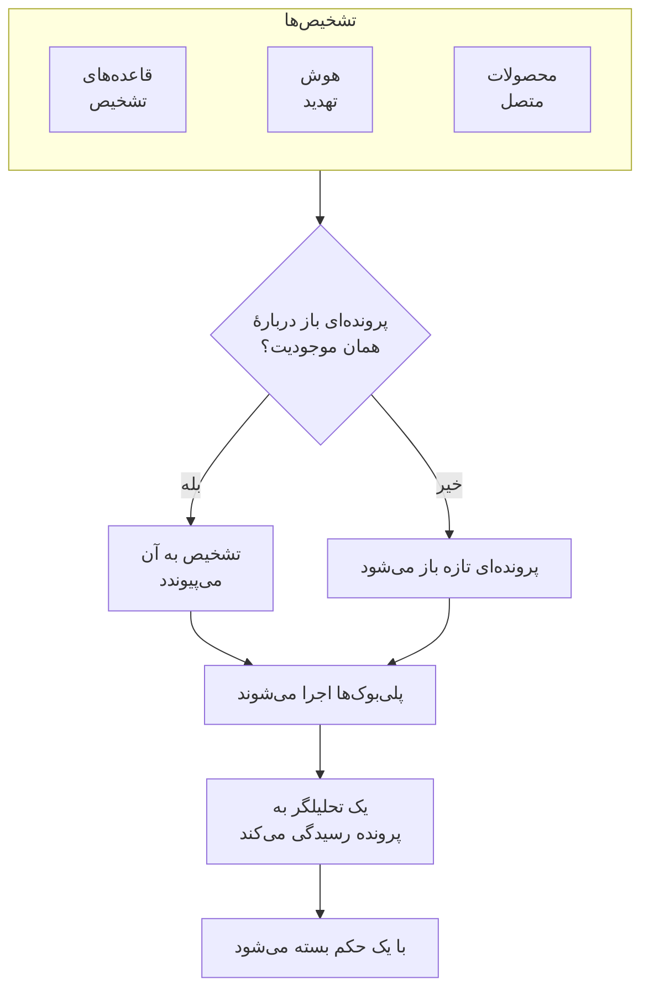

# پرونده‌های امنیتی و پلی‌بوک‌ها (SOAR)

رویدادهای امنیتی آنچه را قاعده‌های تشخیص، هوش تهدید و محصولات امنیتی متصل شما پیدا می‌کنند به پرونده تبدیل می‌کند: برای هر چیزی که ارزش بررسی دارد یک پرونده، که هر تشخیصی دربارهٔ همان کاربر، میزبان یا نشانی در آن گرد می‌آید. تحلیلگران در یک صف به پرونده‌ها رسیدگی می‌کنند، و پلی‌بوک‌ها خودکار یا با یک کلیک به آن‌ها پاسخ می‌دهند.

:::cards
- [پرونده‌ها از کجا می‌آیند](#پروندهها-از-کجا-میآیند): قاعده‌های تشخیص، هوش تهدید، محصولات متصل، ریسک موجودیت و افراد.
- [رسیدگی به یک پرونده](#رسیدگی-به-یک-پرونده): آن را واگذار کنید، موجودیت‌هایش را بررسی کنید، و با یک حکم ببندید.
- [اولویت‌ها و وضعیت‌های پرونده](#اولویتها-و-وضعیتهای-پرونده): نام، رنگ و ترتیبشان را عوض کنید و موارد خودتان را بیفزایید.
- [اهداف پاسخ](#اهداف-پاسخ): یک پرونده با هر اولویت با چه سرعتی باید برعهده گرفته و مهار شود.
- [اعلان‌ها](#اعلانها): چه کسی از یک پروندهٔ تازه، یک واگذاری، یک هدف پاسخ، یک وظیفه و گامی که منتظر تأیید است باخبر می‌شود.
- [پلی‌بوک‌ها](#پلیبوکها): گام‌هایی که روی یک پرونده اجرا می‌شوند، با تأیید هر جا که اهمیت دارد.
- [نمای کلی](#نمای-کلی): چه چیزی همین حالا به کسی نیاز دارد، و پرونده‌ها با چه سرعتی رسیدگی می‌شوند.
:::

## چگونه کار می‌کند

برای صف، **محصولات** > **رویدادهای امنیتی** > **پرونده‌های امنیتی** > **پرونده‌های باز** را باز کنید. **سپرده‌شده به من**، **بی‌مسئول**، **پرونده‌های بسته** و **همه پرونده‌ها** صفحه‌های جداگانه‌ای در کنار آن‌اند که هر کدام پرونده‌هایی را فهرست می‌کند که نامش می‌گوید.

## پیش از شروع

پرونده‌ها و پلی‌بوک‌ها از سه نقش Security پیروی می‌کنند. Project Owner و Project Admin هر کاری را می‌توانند انجام دهند.

| نقش | چه کاری می‌تواند بکند |
| --- | --- |
| Security Admin | همه چیز، از جمله حذف پرونده‌ها، برداشتن شواهد و راه‌اندازی پلی‌بوک‌ها |
| Security Member | باز کردن، واگذاری، تغییر و بستن پرونده‌ها، نوشتن یادداشت، انجام وظایف، افزودن شواهد، اجرای پلی‌بوک‌ها و تأیید یا رد گام‌های آن‌ها |
| Security Viewer | خواندن پرونده‌ها، تشخیص‌ها، یادداشت‌ها، وظایف، شواهد، پلی‌بوک‌ها و اجراهای آن‌ها |

هر یک از این‌ها را می‌توان جداگانه هم اعطا کرد، از ساختن یک پرونده تا تأیید گام‌های یک پلی‌بوک؛ [مرجع دسترسی‌ها](/docs/permissions/reference) را ببینید.

## پرونده‌ها از کجا می‌آیند

| منبع | چه زمانی پرونده باز می‌کند | خاموش کردن با |
| --- | --- | --- |
| قاعده‌های تشخیص | قاعده‌ای تطابق پیدا کند | **باز کردن پرونده هنگام تطبیق**، در گام **هنگام تطابق** از فرم قاعده |
| هوش تهدید | رویدادی از یک شاخص شناخته‌شده نام ببرد | **باز کردن پرونده هنگام تطبیق**، در گام **هنگام تطابق** از فرم فید |
| محصولات متصل | هشدار خودِ یک محصول در آستانهٔ اتصال یا بالاتر از آن وارد شود | تنظیم **Open Cases From** روی **هرگز**، در گام **فراخوانی دوره‌ای** از فرم اتصال |
| ریسک موجودیت | ریسک یک کاربر، میزبان یا نشانی به آستانه پروژه برسد | **پرونده‌های ریسک** در **تنظیمات** > **امتیازدهی ریسک** |
| افراد | کسی از **پرونده‌های امنیتی**، یا با **باز کردن پرونده** در پنل یک رویداد، پرونده‌ای باز کند | هیچ |

همهٔ منبع‌ها به‌طور پیش‌فرض پرونده باز می‌کنند، جز ریسک موجودیت در پروژه‌هایی که پیش از آن ساخته شده‌اند: در آن‌ها اول **پرونده‌های ریسک** را روشن کنید ([ریسک موجودیت](/docs/telemetry/security-entity-risk)). یک اتصال برای هشدارهای **بالا و بالاتر** پرونده باز می‌کند، مگر اینکه سطح دیگری برگزینید؛ هشدارهای پایین‌تر از آن همچنان به‌صورت رویداد وارد می‌شوند.

### تشخیص‌ها چگونه گروه‌بندی می‌شوند

هر تشخیص دربارهٔ یک موجودیت است: مقداری که قاعده‌اش بر پایهٔ آن گروه‌بندی می‌کند، مانند نشانی IP در قاعده‌ای که حملهٔ جست‌وجوی فراگیر را تشخیص می‌دهد، یا شاخصی که یک تطابق هوش تهدید از آن نام می‌برد. تشخیصی که موجودیتی ندارد تنها می‌ماند.

- وقتی پرونده‌ای باز از پیش دربارهٔ همان موجودیت باشد، تشخیص به آن می‌پیوندد. موجودیت‌ها و نگاشت ATT&CK پرونده گسترده‌تر می‌شوند، و اولویتش تا اولویت تشخیص بالا می‌رود و هرگز پایین نمی‌آید.
- وقتی هیچ پروندهٔ بازی دربارهٔ آن نباشد، پرونده‌ای تازه به نام تشخیص و با اولویت آن باز می‌شود.
- تشخیصی که دوباره فعال شود، به‌جای افزودن ردیفی تازه، شمارش ردیف خودش را بالا می‌برد.

اولویت یک پرونده از شدت تشخیص می‌آید، به اولویت پیش‌ساختهٔ پروژه برای آن سطح، هر نامی که به آن داده باشید:

| شدت | اولویت |
| --- | --- |
| Critical یا Fatal | بحرانی |
| High | High |
| Medium، Unknown یا Other | Medium |
| Low | Low |
| Informational | اطلاع‌رسانی |

## رسیدگی به یک پرونده

پرونده‌های یک پروژهٔ تازه چهار وضعیت را پشت سر می‌گذارند، که می‌توانید نامشان را عوض کنید و وضعیت‌های خودتان را به آن‌ها بیفزایید ([اولویت‌ها و وضعیت‌های پرونده](#اولویتها-و-وضعیتهای-پرونده) را ببینید). یک پرونده می‌تواند از یکی بپرد، مانند مثبت کاذبی که مستقیماً از «جدید» بسته می‌شود، و می‌توان آن را دوباره باز کرد.

| وضعیت | معنا |
| --- | --- |
| جدید | هنوز کسی به آن نگاه نکرده است |
| در حال بررسی | کسی در حال روشن کردن این است که چه رخ داده |
| Contained | تهدید دیگر نمی‌تواند آسیبی بزند؛ پاک‌سازی هنوز مانده است |
| بسته | تمام‌شده، با حکمی دربارهٔ اینکه چه بود |

پرونده هم مانند حادثه منوی کناری خودش را دارد، و هر بخش پرونده صفحه‌ای جداگانه است:

| بخش منوی کناری | صفحه‌ها |
| --- | --- |
| **نمای کلی** | **نمای کلی**، **خط زمانی** |
| **بررسی** | **روند رویدادها**، **تشخیص‌ها**، **موجودیت‌ها**، **سیگنال‌های مرتبط**، **شواهد**، **وظایف**، **پلی‌بوک‌ها** |
| **یادداشت‌ها** | **یادداشت‌های خصوصی** |
| **پیشرفته** | **گزارش‌های ممیزی**، **حذف پرونده** — تا روی **پیشرفته** کلیک نکنید جمع است |

هر صفحه سربرگ پرونده را در بالا نگه می‌دارد: شماره، اولویت، وضعیت و عنوان آن، **تخصیص به من**، **اجرای پلی‌بوک**، **اعلام حادثه** و **بستن پرونده**، و در منوی ⋯ کنار آن‌ها **تعیین اولویت**، **تخصیص به فرد دیگر**، **تغییر وضعیت**، **ویرایش پرونده** و **حذف پرونده**. پس می‌توان از هر صفحهٔ پرونده به آن رسیدگی کرد، و پیوند پرونده همچنان **نمای کلی** آن را باز می‌کند. وقتی اولویت پرونده اهداف پاسخ دارد، سربرگ همچنین نشان می‌دهد که موعد هدف بعدی کی است ([اهداف پاسخ](#اهداف-پاسخ)).

- **نمای کلی**: توضیح، برچسب‌ها و گام‌های وضعیت پرونده، اینکه پرونده دست کیست و چه چیزی آن را باز کرد، و ارقام آن: چند تشخیص دارد، چه مدت باز بوده، و تأیید و مهار آن چقدر طول کشید. زیر **زمان تا تأیید** و **زمان تا مهار** آمده است که پرونده نسبت به اهداف پاسخش در چه وضعی است.
- **OneUptime AI**، در **نمای کلی**: برداشت OneUptime AI از پرونده، اولویت و پلی‌بوکی که پیشنهاد می‌دهد، و شواهد پشت آن‌ها. [OneUptime AI در امنیت](/docs/telemetry/security-ai) را ببینید.
- **تأثیر**، در **نمای کلی**: آنچه پرونده در معرض خطر قرار می‌دهد: اینکه آیا OneUptime دیده است رکوردهای آن از اینترنت در دسترس قرار گرفته‌اند، مالکان آن‌ها چه کسانی هستند و آخرین تغییر روی آن‌ها چه بوده است. آن را باز کنید تا ببینید هر رکورد چه چیزی را فراخوانی می‌کند و چه چیزی آن را فراخوانی می‌کند، کدام مانیتورها و صفحه‌های وضعیت آن را زیر نظر دارند، و نشانی‌های پرونده با کدام ماشین‌ها ارتباط داشته‌اند.
- **MITRE ATT&CK**، در **نمای کلی**: تاکتیک‌ها و تکنیک‌هایی که تشخیص‌های پرونده به آن‌ها نگاشت می‌شوند، هر کدام با پیوندی به صفحه‌اش در attack.mitre.org.
- **خط زمانی**: هر آنچه برای پرونده رخ داده، همراه با اینکه چه کسی انجامش داده است.
- **روند رویدادها**: آنچه در سراسر OneUptime به ترتیب رخ داد: هر تشخیص و رویدادهای امنیتی پشت آن، اینکه درخواست‌هایشان تا کجا پیش رفتند، استثناهایی که ایجاد کردند، تغییرات روی رکوردهایی که پرونده نام می‌برد، حادثه‌ها و هشدارهایی که روی آن‌ها رخ داد، و کاری که تیم انجام داد. کاوش‌های فراوان یک اسکنر یک سطر است، و هر سطر آنچه را نام می‌برد باز می‌کند، مانند ترِیس درخواست یا استثنا.
- **تشخیص‌ها**: آنچه فعال شد و پرونده را باز کرد یا به آن پیوست، چند بار، و آخرین رویداد منطبق.
- **موجودیت‌ها**: کاربران، میزبان‌ها و نشانی‌هایی که پرونده دربارهٔ آن‌هاست، با فعالیتشان در همهٔ رویدادهای امنیتی شما در ۷ روز گذشته. هر کدام در **هم‌بسته‌سازی** باز می‌شود.
- **سیگنال‌های مرتبط**: میزبان‌ها، خوشه‌ها، سرویس‌ها و اعضایی که پرونده به آن‌ها اشاره می‌کند، آن‌گونه که OneUptime آن‌ها را می‌شناسد، و آنچه پیرامون شناسایی‌های آن روی هر یک رخ می‌داد: لاگ‌ها، ترِیس‌ها و متریک‌هایشان، آنچه روی آن‌ها باز است و آنچه تغییر کرد. [سیگنال‌های مرتبط](/docs/telemetry/security-connected-signals) را ببینید.
- **شواهد**: فایل‌ها، پیوندها و رویدادهای امنیتی‌ای که روی پرونده نگه داشته می‌شوند، هر کدام با اینکه چه کسی و چه زمانی آن را افزوده است. با **افزودن فایل** فایلی تا 10 MB بارگذاری می‌شود و SHA-256 آنچه بارگذاری شده ثبت می‌شود تا هر کس بعداً آن را دانلود کند بتواند بررسی کند که همان چیزی است که نگه داشته شده؛ با **افزودن پیوند** به شواهدی اشاره می‌شود که جای دیگری نگه داشته می‌شوند. فقط یک Security Admin می‌تواند شاهدی را بردارد، و **خط زمانی** پرونده نشان می‌دهد چه چیزی افزوده و برداشته شد. یک رویداد امنیتی با **افزودن به پرونده** در **رویدادها** یا در صفحهٔ یک [شکار](/docs/telemetry/security-events#شکارها) همان‌طور که بود اینجا نگه داشته می‌شود، و **مشاهده رویداد** آن را باز می‌کند.
- **وظایف**: آنچه در پرونده باید انجام شود، چه کسی انجامش می‌دهد و آیا انجام شده است. وظیفه‌ای را در یک سطر اضافه کنید، آن را به کسی بسپارید و وقتی انجام شد تیکش بزنید. کسی که وظیفه به او سپرده می‌شود باخبر می‌شود، مگر اینکه خودش آن را برداشته باشد، و منو کنار **وظایف** نشان می‌دهد چند وظیفه باز است.
- **پلی‌بوک‌ها**: آنچه هر پلی‌بوک گام به گام روی پرونده انجام داد، و گام‌هایی که منتظر تأییدند. تا وقتی اجرایی منتظر است، منو تعداد آن‌ها را کنار **پلی‌بوک‌ها** نشان می‌دهد.
- **یادداشت‌های خصوصی**: آنچه تیم دربارهٔ پرونده نوشته است.
- **گزارش‌های ممیزی**: هر تغییری که روی پرونده انجام شده، و اینکه چه کسی انجامش داده است. [گزارش‌های ممیزی](/docs/configuration/audit-logs) را ببینید.
- **حذف پرونده**: پرونده را همراه با تشخیص‌ها، یادداشت‌ها، خط زمانی و اجراهای پلی‌بوک آن برای همیشه حذف می‌کند. برای نگه داشتن سابقه، به جای آن پرونده را با یک حکم ببندید.

### رسیدگی به پرونده‌ها از صف

برای رسیدگی به یک پرونده لازم نیست آن را باز کنید. در فهرست‌های صف، منوی ⋯ در ردیف هر پرونده **تخصیص به من**، **تخصیص به فرد دیگر**، **تغییر وضعیت** و **تغییر اولویت** را دارد. برای رسیدگی هم‌زمان به چند پرونده، آن‌ها را برگزینید و همین اقدام‌ها را در **اقدامات گروهی** به کار ببرید: آنجا می‌گوید کدام پرونده‌ها تغییر کردند، کدام‌ها همان‌طور ماندند و چرا.

- برای سپردن پرونده به فرد دیگر، **تخصیص به فرد دیگر** را به کار ببرید و یک نفر یا یک تیم را برگزینید. پروندهٔ یک تیم در **بی‌مسئول** می‌ماند تا یکی از اعضای تیم آن را بردارد.
- وضعیتی که پرونده را می‌بندد، مانند **بستن پرونده** یک حکم و یک یادداشت پایانی می‌خواهد.
- پروندهٔ بسته به کسی تخصیص داده نمی‌شود. برای رسیدگی دوباره، آن را با **تغییر وضعیت** دوباره باز کنید.

### بستن یک پرونده

**بستن پرونده** یک حکم و یک یادداشت پایانی اختیاری می‌خواهد:

| حکم | معنا |
| --- | --- |
| True Positive | فعالیتی مخرب یا غیرمجاز واقعاً رخ داده است |
| Benign Positive | فعالیت واقعی اما مورد انتظار بود، مانند یک آزمون نفوذ یا یک کار مدیریتی |
| False Positive | تشخیص نادرست بود: قاعده یا داده فعالیتی عادی را اشتباه خوانده است |
| Undetermined | اطلاعات کافی برای قضاوت وجود نداشت |

حکم‌ها در نمای کلی شمرده می‌شوند. قاعده‌ای که پرونده‌هایش پیوسته با حکم False Positive بسته می‌شوند، قاعده‌ای است که باید تنظیمش کرد.

تا وقتی وظایفی از پرونده هنوز باز است، پنجرهٔ **بستن پرونده** تعداد آن‌ها را می‌گوید.

پرونده‌ای که از هشدارهای Google SecOps باز شده، وقتی اتصالش **بستن هشدارها هنگام بسته شدن پرونده‌شان** را روشن داشته باشد، آن‌ها را در Google SecOps هم با حکم و یادداشت بستن می‌بندد: [Google SecOps](/docs/integrations/google-secops#بستن-هشدارها-هنگام-بسته-شدن-پروندهشان) را ببینید.

### اعلام یک حادثه

**اعلام حادثه** برای پرونده یک حادثهٔ OneUptime با شدتی که برمی‌گزینید باز می‌کند، و این دو را از هر دو سو به هم پیوند می‌دهد: شرح حادثه از پرونده نام می‌برد، و سرآیند پرونده به حادثه پیوند دارد. از آنجا به بعد کشیک، صفحه‌های وضعیت و گزارش پس از حادثه کار را به دست می‌گیرند. این کار به نقشی نیاز دارد که هم بتواند به پرونده‌ها رسیدگی کند و هم حادثه بسازد.

## اولویت‌ها و وضعیت‌های پرونده

هر پروژه اولویت‌ها و وضعیت‌های پروندهٔ خودش را دارد، در **محصولات** > **رویدادهای امنیتی** > **تنظیمات** > **اولویت‌های پرونده** و **وضعیت‌های پرونده**. نامشان را عوض کنید، رنگشان را تغییر دهید، با کشیدن ترتیبشان را عوض کنید و موارد خودتان را بیفزایید، مانند وضعیت «Triage» یا اولویت «Emergency» بالاتر از **بحرانی**. نام تازه همه‌جا هم‌زمان دیده می‌شود: در صف، در صفحه‌های پرونده و نمای کلی، در اعلان‌ها، در Slack و Microsoft Teams، و در پیام‌های پلی‌بوک.

برخی پیش‌ساخته‌اند، چون OneUptime معنای آن‌ها را می‌خواند. می‌توان نام و رنگشان را عوض کرد، اما نه حذفشان کرد و نه بایگانی‌شان، و ترتیبشان حفظ می‌شود:

| پیش‌ساخته | کاری که OneUptime با آن می‌کند |
| --- | --- |
| وضعیت جدید | پرونده‌های تازه در آن آغاز می‌شوند |
| وضعیت پذیرفته | رسیدن به آن زمان پذیرش پرونده را ثبت می‌کند، و **بازگشایی** پروندهٔ بسته را به آن برمی‌گرداند |
| وضعیت مهارشده | رسیدن به آن زمان مهار پرونده را ثبت می‌کند |
| وضعیت بسته | **بستن پرونده** پرونده را با یک حکم به آن می‌برد |
| اولویت‌های بحرانی، High، Medium، Low و اطلاع‌رسانی | یک تشخیص پرونده‌اش را با اولویت شدت خودش باز می‌کند، و پرونده‌ای که کسی باز کند از Medium آغاز می‌شود |

- جای یک وضعیت تعیین می‌کند پرونده‌ای که در آن است در حکم چه چیزی است، همان‌طور که ستون **در حکم** نشان می‌دهد: از وضعیت پذیرفته به پایین پذیرفته، از وضعیت مهارشده به پایین مهارشده، و از وضعیت بسته به پایین بسته. وضعیتی که می‌افزایید درست بالای وضعیت بسته قرار می‌گیرد، و بردن پرونده به وضعیتی که آن را می‌بندد نخست حکمی می‌خواهد.
- رتبهٔ یک اولویت فوریت آن است، فوری‌ترین در آغاز: **برای پرونده‌های دست‌کم**، گزینه‌های اعلان و قاعده‌های Slack و Microsoft Teams همین ترتیب را می‌خوانند. اولویتی که می‌افزایید به انتها می‌رود، و ستون **شدت تشخیص** نشان می‌دهد کدام تشخیص‌ها پرونده‌هایشان را با هر اولویت پیش‌ساخته باز می‌کنند.

برای کنار گذاشتن وضعیت یا اولویتی از خودتان، **بایگانی** را در ردیف آن به کار ببرید. دیگر کسی نمی‌تواند آن را برگزیند، و API، Terraform و MCP آن را رد می‌کنند، اما پرونده‌هایی که آن را دارند نگهش می‌دارند، و همچنان می‌توانید با آن فیلتر کنید. مقدارهای بایگانی‌شده در بخش جمع‌شدهٔ **وضعیت‌های بایگانی‌شدهٔ پرونده** یا **اولویت‌های بایگانی‌شدهٔ پرونده** زیر جدول فهرست می‌شوند، که در آن **خروج از بایگانی** یکی را برمی‌گرداند. تا وقتی پرونده‌هایی آن مقدار را دارند یا پلی‌بوکی از آن اولویت اجرا می‌شود، **حذف** رد می‌شود.

## اهداف پاسخ

هدف پاسخ می‌گوید یک پرونده با چه سرعتی باید رسیدگی شود: **تأیید ظرف**، اینکه یک پروندهٔ تازه چه مدت می‌تواند منتظر بماند تا کسی آن را برعهده بگیرد، و **مهار ظرف**، اینکه مهار یا بسته شدنش چه مدت می‌تواند طول بکشد. هر اولویت پرونده اهداف خودش را دارد، در **محصولات** > **رویدادهای امنیتی** > **تنظیمات** > **اهداف پاسخ**: با **ویرایش** در ردیف یک اولویت، دو هدف آن را بر حسب دقیقه، ساعت یا روز، تا یک سال، تعیین می‌کنید، و هدف خالی یعنی بدون هدف. اولویت‌های یک پروژهٔ تازه با این‌ها شروع می‌شوند:

| اولویت | تأیید ظرف | مهار ظرف |
| --- | --- | --- |
| بحرانی | 15 دقیقه | 4 ساعت |
| High | 1 ساعت | 1 روز |
| Medium | 12 ساعت | 3 روز |
| Low | 1 روز | 7 روز |
| اطلاع‌رسانی | بدون هدف | بدون هدف |

پروژه‌ای که پیش از اهداف پاسخ ساخته شده، تا وقتی کسی آن‌ها را تعیین نکند هدفی ندارد.

- موعدهای یک پرونده هنگام باز شدنش از روی اهداف اولویتش تعیین می‌شوند. هدفی که بعداً تغییر کند، برای پرونده‌هایی اعمال می‌شود که پس از آن باز می‌شوند.
- پرونده از لحظه‌ای که کسی آن را برعهده بگیرد تأییدشده است: فردی به آن تخصیص داده شود، یا به وضعیتی برود که تأییدشده به حساب می‌آید. از لحظه‌ای که به وضعیتی برسد که مهارشده به حساب می‌آید، یا بسته شود، مهارشده است.
- وقتی اولویت یک پرونده تغییر می‌کند، هدفی که برآورده یا نقض کرده همان‌طور که بود می‌ماند. اولویت بالاتر موعد را نزدیک‌تر می‌کند: هدف تازه از لحظهٔ تغییر شمرده می‌شود، مگر اینکه موعد قبلی زودتر باشد. اولویت پایین‌تر موعد را عقب می‌برد و هرگز جلو نمی‌آورد: هدف تازه از زمان باز شدن پرونده شمرده می‌شود. اولویتی بدون هدف، موعد پرونده‌ای را که بالا رفته نگه می‌دارد و موعد پرونده‌ای را که پایین آمده پاک می‌کند.
- پرونده‌ای بسته‌شده که پیش از آنکه هرگز مهار شده باشد دوباره باز شود، موعد مهار تازه‌ای می‌گیرد که از زمان بازگشایی شمرده می‌شود.
- در یک‌پنجم پایانی یک هدف، پرونده در آستانهٔ نقض آن است: مسئولان پرونده باخبر می‌شوند، و وقتی هدف نقض شد دوباره باخبر می‌شوند. [اعلان‌ها](#اعلانها) را ببینید.

جایی که اهداف دیده می‌شوند:

- سربرگ پرونده هدف بعدی و زمان باقی‌مانده را نشان می‌دهد، یا اینکه چه مدت از موعدش گذشته است: خاکستری تا وقتی زمان هست، کهربایی در یک‌پنجم پایانی، قرمز وقتی نقض شده است.
- در **نمای کلی** پرونده، زیر **زمان تا تأیید** و **زمان تا مهار**: پرونده نسبت به هر هدف در چه وضعی است، یا چقدر از آن فراتر رفت.
- در فهرست‌های صف: سطر زیر اولویت هر پرونده، و ستون **موعد** که می‌توانید روشنش کنید و بر اساس آن مرتب کنید. فهرست‌ها فقط وقتی آن‌ها را نشان می‌دهند که یکی از اولویت‌های پروژه هدفی داشته باشد.

## اعلان‌ها

OneUptime افراد را از پنج رویداد در یک پرونده باخبر می‌کند. لازم نیست کسی چیزی را راه‌اندازی کند: پروژه‌ای که فقط **روشن کردن موارد پیشنهادی** را زده است، از پرونده‌های High و بحرانی خود با ایمیل و پوش باخبر می‌شود.

| اعلان | چه کسی باخبر می‌شود | به‌طور پیش‌فرض |
| --- | --- | --- |
| پرونده امنیتی جدید | هر کسی که می‌تواند پرونده‌های پروژه را ببیند، وقتی پرونده‌ای با اولویتی که او برگزیده یا بالاتر باز می‌شود، یا به آن می‌رسد | ایمیل و پوش، برای پرونده‌های High و بحرانی |
| پرونده امنیتی سپرده‌شده به من | کسی که پرونده به او واگذار شده است، و اعضای تیمی که پرونده به آن واگذار شده است | ایمیل و پوش |
| گام پلی‌بوک در انتظار تأیید من | کسانی در پرونده که می‌توانند گام را تأیید کنند: کسی که پرونده به او واگذار شده و اعضای تیمش. وقتی هیچ‌یک از آن‌ها نتواند تأیید کند، همهٔ کسانی در پروژه که می‌توانند | ایمیل و پوش |
| هدف پاسخ پرونده امنیتی | کسانی که مسئول پرونده‌اند: کسی که پرونده به او واگذار شده و اعضای تیمش. وقتی کسی مسئول آن نیست، کسانی که از پرونده‌های تازه با اولویت آن باخبر می‌شوند | ایمیل و پوش |
| وظیفهٔ پرونده امنیتی تخصیص‌یافته به من | کسی که وظیفه‌ای از پرونده به او سپرده می‌شود، مگر اینکه خودش آن را برداشته باشد | ایمیل و پوش |

- فقط کسانی که می‌توانند پرونده را ببینند از آن باخبر می‌شوند: Project Owner، Project Admin، و نقش‌های Security Admin، Security Member و Security Viewer. نقشی که به برخی برچسب‌ها محدود شده است، فقط از پرونده‌هایی با آن برچسب‌ها باخبر می‌شود.
- هیچ‌کس از کاری که خودش کرده باخبر نمی‌شود: کسی که پرونده‌ای را دستی باز می‌کند، آن را واگذار می‌کند یا اجرایی را آغاز می‌کند، دربارهٔ آن اعلانی نمی‌گیرد.
- هر کس فقط یک بار از یک پرونده باخبر می‌شود. پرونده‌ای که با اولویت Medium باز می‌شود و بعد به بحرانی می‌رسد، هنگام بالا رفتن به کسانی می‌رسد که High یا بحرانی را برگزیده‌اند، و دوباره به کسانی نمی‌رسد که Medium را برگزیده‌اند، چون هنگام باز شدنش از آن باخبر شده‌اند.
- حملهٔ آزمایشی‌ای که **ارسال حمله آزمایشی** می‌فرستد، پرونده‌ای باز می‌کند که به هیچ‌کس اعلان نمی‌دهد.
- یک پروندهٔ بحرانی و گامی که منتظر تأیید است بی‌درنگ فرستاده می‌شوند و هرگز در یک [تجمیع ایمیل‌ها](/docs/emails/notification-rollup) نگه داشته نمی‌شوند. هدف پاسخی که در آستانهٔ نقض است یا نقض شده نیز همین‌طور است.
- **خط زمانی** پرونده می‌گوید چه کسی، و کی، باخبر شد.

### انتخاب آنچه از آن باخبر می‌شوید

هر کس خودش برای خودش انتخاب می‌کند، زیر **تنظیمات کاربر** > **تنظیمات اعلان** > **امنیت**: کانال‌های هر اعلان (ایمیل، SMS، تماس، پوش، Telegram، Slack، Microsoft Teams یا وب‌هوک)، و زیر **پرونده امنیتی جدید**، اولویتی که از آن به بالا اعلان می‌گیرد:

| انتخاب | اعلان دربارهٔ پرونده‌هایی با اولویت |
| --- | --- |
| فقط بحرانی | بحرانی |
| بالا و بالاتر | بحرانی و High (پیش‌فرض) |
| متوسط و بالاتر | بحرانی، High و Medium |
| پایین و بالاتر | هر اولویتی جز اطلاع‌رسانی |
| همه پرونده‌ها | هر اولویتی |

گزینه‌ها از اولویت‌های پروندهٔ پروژه پیروی می‌کنند، با نام‌های خودشان: این‌ها گزینه‌های یک پروژهٔ تازه‌اند.

پیام‌های WhatsApp برای پرونده‌های امنیتی فرستاده نمی‌شوند. اعلان پوش پرونده را در اپلیکیشن OneUptime On-Call (نسخهٔ 1.7.0 یا جدیدتر) باز می‌کند، جایی که می‌توانید گام منتظر یک پلی‌بوک را تأیید یا رد کنید، پرونده را به عهده بگیرید و آن را ببندید. پیوندش پرونده را در مرورگر باز می‌کند.

### ارسال به کانال‌های Slack و Microsoft Teams

برای ارسال به یک کانال، قاعده‌ای زیر **محصولات** > **رویدادهای امنیتی** > **فضای کاری** > **Slack** (یا **Microsoft Teams**) بیفزایید. وقتی هیچ‌کدام وصل نباشد، تنها گزینهٔ این بخش **اتصال Slack یا Teams** است. یک قاعده کانال‌هایی را که باید به آن‌ها ارسال کند (و در Microsoft Teams، گفتگوها را) و، اگر بخواهید، پرونده‌هایی را که برای آن‌هاست نام می‌برد:

| شرط | تطبیق بر پایهٔ |
| --- | --- |
| اولویت پرونده امنیتی | یکی از اولویت‌های پروندهٔ پروژه، مانند بحرانی یا High |
| عنوان پرونده امنیتی، توضیحات پرونده امنیتی | متنی که عنوان یا توضیحات پرونده دربر دارد، با آن آغاز می‌شود یا با آن پایان می‌یابد |
| وضعیت پرونده امنیتی | یکی از وضعیت‌های پروندهٔ پروژه، مانند جدید یا بسته |
| منبع پرونده امنیتی | Detection Rule، Threat Intel، Connected Product، ریسک موجودیت، امنیت داده یا Manual |
| برچسب‌های پرونده امنیتی | برچسب‌های پرونده |

هر اعلانی جز اعلان یک وظیفه به کانال‌های همهٔ قاعده‌هایی فرستاده می‌شود که پرونده در آن لحظه با آن‌ها تطابق دارد. قاعده‌ای که در آن **اولویت پرونده امنیتی** هر یک از **بحرانی** و **زیاد** را دربر دارد، پرونده‌های High و بحرانی را هنگام باز شدن ارسال می‌کند، و پرونده‌ای با اولویت Medium را وقتی به High می‌رسد. یک پروندهٔ امنیتی هرگز کانال جداگانهٔ خودش را نمی‌گیرد.

## پلی‌بوک‌ها

یک پلی‌بوک فهرستی از گام‌هاست که روی یک پرونده اجرا می‌شوند. آن را زیر **محصولات** > **رویدادهای امنیتی** > **پلی‌بوک‌ها**، از یک قالب یا از صفر، بسازید و گام‌هایش را در صفحهٔ خود آن اضافه کنید. پروژه‌ای که هیچ پلی‌بوکی ندارد، به جای یک فهرست خالی قالب‌ها را می‌بیند؛ وقتی پلی‌بوک‌هایی هست، **ساخت از روی قالب** روی فهرست آن‌ها را باز می‌کند و روی قالب‌هایی که پروژه از قبل دارد **افزوده شد** را نشان می‌دهد.

### یک پلی‌بوک کی اجرا می‌شود

| اجراها | چه زمانی |
| --- | --- |
| Case Opened | یک بار، هنگام باز شدن یک پرونده |
| Detection Added | هر بار که تشخیصی تازه به یک پروندهٔ باز بپیوندد |
| بررسی‌شده به‌عنوان احتمالاً مخرب | یک بار، وقتی بررسی اولیهٔ OneUptime AI پرونده را احتمالاً مخرب بخواند |
| Manual | فقط وقتی کسی آن را از یک پرونده اجرا کند |

هر پلی‌بوک فعالی را می‌توان با **اجرای پلی‌بوک** روی یک پرونده دستی هم اجرا کرد. پلی‌بوکی را که خودکار اجرا می‌شود می‌توان محدودتر کرد:

- **برای پرونده‌های دست‌کم**: فقط پرونده‌هایی با این اولویت یا بالاتر.
- **فقط برای تشخیص‌های برآمده از**: فقط وقتی تشخیصِ پشت پرونده از این منبع آمده باشد.
- **فقط برای این قواعد تشخیص**: فقط وقتی از یکی از این قاعده‌ها آمده باشد.

پلی‌بوک غیرفعال نه خودکار اجرا می‌شود و نه دستی.

### گام‌ها

| دسته | گام | چه می‌کند |
| --- | --- | --- |
| Case | Assign the case | پرونده را به یک فرد، یک تیم یا هر دو می‌سپارد |
| Case | Set the priority | اولویت پرونده را بالا یا پایین می‌برد |
| Case | Set the status | پرونده را به وضعیت دیگری از پروژه می‌برد، با حکمی که برمی‌گزینید اگر آن وضعیت پرونده را ببندد |
| Case | Add a note | یادداشتی روی پرونده می‌نویسد، مانند یک چک‌لیست برای تحلیلگر |
| Case | Add labels | به پرونده برچسب می‌زند |
| Investigate | Check entities against threat intel | هر موجودیت را در هوش تهدید شما جستجو می‌کند، و در صورت تطابق می‌تواند اولویت را بالا ببرد |
| Investigate | Look up entity activity | رویدادهای امنیتی هر موجودیت را در یک بازهٔ اخیر می‌شمارد، و نتیجه را روی پرونده یادداشت می‌کند |
| Investigate | Preserve the evidence | بازپخش نشست‌های درخواست‌های پشت پرونده را نگه می‌دارد و ردگیری‌ها و استثناهای آن‌ها را روی پرونده یادداشت می‌کند |
| Notify | Email people | خلاصه‌ای از پرونده را، با پیوندی به آن، برای کاربران و تیم‌ها ایمیل می‌کند |
| Notify | Notify data store owners | برای مالکان هر مخزن داده‌ای که پرونده درباره آن است، پیوندی به پرونده ایمیل می‌کند |
| Notify | Post to Slack | خلاصه‌ای از پرونده را در یک کانال Slack می‌فرستد |
| Notify | Post to Microsoft Teams | خلاصه‌ای از پرونده را در یک کانال Microsoft Teams می‌فرستد |
| Notify | Post a status page announcement | اطلاعیه‌ای را که نوشته‌اید روی صفحه‌های وضعیتی که انتخاب می‌کنید منتشر می‌کند |
| Escalate | Page on-call | یک سیاست کشیک را اجرا می‌کند |
| Escalate | Declare an incident | یک حادثهٔ OneUptime پیوندخورده با پرونده باز می‌کند |
| Contain | Suspend the user in Okta | کاربری را که پرونده دربارهٔ اوست در Okta معلق می‌کند |
| Contain | End the user's Okta sessions | کاربری را که پرونده دربارهٔ اوست از Okta بیرون می‌برد و توکن‌هایش را باطل می‌کند |
| Contain | Contain the host in CrowdStrike | میزبانی را که پرونده دربارهٔ آن است با CrowdStrike Falcon در شبکه مهار می‌کند |
| Contain | Isolate the device in Microsoft Defender | میزبانی را که پرونده دربارهٔ آن است با Microsoft Defender for Endpoint ایزوله می‌کند |
| Contain | Unsuspend the user in Okta | تعلیق کاربری را که پرونده دربارهٔ اوست در Okta برمی‌دارد |
| Contain | Lift containment in CrowdStrike | مهار شبکه‌ای CrowdStrike Falcon را از روی میزبانی که پرونده دربارهٔ آن است برمی‌دارد |
| Contain | Release the device in Microsoft Defender | میزبانی را که پرونده دربارهٔ آن است در Microsoft Defender for Endpoint از حالت ایزوله بیرون می‌آورد |
| Contain | مسدود کردن دسترسی عمومی به مخازن داده | دسترسی عمومی به هر باکت یا حساب ذخیره‌سازی‌ای را که پرونده دربارهٔ آن است، از راه اتصال ابری‌اش مسدود می‌کند |
| Contain | لغو اشتراک‌گذاری مخزن داده | اشتراک‌گذاری اسنپ‌شات‌های هر پایگاه داده‌ای را که پرونده دربارهٔ آن است با بیرون از حساب‌های شما، از راه اتصال ابری‌اش متوقف می‌کند |
| Automate | Send a webhook | پرونده را به‌صورت JSON به یک URL می‌فرستد |
| Automate | Run a workflow | یک گردش کار OneUptime را با پرونده به‌عنوان ورودی‌اش آغاز می‌کند |
| Automate | Run a runbook | یکی از ران‌بوک‌های OneUptime شما را با پرونده به‌عنوان ورودی‌هایش آغاز می‌کند |
| Automate | Fix the code with AI | از OneUptime AI یک pull request می‌خواهد که استثناهایی را که درخواست‌های پرونده ایجاد کردند رفع کند |

یک پلی‌بوک حداکثر ۲۵ گام دارد. گام‌ها به ترتیب اجرا می‌شوند، هر کدام پس از پایان گام پیش از خود. هر گام همچنین می‌تواند:

- **نیازمند تأیید**: اجرا را پیش از این گام نگه دارد تا کسی آن را روی پرونده تأیید کند. چهار گامی که دسترسی کسی را قطع می‌کنند همیشه این کار را می‌کنند، مگر اینکه یک Security Admin آن را خاموش کند. **Run a runbook**، **Post a status page announcement** و دو گام مخزن داده با تأیید روشن آغاز می‌شوند، چون روی سیستم‌های شما فرمان اجرا می‌کنند، با مشتریان شما سخن می‌گویند یا تنظیمات یک ابر را تغییر می‌دهند؛ هر کس گام را اضافه کند می‌تواند آن را خاموش کند.
- **فقط اگر اطلاعات تهدید منطبق شد**: از این گام بگذرد، مگر اینکه یک گام **بررسی موجودیت‌ها با اطلاعات تهدید** پیش‌تر در همین اجرا شاخصی شناخته‌شده پیدا کرده باشد.
- **در صورت شکست ادامه بده**: حتی اگر این گام شکست بخورد، گام بعدی را اجرا کند. اگر خاموش باشد، گام ناموفق اجرا را متوقف می‌کند.

### پاسخ از راه OneUptime

چهار گام به‌جای یک محصول متصل، از راه بقیهٔ OneUptime عمل می‌کنند:

- **Run a runbook** یکی از [ران‌بوک‌های](/docs/runbooks/index) شما را با پرونده به‌عنوان ورودی‌هایش آغاز می‌کند، و یک گام Bash این ورودی‌ها را به‌صورت متغیرهای محیطی می‌خواند (نگاه کنید به [فراخوانی وب‌هوک](/docs/runbooks/triggers#فراخوانی-وبهوک)). `ONEUPTIME_INPUT_IP`، `ONEUPTIME_INPUT_USER` و `ONEUPTIME_INPUT_HOST` نشانی، کاربر و میزبانی هستند که پرونده دربارهٔ آن‌هاست، که با همان قاعدهٔ گام Contain انتخاب می‌شوند، و وقتی پرونده دربارهٔ هیچ‌کدام نباشد خالی‌اند. `ONEUPTIME_INPUT_IPS`، `ONEUPTIME_INPUT_USERS` و `ONEUPTIME_INPUT_HOSTS` همهٔ آن‌هایی را که پرونده نام می‌برد به‌صورت JSON فهرست می‌کنند، و `ONEUPTIME_INPUT_CASE_NUMBER`، `ONEUPTIME_INPUT_CASE_TITLE` و `ONEUPTIME_INPUT_CASE_URL` می‌گویند کدام پرونده است. کاربر یا میزبان محافظت‌شده هرگز در میان آن‌ها نیست. اجرای ران‌بوک نشان می‌دهد که **Security playbook** آن را برای پرونده آغاز کرده است.
- **Preserve the evidence** بازپخش نشست‌های درخواست‌های پشت پرونده را فراتر از دورهٔ نگهداری‌شان نگه می‌دارد، و یادداشتی روی پرونده می‌نویسد که به ردگیری هر درخواست، هر بازپخش و هر استثنا پیوند می‌دهد. لاگ‌ها و ردگیری‌ها را نمی‌توان بیش از مدتی که پروژه تله‌متری را نگه می‌دارد نگه داشت، پس آنچه لازم دارید را پیش از آن صادر کنید.
- **Post a status page announcement** آنچه را نوشته‌اید، همان‌طور که نوشته‌اید، روی صفحه‌های وضعیتی که انتخاب می‌کنید منتشر می‌کند. چیزی از پرونده به آن افزوده نمی‌شود. مشترکان آن صفحه‌ها فقط وقتی **اطلاع به مشترکان** روشن باشد باخبر می‌شوند.
- **Fix the code with AI** برای هر استثنایی که درخواست‌های پرونده ایجاد کردند، حداکثر سه مورد، از OneUptime AI یک pull request می‌خواهد که آن را رفع کند. این گام به روشن بودن OneUptime AI، مخزنی که کد را در خود دارد و از راه GitHub App متصل شده، و یک runner نیاز دارد. بدون این‌ها گام رد می‌شود و می‌گوید چه چیزی کم است.

### مهار

گام‌های Contain از راه اتصالی عمل می‌کنند که به چیزی بیش از دسترسی خواندن نیاز دارد: یک [اتصال رویداد امنیتی](/docs/telemetry/security-events#اتصال-به-یک-محصول-امنیتی) به محصول، یا [اتصال ابری](/docs/telemetry/cloud-accounts) مخزن داده:

| گام | اتصال | چه لازم دارد |
| --- | --- | --- |
| Suspend the user in Okta، End the user's Okta sessions، Unsuspend the user in Okta | Okta System Log | یک توکن API که اجازهٔ مدیریت کاربران را دارد |
| Contain the host in CrowdStrike، Lift containment in CrowdStrike | CrowdStrike Falcon | یک کلاینت API با دسترسی نوشتن روی Hosts |
| Isolate the device in Microsoft Defender، Release the device in Microsoft Defender | Microsoft Defender XDR | یک اپلیکیشن با مجوز Machine.Isolate |
| مسدود کردن دسترسی عمومی به مخازن داده، لغو اشتراک‌گذاری مخزن داده | اتصال ابری مخزن | **پاسخ امنیت داده** روشن باشد، و فرمان راه‌اندازی آن دوباره اجرا شده باشد |

یک گام کاربر یا میزبان فقط روی کاربران یا میزبان‌هایی عمل می‌کند که پرونده دربارهٔ آن‌هاست، و هرگز روی همهٔ آن‌هایی که پرونده از آن‌ها نام می‌برد عمل نمی‌کند:

- مقداری که یکی از تشخیص‌های پرونده بر پایهٔ آن گروه‌بندی شده است، مانند حسابی که یک قاعدهٔ سفر ناممکن بر پایهٔ آن گروه‌بندی می‌کند، یا میزبانی که هشدار یک محصول متصل از آن نام می‌برد.
- کاربر یا میزبانی از پرونده که هوش تهدید شما آن را به‌عنوان یک شاخص می‌شناسد.

پرونده‌ای که بر پایهٔ یک نشانی گروه‌بندی شده، مانند یک حملهٔ جست‌وجوی فراگیر علیه VPN شما، دربارهٔ هیچ‌کدام نیست: از گام‌های Contain آن گذشته می‌شود، و حسابی که امتحان کرده و دروازه‌ای که هدف گرفته دست‌نخورده می‌مانند. یک گام حداکثر روی ۱۰ کاربر یا میزبان عمل می‌کند. هر کدام را با نامش در محصول پیدا می‌کند، و روی اجرا می‌گوید با هر یک چه کرد: انجام شد، از پیش انجام شده بود، پیدا نشد، رد شد، یا محافظت‌شده.

دو گام مخزن داده روی مخازن داده‌ای عمل می‌کنند که پرونده دربارهٔ آن‌هاست، حداکثر 10 مخزن: مخازن مسائل امنیت داده‌ای که پرونده دربر گرفته است، و هر مخزنی که یک تشخیص پرونده را بر پایهٔ آن گروه‌بندی کرده است. به مخزنی که **عمومی از روی طراحی** علامت خورده دست نمی‌زنند، شیوهٔ اشتراک‌گذاری یک مخزن را تغییر می‌دهند اما هرگز داده‌اش را نه، و روی اجرا می‌گویند با هر مخزن چه کردند ([رفع در معرض بودن](/docs/data-security/integrations#رفع-در-معرض-بودن) را ببینید).

#### موجودیت‌های محافظت‌شده

**موجودیت‌های محافظت‌شده**، زیر **پلی‌بوک‌ها** در منو، کاربران و میزبان‌هایی را فهرست می‌کند که هیچ پلی‌بوکی آن‌ها را مهار نمی‌کند، مانند حساب‌های اضطراری، کنترل‌کننده‌های دامنه و دروازه‌های VPN. تطابق یک مقدار به بزرگی و کوچکی حروف حساس نیست، و `*` جای هر رشته‌ای از نویسه‌ها را می‌گیرد: `svc-*` از همهٔ حساب‌های سرویس محافظت می‌کند. یک گام، کاربر یا میزبان محافظت‌شده را محافظت‌شده گزارش می‌کند و به آن دست نمی‌زند. نگهداری این فهرست با Security Admin است.

#### تأیید

چهار گامی که دسترسی کسی را قطع می‌کنند منتظر تأیید می‌مانند. فقط یک Security Admin می‌تواند **نیازمند تأیید** را برای یکی از آن‌ها خاموش کند، و OneUptime ثبت می‌کند چه کسی این کار را کرده است. در تأیید، کاربران یا میزبان‌هایی که گام روی آن‌ها عمل خواهد کرد زیر **اعمال روی** فهرست شده‌اند، همه تیک‌خورده: تیک هر کدام را که گام نباید به آن دست بزند بردارید. موارد محافظت‌شده برای انتخاب پیشنهاد نمی‌شوند. کسی که اجرایی را آغاز کرده نمی‌تواند گام‌های آن را تأیید کند: کس دیگری این کار را می‌کند، هرچند او همچنان می‌تواند آن را رد کند.

#### بازگردانی

گام‌های بازگردانی، مانند گام‌هایی که اثرشان را برمی‌گردانند، روی کاربران یا میزبان‌هایی عمل می‌کنند که پرونده دربارهٔ آن‌هاست. وقتی اجرا متوقف شد، کاربر یا میزبان مهارشده روی گام خود دکمه‌ای مخصوص به خودش هم دارد: **لغو تعلیق**، **لغو مهار** یا **آزادسازی**. یک نشست پایان‌یافتهٔ Okta را نمی‌توان بازگرداند. هر بازگردانی در خط زمانی پرونده و در گزارش ممیزی پروژه نگه داشته می‌شود.

### پیام‌ها

یک یادداشت، یک ایمیل، یک پست Slack و یک پست Teams می‌توانند مقدارهای پرونده را به کار ببرند:

| جای‌نگهدار | به چه تبدیل می‌شود |
| --- | --- |
| `{{case.number}}` | شمارهٔ پرونده، مانند CASE-42 |
| `{{case.title}}` | عنوان پرونده |
| `{{case.priority}}` | اولویت پرونده، با همان نامی که پروژهٔ شما به آن می‌دهد، مانند High |
| `{{case.status}}` | وضعیت پرونده، با همان نامی که پروژهٔ شما به آن می‌دهد، مانند Investigating |
| `{{case.assignee}}` | کسی که پرونده به او واگذار شده است |
| `{{case.url}}` | پیوندی به پرونده در OneUptime |
| `{{case.entities}}` | کاربران، میزبان‌ها و نشانی‌هایی که پرونده دربارهٔ آن‌هاست |
| `{{case.detections}}` | چند تشخیص در پرونده هست |

ایمیل یا پستی که پیام خودش را ندارد، خلاصه‌ای از پرونده را می‌فرستد.

### اجراها و تأییدها

هر اجرا، گام به گام، روی پرونده‌اش و زیر **محصولات** > **رویدادهای امنیتی** > **پلی‌بوک‌ها** > **اجراهای پلی‌بوک** فهرست می‌شود:

| وضعیت اجرا | معنا |
| --- | --- |
| Queued | منتظر یک کارگر |
| در حال اجرا | در حال اجرای گام‌هایش |
| Waiting for Approval | پیش از گامی که تأیید لازم دارد نگه داشته شده |
| موفق | همهٔ گام‌ها اجرا شدند، یا از آن‌ها گذشته شد |
| ناموفق | گامی شکست خورد و اجرا متوقف شد |
| لغوشده | کسی آن را لغو کرد، یا گامی را رد کرد |

گامی که منتظر تأیید است، روی اجرا **تأیید** و **رد کردن** را با یک نظر اختیاری نشان می‌دهد. تأیید، اجرا را از همان گام ادامه می‌دهد؛ رد کردن به آن پایان می‌دهد. تصمیم، تصمیم‌گیرنده و نظر او روی گام، در خط زمانی پرونده و در گزارش ممیزی پروژه نگه داشته می‌شوند. صفحهٔ **تأییدها**، زیر **پلی‌بوک‌ها** در منو، اجراهایی را که منتظر تصمیم‌اند فهرست می‌کند و می‌شمارد؛ **اجراهای پلی‌بوک** همهٔ اجراها را فهرست می‌کند. در **اجراهای پلی‌بوک**، در صفحهٔ یک پلی‌بوک و در **پلی‌بوک‌ها** در صفحهٔ هر پرونده، هر اجرا یک خط است که می‌گوید تا کجا پیش رفته، یا روی کدام گام متوقف شده است؛ **نمایش گام‌ها** گام‌هایش را باز می‌کند. اجرایی که منتظر تأیید است، خودش باز می‌شود، و تازه‌ترین اجرای هر پرونده هم همین‌طور.

اجرایی که دیگر خبری از کارگرش به آن نمی‌رسد، مثلاً پس از یک راه‌اندازی دوباره، دوباره برداشته می‌شود: اجرای در صف پس از ۲ دقیقه دوباره در صف قرار می‌گیرد، و اجرایی که ۳۰ دقیقه هیچ خبری نداده ناموفق می‌شود.

## نمای کلی

**محصولات** > **رویدادهای امنیتی** > **نمای کلی** جایی است که این محصول با آن باز می‌شود:

- پرونده‌های بازی که به شما واگذار شده‌اند، پرونده‌های بازی که هنوز کسی آن‌ها را برنداشته، و گام‌های پلی‌بوکی که منتظر تأییدند؛ هر شمار صفحه‌ای را باز می‌کند که آن‌ها را فهرست می‌کند.
- **میانگین زمان تا پذیرش**، **میانگین زمان تا مهار** و **میانگین زمان تا بستن**، روی پرونده‌هایی که در ۳۰ روز گذشته باز شده‌اند: از باز شدن یک پرونده تا وقتی کسی آن را بر عهده بگیرد (فردی را به آن بگمارد، یا آن را به وضعیتی ببرد که در حکم پذیرفته است)، تا وضعیتی که در حکم مهارشده است، و تا وضعیتی که در حکم بسته است. پرونده‌ای که هنوز منتظر است در میانگین شمرده نمی‌شود.
- پرونده‌های بازشده در هر روز از ۳۰ روز گذشته، بر پایهٔ اولویت، و تشخیص‌های ثبت‌شده در هر روز از ۱۴ روز گذشته، بر پایهٔ منبع.
- پرونده‌های باز بر پایهٔ اولویت و وضعیت، پرخطرترین موجودیت‌ها بر پایهٔ امتیاز ریسک، تشخیص‌هایی که بیش از همه فعال شده‌اند، تاکتیک‌های ATT&CK پشت پرونده‌ها، و حکم‌های ۳۰ روز گذشته.

بالای این‌ها، نواری نشان می‌دهد امنیت چگونه راه‌اندازی شده است: منابع، تشخیص‌ها، پرونده‌ها و پلی‌بوک‌ها، هر کدام با ارقامش. پروژه‌ای که هنوز آن را راه‌اندازی نکرده، آنجا **روشن کردن موارد پیشنهادی** و **ارسال حمله آزمایشی** را می‌بیند؛ [شروع کار با امنیت](/docs/telemetry/security-getting-started) را ببینید. وقتی هیچ چیزی به کسی نیاز ندارد، صفحه **همه‌چیز آرام است** را نشان می‌دهد، و نمودارها به‌محض آنکه چیزی برای نمایش باشد ظاهر می‌شوند.

## یافتن تهدیدها

- **ریسک موجودیت** کاربران، میزبان‌ها و نشانی‌ها را بر پایهٔ امتیاز ریسکشان رتبه‌بندی می‌کند، پرخطرترین‌ها اول، و **پرخطرترین موجودیت‌ها** در نمای کلی بالای همین فهرست را نشان می‌دهد. یک موجودیت را انتخاب کنید تا ببینید چرا پرخطر است. زیر فهرست، **جست‌وجوی یک موجودیت** هر مقداری را در ۳۰ روز رویداد جستجو می‌کند، حتی یک دامنه یا هش فایل، و آن را در **هم‌بسته‌سازی** باز می‌کند.
- **کتابخانه قواعد** قاعده‌های تشخیص آماده‌ای برای تهدیدهای هویت، نقاط پایانی، ابر، شبکه، وب و Kubernetes دارد. هر کدام یک قاعدهٔ Sigma است که برای فیلدهایی نوشته شده که هر منبع متصل به آن‌ها یکسان‌سازی می‌شود. ردیف هر قاعده نشان می‌دهد چه چیزی پیدا می‌کند، تاکتیک‌ها و تکنیک‌های MITRE ATT&CK که با آن‌ها برچسب خورده، رویدادهایی که می‌خواند و اینکه در ۷ روز گذشته رویدادی رسیده یا نه (**دریافت می‌شود** یا **دریافت نمی‌شود**)، و شدت آن. فهرست را بر پایهٔ دسته، داده‌هایی که قاعده‌ها می‌خوانند و افزوده شدن یا نشدن آن‌ها محدود کنید، یا در آن بر پایهٔ نام، تکنیک ATT&CK یا شدت جستجو کنید؛ نشانی صفحه فیلترها را نگه می‌دارد. برای دیدن جزئیات یک قاعده آن را انتخاب کنید: چگونه ارسال رویدادهایی را که می‌خواند آغاز کنید، چگونه اجرا می‌شود، و قاعدهٔ Sigma آن. **افزودن** آن را به‌صورت یکی از قاعده‌های تشخیص خودتان می‌سازد، روشن، و با باز کردن پرونده به‌جای هشدار؛ آن را مانند هر قاعدهٔ دیگری زیر **قواعد تشخیص** تغییر دهید. قاعده‌هایی که با **پیشنهادی** علامت خورده‌اند، تهدیدها را در داده‌هایی پیدا می‌کنند که OneUptime از قبل دارد، و یک دکمه آن‌هایی را که هنوز ندارید اضافه می‌کند.
- **پوشش ATT&CK** تاکتیک‌های MITRE ATT&CK را فهرست می‌کند، هر کدام با این‌که قاعده‌های فعال شما چند تا از تکنیک‌هایش را پوشش می‌دهند و **کتابخانه قواعد** برای چند تکنیک دیگر قاعده دارد. یک تاکتیک را باز کنید تا تکنیک‌هایش را ببینید، یا برای کل ماتریس به **ماتریس** بروید. یک تکنیک را انتخاب کنید تا قاعده‌های کتابخانه را که آن را پوشش می‌دهند ببینید و **کتابخانه قواعد** را با همان‌ها باز کنید.

## خودکارسازی

- **گردش‌های کاری**: یک پرونده یا یک یادداشت می‌تواند هنگام ساخته شدن، به‌روزرسانی یا حذف، یک گردش کار را آغاز کند. گام **اجرای گردش کار** گردش کاری را آغاز می‌کند که راه‌انداز آن یک وب‌هوک است.
- **API**: پرونده‌ها، یادداشت‌ها، وظایف، شواهد، تشخیص‌ها، پلی‌بوک‌ها، اجراها، موجودیت‌های محافظت‌شده و اولویت‌ها و وضعیت‌های پرونده همان REST API بقیهٔ OneUptime را دارند، زیر `/security-case`، `/security-case-note`، `/security-case-task`، `/security-case-evidence`، `/security-detection`، `/security-playbook`، `/security-playbook-run`، `/security-protected-entity`، `/security-case-priority` و `/security-case-status`. [مرجع API](/docs/api-reference/api-reference) را ببینید.
- عامل‌های هوش مصنوعی: سرور MCP ابزارهایی برای پرونده‌ها، یادداشت‌ها، وظایف، شواهد، تشخیص‌ها، پلی‌بوک‌ها و اولویت‌ها و وضعیت‌های پرونده دارد. [سرور MCP](/docs/ai/mcp-server) را ببینید.
- Terraform: منبع‌های `oneuptime_security_case_priority` و `oneuptime_security_case_status` اولویت‌ها و وضعیت‌های یک پروژه را به‌صورت کد نگه می‌دارند.

## رفع اشکال

:::details قاعده تطابق پیدا می‌کند، اما پرونده‌ای باز نمی‌شود
**باز کردن پرونده هنگام تطبیق** را در گام **هنگام تطابق** از فرم قاعده بررسی کنید. تشخیصی دربارهٔ موجودیتی که از پیش پرونده‌ای باز دارد، به‌جای باز کردن پرونده‌ای دیگر به همان پرونده می‌پیوندد: آن را زیر **تشخیص‌ها** در پروندهٔ باز پیدا کنید.
:::

:::details کسی از یک پرونده باخبر نشد
**خط زمانی** پرونده را نگاه کنید، که می‌گوید به چه کسانی اعلان داده شد. اعلان **پرونده امنیتی جدید** به کسانی می‌رود که پرونده به اولویت برگزیدهٔ آن‌ها می‌رسد، پس پرونده‌ای با اولویت Medium به هیچ‌یک از کسانی که پیش‌فرض، یعنی **بالا و بالاتر**، را نگه داشته‌اند اعلان نمی‌دهد. بررسی کنید که کسانی که باید باخبر شوند بتوانند پرونده‌های امنیتی را ببینند (یک نقش Security، یا Project Owner یا Project Admin)، و که این اعلان برایشان زیر **تنظیمات کاربر** > **تنظیمات اعلان** > **امنیت** روشن باشد.
:::

:::details پرونده‌ای هیچ موعدی نشان نمی‌دهد
اولویت آن هدف پاسخی ندارد، یا پس از باز شدن پرونده هدف گرفته است: موعدهای یک پرونده هنگام باز شدنش تعیین می‌شوند. پروندهٔ حملهٔ آزمایشی موعدی ندارد. [اهداف پاسخ](#اهداف-پاسخ) را ببینید.
:::

:::details یک پلی‌بوک اجرا نشد
بررسی کنید که فعال باشد، که تنظیم **تریگر** آن مناسب باشد (Case Opened فقط یک بار، هنگام باز شدن پرونده، اجرا می‌شود)، و که پرونده با تنظیم‌های **برای پرونده‌های دست‌کم**، **فقط برای تشخیص‌های برآمده از** و **فقط برای این قواعد تشخیص** آن جور درآید. پرونده‌ای که دستی باز شده تشخیصی ندارد، پس پلی‌بوکی که به یک منبع یا به قاعده‌هایی محدود شده روی آن اجرا نمی‌شود.
:::

:::details یک گام Contain شکست خورد
اجرا را روی پرونده باز کنید: گام برای هر کاربر یا میزبان می‌گوید که آیا محصول آن را رد کرد، پیدایش نکرد، یا در دسترس نبود. بررسی کنید که اعتبارنامهٔ اتصال اجازهٔ این تغییر را داشته باشد، و **آزمایش اتصال** را در ردیف آن به کار ببرید.
:::

:::details از یک گام Contain گذشته شد
پرونده دربارهٔ هیچ کاربر یا میزبانی نیست، مثلاً فقط دربارهٔ یک نشانی است، یا همهٔ کاربران یا میزبان‌هایی که پرونده دربارهٔ آن‌هاست محافظت‌شده‌اند. اجرا را روی پرونده باز کنید: گام می‌گوید کدام‌یک.
:::

:::details نمی‌توان یک وضعیت یا اولویت را حذف یا بایگانی کرد
مقدار پیش‌ساخته را می‌توان تغییر نام و رنگ داد، اما هرگز نمی‌توان حذف یا بایگانی‌اش کرد: **بایگانی** آن با دلیلش قفل است. مقداری از خودتان را تا وقتی پرونده‌هایی آن را دارند یا پلی‌بوکی از آن اجرا می‌شود نمی‌توان حذف کرد: نخست پرونده‌ها را به مقدار دیگری ببرید، یا آن را بایگانی کنید.
:::

## گام‌های بعدی

:::cards
- [رویدادهای امنیتی](/docs/telemetry/security-events): رویدادها را بفرستید، قاعده‌های تشخیص بنویسید و محصولات امنیتی را متصل کنید.
- [هوش تهدید](/docs/telemetry/threat-intelligence): رویدادهایتان را با فیدهای STIX/TAXII تطبیق دهید.
- [OneUptime AI در امنیت](/docs/telemetry/security-ai): با هوش مصنوعی پرونده‌ها را بررسی کنید، قاعدهٔ تشخیص پیش‌نویس کنید، و دربارهٔ امنیت بپرسید.
- [مرجع دسترسی‌ها](/docs/permissions/reference): نقش‌های Security، و آنچه هر کدام می‌تواند بکند.
:::
