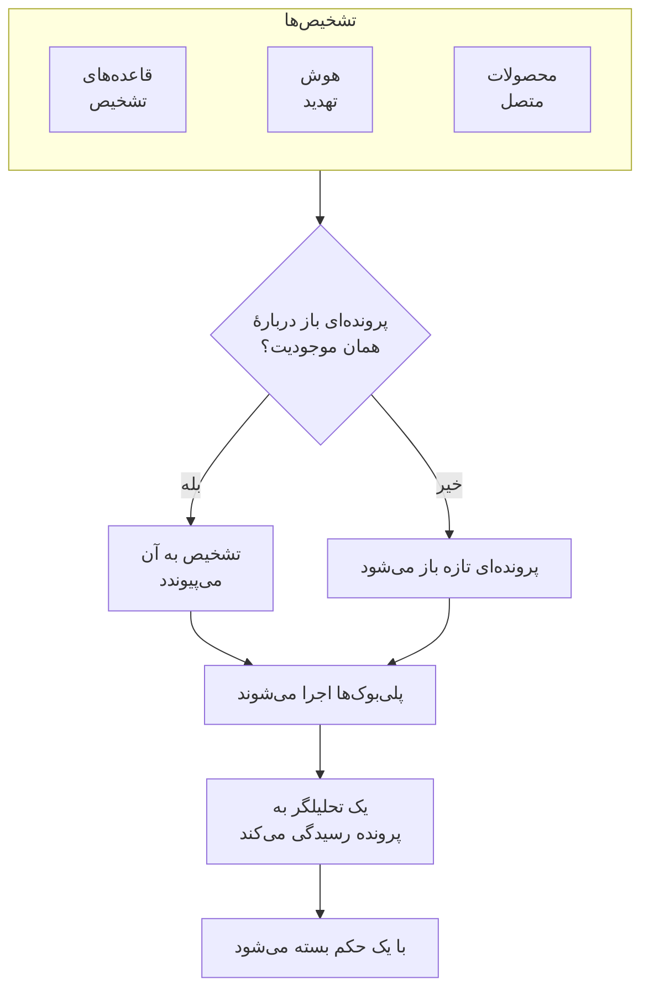

# پرونده‌های امنیتی و پلی‌بوک‌ها (SOAR)

رویدادهای امنیتی آنچه را قاعده‌های تشخیص، هوش تهدید و محصولات امنیتی متصل شما پیدا می‌کنند به پرونده تبدیل می‌کند: برای هر چیزی که ارزش بررسی دارد یک پرونده، که هر تشخیصی دربارهٔ همان کاربر، میزبان یا نشانی در آن گرد می‌آید. تحلیلگران در یک صف به پرونده‌ها رسیدگی می‌کنند، و پلی‌بوک‌ها خودکار یا با یک کلیک به آن‌ها پاسخ می‌دهند.

:::cards
- [پرونده‌ها از کجا می‌آیند](#پروندهها-از-کجا-میآیند): قاعده‌های تشخیص، هوش تهدید، محصولات متصل و افراد.
- [رسیدگی به یک پرونده](#رسیدگی-به-یک-پرونده): آن را واگذار کنید، موجودیت‌هایش را بررسی کنید، و با یک حکم ببندید.
- [پلی‌بوک‌ها](#پلیبوکها): گام‌هایی که روی یک پرونده اجرا می‌شوند، با تأیید هر جا که اهمیت دارد.
- [نمای کلی](#نمای-کلی): چه چیزی همین حالا به کسی نیاز دارد، و پرونده‌ها با چه سرعتی رسیدگی می‌شوند.
:::

## چگونه کار می‌کند

برای صف، **محصولات** > **رویدادهای امنیتی** > **پرونده‌های امنیتی** > **پرونده‌های باز** را باز کنید. **سپرده‌شده به من**، **بی‌مسئول**، **پرونده‌های بسته** و **همه پرونده‌ها** صفحه‌های جداگانه‌ای در کنار آن‌اند که هر کدام پرونده‌هایی را فهرست می‌کند که نامش می‌گوید.

## پیش از شروع

پرونده‌ها و پلی‌بوک‌ها از سه نقش Security پیروی می‌کنند. Project Owner و Project Admin هر کاری را می‌توانند انجام دهند.

| نقش | چه کاری می‌تواند بکند |
| --- | --- |
| Security Admin | همه چیز، از جمله حذف پرونده‌ها و راه‌اندازی پلی‌بوک‌ها |
| Security Member | باز کردن، واگذاری، تغییر و بستن پرونده‌ها، نوشتن یادداشت، اجرای پلی‌بوک‌ها و تأیید یا رد گام‌های آن‌ها |
| Security Viewer | خواندن پرونده‌ها، تشخیص‌ها، یادداشت‌ها، پلی‌بوک‌ها و اجراهای آن‌ها |

هر یک از این‌ها را می‌توان جداگانه هم اعطا کرد، از ساختن یک پرونده تا تأیید گام‌های یک پلی‌بوک؛ [مرجع دسترسی‌ها](/docs/permissions/reference) را ببینید.

## پرونده‌ها از کجا می‌آیند

| منبع | چه زمانی پرونده باز می‌کند | خاموش کردن با |
| --- | --- | --- |
| قاعده‌های تشخیص | قاعده‌ای تطابق پیدا کند | **Open a Case on Match**، در گام **هنگام تطابق** از فرم قاعده |
| هوش تهدید | رویدادی از یک شاخص شناخته‌شده نام ببرد | **Open a Case on Match**، در گام **هنگام تطابق** از فرم فید |
| محصولات متصل | هشدار خودِ یک محصول در آستانهٔ اتصال یا بالاتر از آن وارد شود | تنظیم **Open Cases From** روی **هرگز**، در گام **Polling** از فرم اتصال |
| افراد | کسی از **پرونده‌های امنیتی**، یا با **Open Case** در پنل یک رویداد، پرونده‌ای باز کند | هیچ |

همهٔ منبع‌ها به‌طور پیش‌فرض روشن‌اند. یک اتصال برای هشدارهای **High and above** پرونده باز می‌کند، مگر اینکه سطح دیگری برگزینید؛ هشدارهای پایین‌تر از آن همچنان به‌صورت رویداد وارد می‌شوند.

### تشخیص‌ها چگونه گروه‌بندی می‌شوند

هر تشخیص دربارهٔ یک موجودیت است: مقداری که قاعده‌اش بر پایهٔ آن گروه‌بندی می‌کند، مانند نشانی IP در قاعده‌ای که حملهٔ جست‌وجوی فراگیر را تشخیص می‌دهد، یا شاخصی که یک تطابق هوش تهدید از آن نام می‌برد. تشخیصی که موجودیتی ندارد تنها می‌ماند.

- وقتی پرونده‌ای باز از پیش دربارهٔ همان موجودیت باشد، تشخیص به آن می‌پیوندد. موجودیت‌ها و نگاشت ATT&CK پرونده گسترده‌تر می‌شوند، و اولویتش تا اولویت تشخیص بالا می‌رود و هرگز پایین نمی‌آید.
- وقتی هیچ پروندهٔ بازی دربارهٔ آن نباشد، پرونده‌ای تازه به نام تشخیص و با اولویت آن باز می‌شود.
- تشخیصی که دوباره فعال شود، به‌جای افزودن ردیفی تازه، شمارش ردیف خودش را بالا می‌برد.

اولویت یک پرونده از شدت تشخیص می‌آید:

| شدت | اولویت |
| --- | --- |
| Critical یا Fatal | بحرانی |
| High | High |
| Medium، Unknown یا Other | Medium |
| Low | Low |
| Informational | اطلاع‌رسانی |

## رسیدگی به یک پرونده

یک پرونده چهار وضعیت را پشت سر می‌گذارد. می‌تواند از یکی بپرد، مانند مثبت کاذبی که مستقیماً از «جدید» بسته می‌شود، و می‌توان آن را دوباره باز کرد.

| وضعیت | معنا |
| --- | --- |
| جدید | هنوز کسی به آن نگاه نکرده است |
| در حال بررسی | کسی در حال روشن کردن این است که چه رخ داده |
| Contained | تهدید دیگر نمی‌تواند آسیبی بزند؛ پاک‌سازی هنوز مانده است |
| بسته | تمام‌شده، با حکمی دربارهٔ اینکه چه بود |

صفحهٔ پرونده هر آنچه برای رسیدگی به آن لازم است در خود دارد:

- در بالا: **Assign to Me**، **Run Playbook**، **اعلام حادثه** و **Close Case**، گام‌های وضعیت، و اولویت در منوی کنار آن‌ها.
- **Detections**: آنچه فعال شد و پرونده را باز کرد یا به آن پیوست، چند بار، و آخرین رویداد منطبق.
- **موجودیت‌ها**: کاربران، میزبان‌ها و نشانی‌هایی که پرونده دربارهٔ آن‌هاست، با فعالیتشان در همهٔ رویدادهای امنیتی شما در ۷ روز گذشته. هر کدام در **هم‌بسته‌سازی** باز می‌شود.
- **MITRE ATT&CK**: تاکتیک‌ها و تکنیک‌هایی که تشخیص‌های پرونده به آن‌ها نگاشت می‌شوند، هر کدام با پیوندی به صفحه‌اش در attack.mitre.org.
- **اجراهای پلی‌بوک**: آنچه هر پلی‌بوک گام به گام روی پرونده انجام داد، و گام‌هایی که منتظر تأییدند.
- **یادداشت‌ها** و **خط زمانی**: آنچه تیم نوشته است، و هر آنچه رخ داده، همراه با اینکه چه کسی انجامش داده است.

برای رسیدگی هم‌زمان به چند پرونده، آن‌ها را در صف برگزینید و **Assign to Me**، **Change Status** یا **Change Priority** را به کار ببرید.

### بستن یک پرونده

**Close Case** یک حکم و یک یادداشت پایانی اختیاری می‌خواهد:

| حکم | معنا |
| --- | --- |
| True Positive | فعالیتی مخرب یا غیرمجاز واقعاً رخ داده است |
| Benign Positive | فعالیت واقعی اما مورد انتظار بود، مانند یک آزمون نفوذ یا یک کار مدیریتی |
| False Positive | تشخیص نادرست بود: قاعده یا داده فعالیتی عادی را اشتباه خوانده است |
| Undetermined | اطلاعات کافی برای قضاوت وجود نداشت |

حکم‌ها در نمای کلی شمرده می‌شوند. قاعده‌ای که پرونده‌هایش پیوسته با حکم False Positive بسته می‌شوند، قاعده‌ای است که باید تنظیمش کرد.

### اعلام یک حادثه

**اعلام حادثه** برای پرونده یک حادثهٔ OneUptime با شدتی که برمی‌گزینید باز می‌کند، و این دو را از هر دو سو به هم پیوند می‌دهد: شرح حادثه از پرونده نام می‌برد، و سرآیند پرونده به حادثه پیوند دارد. از آنجا به بعد کشیک، صفحه‌های وضعیت و گزارش پس از حادثه کار را به دست می‌گیرند. این کار به نقشی نیاز دارد که هم بتواند به پرونده‌ها رسیدگی کند و هم حادثه بسازد.

## پلی‌بوک‌ها

یک پلی‌بوک فهرستی از گام‌هاست که روی یک پرونده اجرا می‌شوند. آن را زیر **محصولات** > **رویدادهای امنیتی** > **Playbooks**، از یک قالب یا از صفر، بسازید و گام‌هایش را در صفحهٔ خود آن اضافه کنید.

### یک پلی‌بوک کی اجرا می‌شود

| اجراها | چه زمانی |
| --- | --- |
| Case Opened | یک بار، هنگام باز شدن یک پرونده |
| Detection Added | هر بار که تشخیصی تازه به یک پروندهٔ باز بپیوندد |
| Manual | فقط وقتی کسی آن را از یک پرونده اجرا کند |

هر پلی‌بوک فعالی را می‌توان با **Run Playbook** روی یک پرونده دستی هم اجرا کرد. پلی‌بوکی را که خودکار اجرا می‌شود می‌توان محدودتر کرد:

- **For Cases At Least**: فقط پرونده‌هایی با این اولویت یا بالاتر.
- **Only For Detections From**: فقط وقتی تشخیصِ پشت پرونده از این منبع آمده باشد.
- **Only For These Detection Rules**: فقط وقتی از یکی از این قاعده‌ها آمده باشد.

پلی‌بوک غیرفعال نه خودکار اجرا می‌شود و نه دستی.

### گام‌ها

| دسته | گام | چه می‌کند |
| --- | --- | --- |
| Case | Assign the case | پرونده را به یک فرد، یک تیم یا هر دو می‌سپارد |
| Case | Set the priority | اولویت پرونده را بالا یا پایین می‌برد |
| Case | Set the status | پرونده را به «در حال بررسی»، «Contained» یا «بسته» می‌برد، با حکمی که برمی‌گزینید |
| Case | Add a note | یادداشتی روی پرونده می‌نویسد، مانند یک چک‌لیست برای تحلیلگر |
| Case | Add labels | به پرونده برچسب می‌زند |
| Investigate | Check entities against threat intel | هر موجودیت را در هوش تهدید شما جستجو می‌کند، و در صورت تطابق می‌تواند اولویت را بالا ببرد |
| Investigate | Look up entity activity | رویدادهای امنیتی هر موجودیت را در یک بازهٔ اخیر می‌شمارد، و نتیجه را روی پرونده یادداشت می‌کند |
| Notify | Email people | خلاصه‌ای از پرونده را، با پیوندی به آن، برای کاربران و تیم‌ها ایمیل می‌کند |
| Notify | Post to Slack | خلاصه‌ای از پرونده را در یک کانال Slack می‌فرستد |
| Notify | Post to Microsoft Teams | خلاصه‌ای از پرونده را در یک کانال Microsoft Teams می‌فرستد |
| Escalate | Page on-call | یک سیاست کشیک را اجرا می‌کند |
| Escalate | Declare an incident | یک حادثهٔ OneUptime پیوندخورده با پرونده باز می‌کند |
| Contain | Suspend the user in Okta | هر کاربر پرونده را در Okta معلق می‌کند |
| Contain | End the user's Okta sessions | هر کاربر پرونده را از Okta بیرون می‌برد و توکن‌هایش را باطل می‌کند |
| Contain | Contain the host in CrowdStrike | هر میزبان پرونده را با CrowdStrike Falcon در شبکه مهار می‌کند |
| Contain | Isolate the device in Microsoft Defender | هر میزبان پرونده را با Microsoft Defender for Endpoint ایزوله می‌کند |
| Automate | Send a webhook | پرونده را به‌صورت JSON به یک URL می‌فرستد |
| Automate | Run a workflow | یک گردش کار OneUptime را با پرونده به‌عنوان ورودی‌اش آغاز می‌کند |

یک پلی‌بوک حداکثر ۲۵ گام دارد. گام‌ها به ترتیب اجرا می‌شوند، هر کدام پس از پایان گام پیش از خود. هر گام همچنین می‌تواند:

- **Needs Approval**: اجرا را پیش از این گام نگه دارد تا کسی آن را روی پرونده تأیید کند. این گزینه برای چهار گام Contain، که بیرون از OneUptime عمل می‌کنند، به‌طور پیش‌فرض روشن است.
- **Only If Threat Intel Matched**: از این گام بگذرد، مگر اینکه یک گام **Check entities against threat intel** پیش‌تر در همین اجرا شاخصی شناخته‌شده پیدا کرده باشد.
- **Carry On If It Fails**: حتی اگر این گام شکست بخورد، گام بعدی را اجرا کند. اگر خاموش باشد، گام ناموفق اجرا را متوقف می‌کند.

### مهار

گام‌های Contain از راه یک [اتصال رویداد امنیتی](/docs/telemetry/security-events#اتصال-به-یک-محصول-امنیتی) به محصول عمل می‌کنند، که به چیزی بیش از دسترسی خواندن نیاز دارد:

| گام | اتصال | چه لازم دارد |
| --- | --- | --- |
| Suspend the user in Okta، End the user's Okta sessions | Okta System Log | یک توکن API که اجازهٔ مدیریت کاربران را دارد |
| Contain the host in CrowdStrike | CrowdStrike Falcon | یک کلاینت API با دسترسی نوشتن روی Hosts |
| Isolate the device in Microsoft Defender | Microsoft Defender XDR | یک اپلیکیشن با مجوز Machine.Isolate |

یک گام Contain حداکثر روی ۱۰ کاربر یا میزبان پرونده عمل می‌کند. هر کدام را با نامش در محصول پیدا می‌کند، و روی پرونده می‌گوید با هر یک چه کرد: مهار شد، از پیش مهار شده بود، پیدا نشد، یا رد شد.

### پیام‌ها

یک یادداشت، یک ایمیل، یک پست Slack و یک پست Teams می‌توانند مقدارهای پرونده را به کار ببرند:

| جای‌نگهدار | به چه تبدیل می‌شود |
| --- | --- |
| `{{case.number}}` | شمارهٔ پرونده، مانند CASE-42 |
| `{{case.title}}` | عنوان پرونده |
| `{{case.priority}}` | Critical، High، Medium، Low یا Informational |
| `{{case.status}}` | New، Investigating، Contained یا Closed |
| `{{case.assignee}}` | کسی که پرونده به او واگذار شده است |
| `{{case.url}}` | پیوندی به پرونده در OneUptime |
| `{{case.entities}}` | کاربران، میزبان‌ها و نشانی‌هایی که پرونده دربارهٔ آن‌هاست |
| `{{case.detections}}` | چند تشخیص در پرونده هست |

ایمیل یا پستی که پیام خودش را ندارد، خلاصه‌ای از پرونده را می‌فرستد.

### اجراها و تأییدها

هر اجرا، گام به گام، روی پرونده‌اش و زیر **محصولات** > **رویدادهای امنیتی** > **Playbooks** > **اجراهای پلی‌بوک** فهرست می‌شود:

| وضعیت اجرا | معنا |
| --- | --- |
| Queued | منتظر یک کارگر |
| در حال اجرا | در حال اجرای گام‌هایش |
| Waiting for Approval | پیش از گامی که تأیید لازم دارد نگه داشته شده |
| موفق | همهٔ گام‌ها اجرا شدند، یا از آن‌ها گذشته شد |
| ناموفق | گامی شکست خورد و اجرا متوقف شد |
| لغوشده | کسی آن را لغو کرد، یا گامی را رد کرد |

گامی که منتظر تأیید است، روی اجرا **Approve** و **Reject** را با یک نظر اختیاری نشان می‌دهد. تأیید، اجرا را از همان گام ادامه می‌دهد؛ رد کردن به آن پایان می‌دهد. تصمیم، تصمیم‌گیرنده و نظر او روی گام و در خط زمانی پرونده نگه داشته می‌شوند. **در انتظار تأیید**، زیر **Playbooks** در منو، اجراهایی را که منتظر تصمیم‌اند فهرست می‌کند و می‌شمارد؛ **اجراهای پلی‌بوک** همهٔ اجراها را فهرست می‌کند.

اجرایی که دیگر خبری از کارگرش به آن نمی‌رسد، مثلاً پس از یک راه‌اندازی دوباره، دوباره برداشته می‌شود: اجرای در صف پس از ۲ دقیقه دوباره در صف قرار می‌گیرد، و اجرایی که ۳۰ دقیقه هیچ خبری نداده ناموفق می‌شود.

## نمای کلی

**محصولات** > **رویدادهای امنیتی** > **نمای کلی** جایی است که این محصول با آن باز می‌شود:

- پرونده‌های بازی که به شما واگذار شده‌اند، پرونده‌های بازی که هنوز کسی آن‌ها را برنداشته، و گام‌های پلی‌بوکی که منتظر تأییدند؛ هر شمار صفحه‌ای را باز می‌کند که آن‌ها را فهرست می‌کند.
- **میانگین زمان تا پذیرش**، **میانگین زمان تا مهار** و **میانگین زمان تا بستن**، روی پرونده‌هایی که در ۳۰ روز گذشته باز شده‌اند: از باز شدن یک پرونده تا وقتی کسی آن را بر عهده بگیرد (فردی را به آن بگمارد، یا آن را از «جدید» بیرون ببرد)، تا «Contained»، و تا «بسته». پرونده‌ای که هنوز منتظر است در میانگین شمرده نمی‌شود.
- پرونده‌های بازشده در هر روز از ۳۰ روز گذشته، بر پایهٔ اولویت، و تشخیص‌های ثبت‌شده در هر روز از ۱۴ روز گذشته، بر پایهٔ منبع.
- پرونده‌های باز بر پایهٔ اولویت و وضعیت، حکم‌های ۳۰ روز گذشته، تاکتیک‌های ATT&CK پشت پرونده‌ها، تشخیص‌هایی که بیش از همه فعال شده‌اند، و موجودیت‌هایی که بیشترین یافته‌ها از آن‌ها نام برده‌اند.

بالای این‌ها، نواری نشان می‌دهد امنیت چگونه راه‌اندازی شده است: منابع، تشخیص‌ها، پرونده‌ها و پلی‌بوک‌ها، هر کدام با ارقامش. پروژه‌ای که هنوز آن را راه‌اندازی نکرده، آنجا **روشن کردن موارد پیشنهادی** و **ارسال حمله آزمایشی** را می‌بیند؛ [شروع کار با امنیت](/docs/telemetry/security-getting-started) را ببینید. وقتی هیچ چیزی به کسی نیاز ندارد، صفحه **همه‌چیز آرام است** را نشان می‌دهد، و نمودارها به‌محض آنکه چیزی برای نمایش باشد ظاهر می‌شوند.

## یافتن تهدیدها

- **موجودیت‌ها** کاربران، میزبان‌ها، نشانی‌ها و هش‌هایی را که یافته‌های شما بیش از همه از آن‌ها نام می‌برند، در روز، هفته یا ماه گذشته رتبه‌بندی می‌کند، و هر مقداری را در ۳۰ روز رویداد جستجو می‌کند.
- **Rule Library** قاعده‌های تشخیص آماده‌ای برای تهدیدهای هویت، نقاط پایانی، ابر، شبکه، وب و Kubernetes دارد. هر کدام یک قاعدهٔ Sigma است که برای فیلدهایی نوشته شده که هر منبع متصل به آن‌ها یکسان‌سازی می‌شود. **افزودن قاعده** آن را به‌صورت یکی از قاعده‌های تشخیص خودتان می‌سازد، روشن، و با باز کردن پرونده به‌جای هشدار؛ آن را مانند هر قاعدهٔ دیگری زیر **Detection Rules** تغییر دهید. قاعده‌هایی که با **پیشنهادی** علامت خورده‌اند، تهدیدها را در داده‌هایی پیدا می‌کنند که OneUptime از قبل دارد، و یک دکمه آن‌هایی را که هنوز ندارید اضافه می‌کند.
- **ATT&CK Coverage** ماتریس MITRE ATT&CK را رسم می‌کند و تکنیک‌هایی را که قاعده‌های فعال شما پوشش می‌دهند روشن نشان می‌دهد، و دور تکنیک‌هایی را که یک قاعدهٔ کتابخانه پوشش می‌داد خط می‌کشد.

## خودکارسازی

- **گردش‌های کاری**: یک پرونده یا یک یادداشت می‌تواند هنگام ساخته شدن، به‌روزرسانی یا حذف، یک گردش کار را آغاز کند. گام **Run a workflow** گردش کاری را آغاز می‌کند که راه‌انداز آن یک وب‌هوک است.
- **API**: پرونده‌ها، یادداشت‌ها، تشخیص‌ها، پلی‌بوک‌ها و اجراها همان REST API بقیهٔ OneUptime را دارند، زیر `/security-case`، `/security-case-note`، `/security-detection`، `/security-playbook` و `/security-playbook-run`. [مرجع API](/docs/api-reference/api-reference) را ببینید.
- عامل‌های هوش مصنوعی: سرور MCP ابزارهایی برای پرونده‌ها، یادداشت‌ها، تشخیص‌ها و پلی‌بوک‌ها دارد. [سرور MCP](/docs/ai/mcp-server) را ببینید.

## رفع اشکال

:::details قاعده تطابق پیدا می‌کند، اما پرونده‌ای باز نمی‌شود
**Open a Case on Match** را در گام **هنگام تطابق** از فرم قاعده بررسی کنید. تشخیصی دربارهٔ موجودیتی که از پیش پرونده‌ای باز دارد، به‌جای باز کردن پرونده‌ای دیگر به همان پرونده می‌پیوندد: آن را زیر **Detections** در پروندهٔ باز پیدا کنید.
:::

:::details یک پلی‌بوک اجرا نشد
بررسی کنید که فعال باشد، که تنظیم **تریگر** آن مناسب باشد (Case Opened فقط یک بار، هنگام باز شدن پرونده، اجرا می‌شود)، و که پرونده با تنظیم‌های **For Cases At Least**، **Only For Detections From** و **Only For These Detection Rules** آن جور درآید. پرونده‌ای که دستی باز شده تشخیصی ندارد، پس پلی‌بوکی که به یک منبع یا به قاعده‌هایی محدود شده روی آن اجرا نمی‌شود.
:::

:::details یک گام Contain شکست خورد
اجرا را روی پرونده باز کنید: گام برای هر کاربر یا میزبان می‌گوید که آیا محصول آن را رد کرد، پیدایش نکرد، یا در دسترس نبود. بررسی کنید که اعتبارنامهٔ اتصال اجازهٔ این تغییر را داشته باشد، و **آزمایش اتصال** را در ردیف آن به کار ببرید.
:::

## گام‌های بعدی

:::cards
- [رویدادهای امنیتی](/docs/telemetry/security-events): رویدادها را بفرستید، قاعده‌های تشخیص بنویسید و محصولات امنیتی را متصل کنید.
- [هوش تهدید](/docs/telemetry/threat-intelligence): رویدادهایتان را با فیدهای STIX/TAXII تطبیق دهید.
- [مرجع دسترسی‌ها](/docs/permissions/reference): نقش‌های Security، و آنچه هر کدام می‌تواند بکند.
:::
