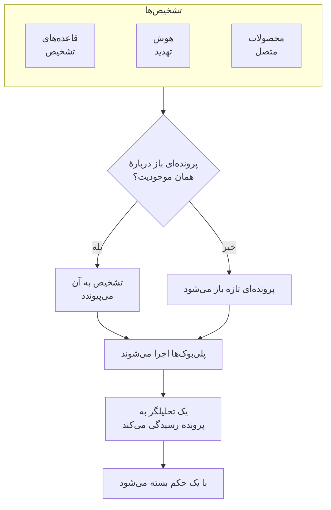

# پرونده‌های امنیتی و پلی‌بوک‌ها (SOAR)

رویدادهای امنیتی آنچه را قاعده‌های تشخیص، هوش تهدید و محصولات امنیتی متصل شما پیدا می‌کنند به پرونده تبدیل می‌کند: برای هر چیزی که ارزش بررسی دارد یک پرونده، که هر تشخیصی دربارهٔ همان کاربر، میزبان یا نشانی در آن گرد می‌آید. تحلیلگران در یک صف به پرونده‌ها رسیدگی می‌کنند، و پلی‌بوک‌ها خودکار یا با یک کلیک به آن‌ها پاسخ می‌دهند.

:::cards
- [پرونده‌ها از کجا می‌آیند](#پروندهها-از-کجا-میآیند): قاعده‌های تشخیص، هوش تهدید، محصولات متصل، ریسک موجودیت و افراد.
- [رسیدگی به یک پرونده](#رسیدگی-به-یک-پرونده): آن را واگذار کنید، موجودیت‌هایش را بررسی کنید، و با یک حکم ببندید.
- [اولویت‌ها و وضعیت‌های پرونده](#اولویتها-و-وضعیتهای-پرونده): نام، رنگ و ترتیبشان را عوض کنید و موارد خودتان را بیفزایید.
- [اهداف پاسخ](#اهداف-پاسخ): یک پرونده با هر اولویت با چه سرعتی باید برعهده گرفته و مهار شود.
- [اعلان‌ها](#اعلانها): چه کسی از یک پروندهٔ تازه، یک واگذاری، یک هدف پاسخ، یک وظیفه و گامی که منتظر تأیید است باخبر می‌شود.
- [پلی‌بوک‌ها](#پلیبوکها): گام‌هایی که روی یک پرونده اجرا می‌شوند، با تأیید هر جا که اهمیت دارد.
- [نمای کلی](#نمای-کلی): چه چیزی همین حالا به کسی نیاز دارد، و پرونده‌ها با چه سرعتی رسیدگی می‌شوند.
:::

## چگونه کار می‌کند

برای صف، **محصولات** > **رویدادهای امنیتی** > **پرونده‌های امنیتی** > **پرونده‌های باز** را باز کنید. **سپرده‌شده به من**، **بی‌مسئول**، **پرونده‌های بسته** و **همه پرونده‌ها** صفحه‌های جداگانه‌ای در کنار آن‌اند که هر کدام پرونده‌هایی را فهرست می‌کند که نامش می‌گوید.

## پیش از شروع

پرونده‌ها و پلی‌بوک‌ها از سه نقش Security پیروی می‌کنند. مالک پروژه و مدیر پروژه هر کاری را می‌توانند انجام دهند.

| نقش | چه کاری می‌تواند بکند |
| --- | --- |
| مدیر امنیت | همه چیز، از جمله حذف پرونده‌ها، برداشتن شواهد و راه‌اندازی پلی‌بوک‌ها |
| عضو امنیت | باز کردن، واگذاری، تغییر و بستن پرونده‌ها، نوشتن یادداشت، انجام وظایف، افزودن شواهد، اجرای پلی‌بوک‌ها و تأیید یا رد گام‌های آن‌ها |
| بیننده امنیت | خواندن پرونده‌ها، تشخیص‌ها، یادداشت‌ها، وظایف، شواهد، پلی‌بوک‌ها و اجراهای آن‌ها |

هر یک از این‌ها را می‌توان جداگانه هم اعطا کرد، از ساختن یک پرونده تا تأیید گام‌های یک پلی‌بوک؛ [مرجع دسترسی‌ها](/docs/permissions/reference) را ببینید.

## پرونده‌ها از کجا می‌آیند

| منبع | چه زمانی پرونده باز می‌کند | خاموش کردن با |
| --- | --- | --- |
| قاعده‌های تشخیص | قاعده‌ای تطابق پیدا کند | **باز کردن پرونده هنگام تطبیق**، در گام **هنگام تطابق** از فرم قاعده |
| هوش تهدید | رویدادی از یک شاخص شناخته‌شده نام ببرد | **باز کردن پرونده هنگام تطبیق**، در گام **هنگام تطابق** از فرم فید |
| محصولات متصل | هشدار خودِ یک محصول در آستانهٔ اتصال یا بالاتر از آن وارد شود | تنظیم **بازکردن پرونده از** روی **هرگز**، در گام **فراخوانی دوره‌ای** از فرم اتصال |
| محصولات امنیتی در لاگ‌های شما | تهدیدی که یک دیوار آتش، IDS یا محصول نقطهٔ پایانی در لاگ‌های شما می‌نویسد در آستانهٔ لاگ‌های شما یا بالاتر از آن باشد | تنظیم **باز کردن پرونده از** روی **هرگز**، در **لاگ‌های شما** |
| ریسک موجودیت | ریسک یک کاربر، میزبان یا نشانی به آستانه پروژه برسد | **پرونده‌های ریسک** در **تنظیمات** > **امتیازدهی ریسک** |
| افراد | کسی از **پرونده‌های امنیتی**، یا با **باز کردن پرونده** در پنل یک رویداد، پرونده‌ای باز کند | هیچ |

همهٔ منبع‌ها به‌طور پیش‌فرض پرونده باز می‌کنند، جز ریسک موجودیت در پروژه‌هایی که پیش از آن ساخته شده‌اند: در آن‌ها اول **پرونده‌های ریسک** را روشن کنید ([ریسک موجودیت](/docs/telemetry/security-entity-risk)). یک اتصال برای هشدارهای **بالا و بالاتر** پرونده باز می‌کند، مگر اینکه سطح دیگری برگزینید؛ هشدارهای پایین‌تر از آن همچنان به‌صورت رویداد وارد می‌شوند. **لاگ‌های شما** هم برای تهدیدهای لاگ‌هایتان همین کار را می‌کند.

### تشخیص‌ها چگونه گروه‌بندی می‌شوند

هر تشخیص دربارهٔ یک موجودیت است: مقداری که قاعده‌اش بر پایهٔ آن گروه‌بندی می‌کند، مانند نشانی IP در قاعده‌ای که حملهٔ جست‌وجوی فراگیر را تشخیص می‌دهد، یا شاخصی که یک تطابق هوش تهدید از آن نام می‌برد. تشخیصی که موجودیتی ندارد تنها می‌ماند.

- وقتی پرونده‌ای باز از پیش دربارهٔ همان موجودیت باشد، تشخیص به آن می‌پیوندد. موجودیت‌ها و نگاشت ATT&CK پرونده گسترده‌تر می‌شوند، و اولویتش تا اولویت تشخیص بالا می‌رود و هرگز پایین نمی‌آید.
- وقتی هیچ پروندهٔ بازی دربارهٔ آن نباشد، پرونده‌ای تازه به نام تشخیص و با اولویت آن باز می‌شود.
- تشخیصی که دوباره فعال شود، به‌جای افزودن ردیفی تازه، شمارش ردیف خودش را بالا می‌برد.

اولویت یک پرونده از شدت تشخیص می‌آید، به اولویت پیش‌ساختهٔ پروژه برای آن سطح، هر نامی که به آن داده باشید:

| شدت | اولویت |
| --- | --- |
| Critical یا Fatal | بحرانی |
| High | High |
| Medium، Unknown یا Other | Medium |
| Low | Low |
| Informational | اطلاع‌رسانی |

## رسیدگی به یک پرونده

پرونده‌های یک پروژهٔ تازه چهار وضعیت را پشت سر می‌گذارند، که می‌توانید نامشان را عوض کنید و وضعیت‌های خودتان را به آن‌ها بیفزایید ([اولویت‌ها و وضعیت‌های پرونده](#اولویتها-و-وضعیتهای-پرونده) را ببینید). یک پرونده می‌تواند از یکی بپرد، مانند مثبت کاذبی که مستقیماً از «جدید» بسته می‌شود، و می‌توان آن را دوباره باز کرد.

| وضعیت | معنا |
| --- | --- |
| جدید | هنوز کسی به آن نگاه نکرده است |
| در حال بررسی | کسی در حال روشن کردن این است که چه رخ داده |
| Contained | تهدید دیگر نمی‌تواند آسیبی بزند؛ پاک‌سازی هنوز مانده است |
| بسته | تمام‌شده، با حکمی دربارهٔ اینکه چه بود |

پرونده هم مانند حادثه منوی کناری خودش را دارد، و هر بخش پرونده صفحه‌ای جداگانه است:

| بخش منوی کناری | صفحه‌ها |
| --- | --- |
| **نمای کلی** | **نمای کلی**، **خط زمانی** |
| **بررسی** | **روند رویدادها**، **تشخیص‌ها**، **موجودیت‌ها**، **سیگنال‌های مرتبط**، **شواهد**، **وظایف**، **پلی‌بوک‌ها** |
| **یادداشت‌ها** | **یادداشت‌های خصوصی** |
| **پیشرفته** | **فیلدهای سفارشی**، **گزارش‌های ممیزی**، **حذف پرونده** — تا روی **پیشرفته** کلیک نکنید جمع است |

هر صفحه سربرگ پرونده را در بالا نگه می‌دارد: شماره، اولویت، وضعیت و عنوان آن، **تخصیص به من**، **اجرای پلی‌بوک**، **اعلام حادثه** و **بستن پرونده**، و در منوی ⋯ کنار آن‌ها **تعیین اولویت**، **تخصیص به فرد دیگر**، **تغییر وضعیت**، **ویرایش پرونده** و **حذف پرونده**. پس می‌توان از هر صفحهٔ پرونده به آن رسیدگی کرد، و پیوند پرونده همچنان **نمای کلی** آن را باز می‌کند. وقتی اولویت پرونده اهداف پاسخ دارد، سربرگ همچنین نشان می‌دهد که موعد هدف بعدی کی است ([اهداف پاسخ](#اهداف-پاسخ)).

- **نمای کلی**: توضیح، برچسب‌ها و گام‌های وضعیت پرونده، اینکه پرونده دست کیست و چه چیزی آن را باز کرد، و ارقام آن: چند تشخیص دارد، چه مدت باز بوده، و تأیید و مهار آن چقدر طول کشید. زیر **زمان تا تأیید** و **زمان تا مهار** آمده است که پرونده نسبت به اهداف پاسخش در چه وضعی است.
- **چرا این پرونده باز شد**، در **نمای کلی**: تشخیصی که پرونده را باز کرد و اینکه قاعده‌اش چگونه فعال می‌شود (آستانه‌اش، اینکه بر پایهٔ چه چیزی گروه‌بندی می‌کند و پنجره‌ای که در آن می‌شمارد)، چند رویداد با آن منطبق شد، از چه چیزی و از کی تا کی، قاعده به دنبال چه می‌گردد، و درخواست‌ها تا کجا پیش رفتند. زیر **موارد منطبق** خودِ رویدادها آمده‌اند، قدیمی‌ترین‌ها اول: در هر کدام آنچه قاعده به دنبالش می‌گردد برجسته شده است و نشان داده می‌شود که درخواستش تا کجا پیش رفت و از کدام خط لاگ یا محصول آمده است، و **ترِیس**، **لاگ‌ها** و **استثنا** از همان‌جا با یک کلیک باز می‌شوند؛ خط لاگی که رویداد از آن آمده است در کاوشگر لاگ روی همان خط باز می‌شود. روی یک رویداد کلیک کنید تا آن را به‌طور کامل ببینید، همراه با خط لاگی که از آن خوانده شده است. **نگه‌داشتن در این پرونده**، در ردیف رویداد یا در پنل آن، رویداد را در **شواهد** پرونده نگه می‌دارد و از تشخیصی که رویداد با آن منطبق شد نام می‌برد؛ رویدادی که پرونده از پیش نگه داشته همین را می‌گوید و آن را همان‌جا باز می‌کند. یک تشخیص هنگام فعال شدن تا ۲۵ مورد از رویدادهایی را که با آن منطبق شدند نگه می‌دارد و همان‌ها را فهرست می‌کند، حتی وقتی از دورهٔ نگهداری‌شان گذشته باشند؛ نقش شما آن‌هایی را می‌بیند که از منابعی آمده‌اند که می‌تواند بخواند. قاعده‌ای که هم‌زمان برای گروه‌های زیادی فعال می‌شود، قاعدهٔ همبستگی هم، برای هر یک از آن‌ها رویداد نگه می‌دارد: روی هم حداکثر ۱٬۰۰۰، پس هر گروه دست‌کم ۱۰ رویداد نگه می‌دارد، و با فعال شدن دوباره تا ۲۵. برای تشخیصی که به پیش از نگه‌داشتن رویدادها برمی‌گردد، تطابق‌های یک قاعده رویدادهایی‌اند که شرط خودِ آن قاعده را، برای گروه تشخیص، در پنجره‌هایی که در آن‌ها فعال شده است برآورده می‌کنند؛ یک تطابق هوش تهدید رویدادهایی را فهرست می‌کند که شاخص آن را دارند، و هشدار یک محصول متصل رویدادی را نشان می‌دهد که در قالب آن فرستاده شده است. **ادامهٔ بررسی** همه چیز دربارهٔ نشانی یا کاربری که تشخیص دربارهٔ آن است، رویدادها و خط‌های لاگی که از آن نام می‌برند، لاگ‌های سرویس‌هایی که خط‌های لاگ آن از آن‌ها آمده‌اند و ترِیس‌های درخواست‌هایش را، هر کدام در پنجرهٔ زمانی تشخیص، و نیز **روند رویدادها** و **سیگنال‌های مرتبط** پرونده را باز می‌کند. تشخیص‌های دیگر پرونده زیر **همچنین در این پرونده** جمع شده‌اند.
- **برنامهٔ پاسخ**، در **نمای کلی**: آنچه اکنون باید برای پرونده انجام داد، فوری‌ترین‌ها اول، زیر **مطمئن شوید واقعی است**، **مهارش کنید**، **آنچه را باعث آن شد برطرف کنید** و **پرونده را ببندید**. هر گام دربارهٔ همین پرونده است: نشانی‌ها، کاربران و میزبان‌هایش، اینکه درخواست‌هایش تا کجا پیش رفتند، آنچه قاعده‌اش می‌گوید ممکن است روی آن هم فعال شود، تاکتیک‌ها و تکنیک‌های ATT&CK که تشخیص‌هایش به آن‌ها نگاشت می‌شوند، و پلی‌بوک‌هایی که پروژه دارد. گام‌های خودِ یک قاعدهٔ تشخیص، که در فرمش زیر **گام‌های پاسخ** نوشته می‌شوند، در بخشی از برنامه که زیر آن قرار می‌گیرند اول می‌آیند، و قاعده‌های کتابخانه هم گام‌های خودشان را دارند. گامی که OneUptime می‌تواند انجام دهد دکمهٔ خودش را دارد: **تخصیص به من**، **افزودن استثنا** که قاعده و نشانی در آن از پیش پر شده‌اند، **اجرای پلی‌بوک** برای پلی‌بوکی که حساب را تعلیق یا میزبان را مهار می‌کند، یا پلی‌بوکی که OneUptime AI پیشنهاد می‌دهد، **اعلام حادثه**، **علامت‌گذاری به‌عنوان مهارشده** و **بستن پرونده**. گام یک نشانی عمومی، همین که مقصدی فهرست مسدودسازی شما را اعمال کند، آن را با یک کلیک، **مسدود کردن به مدت ۲۴ ساعت**، مسدود می‌کند (نگاه کنید به [مسدود کردن یک نشانی از پرونده](#مسدود-کردن-یک-نشانی-از-پرونده)). گامی که OneUptime نمی‌تواند انجام دهد، مانند مسدود کردن یک دامنه در فیلتر DNS شما، **بیرون از OneUptime** را نشان می‌دهد، و مقدار با یک کلیک در کلیپ‌بورد کپی می‌شود. جایی که یک اتصال روی همهٔ ماشین‌ها مسدود می‌کند (ببینید [فهرست مسدودسازی](#فهرست-مسدودسازی))، مسدود کردن دامنه، فایل یا سرور فرمان و کنترل پرونده هم یک کلیک است: **مسدود کردن به مدت ۷ روز**، یا **مسدود کردن فایل** برای ۳۰ روز، آن را در فهرست مسدودسازی می‌گذارد، و گام به محض اینکه Microsoft Defender یا CrowdStrike Falcon مسدودسازی را اعمال کند انجام شده است. وقتی گامی انجام شد تیکش بزنید: به‌عنوان یکی از **وظایف** پرونده، انجام‌شده، همراه با اینکه چه کسی و کی انجامش داد نگه داشته می‌شود. گام‌هایی که انجام شدنشان را خود پرونده تعیین می‌کند به‌طور خودکار تیک می‌خورند: پرونده تخصیص داده شده، حادثه‌ای اعلام شده، پلی‌بوکی اجرا شده، پرونده مهار یا بسته شده است. وقتی همهٔ گام‌هایی که تهدید را مهار می‌کنند انجام شد، برنامه **علامت‌گذاری به‌عنوان مهارشده** را پیشنهاد می‌دهد، که زمان تا مهار پرونده را ثبت می‌کند. وقتی OneUptime AI بررسی اولیهٔ پرونده را انجام داده باشد، ارزیابی‌اش در صدر برنامه می‌آید، و گام‌های پیشنهادی‌اش زیر گام‌های خودِ برنامه جمع می‌شوند. OneUptime بیشتر گام‌ها را خودش بررسی می‌کند و کنار هر گام می‌گوید چه یافته است: [OneUptime چگونه یک گام را بررسی می‌کند](#oneuptime-چگونه-یک-گام-را-بررسی-میکند) را ببینید.
- **OneUptime AI**، در **نمای کلی**: برداشت OneUptime AI از پرونده، اولویت و پلی‌بوکی که پیشنهاد می‌دهد، و شواهد پشت آن‌ها. [OneUptime AI در امنیت](/docs/telemetry/security-ai) را ببینید.
- **تأثیر**، در **نمای کلی**: آنچه پرونده در معرض خطر قرار می‌دهد: اینکه آیا OneUptime دیده است رکوردهای آن از اینترنت در دسترس قرار گرفته‌اند، مالکان آن‌ها چه کسانی هستند، آخرین تغییر روی آن‌ها چه بوده است، و دادهٔ در معرض خطر - مخازن دارای دادهٔ حساس که پرونده نامشان را می‌برد یا کاربران و نقش‌هایش می‌توانند به آن‌ها برسند ([یکپارچه‌سازی‌های امنیت داده](/docs/data-security/integrations#عملیات-امنیتی) را ببینید). آن را باز کنید تا ببینید هر رکورد چه چیزی را فراخوانی می‌کند و چه چیزی آن را فراخوانی می‌کند، کدام مانیتورها و صفحه‌های وضعیت آن را زیر نظر دارند، و نشانی‌های پرونده با کدام ماشین‌ها ارتباط داشته‌اند.
- **MITRE ATT&CK**، در **نمای کلی**: تاکتیک‌ها و تکنیک‌هایی که تشخیص‌های پرونده به آن‌ها نگاشت می‌شوند، هر کدام با پیوندی به صفحه‌اش در attack.mitre.org.
- **خط زمانی**: هر آنچه برای پرونده رخ داده، همراه با اینکه چه کسی انجامش داده است.
- **روند رویدادها**: آنچه در سراسر OneUptime به ترتیب رخ داد: هر تشخیص و رویدادهای امنیتی پشت آن، اینکه درخواست‌هایشان تا کجا پیش رفتند، استثناهایی که ایجاد کردند، تغییرات روی رکوردهایی که پرونده نام می‌برد، حادثه‌ها و هشدارهایی که روی آن‌ها رخ داد، و کاری که تیم انجام داد. کاوش‌های فراوان یک اسکنر یک سطر است، و هر سطر آنچه را نام می‌برد باز می‌کند، مانند ترِیس درخواست یا استثنا.
- **تشخیص‌ها**: آنچه فعال شد و پرونده را باز کرد یا به آن پیوست، چند بار، و آخرین رویداد منطبق.
- **موجودیت‌ها**: کاربران، میزبان‌ها و نشانی‌هایی که پرونده دربارهٔ آن‌هاست، با فعالیتشان در همهٔ رویدادهای امنیتی شما در ۷ روز گذشته. هر کدام در **هم‌بسته‌سازی** باز می‌شود.
- **سیگنال‌های مرتبط**: میزبان‌ها، خوشه‌ها، سرویس‌ها و اعضایی که پرونده به آن‌ها اشاره می‌کند، آن‌گونه که OneUptime آن‌ها را می‌شناسد، و آنچه پیرامون شناسایی‌های آن روی هر یک رخ می‌داد: لاگ‌ها، ترِیس‌ها و متریک‌هایشان، آنچه روی آن‌ها باز است و آنچه تغییر کرد. [سیگنال‌های مرتبط](/docs/telemetry/security-connected-signals) را ببینید.
- **شواهد**: فایل‌ها، پیوندها و رویدادهای امنیتی‌ای که روی پرونده نگه داشته می‌شوند، هر کدام با اینکه چه کسی و چه زمانی آن را افزوده است. با **افزودن فایل** فایلی تا 10 MB بارگذاری می‌شود و SHA-256 آنچه بارگذاری شده ثبت می‌شود تا هر کس بعداً آن را دانلود کند بتواند بررسی کند که همان چیزی است که نگه داشته شده؛ با **افزودن پیوند** به شواهدی اشاره می‌شود که جای دیگری نگه داشته می‌شوند. فقط یک مدیر امنیت می‌تواند شاهدی را بردارد، و **خط زمانی** پرونده نشان می‌دهد چه چیزی افزوده و برداشته شد. یک رویداد امنیتی با **افزودن به پرونده** در **رویدادها** یا در صفحهٔ یک [شکار](/docs/telemetry/security-events#شکارها)، یا با **نگه‌داشتن در این پرونده** روی رویدادی که با یک تشخیص منطبق شده است، همان‌طور که بود اینجا نگه داشته می‌شود، و **مشاهده رویداد** آن را باز می‌کند. گام **حفظ شواهد** در یک پلی‌بوک هم رویدادهای پشت تشخیص‌های پرونده را اینجا نگه می‌دارد.
- **وظایف**: آنچه در پرونده باید انجام شود، چه کسی انجامش می‌دهد و آیا انجام شده است. وظیفه‌ای را در یک سطر اضافه کنید، آن را به کسی بسپارید و وقتی انجام شد تیکش بزنید. کسی که وظیفه به او سپرده می‌شود باخبر می‌شود، مگر اینکه خودش آن را برداشته باشد، و منو کنار **وظایف** نشان می‌دهد چند وظیفه باز است. گام **افزودن وظایف** در یک پلی‌بوک هم وظیفه اضافه می‌کند و وظایفی را که پرونده از قبل دارد کنار می‌گذارد.
- **پلی‌بوک‌ها**: آنچه هر پلی‌بوک گام به گام روی پرونده انجام داد، و گام‌هایی که منتظر تأییدند. تا وقتی اجرایی منتظر است، منو تعداد آن‌ها را کنار **پلی‌بوک‌ها** نشان می‌دهد.
- **یادداشت‌های خصوصی**: آنچه تیم دربارهٔ پرونده نوشته است. منوی **قالب‌ها** در ویرایشگر یکی از قالب‌های یادداشت پروژه را در یادداشت می‌گذارد.
- **فیلدهای سفارشی**: فیلدهای خود پروژه که برای این پرونده پر شده‌اند، و **ویرایش فیلدها** برای تغییرشان. وقتی پروژه فیلدی داشته باشد، **نمای کلی** هم آن‌ها را در آخرین کارتش نشان می‌دهد. نگاه کنید به [فیلدهای سفارشی، قالب‌های یادداشت و شماره‌گذاری](#فیلدهای-سفارشی-قالبهای-یادداشت-و-شمارهگذاری).
- **گزارش‌های ممیزی**: هر تغییری که روی پرونده انجام شده، و اینکه چه کسی انجامش داده است. [گزارش‌های ممیزی](/docs/configuration/audit-logs) را ببینید.
- **حذف پرونده**: پرونده را همراه با تشخیص‌ها، یادداشت‌ها، خط زمانی و اجراهای پلی‌بوک آن برای همیشه حذف می‌کند. برای نگه داشتن سابقه، به جای آن پرونده را با یک حکم ببندید.

### OneUptime چگونه یک گام را بررسی می‌کند

تیک می‌گوید کسی گامی را انجام داده است. OneUptime گام‌های **برنامهٔ پاسخ** یک پرونده را خودش هم بررسی می‌کند، بر پایهٔ آنچه واقعاً رخ داده است: تا وقتی پرونده باز است هر دقیقه، و بی‌درنگ وقتی گامی تیک می‌خورد، وظیفه‌ای تغییر می‌کند یا پلی‌بوکی چیزی را مهار می‌کند. کنار هر گامی که بررسی کرده است، برنامه می‌گوید چه یافته است:

| کنار گام | یعنی |
| --- | --- |
| **بررسی‌شده توسط OneUptime** | OneUptime دید که گام انجام شده و پابرجاست. لازم نیست کسی آن را تیک بزند |
| **به نظر انجام‌شده** | آنچه OneUptime می‌بیند با انجام شدن گام جور است، اما آن را ثابت نمی‌کند. **تأیید** آن را به نام شما تیک می‌زند |
| **هنوز انجام نشده** | OneUptime می‌بیند که گام هنوز مانده است |
| **OneUptime نمی‌تواند بگوید** | OneUptime چیزی ندارد که گام را با آن بررسی کند، و با **چگونه بگذارید OneUptime این را بررسی کند** می‌گوید چرا |
| **دیگر پابرجا نیست** | گام انجام شده بود و دیگر کار نمی‌کند، مانند نشانی مسدودشده‌ای که دوباره عبور می‌کند |
| **تاکنون لازم نبوده** | هنوز چیزی رخ نداده که گام را لازم کند |

**از کجا می‌دانیم**، کنار آنچه OneUptime یافته است، بقیه را باز می‌کند: چه چیز دیگری دید، پیوندی به ترِیس‌ها یا محصولی که خواند، و زمانی که بررسی کرد. پیشرفت برنامه گام‌هایی را می‌شمارد که OneUptime خودش بررسی کرده است، مانند «۴ از ۹ انجام شد، ۳ مورد را OneUptime بررسی کرد».

| گام | آنچه OneUptime می‌خواند |
| --- | --- |
| مسدود کردن نشانی | اینکه آیا مقصدی مسدودسازی نشانی را از [فهرست مسدودسازی](#فهرست-مسدودسازی) شما نگه داشته و آن را بازخوانی کرده است، و اینکه آیا درخواست‌های نشانی هنوز به برنامهٔ شما می‌رسند، در ترِیس‌ها و لاگ‌های دسترسی آن. مسدودسازی‌ای که مقصدی آن را نگه داشته بررسی‌شده است؛ مسدودسازی‌ای که چیزی آن را اعمال نمی‌کند نه. نشانی‌ای که بدون مسدودسازی ساکت می‌شود انجام‌شده به نظر می‌رسد: شاید مسدود شده باشد، یا شاید فقط متوقف شده باشد |
| بررسی اینکه چیز دیگری عبور نکرده است | اینکه هر درخواست نشانی از نخستین تشخیص پرونده به بعد چگونه پایان یافت. وقتی برنامهٔ شما همهٔ آن‌ها را رد کرده باشد، گام بررسی‌شده است |
| تعلیق حساب | حساب در Okta، Microsoft Entra ID یا Google Workspace: معلق، یا غیرفعال با نشست‌هایی که پس از باز شدن پرونده پایان یافته‌اند |
| جدا کردن میزبان از شبکه | میزبان در CrowdStrike Falcon یا Microsoft Defender for Endpoint: مهارشده یا ایزوله |
| مسدود کردن دامنه، فایل یا سرور روی همهٔ ماشین‌ها | مسدودسازی آن در فهرست مسدودسازی: تا وقتی Microsoft Defender یا CrowdStrike Falcon آن را اعمال می‌کند انجام شده، تا وقتی در راه است یا رد شده انجام‌نشده، که گام آن را می‌گوید |
| اعلام حادثه | اینکه آیا تا وقتی پرونده باز بود درخواستی از بررسی‌های برنامهٔ شما گذشت، یا مانیتوری از سرویس‌هایی که به آن‌ها رسید از کار افتاد. تا آن زمان، گام تاکنون لازم نبوده است |
| رد کردن مثبت کاذب | هیچ: فقط شما می‌توانید آن را رد کنید. گام فهرست می‌کند که OneUptime دربارهٔ نشانی چه می‌داند: اینکه آیا یکی از رکوردهای شما آن را دارد، فیدهای اطلاعات تهدیدی که آن را فهرست کرده‌اند، و کاربران واردشده‌ای که در ۳۰ روز گذشته از آن استفاده کرده‌اند |
| اصلاح مسیری که حمله به آن رفت | درخواست‌های حمله به آن مسیر، در ترِیس‌ها و لاگ‌های برنامهٔ شما، پیش و پس از انتشار تغییری در سرویس پشت آن: یک pull request که **اصلاح کد با هوش مصنوعی** در یک پلی‌بوک باز کرد، یا هر استقرار یا نسخهٔ تازه‌ای از سرویس. وقتی از آن پس به اندازهٔ کافی از همان حمله رد شود، یا جایی که پیش‌تر به پایگاه داده می‌رسید دیگر به آن نرسد، گام بررسی‌شده است. اگر از آن پس حمله‌ای نیامده باشد، می‌گوید از زمان اصلاح تلاشی نبوده است، و انجام‌شده به نظر می‌رسد |
| بازنشانی گذرواژه | حساب در Okta یا Microsoft Entra ID: گذرواژه‌اش پس از باز شدن پرونده تغییر کرده و نشست‌هایش پایان یافته است. Google Workspace نمی‌گوید گذرواژه کی تغییر کرده است، پس OneUptime نمی‌تواند بگوید |
| اطمینان از اینکه حساب‌ها از MFA استفاده می‌کنند | هر حسابی که هدف حمله بود، در Okta، Microsoft Entra ID یا Google Workspace: یک فاکتور فعال، یک روش MFA، یا تأیید ۲ مرحله‌ای. با MFA روی همهٔ آن‌ها، گام انجام‌شده به نظر می‌رسد: هیچ محصولی نمی‌گوید آیا ورودهای ناموفق به قفل شدن حساب می‌انجامند، پس شما آن را تأیید می‌کنید |

- گامی که بیرون از OneUptime انجام شده هم شمرده می‌شود. نشانی را در فایروال خودتان مسدود کنید، و OneUptime می‌بیند درخواست‌هایش متوقف می‌شوند؛ حساب را در Okta معلق کنید، و OneUptime آن را بازمی‌خواند.
- همچنان می‌توانید گامی را خودتان تیک بزنید، حتی گامی که OneUptime انجام‌شده نمی‌بیند. گامی که OneUptime بررسی کرده است نیازی به تیک ندارد.
- وقتی گام انجام‌شده‌ای دیگر پابرجا نیست، برنامه این را در بالای خود می‌گوید، **خط زمانی** پرونده می‌گوید OneUptime چه دید، و کسانی که مسئول پرونده‌اند باخبر می‌شوند: [اعلان‌ها](#اعلانها) را ببینید.
- OneUptime درخواست‌های یک نشانی را نمی‌بیند وقتی برنامهٔ شما هیچ ترِیس یا لاگی برایش نمی‌فرستد، وقتی ترِیس‌هایش نمی‌گویند هر درخواست از کدام نشانی آمده است، یا وقتی به‌جای نشانی بازدیدکنندگانتان، نشانی‌های Cloudflare یا یک متعادل‌کننده بار جلوی برنامهٔ شما را دارند. نشانی کلاینت (`client.address`) را روی اسپن‌های سرور برنامهٔ خود تنظیم کنید: پشت Cloudflare از `CF-Connecting-IP`، پشت یک متعادل‌کننده بار از `X-Forwarded-For`.
- OneUptime حساب‌ها و میزبان‌ها را از راه اتصال‌های پروژه به محصولاتی که آن‌ها را دارند می‌خواند، همان‌هایی که [پاسخ از راه OneUptime](#پاسخ-از-راه-oneuptime) به کار می‌برد. بدون هیچ اتصالی، نمی‌تواند بگوید.
- محصولی که پاسخ نمی‌دهد، یا خواندنی که ناموفق است، هرگز گامی انجام‌نشده شمرده نمی‌شود: گام می‌گوید OneUptime همین حالا نتوانست آن را بررسی کند، و OneUptime چند دقیقهٔ دیگر دوباره تلاش می‌کند.
- اصلاح یک مسیر فقط وقتی بررسی‌شده است که خود حمله رد شود: یک استقرار به‌تنهایی اصلاح نیست. OneUptime منتظر می‌ماند تا از انتشار اصلاح آن‌قدر حمله رد شود که با نرخی که پیش‌تر عبور می‌کردند، اگر چیزی تغییر نکرده بود دست‌کم یکی تقریباً به‌یقین (۹۵٪) عبور می‌کرد، و هرگز کمتر از ۳. گام می‌گوید منتظر چند حمله است، و تا ۷ روز پس از انتشار اصلاح بر مسیر نظارت می‌کند، مانند «در حال نظارت بر /api/search تا ۲۷ نوامبر». وقتی پیش‌تر تقریباً هیچ‌کدام عبور نکرده بودند، حمله‌ها نمی‌توانند نشان دهند اصلاح جواب داده است، و گام **به نظر انجام‌شده** می‌ماند تا شما تأییدش کنید.
- OneUptime انتشار یک اصلاح را وقتی می‌بیند که استقرارهای سرویس را ببیند: آن‌ها را به OneUptime بفرستید، یا `service.version` را در تله‌متری برنامهٔ خود گزارش کنید ([استقرارها و تغییرها](/docs/telemetry/change-events) را ببینید). هر pull request که **اصلاح کد با هوش مصنوعی** باز کند روی پرونده نگه داشته می‌شود، و استقرار آن با کامیت آن تطبیق داده می‌شود. درخواست‌هایی که در لبهٔ شما، مثلاً توسط Cloudflare، متوقف شدند هرگز به برنامهٔ شما نرسیدند، پس چیزی دربارهٔ اصلاح نمی‌گویند.
- خواندن MFA یک حساب در Microsoft Entra ID به مجوز برنامهٔ UserAuthenticationMethod.Read.All نیاز دارد، افزون بر مجوزهایی که [مهار](#مهار) فهرست می‌کند.

**علامت زدن پرونده‌ها به‌عنوان مهارشده پس از تأیید**، در **محصولات** > **رویدادهای امنیتی** > **تنظیمات** > **وضعیت‌های پرونده**، پرونده را همین که هر گامی که آن را مهار می‌کند **بررسی‌شده توسط OneUptime** یا **تاکنون لازم نبوده** باشد، به مهارشده می‌برد. زمان تا مهار آن ثبت می‌شود، و **خط زمانی** پرونده می‌گوید OneUptime هر گامی را که تهدید را مهار می‌کند تأیید کرده است. گامی که فقط انجام‌شده به نظر می‌رسد، یا یک تیک، هرگز به‌تنهایی پرونده را جلو نمی‌برد. این تنظیم در هر پروژه روشن است، و مالک پروژه یا مدیر پروژه می‌تواند آن را خاموش کند: آنگاه پرونده همان‌جا که هست می‌ماند تا کسی آن را مهارشده علامت بزند.

هر کسی که می‌تواند پرونده‌ای را ببیند، آنچه OneUptime یافته است را می‌بیند. کسی آن را ویرایش نمی‌کند: کسی که موافق نیست خودش گام را تیک می‌زند، که به نقشی نیاز دارد که بتواند به وظایف پرونده رسیدگی کند.

### مسدود کردن یک نشانی از پرونده

نشانی عمومی‌ای که پرونده درباره آن است، در **برنامهٔ پاسخ** گام خودش را دارد. تا وقتی مقصدی فهرست مسدودسازی شما را اعمال می‌کند، مانند Cloudflare، [AWS WAF](/docs/telemetry/cloud-aws-waf-blocklist) یا فایروالی که یک فهرست را می‌خواند، گام نام آن را می‌برد، مانند «مسدود کردن 35.205.11.131 در Cloudflare.» **مسدود کردن به مدت ۲۴ ساعت** نشانی را آنجا مسدود می‌کند، و منوی کنار آن **به‌جای آن چالش**، **مسدود کردن به مدت ۷ روز** و **مسدود کردن تا رفع مسدودیت** را دارد که فقط مدیر امنیت، مدیر پروژه یا مالک پروژه می‌تواند انتخاب کند. انسان‌ها از چالش عبور می‌کنند؛ اسکریپت‌ها و کلاینت‌های API نه. در صفحهٔ **موجودیت‌ها**ی پرونده، **مسدود کردن…** روی یک نشانی همین کار را می‌کند و می‌پرسد برای چه مدت.

- مسدودسازی، مانند مسدودسازی یک پلی‌بوک، از موتور پلی‌بوک می‌گذرد: در صفحهٔ **پلی‌بوک‌ها**ی پرونده، در **خط زمانی** آن و در گزارش ممیزی نگه داشته می‌شود. منتظر تأیید شخص دیگری می‌ماند، مگر اینکه مدیر امنیت، مدیر پروژه یا مالک پروژه باشید.
- برای نشانی‌ای که درخواست‌های پرونده فقط ادعایش را داشتند، برای یکی از نشانی‌های خودتان یا نشانی محافظت‌شده، و برای نشانی‌ای که مسدودسازی دیگری از قبل آن را پوشش می‌دهد، با ذکر دلیل رد می‌شود.
- همین که مقصدی مسدودسازی را نگه دارد، گام انجام‌شده است و می‌گوید کجا، از کی، توسط چه کسی و تا کی، همراه با **رفع مسدودیت**. تا وقتی هیچ مقصدی آن را نگه نداشته، گام همین را می‌گوید و انجام‌شده نیست.
- تا وقتی چیزی فهرست مسدودسازی شما را اعمال نمی‌کند، گام می‌گوید چطور Cloudflare، AWS WAF یا یک فایروال را متصل کنید، و **روش مسدود کردن** نشانی را در داشبورد Cloudflare، AWS CLI، nginx و nftables نشان می‌دهد.
- بستن پرونده با **مثبت کاذب** یا **مثبت بی‌خطر** پیشنهاد می‌کند مسدودسازی‌هایی را که پرونده ایجاد کرده رفع کنید، تیک‌خورده و با نام هر کدام.

### رسیدگی به پرونده‌ها از صف

برای رسیدگی به یک پرونده لازم نیست آن را باز کنید. در فهرست‌های صف، منوی ⋯ در ردیف هر پرونده **تخصیص به من**، **تخصیص به فرد دیگر**، **تغییر وضعیت** و **تغییر اولویت** را دارد. برای رسیدگی هم‌زمان به چند پرونده، آن‌ها را برگزینید و همین اقدام‌ها را در **اقدامات گروهی** به کار ببرید: آنجا می‌گوید کدام پرونده‌ها تغییر کردند، کدام‌ها همان‌طور ماندند و چرا.

- برای سپردن پرونده به فرد دیگر، **تخصیص به فرد دیگر** را به کار ببرید و یک نفر یا یک تیم را برگزینید. پروندهٔ یک تیم در **بی‌مسئول** می‌ماند تا یکی از اعضای تیم آن را بردارد.
- وضعیتی که پرونده را می‌بندد، مانند **بستن پرونده** یک حکم و یک یادداشت پایانی می‌خواهد.
- پروندهٔ بسته به کسی تخصیص داده نمی‌شود. برای رسیدگی دوباره، آن را با **تغییر وضعیت** دوباره باز کنید.

### بستن یک پرونده

**بستن پرونده** یک حکم و یک یادداشت پایانی اختیاری می‌خواهد:

| حکم | معنا |
| --- | --- |
| True Positive | فعالیتی مخرب یا غیرمجاز واقعاً رخ داده است |
| Benign Positive | فعالیت واقعی اما مورد انتظار بود، مانند یک آزمون نفوذ یا یک کار مدیریتی |
| False Positive | تشخیص نادرست بود: قاعده یا داده فعالیتی عادی را اشتباه خوانده است |
| Undetermined | اطلاعات کافی برای قضاوت وجود نداشت |

حکم‌ها در نمای کلی شمرده می‌شوند. قاعده‌ای که پرونده‌هایش پیوسته با حکم False Positive بسته می‌شوند، قاعده‌ای است که باید تنظیمش کرد.

تا وقتی وظایفی از پرونده هنوز باز است، پنجرهٔ **بستن پرونده** تعداد آن‌ها را می‌گوید.

پرونده‌ای که از هشدارهای Google SecOps باز شده، وقتی اتصالش **بستن هشدارها هنگام بسته شدن پرونده‌شان** را روشن داشته باشد، آن‌ها را در Google SecOps هم با حکم و یادداشت بستن می‌بندد: [Google SecOps](/docs/integrations/google-secops#بستن-هشدارها-هنگام-بسته-شدن-پروندهشان) را ببینید.

### اعلام یک حادثه

**اعلام حادثه** برای پرونده یک حادثهٔ OneUptime با شدتی که برمی‌گزینید باز می‌کند، و این دو را از هر دو سو به هم پیوند می‌دهد: شرح حادثه از پرونده نام می‌برد، و سرآیند پرونده به حادثه پیوند دارد. از آنجا به بعد کشیک، صفحه‌های وضعیت و گزارش پس از حادثه کار را به دست می‌گیرند. این کار به نقشی نیاز دارد که هم بتواند به پرونده‌ها رسیدگی کند و هم حادثه بسازد.

## اولویت‌ها و وضعیت‌های پرونده

هر پروژه اولویت‌ها و وضعیت‌های پروندهٔ خودش را دارد، در **محصولات** > **رویدادهای امنیتی** > **تنظیمات** > **اولویت‌های پرونده** و **وضعیت‌های پرونده**. نامشان را عوض کنید، رنگشان را تغییر دهید، با کشیدن ترتیبشان را عوض کنید و موارد خودتان را بیفزایید، مانند وضعیت «Triage» یا اولویت «Emergency» بالاتر از **بحرانی**. نام تازه همه‌جا هم‌زمان دیده می‌شود: در صف، در صفحه‌های پرونده و نمای کلی، در اعلان‌ها، در Slack، Microsoft Teams و Mattermost، و در پیام‌های پلی‌بوک.

برخی پیش‌ساخته‌اند، چون OneUptime معنای آن‌ها را می‌خواند. می‌توان نام و رنگشان را عوض کرد، اما نه حذفشان کرد و نه بایگانی‌شان، و ترتیبشان حفظ می‌شود:

| پیش‌ساخته | کاری که OneUptime با آن می‌کند |
| --- | --- |
| وضعیت جدید | پرونده‌های تازه در آن آغاز می‌شوند |
| وضعیت پذیرفته | رسیدن به آن زمان پذیرش پرونده را ثبت می‌کند، و **بازگشایی** پروندهٔ بسته را به آن برمی‌گرداند |
| وضعیت مهارشده | رسیدن به آن زمان مهار پرونده را ثبت می‌کند |
| وضعیت بسته | **بستن پرونده** پرونده را با یک حکم به آن می‌برد |
| اولویت‌های بحرانی، High، Medium، Low و اطلاع‌رسانی | یک تشخیص پرونده‌اش را با اولویت شدت خودش باز می‌کند، و پرونده‌ای که کسی باز کند از Medium آغاز می‌شود |

- جای یک وضعیت تعیین می‌کند پرونده‌ای که در آن است در حکم چه چیزی است، همان‌طور که ستون **در حکم** نشان می‌دهد: از وضعیت پذیرفته به پایین پذیرفته، از وضعیت مهارشده به پایین مهارشده، و از وضعیت بسته به پایین بسته. وضعیتی که می‌افزایید درست بالای وضعیت بسته قرار می‌گیرد، و بردن پرونده به وضعیتی که آن را می‌بندد نخست حکمی می‌خواهد.
- رتبهٔ یک اولویت فوریت آن است، فوری‌ترین در آغاز: **برای پرونده‌های دست‌کم**، گزینه‌های اعلان و قاعده‌های Slack، Microsoft Teams و Mattermost همین ترتیب را می‌خوانند. اولویتی که می‌افزایید به انتها می‌رود، و ستون **شدت تشخیص** نشان می‌دهد کدام تشخیص‌ها پرونده‌هایشان را با هر اولویت پیش‌ساخته باز می‌کنند.

برای کنار گذاشتن وضعیت یا اولویتی از خودتان، **بایگانی** را در ردیف آن به کار ببرید. دیگر کسی نمی‌تواند آن را برگزیند، و API، Terraform و MCP آن را رد می‌کنند، اما پرونده‌هایی که آن را دارند نگهش می‌دارند، و همچنان می‌توانید با آن فیلتر کنید. مقدارهای بایگانی‌شده در بخش جمع‌شدهٔ **وضعیت‌های بایگانی‌شدهٔ پرونده** یا **اولویت‌های بایگانی‌شدهٔ پرونده** زیر جدول فهرست می‌شوند، که در آن **خروج از بایگانی** یکی را برمی‌گرداند. تا وقتی پرونده‌هایی آن مقدار را دارند یا پلی‌بوکی از آن اولویت اجرا می‌شود، **حذف** رد می‌شود.

## اهداف پاسخ

هدف پاسخ می‌گوید یک پرونده با چه سرعتی باید رسیدگی شود: **تأیید ظرف**، اینکه یک پروندهٔ تازه چه مدت می‌تواند منتظر بماند تا کسی آن را برعهده بگیرد، و **مهار ظرف**، اینکه مهار یا بسته شدنش چه مدت می‌تواند طول بکشد. هر اولویت پرونده اهداف خودش را دارد، در **محصولات** > **رویدادهای امنیتی** > **تنظیمات** > **اهداف پاسخ**: با **ویرایش** در ردیف یک اولویت، دو هدف آن را بر حسب دقیقه، ساعت یا روز، تا یک سال، تعیین می‌کنید، و هدف خالی یعنی بدون هدف. اولویت‌های یک پروژهٔ تازه با این‌ها شروع می‌شوند:

| اولویت | تأیید ظرف | مهار ظرف |
| --- | --- | --- |
| بحرانی | 15 دقیقه | 4 ساعت |
| High | 1 ساعت | 1 روز |
| Medium | 12 ساعت | 3 روز |
| Low | 1 روز | 7 روز |
| اطلاع‌رسانی | بدون هدف | بدون هدف |

پروژه‌ای که پیش از اهداف پاسخ ساخته شده، تا وقتی کسی آن‌ها را تعیین نکند هدفی ندارد.

- موعدهای یک پرونده هنگام باز شدنش از روی اهداف اولویتش تعیین می‌شوند. هدفی که بعداً تغییر کند، برای پرونده‌هایی اعمال می‌شود که پس از آن باز می‌شوند.
- پرونده از لحظه‌ای که کسی آن را برعهده بگیرد تأییدشده است: فردی به آن تخصیص داده شود، یا به وضعیتی برود که تأییدشده به حساب می‌آید. از لحظه‌ای که به وضعیتی برسد که مهارشده به حساب می‌آید، یا بسته شود، مهارشده است.
- وقتی اولویت یک پرونده تغییر می‌کند، هدفی که برآورده یا نقض کرده همان‌طور که بود می‌ماند. اولویت بالاتر موعد را نزدیک‌تر می‌کند: هدف تازه از لحظهٔ تغییر شمرده می‌شود، مگر اینکه موعد قبلی زودتر باشد. اولویت پایین‌تر موعد را عقب می‌برد و هرگز جلو نمی‌آورد: هدف تازه از زمان باز شدن پرونده شمرده می‌شود. اولویتی بدون هدف، موعد پرونده‌ای را که بالا رفته نگه می‌دارد و موعد پرونده‌ای را که پایین آمده پاک می‌کند.
- پرونده‌ای بسته‌شده که پیش از آنکه هرگز مهار شده باشد دوباره باز شود، موعد مهار تازه‌ای می‌گیرد که از زمان بازگشایی شمرده می‌شود.
- در یک‌پنجم پایانی یک هدف، پرونده در آستانهٔ نقض آن است: مسئولان پرونده باخبر می‌شوند، و وقتی هدف نقض شد دوباره باخبر می‌شوند. [اعلان‌ها](#اعلانها) را ببینید.

جایی که اهداف دیده می‌شوند:

- سربرگ پرونده هدف بعدی و زمان باقی‌مانده را نشان می‌دهد، یا اینکه چه مدت از موعدش گذشته است: خاکستری تا وقتی زمان هست، کهربایی در یک‌پنجم پایانی، قرمز وقتی نقض شده است.
- در **نمای کلی** پرونده، زیر **زمان تا تأیید** و **زمان تا مهار**: پرونده نسبت به هر هدف در چه وضعی است، یا چقدر از آن فراتر رفت.
- در فهرست‌های صف: سطر زیر اولویت هر پرونده، و ستون **موعد** که می‌توانید روشنش کنید و بر اساس آن مرتب کنید. تا وقتی این ستون روشن است، سطر زیر اولویت نشان داده نمی‌شود. فهرست‌ها فقط وقتی آن‌ها را نشان می‌دهند که یکی از اولویت‌های پروژه هدفی داشته باشد.

## فیلدهای سفارشی، قالب‌های یادداشت و شماره‌گذاری

سه تنظیم دیگر پرونده‌ها را از آنِ پروژهٔ شما می‌کنند، در **محصولات** > **رویدادهای امنیتی** > **تنظیمات**:

- **فیلدهای سفارشی**: فیلدهایی که تیم شما در هر پرونده پر می‌کند، مانند واحد کسب‌وکاری که پرونده به آن مربوط است یا تیکت آن در ابزاری دیگر. یک فیلد می‌تواند متن، عدد، تاریخ، بله یا خیر، گزینه‌ای از یک فهرست، یا یک فایل باشد. صفحهٔ **فیلدهای سفارشی** هر پرونده، زیر **پیشرفته**، هر فیلد را با مقدار پرونده نشان می‌دهد، و **ویرایش فیلدها** آن‌ها را تغییر می‌دهد. در فهرست‌های صف، هر فیلد ستونی است که می‌توانید در **ستون‌ها** روشنش کنید.
- **قالب‌های یادداشت**: متن آماده برای یادداشت‌هایی که تیم شما پرونده به پرونده می‌نویسد، مانند چک‌لیست مهار یا تحویل کار به شیفت بعد. در **یادداشت‌های خصوصی** یک پرونده، منوی **قالب‌ها** در ویرایشگر یکی را در یادداشت می‌گذارد تا پیش از ارسال ویرایشش کنید، و **مدیریت قالب‌ها** فهرست را باز می‌کند.
- **شماره‌گذاری**: متنی که پیش از شماره پرونده‌ها می‌آید، اگر پیشوند خودتان را تعیین نکنید `CASE-`، مانند `CASE-42`، و شماره‌ای که پرونده بعدی می‌گیرد. از ابزار دیگری می‌آیید؟ پس از آخرین شماره پروندهٔ آن شروع کنید تا یک شماره هرگز به دو پرونده اشاره نکند. پیشوند یا شروع تازه فقط برای پرونده‌های تازه اعمال می‌شود، و شروع باید از بیشترین شمارهٔ به‌کاررفته تاکنون بیشتر باشد.

مدیر امنیت فیلدهای سفارشی و قالب‌های یادداشت را مدیریت می‌کند، و عضو امنیت فیلدهای یک پرونده را پر می‌کند؛ در OneUptime Cloud این‌ها به طرح Growth یا بالاتر نیاز دارند. شماره‌گذاری را مالک پروژه یا مدیر پروژه تعیین می‌کند، همان‌طور که برای حادثه‌ها و هشدارها.

## اعلان‌ها

OneUptime افراد را از هفت رویداد در یک پرونده باخبر می‌کند. لازم نیست کسی چیزی را راه‌اندازی کند: پروژه‌ای که فقط **روشن کردن موارد پیشنهادی** را زده است، از پرونده‌های High و بحرانی خود با ایمیل و پوش باخبر می‌شود.

| اعلان | چه کسی باخبر می‌شود | به‌طور پیش‌فرض |
| --- | --- | --- |
| پرونده امنیتی جدید | هر کسی که می‌تواند پرونده‌های پروژه را ببیند، وقتی پرونده‌ای با اولویتی که او برگزیده یا بالاتر باز می‌شود، یا به آن می‌رسد | ایمیل و پوش، برای پرونده‌های High و بحرانی |
| پرونده امنیتی سپرده‌شده به من | کسی که پرونده به او واگذار شده است، و اعضای تیمی که پرونده به آن واگذار شده است | ایمیل و پوش |
| گام پلی‌بوک در انتظار تأیید من | کسانی در پرونده که می‌توانند گام را تأیید کنند: کسی که پرونده به او واگذار شده و اعضای تیمش. وقتی هیچ‌یک از آن‌ها نتواند تأیید کند، همهٔ کسانی در پروژه که می‌توانند | ایمیل و پوش |
| هدف پاسخ پرونده امنیتی | کسانی که مسئول پرونده‌اند: کسی که پرونده به او واگذار شده و اعضای تیمش. وقتی کسی مسئول آن نیست، کسانی که از پرونده‌های تازه با اولویت آن باخبر می‌شوند | ایمیل و پوش |
| وظیفهٔ پرونده امنیتی تخصیص‌یافته به من | کسی که وظیفه‌ای از پرونده به او سپرده می‌شود، مگر اینکه خودش آن را برداشته باشد | ایمیل و پوش |
| گام پرونده امنیتی دیگر پابرجا نیست | کسانی که مسئول پرونده‌اند، وقتی گامی که OneUptime انجامش را دیده بود دیگر پابرجا نیست: کسی که پرونده به او واگذار شده و اعضای تیمش. وقتی کسی مسئول آن نیست، کسانی که از پرونده‌های تازه با اولویت آن باخبر می‌شوند | ایمیل و پوش |
| OneUptime AI یک پرونده امنیتی را به افراد سپرد | کسانی که مسئول پرونده‌اند، وقتی OneUptime AI رسیدگی به آن را متوقف می‌کند و دلیلش را می‌گوید: کسی که پرونده به او واگذار شده و اعضای تیمش. وقتی کسی مسئول آن نیست، کسانی که از پرونده‌های تازه با اولویت آن باخبر می‌شوند | ایمیل و پوش |

- فقط کسانی که می‌توانند پرونده را ببینند از آن باخبر می‌شوند: مالک پروژه، مدیر پروژه، و نقش‌های مدیر امنیت، عضو امنیت و بیننده امنیت. نقشی که به برخی برچسب‌ها محدود شده است، فقط از پرونده‌هایی با آن برچسب‌ها باخبر می‌شود.
- هیچ‌کس از کاری که خودش کرده باخبر نمی‌شود: کسی که پرونده‌ای را دستی باز می‌کند، آن را واگذار می‌کند یا اجرایی را آغاز می‌کند، دربارهٔ آن اعلانی نمی‌گیرد.
- هر کس فقط یک بار از یک پرونده باخبر می‌شود. پرونده‌ای که با اولویت Medium باز می‌شود و بعد به بحرانی می‌رسد، هنگام بالا رفتن به کسانی می‌رسد که High یا بحرانی را برگزیده‌اند، و دوباره به کسانی نمی‌رسد که Medium را برگزیده‌اند، چون هنگام باز شدنش از آن باخبر شده‌اند.
- حملهٔ آزمایشی‌ای که **ارسال حمله آزمایشی** می‌فرستد، پرونده‌ای باز می‌کند که به هیچ‌کس اعلان نمی‌دهد.
- یک پروندهٔ بحرانی و گامی که منتظر تأیید است بی‌درنگ فرستاده می‌شوند و هرگز در یک [تجمیع ایمیل‌ها](/docs/emails/notification-rollup) نگه داشته نمی‌شوند. هدف پاسخی که در آستانهٔ نقض است یا نقض شده، گامی که دیگر پابرجا نیست، و پرونده‌ای که OneUptime AI به افراد سپرده است نیز همین‌طورند.
- **خط زمانی** پرونده می‌گوید چه کسی، و کی، باخبر شد.

### انتخاب آنچه از آن باخبر می‌شوید

هر کس خودش برای خودش انتخاب می‌کند، زیر **تنظیمات کاربر** > **تنظیمات اعلان** > **امنیت**: کانال‌های هر اعلان (ایمیل، SMS، تماس، پوش، Telegram، Slack، Microsoft Teams، Mattermost یا وب‌هوک)، و زیر **پرونده امنیتی جدید**، اولویتی که از آن به بالا اعلان می‌گیرد:

| انتخاب | اعلان دربارهٔ پرونده‌هایی با اولویت |
| --- | --- |
| فقط بحرانی | بحرانی |
| بالا و بالاتر | بحرانی و High (پیش‌فرض) |
| متوسط و بالاتر | بحرانی، High و Medium |
| پایین و بالاتر | هر اولویتی جز اطلاع‌رسانی |
| همه پرونده‌ها | هر اولویتی |

گزینه‌ها از اولویت‌های پروندهٔ پروژه پیروی می‌کنند، با نام‌های خودشان: این‌ها گزینه‌های یک پروژهٔ تازه‌اند.

پیام‌های WhatsApp برای پرونده‌های امنیتی فرستاده نمی‌شوند. اعلان پوش پرونده را در اپلیکیشن OneUptime On-Call (نسخهٔ 1.7.0 یا جدیدتر) باز می‌کند، جایی که می‌توانید گام منتظر یک پلی‌بوک را تأیید یا رد کنید، پرونده را به عهده بگیرید و آن را ببندید. پیوندش پرونده را در مرورگر باز می‌کند. اعلان پوش دربارهٔ گامی که منتظر تأیید شماست، خودِ همان تأیید را با شواهدش باز می‌کند؛ اگر کسی در این فاصله دربارهٔ آن تصمیم گرفته باشد، پرونده می‌گوید چه کسی، چه زمانی و گام چطور پیش رفت.

گامی که منتظر تأیید شماست، در Slack یا Microsoft Teams به شکل پیامی به شما می‌رسد که می‌توانید از همان‌جا تأییدش کنید، و ایمیلش می‌گوید گام چه خواهد کرد و چرا: [تأیید از Slack و Microsoft Teams](#تأیید-از-slack-و-microsoft-teams) را ببینید.

### ارسال به کانال‌های Slack، Microsoft Teams و Mattermost

برای ارسال به یک کانال، قاعده‌ای زیر **محصولات** > **رویدادهای امنیتی** > **فضای کاری** > **Slack** (یا **Microsoft Teams** یا **Mattermost**) بیفزایید. وقتی هیچ‌کدام وصل نباشد، تنها گزینهٔ این بخش **اتصال یک فضای کاری** است. یک قاعده کانال‌هایی را که باید به آن‌ها ارسال کند (و در Microsoft Teams، گفتگوها را) و، اگر بخواهید، پرونده‌هایی را که برای آن‌هاست نام می‌برد:

| شرط | تطبیق بر پایهٔ |
| --- | --- |
| اولویت پرونده امنیتی | یکی از اولویت‌های پروندهٔ پروژه، مانند بحرانی یا High |
| عنوان پرونده امنیتی، توضیحات پرونده امنیتی | متنی که عنوان یا توضیحات پرونده دربر دارد، با آن آغاز می‌شود یا با آن پایان می‌یابد |
| وضعیت پرونده امنیتی | یکی از وضعیت‌های پروندهٔ پروژه، مانند جدید یا بسته |
| منبع پرونده امنیتی | Detection Rule، Threat Intel، Connected Product، ریسک موجودیت، امنیت داده یا Manual |
| برچسب‌های پرونده امنیتی | برچسب‌های پرونده |

هر اعلانی جز اعلان یک وظیفه به کانال‌های همهٔ قاعده‌هایی فرستاده می‌شود که پرونده در آن لحظه با آن‌ها تطابق دارد. قاعده‌ای که در آن **اولویت پرونده امنیتی** هر یک از **بحرانی** و **زیاد** را دربر دارد، پرونده‌های High و بحرانی را هنگام باز شدن ارسال می‌کند، و پرونده‌ای با اولویت Medium را وقتی به High می‌رسد. یک پروندهٔ امنیتی هرگز کانال جداگانهٔ خودش را نمی‌گیرد.

در گام **به‌روزرسانی‌ها** یک قاعده انتخاب می‌کنید کدام‌یک از این اعلان‌ها را ارسال کند: **پرونده‌های جدید و ارتقای اولویت**، **واگذاری‌ها**، **درخواست‌های تأیید**، **اهداف پاسخ** و **سپرده‌شده به افراد توسط OneUptime AI**، هر کدام یک گزینه زیر **انتخاب به‌روزرسانی‌ها**. **فقط به‌روزرسانی‌های کلیدی** همه را جز واگذاری‌ها ارسال می‌کند، برای کانالی که فقط باید از چیزهایی باخبر شود که کسی باید به آن‌ها رسیدگی کند. قاعده‌ای که پیش از این گام ذخیره شده، و قاعده تازه، همه اعلان‌ها را ارسال می‌کند.

## پلی‌بوک‌ها

یک پلی‌بوک فهرستی از گام‌هاست که روی یک پرونده اجرا می‌شوند. آن را زیر **محصولات** > **رویدادهای امنیتی** > **پلی‌بوک‌ها**، از یک قالب یا از صفر، بسازید و گام‌هایش را در صفحهٔ خود آن اضافه کنید. پروژه‌ای که هیچ پلی‌بوکی ندارد، به جای یک فهرست خالی قالب‌ها را می‌بیند؛ وقتی پلی‌بوک‌هایی هست، **ساخت از روی قالب** روی فهرست آن‌ها را باز می‌کند و روی قالب‌هایی که پروژه از قبل دارد **افزوده شد** را نشان می‌دهد.

### یک پلی‌بوک کی اجرا می‌شود

| اجراها | چه زمانی |
| --- | --- |
| Case Opened | یک بار، هنگام باز شدن یک پرونده |
| Detection Added | هر بار که تشخیصی تازه به یک پروندهٔ باز بپیوندد |
| بررسی‌شده به‌عنوان احتمالاً مخرب | یک بار، وقتی بررسی اولیهٔ OneUptime AI پرونده را احتمالاً مخرب بخواند |
| Manual | فقط وقتی کسی آن را از یک پرونده اجرا کند |

هر پلی‌بوک فعالی را می‌توان با **اجرای پلی‌بوک** روی یک پرونده دستی هم اجرا کرد. پلی‌بوکی را که خودکار اجرا می‌شود می‌توان محدودتر کرد:

- **برای پرونده‌های دست‌کم**: فقط پرونده‌هایی با این اولویت یا بالاتر.
- **فقط برای تشخیص‌های برآمده از**: فقط وقتی تشخیصِ پشت پرونده از این منبع آمده باشد.
- **فقط برای این قواعد تشخیص**: فقط وقتی از یکی از این قاعده‌ها آمده باشد.

پلی‌بوک غیرفعال نه خودکار اجرا می‌شود و نه دستی.

### گام‌ها

| دسته | گام | چه می‌کند |
| --- | --- | --- |
| Case | Assign the case | پرونده را به یک فرد، یک تیم یا هر دو می‌سپارد |
| Case | Set the priority | اولویت پرونده را بالا یا پایین می‌برد |
| Case | Set the status | پرونده را به وضعیت دیگری از پروژه می‌برد، با حکمی که برمی‌گزینید اگر آن وضعیت پرونده را ببندد |
| Case | Add a note | یادداشتی روی پرونده می‌نویسد، مانند زمینه برای تحلیلگر |
| Case | Add labels | به پرونده برچسب می‌زند |
| Case | Add tasks | وظایفی به چک‌لیست پرونده اضافه می‌کند، برای یک نفر یا برای هر کسی که روی پرونده کار می‌کند |
| Investigate | Check entities against threat intel | هر موجودیت را در هوش تهدید شما جستجو می‌کند، و در صورت تطابق می‌تواند اولویت را بالا ببرد |
| Investigate | Look up entity activity | رویدادهای امنیتی هر موجودیت را در یک بازهٔ اخیر می‌شمارد، و نتیجه را روی پرونده یادداشت می‌کند |
| Investigate | Preserve the evidence | رویدادهای پشت تشخیص‌های پرونده و بازپخش نشست‌های درخواست‌هایش را نگه می‌دارد و ردگیری‌ها و استثناهای آن‌ها را روی پرونده یادداشت می‌کند |
| Notify | Email people | خلاصه‌ای از پرونده را، با پیوندی به آن، برای کاربران و تیم‌ها ایمیل می‌کند |
| Notify | Notify data store owners | برای مالکان هر مخزن داده‌ای که پرونده درباره آن است، پیوندی به پرونده ایمیل می‌کند |
| Notify | Post to Slack | خلاصه‌ای از پرونده را در یک کانال Slack می‌فرستد |
| Notify | Post to Microsoft Teams | خلاصه‌ای از پرونده را در یک کانال Microsoft Teams می‌فرستد |
| Notify | Post a status page announcement | اطلاعیه‌ای را که نوشته‌اید روی صفحه‌های وضعیتی که انتخاب می‌کنید منتشر می‌کند |
| Escalate | Page on-call | یک سیاست آنکال را اجرا می‌کند |
| Escalate | Declare an incident | یک حادثهٔ OneUptime پیوندخورده با پرونده باز می‌کند |
| Contain | Suspend the user in Okta | کاربری را که پرونده دربارهٔ اوست در Okta معلق می‌کند |
| Contain | End the user's Okta sessions | کاربری را که پرونده دربارهٔ اوست از Okta بیرون می‌برد و توکن‌هایش را باطل می‌کند |
| Contain | Contain the host in CrowdStrike | میزبانی را که پرونده دربارهٔ آن است با CrowdStrike Falcon در شبکه مهار می‌کند |
| Contain | Isolate the device in Microsoft Defender | میزبانی را که پرونده دربارهٔ آن است با Microsoft Defender for Endpoint ایزوله می‌کند |
| Contain | Disable the user in Microsoft Entra ID | حساب کاربری را که پرونده دربارهٔ اوست در Microsoft Entra ID غیرفعال می‌کند |
| Contain | Sign the user out of Microsoft Entra ID | کاربری را که پرونده دربارهٔ اوست از همه‌جای Microsoft Entra ID خارج می‌کند و توکن‌های تازه‌سازی‌اش را لغو می‌کند |
| Contain | Suspend the user in Google Workspace | کاربری را که پرونده دربارهٔ اوست در Google Workspace تعلیق می‌کند |
| Contain | Sign the user out of Google Workspace | کاربری را که پرونده دربارهٔ اوست در همهٔ مرورگرها و دستگاه‌ها از Google Workspace خارج می‌کند |
| Contain | Unsuspend the user in Okta | تعلیق کاربری را که پرونده دربارهٔ اوست در Okta برمی‌دارد |
| Contain | Lift containment in CrowdStrike | مهار شبکه‌ای CrowdStrike Falcon را از روی میزبانی که پرونده دربارهٔ آن است برمی‌دارد |
| Contain | Release the device in Microsoft Defender | میزبانی را که پرونده دربارهٔ آن است در Microsoft Defender for Endpoint از حالت ایزوله بیرون می‌آورد |
| Contain | Enable the user in Microsoft Entra ID | حساب کاربری را که پرونده دربارهٔ اوست در Microsoft Entra ID دوباره فعال می‌کند |
| Contain | Unsuspend the user in Google Workspace | تعلیق کاربری را که پرونده دربارهٔ اوست در Google Workspace لغو می‌کند |
| Contain | مسدود کردن دسترسی عمومی به مخازن داده | دسترسی عمومی به هر باکت یا حساب ذخیره‌سازی‌ای را که پرونده دربارهٔ آن است، از راه اتصال ابری‌اش مسدود می‌کند |
| Contain | لغو اشتراک‌گذاری مخزن داده | اشتراک‌گذاری اسنپ‌شات‌های هر پایگاه داده‌ای را که پرونده دربارهٔ آن است با بیرون از حساب‌های شما، از راه اتصال ابری‌اش متوقف می‌کند |
| Contain | مسدود کردن نشانی | نشانی‌ای را که پرونده دربارهٔ آن است، در هر مقصدی که فهرست مسدودسازی شما را اعمال می‌کند مسدود می‌کند یا به چالش می‌کشد |
| Contain | رفع مسدودیت نشانی | مسدودیت نشانی‌ای را که پرونده دربارهٔ آن است رفع می‌کند |
| Automate | Send a webhook | پرونده را به‌صورت JSON به یک URL می‌فرستد |
| Automate | Run a workflow | یک گردش کار OneUptime را با پرونده به‌عنوان ورودی‌اش آغاز می‌کند |
| Automate | Run a runbook | یکی از ران‌بوک‌های OneUptime شما را با پرونده به‌عنوان ورودی‌هایش آغاز می‌کند |
| Automate | Fix the code with AI | از OneUptime AI یک pull request می‌خواهد که استثناهایی را که درخواست‌های پرونده ایجاد کردند رفع کند |
| Flow control | توقف اجرا | اجرا را همان‌جا به‌عنوان انجام‌شده پایان می‌دهد: گام‌های پس از آن اجرا نمی‌شوند |

یک پلی‌بوک حداکثر ۲۵ گام دارد. گام‌ها به ترتیب اجرا می‌شوند، هر کدام پس از پایان گام پیش از خود. هر گام همچنین می‌تواند:

- **نیازمند تأیید**: اجرا را پیش از این گام نگه دارد تا کسی آن را روی پرونده تأیید کند. نه گامی که دسترسی کسی را قطع می‌کنند همیشه این کار را می‌کنند، مگر اینکه یک مدیر امنیت آن را خاموش کند. **اجرای رانبوک**، **انتشار اطلاعیه در صفحه وضعیت** و دو گام مخزن داده با تأیید روشن آغاز می‌شوند، چون روی سیستم‌های شما فرمان اجرا می‌کنند، با مشتریان شما سخن می‌گویند یا تنظیمات یک ابر را تغییر می‌دهند؛ هر کس گام را اضافه کند می‌تواند آن را خاموش کند.
- **اجرای این گام**: **همیشه**، یا فقط پس از نتایجی از گام‌های پیشین، مثلاً وقتی **بررسی موجودیت‌ها با اطلاعات تهدید** موجودیتی شناخته‌شده به‌عنوان مخرب پیدا کند؛ [شاخه‌بندی بر پایهٔ نتیجهٔ یک گام](#شاخهبندی-بر-پایهٔ-نتیجهٔ-یک-گام) را ببینید.
- **در صورت شکست ادامه بده**: حتی اگر این گام شکست بخورد، گام بعدی را اجرا کند. اگر خاموش باشد، گام ناموفق اجرا را متوقف می‌کند. این گزینه همراه با **اجرای این گام** زیر **فیلدهای بیشتر** است.

### شاخه‌بندی بر پایهٔ نتیجهٔ یک گام

**اجرای این گام** یک گام را منتظر می‌گذارد تا ببیند یک گام پیشین چگونه به پایان رسید. هر گام پیشین نتیجه‌هایش را پیشنهاد می‌دهد:

| یک گام پیشین | نتیجه‌های آن |
| --- | --- |
| بررسی موجودیت‌ها با اطلاعات تهدید | موجودیتی شناخته‌شده به‌عنوان مخرب یافت، یا چیز شناخته‌شده مخربی نیافت |
| جستجوی فعالیت موجودیت | فعالیتی یافت، یا فعالیتی نیافت |
| هر گام دیگر | موفق شد، و شکست خورد وقتی **در صورت شکست ادامه بده** در آن روشن است |

دو گامی که منتظر نتیجه‌های مخالف یک گام‌اند یک «اگر» و یک «وگرنه» می‌سازند: کاربری را فقط وقتی تعلیق کنید که اطلاعات تهدید او را می‌شناسد، و وگرنه وظیفه‌ای برای تأیید ورود با او اضافه کنید. وقتی گامی که منتظرش هستند جور دیگری به پایان برسد، از گام منتظر گذشته می‌شود و اجرا زیر آن دلیلش را می‌گوید؛ گامی هم که منتظر گامی ردشده است همین‌طور. کارت هر گام می‌گوید منتظر چیست، و گامی که گام دیگری منتظرش است تا وقتی آن گام جور دیگری اجرا نشود نه به زیر آن جابه‌جا می‌شود و نه حذف. قالب **تشدید شاخص‌های شناخته‌شده مخرب** اولویت و وضعیت پرونده را فقط وقتی اطلاعات تهدید منطبق شد بالا می‌برد، و گامی که با کلید قدیمی اطلاعات تهدید ذخیره شده آن را به‌صورت **فقط اگر یک بررسی قبلی اطلاعات تهدید موجودیتی شناخته‌شده به‌عنوان مخرب یافته باشد** نگه می‌دارد.

یک گام می‌تواند منتظر حداکثر پنج نتیجه باشد: هر کدام را در **اجرای این گام** انتخاب کنید، و **زمان اجرا** می‌پرسد چطور خوانده شوند، **وقتی همه آن‌ها رخ داده باشند** یا **وقتی هر یک از آن‌ها رخ داده باشد**. کاربری را فقط وقتی تعلیق کنید که اطلاعات تهدید او را بشناسد و فعالیتش هم پیدا شده باشد، یا وقتی هر یک از دو جست‌وجو چیزی یافت، کشیک را فرا بخوانید. گامی که منتظر همهٔ نتایجش است نمی‌تواند منتظر دو نتیجهٔ یک گام باشد، مثل یافت و چیزی نیافت، چون هیچ اجرایی هر دو را ندارد.

### توقف اجرا

**توقف اجرا**، زیر **کنترل جریان**، اجرا را همان‌جا که هست به‌عنوان انجام‌شده پایان می‌دهد: گام‌های پس از آن رد می‌شوند و هر کدام می‌گوید اجرا کجا متوقف شد، و اجرا موفق می‌شود. با **اجرای این گام**، فقط پس از یک نتیجه متوقف می‌شود: وقتی اطلاعات تهدید چیز شناخته‌شده مخربی نیافت متوقف شوید، و در غیر این صورت بگذارید گام‌های مهار زیرش اجرا شوند. آنچه در **دلیل توقف** می‌نویسید، وقتی اجرا آنجا متوقف می‌شود در خط زمانی پرونده گفته می‌شود. چیزی برای تأیید ندارد و هرگز شکست نمی‌خورد، پس نه **نیازمند تأیید** دارد و نه **در صورت شکست ادامه بده**، و هیچ گامی نمی‌تواند منتظرش باشد. گام توقفی که همیشه اجرا می‌شود هر اجرایی را پایان می‌دهد، پس فقط می‌تواند گام آخر باشد.

### ارسال وب‌هوک

**ارسال وب‌هوک** پرونده را به‌صورت JSON به **نشانی وب‌هوک** گام می‌فرستد، امضاشده تا گیرنده بتواند بررسی کند که از OneUptime آمده است. گیرنده‌ای که گواهی آن را خودش یا CA خود شما امضا کرده است، تا وقتی گام به آن اعتماد نکند رد می‌شود: چیزی فرستاده نمی‌شود، و گام شکست می‌خورد و می‌گوید چه چیزی را باید تغییر داد. زیر **فیلدهای بیشتر**، گواهی‌ای را که آن را امضا کرده در **گواهی CA** بگذارید: گواهی CA، یا گواهی خود گیرنده اگر خودامضا باشد. آنگاه گام گواهی گیرنده را با آن بررسی می‌کند، نام میزبان و تاریخ‌های اعتبار هم، پس سروری که فقط وانمود می‌کند گیرنده است همچنان رد می‌شود. **اجازه گواهی‌های خودامضا** را فقط وقتی روشن کنید که نمی‌توانید گواهی‌ای بگذارید: آنگاه گام هیچ گواهی‌ای را بررسی نمی‌کند، پس هر کسی در مسیر شبکه می‌تواند پرونده را بخواند و پاسخ را تغییر دهد. هر دو به‌طور پیش‌فرض خاموش‌اند، و هر دو فقط بر درخواست همین گام اثر دارند، هرگز بر گامی دیگر، درخواستی دیگر از OneUptime یا اتصال به یک پراکسی خروجی. گیرنده‌ای با چنین گواهی‌ای معمولاً در شبکه خود شماست، و پلی‌بوک فقط وقتی به آن می‌رسد که مدیر یک نصب خودمیزبان نشانی‌های شبکه خصوصی را برای وب‌هوک‌ها مجاز کند: [وب‌هوک‌ها و گردش‌های کاری](/docs/self-hosted/private-network-access#وبهوکها-و-گردشهای-کاری) را ببینید.

### پاسخ از راه OneUptime

چهار گام به‌جای یک محصول متصل، از راه بقیهٔ OneUptime عمل می‌کنند:

- **اجرای رانبوک** یکی از [ران‌بوک‌های](/docs/runbooks/index) شما را با پرونده به‌عنوان ورودی‌هایش آغاز می‌کند، و یک گام Bash این ورودی‌ها را به‌صورت متغیرهای محیطی می‌خواند (نگاه کنید به [فراخوانی وب‌هوک](/docs/runbooks/triggers#فراخوانی-وبهوک)). `ONEUPTIME_INPUT_IP`، `ONEUPTIME_INPUT_USER` و `ONEUPTIME_INPUT_HOST` نشانی، کاربر و میزبانی هستند که پرونده دربارهٔ آن‌هاست، که با همان قاعدهٔ گام Contain انتخاب می‌شوند، و وقتی پرونده دربارهٔ هیچ‌کدام نباشد خالی‌اند. `ONEUPTIME_INPUT_IPS`، `ONEUPTIME_INPUT_USERS` و `ONEUPTIME_INPUT_HOSTS` همهٔ آن‌هایی را که پرونده نام می‌برد به‌صورت JSON فهرست می‌کنند، و `ONEUPTIME_INPUT_CASE_NUMBER`، `ONEUPTIME_INPUT_CASE_TITLE` و `ONEUPTIME_INPUT_CASE_URL` می‌گویند کدام پرونده است. کاربر یا میزبان محافظت‌شده هرگز در میان آن‌ها نیست. اجرای ران‌بوک نشان می‌دهد که **پلی‌بوک امنیتی** آن را برای پرونده آغاز کرده است.
- **حفظ شواهد** تازه‌ترین رویداد هر یک از تشخیص‌های پرونده را، تا ۱۰۰ مورد، همان‌طور که اکنون هست در صفحهٔ **شواهد** پرونده نگه می‌دارد، بازپخش نشست‌های درخواست‌های پشت پرونده را فراتر از دورهٔ نگهداری‌شان نگه می‌دارد، و یادداشتی روی پرونده می‌نویسد که به ردگیری هر درخواست، هر بازپخش و هر استثنا پیوند می‌دهد. لاگ‌ها و ردگیری‌ها را نمی‌توان بیش از مدتی که پروژه تله‌متری را نگه می‌دارد نگه داشت، پس آنچه لازم دارید را پیش از آن صادر کنید.
- **انتشار اطلاعیه در صفحه وضعیت** آنچه را نوشته‌اید، همان‌طور که نوشته‌اید، روی صفحه‌های وضعیتی که انتخاب می‌کنید منتشر می‌کند. چیزی از پرونده به آن افزوده نمی‌شود. مشترکان آن صفحه‌ها فقط وقتی **اطلاع به مشترکان** روشن باشد باخبر می‌شوند.
- **اصلاح کد با هوش مصنوعی** برای هر استثنایی که درخواست‌های پرونده ایجاد کردند، حداکثر سه مورد، از OneUptime AI یک pull request می‌خواهد که آن را رفع کند. این گام به روشن بودن OneUptime AI، مخزنی که کد را در خود دارد و از راه GitHub App متصل شده، و یک runner نیاز دارد. بدون این‌ها گام رد می‌شود و می‌گوید چه چیزی کم است. هر pull request روی پرونده نگه داشته می‌شود، و گام اصلاح در برنامهٔ پاسخ می‌خواند که آیا منتشر شده و حمله را رد کرده است: [OneUptime چگونه یک گام را بررسی می‌کند](#oneuptime-چگونه-یک-گام-را-بررسی-میکند) را ببینید. در یک پرونده امنیت داده که مسائلش را یک اشتباه ساخته، به‌جای آن همان یک Pull Request را درخواست می‌کند که علتشان را رفع می‌کند، و مخزن‌های داده‌ای را که در کنسول ساخته شده‌اند برای تأیید به یک شخص می‌سپارد (ببینید [مسائل با یک علت](/docs/data-security/checks-and-issues#مسائل-با-یک-علت)).

### مهار

گام‌های Contain از راه اتصالی عمل می‌کنند که به چیزی بیش از دسترسی خواندن نیاز دارد: یک [اتصال رویداد امنیتی](/docs/telemetry/security-events#اتصال-به-یک-محصول-امنیتی) به محصول، یا [اتصال ابری](/docs/telemetry/cloud-accounts) مخزن داده:

| گام | اتصال | چه لازم دارد |
| --- | --- | --- |
| Suspend the user in Okta، End the user's Okta sessions، Unsuspend the user in Okta | Okta System Log | یک توکن API که اجازهٔ مدیریت کاربران را دارد |
| Contain the host in CrowdStrike، Lift containment in CrowdStrike | CrowdStrike Falcon | یک کلاینت API با دسترسی نوشتن روی Hosts |
| Isolate the device in Microsoft Defender، Release the device in Microsoft Defender | Microsoft Defender XDR | یک اپلیکیشن با مجوز Machine.Isolate |
| Disable the user in Microsoft Entra ID, Sign the user out of Microsoft Entra ID, Enable the user in Microsoft Entra ID | Microsoft Entra ID | برنامه‌ای با مجوزهای برنامهٔ User.Read.All، User.EnableDisableAccount.All و User.RevokeSessions.All |
| Suspend the user in Google Workspace, Sign the user out of Google Workspace, Unsuspend the user in Google Workspace | Google Workspace | تفویض اختیار در سطح دامنه با دامنه‌های دسترسی admin.directory.user و admin.directory.user.security، برای مدیری که آن کاربر را مدیریت می‌کند |
| مسدود کردن دسترسی عمومی به مخازن داده، لغو اشتراک‌گذاری مخزن داده | اتصال ابری مخزن | **پاسخ امنیت داده** روشن باشد، و فرمان راه‌اندازی آن دوباره اجرا شده باشد |

یک گام کاربر یا میزبان فقط روی کاربران یا میزبان‌هایی عمل می‌کند که پرونده دربارهٔ آن‌هاست، و هرگز روی همهٔ آن‌هایی که پرونده از آن‌ها نام می‌برد عمل نمی‌کند:

- مقداری که یکی از تشخیص‌های پرونده بر پایهٔ آن گروه‌بندی شده است، مانند حسابی که یک قاعدهٔ سفر ناممکن بر پایهٔ آن گروه‌بندی می‌کند، یا میزبانی که هشدار یک محصول متصل از آن نام می‌برد.
- کاربر یا میزبانی از پرونده که هوش تهدید شما آن را به‌عنوان یک شاخص می‌شناسد.

پرونده‌ای که بر پایهٔ یک نشانی گروه‌بندی شده، مانند یک حملهٔ جست‌وجوی فراگیر علیه VPN شما، دربارهٔ هیچ‌کدام نیست: از گام‌های Contain آن گذشته می‌شود، و حسابی که امتحان کرده و دروازه‌ای که هدف گرفته دست‌نخورده می‌مانند. یک گام حداکثر روی ۱۰ کاربر یا میزبان عمل می‌کند. هر کدام را با نامش در محصول پیدا می‌کند، و روی اجرا می‌گوید با هر یک چه کرد: انجام شد، از پیش انجام شده بود، پیدا نشد، رد شد، یا محافظت‌شده. Microsoft Entra ID کاربر را با نام ورود یا نشانی ایمیل پیدا می‌کند، و حساب یک مدیر را فقط برای برنامه‌ای تغییر می‌دهد که نقش Privileged Authentication Administrator را هم دارد؛ Google Workspace کاربر را با نشانی اصلی یا نام مستعار پیدا می‌کند.

**مسدود کردن نشانی** و **رفع مسدودیت نشانی** از راه [فهرست مسدودسازی](#فهرست-مسدودسازی) شما عمل می‌کنند که مقصدهایش آن را اعمال می‌کنند، پس به اتصال جداگانه‌ای نیاز ندارند. روی نشانی‌های عمومی پرونده عمل می‌کنند که یک تشخیص پرونده را بر پایهٔ آن‌ها گروه‌بندی کرده یا اطلاعات تهدید شما آن‌ها را می‌شناسد، حداکثر ۱۰ نشانی، و هرگز روی نشانی‌ای که درخواست‌هایش فقط ادعایش را داشتند. یکی از نشانی‌های خود شما، مانند نشانی یک میزبان یا یک متعادل‌کننده بار، محافظت‌شده است و دست‌نخورده می‌ماند، و گام می‌گوید چیست. مسدودسازی یک پلی‌بوک منقضی می‌شود: پس از ۲۴ ساعت، مگر اینکه گام ۱ ساعت، ۷ روز یا ۳۰ روز بگوید. مسدودسازی‌ای که چیزی آن را اعمال نمی‌کند گام را ناموفق می‌کند: «Not enforced anywhere: connect Cloudflare, AWS WAF or a firewall.»

دو گام مخزن داده روی مخازن داده‌ای عمل می‌کنند که پرونده دربارهٔ آن‌هاست، حداکثر 10 مخزن: مخازن مسائل امنیت داده‌ای که پرونده دربر گرفته است، و هر مخزنی که یک تشخیص پرونده را بر پایهٔ آن گروه‌بندی کرده است. به مخزنی که **عمومی از روی طراحی** علامت خورده دست نمی‌زنند، شیوهٔ اشتراک‌گذاری یک مخزن را تغییر می‌دهند اما هرگز داده‌اش را نه، و روی اجرا می‌گویند با هر مخزن چه کردند ([رفع در معرض بودن](/docs/data-security/integrations#رفع-در-معرض-بودن) را ببینید).

#### موجودیت‌های محافظت‌شده

**موجودیت‌های محافظت‌شده**، زیر **پلی‌بوک‌ها** در منو، کاربران، میزبان‌ها، آدرس‌های IP، دامنه‌ها و فایل‌ها را فهرست می‌کند که هیچ پلی‌بوکی آن‌ها را مهار نمی‌کند و فهرست مسدودسازی هرگز مسدودشان نمی‌کند، مانند حساب‌های اضطراری، کنترل‌کننده‌های دامنه، دروازه‌های VPN، نشانی‌های دفتر، دامنه‌های شما و ساخت‌های شما. تطابق یک مقدار به بزرگی و کوچکی حروف حساس نیست، و `*` جای هر رشته‌ای از نویسه‌ها را می‌گیرد: `svc-*` از همهٔ حساب‌های سرویس محافظت می‌کند. هر ورودی نشانی یک نشانی یا محدوده است، مانند `203.0.113.0/24`، که از همهٔ نشانی‌های درون آن محافظت می‌کند. یک ورودی دامنه، مانند `status.acme.com`، هرگز مسدود نمی‌شود، و نه دامنه‌ای بالاتر از آن، که مسدود کردنش آن را هم مسدود می‌کند؛ پیش از یک دامنه `*.` بنویسید، مانند `*.acme.com`، تا از هر نام زیر آن هم محافظت شود. یک ورودی هش فایل، MD5، SHA-1 یا SHA-256، از آن فایل محافظت می‌کند: هش نرم‌افزارهایی را که عرضه می‌کنید فهرست کنید. یک گام، کاربر یا میزبان محافظت‌شده را محافظت‌شده گزارش می‌کند و به آن دست نمی‌زند. نگهداری این فهرست با مدیر امنیت است.

#### تأیید

نه گامی که دسترسی کسی را قطع می‌کنند منتظر تأیید می‌مانند. فقط یک مدیر امنیت می‌تواند **نیازمند تأیید** را برای یکی از آن‌ها خاموش کند، و OneUptime ثبت می‌کند چه کسی این کار را کرده است. در تأیید، کاربران یا میزبان‌هایی که گام روی آن‌ها عمل خواهد کرد زیر **اعمال روی** فهرست شده‌اند، همه تیک‌خورده: تیک هر کدام را که گام نباید به آن دست بزند بردارید. موارد محافظت‌شده برای انتخاب پیشنهاد نمی‌شوند. کسی که اجرایی را آغاز کرده نمی‌تواند گام‌های آن را تأیید کند: کس دیگری این کار را می‌کند، هرچند او همچنان می‌تواند آن را رد کند.

#### تأیید از Slack و Microsoft Teams

گامی که منتظر تأیید است پیامی است با **تأیید**، **رد کردن** و **باز کردن پرونده**؛ وقتی روی بیش از یک کاربر یا میزبان عمل می‌کند، می‌توانید فقط برخی از آن‌ها را هم تأیید کنید. این پیام به کانال‌ها و گفتگوهای هر قاعدهٔ پرونده‌های امنیتی می‌رود که در **به‌روزرسانی‌ها** **درخواست‌های تأیید** را ارسال می‌کند، و به هر تأییدکننده‌ای که Slack یا Microsoft Teams را برای **گام پلی‌بوک در انتظار تأیید من** برگزیده است، به زبان حسابش. پیام می‌گوید گام چه خواهد کرد و از راه کدام اتصال، روی کدام کاربر یا میزبان عمل می‌کند و چرا، کدام موارد محافظت‌شده را دست‌نخورده می‌گذارد، چه کسی یا چه چیزی درخواست کرد، شواهد پشت پرونده (درخواست‌های پشت آن تا کجا رسیدند، اطلاعات تهدید چه می‌داند، و اینکه هیچ‌یک از مواردی که روی آن‌ها عمل می‌کند محافظت‌شده نیست) و اینکه آیا می‌توان آن را بازگرداند. ایمیلی که برای تأیید فرستاده می‌شود همین‌ها را می‌گوید؛ دکمه‌اش تأیید را در پرونده باز می‌کند و هرگز چیزی را تصمیم نمی‌گیرد، چون اسکنرهای ایمیل پیوندها را دنبال می‌کنند.

- اگر فقط برخی را تأیید کنید، کاربران یا میزبان‌هایی که گام روی آن‌ها عمل خواهد کرد فهرست می‌شوند، همه علامت‌خورده: علامت هر کدام را که گام باید دست‌نخورده بگذارد بردارید. دست‌کم یکی می‌ماند، وگرنه گام را رد کنید.
- زدن یک دکمه به نام شما تصمیم می‌گیرد، از راه حساب Slack یا Microsoft Teams که به OneUptime وصل کرده‌اید. اگر هنوز وصل نکرده‌اید، از شما خواسته می‌شود وصل کنید و دوباره دکمه را بزنید. به نقشی نیاز دارید که بتواند پلی‌بوک اجرا کند و باید بتوانید پرونده را ببینید؛ کسی که اجرا را شروع کرده نمی‌تواند آن را تأیید کند، هرچند می‌تواند ردش کند. رد شدن درخواست دلیلش را می‌گوید: در Slack فقط خودتان آن را می‌بینید.
- OneUptime بررسی می‌کند که هر بار زدن دکمه از Slack یا Microsoft Teams آمده باشد، و فقط یک بار تصمیم می‌گیرد: زدنی که تکرار شود، دوباره فرستاده شود یا روی پیامی دربارهٔ گامی دیگر باشد هیچ تصمیمی نمی‌گیرد، و زدنی که پس از تصمیم کسی دیگر باشد می‌گوید چه کسی و چه زمانی.
- وقتی کسی تصمیم می‌گیرد، در Slack، در Microsoft Teams، در پرونده یا در اپلیکیشن، هر نسخه از پیام می‌گوید چه کسی و چه زمانی آن را تأیید یا رد کرد، سپس گام چطور پیش رفت و بر سر هر کاربر یا میزبان چه آمد، بی هیچ دکمه‌ای جز **باز کردن پرونده**. تصمیم در خط زمانی پرونده، با ذکر اینکه از Slack یا Microsoft Teams آمده، و در گزارش ممیزی پروژه نگه داشته می‌شود.

Mattermost تأیید را به شکل متن و بدون دکمه دریافت می‌کند.

#### بازگردانی

گام‌های بازگردانی، مانند گام‌هایی که اثرشان را برمی‌گردانند، روی کاربران یا میزبان‌هایی عمل می‌کنند که پرونده دربارهٔ آن‌هاست. وقتی اجرا متوقف شد، کاربر یا میزبان مهارشده روی گام خود دکمه‌ای مخصوص به خودش هم دارد: **لغو تعلیق**، **لغو مهار**، **آزادسازی**، **فعال کردن** یا **رفع مسدودیت**. خروج از حساب را نمی‌توان بازگرداند. هر بازگردانی در خط زمانی پرونده و در گزارش ممیزی پروژه نگه داشته می‌شود. در اپلیکیشن OneUptime On-Call، پرونده آنچه پلی‌بوک‌هایش مهار کرده‌اند را فهرست می‌کند و هر کدام را می‌توان از همان‌جا بازگرداند.

### فهرست مسدودسازی

**فهرست مسدودسازی**، زیر **پلی‌بوک‌ها** در منو، آنچه پروژه شما مسدود می‌کند را روی یک زبانه برای هر نوع، **نشانی‌ها**، **دامنه‌ها و URLها** و **فایل‌ها**، فهرست می‌کند: چرا، تا کی، پرونده‌اش، و چه کسی یا چه چیزی آن را افزوده است. **مسدود کردن نشانی** یک نشانی یا محدوده را به مدت ۲۴ ساعت مسدود می‌کند، مگر اینکه ۱ ساعت، ۷ روز یا ۳۰ روز را انتخاب کنید. فقط مدیر امنیت، مدیر پروژه یا مالک پروژه می‌تواند یک مسدودسازی را تا وقتی کسی آن را رفع کند نگه دارد، یا محدوده‌ای گسترده‌تر از یک /24 (یک /48 برای IPv6) را مسدود کند، و هیچ‌کس محدوده‌ای گسترده‌تر از یک /8 (یک /16 برای IPv6) را مسدود نمی‌کند. **رفع مسدودیت** یک مسدودسازی را پایان می‌دهد، در یک ردیف یا چند ردیف با هم، و **تمدید** پایان آن را جابه‌جا می‌کند.

**مسدود کردن دامنه یا URL** و **مسدود کردن فایل** روی همهٔ ماشین‌ها مسدود می‌کنند، از طریق یک اتصال [Microsoft Defender](/docs/integrations/microsoft-defender-xdr) یا [CrowdStrike Falcon](/docs/integrations/crowdstrike-falcon) که مسدودسازی در آن روشن است: یک دامنه با هر نام زیر آن، یک URL، یا یک فایل بر اساس هش MD5، SHA-1 یا SHA-256 آن، که قرنطینه هم می‌شود مگر اینکه **قرنطینه کردن** را خاموش کنید. یک دامنه یا URL به مدت ۷ روز و یک فایل به مدت ۳۰ روز مسدود می‌شود، مگر اینکه چیز دیگری انتخاب کنید. **مسدود کردن روی همهٔ ماشین‌ها هم**، در **مسدود کردن نشانی**، یک نشانی را در لبه و روی همهٔ ماشین‌ها مسدود می‌کند، برای سرور فرمان و کنترلی که ماشین‌های شما با آن تماس می‌گیرند. مسدودسازی‌ای که هیچ‌یک از چیزهایی که متصل کرده‌اید نمی‌تواند اعمالش کند رد می‌شود، همراه با اینکه چه چیزی را باید روشن کنید.

نشانی‌های خود پروژه شما هرگز مسدود نمی‌شوند: ورودی‌های **موجودیت‌های محافظت‌شده**، میزبان‌ها، گره‌های Kubernetes، منابع ابری، دستگاه‌ها و نقطه‌های پایانی شبکهٔ شما، نام نشانی‌ها و پراب‌های شما، پراب‌های OneUptime Cloud، محدوده‌هایی که روی اینترنت نیستند، و لبهٔ شبکه‌ای که جلوی برنامهٔ شما قرار دارد. مسدودسازی‌ای که به یکی از آن‌ها برسد رد می‌شود و می‌گوید آن نشانی چیست، و **موجودیت‌های محافظت‌شده** آن‌ها را زیر **محافظت خودکار** فهرست می‌کند. دامنه‌های خود پروژه هم هرگز مسدود نمی‌شوند: دامنه‌های OneUptime، Microsoft Defender و CrowdStrike Falcon، میزبان‌هایی که مانیتورهای شما بررسی می‌کنند، دامنه‌های صفحه‌های وضعیت شما، دامنه‌های تأییدشدهٔ شما و نام‌های DNS و زُن‌های منابع ابری شما، و نه هش یک فایل خالی. مسدود کردن هر یک از آن‌ها هم به همین شکل رد می‌شود. وقتی OneUptime نمی‌تواند تشخیص دهد که یک نشانی، دامنه یا فایل محافظت‌شده است یا نه، آن را مسدود نمی‌کند.

**محل اعمال** هر جایی را که یک مسدودسازی در آن اعمال می‌شود نشان می‌دهد، و اینکه آیا آنجا برقرار است. یک فایروال یا پراکسی آن را با خواندن یک [فید فهرست مسدودسازی](/docs/telemetry/blocklist-feeds) اعمال می‌کند، یک URL محرمانه که هر چند دقیقه دریافتش می‌کند. AWS WAF آن را در web ACLهایی که برمی‌گزینید اعمال می‌کند، وقتی آن را برای یک اتصال ابری AWS روشن کنید: [مسدود کردن نشانی‌ها در AWS WAF](/docs/telemetry/cloud-aws-waf-blocklist). تا وقتی چیزی فهرست مسدودسازی را اعمال نمی‌کند، صفحه همین را می‌گوید، و یک مسدودسازی ثبت می‌شود اما چیزی را مسدود نمی‌کند. هر مسدودسازی، رفع مسدودیت و انقضا در گزارش ممیزی پروژه نگه داشته می‌شود، و اگر پرونده‌ای داشته باشد، در خط زمانی آن پرونده هم. مسدودسازی نشانی یک پرونده در **برنامهٔ پاسخ** آن هم دیده می‌شود، جایی که **رفع مسدودیت** به آن پایان می‌دهد، و **مسدود کردن نشانی** در یک ردیف از **کارزارها** نشانی آن کارزار را مسدود می‌کند.

### پیام‌ها

یک یادداشت، یک ایمیل، یک پست Slack و یک پست Teams می‌توانند مقدارهای پرونده را به کار ببرند:

| جای‌نگهدار | به چه تبدیل می‌شود |
| --- | --- |
| `{{case.number}}` | شمارهٔ پرونده، مانند CASE-42 |
| `{{case.title}}` | عنوان پرونده |
| `{{case.priority}}` | اولویت پرونده، با همان نامی که پروژهٔ شما به آن می‌دهد، مانند High |
| `{{case.status}}` | وضعیت پرونده، با همان نامی که پروژهٔ شما به آن می‌دهد، مانند Investigating |
| `{{case.assignee}}` | کسی که پرونده به او واگذار شده است |
| `{{case.url}}` | پیوندی به پرونده در OneUptime |
| `{{case.entities}}` | کاربران، میزبان‌ها و نشانی‌هایی که پرونده دربارهٔ آن‌هاست |
| `{{case.detections}}` | چند تشخیص در پرونده هست |

ایمیل یا پستی که پیام خودش را ندارد، خلاصه‌ای از پرونده را می‌فرستد.

### اجراها و تأییدها

هر اجرا، گام به گام، روی پرونده‌اش و زیر **محصولات** > **رویدادهای امنیتی** > **پلی‌بوک‌ها** > **اجراهای پلی‌بوک** فهرست می‌شود:

| وضعیت اجرا | معنا |
| --- | --- |
| Queued | منتظر یک کارگر |
| در حال اجرا | در حال اجرای گام‌هایش |
| Waiting for Approval | پیش از گامی که تأیید لازم دارد نگه داشته شده |
| موفق | همهٔ گام‌ها اجرا شدند، یا از آن‌ها گذشته شد، یا یک گام **توقف اجرا** آن را پایان داد |
| ناموفق | گامی شکست خورد و اجرا متوقف شد |
| لغوشده | کسی آن را لغو کرد، یا گامی را رد کرد |

گامی که منتظر تأیید است، روی اجرا **تأیید** و **رد کردن** را با یک نظر اختیاری نشان می‌دهد. تأیید، اجرا را از همان گام ادامه می‌دهد؛ رد کردن به آن پایان می‌دهد. تصمیم، تصمیم‌گیرنده و نظر او روی گام، در خط زمانی پرونده و در گزارش ممیزی پروژه نگه داشته می‌شوند. صفحهٔ **تأییدها**، زیر **پلی‌بوک‌ها** در منو، اجراهایی را که منتظر تصمیم‌اند فهرست می‌کند و می‌شمارد؛ **اجراهای پلی‌بوک** همهٔ اجراها را فهرست می‌کند. در **اجراهای پلی‌بوک**، در صفحهٔ یک پلی‌بوک و در **پلی‌بوک‌ها** در صفحهٔ هر پرونده، هر اجرا یک خط است که می‌گوید تا کجا پیش رفته، یا روی کدام گام متوقف شده است؛ **نمایش گام‌ها** گام‌هایش را باز می‌کند. اجرایی که منتظر تأیید است، خودش باز می‌شود، و تازه‌ترین اجرای هر پرونده هم همین‌طور.

اجرایی که دیگر خبری از کارگرش به آن نمی‌رسد، مثلاً پس از یک راه‌اندازی دوباره، دوباره برداشته می‌شود: اجرای در صف پس از ۲ دقیقه دوباره در صف قرار می‌گیرد، و اجرایی که ۳۰ دقیقه هیچ خبری نداده ناموفق می‌شود.

## نمای کلی

**محصولات** > **رویدادهای امنیتی** > **نمای کلی** جایی است که این محصول با آن باز می‌شود:

- پرونده‌های بازی که به شما واگذار شده‌اند، پرونده‌های بازی که هنوز کسی آن‌ها را برنداشته، و گام‌های پلی‌بوکی که منتظر تأییدند؛ هر شمار صفحه‌ای را باز می‌کند که آن‌ها را فهرست می‌کند.
- **میانگین زمان تا پذیرش**، **میانگین زمان تا مهار** و **میانگین زمان تا بستن**، روی پرونده‌هایی که در ۳۰ روز گذشته باز شده‌اند: از باز شدن یک پرونده تا وقتی کسی آن را بر عهده بگیرد (فردی را به آن بگمارد، یا آن را به وضعیتی ببرد که در حکم پذیرفته است)، تا وضعیتی که در حکم مهارشده است، و تا وضعیتی که در حکم بسته است. پرونده‌ای که هنوز منتظر است در میانگین شمرده نمی‌شود.
- پرونده‌های بازشده در هر روز از ۳۰ روز گذشته، بر پایهٔ اولویت، و تشخیص‌های ثبت‌شده در هر روز از ۱۴ روز گذشته، بر پایهٔ منبع.
- پرونده‌های باز بر پایهٔ اولویت و وضعیت، پرخطرترین موجودیت‌ها بر پایهٔ امتیاز ریسک، تشخیص‌هایی که بیش از همه فعال شده‌اند، تاکتیک‌های ATT&CK پشت پرونده‌ها، و حکم‌های ۳۰ روز گذشته.

بالای این‌ها، نواری نشان می‌دهد امنیت چگونه راه‌اندازی شده است: منابع، تشخیص‌ها، پرونده‌ها و پلی‌بوک‌ها، هر کدام با ارقامش. پروژه‌ای که هنوز آن را راه‌اندازی نکرده، آنجا **روشن کردن موارد پیشنهادی** و **ارسال حمله آزمایشی** را می‌بیند؛ [شروع کار با امنیت](/docs/telemetry/security-getting-started) را ببینید. وقتی هیچ چیزی به کسی نیاز ندارد، صفحه **همه‌چیز آرام است** را نشان می‌دهد، و نمودارها به‌محض آنکه چیزی برای نمایش باشد ظاهر می‌شوند.

## یافتن تهدیدها

- **ریسک موجودیت** کاربران، میزبان‌ها و نشانی‌ها را بر پایهٔ امتیاز ریسکشان رتبه‌بندی می‌کند، پرخطرترین‌ها اول، و **پرخطرترین موجودیت‌ها** در نمای کلی بالای همین فهرست را نشان می‌دهد. یک موجودیت را انتخاب کنید تا ببینید چرا پرخطر است. زیر فهرست، **جست‌وجوی یک موجودیت** هر مقداری را در ۳۰ روز رویداد جستجو می‌کند، حتی یک دامنه یا هش فایل، و آن را در **هم‌بسته‌سازی** باز می‌کند.
- **کتابخانه قواعد** قاعده‌های تشخیص آماده‌ای برای تهدیدهای هویت، نقاط پایانی، ابر، شبکه، وب و Kubernetes دارد. هر کدام یک قاعدهٔ Sigma است که برای فیلدهایی نوشته شده که هر منبع متصل به آن‌ها یکسان‌سازی می‌شود. ردیف هر قاعده نشان می‌دهد چه چیزی پیدا می‌کند، تاکتیک‌ها و تکنیک‌های MITRE ATT&CK که با آن‌ها برچسب خورده، رویدادهایی که می‌خواند و اینکه در ۷ روز گذشته رویدادی رسیده یا نه (**دریافت می‌شود** یا **دریافت نمی‌شود**)، و شدت آن. فهرست را بر پایهٔ دسته، داده‌هایی که قاعده‌ها می‌خوانند و افزوده شدن یا نشدن آن‌ها محدود کنید، یا در آن بر پایهٔ نام، تکنیک ATT&CK یا شدت جستجو کنید؛ نشانی صفحه فیلترها را نگه می‌دارد. برای دیدن جزئیات یک قاعده آن را انتخاب کنید: چگونه ارسال رویدادهایی را که می‌خواند آغاز کنید، چگونه اجرا می‌شود، و قاعدهٔ Sigma آن. **افزودن** آن را به‌صورت یکی از قاعده‌های تشخیص خودتان می‌سازد، روشن، و با باز کردن پرونده به‌جای هشدار؛ آن را مانند هر قاعدهٔ دیگری زیر **قواعد تشخیص** تغییر دهید. قاعده‌هایی که با **پیشنهادی** علامت خورده‌اند، تهدیدها را در داده‌هایی پیدا می‌کنند که OneUptime از قبل دارد، و یک دکمه آن‌هایی را که هنوز ندارید اضافه می‌کند.
- **پوشش ATT&CK** تاکتیک‌های MITRE ATT&CK را فهرست می‌کند، هر کدام با این‌که قاعده‌های فعال شما چند تا از تکنیک‌هایش را پوشش می‌دهند و **کتابخانه قواعد** برای چند تکنیک دیگر قاعده دارد. یک تاکتیک را باز کنید تا تکنیک‌هایش را ببینید، یا برای کل ماتریس به **ماتریس** بروید. یک تکنیک را انتخاب کنید تا قاعده‌های کتابخانه را که آن را پوشش می‌دهند ببینید و **کتابخانه قواعد** را با همان‌ها باز کنید.

## خودکارسازی

- **گردش‌های کاری**: یک پرونده یا یک یادداشت می‌تواند هنگام ساخته شدن، به‌روزرسانی یا حذف، یک گردش کار را آغاز کند. گام **اجرای گردش کار** گردش کاری را آغاز می‌کند که راه‌انداز آن یک وب‌هوک است.
- **API**: پرونده‌ها، یادداشت‌ها، وظایف، شواهد، تشخیص‌ها، پلی‌بوک‌ها، اجراها، موجودیت‌های محافظت‌شده، مسدودسازی‌ها و اولویت‌ها و وضعیت‌های پرونده همان REST API بقیهٔ OneUptime را دارند، زیر `/security-case`، `/security-case-note`، `/security-case-task`، `/security-case-evidence`، `/security-detection`، `/security-playbook`، `/security-playbook-run`، `/security-protected-entity`، `/security-block`، `/security-case-priority` و `/security-case-status`. [مرجع API](/docs/api-reference/api-reference) را ببینید.
- عامل‌های هوش مصنوعی: سرور MCP ابزارهایی برای پرونده‌ها، یادداشت‌ها، وظایف، شواهد، تشخیص‌ها، پلی‌بوک‌ها و اولویت‌ها و وضعیت‌های پرونده دارد. [سرور MCP](/docs/ai/mcp-server) را ببینید.
- Terraform: منبع‌های `oneuptime_security_case_priority` و `oneuptime_security_case_status` اولویت‌ها و وضعیت‌های یک پروژه را به‌صورت کد نگه می‌دارند.

## رفع اشکال

:::details قاعده تطابق پیدا می‌کند، اما پرونده‌ای باز نمی‌شود
**باز کردن پرونده هنگام تطبیق** را در گام **هنگام تطابق** از فرم قاعده بررسی کنید. تشخیصی دربارهٔ موجودیتی که از پیش پرونده‌ای باز دارد، به‌جای باز کردن پرونده‌ای دیگر به همان پرونده می‌پیوندد: آن را زیر **تشخیص‌ها** در پروندهٔ باز پیدا کنید.
:::

:::details کسی از یک پرونده باخبر نشد
**خط زمانی** پرونده را نگاه کنید، که می‌گوید به چه کسانی اعلان داده شد. اعلان **پرونده امنیتی جدید** به کسانی می‌رود که پرونده به اولویت برگزیدهٔ آن‌ها می‌رسد، پس پرونده‌ای با اولویت Medium به هیچ‌یک از کسانی که پیش‌فرض، یعنی **بالا و بالاتر**، را نگه داشته‌اند اعلان نمی‌دهد. بررسی کنید که کسانی که باید باخبر شوند بتوانند پرونده‌های امنیتی را ببینند (یک نقش Security، یا مالک پروژه یا مدیر پروژه)، و که این اعلان برایشان زیر **تنظیمات کاربر** > **تنظیمات اعلان** > **امنیت** روشن باشد.
:::

:::details پرونده‌ای هیچ موعدی نشان نمی‌دهد
اولویت آن هدف پاسخی ندارد، یا پس از باز شدن پرونده هدف گرفته است: موعدهای یک پرونده هنگام باز شدنش تعیین می‌شوند. پروندهٔ حملهٔ آزمایشی موعدی ندارد. [اهداف پاسخ](#اهداف-پاسخ) را ببینید.
:::

:::details گامی «OneUptime نمی‌تواند بگوید» را نشان می‌دهد
گام همان‌جا کنار خودش می‌گوید چرا. بیشتر وقت‌ها برنامهٔ شما هیچ ترِیس یا لاگی برای OneUptime نمی‌فرستد، ترِیس‌هایش نشانی کلاینت را ندارند، یا پروژه هیچ اتصالی به محصولی که حساب یا میزبان را دارد ندارد. [OneUptime چگونه یک گام را بررسی می‌کند](#oneuptime-چگونه-یک-گام-را-بررسی-میکند) را ببینید.
:::

:::details یک پلی‌بوک اجرا نشد
بررسی کنید که فعال باشد، که تنظیم **تریگر** آن مناسب باشد (Case Opened فقط یک بار، هنگام باز شدن پرونده، اجرا می‌شود)، و که پرونده با تنظیم‌های **برای پرونده‌های دست‌کم**، **فقط برای تشخیص‌های برآمده از** و **فقط برای این قواعد تشخیص** آن جور درآید. پرونده‌ای که دستی باز شده تشخیصی ندارد، پس پلی‌بوکی که به یک منبع یا به قاعده‌هایی محدود شده روی آن اجرا نمی‌شود.
:::

:::details یک گام Contain شکست خورد
اجرا را روی پرونده باز کنید: گام برای هر کاربر یا میزبان می‌گوید که آیا محصول آن را رد کرد، پیدایش نکرد، یا در دسترس نبود. بررسی کنید که اعتبارنامهٔ اتصال اجازهٔ این تغییر را داشته باشد، و **آزمایش اتصال** را در ردیف آن به کار ببرید.
:::

:::details از یک گام Contain گذشته شد
پرونده دربارهٔ هیچ کاربر یا میزبانی نیست، مثلاً فقط دربارهٔ یک نشانی است، یا همهٔ کاربران یا میزبان‌هایی که پرونده دربارهٔ آن‌هاست محافظت‌شده‌اند. اجرا را روی پرونده باز کنید: گام می‌گوید کدام‌یک.
:::

:::details گامی که فقط پس از گامی دیگر اجرا می‌شود رد شد
گامی که منتظرش است جور دیگری به پایان رسید، یا خودش رد شد: مثلاً چیز شناخته‌شده مخربی نیافت، در حالی که گام منتظر موجودیتی شناخته‌شده به‌عنوان مخرب است. اجرا را روی پرونده باز کنید: گام ردشده می‌گوید منتظر کدام گام و کدام نتیجه بود. برای تغییرش، گام را ویرایش کنید و **فیلدهای بیشتر** را باز کنید.
:::

:::details یک اجرا پیش از گام‌های آخرش پایان یافت
یک گام **توقف اجرا** اجرا شد: نتیجه‌ای که منتظرش است رسید، یا همیشه اجرا می‌شود. اجرا را روی پرونده باز کنید: گام‌های پس از آن می‌گویند اجرا کجا متوقف شد، و اگر دلیلی برایش نوشته باشید، گام توقف می‌گوید چرا. برای تغییر زمان توقفش، گام را ویرایش کنید و **فیلدهای بیشتر** را باز کنید.
:::

:::details نمی‌توان یک وضعیت یا اولویت را حذف یا بایگانی کرد
مقدار پیش‌ساخته را می‌توان تغییر نام و رنگ داد، اما هرگز نمی‌توان حذف یا بایگانی‌اش کرد: **بایگانی** آن با دلیلش قفل است. مقداری از خودتان را تا وقتی پرونده‌هایی آن را دارند یا پلی‌بوکی از آن اجرا می‌شود نمی‌توان حذف کرد: نخست پرونده‌ها را به مقدار دیگری ببرید، یا آن را بایگانی کنید.
:::

## گام‌های بعدی

:::cards
- [رویدادهای امنیتی](/docs/telemetry/security-events): رویدادها را بفرستید، قاعده‌های تشخیص بنویسید و محصولات امنیتی را متصل کنید.
- [هوش تهدید](/docs/telemetry/threat-intelligence): رویدادهایتان را با فیدهای STIX/TAXII تطبیق دهید.
- [OneUptime AI در امنیت](/docs/telemetry/security-ai): با هوش مصنوعی پرونده‌ها را بررسی کنید، قاعدهٔ تشخیص پیش‌نویس کنید، و دربارهٔ امنیت بپرسید.
- [مرجع دسترسی‌ها](/docs/permissions/reference): نقش‌های Security، و آنچه هر کدام می‌تواند بکند.
:::
