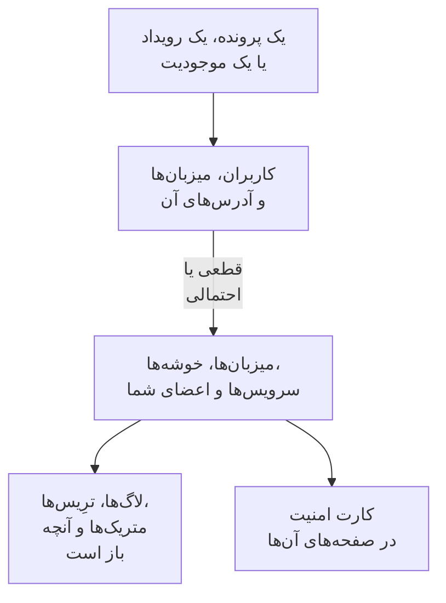

# سیگنال‌های مرتبط

یک پرونده امنیتی می‌گوید درباره کدام کاربران، میزبان‌ها و آدرس‌هاست. سیگنال‌های مرتبط می‌گوید OneUptime کدام‌یک از آن‌ها را از پیش می‌شناسد - میزبان‌ها، میزبان‌های کانتینر، خوشه‌های Kubernetes، دستگاه‌های شبکه، سرویس‌ها و اعضای شما - و پیرامون پرونده روی هر یک چه رخ می‌داد: لاگ‌ها، ترِیس‌ها و متریک‌های آن، حوادث و هشدارهای باز روی آن، مانیتورهایی که آن را زیر نظر دارند و آنچه روی آن تغییر کرد. در جهت عکس، صفحه یک میزبان، یک خوشه، یک سرویس یا یک عضو می‌گوید Security Events درباره آن چه یافته است.

:::cards
- [کجا آن را می‌بینید](#کجا-آن-را-میبینید): صفحه یک پرونده، زبانه یک رویداد، صفحه یک موجودیت و صفحه‌های آنچه به آن‌ها اشاره می‌کنند.
- [یک مقدار چگونه تطبیق داده می‌شود](#یک-مقدار-چگونه-تطبیق-داده-میشود): چه چیزی همان رکورد شمرده می‌شود و چه چیزی فقط احتمالاً.
- [هر رکورد چه نشان می‌دهد](#هر-رکورد-چه-نشان-میدهد): سیگنال‌های آن پیرامون پرونده و آنچه روی آن باز است.
- [چه کسی چه می‌بیند](#چه-کسی-چه-میبیند): هر رکورد با نقش خود خواننده خوانده می‌شود.
:::

## چگونه کار می‌کند

OneUptime هر مقدار را در میان رکوردهای پروژه جستجو می‌کند، می‌گوید هر تطابق چقدر قطعی است، و نشان می‌دهد پیرامون پرونده روی هر رکورد چه رخ می‌داد.

## پیش از شروع

- رویدادهای امنیتی که می‌رسند، و میزبان‌ها، خوشه‌های Kubernetes، سرویس‌ها یا اعضایی در پروژه که آن رویدادها بتوانند به آن‌ها اشاره کنند. [شروع کار با امنیت](/docs/telemetry/security-getting-started) را ببینید.
- نقشی که بتواند رویدادهای امنیتی را بخواند، و انواع رکوردهایی را که می‌خواهید ببینید.

## کجا آن را می‌بینید

- **سیگنال‌های مرتبط**، صفحه‌ای از هر پرونده امنیتی: یک پرونده را در **محصولات** > **رویدادهای امنیتی** > **پرونده‌های امنیتی** > **پرونده‌های باز** باز کنید و سپس در منوی آن، **سیگنال‌های مرتبط** را پس از **موجودیت‌ها** باز کنید.
- **متصل**، زبانه‌ای از هر رویداد امنیتی: یک رویداد را در **محصولات** > **رویدادهای امنیتی** > **رویدادها** باز کنید. آنچه رویداد به آن اشاره می‌کند را در یک ساعتِ پیرامون آن فهرست می‌کند.
- صفحه یک موجودیت، در **محصولات** > **رویدادهای امنیتی** > **ریسک موجودیت**: جایی که OneUptime آن کاربر، میزبان یا آدرس را می‌شناسد، پیرامون آخرین رویداد امنیتی آن.
- کارت **امنیت** در صفحه هر میزبان، میزبان Docker، میزبان Podman، خوشه Kubernetes، دستگاه شبکه، سرویس، عضو و مورد موجودی: پرونده‌های امنیتی بازی که به آن اشاره می‌کنند، اینکه در ۷ روز گذشته چند رویداد امنیتی و یافته به آن اشاره کرده‌اند، شدیدترینِ آن‌ها و ریسک آن. **باز کردن در Security Events** آن را آنجا باز می‌کند.
- کارت **امنیت** در صفحه یک حادثه، وقتی یک پرونده امنیتی آن حادثه را اعلام کرده باشد (**اعلام‌شده از**) یا پرونده‌های باز به میزبان یا خوشه‌ای اشاره کنند که حادثه بر آن اثر می‌گذارد (**پرونده‌های باز که به موارد متأثر از آن اشاره می‌کنند**).

## یک مقدار چگونه تطبیق داده می‌شود

هر کاربر، میزبان و آدرسی که یک پرونده یا رویداد به آن اشاره می‌کند، در میان رکوردهای پروژه جستجو می‌شود:

| آنچه پرونده یا رویداد به آن اشاره می‌کند | تطبیق‌داده‌شده با | چقدر قطعی |
| --- | --- | --- |
| نام میزبان یا دامنه‌ای همانند نامی که یک میزبان، میزبان کانتینر، خوشه یا دستگاه شبکه گزارش می‌کند | همان رکورد | قطعی |
| همان نام، بی‌آنکه گفته شود میزبان است | همان رکورد | احتمالی |
| شکل کوتاه یا کامل نام یک رکورد، مانند `web-1` و `web-1.acme.internal` | همان رکورد | احتمالی |
| آدرس IP عمومی‌ای که فقط یک رکورد دارد | همان رکورد | قطعی |
| آدرس IP خصوصی، یا آدرسی که بیش از یک رکورد دارند | هر رکوردی که آن را دارد | احتمالی |
| ایمیل یک عضو | همان عضو | قطعی |
| برای رویدادهایی که از لاگ‌های شما خوانده می‌شوند، رکوردی که خط لاگ زیر آن فرستاده شد | همان میزبان، خوشه یا سرویس | قطعی |
| فقط یک نام کاربری، یک URL، هش یک فایل یا یک فرایند | هیچ: هیچ رکوردی با آن‌ها شناخته نمی‌شود | - |

- یک تطابق احتمالی کنار نامش **تطابق احتمالی** را نشان می‌دهد و می‌گوید چرا. هرگز در صفحه رکورد شمرده نمی‌شود و حادثه‌ای که پرونده اعلام می‌کند هرگز به آن پیوند داده نمی‌شود.
- آنچه جستجو شد و رکوردی از پروژه نیست، زیر **در OneUptime نیست** فهرست می‌شود. وقتی نوعی از رکورد که مقدار ممکن است باشد خوانده نشده باشد، آن مقدار هرگز آنجا فهرست نمی‌شود.
- برای یک پرونده حداکثر ۱۰ رکورد فهرست می‌شود، اول قطعی‌ها.

## هر رکورد چه نشان می‌دهد

- سیگنال‌های آن، که هر کدام روی همان رکورد و بازه پرونده باز می‌شود: **لاگ‌ها**، **ترِیس‌ها** و **متریک‌ها**، **استثناها** یک سرویس، **رویدادهای Kubernetes** یک خوشه، **توپولوژی** رکورد، و مورد **Inventory** آن وقتی موجودی موردی برای آن دارد.
- حوادث و هشدارهایی که اکنون روی آن باز هستند، و مانیتورهایی که آن را زیر نظر دارند، که هر کدام صفحه خود را باز می‌کند.
- آنچه در این بازه روی آن تغییر کرد: استقرارهای یک سرویس، انتشارهای یک خوشه و رفع‌های یک میزبان.

| کجا | بازه |
| --- | --- |
| یک پرونده | از ۳۰ دقیقه پیش از نخستین شناسایی آن تا ۳۰ دقیقه پس از آخرینِ آن، حداکثر ۲۴ ساعتِ آخرِ آن |
| یک رویداد | ۳۰ دقیقه پیش و پس از آن |
| صفحه یک موجودیت | ۳۰ دقیقه پیش و پس از آخرین رویداد امنیتی آن |
| کارت **امنیت** یک رکورد | ۷ روز گذشته |

## چه کسی چه می‌بیند

- سیگنال‌های مرتبط و کارت **امنیت** یک رکورد به نقشی نیاز دارند که بتواند رویدادهای امنیتی را بخواند: Security Admin، Security Member، Security Viewer، Project Owner یا Project Admin. هیچ‌کس دیگر در هیچ صفحه‌ای داده امنیتی نمی‌بیند. [نقش‌ها](/docs/permissions/reference#نقشها) را ببینید.
- کارت **امنیت** یک حادثه به نقشی نیاز دارد که بتواند پرونده‌های امنیتی را بخواند.
- هر رکورد با نقش خود شما خوانده می‌شود. نوعی از رکورد که نقش شما نمی‌تواند بخواند کنار گذاشته می‌شود و صفحه این را می‌گوید؛ نوعی که همین حالا خوانده نشد هم این را می‌گوید، همراه با **تلاش دوباره**.
- صفحه یک رکورد کارت **امنیت** خود را فقط در پروژه‌ای نشان می‌دهد که از Security Events استفاده می‌کند: پروژه‌ای که در ۷ روز گذشته یک رویداد امنیتی دریافت کرده است.

## حوادثی که یک پرونده اعلام می‌کند

**اعلام حادثه** روی یک پرونده، یا گام یک پلی‌بوک که حادثه‌ای اعلام می‌کند، حادثه را به میزبان‌ها، میزبان‌های Docker و Podman، خوشه‌های Kubernetes و سرویس‌هایی پیوند می‌دهد که پرونده به‌طور قطعی به آن‌ها مرتبط است. حادثه در صفحه‌های آن‌ها نشان داده می‌شود، قوانین مالکانشان بر آن اعمال می‌شود و فید آن، پرونده و آنچه به آن پیوند داده شد را نام می‌برد. یک تطابق احتمالی هرگز پیوند داده نمی‌شود.

## OneUptime AI

ارزیابی اولیه یک پرونده توسط OneUptime AI سیگنال‌های مرتبط آن را می‌خواند: آنچه روی میزبان‌ها، سرویس‌ها و اعضایی که پرونده به آن‌ها اشاره می‌کند باز است و آنچه تغییر کرد. بررسی یک حادثه، پرونده امنیتی‌ای را که آن را اعلام کرد و پرونده‌های بازی را که به موارد متأثر از آن اشاره می‌کنند می‌خواند. [OneUptime AI در امنیت](/docs/telemetry/security-ai) را ببینید.

## عیب‌یابی

:::details میزبانی که پرونده به آن اشاره می‌کند فهرست نشده است
بررسی کنید که پرونده میزبان را با همان نامی بنامد که میزبان خود را می‌نامد، یا به آدرس عمومی‌ای اشاره کند که فقط همان میزبان دارد. نام کوتاهی مانند `web-1` برای `web-1.acme.internal` به‌عنوان تطابق احتمالی فهرست می‌شود، و فقط یک نام کاربری، یک URL، هش یک فایل یا یک فرایند اصلاً جستجو نمی‌شود.
:::

:::details میزبان درست به‌عنوان تطابق احتمالی فهرست شده است
یک تطابق احتمالی هرگز شمرده یا پیوند داده نمی‌شود، تا نامی که دو ماشین در آن شریک‌اند هرگز درباره ماشین اشتباه چیزی به شما نگوید. کاری کنید که لاگ‌ها و شناسایی‌هایتان میزبان را با نامی که گزارش می‌کند بنامند.
:::

:::details صفحه یک میزبان کارت امنیت ندارد
این کارت به نقشی نشان داده می‌شود که بتواند رویدادهای امنیتی را بخواند، در پروژه‌ای که در ۷ روز گذشته یک رویداد امنیتی دریافت کرده است. میزبانی که در این مدت چیزی به آن اشاره نکرده، یک خط نشان می‌دهد که همین را می‌گوید.
:::

:::details صفحه می‌گوید نقش شما نمی‌تواند نوعی از رکورد را ببیند
هر رکورد با نقش خود شما خوانده می‌شود. از یک Project Owner یا Project Admin نقشی بخواهید که بتواند آن نوع رکورد را بخواند.
:::

## گام‌های بعدی

:::cards
- [پرونده‌های امنیتی و پلی‌بوک‌ها](/docs/telemetry/security-cases): به یک پرونده رسیدگی کنید و از آن یک حادثه اعلام کنید.
- [رویدادهای امنیتی (SIEM)](/docs/telemetry/security-events): رویدادهای پشت یک پرونده و لاگ‌هایی که از آن‌ها خوانده می‌شوند.
- [ریسک موجودیت (هشداردهی مبتنی بر ریسک)](/docs/telemetry/security-entity-risk): صفحه یک موجودیت، ریسک آن، و جایی که OneUptime آن را می‌شناسد.
- [OneUptime AI در امنیت](/docs/telemetry/security-ai): ارزیابی اولیه چگونه آنچه پرونده به آن اشاره می‌کند را می‌خواند.
:::
