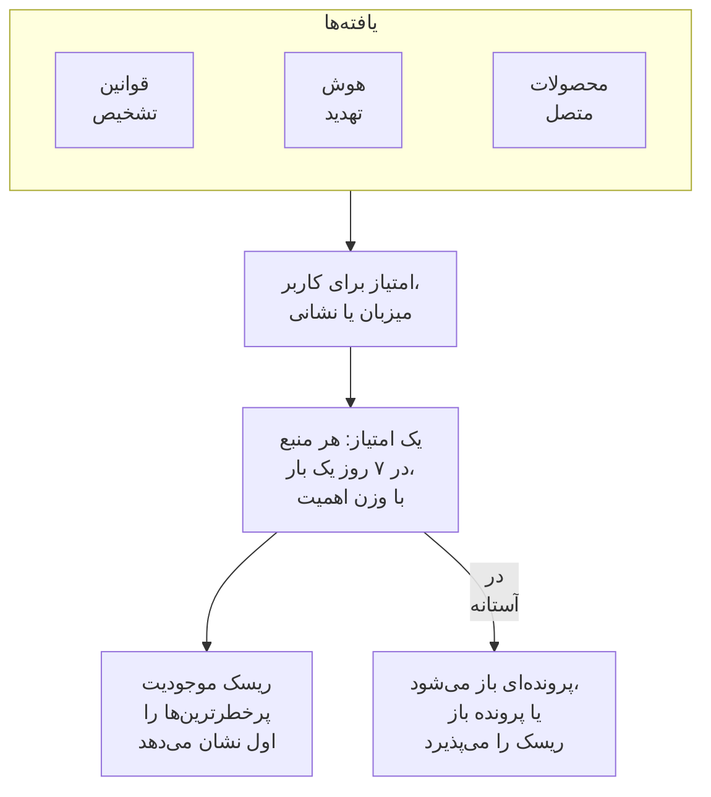

# ریسک موجودیت (هشداردهی مبتنی بر ریسک)

یک یافته به‌تنهایی معمولاً چیز زیادی نمی‌گوید. رشته‌ای از ورودهای ناموفق، نخستین sudo روی یک میزبان و ورودی از کشوری تازه هر کدام ارزش یک نگاه دارند؛ همان حساب در هر سه طی یک هفته ارزش یک پرونده دارد. ریسک موجودیت آنچه را قوانین تشخیص، هوش تهدید، محصولات متصل شما و امنیت داده درباره هر کاربر، میزبان، نشانی IP و مخزن داده می‌یابند جمع می‌کند، پرخطرترین‌ها را اول نشان می‌دهد و برای موجودیتی که ریسکش به آستانه پروژه برسد پرونده باز می‌کند.

:::cards
- [امتیاز چگونه شمرده می‌شود](#امتیاز-چگونه-شمرده-میشود): امتیاز بر اساس شدت، و هر منبع هفته‌ای یک بار.
- [سطح‌های ریسک و پرونده‌ها](#سطحهای-ریسک-و-پروندهها): یک امتیاز چه سطحی دارد، و پرونده کی باز می‌شود.
- [اهمیت موجودیت](#اهمیت-موجودیت): آنچه مهم‌تر است بیشتر، و آنچه کم‌اهمیت‌تر است کمتر شمرده شود.
- [صفحه یک موجودیت](#صفحه-یک-موجودیت): چرا پرخطر است، ماه آن، و پرونده‌های مربوط به آن.
- [امتیاز ریسک یک قانون تشخیص](#امتیاز-ریسک-یک-قانون-تشخیص): وزن خود یک قانون در امتیاز.
:::

## چگونه کار می‌کند

**محصولات** > **رویدادهای امنیتی** > **ریسک موجودیت** را باز کنید: هر کاربر، میزبان، نشانی IP و مخزن داده که اکنون ریسک دارد، پرخطرترین‌ها اول، با سطح، میزان اهمیت، آنچه آن را یافته و زمانش. هر کدام در صفحه‌ای جداگانه باز می‌شود. **پرخطرترین موجودیت‌ها** در نمای کلی بالای این فهرست را نشان می‌دهد، و **جست‌وجوی یک موجودیت** در زیر آن هر مقداری را در 30 روز رویداد جستجو می‌کند، حتی یک دامنه یا هش فایل.

## پیش از شروع

- رویدادهای امنیتی که می‌رسند، و قوانین تشخیص، هوش تهدید یا محصولات متصلی که چیزی در آنها می‌یابند. [شروع کار با امنیت](/docs/telemetry/security-getting-started) را ببینید.
- قوانین تشخیصی که بر اساس فیلدی که کسی را نام می‌برد گروه‌بندی می‌کنند: **فیلد گروه‌بندی**، مانند `principalUser`، `principalHost` یا `principalIp`، یا فیلدهایی که یک همبستگی بر اساس آنها گروه‌بندی می‌کند. قانونی که بر اساس هیچ چیز گروه‌بندی نکند ریسکی نمی‌افزاید.
- برای تغییر **امتیازدهی ریسک**: برای کلید و آستانه آن Project Owner یا Project Admin، و برای فهرست موجودیت‌ها نقشی که بتواند قوانین تشخیص بسازد. Security Viewer همه را می‌خواند. [نقش‌ها](/docs/permissions/reference#نقشها) را ببینید.

## امتیاز چگونه شمرده می‌شود

هر یافته به کاربر، میزبان، نشانی IP یا مخزن داده مربوط امتیاز ریسک می‌دهد:

| یافته‌ای با شدت | می‌افزاید |
| --- | --- |
| کم | 10 امتیاز |
| متوسط | 25 امتیاز |
| زیاد | 50 امتیاز |
| بحرانی | 75 امتیاز |

- یافته اطلاعاتی چیزی نمی‌افزاید، و یافته‌ای با شدت نامعلوم متوسط شمرده می‌شود.
- امتیاز یک قانون تشخیص به مقداری می‌رسد که بر اساس آن گروه‌بندی می‌کند. تطبیق هوش تهدید به نشانی IP که شاخص نام می‌برد افزوده می‌شود. هشدار یک محصول متصل به کاربر و میزبانی که نام می‌برد افزوده می‌شود، و در غیر این صورت به نشانی IP آن. مسئله‌ای که امنیت داده می‌یابد به مخزن داده‌ای افزوده می‌شود که در آن یافته شده است.
- هر منبع یک بار شمرده می‌شود. یک قانون تشخیص، یک فید هوش تهدید، قانون یک محصول متصل یا یک بررسی امنیت داده در 7 روز یک بار شمرده می‌شود، با بیشترین مقداری که افزوده، هر چند بار هم که اجرا شود: یک قانون پرسروصدا هرگز نمی‌تواند موجودیتی را بدتر از سه قانون مختلف نشان دهد.
- منبعی که ۷ روز چیزی نیافته دیگر شمرده نمی‌شود و امتیاز پایین می‌آید. امتیازها هر ۱۵ دقیقه بررسی می‌شوند، پس امتیاز بدون یافته تازه هم به‌موقع پایین می‌آید.

امتیاز یک موجودیت جمع منابع آن است که با اهمیتش وزن‌دهی می‌شود. حمله آزمایشی **ارسال حمله آزمایشی** و پرونده‌ای که کسی دستی باز کند ریسکی نمی‌افزایند.

## سطح‌های ریسک و پرونده‌ها

هر امتیاز در برابر آستانه پروژه، که اگر تغییرش ندهید 100 است، به‌عنوان یک سطح خوانده می‌شود:

| امتیاز ریسک | سطح | چه رخ می‌دهد |
| --- | --- | --- |
| 1 تا 49 | کم | در ریسک موجودیت فهرست می‌شود |
| 50 تا 99 | متوسط | در ریسک موجودیت فهرست می‌شود |
| 100 تا 199 | زیاد | پرونده‌ای با سطح زیاد باز می‌شود |
| 200 یا بیشتر | بحرانی | پرونده‌ای با سطح بحرانی باز می‌شود |

وقتی ریسک یک موجودیت به آستانه برسد، تشخیصی از منبع ریسک موجودیت درباره آن ایجاد می‌شود. این تشخیص به پرونده باز آن موجودیت می‌پیوندد یا پرونده‌ای به نام آن باز می‌کند، مانند `High risk — k.morgan@acme-commerce.example`، و منابعی را که بیشترین ریسک را افزوده‌اند، تا ۱۰ مورد، با امتیاز، دفعات اجرا و آخرین زمانشان فهرست می‌کند.

وقتی پرونده‌ای درباره ریسک یک موجودیت باز شد، آنچه پشت آن بود دوباره شمرده نمی‌شود: پرونده دیگری تنها زمانی باز می‌شود که منابع تازه از آن پس دوباره به آستانه برسند. پرونده‌ای که به‌عنوان رسیدگی‌شده بسته شده با همان یافته‌ها دوباره باز نمی‌شود.

آستانه را در **محصولات** > **رویدادهای امنیتی** > **تنظیمات** > **امتیازدهی ریسک** > **آستانه خطر** تغییر دهید: عددی صحیح از 10 تا 10000. متوسط از نصف آن و بحرانی از دو برابر آن شروع می‌شود، در همه صفحه‌ها.

### روشن یا خاموش کردن پرونده‌های ریسک

**پرونده‌های ریسک** در **تنظیمات** > **امتیازدهی ریسک** تعیین می‌کند که ریسک پرونده باز کند یا نه، و با تغییر آن ذخیره می‌شود. پروژه‌های تازه با آن روشن شروع می‌شوند. پروژه‌ای که پیش از ریسک موجودیت ساخته شده آن را خاموش نگه می‌دارد تا کسی روشنش کند، و **ریسک موجودیت** این را بالای فهرستش می‌گوید. ریسک در هر حال امتیازدهی و فهرست می‌شود.

## اهمیت موجودیت

برخی موجودیت‌ها از بقیه مهم‌ترند: یک کنترل‌کننده دامنه، حساب یک مدیر، یک سرور پرداخت. برخی کم‌اهمیت‌ترند، مانند یک اسکنر آسیب‌پذیری که اسکن‌هایش قابل انتظار است. آنها را در **تنظیمات** > **امتیازدهی ریسک** > **اهمیت موجودیت** با **افزودن موجودیت** فهرست کنید:

| اهمیت | ریسک آن را می‌شمارد |
| --- | --- |
| کم | ×0.5 |
| فهرست‌نشده | ×1 |
| زیاد | ×1.5 |
| بسیار زیاد | ×2 |

هر مدخل یک مقدار یا یک الگوی `*` است، بدون توجه به حروف بزرگ و کوچک: `dc-*` همه کنترل‌کننده‌های دامنه را نام می‌برد، و `*@contractors.example` همه پیمانکاران را. **نوع** آن را به کاربران، میزبان‌ها، نشانی‌های IP یا مخازن داده محدود می‌کند؛ خالی بودنش با همه منطبق است. وقتی چند مدخل یک موجودیت را نام ببرند، دقیق‌ترین شمرده می‌شود: مقدار کامل پیش از الگو، و الگوی بلندتر پیش از کوتاه‌تر. یک تغییر طی چند دقیقه به امتیاز همه موجودیت‌ها می‌رسد. امنیت داده مخازن داده‌ای را که حساس می‌یابد خودش فهرست می‌کند، مخازن محرمانه را با زیاد و مخازن محدود را با بسیار زیاد؛ اگر چنین مدخلی را تغییر دهید از آن شما می‌شود و امنیت داده دیگر به آن دست نمی‌زند.

## صفحه یک موجودیت

در یک ردیف از **ریسک موجودیت** روی **مشاهده** کلیک کنید، یا روی ریسک کنار یک موجودیت در صفحه **موجودیت‌ها** یک پرونده:

| بخش | آنچه نشان می‌دهد |
| --- | --- |
| سرصفحه | نوع و اهمیت آن، امتیاز و سطحش، و اینکه امتیاز چگونه به دست آمده |
| **فعالیت** | رویدادهای امنیتی و یافته‌های آن در ۷ روز گذشته |
| **آنچه به ریسک آن می‌افزاید** | هر منبع، شدتش، امتیازی که می‌افزاید، دفعات اجرا و آخرین زمانش |
| **ریسک در ۳۰ روز گذشته** | امتیاز آن در پایان هر روز، با رنگ سطحش |
| **پرونده‌های مربوط** | پرونده‌های امنیتی بازشده درباره آن، جدیدترین‌ها اول |

**باز کردن در هم‌بسته‌سازی** نموداری از رویدادهایش می‌کشد، و **جستجوی رویدادهای آن** صفحه **رویدادها** را روی هفته‌اش باز می‌کند. **بازنشانی ریسک** امتیاز و منابع آن را پاک می‌کند، مثلاً پس از یک آزمایش برنامه‌ریزی‌شده: آنچه بعداً یافت شود از صفر شمرده می‌شود و پرونده‌هایش تغییر نمی‌کنند. بازنشانی به نقشی نیاز دارد که بتواند داده‌های امنیتی را حذف کند، و [گزارش ممیزی](/docs/configuration/audit-logs) آن را ثبت می‌کند.

OneUptime AI هنگام بررسی یک پرونده، ریسک موجودیت‌های آن را می‌خواند. [OneUptime AI در امنیت](/docs/telemetry/security-ai) را ببینید.

## امتیاز ریسک یک قانون تشخیص

یک قانون تشخیص امتیاز سطح خود را می‌افزاید، که از `level` آن در Sigma می‌آید. برای دادن وزنی جداگانه به آن، فرم قانون را باز کنید، به **هنگام تطابق** بروید، **فیلدهای بیشتر** را باز کنید و **امتیاز ریسک** را از 0، که ریسکی نمی‌افزاید، تا 100 تنظیم کنید. برای امتیاز سطحش آن را خالی بگذارید.

## عیب‌یابی

:::details موجودیتی در ریسک موجودیت نیست
بررسی کنید که یک قانون تشخیص، یک فید هوش تهدید یا یک محصول متصل در ۷ روز گذشته چیزی درباره آن یافته باشد، و قانون بر اساس فیلدی که آن را نام می‌برد گروه‌بندی کند. یافته‌های اطلاعاتی چیزی نمی‌افزایند، و منبعی که ۷ روز چیزی نیافته دیگر شمرده نمی‌شود.
:::

:::details ریسک یک موجودیت به آستانه رسید و پرونده‌ای باز نشد
بررسی کنید که **پرونده‌های ریسک** در **تنظیمات** > **امتیازدهی ریسک** روشن باشد. اگر پیش‌تر پرونده‌ای درباره ریسک موجودیت باز شده باشد، برای پرونده بعدی فقط منابع تازه از آن پس شمرده می‌شوند.
:::

:::details قانونی بارها و بارها اجرا می‌شود و امتیاز موجودیت بالا نمی‌رود
شمارش همین‌گونه است: هر منبع در ۷ روز یک بار شمرده می‌شود، با بیشترین مقداری که افزوده. **امتیاز ریسک** یک قانون پرسروصدا را کم کنید، یا به موجودیتی که یافته‌هایش قابل انتظار است اهمیت کم بدهید.
:::

:::details امتیازی برابر جمع منابعش نیست
اهمیت آن را وزن‌دهی می‌کند. صفحه موجودیت جمع منابعش و وزن را نشان می‌دهد، مانند 100 از منابعش × 2 = 200.
:::

## گام‌های بعدی

:::cards
- [پرونده‌های امنیتی و پلی‌بوک‌ها](/docs/telemetry/security-cases): به پرونده‌هایی که ریسک باز می‌کند رسیدگی کنید و آنها را با یک حکم ببندید.
- [رویدادهای امنیتی (SIEM)](/docs/telemetry/security-events): قوانین تشخیص، همبستگی و رویدادهای پشت هر یافته.
- [هوش تهدید (STIX/TAXII)](/docs/telemetry/threat-intelligence): تطبیق‌هایی که به ریسک یک نشانی می‌افزایند.
- [OneUptime AI در امنیت](/docs/telemetry/security-ai): یک بررسی چگونه ریسک موجودیت‌های یک پرونده را می‌خواند.
:::
