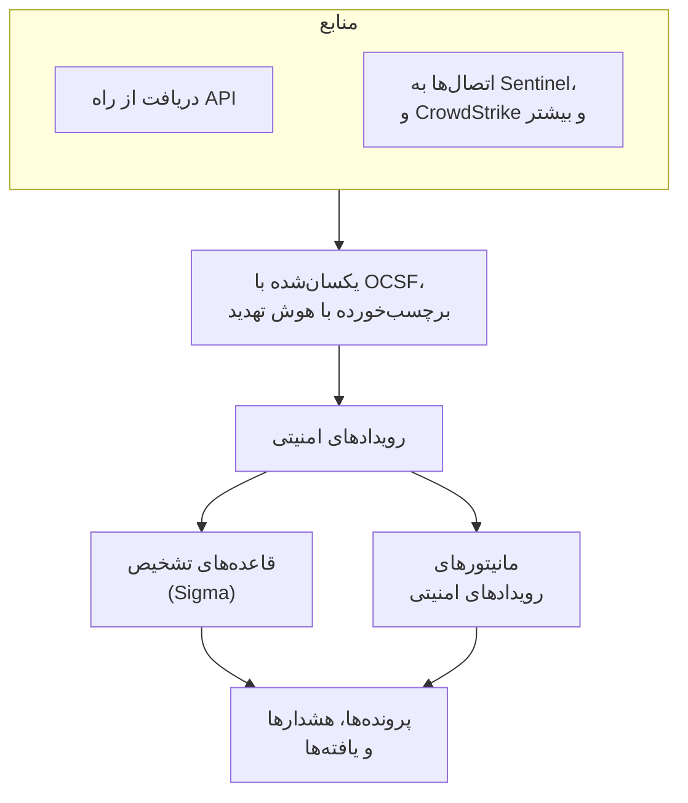
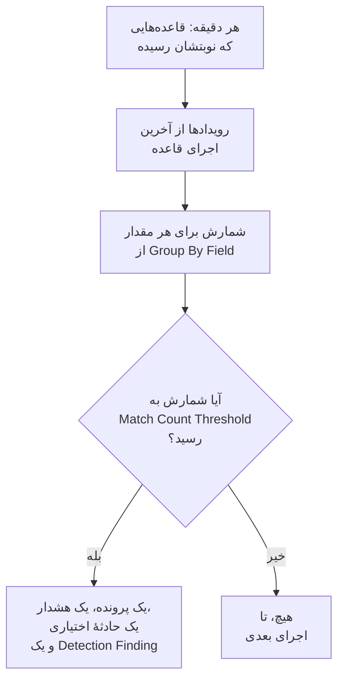

# رویدادهای امنیتی (SIEM)

OneUptime رویدادهای امنیتی را کنار لاگ‌ها، ترِیس‌ها و متریک‌های شما نگه می‌دارد، و به همهٔ آن‌ها یک شکل می‌دهد، [OCSF](https://schema.ocsf.io/) (Open Cybersecurity Schema Framework)، با هر قالبی که رسیده باشند. رویدادها را از هر منبعی بفرستید، در آن‌ها جستجو کنید، و آن‌هایی را که مهم‌اند با قاعده‌های تشخیص Sigma، هوش تهدید و مانیتورها پیدا کنید. آنچه این‌ها پیدا می‌کنند به [پرونده‌هایی](/docs/telemetry/security-cases) برای رسیدگی تبدیل می‌شود، و پلی‌بوک‌ها به آن‌ها پاسخ می‌دهند.

:::cards
- [ارسال رویدادها](#ارسال-رویدادهای-امنیتی): یک POST روی HTTPS، یک خروجی Fluent Bit، یا اتصالی به یک محصول امنیتی.
- [جستجو و هم‌بسته‌سازی](#کاوش-رویدادهای-امنیتی): کاوشگر رویدادها و نمودار هم‌بسته‌سازی.
- [شکارها](#شکارها): جستجوهای ذخیره‌شده‌ای که طبق زمان‌بندی اجرا می‌شوند و وقتی چیزی پیدا کنند به افراد خبر می‌دهند.
- [قاعده‌های تشخیص](#قاعدههای-تشخیص): قاعده‌های Sigma که پرونده و هشدار باز می‌کنند.
- [مانیتورها](#مانیتورهای-رویدادهای-امنیتی): شمارش در یک پنجرهٔ غلتان، با وضعیتی که بهبود می‌یابد.
:::

## چگونه کار می‌کند



**محصولات** > **رویدادهای امنیتی** را زیر **مشاهده‌پذیری** باز کنید. منوی آن برای هر بخش از امنیت یک قسمت دارد، و برای هر چیزی در آن صفحه‌ای جدا:

| صفحه | قسمت | برای چیست |
| --- | --- | --- |
| **نمای کلی** | نمای کلی | امنیت چگونه راه‌اندازی شده، چه چیزی همین حالا به کسی نیاز دارد، و پرونده‌ها با چه سرعتی رسیدگی می‌شوند |
| **پرونده‌های باز** | پرونده‌های امنیتی | صف: هر پرونده‌ای که هنوز بسته نشده، گروه‌بندی‌شده بر پایهٔ اینکه دربارهٔ چیست |
| **سپرده‌شده به من** | پرونده‌های امنیتی | پرونده‌های بازی که به شما سپرده شده‌اند |
| **بی‌مسئول** | پرونده‌های امنیتی | پرونده‌های بازی که هنوز کسی برنداشته |
| **پرونده‌های بسته** | پرونده‌های امنیتی | پرونده‌هایی که با نتیجه بسته شده‌اند، تازه‌ترین‌ها اول |
| **همه پرونده‌ها** | پرونده‌های امنیتی | هر پرونده، باز یا بسته |
| **رویدادها** | رویدادها | هر رویداد را جستجو و فیلتر کنید، و یکی را باز کنید تا همهٔ فیلدهایش را ببینید |
| **شکارها** | رویدادها | جستجوهایی که از رویدادها ذخیره شده‌اند، با یک کلیک دوباره باز می‌شوند یا طبق زمان‌بندی‌ای اجرا می‌شوند که وقتی چیزی پیدا کنند به افراد خبر می‌دهد |
| **Campaigns** | رویدادها | هر نشانی‌ای که درخواست‌های حمله فرستاده است، و اینکه آیا یکی از درخواست‌هایش عبور کرده است |
| **ریسک موجودیت** | رویدادها | هر کاربر، میزبان و نشانی با امتیازی بر اساس آنچه این هفته درباره‌اش یافت شده، پرخطرترین‌ها اول |
| **هم‌بسته‌سازی** | رویدادها | نموداری از رویدادهایی که یک میزبان، یک کاربر یا یک نشانی IP مشترک دارند |
| **قواعد تشخیص** | Detections | قاعده‌های Sigma که طبق زمان‌بندی اجرا می‌شوند و پرونده باز می‌کنند |
| **استثناهای قاعده** | Detections | آنچه قاعده‌هایتان عمداً نادیده می‌گیرند، مانند یک اسکنر یا یک آزمون برنامه‌ریزی‌شده، هر کدام با اینکه چه کسی و چرا آن را افزوده است |
| **فهرست‌های پایش** | Detections | فهرست‌هایی که قاعده‌هایتان با آن‌ها تطبیق می‌دهند، مانند کاربران VIP، میزبان‌های حیاتی، هش‌های فایل مخرب شناخته‌شده و نشانی‌هایی که مدیران می‌توانند از آن‌ها وارد شوند |
| **کتابخانه قواعد** | Detections | قاعده‌های تشخیص آماده برای افزودن، هر کدام با رویدادهایی که می‌خواند و اینکه می‌رسند یا نه، با علامت روی قاعده‌های پیشنهادی |
| **اطلاعات تهدید** | Detections | فیدهای STIX/TAXII از شاخص‌های شناخته‌شدهٔ مخرب |
| **پوشش ATT&CK** | Detections | تکنیک‌های MITRE ATT&CK که قاعده‌های شما پوشش می‌دهند |
| **پلی‌بوک‌ها** | Playbooks | گام‌هایی که خودکار یا دستی روی پرونده‌ها اجرا می‌شوند |
| **تأییدها** | Playbooks | گام‌های پلی‌بوک که منتظرند کسی آن‌ها را تأیید یا رد کند |
| **اجراهای پلی‌بوک** | Playbooks | آنچه هر پلی‌بوک گام به گام انجام داد |
| **موجودیت‌های محافظت‌شده** | Playbooks | کاربران و میزبان‌هایی که هیچ پلی‌بوکی آن‌ها را مهار نمی‌کند |
| **تنظیمات** | هوش مصنوعی | اینکه آیا OneUptime AI هر پروندهٔ تازه را بررسی اولیه می‌کند |
| **اتصال‌ها** | Connections | لاگ‌های شما، محصولات امنیتی‌ای که OneUptime از آن‌ها دریافت می‌کند، و SIEM‌هایی که به آن‌ها می‌فرستد |
| **راهنمای راه‌اندازی** | Connections | قطعه‌کدهایی برای ارسال رویدادها، با کلید دریافت دادهٔ شما پرشده |
| **اولویت‌های پرونده** | تنظیمات | یک پرونده چقدر فوری است: اولویت‌های خود پروژه، فوری‌ترین در آغاز |
| **اهداف پاسخ** | تنظیمات | یک پرونده با هر اولویت با چه سرعتی باید برعهده گرفته و مهار شود |
| **وضعیت‌های پرونده** | تنظیمات | گام‌هایی که پرونده از آن‌ها می‌گذرد، و اینکه پرونده در هر کدام در حکم چیست |
| **امتیازدهی ریسک** | تنظیمات | اینکه ریسک یک موجودیت پرونده باز کند یا نه، در چه ریسکی، و اهمیت هر موجودیت |

**تشخیص‌ها**، **هوش مصنوعی**، **اتصال‌ها** و **تنظیمات** که یک بار راه‌اندازی می‌شوند، تا وقتی بازشان نکنید جمع‌شده می‌مانند. تازه با امنیت آشنا شده‌اید؟ [شروع کار با امنیت](/docs/telemetry/security-getting-started) آن را با دو کلیک راه‌اندازی می‌کند.

## پیش از شروع

دادهٔ امنیتی را فقط نقش‌های Project Owner و Project Admin و سه نقش Security می‌خوانند؛ نقش‌های دیگر در رویدادهای امنیتی چیزی نمی‌بینند. [نقش‌ها](/docs/permissions/reference#نقشها) را ببینید.

| نقش | چه کاری می‌تواند بکند |
| --- | --- |
| Security Admin | همه چیز: رویدادها، پرونده‌ها، پلی‌بوک‌ها، قاعده‌های تشخیص، فیدهای هوش تهدید و اتصال‌ها |
| Security Member | خواندن رویدادها و هوش تهدید، رسیدگی به پرونده‌ها، اجرای پلی‌بوک‌ها و تأیید گام‌های آن‌ها، و ساختن، تغییر دادن و حذف کردن قاعده‌های تشخیص و فیدها. نمی‌تواند پلی‌بوک یا اتصال راه بیندازد، یا دادهٔ امنیتی را حذف کند. |
| Security Viewer | خواندن رویدادها، پرونده‌ها، پلی‌بوک‌ها، قاعده‌ها، فیدها، شاخص‌ها و اتصال‌ها |

## ارسال رویدادهای امنیتی

:::steps
### یک کلید دریافت داده بسازید

**تنظیمات پروژه** > **تله‌متری و APM** > **کلیدهای دریافت داده** را باز کنید و روی **ساخت کلید دریافت داده** کلیک کنید. رویدادهای امنیتی همان کلیدهای بقیهٔ تله‌متری شما را به کار می‌برند.

### رویدادهایتان را بفرستید

JSON را با کلید در `x-oneuptime-token` به `/security-events/v1/ingest` بفرستید:

:::tabs
@tab OCSF
```bash
curl -X POST "https://oneuptime.com/security-events/v1/ingest?format=ocsf" \
  -H "Content-Type: application/json" \
  -H "x-oneuptime-token: YOUR_INGESTION_TOKEN" \
  -H "x-oneuptime-service-name: my-security-source" \
  -d '{ "events": [ { "class_uid": 3002, "severity_id": 4, "status": "Failure", "message": "Failed logon for alice", "actor": { "user": { "name": "alice" } }, "src_endpoint": { "ip": "203.0.113.7", "hostname": "laptop-alice" } } ] }'
```
@tab Google UDM
```bash
curl -X POST "https://oneuptime.com/security-events/v1/ingest?format=udm" \
  -H "Content-Type: application/json" \
  -H "x-oneuptime-token: YOUR_INGESTION_TOKEN" \
  -d '{ "events": [ { "metadata": { "event_type": "USER_LOGIN" }, "principal": { "hostname": "laptop-alice", "user": { "userid": "alice" }, "ip": ["203.0.113.7"] }, "security_result": [{ "severity": "HIGH", "action": ["BLOCK"] }] } ] }'
```
@tab Generic JSON
```bash
curl -X POST "https://oneuptime.com/security-events/v1/ingest" \
  -H "Content-Type: application/json" \
  -H "x-oneuptime-token: YOUR_INGESTION_TOKEN" \
  -d '{ "events": [ { "severity": "high", "event_type": "ssh_brute_force", "message": "12 failed SSH logins in 60s", "username": "root", "hostname": "web-01", "src_ip": "203.0.113.7" } ] }'
```
:::

نقطهٔ پایانی به‌محض اینکه رویدادها در صف قرار گیرند پاسخ `200` می‌دهد. رویدادی که مانند این‌ها بدون زمان فرستاده شود، در لحظهٔ رسیدنش قرار می‌گیرد.

### آن‌ها را در رویدادها پیدا کنید

**محصولات** > **رویدادهای امنیتی** > **رویدادها** را باز کنید. رویدادها در چند ثانیه نمایان می‌شوند، با شدت، کلاس، کاربر، میزبان و نشانی‌های IP پرشده.
:::

### قالب‌ها

| `format` | چه چیزی را می‌خواند | مقدارهای پذیرفتنی دیگر |
| --- | --- | --- |
| `ocsf` | JSON رویداد OCSF (`class_uid` ، `severity_id` و مانند آن) | ندارد |
| `udm` | رویدادهای UDM از Google SecOps (Chronicle) (`metadata.event_type` و مانند آن) | `chronicle`، `google-secops` |
| `google-secops-alert` | تشخیص‌ها و هشدارهای Google SecOps: وب‌هوک‌های SOAR و جریان تشخیص‌ها | `secops-alert`، `detection` |
| `generic` | هر JSON دیگری، که بر پایهٔ نام‌های رایج فیلدها خوانده می‌شود | ندارد |

قالب را با `?format=` ، با هدر `x-oneuptime-security-event-format` ، یا با یک فیلد `"format"` در بالاترین سطح نام ببرید. اگر آن را نگذارید، قالب هر رویداد جداگانه تعیین می‌شود، پس یک وب‌هوک می‌تواند تشخیص‌ها را با رویدادهای خام درآمیزد.

- بدنه می‌تواند یک رویداد، آرایه‌ای از رویدادها، یا `{ "events": [...] }` باشد.
- هدر `x-oneuptime-service-name` سرویس تله‌متری‌ای را نام می‌برد که رویدادها به آن تعلق دارند. بدون آن، رویدادها به سرویسی تعلق دارند که به نام محصول یا فروشندهٔ نخستین رویداد است، یا به `Security Events` .
- چیزی به این دلیل که نگاشت نشد کنار گذاشته نمی‌شود: هر فیلد منبع در ویژگی‌های رویداد قرار می‌گیرد.

### فیلدهای JSON عمومی

یک رویداد عمومی بر پایهٔ نام‌های رایج فیلدها خوانده می‌شود:

| فیلد رویداد | از نخستین موردِ موجود از این‌ها خوانده می‌شود |
| --- | --- |
| `message` | `message`، `msg`، `summary`، `description`، `title` |
| `severityName` | `severity`، `severity_name`، `level`، `priority`، `risk_level` |
| `time` | `timestamp`، `time`، `@timestamp`، `event_time`، `created_at` |
| `principalUser` | `user`، `username`، `user_name`، `account`، `actor` |
| `principalHost` | `host`، `hostname`، `computer`، `device`، `machine` |
| `principalIp` | `source_ip`، `src_ip`، `client_ip`، `ip` |
| `targetIp` | `destination_ip`، `dest_ip`، `dst_ip`، `target_ip` |
| `className` | `event_type`، `category`، `type`، `action` |
| `ruleName` | `rule`، `rule_name`، `signature`، `detection` |
| `productName` | `product`، `product_name`، `source`، `log_source` |
| `processName` | `process_name`، `process.name`، `proc.name`، `comm` |
| `processPath` | `process_path`، `Image`، `NewProcessName`، `exe`، `process.executable` |
| `processCommandLine` | `command_line`، `CommandLine`، `cmdline`، `process.command_line`، `proc.cmdline`، `process` |
| `parentProcessName` | `parent_process_name`، `process.parent.name`، `proc.pname` |
| `parentProcessPath` | `parent_process_path`، `ParentImage`، `ParentProcessName`، `process.parent.executable` |
| `parentProcessCommandLine` | `parent_command_line`، `ParentCommandLine`، `process.parent.command_line`، `proc.pcmdline` |

واژه‌ای که شدت را بیان می‌کند به یک سطح OCSF تبدیل می‌شود: `info` به‌صورت Informational، `warning` به‌صورت Low، `error` به‌صورت Medium، `alert` به‌صورت Critical و `emergency` به‌صورت Fatal خوانده می‌شود.

### ارسال با Fluent Bit

برای فرستادن لاگ‌های امنیتی‌ای که از پیش گردآوری می‌کنید، مانند auditd، syslog یا Falco، یک خروجی `http` به Fluent Bit اضافه کنید:

```ini title="fluent-bit.conf"
[OUTPUT]
    Name             http
    Match            security.*
    Host             oneuptime.com
    Port             443
    tls              On
    URI              /security-events/v1/ingest
    Format           json
    Json_date_key    timestamp
    Json_date_format iso8601
    Header           x-oneuptime-token YOUR_INGESTION_TOKEN
    Header           x-oneuptime-service-name my-security-source
    Retry_Limit      5
```

صفحهٔ **راهنمای راه‌اندازی**، زیر **اتصال‌ها**، این قطعه‌کدها را با میزبان و کلید خودتان پرشده دارد.

### یافتن رویدادهای امنیتی در لاگ‌های شما

**لاگ‌های شما** در بالای **اتصال‌ها** لاگ‌هایی را که از قبل برای OneUptime می‌فرستید به یک منبع تبدیل می‌کند. وقتی **یافتن رویدادهای امنیتی در لاگ‌های شما** روشن باشد، لاگ‌های تازهٔ پروژه هر دقیقه خوانده می‌شوند و هر ورود SSH، فرمان sudo، رکورد ممیزی Kubernetes، تغییر AWS CloudTrail و حملهٔ وب در آن‌ها به‌صورت یک رویداد امنیتی ذخیره می‌شود. برای اینکه هر گونه چه چیزهایی را پوشش می‌دهد، [شروع کار با امنیت](/docs/telemetry/security-getting-started#یافتن-رویدادهای-امنیتی-در-لاگهای-شما) را ببینید.

### اتصال به یک محصول امنیتی

**اتصال‌ها** به‌جای شما از یک محصول امنیتی نظرسنجی می‌کند و رکوردهای تازه‌اش را به‌صورت رویدادهای امنیتی وارد می‌کند. یک اتصال تنظیمات محصول و یک اعتبارنامهٔ رمزگذاری‌شده را نگه می‌دارد؛ یک کارگر در بازه‌ای که تعیین می‌کنید از آن نظرسنجی می‌کند و رکوردهایی را که پیش‌تر وارد کرده رد می‌کند.

| محصول | چه چیزی را وارد می‌کند | راهنمای راه‌اندازی |
| --- | --- | --- |
| Google SecOps (Chronicle) | تشخیص‌های قاعده، تشخیص‌های گزیده و هشدارها، به‌صورت Detection Finding | [Google SecOps](/docs/integrations/google-secops) |
| Microsoft Sentinel | حادثه‌ها، به‌صورت Incident Finding | [Microsoft Sentinel](/docs/integrations/microsoft-sentinel) |
| Microsoft Defender XDR | هشدارها، به‌صورت Detection Finding | [Microsoft Defender XDR](/docs/integrations/microsoft-defender-xdr) |
| CrowdStrike Falcon | هشدارها، به‌صورت Detection Finding | [CrowdStrike Falcon](/docs/integrations/crowdstrike-falcon) |
| Splunk Enterprise Security | رویدادهای Notable، یا هر جستجویی، به‌صورت Detection Finding | [Splunk Enterprise Security](/docs/integrations/splunk) |
| Elastic Security | هشدارهای تشخیص، به‌صورت Detection Finding | [Elastic Security](/docs/integrations/elastic-security) |
| AWS Security Hub | Findingها، به‌صورت Detection و Compliance Finding | [AWS Security Hub](/docs/integrations/aws-security-hub) |
| Okta System Log | رویدادهای ورود، MFA، حساب و سیاست | [Okta System Log](/docs/integrations/okta) |

- هشدارهای خود محصول در سطح **Open Cases From** یا بالاتر از آن (**بالا و بالاتر** ، مگر اینکه سطح دیگری برگزینید، یا **هرگز** ) [پرونده](/docs/telemetry/security-cases) باز می‌کنند، که بر پایهٔ کاربر، میزبان یا نشانی‌ای که دربارهٔ آن‌اند گروه‌بندی می‌شوند.
- یک اتصال رکوردها را بر پایهٔ زمانی می‌خواند که محصول آن‌ها را ساخته است، نه زمان فعالیتی که توصیف می‌کنند. قاعدهٔ SIEMی که ساعتی یک بار اجرا می‌شود، تشخیص‌ها را مدت‌ها پس از رویدادهایی که با آن‌ها تطابق داشته می‌سازد، و آن‌ها باز هم وارد می‌شوند.
- نخستین نظرسنجی ۲۴ ساعت به عقب نگاه می‌کند، پس یک اتصال تازه بی‌درنگ رکوردهای اخیر را نشان می‌دهد.
- **آزمایش اتصال** ، در ردیف اتصال، دسترسی به محصول و در حال اجرا بودن کارگرهای خود OneUptime را بررسی می‌کند و چیزی وارد نمی‌کند. **اجرای اکنون** بی‌درنگ نظرسنجی می‌کند.

## یک رویداد چه چیزهایی دارد

هر رویداد با فیلدهای نوع‌دار و محتوای منبعش ذخیره می‌شود:

| گروه | فیلدها |
| --- | --- |
| دسته‌بندی | `categoryName` ، `className` ، `activityName` ، `statusName` ، همراه با شناسه‌های OCSF آن‌ها (`categoryUid` ، `classUid`) |
| شدت | `severityName` ، یکی از Unknown، Informational، Low، Medium، High، Critical، Fatal یا Other، و `severityId` |
| چه کسی انجامش داد | `principalUser` ، `principalHost` ، `principalIp` ، `principalProcess` |
| به چه چیزی دست زد | `targetUser` ، `targetHost` ، `targetIp` ، `targetPort` ، `targetResource` |
| فرایند | `processName` ، `processPath` و `processCommandLine` : در فعالیت یک فرایند، فرایندی که اجرا، باز، به آن تزریق یا پایان داده شد، و در غیر این صورت فرایندی که عمل کرد. `parentProcessName` ، `parentProcessPath` و `parentProcessCommandLine` : فرایندی که آن را اجرا کرد |
| منبع | `productName` ، `vendorName` ، `ruleId` ، `ruleName` ، `eventUid` |
| محتوا | `message` ، `mitreTactics` ، `mitreTechniques` و `observables` : هر کاربر، میزبان، نشانی IP، دامنه و هشی که از رویداد برداشته شده |
| ویژگی‌ها | کل محتوای منبع، که به کلیدهای نقطه‌دار تخت شده است |

رویدادهایی که پیش از OneUptime 14.0.84 ذخیره شده‌اند، فیلدهای فرایند را خالی می‌گذارند و فرایندشان را فقط به‌صورت `principalProcess`، فرایندی که عمل کرد، نام می‌برند. این رویدادها بعداً تکمیل نمی‌شوند: تا پایان نگهداری‌شان همان چیزی را دارند که با آن ذخیره شدند.

## کاوش رویدادهای امنیتی

**رویدادها** یک کاوشگر تله‌متری مانند کاوشگرهای لاگ‌ها و ترِیس‌هاست: نموداری از رویدادهای پنجره بر پایهٔ شدت، نوار کناری از وجه‌ها، فهرست، و پنلی با هر فیلد و ویژگی رویدادی که باز می‌کنید. پنجره، فیلترها و جستجو همه در URL قرار دارند، پس نمای فیلترشده را می‌توان هم‌رسانی کرد و پس از بازخوانی صفحه هم باقی می‌ماند.

### جستجو

نوار جستجو همان زبان کاوشگرهای تله‌متری دیگر را می‌فهمد ( [نحو جستجو](/docs/telemetry/search-syntax) را ببینید):

| نحو | معنا | نمونه |
| --- | --- | --- |
| متن آزاد | پیام آن را دارد | `failed logon` |
| `"quoted phrase"` | واژه‌ها را کنار هم نگه دارید | `"brute force"` |
| `<field>:<value>` | یک فیلد نوع‌دار | `severity:Critical` |
| `@<attribute>:<value>` | یک ویژگی منبع | `@threat.matched:true` |
| `-<filter>` | این نباشد | `-severity:Informational` |
| `<field>:(a OR b)` | هر یک از این مقدارها | `severity:(High OR Critical)` |
| `<field>:a*` | `*` هر متنی است، `?` یک نویسه | `host:web-*` |
| `@<attribute>:*` | ویژگی وجود دارد | `@threat.indicator_id:*` |
| `@<attribute>:~text` | ویژگی آن متن را دارد | `@finding_info.title:~ransom` |

یک فیلد یا نامی کوتاه است (`severity` ، `class` ، `category` ، `activity` ، `status` ، `vendor` ، `product` ، `rule` ، `user` ، `host` ، `ip` ، `targetuser` ، `targethost` ، `targetip` ، `processname` ، `commandline` ، `parentprocessname` ، `observable` ، `tactic` ، `technique` ، `requestoutcome` ، `trace` ، `session`) یا نام خود فیلد، مانند `severityName` یا `principalHost` . هر نام دیگری به‌صورت یک ویژگی منبع خوانده می‌شود. `observable:<value>` هر رویدادی را که از یک مقدار نام می‌برد پیدا می‌کند، در هر سویی از فعالیت که بوده باشد.

### وجه‌ها

نوار کناری رویدادهای پنجره را بر پایهٔ **منبع** ، **شدت** ، **Request Outcome** ، **کلاس رویداد** ، **دسته** ، **فعالیت** ، **وضعیت** ، **فروشنده** ، **محصول** ، **قاعده تشخیص** ، **کاربر مبدأ** ، **میزبان مبدأ** ، **فرایند** و **فرایند والد** می‌شمارد. روی یک مقدار کلیک کنید تا فقط رویدادهای آن بمانند، یا روی علامت منفی کنارش تا کنار گذاشته شوند. برای برگرداندن، دوباره کلیک کنید. نمودار و هر شمارش دقیقاً رویدادهای فهرست را توصیف می‌کنند.

### بعد از آن چه شد

رویدادی که از یک خط لاگِ نوشته‌شده درون یک درخواستِ ردیابی‌شده خوانده شده است، تا درون همان درخواست دنبال می‌شود. پنل آن نشان می‌دهد درخواست تا کجا پیش رفته است (**ردشده**، **Reached App**، **Errored** یا **Reached Database**)، چه کسی آن را فرستاده است، و به ردیابی، استثنا، بازپخش نشست و خودِ خط لاگ پیوند می‌دهد. خط لاگ، ردیابی و استثنایی که بخشی از یک حمله باشند هم در صفحه‌های خودشان این را می‌گویند.

### Campaigns

**Campaigns** هر نشانی‌ای را که درخواست حمله فرستاده است در یک ردیف فهرست می‌کند، با نوع حمله‌ها، ابزارها و درخواست‌هایی که فرستاده است، و اینکه چندتا عبور کرده‌اند. نشانی‌هایی که درخواست‌هایشان به اپ شما رسیده است اول می‌آیند.

### هم‌بسته‌سازی

**هم‌بسته‌سازی** رویدادهای پیرامون یک میزبان، یک کاربر یا یک نشانی IP را رسم می‌کند: کلاس‌های رویدادشان را پیرامون آنچه جستجو کردید، با بدترین شدتشان علامت‌گذاری‌شده، و مقدارهای دیگری را که در همان رویدادها دیده شده‌اند روی حلقهٔ بیرونی. روی یک کلاس کلیک کنید تا رویدادهایش فهرست شوند، یا روی یک مقدار تا در گام بعد بر پایهٔ آن هم‌بسته‌سازی کنید. هر observable در پنل یک رویداد در **رویدادها** ، **هم‌بسته‌سازی** را بر پایهٔ همان مقدار باز می‌کند.

## شکارها

شکار جستجویی روی رویدادهای امنیتی شماست که با یک نام نگه داشته می‌شود: متن نوار جستجو، فیلترهای نوار کناری، و اینکه تا چه زمانی به عقب نگاه می‌کند. آن را با یک کلیک دوباره باز کنید، طبق زمان‌بندی‌ای اجرا کنید که وقتی چیزی پیدا می‌کند به افراد خبر می‌دهد، و رویدادهایی را که پیدا می‌کند روی یک پرونده نگه دارید.

### ذخیرهٔ یک جستجو به‌عنوان شکار

در **رویدادها** جستجو و فیلتر کنید تا فهرست آنچه را دنبالش هستید نشان دهد، سپس **شکارها** را در نوار ابزار باز کنید و **ذخیره به‌عنوان شکار** را انتخاب کنید. نامی به آن بدهید، انتخاب کنید که طبق زمان‌بندی اجرا شود یا نه، و صفحه‌اش باز می‌شود. **رویدادها** > **شکارها** شکارهای پروژه را فهرست می‌کند، هر کدام با جستجویش، اینکه چند وقت یک بار اجرا می‌شود، به چه کسی خبر می‌دهد و آخرین اجرایش چه پیدا کرده است؛ **ساخت شکار** در آنجا جستجو را همان‌طور می‌گیرد که در **رویدادها** می‌نویسید. هر پروژه تا ۲۰۰ شکار نگه می‌دارد.

صفحهٔ یک شکار همان جستجوی آن است که در کاوشگر رویدادها باز شده است. جستجو یا فیلترها را در آنجا تغییر دهید تا سرصفحهٔ شکار **ذخیره تغییرات** و **نادیده گرفتن تغییرها** را پیشنهاد کند. **ویرایش** نام، جستجو، اینکه تا چه زمانی به عقب نگاه می‌کند، زمان‌بندی و کسانی را که به آن‌ها خبر می‌دهد تغییر می‌دهد، و **حذف شکار** در منوی آن است. Security Member و نقش‌های بالاتر می‌توانند شکارها را ذخیره، تغییر و حذف کنند، و Security Viewer می‌تواند آن‌ها را باز کند.

### اجرای یک شکار طبق زمان‌بندی

| زمان‌بندی | اجرا |
| --- | --- |
| **زمان‌بندی‌نشده** | فقط وقتی آن را باز می‌کنید |
| **هر ساعت**، **هر 6 ساعت**، **هر روز**، **هر هفته** | خودکار، با همان تناوب |

شکار زمان‌بندی‌شده به افراد و تیم‌هایی که در **اطلاع بده** انتخاب می‌کنید خبر می‌دهد: دست‌کم یکی، و روی هم حداکثر ۵۰. هر اجرا:

- رویدادهایی را می‌خواند که زمانشان بعد از اجرای قبلی است، تا دو دقیقه پیش، تا هر رویداد یک بار جستجو شود. اولین اجرا از لحظه‌ای می‌خواند که زمان‌بندی تنظیم شد یا جستجو آخرین بار تغییر کرد، و پس از یک قطعی، یک اجرا حداکثر یک روز بیشتر از بازهٔ خود را جبران می‌کند.
- رویدادهایی را که جستجویش در آنجا پیدا می‌کند می‌شمارد، دقیقاً همان‌طور که **رویدادها** آن‌ها را فهرست می‌کرد، و فقط چیزی را می‌خواند که فردی که شکار به نام او اجرا می‌شود می‌تواند بخواند.
- وقتی رویدادی پیدا کند، به افرادی که شکار نام می‌برد و اعضای تیم‌هایی که نام می‌برد خبر می‌دهد، به شرطی که بتوانند شکارها و رویدادهای امنیتی را بخوانند.

یک اجرا هیچ پرونده‌ای باز نمی‌کند و هیچ هشداری برنمی‌انگیزد: آنچه باید پرونده باز کند را به‌صورت یک [قاعدهٔ تشخیص](#قاعدههای-تشخیص) بنویسید. اجرایی که جستجویش بیش از حد طول بکشد، یا نتواند رویدادها را بخواند، دلیلش را روی شکار می‌گوید و ظرف یک ساعت از همان جایی که متوقف شد دوباره امتحان می‌شود.

شکار زمان‌بندی‌شده به نام فردی اجرا می‌شود که آخرین بار زمان‌بندی‌اش را تنظیم کرد، جستجویش را تغییر داد یا آن را با **ویرایش** ذخیره کرد. کلید API نمی‌تواند زمان‌بندی تنظیم کند. وقتی آن فرد پروژه را ترک کند یا دیگر نتواند رویدادهای امنیتی را بخواند، شکار این را می‌گوید: **ویرایش** را باز کنید و آن را ذخیره کنید تا به نام شما اجرا شود.

### به چه کسی خبر داده می‌شود

اعلان **شکار رویدادهای امنیتی پیدا کرد** شکار و جستجویش، تعداد رویدادهایی که اجرایش پیدا کرد و بازه‌ای را که خواند نام می‌برد، و به صفحهٔ شکار روی همان رویدادها پیوند می‌دهد؛ هیچ واژه‌ای از خود رویدادها در آن نیست. همه آن را از راه ایمیل و پوش دریافت می‌کنند و کانال‌هایش را در **تنظیمات کاربر** > **تنظیمات اعلان** انتخاب می‌کنند. مانند دیگر ایمیل‌های روزمره، ممکن است در یک [ایمیل تجمیعی](/docs/emails/notification-rollup) نگه داشته شود.

### نگه‌داشتن رویدادها روی یک پرونده

رویدادها را در **رویدادها** یا در صفحهٔ یک شکار انتخاب کنید و **اقدامات گروهی** > **افزودن به پرونده** را برگزینید، یا یک رویداد را باز کنید و **افزودن به پرونده** را برگزینید. یک پروندهٔ باز را با شماره یا عنوانش انتخاب کنید. هر بار تا ۱۰۰ رویداد افزوده می‌شود.

OneUptime هر رویداد را دوباره به نام شما می‌خواند و آن را همان‌طور که بود در صفحهٔ **شواهد** پرونده نگه می‌دارد، تا پرونده پس از پایان نگهداری رویداد هم آن را نشان دهد. رویدادی که نمی‌توانید بخوانید نگه داشته نمی‌شود، و رویدادی که پرونده از پیش نگه داشته همان‌طور که هست می‌ماند. رویدادی که از یک شکار پیدا شده نام آن شکار را دارد، و **مشاهده رویداد** آن را همان‌طور که نگه داشته شد باز می‌کند.

شکارها همان REST API بقیهٔ OneUptime را دارند، زیر `/security-hunt`، و `POST /security-case-evidence/add-events` رویدادها را روی یک پرونده نگه می‌دارد. [مرجع API](/docs/api-reference/api-reference) را ببینید.

## قاعده‌های تشخیص

یک قاعدهٔ تشخیص یک قاعدهٔ [Sigma](https://sigmahq.io/) است، قالبی باز بر پایهٔ YAML برای توصیف فعالیت مشکوک، که OneUptime آن را طبق زمان‌بندی روی رویدادهای شما اجرا می‌کند. وقتی تطابق پیدا کند، یک [پرونده](/docs/telemetry/security-cases) باز می‌کند یا به پروندهٔ موجود می‌پیوندد، یک هشدار، و در صورت تمایل یک حادثه، باز می‌کند و یک Detection Finding را به رویدادها بازمی‌نویسد. **کتابخانه قواعد** قاعده‌های آماده‌ای برای شروع دارد.



### ساختن یک قاعده

:::steps
1. **محصولات** > **رویدادهای امنیتی** > **تشخیص‌ها** > **قواعد تشخیص** را باز کنید و روی **ساخت قاعده تشخیص** کلیک کنید.
2. در **قاعده Sigma** ، YAML قاعده را در **قاعده Sigma (YAML)** بچسبانید. این متن هنگام ذخیره تجزیه می‌شود، پس هر اشتباهی در فرم نمایان می‌شود.
3. **نام** از `title` قاعده پر می‌شود: برای نام دیگری روی آن بنویسید. قاعدهٔ تازه اجرا می‌شود؛ **فعال** در فرم ویرایش آن است.
4. در **هنگام تطابق** ، **باز کردن پرونده هنگام تطبیق** را روشن نگه دارید تا تطابق‌های قاعده، بر پایهٔ مقداری که قاعده با آن گروه‌بندی می‌کند، در پرونده‌ها گرد آیند.
5. زیر **هشدارها و حوادث** برگزینید که تطابق چه چیز دیگری باز کند: **ساخت هشدار** (پیش‌فرض)، **اعلام حادثه** ، **هر دو** یا **هیچ‌کدام** ، با **شدت هشدار** یا **شدت حادثه** اختیاری.
6. **فیلدهای بیشتر** شامل **توضیحات** ، **نوشتن Detection Finding هنگام تطبیق** (روشن) و شیوهٔ شمارش تطابق‌هاست؛ [تنظیمات ارزیابی](#تنظیمات-ارزیابی) را ببینید.
:::

نخستین قاعده، که با ورودهای ناموفق از بیرون `10.x.x.x` تطابق دارد:

```yaml title="failed-logon-burst.yml"
title: Failed logon burst
description: Repeated authentication failures from one source.
level: high
tags:
  - attack.t1110
  - attack.ta0006
detection:
  selection:
    className: Authentication
    statusName: Failure
  filter_internal:
    principalIp|startswith: '10.'
  condition: selection and not filter_internal
```

### یک قاعده چه چیزهایی می‌تواند بگوید

OneUptime هستهٔ بولی Sigma را اجرا می‌کند:

- گزینش‌ها نگاشت‌هایی از فیلدها هستند (هر فیلد باید تطابق داشته باشد؛ فهرستی از مقدارها با هر یک از آن‌ها تطابق دارد) یا فهرست‌هایی از کلیدواژه‌ها، که در هر جای پیام تطابق دارند.
- شرط‌ها گزینش‌ها را با `and` ، `or` ، `not` و پرانتزها، یا با `1 of selection_*` ، `all of selection_*` ، `any of them` و `all of them` ترکیب می‌کنند.
- پیراینده‌های فیلد: `contains` ، `startswith` ، `endswith` ، `all` ، `re` ، `cased` ، `gt` ، `gte` ، `lt` ، `lte` ، `cidr` ، `exists` ، `windash` و `expand` که یک [فهرست پایش](#فهرستهای-پایش) را می‌خواند. متن بدون توجه به بزرگی و کوچکی حروف مقایسه می‌شود، مگر اینکه `cased` را اضافه کنید.
- یک فیلد یا فیلدی نوع‌دار است (`principalUser`)، یا نگارش رایج آن در Sigma (`CommandLine` ، `src_ip` ، `Hostname`)، یا هر کلید ویژگی، به همان شکلی که در رویداد نوشته شده (`threat.matched`).
- `Image` و `CommandLine` فرایندی را می‌خوانند که رویداد دربارهٔ آن است، یعنی در اجرای یک فرایند همان فرایندی که اجرا شد (`processPath` ، `processCommandLine`)، و `ParentImage` و `ParentCommandLine` فرایندی را که آن را اجرا کرد (`parentProcessPath` ، `parentProcessCommandLine`). `principalProcess` فرایندی است که عمل کرد، که در یک اجرا همان فرایند والد است.
- `level` شدت را تعیین می‌کند: `informational` ، `low` ، `medium` ، `high` یا `critical` ، و اگر نباشد `medium` . شناسه‌های ATT&CK در `tags` (`attack.t1110` ، `attack.ta0006`) فیلدهای MITRE یافته را پر می‌کنند.

تجمیع‌هایی مانند `| count() by principalIp > 5` هنگام ذخیره رد می‌شوند: به‌جای آن‌ها یک [قاعدهٔ همبستگی](#قاعدههای-همبستگی) ، یا **فیلد گروه‌بندی** و **آستانه تعداد تطبیق** را به کار ببرید. `logsource` فقط جنبهٔ اطلاعاتی دارد و چیزی را محدود نمی‌کند: آن فیلتر را در یک گزینش بگذارید، مانند `className: Authentication` . یک `timeframe` نادیده گرفته می‌شود، چون بازهٔ قاعده پنجرهٔ آن را تعیین می‌کند.

### قاعده‌های همبستگی

یک [همبستگی Sigma](https://sigmahq.io/docs/meta/correlations.html) با چند رویداد با هم فعال می‌شود، نه با یکی. آن را همراه با قاعده‌هایی که می‌خواند، به‌صورت سندهای YAML جداشده با `---` ، در **قاعده Sigma (YAML)** بچسبانید، یا قاعده‌هایی را که پروژه از پیش دارد با `name` یا `id` آن‌ها در Sigma نام ببرید. **کتابخانه قواعد** نمونه‌های آماده دارد، مانند ورودهای ناموفقی که یک ورود موفق پس از آن‌ها می‌آید.

| نوع | کی فعال می‌شود | نمایش با نام |
| --- | --- | --- |
| `event_count` | یک گروه در `timespan` به شمار معینی از رویدادها می‌رسد | تعداد رویداد |
| `value_count` | یک گروه در `timespan` شمار معینی از مقدارهای متفاوت یک فیلد را نشان می‌دهد | مقادیر متمایز |
| `temporal` | هر قاعده برای همان گروه در `timespan` تطابق دارد، به هر ترتیبی | رویدادهای هم‌زمان |
| `temporal_ordered` | قاعده‌ها به ترتیب خودشان برای همان گروه در `timespan` تطابق دارند | Sequence |
| `new_value` | یک گروه مقداری از یک فیلد را نشان می‌دهد که در `timespan` نشان نداده بود | First seen |

```yaml title="failed-then-success.yml"
title: Failed sign-ins, then a success from the same address
level: high
correlation:
  type: temporal_ordered
  rules:
    - failed_sign_ins
    - successful_sign_in
  group-by:
    - principalIp
  timespan: 10m
---
title: Five failed sign-ins
name: failed_sign_ins
correlation:
  type: event_count
  rules:
    - failed_sign_in
  group-by:
    - principalIp
  timespan: 10m
  condition:
    gte: 5
---
title: Failed sign-in
name: failed_sign_in
detection:
  selection:
    className: Authentication
    statusName: Failure
  condition: selection
---
title: Successful sign-in
name: successful_sign_in
detection:
  selection:
    className: Authentication
    statusName: Success
  condition: selection
```

- یک گروه مقدار فیلدهای `group-by` است، مانند یک نشانی. شمارش‌ها غلتان‌اند: انفجاری که دو اجرا میانشان تقسیم کنند باز هم در `timespan` خودش کامل شمرده می‌شود، که حداکثر ۲۴ ساعت است.
- `new_value` نوعی از خود OneUptime است، چون Sigma همبستگی «نخستین بار دیده‌شده» ندارد: آن را با تا ۳۰ روز تاریخچه مقایسه می‌کند. `value_sum` ، `value_avg` ، `value_percentile` و `value_median` هنگام ذخیره رد می‌شوند.
- ستون **نوع** در **قواعد تشخیص** گونهٔ هر قاعده را نام می‌برد، و فرم در یک جمله می‌گوید قاعده دنبال چه می‌گردد.

### تنظیمات ارزیابی

| فیلد | چه می‌کند |
| --- | --- |
| **فاصله ارزیابی (دقیقه)** | هر چند وقت یک بار قاعده اجرا می‌شود: دقیقه‌های کامل، از ۱ تا ۱۴۴۰. فرم قاعدهٔ تازه با ۵ آغاز می‌شود. |
| **فیلد گروه‌بندی** | اختیاری. تطابق‌هایی که مقدار این فیلد را مشترک دارند، مانند `principalHost` ، با هم شمرده، با هم هشدار داده و با هم تکراری‌زدایی می‌شوند: یک هشدار برای هر میزبان به‌جای صدها هشدار. |
| **فیلد شمارش یکتا** | اختیاری. به‌جای رویدادهای منطبق، مقدارهای متفاوت این فیلد را بشمارید. مقدارهای خالی شمرده نمی‌شوند. |
| **آستانه تعداد تطبیق** | یک گروه فقط وقتی فعال می‌شود که شمارشش در یک اجرا به این عدد برسد: از ۱ تا ۱۰۰۰۰۰۰، و ۱ با هر تطابقی فعال می‌شود. |

Group By و Distinct Count همان نام‌های فیلدی را می‌پذیرند که قاعده می‌پذیرد. با آن‌ها آستانه یعنی «این تعداد، از یک چیز، در یک اجرا»، بی‌آنکه مانیتوری روی آن لازم باشد:

| هدف | Group By Field | Distinct Count Field | آستانه |
| --- | --- | --- | --- |
| هشدار برای هر تطابق | خالی | خالی | ۱ |
| یک هشدار برای هر میزبان | `principalHost` | خالی | ۱ |
| حملهٔ جست‌وجوی فراگیر: ۵ ورود ناموفق از یک IP | `principalIp` | خالی | ۵ |
| پاشیدن گذرواژه: یک IP که روی ۵ حساب متفاوت شکست می‌خورد | `principalIp` | `principalUser` | ۵ |
| پویش درگاه: یک IP که به ۲۰ درگاه متفاوت می‌رسد | `principalIp` | `targetPort` | ۲۰ |

### یک قاعده کی اجرا می‌شود

OneUptime هر دقیقه قاعده‌های فعالی را بررسی می‌کند که بازه‌شان از آخرین اجرا گذشته است. هر اجرا رویدادهایی را می‌خواند که زمان رویدادشان میان اجرای پیشین و دو دقیقه پیش است، سپس جلو می‌رود. این دو دقیقه برای رویدادهایی جا می‌گذارد که هنوز در راه‌اند، مانند خطی از لاگ که یک دقیقه پس از نوشته شدن خوانده می‌شود:

- پنجره‌ها پشت سر هم‌اند، نه غلتان. با بازهٔ ۱۰ دقیقه‌ای، شکست‌هایی در ۰۹:۵۸ و ۱۰:۰۱ می‌توانند در اجراهای متفاوتی بیفتند و جدا شمرده شوند، پس هنگام برگزیدن آستانه حاشیه بگذارید.
- پس از یک وقفه، مانند قطع کار یک کارگر یا قاعده‌ای که دوباره روشن شده، اجرای بعدی کل وقفه را پوشش می‌دهد، حداکثر تا ۲۴ ساعت گذشته.
- رویدادی که بیش از دو دقیقه دیر می‌رسد، پس از آنکه اجرایی زمان آن را پوشش داده است، ذخیره می‌شود و قابل جستجوست، اما آن قاعده هرگز آن را نمی‌خواند.
- هر گروهی که به آستانه برسد به یک Detection Finding تبدیل می‌شود، تا ۱۰٬۰۰۰ مورد در هر اجرا. برای ۱۰۰ گروهی که بیشترین شمارش را دارند هشدار، حادثه و پرونده باز می‌شود؛ بقیه در یک پرونده دربارهٔ قاعده جمع می‌شوند، و **آخرین خطا**ی قاعده می‌گوید چند گروه تطابق داشتند.

### شدت

`level` یک قاعده شدت یافته‌های آن است: `informational` ، `low` ، `medium` ، `high` و `critical` به Informational، Low، Medium، High و Critical تبدیل می‌شوند. هشدارها و حادثه‌های آن یکی از شدت‌های پروژهٔ شما را، به این ترتیب، می‌گیرند:

1. **شدت هشدار** (یا **شدت حادثه** ) قاعده، اگر تنظیم شده باشد.
2. شدتی از شما که به نام آن سطح است، مانند High، بدون توجه به بزرگی و کوچکی حروف.
3. بر پایهٔ رتبه: قاعده‌های `critical` و `high` شدیدترین شدت شما را می‌گیرند، بقیه کم‌شدت‌ترین را.

> [!TIP]
> شدت‌های هشدار خود را به نام سطح‌های Sigma (Critical، High، Medium، Low، Informational) بنامید، تا هر قاعده بدون تنظیم جداگانه روی شدت درست بنشیند.

### هشدارها و یافته‌ها

هر گروهی که فعال شود هشداری با عنوان `[Detection] <rule name> — <group value>` باز می‌کند، یا `[Detection] <rule name>` برای قاعده‌ای بدون Group By Field. تا وقتی باز است، تطابق‌های بیشتر برای آن گروه هشدار دیگری باز نمی‌کنند. یک قاعده فقط تطابق‌ها را می‌بیند و نمی‌تواند بفهمد که حمله‌ای متوقف شده است، پس هشدارهایش تا وقتی کسی رفعشان کند باز می‌مانند.

یک Detection Finding رویدادی امنیتی از کلاس `Detection Finding` (کلاس OCSF ۲۰۰۴) از محصول `OneUptime Detections` است، با برچسب‌های MITRE قاعده، مقدار گروه در جایگاه نخست `observables` ، و این ویژگی‌ها:

| ویژگی | مقدار |
| --- | --- |
| `oneuptime.detection.rule_id` | شناسهٔ قاعده‌ای که فعال شد |
| `oneuptime.detection.rule_name` | نام قاعده |
| `oneuptime.detection.match_count` | چند رویداد پشت این یافته است |
| `oneuptime.detection.distinct_count` | چند مقدار متفاوت پشت آن است، برای قاعده‌ای که Distinct Count Field دارد |
| `oneuptime.detection.group_value` | مقدار گروه، برای قاعده‌ای که Group By Field دارد |
| `oneuptime.detection.sigma_id` | `id` خود قاعدهٔ Sigma |

یافته‌ها رویدادهای معمولی‌اند: در **رویدادها** جستجویشان کنید و در **هم‌بسته‌سازی** از آن‌ها پیش بروید. برای آزمودن بی‌سروصدای یک قاعدهٔ تازه، تا وقتی به آن اعتماد نکرده‌اید همهٔ اقدام‌ها جز یافته را خاموش کنید.

### استثناها

استثنا چیزی است که یک قاعده نادیده می‌گیرد چون شما انتظارش را دارید، مانند یک اسکنر آسیب‌پذیری، کار پشتیبان‌گیری شبانه یا یک آزمون نفوذ برنامه‌ریزی‌شده. قاعده را بدون خاموش کردنش فقط برای همان یک چیز ساکت می‌کند و دیگر تطابق‌های قاعده همچنان فعال می‌شوند. همهٔ استثناها در **محصولات** > **رویدادهای امنیتی** > **تشخیص‌ها** > **استثناهای قاعده** فهرست شده‌اند: یکی را آنجا با **افزودن استثنای قاعده** بیفزایید، با **افزودن استثنا** در ردیف یک قاعده، یا با **افزودن استثنا** در ردیف یک تشخیص در یک پرونده، که با قاعدهٔ آن تشخیص و آنچه برایش فعال شده آغاز می‌شود.

| آنچه قاعده نادیده می‌گیرد | با چه چیزی منطبق می‌شود |
| --- | --- |
| **یک موجودیت** | یک کاربر، میزبان یا نشانی IP، هر جا که رویدادی نامش را ببرد: به‌عنوان کنشگر (`principalUser` ، `principalHost` ، `principalIp`)، به‌عنوان کسی که کنش بر او انجام شد (`targetUser` ، `targetHost` ، `targetIp`)، یا در میان `observables` آن |
| **یک مقدار** | مقدار یک فیلد، با نامی که قاعده به آن فیلد می‌دهد: `processName` ، `principalUser` یا یک کلید ویژگی مانند `http.user_agent` |
| **یک بازه زمانی** | هر رویداد از **شروع در** تا **پایان در** ، با حداکثر ۳۰ روز فاصله |

- مقدارها بدون توجه به بزرگی و کوچکی حروف منطبق می‌شوند، و `*` به‌جای هر رشته‌ای از نویسه‌ها می‌نشیند: `svc-*` هر حساب سرویس را نادیده می‌گیرد، و `*.lab.example.com` هر میزبان یک دامنه را. نشانی IP می‌تواند یک بازه باشد، مانند `10.20.0.0/16`. مقداری که فقط `*` باشد پذیرفته نمی‌شود: برای متوقف کردن یک قاعده، آن را خاموش کنید.
- هر استثنا در **دلیل** می‌گوید چرا، که هر کسی که فهرست را می‌خواند آن را می‌بیند، و نگه می‌دارد که چه کسی و کی آن را افزود. برای یک موجودیت یا یک مقدار می‌توان **تاریخ انقضا** گذاشت که پس از آن قاعده دوباره آن را می‌بیند؛ بازهٔ زمانی خودبه‌خود پایان می‌یابد.
- **وضعیت** می‌گوید هر کدام در چه وضعی است: **فعال** ، **پیش‌رو** برای بازه‌ای که هنوز آغاز نشده، **منقضی‌شده** یا **پایان‌یافته**. زیر نام یک قاعده در **قواعد تشخیص** ، یک سطر استثناهای فعالش را می‌شمارد، و **مشاهده استثناها** در ردیف قاعده فهرست را فیلترشده روی همان قاعده باز می‌کند.
- رویدادهای نادیده‌گرفته پیش از آنکه قاعده چیزی بشمارد کنار گذاشته می‌شوند، پس هرگز در **آستانه تعداد تطبیق** آن شمرده نمی‌شوند و هیچ پرونده، هشدار، حادثه یا یافته‌ای باز نمی‌کنند. استثناها بر هر اجرای قاعده، از جمله همبستگی‌ها، و بر **اجرا روی رویدادهای گذشته** اعمال می‌شوند، اما هرگز بر یک حملهٔ آزمایشی که بررسی می‌کند رویدادها می‌رسند.
- هر قاعده حداکثر ۱۰۰ استثنا دارد. هر کسی که می‌تواند قاعده‌های تشخیص را ویرایش کند آن‌ها را می‌افزاید، تغییر می‌دهد و حذف می‌کند، هر نقش Security می‌تواند آن‌ها را بخواند، و هر تغییر در گزارش ممیزی پروژه می‌ماند.

### فهرست‌های پایش

فهرست پایش فهرستی است که تیم شما یک بار نگه می‌دارد و هر قاعده‌ای می‌تواند آن را بخواند، مانند کاربران VIP، میزبان‌های حیاتی، هش‌های فایل مخرب شناخته‌شده یا نشانی‌هایی که مدیران می‌توانند از آن‌ها وارد شوند. همهٔ فهرست‌ها در **محصولات** > **رویدادهای امنیتی** > **تشخیص‌ها** > **فهرست‌های پایش** هستند: آنجا با **ساخت فهرست پایش** یکی بسازید که نام و محتوای آن را می‌پرسد، یا از **با یک فهرست رایج شروع کنید** یک فهرست رایج بیفزایید. صفحهٔ هر فهرست مقدارهای آن را نشان می‌دهد، و **استفاده در قاعده** گزینشی می‌دهد که فهرست را می‌خواند، تا در یک قاعده کپی شود.

قاعده یک فهرست را با `expand` و نام فهرست میان دو علامت `%` می‌خواند. این قاعده وقتی فعال می‌شود که یک مدیر از نشانی‌ای وارد شود که در فهرست مجاز نیست:

```yaml title="admin-sign-in-from-outside.yml"
title: Admin sign-in from outside the allowed addresses
detection:
  admin_sign_in:
    className: Authentication
    principalUser|expand: '%admins%'
  allowed:
    principalIp|expand: '%admin_addresses%'
  condition: admin_sign_in and not allowed
level: high
```

- یک فهرست کاربران، میزبان‌ها، نشانی‌های IP، هش‌های فایل، دامنه‌ها، URLها، فرایندها یا مقدارهای دیگر را نگه می‌دارد که هنگام ساختنش انتخاب می‌شود. هر مقدار بدون توجه به بزرگی و کوچکی حروف منطبق می‌شود، و `*` به‌جای هر رشته‌ای از نویسه‌ها می‌نشیند: `svc-*` با هر حساب سرویس منطبق است. فهرست نشانی‌های IP بازه‌هایی مانند `10.20.0.0/16` را هم می‌پذیرد، و فهرست هش‌های فایل هش‌های MD5، SHA-1، SHA-256 و SHA-512 را.
- مقدارها را یکی‌یکی با **افزودن مقدار** بیفزایید، یا یکجا با **واردکردن مقدارها**: آن‌ها را جای‌گذاری کنید، یا یک فایل `.txt` یا `.csv` انتخاب کنید، هر خط یک مقدار، با یادداشتی اختیاری پس از ویرگول. **افزودن به فهرست** مقدارهای موجود را نگه می‌دارد، و **جایگزین کردن فهرست** آن‌هایی را که در داده‌های واردشده نیستند حذف می‌کند.
- فهرست نشانی‌های IP، هش‌های فایل، دامنه‌ها یا URLها می‌تواند به‌جای نگه‌داشتن مقدار، یک فید اطلاعات تهدید را دنبال کند: آنگاه مقدارهایش شاخص‌های فعال فید از نوع فهرست‌اند و با هر بار خواندن فید به‌روز می‌مانند.
- `expand` به‌تنهایی به کار می‌رود، چون مقدارهای فهرست تعیین می‌کنند چگونه منطبق شوند. فیلدی که چند مقدار دارد، مانند `observables` ، وقتی منطبق است که یکی از آن‌ها در فهرست باشد. **خوانده‌شده توسط** قاعده‌هایی را که هر فهرست را می‌خوانند نام می‌برد، و زیر YAML هر قاعده، فرم آن فهرست‌هایی را که قاعده می‌خواند نام می‌برد.
- قاعده فهرست را بدون توجه به بزرگی و کوچکی حروف نام می‌برد. قاعده‌ای که فهرستی را نام ببرد که پروژه ندارد هنگام ذخیره پذیرفته نمی‌شود، و فهرستی که قاعده‌ها می‌خوانند تا وقتی قاعده‌ای آن را می‌خواند نه نامش عوض می‌شود و نه حذف می‌شود.
- تغییر یک فهرست در اجرای بعدی هر قاعده‌ای که آن را می‌خواند به آن قاعده می‌رسد. قاعده‌های همبستگی و **اجرا روی رویدادهای گذشته** هم فهرست‌ها را می‌خوانند.
- هر فهرست حداکثر ۵٬۰۰۰ مقدار دارد که حداکثر ۱۰۰ تای آن‌ها با `*` و ۱۰۰ تا بازه‌اند، و هر پروژه حداکثر ۲۰۰ فهرست دارد: برای فهرستی بلندتر، یک فید اطلاعات تهدید را دنبال کنید. هر کسی که می‌تواند قاعده‌های تشخیص را بسازد، ویرایش یا حذف کند، همین کار را با فهرست‌ها هم می‌تواند بکند، و هر کسی که می‌تواند قاعده‌های تشخیص را ویرایش کند مقدارهای آن‌ها را می‌افزاید، تغییر می‌دهد و حذف می‌کند. هر نقش Security می‌تواند آن‌ها را بخواند، و هر تغییر در گزارش ممیزی پروژه می‌ماند.

### اجرا روی رویدادهای گذشته

**اجرا روی رویدادهای گذشته** نشان می‌دهد اگر قاعده در حال اجرا بود چه پیدا می‌کرد، بی‌آنکه چیزی باز کند، بفرستد یا بنویسد. در ردیف یک قاعده برای قاعدهٔ ذخیره‌شده است، و زیر **قاعده Sigma (YAML)** در فرم قاعده برای قاعده همان‌طور که آنجا هست، پیش از آنکه ذخیره‌اش کنید. **۲۴ ساعت گذشته** ، **۷ روز گذشته** یا **۳۰ روز گذشته** را برگزینید.

- قاعده همان‌طور شمرده می‌شود که اجراهایش می‌شمارند: در پنجره‌هایی به درازای **فاصله ارزیابی (دقیقه)** آن، و یک گروه در پنجره‌ای فعال می‌شود که شمارشش در آن به **آستانه تعداد تطبیق** برسد. همبستگی در سراسر دوره خوانده می‌شود و گروه‌هایی را که با آن‌ها منطبق می‌شد فهرست می‌کند، هر کدام با آنچه رخ داد.
- پاسخ می‌گوید قاعده چند بار فعال می‌شد، روزی چند بار، برای چند کاربر، میزبان یا نشانی، و چند رویداد منطبق شد. ۵۰ گروهی که بیش از همه فعال شدند فهرست می‌شوند، هر کدام با رویدادهایش و زمان آخرین فعال شدنش.
- استثناهای قاعدهٔ ذخیره‌شده اعمال می‌شوند، و پاسخ می‌گوید چند رویداد را نادیده گرفتند و جلوی چند بار فعال شدن را گرفتند. قاعده‌ای که فعال نمی‌شد می‌گوید چقدر نزدیک شد: چند رویداد منطبق شد، و آستانه‌ای که هیچ گروهی در یک پنجره به آن نرسید.
- قاعده‌ای که روزی بیش از ۲۰ بار فعال شود، بیش از آنچه یک نفر بتواند ببیند فعال می‌شود، و پاسخ همین را می‌گوید، همراه با راه‌هایی برای آرام‌تر کردنش.
- فقط منبع‌هایی را می‌خواند که شما می‌توانید بخوانید. اجرایی که بیش از ۴۵ ثانیه طول بکشد متوقف می‌شود و همین را می‌گوید: دورهٔ کوتاه‌تری برگزینید.

## مانیتورهای رویدادهای امنیتی

یک مانیتور رویدادهای امنیتی رویدادهایی را که با فیلترهایش تطابق دارند در یک پنجرهٔ غلتان می‌شمارد و معیارهای معمول مانیتور را روی آن شمارش اجرا می‌کند: وضعیت مانیتور را تغییر می‌دهد، هشدار یا حادثه باز می‌کند و کشیک را فرا می‌خواند. آن را زیر **مانیتورها** > **ساخت مانیتور** با نوع **رویدادهای امنیتی** بسازید؛ آنجا همراه با دیگر مانیتورهای شما فهرست می‌شود.

فرم آن **Monitor events that include this text** ، **Monitor Security Events for (time)** ، **Event Severity** و **کلاس رویداد** را نشان می‌دهد. **فیلتر بر اساس سرویس تله‌متری** و **فیلتر بر اساس ویژگی‌ها** زیر **فیلدهای بیشتر** منتظرند، که سرتیترش نشان می‌دهد یک مانیتور کدام‌ها را به کار می‌برد. معیارهای آن **Security Event Count** را بررسی می‌کنند.

| | قاعدهٔ تشخیص | مانیتور رویدادهای امنیتی |
| --- | --- | --- |
| با چه تطابق دارد | یک قاعدهٔ Sigma | فیلترهایی روی شدت، کلاس، پیام، سرویس و ویژگی‌ها |
| پنجره | پشت سر هم، یکی برای هر اجرا | غلتان: از ۵ ثانیهٔ گذشته تا ۲۴ ساعت |
| شمارش برای هر گروه | بله، با **فیلد گروه‌بندی** | نه: یک شمارش برای هر چیزی که تطابق دارد |
| چه چیزی باز می‌کند | هشدارها، حادثه‌ها و یافته‌ها | یک وضعیت، هشدارها و حادثه‌ها |
| بهبود می‌یابد | نه: هشدارها تا وقتی رفع شوند باز می‌مانند | بله: وقتی شمارش برگردد وضعیت هم برمی‌گردد |

خود تشخیص را به‌صورت یک قاعده، با آستانه‌اش، بنویسید. وقتی پنجرهٔ غلتان، وضعیتی که خودبه‌خود بهبود یابد، یک صفحهٔ وضعیت، یا سیاست‌های کشیک متفاوت برای هر معیار می‌خواهید، از مانیتور استفاده کنید.

### تشخیص‌هایتان را بپایید

یافته‌ها رویدادند، پس یک مانیتور می‌تواند خود قاعده‌ها را بپاید:

- طوفان‌ها: مانیتوری روی کلاس `Detection Finding` ، که هر یافته را می‌شمارد. فعال شدن بیست قاعدهٔ متفاوت در یک ساعت سیگنالی است که هیچ قاعدهٔ تنهایی نمی‌تواند ببیند.
- تغییر نرخ: بر پایهٔ `oneuptime.detection.rule_id` یک قاعده فیلتر کنید. قاعده‌ای که هفته‌ای یک بار فعال می‌شود و حالا ساعتی پنجاه بار فعال می‌شود، واکنش دیگری لازم دارد.
- سکوت: یافته‌هایی که معمولاً چندتایی از آن‌ها را می‌بینید و به صفر می‌رسند، معمولاً یعنی منبعی دیگر نمی‌فرستد. معیاری به کار ببرید که بررسی کند شمارش از یک عدد کمتر است.

اقدام **ساخت مانیتور** در ردیف یک قاعده، مانیتوری تازه باز می‌کند که از پیش به همین شکل تنظیم شده است: کلاس `Detection Finding` ، شناسهٔ قاعده (هرگز نامش، که با تغییر نام عوض می‌شود)، و یک ساعت گذشته. چنین مانیتوری یافته‌ها را می‌شمارد، یکی برای هر گروه در هر اجرا، نه رویدادهای پشت آن‌ها را. برای اینکه پیش از فعال شدن هر چیزی شمار معینی رویداد لازم باشد، **آستانه تعداد تطبیق** قاعده را به کار ببرید.

## هوش تهدید

**اطلاعات تهدید** مشترک فیدهای STIX/TAXII از نشانی‌های IP، دامنه‌ها، URLها، نشانی‌های ایمیل و هش‌های فایل شناخته‌شدهٔ مخرب می‌شود. رویدادهایی که از یکی از آن‌ها نام می‌برند هنگام رسیدن با ویژگی‌های `threat.*` برچسب می‌خورند، که قاعده‌ها و مانیتورها می‌توانند بر پایهٔ آن‌ها فیلتر کنند، و هر دقیقه رویدادهای اخیر با فیدها تطبیق داده می‌شوند و مانند یک قاعده هشدار و یافته باز می‌کنند. [هوش تهدید](/docs/telemetry/threat-intelligence) را ببینید.

## نگهداری و صورت‌حساب

رویدادهای امنیتی مانند بقیهٔ تله‌متری شما به ازای هر گیگابایت دریافت‌شده صورت‌حساب می‌شوند، و به اندازهٔ دورهٔ نگهداری تله‌متری شما نگه داشته می‌شوند: **نگهداری پیش‌فرض (روز)** پروژه، زیر **تنظیمات پروژه** > **تله‌متری و APM** > **نگهداری داده** ، یا دورهٔ نگهداری‌ای که روی سرویس تله‌متری‌ای که به آن تعلق دارند تنظیم شده است. وقتی دورهٔ نگهداری یک رویداد به پایان برسد، حذف می‌شود.

## رفع اشکال

:::details رویدادها نمایش داده نمی‌شوند
کلید را در `x-oneuptime-token` و مسیر `/security-events/v1/ingest` را بررسی کنید. سپس پنجرهٔ **رویدادها** را بررسی کنید، که مگر اینکه تغییرش دهید یک روز گذشته است: یک رویداد در زمان خودش قرار می‌گیرد، پس رویدادی با مهر زمانی قدیمی‌تر بیرون از آن می‌افتد.
:::

:::details یک قاعده هرگز تطابق پیدا نمی‌کند
**وضعیت** آن را بررسی کنید: قاعدهٔ **غیرفعال** اجرا نمی‌شود، و وقتی **اجرا ناموفق بود** نشان داده شود، **مشاهده خطا** در ردیفش علت را نشان می‌دهد. رویدادی را که انتظار داشتید تطابق داشته باشد باز کنید و فیلد به فیلد با قاعده مقایسه کنید: یک مقدار ساده باید با کل فیلد برابر باشد، پس برای بخشی از آن `contains` یا `*` را به کار ببرید. یک ویژگی به همان نامی نوشته می‌شود که در رویداد دارد (`threat.matched` ، نه `attributes.threat.matched`). با آستانهٔ بیش از ۱، تطابق‌ها باید در یک اجرا بیفتند.
:::

:::details قاعده تطابق یافت، اما هشداری باز نشد
**هشدارها و حوادث** روی **اعلام حادثه** یا **هیچ‌کدام** است، یا هشداری برای همان قاعده و مقدار گروه هنوز باز است و تطابق‌های بعدی در آن جمع می‌شوند. یک پروژه برای اینکه قاعده‌ها هشدار باز کنند دست‌کم به یک شدت هشدار نیاز دارد.
:::

:::details یک قاعده هشدارهای بیش از اندازه باز می‌کند
هر مقدار **فیلد گروه‌بندی** هشدار خودش را می‌گیرد: بر پایهٔ چیزی درشت‌تر گروه‌بندی کنید، آستانه را بالا ببرید، یا یک Distinct Count Field اضافه کنید. اگر نرخ برایتان مهم است و نه تک‌تک تطابق‌ها، **هشدارها و حوادث** را روی **هیچ‌کدام** بگذارید و روی یافته‌های قاعده یک مانیتور بگذارید.
:::

:::details یک قاعده روی چیزی فعال می‌شود که انتظارش را دارید
به‌جای خاموش کردن قاعده برایش استثنا بیفزایید: **افزودن استثنا** در ردیف تشخیص در پرونده‌اش با قاعده و آنچه برایش فعال شده آغاز می‌شود. برای تغییر خود قاعده، **اجرا روی رویدادهای گذشته** زیر YAML آن پیش از ذخیره نشان می‌دهد که تغییر چه پیدا می‌کرد.
:::

:::details یک استثنا آنچه را باید نادیده بگیرد نادیده نمی‌گیرد
**وضعیت** آن را در **استثناهای قاعده** بررسی کنید: استثنایی در وضعیت **منقضی‌شده** چیزی را نادیده نمی‌گیرد، و بازهٔ زمانی فقط رویدادهای میان دو زمانش را نادیده می‌گیرد. موجودیت به‌عنوان کنشگر، به‌عنوان کسی که کنش بر او انجام شد و در میان `observables` رویداد جست‌وجو می‌شود؛ برای نادیده گرفتن مقدار فیلدی دیگر، یک استثنای **یک مقدار** بیفزایید که آن فیلد را نام ببرد. بدون `*` مقدار باید با کل فیلد برابر باشد: `svc-*` مقدار `svc-backup` را نادیده می‌گیرد، و `svc-` نه.
:::

:::details قاعده‌ای که یک فهرست پایش را می‌خواند منطبق نمی‌شود
فهرست را باز کنید و مقدارهایش را بررسی کنید: مقداری بدون `*` باید با کل فیلد برابر باشد، بدون توجه به بزرگی و کوچکی حروف، و فهرستی که یک فید اطلاعات تهدید را دنبال می‌کند فقط شاخص‌های فعال فید از نوع خود را دارد. بررسی کنید که قاعده فیلدی را بخواند که رویدادهایتان پر می‌کنند: **استفاده در قاعده** با فیلدی آغاز می‌شود که فهرستی از آن نوع معمولاً در آن است. تغییر یک فهرست در اجرای بعدی قاعده به آن می‌رسد.
:::

:::details نام یک فهرست پایش عوض نمی‌شود یا حذف نمی‌شود
قاعده‌ها هنوز آن را با نامش می‌خوانند، و پیام نام آن‌ها را می‌آورد. نام را در آن قاعده‌ها تغییر دهید یا فهرست را از آن‌ها بردارید، سپس نامش را عوض کنید یا حذفش کنید.
:::

:::details اجرا روی رویدادهای گذشته چیزی پیدا نمی‌کند
فقط دوره‌ای را که برمی‌گزینید و منبع‌هایی را که می‌توانید بخوانید می‌خواند. وقتی رویدادهایی منطبق شدند اما هیچ گروهی در یک پنجره به **آستانه تعداد تطبیق** نرسید، پاسخ می‌گوید چند تا منطبق شدند: آستانه را پایین بیاورید، یا در **فاصله ارزیابی (دقیقه)** بلندتری بشمارید.
:::

## گام‌های بعدی

:::cards
- [هوش تهدید](/docs/telemetry/threat-intelligence): رویدادهایتان را با فیدهای STIX/TAXII تطبیق دهید.
- [پرونده‌های امنیتی و پلی‌بوک‌ها](/docs/telemetry/security-cases): به آنچه قاعده‌هایتان پیدا می‌کنند رسیدگی کنید، و با پلی‌بوک‌ها پاسخ دهید.
- [Google SecOps](/docs/integrations/google-secops): تشخیص‌ها و رویدادهای Chronicle را وارد کنید.
- [نحو جستجو](/docs/telemetry/search-syntax): هر آنچه نوار جستجو می‌فهمد.
- [مرجع دسترسی‌ها](/docs/permissions/reference): نقش‌های Security، و آنچه هر کدام می‌تواند بکند.
:::
