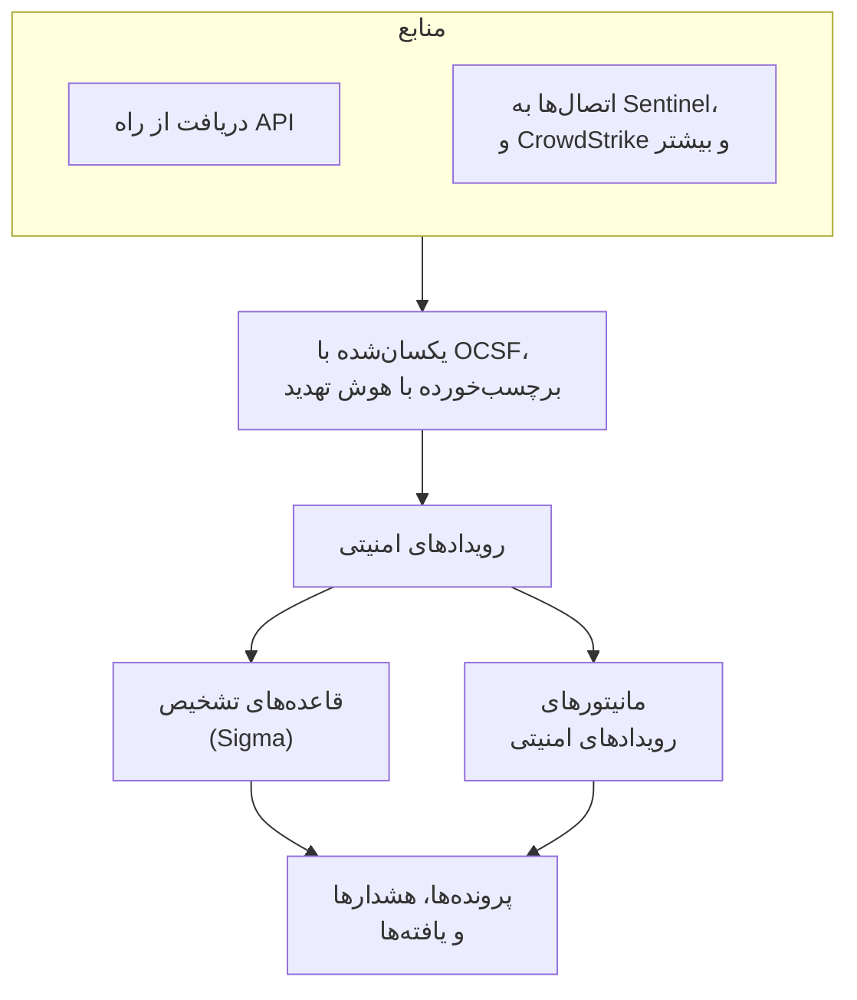
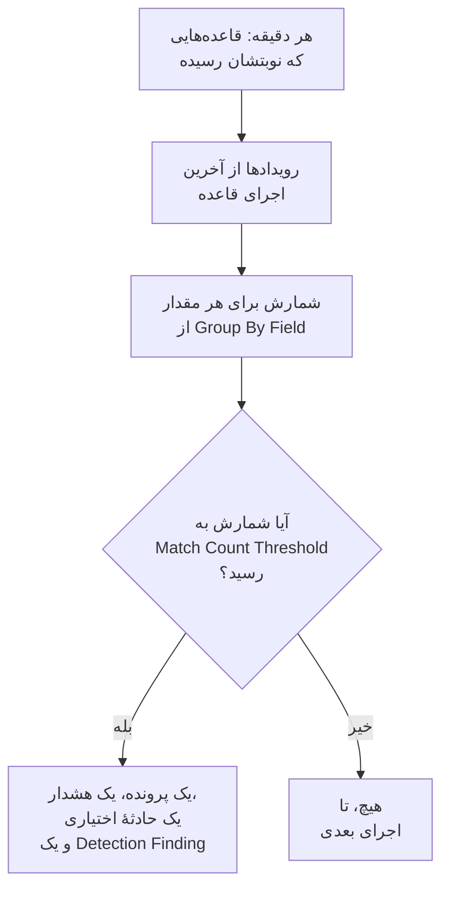

# رویدادهای امنیتی (SIEM)

OneUptime رویدادهای امنیتی را کنار لاگ‌ها، ترِیس‌ها و متریک‌های شما نگه می‌دارد، و به همهٔ آن‌ها یک شکل می‌دهد، [OCSF](https://schema.ocsf.io/) (Open Cybersecurity Schema Framework)، با هر قالبی که رسیده باشند. رویدادها را از هر منبعی بفرستید، در آن‌ها جستجو کنید، و آن‌هایی را که مهم‌اند با قاعده‌های تشخیص Sigma، هوش تهدید و مانیتورها پیدا کنید. آنچه این‌ها پیدا می‌کنند به [پرونده‌هایی](/docs/telemetry/security-cases) برای رسیدگی تبدیل می‌شود، و پلی‌بوک‌ها به آن‌ها پاسخ می‌دهند.

:::cards
- [ارسال رویدادها](#ارسال-رویدادهای-امنیتی): یک POST روی HTTPS، یک خروجی Fluent Bit، یا اتصالی به یک محصول امنیتی.
- [جستجو و هم‌بسته‌سازی](#کاوش-رویدادهای-امنیتی): کاوشگر رویدادها و نمودار هم‌بسته‌سازی.
- [قاعده‌های تشخیص](#قاعدههای-تشخیص): قاعده‌های Sigma که پرونده و هشدار باز می‌کنند.
- [مانیتورها](#مانیتورهای-رویدادهای-امنیتی): شمارش در یک پنجرهٔ غلتان، با وضعیتی که بهبود می‌یابد.
:::

## چگونه کار می‌کند



**محصولات** > **رویدادهای امنیتی** را زیر **مشاهده‌پذیری** باز کنید. منوی آن برای هر بخش از امنیت یک قسمت دارد، و برای هر چیزی در آن صفحه‌ای جدا:

| صفحه | قسمت | برای چیست |
| --- | --- | --- |
| **نمای کلی** | نمای کلی | امنیت چگونه راه‌اندازی شده، چه چیزی همین حالا به کسی نیاز دارد، و پرونده‌ها با چه سرعتی رسیدگی می‌شوند |
| **پرونده‌های باز** | پرونده‌های امنیتی | صف: هر پرونده‌ای که هنوز بسته نشده، گروه‌بندی‌شده بر پایهٔ اینکه دربارهٔ چیست |
| **سپرده‌شده به من** | پرونده‌های امنیتی | پرونده‌های بازی که به شما سپرده شده‌اند |
| **بی‌مسئول** | پرونده‌های امنیتی | پرونده‌های بازی که هنوز کسی برنداشته |
| **پرونده‌های بسته** | پرونده‌های امنیتی | پرونده‌هایی که با نتیجه بسته شده‌اند، تازه‌ترین‌ها اول |
| **همه پرونده‌ها** | پرونده‌های امنیتی | هر پرونده، باز یا بسته |
| **رویدادها** | رویدادها | هر رویداد را جستجو و فیلتر کنید، و یکی را باز کنید تا همهٔ فیلدهایش را ببینید |
| **موجودیت‌ها** | رویدادها | کاربران، میزبان‌ها و نشانی‌هایی که یافته‌های شما بیش از همه از آن‌ها نام می‌برند |
| **هم‌بسته‌سازی** | رویدادها | نموداری از رویدادهایی که یک میزبان، یک کاربر یا یک نشانی IP مشترک دارند |
| **Detection Rules** | Detections | قاعده‌های Sigma که طبق زمان‌بندی اجرا می‌شوند و پرونده باز می‌کنند |
| **Rule Library** | Detections | قاعده‌های تشخیص آماده برای افزودن، هر کدام با رویدادهایی که می‌خواند و اینکه می‌رسند یا نه، با علامت روی قاعده‌های پیشنهادی |
| **Threat Intel** | Detections | فیدهای STIX/TAXII از شاخص‌های شناخته‌شدهٔ مخرب |
| **ATT&CK Coverage** | Detections | تکنیک‌های MITRE ATT&CK که قاعده‌های شما پوشش می‌دهند |
| **Playbooks** | Playbooks | گام‌هایی که خودکار یا دستی روی پرونده‌ها اجرا می‌شوند |
| **در انتظار تأیید** | Playbooks | گام‌های پلی‌بوک که منتظرند کسی آن‌ها را تأیید یا رد کند |
| **اجراهای پلی‌بوک** | Playbooks | آنچه هر پلی‌بوک گام به گام انجام داد |
| **Protected Entities** | Playbooks | کاربران و میزبان‌هایی که هیچ پلی‌بوکی آن‌ها را مهار نمی‌کند |
| **تنظیمات** | هوش مصنوعی | اینکه آیا OneUptime AI هر پروندهٔ تازه را بررسی اولیه می‌کند |
| **Connections** | Connections | لاگ‌های شما، محصولات امنیتی‌ای که OneUptime از آن‌ها دریافت می‌کند، و SIEM‌هایی که به آن‌ها می‌فرستد |
| **راهنمای راه‌اندازی** | Connections | قطعه‌کدهایی برای ارسال رویدادها، با کلید دریافت دادهٔ شما پرشده |

**Detections**، **هوش مصنوعی** و **Connections** که یک بار راه‌اندازی می‌شوند، تا وقتی بازشان نکنید جمع‌شده می‌مانند. تازه با امنیت آشنا شده‌اید؟ [شروع کار با امنیت](/docs/telemetry/security-getting-started) آن را با دو کلیک راه‌اندازی می‌کند.

## پیش از شروع

دادهٔ امنیتی را فقط نقش‌های Project Owner و Project Admin و سه نقش Security می‌خوانند؛ نقش‌های دیگر در رویدادهای امنیتی چیزی نمی‌بینند. [نقش‌ها](/docs/permissions/reference#نقشها) را ببینید.

| نقش | چه کاری می‌تواند بکند |
| --- | --- |
| Security Admin | همه چیز: رویدادها، پرونده‌ها، پلی‌بوک‌ها، قاعده‌های تشخیص، فیدهای هوش تهدید و اتصال‌ها |
| Security Member | خواندن رویدادها و هوش تهدید، رسیدگی به پرونده‌ها، اجرای پلی‌بوک‌ها و تأیید گام‌های آن‌ها، و ساختن، تغییر دادن و حذف کردن قاعده‌های تشخیص و فیدها. نمی‌تواند پلی‌بوک یا اتصال راه بیندازد، یا دادهٔ امنیتی را حذف کند. |
| Security Viewer | خواندن رویدادها، پرونده‌ها، پلی‌بوک‌ها، قاعده‌ها، فیدها، شاخص‌ها و اتصال‌ها |

## ارسال رویدادهای امنیتی

:::steps
### یک کلید دریافت داده بسازید

**تنظیمات پروژه** > **تله‌متری و APM** > **کلیدهای دریافت داده** را باز کنید و روی **ساخت کلید دریافت داده** کلیک کنید. رویدادهای امنیتی همان کلیدهای بقیهٔ تله‌متری شما را به کار می‌برند.

### رویدادهایتان را بفرستید

JSON را با کلید در `x-oneuptime-token` به `/security-events/v1/ingest` بفرستید:

:::tabs
@tab OCSF
```bash
curl -X POST "https://oneuptime.com/security-events/v1/ingest?format=ocsf" \
  -H "Content-Type: application/json" \
  -H "x-oneuptime-token: YOUR_INGESTION_TOKEN" \
  -H "x-oneuptime-service-name: my-security-source" \
  -d '{ "events": [ { "class_uid": 3002, "severity_id": 4, "status": "Failure", "message": "Failed logon for alice", "actor": { "user": { "name": "alice" } }, "src_endpoint": { "ip": "203.0.113.7", "hostname": "laptop-alice" } } ] }'
```
@tab Google UDM
```bash
curl -X POST "https://oneuptime.com/security-events/v1/ingest?format=udm" \
  -H "Content-Type: application/json" \
  -H "x-oneuptime-token: YOUR_INGESTION_TOKEN" \
  -d '{ "events": [ { "metadata": { "event_type": "USER_LOGIN" }, "principal": { "hostname": "laptop-alice", "user": { "userid": "alice" }, "ip": ["203.0.113.7"] }, "security_result": [{ "severity": "HIGH", "action": ["BLOCK"] }] } ] }'
```
@tab Generic JSON
```bash
curl -X POST "https://oneuptime.com/security-events/v1/ingest" \
  -H "Content-Type: application/json" \
  -H "x-oneuptime-token: YOUR_INGESTION_TOKEN" \
  -d '{ "events": [ { "severity": "high", "event_type": "ssh_brute_force", "message": "12 failed SSH logins in 60s", "username": "root", "hostname": "web-01", "src_ip": "203.0.113.7" } ] }'
```
:::

نقطهٔ پایانی به‌محض اینکه رویدادها در صف قرار گیرند پاسخ `200` می‌دهد. رویدادی که مانند این‌ها بدون زمان فرستاده شود، در لحظهٔ رسیدنش قرار می‌گیرد.

### آن‌ها را در رویدادها پیدا کنید

**محصولات** > **رویدادهای امنیتی** > **رویدادها** را باز کنید. رویدادها در چند ثانیه نمایان می‌شوند، با شدت، کلاس، کاربر، میزبان و نشانی‌های IP پرشده.
:::

### قالب‌ها

| `format` | چه چیزی را می‌خواند | مقدارهای پذیرفتنی دیگر |
| --- | --- | --- |
| `ocsf` | JSON رویداد OCSF (`class_uid` ، `severity_id` و مانند آن) | ندارد |
| `udm` | رویدادهای UDM از Google SecOps (Chronicle) (`metadata.event_type` و مانند آن) | `chronicle`، `google-secops` |
| `google-secops-alert` | تشخیص‌ها و هشدارهای Google SecOps: وب‌هوک‌های SOAR و جریان تشخیص‌ها | `secops-alert`، `detection` |
| `generic` | هر JSON دیگری، که بر پایهٔ نام‌های رایج فیلدها خوانده می‌شود | ندارد |

قالب را با `?format=` ، با هدر `x-oneuptime-security-event-format` ، یا با یک فیلد `"format"` در بالاترین سطح نام ببرید. اگر آن را نگذارید، قالب هر رویداد جداگانه تعیین می‌شود، پس یک وب‌هوک می‌تواند تشخیص‌ها را با رویدادهای خام درآمیزد.

- بدنه می‌تواند یک رویداد، آرایه‌ای از رویدادها، یا `{ "events": [...] }` باشد.
- هدر `x-oneuptime-service-name` سرویس تله‌متری‌ای را نام می‌برد که رویدادها به آن تعلق دارند. بدون آن، رویدادها به سرویسی تعلق دارند که به نام محصول یا فروشندهٔ نخستین رویداد است، یا به `Security Events` .
- چیزی به این دلیل که نگاشت نشد کنار گذاشته نمی‌شود: هر فیلد منبع در ویژگی‌های رویداد قرار می‌گیرد.

### فیلدهای JSON عمومی

یک رویداد عمومی بر پایهٔ نام‌های رایج فیلدها خوانده می‌شود:

| فیلد رویداد | از نخستین موردِ موجود از این‌ها خوانده می‌شود |
| --- | --- |
| `message` | `message`، `msg`، `summary`، `description`، `title` |
| `severityName` | `severity`، `severity_name`، `level`، `priority`، `risk_level` |
| `time` | `timestamp`، `time`، `@timestamp`، `event_time`، `created_at` |
| `principalUser` | `user`، `username`، `user_name`، `account`، `actor` |
| `principalHost` | `host`، `hostname`، `computer`، `device`، `machine` |
| `principalIp` | `source_ip`، `src_ip`، `client_ip`، `ip` |
| `targetIp` | `destination_ip`، `dest_ip`، `dst_ip`، `target_ip` |
| `className` | `event_type`، `category`، `type`، `action` |
| `ruleName` | `rule`، `rule_name`، `signature`، `detection` |
| `productName` | `product`، `product_name`، `source`، `log_source` |
| `processName` | `process_name`، `process.name`، `proc.name`، `comm` |
| `processPath` | `process_path`، `Image`، `NewProcessName`، `exe`، `process.executable` |
| `processCommandLine` | `command_line`، `CommandLine`، `cmdline`، `process.command_line`، `proc.cmdline`، `process` |
| `parentProcessName` | `parent_process_name`، `process.parent.name`، `proc.pname` |
| `parentProcessPath` | `parent_process_path`، `ParentImage`، `ParentProcessName`، `process.parent.executable` |
| `parentProcessCommandLine` | `parent_command_line`، `ParentCommandLine`، `process.parent.command_line`، `proc.pcmdline` |

واژه‌ای که شدت را بیان می‌کند به یک سطح OCSF تبدیل می‌شود: `info` به‌صورت Informational، `warning` به‌صورت Low، `error` به‌صورت Medium، `alert` به‌صورت Critical و `emergency` به‌صورت Fatal خوانده می‌شود.

### ارسال با Fluent Bit

برای فرستادن لاگ‌های امنیتی‌ای که از پیش گردآوری می‌کنید، مانند auditd، syslog یا Falco، یک خروجی `http` به Fluent Bit اضافه کنید:

```ini title="fluent-bit.conf"
[OUTPUT]
    Name             http
    Match            security.*
    Host             oneuptime.com
    Port             443
    tls              On
    URI              /security-events/v1/ingest
    Format           json
    Json_date_key    timestamp
    Json_date_format iso8601
    Header           x-oneuptime-token YOUR_INGESTION_TOKEN
    Header           x-oneuptime-service-name my-security-source
    Retry_Limit      5
```

صفحهٔ **راهنمای راه‌اندازی**، زیر **Connections**، این قطعه‌کدها را با میزبان و کلید خودتان پرشده دارد.

### یافتن رویدادهای امنیتی در لاگ‌های شما

**لاگ‌های شما** در بالای **Connections** لاگ‌هایی را که از قبل برای OneUptime می‌فرستید به یک منبع تبدیل می‌کند. وقتی **یافتن رویدادهای امنیتی در لاگ‌های شما** روشن باشد، لاگ‌های تازهٔ پروژه هر دقیقه خوانده می‌شوند و هر ورود SSH، فرمان sudo، رکورد ممیزی Kubernetes، تغییر AWS CloudTrail و حملهٔ وب در آن‌ها به‌صورت یک رویداد امنیتی ذخیره می‌شود. برای اینکه هر گونه چه چیزهایی را پوشش می‌دهد، [شروع کار با امنیت](/docs/telemetry/security-getting-started#یافتن-رویدادهای-امنیتی-در-لاگهای-شما) را ببینید.

### اتصال به یک محصول امنیتی

**Connections** به‌جای شما از یک محصول امنیتی نظرسنجی می‌کند و رکوردهای تازه‌اش را به‌صورت رویدادهای امنیتی وارد می‌کند. یک اتصال تنظیمات محصول و یک اعتبارنامهٔ رمزگذاری‌شده را نگه می‌دارد؛ یک کارگر در بازه‌ای که تعیین می‌کنید از آن نظرسنجی می‌کند و رکوردهایی را که پیش‌تر وارد کرده رد می‌کند.

| محصول | چه چیزی را وارد می‌کند | راهنمای راه‌اندازی |
| --- | --- | --- |
| Google SecOps (Chronicle) | تشخیص‌های قاعده، تشخیص‌های گزیده و هشدارها، به‌صورت Detection Finding | [Google SecOps](/docs/integrations/google-secops) |
| Microsoft Sentinel | حادثه‌ها، به‌صورت Incident Finding | [Microsoft Sentinel](/docs/integrations/microsoft-sentinel) |
| Microsoft Defender XDR | هشدارها، به‌صورت Detection Finding | [Microsoft Defender XDR](/docs/integrations/microsoft-defender-xdr) |
| CrowdStrike Falcon | هشدارها، به‌صورت Detection Finding | [CrowdStrike Falcon](/docs/integrations/crowdstrike-falcon) |
| Splunk Enterprise Security | رویدادهای Notable، یا هر جستجویی، به‌صورت Detection Finding | [Splunk Enterprise Security](/docs/integrations/splunk) |
| Elastic Security | هشدارهای تشخیص، به‌صورت Detection Finding | [Elastic Security](/docs/integrations/elastic-security) |
| AWS Security Hub | Findingها، به‌صورت Detection و Compliance Finding | [AWS Security Hub](/docs/integrations/aws-security-hub) |
| Okta System Log | رویدادهای ورود، MFA، حساب و سیاست | [Okta System Log](/docs/integrations/okta) |

- هشدارهای خود محصول در سطح **Open Cases From** یا بالاتر از آن (**بالا و بالاتر** ، مگر اینکه سطح دیگری برگزینید، یا **هرگز** ) [پرونده](/docs/telemetry/security-cases) باز می‌کنند، که بر پایهٔ کاربر، میزبان یا نشانی‌ای که دربارهٔ آن‌اند گروه‌بندی می‌شوند.
- یک اتصال رکوردها را بر پایهٔ زمانی می‌خواند که محصول آن‌ها را ساخته است، نه زمان فعالیتی که توصیف می‌کنند. قاعدهٔ SIEMی که ساعتی یک بار اجرا می‌شود، تشخیص‌ها را مدت‌ها پس از رویدادهایی که با آن‌ها تطابق داشته می‌سازد، و آن‌ها باز هم وارد می‌شوند.
- نخستین نظرسنجی ۲۴ ساعت به عقب نگاه می‌کند، پس یک اتصال تازه بی‌درنگ رکوردهای اخیر را نشان می‌دهد.
- **آزمایش اتصال** ، در ردیف اتصال، دسترسی به محصول و در حال اجرا بودن کارگرهای خود OneUptime را بررسی می‌کند و چیزی وارد نمی‌کند. **Run now** بی‌درنگ نظرسنجی می‌کند.

## یک رویداد چه چیزهایی دارد

هر رویداد با فیلدهای نوع‌دار و محتوای منبعش ذخیره می‌شود:

| گروه | فیلدها |
| --- | --- |
| دسته‌بندی | `categoryName` ، `className` ، `activityName` ، `statusName` ، همراه با شناسه‌های OCSF آن‌ها (`categoryUid` ، `classUid`) |
| شدت | `severityName` ، یکی از Unknown، Informational، Low، Medium، High، Critical، Fatal یا Other، و `severityId` |
| چه کسی انجامش داد | `principalUser` ، `principalHost` ، `principalIp` ، `principalProcess` |
| به چه چیزی دست زد | `targetUser` ، `targetHost` ، `targetIp` ، `targetPort` ، `targetResource` |
| فرایند | `processName` ، `processPath` و `processCommandLine` : در اجرای یک فرایند، فرایندی که اجرا شد، و در غیر این صورت فرایندی که عمل کرد. `parentProcessName` ، `parentProcessPath` و `parentProcessCommandLine` : فرایندی که آن را اجرا کرد |
| منبع | `productName` ، `vendorName` ، `ruleId` ، `ruleName` ، `eventUid` |
| محتوا | `message` ، `mitreTactics` ، `mitreTechniques` و `observables` : هر کاربر، میزبان، نشانی IP، دامنه و هشی که از رویداد برداشته شده |
| ویژگی‌ها | کل محتوای منبع، که به کلیدهای نقطه‌دار تخت شده است |

## کاوش رویدادهای امنیتی

**رویدادها** یک کاوشگر تله‌متری مانند کاوشگرهای لاگ‌ها و ترِیس‌هاست: نموداری از رویدادهای پنجره بر پایهٔ شدت، نوار کناری از وجه‌ها، فهرست، و پنلی با هر فیلد و ویژگی رویدادی که باز می‌کنید. پنجره، فیلترها و جستجو همه در URL قرار دارند، پس نمای فیلترشده را می‌توان هم‌رسانی کرد و پس از بازخوانی صفحه هم باقی می‌ماند.

### جستجو

نوار جستجو همان زبان کاوشگرهای تله‌متری دیگر را می‌فهمد ( [نحو جستجو](/docs/telemetry/search-syntax) را ببینید):

| نحو | معنا | نمونه |
| --- | --- | --- |
| متن آزاد | پیام آن را دارد | `failed logon` |
| `"quoted phrase"` | واژه‌ها را کنار هم نگه دارید | `"brute force"` |
| `<field>:<value>` | یک فیلد نوع‌دار | `severity:Critical` |
| `@<attribute>:<value>` | یک ویژگی منبع | `@threat.matched:true` |
| `-<filter>` | این نباشد | `-severity:Informational` |
| `<field>:(a OR b)` | هر یک از این مقدارها | `severity:(High OR Critical)` |
| `<field>:a*` | `*` هر متنی است، `?` یک نویسه | `host:web-*` |
| `@<attribute>:*` | ویژگی وجود دارد | `@threat.indicator_id:*` |
| `@<attribute>:~text` | ویژگی آن متن را دارد | `@finding_info.title:~ransom` |

یک فیلد یا نامی کوتاه است (`severity` ، `class` ، `category` ، `activity` ، `status` ، `vendor` ، `product` ، `rule` ، `user` ، `host` ، `ip` ، `targetuser` ، `targethost` ، `targetip` ، `processname` ، `commandline` ، `parentprocessname` ، `observable` ، `tactic` ، `technique`) یا نام خود فیلد، مانند `severityName` یا `principalHost` . هر نام دیگری به‌صورت یک ویژگی منبع خوانده می‌شود. `observable:<value>` هر رویدادی را که از یک مقدار نام می‌برد پیدا می‌کند، در هر سویی از فعالیت که بوده باشد.

### وجه‌ها

نوار کناری رویدادهای پنجره را بر پایهٔ **منبع** ، **شدت** ، **کلاس رویداد** ، **Category** ، **فعالیت** ، **وضعیت** ، **فروشنده** ، **محصول** ، **Detection Rule** ، **کاربر مبدأ** ، **میزبان مبدأ** ، **فرایند** و **فرایند والد** می‌شمارد. روی یک مقدار کلیک کنید تا فقط رویدادهای آن بمانند، یا روی علامت منفی کنارش تا کنار گذاشته شوند. برای برگرداندن، دوباره کلیک کنید. نمودار و هر شمارش دقیقاً رویدادهای فهرست را توصیف می‌کنند.

### هم‌بسته‌سازی

**هم‌بسته‌سازی** رویدادهای پیرامون یک میزبان، یک کاربر یا یک نشانی IP را رسم می‌کند: کلاس‌های رویدادشان را پیرامون آنچه جستجو کردید، با بدترین شدتشان علامت‌گذاری‌شده، و مقدارهای دیگری را که در همان رویدادها دیده شده‌اند روی حلقهٔ بیرونی. روی یک کلاس کلیک کنید تا رویدادهایش فهرست شوند، یا روی یک مقدار تا در گام بعد بر پایهٔ آن هم‌بسته‌سازی کنید. هر observable در پنل یک رویداد در **رویدادها** ، **هم‌بسته‌سازی** را بر پایهٔ همان مقدار باز می‌کند.

## قاعده‌های تشخیص

یک قاعدهٔ تشخیص یک قاعدهٔ [Sigma](https://sigmahq.io/) است، قالبی باز بر پایهٔ YAML برای توصیف فعالیت مشکوک، که OneUptime آن را طبق زمان‌بندی روی رویدادهای شما اجرا می‌کند. وقتی تطابق پیدا کند، یک [پرونده](/docs/telemetry/security-cases) باز می‌کند یا به پروندهٔ موجود می‌پیوندد، یک هشدار، و در صورت تمایل یک حادثه، باز می‌کند و یک Detection Finding را به رویدادها بازمی‌نویسد. **Rule Library** قاعده‌های آماده‌ای برای شروع دارد.



### ساختن یک قاعده

:::steps
1. **محصولات** > **رویدادهای امنیتی** > **Detections** > **Detection Rules** را باز کنید و روی **ساخت Detection Rule** کلیک کنید.
2. در **Sigma Rule** ، YAML قاعده را در **Sigma Rule (YAML)** بچسبانید. این متن هنگام ذخیره تجزیه می‌شود، پس هر اشتباهی در فرم نمایان می‌شود.
3. **نام** از `title` قاعده پر می‌شود: برای نام دیگری روی آن بنویسید. قاعدهٔ تازه اجرا می‌شود؛ **فعال** در فرم ویرایش آن است.
4. در **هنگام تطابق** ، **Open a Case on Match** را روشن نگه دارید تا تطابق‌های قاعده، بر پایهٔ مقداری که قاعده با آن گروه‌بندی می‌کند، در پرونده‌ها گرد آیند.
5. زیر **هشدارها و حوادث** برگزینید که تطابق چه چیز دیگری باز کند: **ساخت هشدار** (پیش‌فرض)، **اعلام حادثه** ، **هر دو** یا **هیچ‌کدام** ، با **شدت هشدار** یا **شدت حادثه** اختیاری.
6. **فیلدهای بیشتر** شامل **توضیحات** ، **Write Detection Finding on Match** (روشن) و شیوهٔ شمارش تطابق‌هاست؛ [تنظیمات ارزیابی](#تنظیمات-ارزیابی) را ببینید.
:::

نخستین قاعده، که با ورودهای ناموفق از بیرون `10.x.x.x` تطابق دارد:

```yaml title="failed-logon-burst.yml"
title: Failed logon burst
description: Repeated authentication failures from one source.
level: high
tags:
  - attack.t1110
  - attack.ta0006
detection:
  selection:
    className: Authentication
    statusName: Failure
  filter_internal:
    principalIp|startswith: '10.'
  condition: selection and not filter_internal
```

### یک قاعده چه چیزهایی می‌تواند بگوید

OneUptime هستهٔ بولی Sigma را اجرا می‌کند:

- گزینش‌ها نگاشت‌هایی از فیلدها هستند (هر فیلد باید تطابق داشته باشد؛ فهرستی از مقدارها با هر یک از آن‌ها تطابق دارد) یا فهرست‌هایی از کلیدواژه‌ها، که در هر جای پیام تطابق دارند.
- شرط‌ها گزینش‌ها را با `and` ، `or` ، `not` و پرانتزها، یا با `1 of selection_*` ، `all of selection_*` ، `any of them` و `all of them` ترکیب می‌کنند.
- پیراینده‌های فیلد: `contains` ، `startswith` ، `endswith` ، `all` ، `re` ، `cased` ، `gt` ، `gte` ، `lt` ، `lte` ، `cidr` ، `exists` و `windash` . متن بدون توجه به بزرگی و کوچکی حروف مقایسه می‌شود، مگر اینکه `cased` را اضافه کنید.
- یک فیلد یا فیلدی نوع‌دار است (`principalUser`)، یا نگارش رایج آن در Sigma (`CommandLine` ، `src_ip` ، `Hostname`)، یا هر کلید ویژگی، به همان شکلی که در رویداد نوشته شده (`threat.matched`).
- `Image` و `CommandLine` فرایندی را می‌خوانند که رویداد دربارهٔ آن است، یعنی در اجرای یک فرایند همان فرایندی که اجرا شد (`processPath` ، `processCommandLine`)، و `ParentImage` و `ParentCommandLine` فرایندی را که آن را اجرا کرد (`parentProcessPath` ، `parentProcessCommandLine`). `principalProcess` فرایندی است که عمل کرد، که در یک اجرا همان فرایند والد است.
- `level` شدت را تعیین می‌کند: `informational` ، `low` ، `medium` ، `high` یا `critical` ، و اگر نباشد `medium` . شناسه‌های ATT&CK در `tags` (`attack.t1110` ، `attack.ta0006`) فیلدهای MITRE یافته را پر می‌کنند.

تجمیع‌هایی مانند `| count() by principalIp > 5` هنگام ذخیره رد می‌شوند: به‌جای آن‌ها یک [قاعدهٔ همبستگی](#قاعدههای-همبستگی) ، یا **Group By Field** و **Match Count Threshold** را به کار ببرید. `logsource` فقط جنبهٔ اطلاعاتی دارد و چیزی را محدود نمی‌کند: آن فیلتر را در یک گزینش بگذارید، مانند `className: Authentication` . یک `timeframe` نادیده گرفته می‌شود، چون بازهٔ قاعده پنجرهٔ آن را تعیین می‌کند.

### قاعده‌های همبستگی

یک [همبستگی Sigma](https://sigmahq.io/docs/meta/correlations.html) با چند رویداد با هم فعال می‌شود، نه با یکی. آن را همراه با قاعده‌هایی که می‌خواند، به‌صورت سندهای YAML جداشده با `---` ، در **Sigma Rule (YAML)** بچسبانید، یا قاعده‌هایی را که پروژه از پیش دارد با `name` یا `id` آن‌ها در Sigma نام ببرید. **Rule Library** نمونه‌های آماده دارد، مانند ورودهای ناموفقی که یک ورود موفق پس از آن‌ها می‌آید.

| نوع | کی فعال می‌شود | نمایش با نام |
| --- | --- | --- |
| `event_count` | یک گروه در `timespan` به شمار معینی از رویدادها می‌رسد | تعداد رویداد |
| `value_count` | یک گروه در `timespan` شمار معینی از مقدارهای متفاوت یک فیلد را نشان می‌دهد | مقادیر متمایز |
| `temporal` | هر قاعده برای همان گروه در `timespan` تطابق دارد، به هر ترتیبی | رویدادهای هم‌زمان |
| `temporal_ordered` | قاعده‌ها به ترتیب خودشان برای همان گروه در `timespan` تطابق دارند | Sequence |
| `new_value` | یک گروه مقداری از یک فیلد را نشان می‌دهد که در `timespan` نشان نداده بود | First seen |

```yaml title="failed-then-success.yml"
title: Failed sign-ins, then a success from the same address
level: high
correlation:
  type: temporal_ordered
  rules:
    - failed_sign_ins
    - successful_sign_in
  group-by:
    - principalIp
  timespan: 10m
---
title: Five failed sign-ins
name: failed_sign_ins
correlation:
  type: event_count
  rules:
    - failed_sign_in
  group-by:
    - principalIp
  timespan: 10m
  condition:
    gte: 5
---
title: Failed sign-in
name: failed_sign_in
detection:
  selection:
    className: Authentication
    statusName: Failure
  condition: selection
---
title: Successful sign-in
name: successful_sign_in
detection:
  selection:
    className: Authentication
    statusName: Success
  condition: selection
```

- یک گروه مقدار فیلدهای `group-by` است، مانند یک نشانی. شمارش‌ها غلتان‌اند: انفجاری که دو اجرا میانشان تقسیم کنند باز هم در `timespan` خودش کامل شمرده می‌شود، که حداکثر ۲۴ ساعت است.
- `new_value` نوعی از خود OneUptime است، چون Sigma همبستگی «نخستین بار دیده‌شده» ندارد: آن را با تا ۳۰ روز تاریخچه مقایسه می‌کند. `value_sum` ، `value_avg` ، `value_percentile` و `value_median` هنگام ذخیره رد می‌شوند.
- ستون **نوع** در **Detection Rules** گونهٔ هر قاعده را نام می‌برد، و فرم در یک جمله می‌گوید قاعده دنبال چه می‌گردد.

### تنظیمات ارزیابی

| فیلد | چه می‌کند |
| --- | --- |
| **Evaluation Interval (Minutes)** | هر چند وقت یک بار قاعده اجرا می‌شود: دقیقه‌های کامل، از ۱ تا ۱۴۴۰. فرم قاعدهٔ تازه با ۵ آغاز می‌شود. |
| **Group By Field** | اختیاری. تطابق‌هایی که مقدار این فیلد را مشترک دارند، مانند `principalHost` ، با هم شمرده، با هم هشدار داده و با هم تکراری‌زدایی می‌شوند: یک هشدار برای هر میزبان به‌جای صدها هشدار. |
| **Distinct Count Field** | اختیاری. به‌جای رویدادهای منطبق، مقدارهای متفاوت این فیلد را بشمارید. مقدارهای خالی شمرده نمی‌شوند. |
| **Match Count Threshold** | یک گروه فقط وقتی فعال می‌شود که شمارشش در یک اجرا به این عدد برسد: از ۱ تا ۱۰۰۰۰۰۰، و ۱ با هر تطابقی فعال می‌شود. |

Group By و Distinct Count همان نام‌های فیلدی را می‌پذیرند که قاعده می‌پذیرد. با آن‌ها آستانه یعنی «این تعداد، از یک چیز، در یک اجرا»، بی‌آنکه مانیتوری روی آن لازم باشد:

| هدف | Group By Field | Distinct Count Field | آستانه |
| --- | --- | --- | --- |
| هشدار برای هر تطابق | خالی | خالی | ۱ |
| یک هشدار برای هر میزبان | `principalHost` | خالی | ۱ |
| حملهٔ جست‌وجوی فراگیر: ۵ ورود ناموفق از یک IP | `principalIp` | خالی | ۵ |
| پاشیدن گذرواژه: یک IP که روی ۵ حساب متفاوت شکست می‌خورد | `principalIp` | `principalUser` | ۵ |
| پویش درگاه: یک IP که به ۲۰ درگاه متفاوت می‌رسد | `principalIp` | `targetPort` | ۲۰ |

### یک قاعده کی اجرا می‌شود

OneUptime هر دقیقه قاعده‌های فعالی را بررسی می‌کند که بازه‌شان از آخرین اجرا گذشته است. هر اجرا رویدادهایی را می‌خواند که زمان رویدادشان میان اجرای پیشین و دو دقیقه پیش است، سپس جلو می‌رود. این دو دقیقه برای رویدادهایی جا می‌گذارد که هنوز در راه‌اند، مانند خطی از لاگ که یک دقیقه پس از نوشته شدن خوانده می‌شود:

- پنجره‌ها پشت سر هم‌اند، نه غلتان. با بازهٔ ۱۰ دقیقه‌ای، شکست‌هایی در ۰۹:۵۸ و ۱۰:۰۱ می‌توانند در اجراهای متفاوتی بیفتند و جدا شمرده شوند، پس هنگام برگزیدن آستانه حاشیه بگذارید.
- پس از یک وقفه، مانند قطع کار یک کارگر یا قاعده‌ای که دوباره روشن شده، اجرای بعدی کل وقفه را پوشش می‌دهد، حداکثر تا ۲۴ ساعت گذشته.
- رویدادی که بیش از دو دقیقه دیر می‌رسد، پس از آنکه اجرایی زمان آن را پوشش داده است، ذخیره می‌شود و قابل جستجوست، اما آن قاعده هرگز آن را نمی‌خواند.
- هر گروهی که به آستانه برسد به یک Detection Finding تبدیل می‌شود، تا ۱۰٬۰۰۰ مورد در هر اجرا. برای ۱۰۰ گروهی که بیشترین شمارش را دارند هشدار، حادثه و پرونده باز می‌شود؛ بقیه در یک پرونده دربارهٔ قاعده جمع می‌شوند، و **آخرین خطا**ی قاعده می‌گوید چند گروه تطابق داشتند.

### شدت

`level` یک قاعده شدت یافته‌های آن است: `informational` ، `low` ، `medium` ، `high` و `critical` به Informational، Low، Medium، High و Critical تبدیل می‌شوند. هشدارها و حادثه‌های آن یکی از شدت‌های پروژهٔ شما را، به این ترتیب، می‌گیرند:

1. **شدت هشدار** (یا **شدت حادثه** ) قاعده، اگر تنظیم شده باشد.
2. شدتی از شما که به نام آن سطح است، مانند High، بدون توجه به بزرگی و کوچکی حروف.
3. بر پایهٔ رتبه: قاعده‌های `critical` و `high` شدیدترین شدت شما را می‌گیرند، بقیه کم‌شدت‌ترین را.

> [!TIP]
> شدت‌های هشدار خود را به نام سطح‌های Sigma (Critical، High، Medium، Low، Informational) بنامید، تا هر قاعده بدون تنظیم جداگانه روی شدت درست بنشیند.

### هشدارها و یافته‌ها

هر گروهی که فعال شود هشداری با عنوان `[Detection] <rule name> — <group value>` باز می‌کند، یا `[Detection] <rule name>` برای قاعده‌ای بدون Group By Field. تا وقتی باز است، تطابق‌های بیشتر برای آن گروه هشدار دیگری باز نمی‌کنند. یک قاعده فقط تطابق‌ها را می‌بیند و نمی‌تواند بفهمد که حمله‌ای متوقف شده است، پس هشدارهایش تا وقتی کسی رفعشان کند باز می‌مانند.

یک Detection Finding رویدادی امنیتی از کلاس `Detection Finding` (کلاس OCSF ۲۰۰۴) از محصول `OneUptime Detections` است، با برچسب‌های MITRE قاعده، مقدار گروه در جایگاه نخست `observables` ، و این ویژگی‌ها:

| ویژگی | مقدار |
| --- | --- |
| `oneuptime.detection.rule_id` | شناسهٔ قاعده‌ای که فعال شد |
| `oneuptime.detection.rule_name` | نام قاعده |
| `oneuptime.detection.match_count` | چند رویداد پشت این یافته است |
| `oneuptime.detection.distinct_count` | چند مقدار متفاوت پشت آن است، برای قاعده‌ای که Distinct Count Field دارد |
| `oneuptime.detection.group_value` | مقدار گروه، برای قاعده‌ای که Group By Field دارد |
| `oneuptime.detection.sigma_id` | `id` خود قاعدهٔ Sigma |

یافته‌ها رویدادهای معمولی‌اند: در **رویدادها** جستجویشان کنید و در **هم‌بسته‌سازی** از آن‌ها پیش بروید. برای آزمودن بی‌سروصدای یک قاعدهٔ تازه، تا وقتی به آن اعتماد نکرده‌اید همهٔ اقدام‌ها جز یافته را خاموش کنید.

## مانیتورهای رویدادهای امنیتی

یک مانیتور رویدادهای امنیتی رویدادهایی را که با فیلترهایش تطابق دارند در یک پنجرهٔ غلتان می‌شمارد و معیارهای معمول مانیتور را روی آن شمارش اجرا می‌کند: وضعیت مانیتور را تغییر می‌دهد، هشدار یا حادثه باز می‌کند و کشیک را فرا می‌خواند. آن را زیر **مانیتورها** > **ساخت مانیتور** با نوع **Security Events** بسازید؛ آنجا همراه با دیگر مانیتورهای شما فهرست می‌شود.

فرم آن **Monitor events that include this text** ، **Monitor Security Events for (time)** ، **Event Severity** و **کلاس رویداد** را نشان می‌دهد. **فیلتر بر اساس سرویس تله‌متری** و **فیلتر بر اساس ویژگی‌ها** زیر **فیلدهای بیشتر** منتظرند، که سرتیترش نشان می‌دهد یک مانیتور کدام‌ها را به کار می‌برد. معیارهای آن **Security Event Count** را بررسی می‌کنند.

| | قاعدهٔ تشخیص | مانیتور رویدادهای امنیتی |
| --- | --- | --- |
| با چه تطابق دارد | یک قاعدهٔ Sigma | فیلترهایی روی شدت، کلاس، پیام، سرویس و ویژگی‌ها |
| پنجره | پشت سر هم، یکی برای هر اجرا | غلتان: از ۵ ثانیهٔ گذشته تا ۲۴ ساعت |
| شمارش برای هر گروه | بله، با **Group By Field** | نه: یک شمارش برای هر چیزی که تطابق دارد |
| چه چیزی باز می‌کند | هشدارها، حادثه‌ها و یافته‌ها | یک وضعیت، هشدارها و حادثه‌ها |
| بهبود می‌یابد | نه: هشدارها تا وقتی رفع شوند باز می‌مانند | بله: وقتی شمارش برگردد وضعیت هم برمی‌گردد |

خود تشخیص را به‌صورت یک قاعده، با آستانه‌اش، بنویسید. وقتی پنجرهٔ غلتان، وضعیتی که خودبه‌خود بهبود یابد، یک صفحهٔ وضعیت، یا سیاست‌های کشیک متفاوت برای هر معیار می‌خواهید، از مانیتور استفاده کنید.

### تشخیص‌هایتان را بپایید

یافته‌ها رویدادند، پس یک مانیتور می‌تواند خود قاعده‌ها را بپاید:

- طوفان‌ها: مانیتوری روی کلاس `Detection Finding` ، که هر یافته را می‌شمارد. فعال شدن بیست قاعدهٔ متفاوت در یک ساعت سیگنالی است که هیچ قاعدهٔ تنهایی نمی‌تواند ببیند.
- تغییر نرخ: بر پایهٔ `oneuptime.detection.rule_id` یک قاعده فیلتر کنید. قاعده‌ای که هفته‌ای یک بار فعال می‌شود و حالا ساعتی پنجاه بار فعال می‌شود، واکنش دیگری لازم دارد.
- سکوت: یافته‌هایی که معمولاً چندتایی از آن‌ها را می‌بینید و به صفر می‌رسند، معمولاً یعنی منبعی دیگر نمی‌فرستد. معیاری به کار ببرید که بررسی کند شمارش از یک عدد کمتر است.

اقدام **ساخت مانیتور** در ردیف یک قاعده، مانیتوری تازه باز می‌کند که از پیش به همین شکل تنظیم شده است: کلاس `Detection Finding` ، شناسهٔ قاعده (هرگز نامش، که با تغییر نام عوض می‌شود)، و یک ساعت گذشته. چنین مانیتوری یافته‌ها را می‌شمارد، یکی برای هر گروه در هر اجرا، نه رویدادهای پشت آن‌ها را. برای اینکه پیش از فعال شدن هر چیزی شمار معینی رویداد لازم باشد، **Match Count Threshold** قاعده را به کار ببرید.

## هوش تهدید

**Threat Intel** مشترک فیدهای STIX/TAXII از نشانی‌های IP، دامنه‌ها، URLها، نشانی‌های ایمیل و هش‌های فایل شناخته‌شدهٔ مخرب می‌شود. رویدادهایی که از یکی از آن‌ها نام می‌برند هنگام رسیدن با ویژگی‌های `threat.*` برچسب می‌خورند، که قاعده‌ها و مانیتورها می‌توانند بر پایهٔ آن‌ها فیلتر کنند، و هر دقیقه رویدادهای اخیر با فیدها تطبیق داده می‌شوند و مانند یک قاعده هشدار و یافته باز می‌کنند. [هوش تهدید](/docs/telemetry/threat-intelligence) را ببینید.

## نگهداری و صورت‌حساب

رویدادهای امنیتی مانند بقیهٔ تله‌متری شما به ازای هر گیگابایت دریافت‌شده صورت‌حساب می‌شوند، و به اندازهٔ دورهٔ نگهداری تله‌متری شما نگه داشته می‌شوند: **نگهداری پیش‌فرض (روز)** پروژه، زیر **تنظیمات پروژه** > **تله‌متری و APM** > **نگهداری داده** ، یا دورهٔ نگهداری‌ای که روی سرویس تله‌متری‌ای که به آن تعلق دارند تنظیم شده است. وقتی دورهٔ نگهداری یک رویداد به پایان برسد، حذف می‌شود.

## رفع اشکال

:::details رویدادها نمایش داده نمی‌شوند
کلید را در `x-oneuptime-token` و مسیر `/security-events/v1/ingest` را بررسی کنید. سپس پنجرهٔ **رویدادها** را بررسی کنید، که مگر اینکه تغییرش دهید یک روز گذشته است: یک رویداد در زمان خودش قرار می‌گیرد، پس رویدادی با مهر زمانی قدیمی‌تر بیرون از آن می‌افتد.
:::

:::details یک قاعده هرگز تطابق پیدا نمی‌کند
**وضعیت** آن را بررسی کنید: قاعدهٔ **غیرفعال** اجرا نمی‌شود، و وقتی **اجرا ناموفق بود** نشان داده شود، **مشاهده خطا** در ردیفش علت را نشان می‌دهد. رویدادی را که انتظار داشتید تطابق داشته باشد باز کنید و فیلد به فیلد با قاعده مقایسه کنید: یک مقدار ساده باید با کل فیلد برابر باشد، پس برای بخشی از آن `contains` یا `*` را به کار ببرید. یک ویژگی به همان نامی نوشته می‌شود که در رویداد دارد (`threat.matched` ، نه `attributes.threat.matched`). با آستانهٔ بیش از ۱، تطابق‌ها باید در یک اجرا بیفتند.
:::

:::details قاعده تطابق یافت، اما هشداری باز نشد
**هشدارها و حوادث** روی **اعلام حادثه** یا **هیچ‌کدام** است، یا هشداری برای همان قاعده و مقدار گروه هنوز باز است و تطابق‌های بعدی در آن جمع می‌شوند. یک پروژه برای اینکه قاعده‌ها هشدار باز کنند دست‌کم به یک شدت هشدار نیاز دارد.
:::

:::details یک قاعده هشدارهای بیش از اندازه باز می‌کند
هر مقدار **Group By Field** هشدار خودش را می‌گیرد: بر پایهٔ چیزی درشت‌تر گروه‌بندی کنید، آستانه را بالا ببرید، یا یک Distinct Count Field اضافه کنید. اگر نرخ برایتان مهم است و نه تک‌تک تطابق‌ها، **هشدارها و حوادث** را روی **هیچ‌کدام** بگذارید و روی یافته‌های قاعده یک مانیتور بگذارید.
:::

## گام‌های بعدی

:::cards
- [هوش تهدید](/docs/telemetry/threat-intelligence): رویدادهایتان را با فیدهای STIX/TAXII تطبیق دهید.
- [پرونده‌های امنیتی و پلی‌بوک‌ها](/docs/telemetry/security-cases): به آنچه قاعده‌هایتان پیدا می‌کنند رسیدگی کنید، و با پلی‌بوک‌ها پاسخ دهید.
- [Google SecOps](/docs/integrations/google-secops): تشخیص‌ها و رویدادهای Chronicle را وارد کنید.
- [نحو جستجو](/docs/telemetry/search-syntax): هر آنچه نوار جستجو می‌فهمد.
- [مرجع دسترسی‌ها](/docs/permissions/reference): نقش‌های Security، و آنچه هر کدام می‌تواند بکند.
:::
