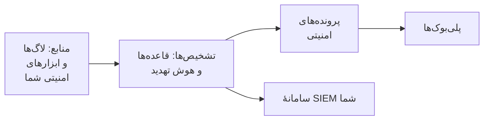

# شروع کار با امنیت

OneUptime تهدیدها را در داده‌هایی پیدا می‌کند که از قبل دارید - لاگ‌هایتان، ابزارهای امنیتی‌ای که به کار می‌برید و هر چیزی که برایش می‌فرستید -، یافته‌ها را در پرونده‌ها گروه‌بندی می‌کند و با پلی‌بوک‌ها به آن‌ها پاسخ می‌دهد. راه‌اندازی آن دو کلیک است و چیزی برای نصب وجود ندارد.

:::cards
- [راه‌اندازی](#راهاندازی): آنچه بیشتر تیم‌ها نیاز دارند را روشن کنید و ببینید یک حملهٔ آزمایشی پرونده‌ای باز می‌کند.
- [چگونه کار می‌کند](#چگونه-کار-میکند): منابع، تشخیص‌ها، پرونده‌ها و پلی‌بوک‌ها، و کاری که هر کدام انجام می‌دهد.
- [لاگ‌های شما](#یافتن-رویدادهای-امنیتی-در-لاگهای-شما): رویدادهای امنیتی‌ای که از قبل در لاگ‌هایی هستند که برای OneUptime می‌فرستید.
- [سامانهٔ SIEM شما](#ارسال-یافتههای-oneuptime-به-سامانهٔ-siem-شما): یافته‌های OneUptime را به Google SecOps بفرستید.
:::

## پیش از شروع

راه‌اندازی امنیت به نقش Project Owner، Project Admin یا Security Admin نیاز دارد. نقش‌های Security Member و Security Viewer یافته‌ها را می‌خوانند؛ [نقش‌ها](/docs/permissions/reference#نقشها) را ببینید.

## راه‌اندازی

:::steps
### روشن کردن آنچه بیشتر تیم‌ها نیاز دارند

**محصولات** > **رویدادهای امنیتی** را باز کنید. در **نمای کلی**، روی **Turn on recommended** کلیک کنید. این کار سه چیز را یک‌جا روشن می‌کند: **Find security events in your logs**، قاعده‌های تشخیص پیشنهادی و **Enrich New Cases**، پلی‌بوکی که هر پروندهٔ تازه را با هوش تهدید مقایسه می‌کند و یک فهرست بررسی برای اولویت‌بندی در آن می‌گذارد.

### ارسال یک حملهٔ آزمایشی

روی **Send a test attack** کلیک کنید. ده‌دوازده ورود ناموفق از یک نشانی مخصوص مستندات از پردازش واقعی می‌گذرند: ذخیره می‌شوند، قاعدهٔ حملهٔ جست‌وجوی فراگیر آن‌ها را تشخیص می‌دهد و پرونده‌ای باز می‌شود. کسی فراخوانده نمی‌شود و هیچ SIEM آن‌ها را دریافت نمی‌کند.

### باز کردن پرونده

روی **Open the case** کلیک کنید. یک یافتهٔ واقعی این‌گونه است: رویدادهای پشت آن، نشانی‌ای که به آن مربوط است و آنچه **Enrich New Cases** پیدا کرد. وقتی کارتان تمام شد، آن را به‌عنوان آزمایش ببندید.
:::

از آن پس، **نمای کلی** با چیزهایی باز می‌شود که به کسی نیاز دارند: پرونده‌های باز شما، پرونده‌هایی که کسی برنداشته و گام‌های پلی‌بوک که منتظر تأیید هستند، یا **All quiet** وقتی هیچ‌کدام نباشد.

## چگونه کار می‌کند

| بخش | کجا | چه می‌کند |
| --- | --- | --- |
| **Sources** | **Connections** | لاگ‌های شما، محصولات امنیتی‌ای که OneUptime از آن‌ها دریافت می‌کند و هر چیزی که می‌فرستید |
| **Detections** | **Detections** | قاعده‌های Sigma و خوراک‌های هوش تهدید که در هر رویداد دنبال تهدید می‌گردند |
| **Security Cases** | **Security Cases** | آنچه پیدا شد، گروه‌بندی‌شده بر اساس کاربر، میزبان یا نشانی‌ای که به آن مربوط است |
| **Playbooks** | **Playbooks** | گام‌هایی که روی پرونده‌های تازه اجرا می‌شوند: غنی‌سازی، اطلاع‌رسانی، باز کردن رخداد یا مهار |

نوار بالای **نمای کلی** هر بخش را با ارقامش نشان می‌دهد: منابع و رویدادهای ۲۴ ساعت گذشتهٔ آن‌ها، قاعده‌های روشن، پرونده‌های باز و پلی‌بوک‌هایی که پاسخ می‌دهند.

## یافتن رویدادهای امنیتی در لاگ‌های شما

**Your logs** در بالای **Connections** به نصب هیچ چیزی نیاز ندارد. وقتی **Find security events in your logs** روشن باشد، OneUptime هر دقیقه لاگ‌های تازهٔ پروژه را می‌خواند و خط‌هایی را که می‌شناسد به رویدادهای امنیتی تبدیل می‌کند:

| لاگ‌ها | آنچه به رویداد امنیتی تبدیل می‌شود |
| --- | --- |
| ورودهای SSH | ورودهای ناموفق و موفق SSH از لاگ احراز هویت، journal یا syslog یک سرور |
| sudo | فرمان‌هایی که به‌جای کاربری دیگر اجرا شده‌اند، گذرواژه‌های نادرست sudo و افرادی که اجازهٔ استفاده از sudo را ندارند |
| لاگ‌های ممیزی Kubernetes | تغییرات خوشه، پوسته‌های باز شده در پادها، رازهای خوانده شده و درخواست‌های ردشده |
| AWS CloudTrail | ورودها به کنسول، تغییرات در حساب‌های AWS شما و فراخوانی‌هایی که AWS رد کرد |
| حمله‌های وب | درخواست‌هایی در لاگ دسترسی یک سرور وب که تزریق SQL، پیمایش مسیر یا Log4Shell را امتحان می‌کنند |

لاگ‌های شما همان‌طور که هستند می‌مانند. تنها خط‌هایی که برای امنیت مهم‌اند به رویداد تبدیل می‌شوند: هرگز هر صفحه‌ای که یک سرور وب ارائه کرده یا هر خواندنی از یک API.

## ارسال یافته‌های OneUptime به سامانهٔ SIEM شما

اگر تیم شما از قبل با یک SIEM کار می‌کند، OneUptime یافته‌هایش را به آنجا هم می‌فرستد. زیر **Connections** > **Send to your SIEM**، روی **Add destination** کلیک کنید، منطقه، نمونه و کلید حساب سرویس Google SecOps خود را وارد کنید و پیش از ذخیره روی **Send a test event** کلیک کنید. [ارسال رویدادهای امنیتی به Google SecOps](/docs/integrations/google-secops#ارسال-رویدادهای-امنیتی-به-google-secops) را ببینید.

## عیب‌یابی

:::details دکمهٔ Turn on recommended خاکستری است
نقش شما نمی‌تواند قاعده‌های تشخیص، پلی‌بوک‌ها یا منبع لاگ را اضافه کند. از یک Project Owner، Project Admin یا Security Admin کمک بخواهید، یا از آن‌ها بخواهید نقش Security Admin را به شما بدهند.
:::

:::details حملهٔ آزمایشی پرونده‌ای باز نکرد
پرونده معمولاً پیش از پاسخ دکمه باز می‌شود؛ وقتی قاعده هنوز در حال رسیدن است، این را می‌گوید و پرونده ظرف یک دقیقه باز می‌شود. دوباره **Security Cases** را ببینید و در **Detections** بررسی کنید که قاعدهٔ حملهٔ جست‌وجوی فراگیر روشن باشد.
:::

:::details هیچ رویداد امنیتی‌ای از لاگ‌های من نمی‌آید
بررسی کنید که **Find security events in your logs** روشن باشد و **Your logs** نشان دهد آخرین بررسی کی بوده است. تنها گونه‌های خطی که در جدول بالا آمده‌اند به رویداد تبدیل می‌شوند: سروری که هیچ لاگ SSH، sudo، ممیزی، CloudTrail یا دسترسی نمی‌فرستد، چیزی برای یافتن ندارد.
:::

## گام‌های بعدی

:::cards
- [رویدادهای امنیتی (SIEM)](/docs/telemetry/security-events): رویدادها را بفرستید، در آن‌ها جست‌وجو کنید و قاعده‌های تشخیص بنویسید.
- [پرونده‌های امنیتی و پلی‌بوک‌ها (SOAR)](/docs/telemetry/security-cases): به پرونده‌ها رسیدگی کنید و با پلی‌بوک‌ها پاسخ دهید.
- [هوش تهدید (STIX/TAXII)](/docs/telemetry/threat-intelligence): رویدادهای خود را با نشانگرهای مخرب شناخته‌شده مقایسه کنید.
- [Google SecOps](/docs/integrations/google-secops): تشخیص‌های Google SecOps را وارد کنید و یافته‌های OneUptime را به آن بفرستید.
:::
