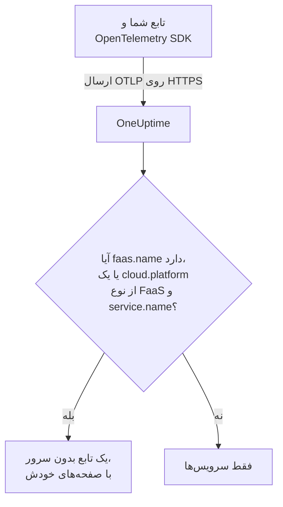

# توابع بدون سرور

OneUptime یک تابع بدون سرور را همان لحظه‌ای که داده OpenTelemetry از آن دریافت می‌کند می‌شناسد، و آن را همراه با ترِیس‌ها، لاگ‌ها و متریک‌هایش زیر **توابع بدون سرور** فهرست می‌کند. این برای AWS Lambda، Google Cloud Functions، Azure Functions، Cloudflare Workers و هر محیط اجرای FaaS دیگری که بتواند OpenTelemetry بفرستد کار می‌کند. چیزی برای ساختن دستی وجود ندارد: تابع را با SDK مربوط به OpenTelemetry برای محیط اجرایش ابزارگذاری کنید و صادرکننده OTLP آن را به سمت OneUptime بفرستید.

:::cards
- [OneUptime چگونه یک تابع را شناسایی می‌کند](#oneuptime-چگونه-یک-تابع-را-شناسایی-میکند): `faas.name`، یا یک `cloud.platform` از نوع FaaS همراه با یک `service.name`.
- [ارسال تله‌متری یک تابع](#ارسال-تلهمتری-یک-تابع): تنظیمات صادرکننده، و لایه Lambda.
- [Azure Functions](#azure-functions): یک تابع برای هر Function App، از میزبان Functions.
- [رفع اشکال](#رفع-اشکال): تابعی که نمایان نمی‌شود، یا صفحه‌هایش خالی است.
:::

## چگونه کار می‌کند

OneUptime ویژگی‌های منبع هر دسته را هنگام رسیدن آن می‌خواند. منبعی که `faas.name` دارد، یا یک `cloud.platform` از نوع FaaS مانند `aws_lambda` یا `azure_functions` را همراه با یک `service.name` دارد، یک تابع بدون سرور است: OneUptime آن را با نخستین داده‌اش می‌سازد و تله‌متری را زیر آن بایگانی می‌کند.



## پیش از شروع

- یک کلید دریافت داده. آن را زیر **تنظیمات پروژه** > **تله‌متری و APM** > **کلیدهای دریافت داده** بسازید و مقدارش را کپی کنید.
- SDK مربوط به OpenTelemetry، یا یک لایه ابزارگذاری خودکار، برای زبان تابع شما.

## OneUptime چگونه یک تابع را شناسایی می‌کند

OneUptime هر تابع را با ویژگی منبع `faas.name` شناسایی می‌کند. آشکارسازهای منبع برخی پلتفرم‌ها هرگز آن را تنظیم نمی‌کنند ([Azure Functions](#azure-functions) نمونه رایج آن است)، پس وقتی منبعی `faas.name` ندارد ولی `cloud.platform` آن یک پلتفرم FaaS است، OneUptime به‌جای آن از `service.name` آن به‌عنوان هویت تابع استفاده می‌کند، و همان مقدار را به‌صورت `faas.name` روی هر اسپن، لاگ، متریک و پروفایلی که ذخیره می‌کند می‌نویسد، تا صفحه‌های تابع همه تله‌متری آن را پیدا کنند:

| ویژگی | الزامی | کاربرد |
| --- | --- | --- |
| `faas.name` | **بله**، مگر اینکه دو مورد بعدی تنظیم شده باشند | هویت تابع (مانند `checkout-handler`) |
| `cloud.platform` | همراه با `service.name`، وقتی `faas.name` وجود ندارد | `aws_lambda`، `gcp_cloud_functions`، `azure_functions`، `tencent_cloud_scf` یا `alibaba_cloud_fc` |
| `service.name` | روی یک `cloud.platform` از نوع FaaS بدون `faas.name` | هویت تابع، که به‌صورت `faas.name` روی تله‌متری نوشته می‌شود |
| `faas.version` | خیر | در نمای کلی نشان داده می‌شود |
| `faas.instance` | خیر | برای هر نمونه در صفحه **نمونه‌ها** دنبال می‌شود |
| `cloud.provider` / `cloud.region` / `cloud.account.id` | خیر | در نمای کلی نشان داده می‌شود |
| `process.runtime.name` / `process.runtime.version` | خیر | به‌عنوان محیط اجرا در نمای کلی نشان داده می‌شود |

`faas.name` که خودتان تنظیم کنید هرگز جایگزین نمی‌شود. مقدار `cloud.platform` باید همان‌طور که فهرست شده نوشته شود (شکل نقطه‌دار `azure.functions` که برخی آشکارسازهای Azure می‌فرستند هم پذیرفته می‌شود)، و `service.name` باید یک ویژگی منبع باشد: سرآیند `x-oneuptime-service-name` یک سرویس را نام‌گذاری می‌کند، نه یک تابع.

> [!NOTE]
> تابعی که `service.name` را هم تنظیم کند، همچنان زیر **سرویس‌ها** هم نمایان می‌شود. **توابع بدون سرور** نمایی است که برای توابع ساخته شده و با `faas.name` محدود می‌شود.

## ارسال تله‌متری یک تابع

:::steps
### متغیرهای محیطی صادرکننده OTLP را تنظیم کنید

بیشتر ابزارگذاری‌های خودکار زبان‌ها متغیرهای محیطی استاندارد OpenTelemetry را می‌خوانند:

```bash
OTEL_EXPORTER_OTLP_ENDPOINT="https://oneuptime.com/otlp"
OTEL_EXPORTER_OTLP_HEADERS="x-oneuptime-token=YOUR_TELEMETRY_INGESTION_TOKEN"
OTEL_RESOURCE_ATTRIBUTES="faas.name=checkout-handler,faas.version=1.4.2"
```

اگر OneUptime را خودتان میزبانی می‌کنید، نقطه پایانی را با `https://YOUR-ONEUPTIME-HOST/otlp` جایگزین کنید. روی Azure Functions، `faas.name` را در `OTEL_RESOURCE_ATTRIBUTES` نگذارید — [Azure Functions](#azure-functions) را ببینید.

> [!WARNING]
> کلید دریافت داده یک راز است. از یک کلید دریافت داده از نوع **سرور** استفاده کنید که به‌صورت متغیر محیطی تابع تنظیم شده باشد. کلیدی که به یک مرورگر برسد، برای هر کسی که منبع صفحه را ببیند خواندنی است.

### لایه Lambda مربوط به OpenTelemetry را بیفزایید (AWS Lambda)

روی AWS Lambda، ساده‌ترین راه [لایه Lambda مربوط به OpenTelemetry](https://opentelemetry.io/docs/faas/lambda-auto/) است. لایه را برای محیط اجرای تابع خود پیوست کنید و این‌ها را تنظیم کنید:

```bash
AWS_LAMBDA_EXEC_WRAPPER=/opt/otel-handler
OTEL_EXPORTER_OTLP_ENDPOINT=https://oneuptime.com/otlp
OTEL_EXPORTER_OTLP_HEADERS=x-oneuptime-token=YOUR_TELEMETRY_INGESTION_TOKEN
```

این لایه `faas.name` را از نام تابع تنظیم می‌کند، و آشکارساز منبع آن `cloud.platform`، `cloud.region` و `cloud.account.id` را پر می‌کند. روی پلتفرم دیگری، این گام را رد کنید.

### تابع را فراخوانی کنید و بررسی کنید که داده می‌رسد

بررسی کنید که OneUptime کلید را می‌پذیرد:

```bash
curl -i https://oneuptime.com/otlp/v1/validate \
  -H "x-oneuptime-token: YOUR_TELEMETRY_INGESTION_TOKEN"
```

`200` همراه با `"valid": true` یعنی OneUptime کلید را می‌پذیرد؛ `401` یعنی کلید ناشناخته، باطل‌شده، غیرفعال یا منقضی است. سپس تابع را فراخوانی کنید. به‌محض اینکه یک اسپن، لاگ یا متریک بفرستد، زیر **محصولات** > **زیرساخت** > **بدون سرور** > **همه توابع** نمایان می‌شود.
:::

## Azure Functions

میزبان Azure Functions خودش می‌تواند OpenTelemetry بفرستد، پس یک Function App بدون تغییر کد، به هر زبانی که نوشته شده باشد، فراخوانی‌هایش (ترِیس‌ها، لاگ‌ها و متریک‌ها) را گزارش می‌کند. راهنمای Microsoft سند [Use OpenTelemetry with Azure Functions](https://learn.microsoft.com/en-us/azure/azure-functions/opentelemetry-howto) است.

### یک Function App چگونه نمایان می‌شود

آشکارسازهای منبع Azure (آشکارساز خود میزبان Functions، آشکارساز ورکر ایزوله .NET در `Microsoft.Azure.Functions.Worker.OpenTelemetry`، و آشکارساز Node.js در `@opentelemetry/resource-detector-azure`) **Function App** را توصیف می‌کنند، نه یک تابع منفرد را، و هیچ‌کدام `faas.name` را تنظیم نمی‌کنند:

| ویژگی | مقدار |
| --- | --- |
| `service.name` | نام Function App، از `WEBSITE_SITE_NAME` |
| `cloud.provider` | `azure` |
| `cloud.platform` | `azure_functions`؛ آشکارساز Node.js مقدار `azure.functions` را می‌نویسد که OneUptime آن را بازنویسی می‌کند |
| `cloud.region` | منطقه برنامه، از `REGION_NAME` |
| `cloud.resource_id` | `/subscriptions/<subscription>/resourceGroups/<group>/providers/Microsoft.Web/sites/<app>` |
| `faas.instance` | نمونه، از `WEBSITE_INSTANCE_ID`: فقط آشکارساز Node.js |

پس OneUptime تابع را با `service.name` شناسایی می‌کند، `faas.name` را با نام Function App پر می‌کند و **یک تابع بدون سرور برای هر Function App** نشان می‌دهد. منبع، برنامه را توصیف می‌کند، نه یکی از توابع آن را: هر نمونه، هر تابعی از برنامه را که اجرا کند، همان ویژگی‌های سطح برنامه را گزارش می‌دهد، و در طرح Flex Consumption برخی توابع حتی روی نمونه‌های خودشان مقیاس‌دهی افقی می‌شوند. توابع جداگانه در خود تله‌متری هستند:

- میزبان برای هر فراخوانی یک اسپن آغاز می‌کند که به نام تابعی است که اجرا کرده است: صفحه **ترِیس‌ها** تابع را با همان نام جست‌وجو کنید.
- میزبان `faas.invoke_duration` را ثبت می‌کند، که یک هیستوگرام بر حسب ثانیه است، و نام تابع در ویژگی نقطه داده `faas.name` قرار دارد: برای تأخیر هر تابع، متریک را در صفحه **متریک‌ها** یا در یک داشبورد بر پایه آن گروه‌بندی کنید.

`faas.name` را روی یک Function App به `OTEL_RESOURCE_ATTRIBUTES` نیفزایید، آن‌طور که نمونه عمومی [گام نخست](#متغیرهای-محیطی-صادرکننده-otlp-را-تنظیم-کنید) این کار را می‌کند. تنظیمات برنامه به همه پردازه‌های برنامه می‌رسند، پس تله‌متری همه توابع آن همان یک نام را خواهد داشت، و OneUptime هرگز `faas.name` را که به آن داده شده جایگزین نمی‌کند. راهنمای Microsoft هم همین را می‌گوید: مقدارهای مخصوص یک تابع را روی منبع نگذارید. آن را تنظیم‌نشده بگذارید تا تابع به نام برنامه نام‌گذاری شود.

میزبان و ورکر ایزوله .NET، وقتی `OTEL_SERVICE_NAME` تنظیم شده باشد، به‌جای نام برنامه از آن استفاده می‌کنند. همه پردازه‌های یک برنامه را روی همان `service.name` نگه دارید: میزبان و ورکر زبان هر دو تله‌متری می‌فرستند، و ورکری که نام دومی گزارش دهد یک تابع بدون سرور دوم می‌سازد. ورکری که منبعش `cloud.platform` از نوع FaaS ندارد به هیچ تابع بدون سروری نمی‌پیوندد — [کد تابع خود را ابزارگذاری کنید](#کد-تابع-خود-را-ابزارگذاری-کنید-اختیاری) را ببینید.

:::steps
### OpenTelemetry را در میزبان Functions روشن کنید

`"telemetryMode": "OpenTelemetry"` را به ریشه `host.json` برنامه بیفزایید:

```json title="host.json"
{
  "version": "2.0",
  "telemetryMode": "OpenTelemetry"
}
```

از آن پس میزبان، به هر زبانی که برنامه نوشته شده باشد، ترِیس‌های خودش (یک اسپن برای هر فراخوانی، به‌علاوه اسپن‌های پردازشگر Service Bus و Event Hubs پشت توابع راه‌اندازی‌شده)، لاگ‌هایش، و متریک‌هایی از جمله `faas.invoke_duration` را می‌فرستد.

### میزبان را به سمت OneUptime بفرستید

صادرکننده را به‌صورت تنظیمات برنامه تنظیم کنید:

```bash
az functionapp config appsettings set \
  --name my-function-app \
  --resource-group my-rg \
  --settings \
    OTEL_EXPORTER_OTLP_ENDPOINT=https://oneuptime.com/otlp \
    OTEL_EXPORTER_OTLP_PROTOCOL=http/protobuf \
    "OTEL_EXPORTER_OTLP_HEADERS=x-oneuptime-token=YOUR_TELEMETRY_INGESTION_TOKEN"
```

اگر OneUptime را خودتان میزبانی می‌کنید، نقطه پایانی را با `https://YOUR-ONEUPTIME-HOST/otlp` جایگزین کنید. `OTEL_EXPORTER_OTLP_PROTOCOL=http/protobuf` مهم است: صادرکننده .NET میزبان به‌طور پیش‌فرض از gRPC استفاده می‌کند، و با `http/protobuf` به `/otlp/v1/traces`، `/otlp/v1/metrics` و `/otlp/v1/logs` زیر نقطه پایانی می‌فرستد. میزبان فقط تا وقتی `OTEL_EXPORTER_OTLP_ENDPOINT` تنظیم شده باشد OTLP می‌فرستد.

> [!WARNING]
> این توکن یک راز است: از یک کلید دریافت داده از نوع **سرور** استفاده کنید. تنظیمات برنامه در حالت ذخیره رمزگذاری می‌شوند؛ برای نگه‌داشتن توکن در Key Vault، `OTEL_EXPORTER_OTLP_HEADERS` را روی یک ارجاع Key Vault مانند `@Microsoft.KeyVault(SecretUri=https://my-vault.vault.azure.net/secrets/oneuptime-otlp-headers/)` بگذارید و به هویت مدیریت‌شده برنامه نقش **Key Vault Secrets User** را روی خزانه بدهید. این ارجاع به مقدار راز همان‌طور که ذخیره شده است تبدیل می‌شود، پس کل سرآیند، `x-oneuptime-token=YOUR_TELEMETRY_INGESTION_TOKEN`، را ذخیره کنید، نه فقط توکن را.

اگر هنوز Application Insights را می‌خواهید، `APPLICATIONINSIGHTS_CONNECTION_STRING` را نگه دارید: وقتی هر دو تنظیم شده باشند، میزبان همان داده OpenTelemetry را هم به Application Insights و هم به OneUptime می‌فرستد. برای ارسال فقط به OneUptime آن را بردارید.

### کد تابع خود را ابزارگذاری کنید (اختیاری)

میزبان از پیش هر فراخوانی را ردیابی می‌کند. برای افزودن اسپن‌ها و لاگ‌هایی از کد خودتان که به اسپن‌های میزبان وصل باشند، OpenTelemetry را در ورکر زبان هم روشن کنید. این ورکر با همان تنظیمات `OTEL_EXPORTER_OTLP_*` می‌فرستد:

- **C# (isolated worker)**: بسته‌های NuGet `Microsoft.Azure.Functions.Worker.OpenTelemetry`، `OpenTelemetry.Extensions.Hosting` و `OpenTelemetry.Exporter.OpenTelemetryProtocol` را بیفزایید، سپس در `Program.cs`: `builder.Services.AddOpenTelemetry().UseFunctionsWorkerDefaults().UseOtlpExporter();`
- **JavaScript / TypeScript**: `npm install @azure/functions-opentelemetry-instrumentation` را کنار SDK مربوط به OpenTelemetry برای Node.js و صادرکننده‌های OTLP آن اجرا کنید، و `AzureFunctionsInstrumentation` را در فایلی که فیلد `main` در `package.json` شامل می‌شود ثبت کنید.
- **Java**: وابستگی Maven یعنی `com.microsoft.azure.functions:azure-functions-java-opentelemetry` را بیفزایید.
- **Python**: تنظیم برنامه `PYTHON_ENABLE_OPENTELEMETRY=true` را بگذارید، بسته‌های OpenTelemetry که Microsoft فهرست می‌کند (از جمله `opentelemetry-sdk` و `opentelemetry-exporter-otlp`) را به `requirements.txt` بیفزایید، و صادرکننده‌ها را در `function_app.py` پیکربندی کنید.
- **PowerShell**: تنظیم برنامه `OTEL_FUNCTIONS_WORKER_ENABLED=True` را بگذارید و ماژول `AzureFunctions.PowerShell.OpenTelemetry.SDK` را از `profile.ps1` بارگذاری کنید.

راهنمای Microsoft کد کامل هر زبان را دارد. ورکر .NET (از راه `UseFunctionsWorkerDefaults()`) و ورکر Python (از راه `PYTHON_ENABLE_OPENTELEMETRY`) به میزبان می‌گویند لاگ‌هایشان را به خودشان واگذارد، پس آن لاگ‌ها دو بار فرستاده نمی‌شوند.

اسپن‌ها و لاگ‌های یک ورکر فقط وقتی به صفحه‌های تابع می‌رسند که منبع آن، برنامه را همان‌طور توصیف کند که منبع میزبان: همان `service.name` و یک `cloud.platform` از نوع FaaS. ورکر ایزوله .NET (از راه `UseFunctionsWorkerDefaults()`) و نمونه Node.js در Microsoft (از راه آشکارسازهای Azure که `getResourceDetectors()` شامل می‌شود) هر دو را گزارش می‌دهند. نمونه Python در Microsoft منبعش را بدون آشکارساز Azure می‌سازد، پس به‌طور پیش‌فرض هیچ‌کدام را گزارش نمی‌دهد و تله‌متری‌اش هرگز به تابع نمی‌رسد. برای Python، یا هر ورکری که بدون آشکارساز منبع Azure Functions راه‌اندازی شده است، دو تنظیم برنامه دیگر بیفزایید. همه پردازه‌های برنامه، از جمله میزبان، آن‌ها را می‌خوانند، پس همه همان هویت را گزارش می‌دهند:

```bash
az functionapp config appsettings set \
  --name my-function-app \
  --resource-group my-rg \
  --settings \
    OTEL_SERVICE_NAME=my-function-app \
    "OTEL_RESOURCE_ATTRIBUTES=cloud.provider=azure,cloud.platform=azure_functions"
```

`OTEL_SERVICE_NAME` را روی نام خود Function App بگذارید. این همان نامی است که میزبان و آشکارساز Node.js بدون این تنظیم گزارش می‌دهند، پس تابع هویتی را که از پیش دارد نگه می‌دارد.
:::

### محدودیت‌ها

- **برنامه‌های درون‌پردازه‌ای C#** نمی‌توانند از OpenTelemetry استفاده کنند: نخست آن‌ها را به مدل ورکر ایزوله منتقل کنید.
- **جریان زنده لاگ** در پرتال Azure تا وقتی میزبان در حالت OpenTelemetry است کار نمی‌کند، و فهرست _Recent function invocations_ در پرتال به تله‌متری در Application Insights نیاز دارد. به‌جای آن از صفحه‌های **لاگ‌ها** و **ترِیس‌ها** تابع در OneUptime استفاده کنید.
- وقتی `telemetryMode` برابر `OpenTelemetry` باشد، بخش `logging.applicationInsights` در `host.json` دیگر اعمال نمی‌شود.
- **نمونه‌ها** مقدارهای `faas.instance` را فهرست می‌کند. از آشکارسازهای بالا فقط آشکارساز Node.js آن را تنظیم می‌کند، پس این صفحه برای تله‌متری میزبان و ورکر .NET خالی می‌ماند.

## آنچه دریافت می‌کنید

به‌محض اینکه تابع یک اسپن، لاگ یا متریک بفرستد، زیر **توابع بدون سرور** نمایان می‌شود. **نمای کلی** آن نشان می‌دهد:

- **فراخوانی‌ها**، **نرخ خطا** و **مدت p95**، که از ترِیس‌های شما در بازه زمانی دلخواهتان محاسبه می‌شوند، همراه با نمودارهای روند.
- **نمونه‌ها**: فهرست زنده مقدارهای `faas.instance` که تابع گزارش می‌دهد.
- صفحه‌های کامل **لاگ‌ها**، **ترِیس‌ها** و **متریک‌ها** که به همین تابع محدود شده‌اند.

## برچسب‌گذاری توابع و تعیین مالک

ویژگی منبعی که با `oneuptime.label.` آغاز شود، به برچسب پروژه روی تابع تبدیل می‌شود: `oneuptime.label.team=payments` برچسب `team:payments` را می‌افزاید. ویژگی‌ها را به `OTEL_RESOURCE_ATTRIBUTES` بیفزایید:

```bash
OTEL_RESOURCE_ATTRIBUTES="faas.name=checkout-handler,oneuptime.label.team=payments,oneuptime.label.env=production"
```

برای برچسب‌گذاری توابع یا تعیین مالک بر پایه نامشان، **محصولات** > **زیرساخت** > **بدون سرور** را باز کنید و از **قواعد برچسب** و **قواعد مالکیت** در منوی کناری استفاده کنید. قواعد هنگام ساخته شدن یک تابع اجرا می‌شوند، از جمله توابعی که خودکار کشف شده‌اند. برای اعمال یک قاعده روی توابعی که از پیش دارید، از **Run Now** آن استفاده کنید ([اجرای قواعد روی منابع موجود](/docs/configuration/run-rules-now) را ببینید).

## رفع اشکال

:::details تابع زیر توابع بدون سرور نمایان نمی‌شود
به این ترتیب بررسی کنید:

1. تابع پس از تنظیم متغیرها فراخوانی شده باشد: فقط هنگام اجرا تله‌متری می‌فرستد.
2. روی AWS Lambda، لایه برای محیط اجرای تابع پیوست شده باشد و `AWS_LAMBDA_EXEC_WRAPPER` برابر `/opt/otel-handler` باشد: بدون این پوشش‌دهنده، ابزارگذاری لایه هرگز آغاز نمی‌شود.
3. در جاهای دیگر، کد تابع SDK مربوط به OpenTelemetry یا ابزارگذاری خودکار را بارگذاری کند: متغیرها به‌تنهایی چیزی نمی‌فرستند.
4. منبع `faas.name`، یا یک `cloud.platform` از نوع FaaS و یک `service.name` داشته باشد. بدون آن‌ها، تله‌متری به‌جای آن زیر **سرویس‌ها** و به‌عنوان یک سرویس بایگانی می‌شود.
5. تابع بتواند به نشانی OneUptime شما برسد. تابعی که در یک شبکه خصوصی است به مسیری رو به بیرون تا آن نیاز دارد، مانند یک دروازه NAT.
:::

:::details تابع فهرست شده است، ولی صفحه‌هایش خالی‌اند
صفحه‌های **نمای کلی**، **لاگ‌ها**، **ترِیس‌ها** و **متریک‌ها** تابع تله‌متری‌ای را نشان می‌دهند که `faas.name` آن دقیقاً، با بزرگی و کوچکی حروف، برابر نام تابع باشد. تابعی که با یک `cloud.platform` از نوع FaaS و `service.name` خود نام‌گذاری شده است، به `faas.name` جداگانه‌ای نیاز ندارد: OneUptime هنگام رسیدن تله‌متری، `service.name` را به‌صورت `faas.name` روی آن می‌نویسد. تله‌متری‌ای که پیش از آغاز پر کردن `faas.name` در OneUptime ذخیره شده است به‌روزرسانی نمی‌شود و بیرون از صفحه‌ها می‌ماند: تابع را فراخوانی کنید تا تله‌متری تازه بفرستد. بازه زمانی بالای صفحه را هم بررسی کنید.
:::

:::details تابع قطع‌شده نشان داده می‌شود
وقتی OneUptime به مدت ۱۵ دقیقه هیچ چیزی از یک تابع دریافت نکند، تابع قطع‌شده می‌شود؛ OneUptime هر ۵ دقیقه بررسی می‌کند، و زمانی که خودش داده دریافت نمی‌کرد به حساب نمی‌آید. تابعی که فقط گاه‌به‌گاه اجرا می‌شود، میان اجراها قطع‌شده است: با تله‌متری بعدی‌اش دوباره متصل می‌شود.
:::

## گام‌های بعدی

:::cards
- [OpenTelemetry](/docs/telemetry/open-telemetry): ترِیس‌ها، لاگ‌ها و متریک‌ها را از هر برنامه‌ای بفرستید.
- [صف‌ها](/docs/telemetry/queues): صف‌ها و تاپیک‌هایی که توابع شما در آن‌ها منتشر می‌کنند و از آن‌ها مصرف می‌کنند.
- [مانیتور ترِیس‌ها](/docs/monitor/traces-monitor): هشدار بر پایه فراخوانی‌های ناموفق یا کند یک تابع.
:::
