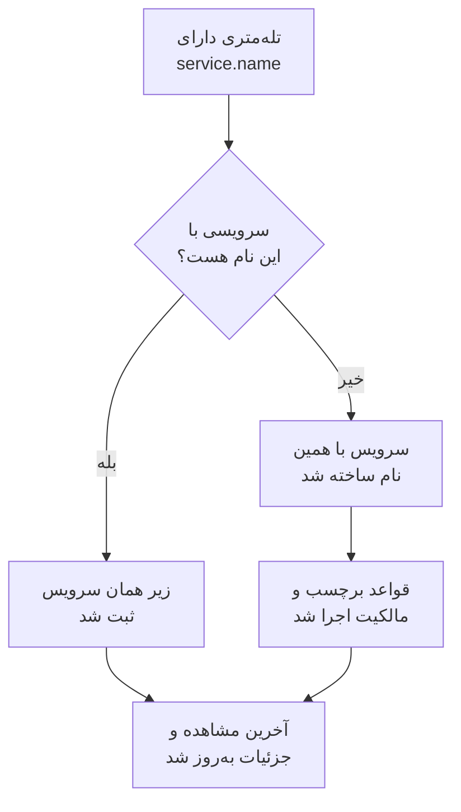

# کاتالوگ سرویس

کاتالوگ سرویس برنامه‌ها و میکروسرویس‌هایی را که اجرا می‌کنید فهرست می‌کند. نخستین باری که تله‌متری یک سرویس می‌رسد، OneUptime آن سرویس را می‌افزاید، سپس لاگ‌ها، ترِیس‌ها، متریک‌ها، استثناها، حوادث و مالکانش را در یک صفحه کنار هم می‌آورد تا هر کسی بفهمد سرویس چه می‌کند، مالکش کیست و حالش چطور است.

:::cards
- [یک سرویس چگونه وارد کاتالوگ می‌شود](#یک-سرویس-چگونه-وارد-کاتالوگ-میشود): `service.name` آن، با نخستین تله‌متری‌اش.
- [یافتن یک سرویس](#یافتن-یک-سرویس): فهرست، فیلترها و ستون‌هایش.
- [صفحه‌های یک سرویس](#صفحههای-یک-سرویس): همه‌چیز دربارهٔ یک سرویس.
- [بایگانی یا حذف یک سرویس](#بایگانی-یا-حذف-یک-سرویس): تاریخچه را نگه دارید، یا آن را بردارید.
:::

## یک سرویس چگونه وارد کاتالوگ می‌شود

لازم نیست سرویس‌ها را بسازید. هر دسته از تله‌متری سرویسی را که آن را فرستاده در ویژگی منبع `service.name` نام می‌برد. OneUptime دسته را زیر سرویسی با همان نام ثبت می‌کند، و اگر پروژه چنین سرویسی نداشته باشد آن را می‌سازد.

- **نام، هویت سرویس است.** بدون توجه به کوچکی و بزرگی حروف مقایسه می‌شود، پس `Checkout-API` و `checkout-api` یک سرویس‌اند. یک `service.name` تازه سرویس تازه‌ای را آغاز می‌کند.
- **کانتینرها خودشان را نام‌گذاری می‌کنند.** وقتی تله‌متری ایجنت‌های Docker و Podman هیچ `service.name` نداشته باشد، سرویس به نام کانتینرش نامیده می‌شود.
- **یک کلید دریافت داده می‌تواند سرویس را تعیین کند.** داده‌های OpenTelemetry که با کلیدی دارای **نام سرویس سنجاق‌شده** فرستاده شوند، زیر همان نام ثبت می‌شوند، هر چه `service.name` آن‌ها بگوید. [کلیدهای دریافت داده](/docs/telemetry/ingestion-keys#محدود-کردن-کلید-مرورگر) را ببینید.
- **مرورگرها و تلفن‌ها سرویس نیستند.** تله‌متری یک مرورگر یا اپلیکیشن موبایل به‌جای آن به یک [اپلیکیشن RUM](/docs/rum/applications) تعلق دارد.
- **برچسب‌ها می‌توانند همراه تله‌متری بیایند.** ویژگی منبعی به نام `oneuptime.label.<name>` برچسب `<name>:<value>` را به سرویس می‌افزاید، مانند `oneuptime.label.team=payments` برای `team:payments`.

هر بار که تله‌متری می‌رسد، **آخرین مشاهده** سرویس جلو می‌رود و جزئیاتش از ویژگی‌های منبعی که همراهش می‌آیند تازه می‌شود:

| جزئیات | از ویژگی |
| --- | --- |
| نسخهٔ سرویس | `service.version` |
| محیط استقرار | `deployment.environment.name`، یا `deployment.environment` |
| فضای نام سرویس | `service.namespace` |
| محیط اجرا | `process.runtime.name` و `process.runtime.version` |
| فناوری | `telemetry.sdk.language`، یا محیط اجرا |
| ابر | `cloud.provider`، `cloud.platform`، `cloud.region` و `cloud.account.id` |

## پیش از شروع

- **تله‌متری در حال رسیدن** با یک `service.name`. [OpenTelemetry](/docs/telemetry/open-telemetry) را ببینید: `OTEL_SERVICE_NAME` آن را تنظیم می‌کند.
- **نقشی که سرویس‌ها را بخواند.** Project Owner، Project Admin، Project Member، Viewer، Settings Admin، Settings Member یا Settings Viewer، یا یک نقش سفارشی با مجوز Read Service. ساختن، تغییر دادن و حذف سرویس‌ها به Project Owner، Project Admin، Project Member، Settings Admin یا Settings Member، یا مجوزهای متناظر سرویس نیاز دارد.

## یافتن یک سرویس

به **محصولات** > **منابع** > **سرویس‌ها** بروید. **همه سرویس‌ها** هر سرویس را با **نام**، **توضیحات**، **Technology**، **آخرین مشاهده**، **برچسب‌ها** و **مالکان** آن فهرست می‌کند.

- با نام یا توضیحات جستجو کنید، و با نوار بالای فهرست بر اساس مالک یا برچسب فیلتر کنید.
- چند سرویس را انتخاب کنید تا یک‌جا به همه‌شان برچسب یا مالک بیفزایید، یا بایگانی‌شان کنید.
- روی یک سرویس کلیک کنید تا صفحه‌هایش باز شوند.

برای افزودن سرویسی پیش از رسیدن تله‌متری‌اش، مثلاً برای اینکه اول مالکانش را تعیین کنید، روی **ساخت سرویس** کلیک کنید و **نام** آن را دقیقاً همان‌طور وارد کنید که `service.name` آن خواهد بود. قواعد برچسب و مالکیت روی آن مثل یک سرویس کشف‌شده اجرا می‌شوند. پس از ذخیره، راهنمای راه‌اندازی OpenTelemetry با همان نام در همهٔ قطعه کدها باز می‌شود، و گام آخر آن، **منتظر اتصال بمانید**، می‌گوید نخستین داده‌های سرویس چه زمانی می‌رسند.

## صفحه‌های یک سرویس

منوی کناری یک سرویس پنج بخش دارد:

| بخش | صفحه‌ها |
| --- | --- |
| **پایه** | **نمای کلی**: درخواست‌ها، نرخ خطا و تأخیر p95 از روی اسپن‌هایش، نمودارها و جزئیاتش. **توصیه‌ها**: مانیتورهای آماده برای سرویس، انتخاب‌شده بر اساس زبانش. **مالکان**: افراد و تیم‌هایی که مسئول آن‌اند. **فید**: هر آنچه برایش رخ داده، از چگونگی ساخته شدنش تا هر تغییر پس از آن. |
| **تله‌متری** | **لاگ‌ها**، **ترِیس‌ها**، **متریک‌ها**، **پروفایل‌های کارایی**، **استثناها** و **Source Maps** آن، که از پیش برای همین سرویس فیلتر شده‌اند. |
| **فعالیت** | رویدادهای **حوادث**، **هشدارها** و **تعمیر و نگهداری زمان‌بندی‌شده** که روی آن اثر می‌گذارند. |
| **توسعه‌دهنده** | **Terraform**، **API** و **دستیارهای هوش مصنوعی**: مدیریت سرویس از راه کد. در آغاز بسته است. |
| **پیشرفته** | **تنظیمات**، **گزارش‌های ممیزی** و **حذف سرویس**. **پیشرفته** در آغاز بسته است: اول بازش کنید. |

مالکان فراتر از این صفحه هم اهمیت دارند: نقشی با دامنهٔ Owned تله‌متری سرویس‌هایی را می‌خواند که شما یا تیم‌هایتان مالکشان هستید. [تله‌متری](/docs/permissions/index#تلهمتری) را ببینید.

## تغییر یک سرویس

:::steps
### تنظیماتش را باز کنید

سرویس را باز کنید، در منوی کناری‌اش **پیشرفته** را باز کنید و روی **تنظیمات** کلیک کنید.

### نامش را عوض کنید یا توضیحی بنویسید

در **جزئیات سرویس**، روی **ویرایش جزئیات** کلیک کنید تا **نام**، **توضیحات** یا **برچسب‌ها** را تغییر دهید. نام همچنان باید با `service.name` که تله‌متری‌اش گزارش می‌کند یکی باشد: آن را در تنظیمات OpenTelemetry هم عوض کنید، وگرنه تله‌متری بعدی یک سرویس تازه می‌سازد.

### رنگ و پشتهٔ فناوری‌اش را انتخاب کنید

در **تنظیمات سرویس**، روی **ویرایش تنظیمات** کلیک کنید. **رنگ سرویس** سرویس را در نمودارها و فهرست‌ها مشخص می‌کند؛ هر سرویس تازه رنگی از آنِ خود می‌گیرد. **پشته فناوری** اختیاری است: خالی‌اش بگذارید تا زبانی که از تله‌متری‌اش تشخیص داده شده نشان داده شود.
:::

همین صفحه نگهداری داده‌های سرویس را هم، جمع‌شده زیر **تنظیمات بیشتر**، در خود دارد. کارت‌های **نگهداری داده تله‌متری** و **نگهداری بر اساس نوع تله‌متری** تله‌متری آن را بیشتر یا کمتر از نگهداری پیش‌فرض پروژه نگه می‌دارند. این‌ها بخشی از [Enterprise Edition](/docs/self-hosted/enterprise) و در OneUptime Cloud بخشی از طرح Scale هستند؛ بدون آن‌ها صفحه نشان می‌دهد چه چیزی اضافه می‌کنند، و سرویس همان نگهداری پروژه را دارد.

## تعیین خودکار برچسب‌ها و مالکان

قواعد به سرویس‌های تازه هنگام ساخته شدن برچسب و مالک می‌دهند، از جمله به سرویس‌های کشف‌شده. آن‌ها را در **سرویس‌ها** > **تنظیمات** > **قواعد مالکیت** و **سرویس‌ها** > **تنظیمات** > **قواعد برچسب** پیدا کنید؛ **تنظیمات** در منوی کناری در آغاز بسته است. [قواعد برچسب و مالکیت](/docs/configuration/label-and-owner-rules) را ببینید.

## بایگانی یا حذف یک سرویس

سرویسی را که دیگر زیر نظر ندارید اما می‌خواهید تاریخچه‌اش بماند بایگانی کنید. سرویس بایگانی‌شده از **همه سرویس‌ها** پنهان می‌شود، اما همچنان تله‌متری جمع می‌کند. آن را از صفحهٔ **تنظیمات** خودش بایگانی کنید، یا چند سرویس را در فهرست انتخاب کنید. برای بازگرداندن یک سرویس، **سرویس‌ها** > **پیشرفته** > **بایگانی‌شده** را باز کنید.

> [!WARNING]
> حذف یک سرویس نقشه‌های منبع آن، و قواعد خط لولهٔ متریک و بودجه‌های هزینهٔ LLM تعیین‌شده برایش را هم حذف می‌کند. اگر OneUptime هنوز تله‌متری آن را دریافت کند، سرویس دوباره افزوده می‌شود، بی برچسب‌ها، مالکان و تنظیماتی که به آن داده بودید. برای برداشتن آن از فهرست و نگه داشتن همه‌چیز، به‌جایش بایگانی‌اش کنید.

## عیب‌یابی

:::details یک سرویس دو بار نمایش داده می‌شود
دو مقدار `service.name` به OneUptime رسیده‌اند، مثلاً از دو نسخه از تنظیمات شما، یا پس از تغییر نام فقط در یک سو. تله‌متری بر اساس نام تطبیق داده می‌شود: کاری کنید که همهٔ نمونه‌ها یک `service.name` گزارش کنند، سپس سرویسی را که دیگر لازم ندارید بایگانی یا حذف کنید.
:::

:::details سرویس من در کاتالوگ نیست
بررسی کنید که تله‌متری‌اش یک `service.name` دارد. تله‌متری یک مرورگر یا اپلیکیشن موبایل به‌جای آن به Real User Monitoring می‌رود، و تله‌متری میزبان یا خوشه‌ای که نام سرویس ندارد زیر همان میزبان یا خوشه ثبت می‌شود.
:::

:::details آخرین مشاهده عقب است
**آخرین مشاهده** تقریباً هر دقیقه یک بار به‌روز می‌شود، نه با هر دسته، پس ممکن است یک دقیقه یا کمی بیشتر از تله‌متری زنده عقب باشد.
:::

## گام‌های بعدی

:::cards
- [کاوشگر لاگ](/docs/telemetry/logs-explorer): در لاگ‌های یک سرویس جستجو کنید.
- [کاوشگر ترِیس](/docs/telemetry/traces-explorer): درخواست‌هایش را دنبال کنید.
- [ردیابی استثناها](/docs/telemetry/exceptions): خطاهایی را که پرتاب می‌کند دسته‌بندی کنید.
- [قواعد برچسب و مالکیت](/docs/configuration/label-and-owner-rules): به سرویس‌های تازه برچسب و مالک بدهید.
:::
