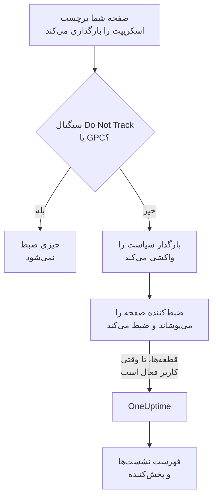
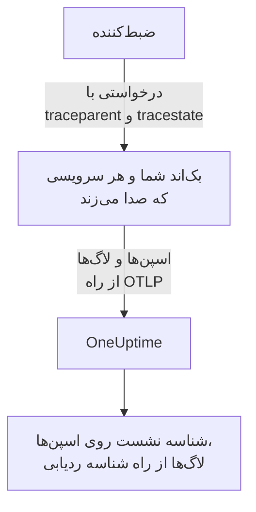
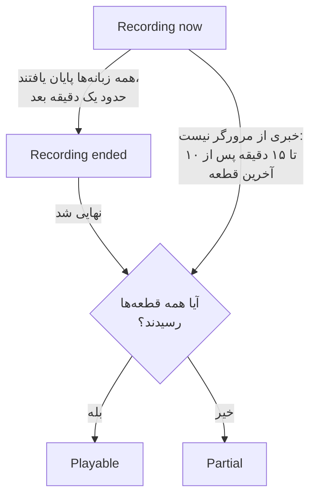
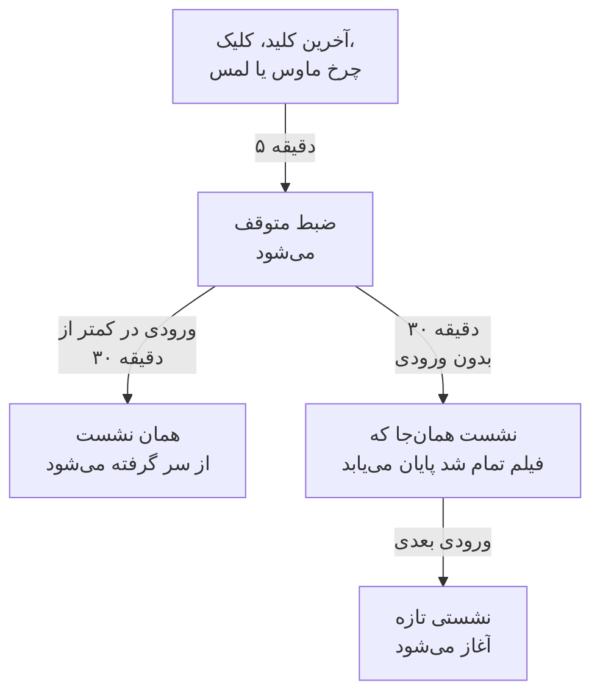

# بازپخش نشست

بازپخش نشست آنچه کاربران واقعی در برنامه وب یا React Native شما دیدند ضبط می‌کند و آن را کنار خطاها، ردیابی‌ها و لاگ‌های همان نشست پخش می‌کند. یک برچسب اسکریپت می‌افزایید، برمی‌گزینید چه چیزی پوشانده شود، و هر نشستی را از برنامه RUM آن تماشا می‌کنید.

:::cards
- [چگونه کار می‌کند](#چگونه-کار-میکند): یک بارگذار، یک سیاست و یک ضبط‌کننده که در همان حال ارسال می‌کند.
- [نصب](#نصب): یک برچسب اسکریپت روی هر صفحه، یا SDK مربوط به React Native.
- [حریم خصوصی](#حریم-خصوصی): چه چیزی پوشانده می‌شود، رضایت، و چه کسی می‌تواند ضبط بفرستد.
- [همبسته کردن با باقی تله‌متری‌تان](#همبسته-کردن-با-باقی-تلهمتریتان): ردیابی‌ها، لاگ‌ها و خطاهای بک‌اند، بی هیچ کدی پیوند خورده.
- [تماشای یک نشست](#تماشای-یک-نشست): فهرست نشست‌ها، صفحه کاربران، جریان کاربران و پخش‌کننده.
- [سلامت ضبط](#سلامت-ضبط): چرا چیزی نمی‌رسد، و هشدار پیش از آنکه بودجه‌ای تمام شود.
:::

## چگونه کار می‌کند

اسکریپت روی صفحه شما یک بارگذار کوچک است. سیگنال‌های حریم خصوصی مرورگر را بررسی می‌کند، سیاست برنامه را از OneUptime واکشی می‌کند، و تنها پس از آن ضبط‌کننده را بارگذاری می‌کند؛ ضبط‌کننده صفحه را همان‌طور که ضبطش می‌کند می‌پوشاند و تا وقتی کاربر فعال است آن را قطعه‌قطعه ارسال می‌کند.



به‌طور پیش‌فرض هر نشستی ضبط و همان‌طور که رخ می‌دهد ارسال می‌شود، نه فقط آن‌هایی که خراب شدند. نشست‌هایی که در آن‌ها هیچ خطایی رخ نداد جایی‌اند که پرداختی را می‌یابید که کسی تمامش نکرد، فرمی که همه رهایش کردند، و صفحه‌ای که مشتری می‌گوید «عجیب به نظر می‌رسید».

برای ذخیره کمتر، دو تنظیم از سیاست برنامه با هم کار می‌کنند:

| تنظیم | پیش‌فرض | چه چیزی را تغییر می‌دهد |
| --- | --- | --- |
| **درصد نمونه‌گیری** | ۱۰۰ | اصلاً چه تعداد نشست واجد شرایط‌اند. نصفش کنید تا هم بایت‌های ذخیره‌شده و هم داده کاربر نهایی در حال سکون نصف شود. تصمیم یک بار به ازای هر نشست از درهم‌سازی شناسه نشست گرفته می‌شود، پس هیچ نشستی نیمه‌ضبط نمی‌شود. |
| **زمان بارگذاری ضبط** | _Always_ | اگر روی _On error or frustration_ تنظیم شود، ضبط‌کننده یک بافر چرخان در حافظه نگه می‌دارد و فقط وقتی چیزی خراب شود ارسال می‌کند. آن‌گاه تقریباً برای هر نشست ناموفقی ضبطی هست، با هزینه‌ای حدوداً ۱۵ برابر کمتر از ضبط همه، اما نشستی را که شکست نخورد نمی‌توانید تماشا کنید. |

## پیش از شروع

- یک برنامه RUM. یکی را زیر **محصولات** > **منابع** > **پایش کاربر واقعی** بسازید، یا بگذارید تله‌متری‌تان آن را بسازد: [مدیریت برنامه‌ها](/docs/rum/applications) را ببینید.
- یک کلید دریافت داده **مرورگر**، از **تنظیمات پروژه** > **تله‌متری و APM** > **کلیدهای دریافت داده**. کلید Browser فقط از مبدأهایی کار می‌کند که روی آن فهرست می‌کنید: [مبدأهای مجازتان را در تولید تنظیم کنید](#مبدأهای-مجازتان-را-در-تولید-تنظیم-کنید) را ببینید.

بازپخش نشست به‌طور پیش‌فرض روشن است. تنظیماتش در سه جا هستند:

| کجا | آنجا چه هست |
| --- | --- |
| صفحه **Replay Policy** برنامه | سیاست (ضبط، پوشاندن، رضایت، ردیابی و محدودیت‌ها)، خلاصه‌ای از **سلامت ضبط**، کارت **ضبط شامل چه چیزهایی است**، پنل **Test your installation** و **Record a specific user's next session**. |
| صفحه **سلامت** برنامه | اینکه ضبط‌ها می‌رسند یا نه، و وقتی نمی‌رسند چرا. [سلامت ضبط](#سلامت-ضبط) را ببینید. |
| **پایش کاربر واقعی** > **تنظیمات** > **بازپخش نشست** | کلید سراسری پروژه که همه برنامه‌ها را یک‌جا متوقف می‌کند، و فهرستی فقط‌خواندنی از سیاست هر برنامه. |

## نصب

به هر صفحه‌ای که می‌خواهید ضبط شود یک برچسب اسکریپت بیفزایید.

:::steps
### یک کلید Browser بسازید

زیر **تنظیمات پروژه** > **تله‌متری و APM** > **کلیدهای دریافت داده** روی **ساخت کلید دریافت داده** کلیک کنید، **مرورگر** را به‌عنوان **نوع کلید** برگزینید و مبدأهای سایتتان را در **مبداهای مجاز** فهرست کنید. سپس **کلید محرمانه** کلید را کپی کنید. [راه‌اندازی مرورگر](/docs/rum/browser-setup#راهاندازی) هر صفحه را نشان می‌دهد.

### برچسب اسکریپت را بیفزایید

برچسب را روی هر صفحه بگذارید، با کلیدتان و شناسه برنامه‌تان:

```html
<script
  src="https://oneuptime.com/telemetry/session-replay/v1/recorder.js"
  data-oneuptime-token="YOUR_TELEMETRY_INGESTION_KEY"
  data-oneuptime-app-identifier="storefront-web"
  crossorigin="anonymous"
  async
></script>
```

`data-oneuptime-app-identifier` باید با شناسه برنامه RUM یکی باشد، همان مقداری که برای `service.name` به کار می‌برید. صفحه **مستندات** برنامه، در بخش **بازپخش نشست** منوی کناری‌اش، این قطعه کد را با هر دو مقدار پرشده نشان می‌دهد، همراه با نسخه‌های Next.js / React و Google Tag Manager آن.

### بررسی کنید که ضبط‌ها می‌رسند

یکی از صفحه‌هایتان را باز کنید و چند ثانیه این‌سو و آن‌سو کلیک کنید. در حدود یک دقیقه، نشست در صفحه **بازپخش نشست** برنامه با نشان **در حال ضبط** دیده می‌شود. اگر نبود، صفحه **سلامت** برنامه می‌گوید چرا: [سلامت ضبط](#سلامت-ضبط) را ببینید.
:::

اسکریپتِ `/v1/recorder.js` یک بارگذار کوچک است. Do Not Track را بررسی می‌کند، سیاست برنامه‌تان را واکشی می‌کند، و تنها پس از آن `/latest/recorder.js` را بارگذاری می‌کند. سیاست و ضبط‌کننده هر دو با `no-store` ارائه می‌شوند، پس تغییر در هر یک بی انتظار برای حافظه نهان مرورگر به بارگذاری بعدی صفحه می‌رسد.

### صفت‌های برچسب اسکریپت

| صفت | الزامی | چه می‌کند |
| --- | --- | --- |
| `data-oneuptime-token` | بله | توکن دریافت تله‌متری شما. |
| `data-oneuptime-app-identifier` | بله | شناسه برنامه RUM. |
| `data-oneuptime-host` | خیر | مبدأ OneUptime. وقتی حذف شود از `src` خود اسکریپت مشتق می‌شود، پس فقط وقتی لازمش دارید که اسکریپت را از دامنه خودتان پراکسی کنید. |
| `data-oneuptime-user-ref` | خیر | ارجاع کاربر نهایی که هنگام بارگذاری صفحه شناخته است (یک شناسه کاربر، هرگز ایمیلی که نمی‌خواهید ذخیره شود). همان چیزی که `identify()` بعداً تنظیم می‌کند؛ تنها شکلی است که برای [ضبط نشست بعدی یک کاربر مشخص](#ضبط-نشست-بعدی-یک-کاربر-مشخص) کار می‌کند. |
| `data-oneuptime-respect-do-not-track` | خیر | پیش‌فرضش رعایت کردن Do Not Track و Global Privacy Control است. برای ضبط کردن بدون توجه به سیگنال، `"false"` بگذاریدش؛ [Do Not Track](#do-not-track) را ببینید. |
| `data-oneuptime-debug` | خیر | مقدار `"true"` تصمیم‌های ضبط‌کننده را در کنسول چاپ می‌کند. [رفع اشکال بازپخش نشست](/docs/rum/session-replay-troubleshooting) را ببینید. |
| `data-oneuptime-offline-storage` | خیر | آن را `"false"` بگذارید تا قطعه‌هایی که هنگام آفلاین بودن بازدیدکننده ضبط می‌شوند فقط در حافظه بمانند، نه افزون بر آن در IndexedDB مرورگر. [حالت آفلاین](#حالت-آفلاین) را ببینید. |

همان گزینه‌ها را می‌توان به‌جای برچسب روی یک سراسری داد، که همان چیزی است که مدیران برچسب و نصب‌های بسته‌بندی‌شده به کار می‌برند:

```js
window.__ONEUPTIME_SESSION_REPLAY__ = {
  host: "https://oneuptime.com",
  token: "YOUR_TELEMETRY_INGESTION_KEY",
  appIdentifier: "storefront-web",
  userRef: "user-123", // optional
  respectDoNotTrack: true, // optional
  debug: false, // optional
  offlineStorage: true, // optional; false keeps offline chunks in memory only
};
```

### نصب سالم چه شکلی است

زبانه Network را در DevTools باز کنید و روی `session-replay` پالایه بگذارید. صفحه‌ای که کار می‌کند این‌ها را می‌سازد:

1. **یک `GET .../session-replay/v1/config`** به ازای هر بارگذاری صفحه — واکشی سیاست.
2. **یک `POST .../session-replay/v1/chunk` تقریباً هر ۱۵ ثانیه تا وقتی کاربر در حال انجام کاری است**، یا زودتر وقتی ۲۵۶ کیلوبایت رویداد انباشته شود. زبانه‌ای بیکار رویدادی تولید نمی‌کند و بنابراین اصلاً POSTای نمی‌زند: پیش از آنکه از روی زبانه Network درباره نصب داوری کنید، ماوس را حرکت دهید یا کلیک کنید.
3. وقتی زبانه پنهان می‌شود، و دوباره وقتی صفحه کنار می‌رود، یک `POST` که با `keepalive` فرستاده می‌شود. کنار رفتن صفحه — بستن زبانه، بازخوانی آن، رفتن به صفحه‌ای دیگر، یا رفتن صفحه به حافظه نهان back/forward مرورگر (هر `pagehide`) — آن را پایانی علامت می‌زند و به OneUptime می‌گوید ضبط آن زبانه تمام شده است؛ صفحه‌ای که کاربر از حافظه نهان back/forward برمی‌گرداند، به‌عنوان زبانه‌ای تازه از همان نشست به ضبط ادامه می‌دهد. زبانه‌ای که صرفاً پنهان شده باز می‌ماند، تا وقتی کاربر به آن برگشت ضبط ادامه یابد. کل بدنه‌اش زیر ۵۶ کیلوبایت می‌ماند — سهم ضبط‌کننده از سهمیه ۶۴ کیلوبایتی keepalive مرورگر به ازای هر مبدأ — و می‌تواند چند قطعه را به‌عنوان فریم‌های همان یک درخواست حمل کند: قطعه پایانی، پاره‌هایی که قطعه پایانی بزرگ به آن‌ها بریده شده (هرکدام حداکثر ۴۸ کیلوبایت رویداد، تا سرآیند فریم هنوز جا شود)، و هر قطعه‌ای که هنوز منتظر تلاش دوباره بود. قطعه‌ای که وقتی زبانه صرفاً پنهان می‌شود از پیش بزرگ‌تر از این بودجه است، به‌جایش از مسیر عادی می‌رود، در حالی که صفحه هنوز زنده است تا بفرستدش.

زیر تریگر _On error or frustration_، گام ۲ تا شلیک شدن تریگری رخ نمی‌دهد — [رفع اشکال](#رفع-اشکال) را ببینید.

## نصب در React Native

SDK مربوط به React Native سلسله‌مراتب نماهای بومی را به‌صورت رویدادهای مصنوعیِ سازگار با rrweb ضبط می‌کند، پس ضبط‌های موبایل در همان فهرست نشست‌ها و پخش‌کننده‌ای باز می‌شوند که ضبط‌های وب. از صفحه عکس نمی‌گیرد. پخش‌کننده هر ضبط را به‌عنوان یک برنامه React Native برچسب می‌زند، و زبانه **Fidelity** آن سطح‌های بومی را که نمی‌شد بازنمایی کرد توضیح می‌دهد.

:::steps
### SDK را نصب کنید

این SDK از برنامه‌های React Native روی iOS و Android پشتیبانی می‌کند. آن را همراه وابستگی هم‌تای صندوق خروجی پایدارش نصب کنید:

```bash
npm install @oneuptime/react-native-replay @react-native-async-storage/async-storage
```

در یک پروژه iOS خام، پس از افزودن بسته‌ها نصب معمول CocoaPods را اجرا کنید؛ نسخه‌های کنونی React Native روی Android بدون ثبت دستی خودکار پیوند می‌دهند. ضبط‌کننده افزون بر Async Storage ماژول بومی خودش را برای درخت نماها دارد، پس پروژه‌های Expo باید یک بیلد سفارشی توسعه یا تولید به کار ببرند (برای نمونه EAS Build یا یک prebuild). Expo Go نمی‌تواند این SDK را اجرا کند، چون هیچ‌یک از دو ماژول بومی را نمی‌توان به فایل اجرایی ثابت Expo Go افزود.

### ضبط‌کننده را آغاز کنید و برنامه‌تان را درونش بپیچید

نمونه یکتا را یک بار آغاز کنید، سپس provider را بالای بخشی از برنامه بگذارید که می‌خواهید ضبط شود:

```tsx
import {
  OneUptimeReplay,
  OneUptimeReplayProvider,
} from "@oneuptime/react-native-replay";

OneUptimeReplay.start({
  host: "https://oneuptime.com",
  token: "YOUR_TELEMETRY_INGESTION_KEY",
  appIdentifier: "storefront-mobile",
  mobileAppIdentifier: "com.example.storefront",
  appName: "Storefront", // optional, shown in session details
  appVersion: "4.2.0", // optional, shown in session details
});

export default function App() {
  return (
    <OneUptimeReplayProvider>
      <Navigation />
    </OneUptimeReplayProvider>
  );
}
```

`appIdentifier` شناسه برنامه RUM است. `mobileAppIdentifier` شناسه برنامه Android یا شناسه بسته iOS است که در فایل اجرایی ارسال می‌شود، نه نام نمایشی. همین مقدار را در [فهرست‌های مجاز `app://`](#مبدأهای-مجازتان-را-در-تولید-تنظیم-کنید) به کار ببرید. SDK سیاست بازپخش برنامه را از `host` واکشی می‌کند؛ نمونه‌برداری، تریگر، رضایت، نگهداشت و بودجه‌های ارسال در اختیار سرور می‌مانند.
:::

provider یک ریشه بومیِ ادغام‌نشدنی را در اختیار دارد و درخت نماها و رویدادهای آغاز، حرکت و پایان لمس آن را ضبط می‌کند. اگر خودتان نمونه‌های ضبط‌کننده می‌سازید، یکی را با `<OneUptimeReplayProvider recorder={recorder}>` بدهید. `MobileReplayRecorder` هم برای یکپارچه‌سازی‌های جداافتاده یا چندکلاینتی صادر شده است؛ بیشتر برنامه‌ها باید همان نمونه یکتا را به کار ببرند.

### API در React Native

`OneUptimeReplay` را مستقیم وارد کنید، یا زیر provider تابع `useOneUptimeReplay()` را صدا بزنید. نمونه یکتا این‌ها را در دسترس می‌گذارد:

| متد | چه می‌کند |
| --- | --- |
| `start(options)` | سیاست را واکشی می‌کند و ثبت را آغاز می‌کند. گزینه‌های الزامی `host`، `token`، `appIdentifier` و `mobileAppIdentifier` هستند؛ `appName` و `appVersion` فراداده نمایشی اختیاری‌اند، و `connectivity` منبعی اختیاری برای وضعیت شبکه در [حالت آفلاین](#حالت-آفلاین) است. |
| `stop()` | آنچه را می‌شود فرستاد می‌فرستد، ثبت را متوقف می‌کند و گرداننده‌های چرخه عمر را جدا می‌کند. |
| `identify(userRef, traits?)` | کاربر واردشده و ویژگی‌های اختیاری را پیوست می‌کند، به شرط **ثبت هویت کاربر نهایی**. |
| `setTags(tags)` / `addTag(key, value)` | همه برچسب‌های جست‌وجوپذیر نشست را جایگزین می‌کند، یا یک برچسب را بی جایگزین کردن بقیه می‌افزاید. |
| `track(name, properties?)` | یک رویداد برنامه را روی خط زمانی بازپخش می‌گذارد. |
| `setRoute(route)` | پس از ناوبری، صفحه یا مسیر منطقیِ پاک‌سازی‌شده‌ای را ثبت می‌کند. آن را از callback تغییر مسیرِ ناوبرتان صدا بزنید. |
| `captureSession(reason?)` | زیر _On error or frustration_، بافر چرخان را به دلیلی ویژه برنامه ارسال می‌کند، مانند کاربری که روی «گزارش یک مشکل» می‌زند. |
| `captureError(error)` | یک خطای جاوااسکریپتِ مدیریت‌شده را ثبت می‌کند و ثبتِ تریگرشونده با خطا را فعال می‌کند. |
| `grantConsent()` / `revokeConsent()` | ارسال‌ها را مجاز می‌کند، یا بافر درون حافظه، صندوق خروجی ذخیره‌شده، نشست و شناسه بازدیدکننده را بی‌درنگ پاک می‌کند. اجازه بعدی با شناسه‌های تازه آغاز می‌شود. |
| `getSessionId()` / `onSessionChange(listener)` | شناسه نشست بازپخشِ کنونیِ دارای رضایت را برای همبستگی ردیابی و لاگ می‌خواند یا مشترکش می‌شود. شنونده وقتی ثبت یا رضایت پایان می‌یابد `null` هم دریافت می‌کند. |
| `getDiagnostics()` | وضعیت ضبط‌کننده و تصمیم‌های اخیر را برمی‌گرداند، بی آنکه محتوای ثبت‌شده نماها را برگرداند. |

SDK به `AppState` در React Native گوش می‌دهد: رفتن به پس‌زمینه رویدادهای دارای رضایت را می‌بندد و تخلیه می‌کند، در حالی که ضبطِ پیش از رضایت فقط در حافظه می‌ماند. پیش از آنکه ثبت در پیش‌زمینه از سر گرفته شود، SDK سیاست را بدون پاسخ ذخیره‌شده در حافظه نهان تازه می‌کند. هنگام فعال بودن هم سیاست را به‌طور دوره‌ای تازه می‌کند، تا غیرفعال‌سازی، رضایت، نمونه‌برداری، هدف‌گیری و تغییرات هویت در برنامه‌ای که مدت‌ها باز می‌ماند اثر کنند. وقتی یکپارچه‌سازی‌تان برای همیشه برچیده می‌شود `stop()` را صدا بزنید؛ ناوبری معمولی میان صفحه‌ها باید به‌جای توقف و آغاز دوباره ضبط‌کننده از `setRoute()` استفاده کند.

**وقتی یک نشست موبایل در بیکاری پایان می‌یابد.** پنج دقیقه بدون ورودی از پیش ثبت را متوقف می‌کند ([زمان بیکاری](#زمان-بیکاری) را ببینید). سی دقیقه بدون لمس و بدون هیچ فراخوان ثبت‌شده‌ای از SDK (`track()`، `setTags()`، `identify()` و مانند آن‌ها، که هنگام اجرای ثبت انجام شده باشند) نشست را پایان می‌دهد. نشست در همان آخرین فعالیت پایان می‌یابد، یا برای نشستی متوقف‌شده در همان توقف، جایی که ضبطش تمام شد — نه وقتی برنامه برمی‌گردد یا ضبط‌کننده متوجه می‌شود — پس زمانی که در پس‌زمینه یا در حالت توقف گذشته هرگز به انتهای نشست افزوده نمی‌شود. برنامه‌ای که در پیش‌زمینه باز مانده، هر نیم ساعت نشست تازه‌ای آغاز نمی‌کند. نشست بعدی وقتی آغاز می‌شود که کاربر برگردد: نخستین لمسش، نمایش یا پنهان شدن صفحه‌کلید نرم‌افزاری، بازگشت برنامه به پیش‌زمینه، یا یک فراخوان `captureSession()`. روی نمای تازه‌ای از صفحه باز می‌شود. تا آن هنگام `getSessionId()` مقدار `null` را برمی‌گرداند و `onSessionChange()` با `null` صدا زده می‌شود. خطاها، ناوبری و فراخوان‌های `track()` در این میان ضبط نمی‌شوند.

برای همبسته کردن تله‌متری موبایل با یک بازپخش، با `onSessionChange()` مشترک شوید و مقدار برگشتی را به‌عنوان صفت `session.id` در ابزارگذاری OpenTelemetry خود بگذارید. هر بار که callback فراخوانده می‌شود آن صفت را جایگزین کنید، از جمله پاک کردنش وقتی مقدار `null` است. SDK بازپخش شبکه بومی را وصله نمی‌کند و خودش یک provider مربوط به OpenTelemetry را تغییر نمی‌دهد.

### حریم خصوصی و پوشاندن در React Native

ثبت موبایل عمداً از حالت‌های پوشاندن وب سخت‌گیرانه‌تر است. متن رابط کاربری بومی، مقدارهای دسترس‌پذیری، مقدارهای ورودی و پیکسل‌های تصویر هرگز سریال‌سازی نمی‌شوند؛ سرور یک وایرفریم ساختاری دریافت می‌کند، حتی وقتی حالت پوشاندن وب برنامه اجازه متن خوانا را بدهد. فراداده‌ای که فراخواننده می‌دهد، مانند ارجاع‌های کاربر، نام رویدادها، مسیرها و برچسب‌های جست‌وجوپذیر، از قرارداد API پیروی می‌کند، پس رازها را در این فیلدها نگذارید. یک زیردرخت به‌ویژه حساس را در `<ReplayMask>` بپیچید تا آن ناحیه با یک جانگهدار حریم خصوصی جایگزین شود و چیدمان پیرامونش حفظ شود.

رضایت از مجوز سیستم‌عامل یا بنر رضایت شما استنباط نمی‌شود. زیر _Require explicit_، `grantConsent()` را فقط پس از آنکه برنامه‌تان رضایت لازم را گرفت صدا بزنید. صدا زدن `revokeConsent()` هم داده‌های نفرستاده صف‌شده و ماندگار را دور می‌ریزد و هم شناسه‌هایی را که می‌توانستند نشستی بعدی را به نشست لغوشده پیوند دهند.

ضبط‌کننده موبایل مرزها و نوع نماها، مکان‌های لمس، مسیرهای منطقی، رویدادهای سفارشی و خطاهای جاوااسکریپت را ثبت می‌کند. این محدودیت‌ها همیشه در زبانه Fidelity پخش‌کننده اعلام می‌شوند:

- پیکسل‌های `Image` بومی مات‌اند؛ فقط قاب بازنمایی می‌شود.
- محتوای `WebView` بیرون از درخت React Native است. اگر صفحه میزبانی‌شده ضبط خودش را لازم دارد، ضبط‌کننده وب را درون آن نصب کنید.
- Canvas، Skia، OpenGL، نقشه‌ها، پیش‌نمایش دوربین، ویدیو و دیگر سطح‌هایی که به‌طور سفارشی رسم می‌شوند مات‌اند.
- مسیرهای لمس درون `ReplayMask` یا یک سطح مات ضبط نمی‌شوند. پل بومی هدف زنده لمس و نیاکانش را بررسی می‌کند، و اگر این بررسی حریم خصوصی کامل نشود، آن حرکت را سرکوب می‌کند.
- پویانمایی‌های Reanimated، native-driver و رشته UI در لحظه‌های عکس‌برداری از درخت نماها نمونه‌برداری می‌شوند، نه فریم به فریم بازتولید.
- خرابی‌های بومی که جاوااسکریپت را پیش از آنکه بتواند تخلیه کند پایان می‌دهند، یک SDK خرابی بومی لازم دارند؛ `captureError()` خطاهای جاوااسکریپتِ مدیریت‌شده را پوشش می‌دهد، نه تخلیه‌های خرابی در سطح فرایند.

## کاربرانتان را شناسایی کنید

هر نشستی ناشناس است تا وقتی صفحه شما بگوید به چه کسی تعلق دارد. بدون آن، فهرست همچنان می‌تواند نشست‌های یک مرورگر را زیر یک شناسه بازدیدکننده ناشناس گروه کند ([بازدیدکنندگان ناشناس](#بازدیدکنندگان-ناشناس) را در پایین ببینید)، اما هیچ‌چیز شخص را نام نمی‌برد و مرورگر دومش را به اولی پیوند نمی‌دهد. به‌محض اینکه دانستید `identify()` را صدا بزنید، یا پیش از بارگذاری اسکریپت صفش کنید — در هر دو حالت پیش از فرستادن نخستین قطعه اعمال می‌شود، پس نشست از همان لحظه‌ای که پدیدار می‌شود با کاربر قابل جستجوست:

```js
// After the script has loaded:
OneUptimeReplay.identify("user-123", { plan: "pro", tenant: "acme" });

// Or at any time, whether or not the script has loaded yet:
(window.OneUptimeReplayQueue = window.OneUptimeReplayQueue || []).push([
  "identify",
  "user-123",
  { plan: "pro", tenant: "acme" },
]);
```

- ارجاع همان چیزی است که فهرست نشست‌ها نشان می‌دهد و جستجوهای `user:` با آن می‌خوانند. خصیصه‌ها در سرآیند پخش‌کننده و روی پنل جزئیات نشست نشان داده می‌شوند.
- **هویت از آنِ نشست است، نه فقط صفحه.** یک نشست هر بارگذاری صفحه و هر زبانه بازدید را در بر می‌گیرد، و همین که یکی از صفحه‌هایش `identify()` را صدا بزند، کل نشست از آنِ آن کاربر است — صفحه‌های پیش از ورود هم، چون همان بازدیدند. هر صفحه و زبانه بعدی نشست هم کاربر را نام می‌برد، حتی صفحه‌ای که خودش هرگز `identify()` را صدا نمی‌زند: صفحه فرودِ تغییر مسیر ورود، پیوندی که در زبانه‌ای تازه باز شده. تا وقتی **ثبت هویت کاربر نهایی** روشن است، ضبط‌کننده به خاطر می‌سپارد نشست جاری از آنِ کیست، در `localStorage` زیر `oneuptime.replay.user` — شناسه نشست و ارجاع، و هیچ چیز دیگر، و زیر رضایت _Require explicit_ فقط پس از اعطای رضایت — و فقط برای همان نشست: نشست بعدی (پس از ۳۰ دقیقه بیکاری یا سقف ۴ ساعت) ناشناس آغاز می‌شود تا صفحه‌ای شناسایی‌اش کند، مگر آنکه صفحه‌ای که آغازش کرد خودش کاربر را شناسایی کرده باشد. پس `identify()` را در هر بارگذاری صفحه‌ای که برنامه‌تان کاربر را می‌شناسد صدا بزنید، نه فقط درست پس از ورود.
- **کاربری دیگر نشست خودش را می‌گیرد.** وقتی `identify()` کسی جز کاربری را نام ببرد که نشست از پیش از آنِ اوست — یک نفر خارج شده و دیگری روی همان مرورگر وارد شده، در این زبانه یا زبانه‌ای دیگر — نشست جاری پایان می‌یابد، همچنان زیر نام کاربر نخست، و نشستی تازه برای دومی آغاز می‌شود. به شنونده‌های `onSessionChange` خبر داده می‌شود، و پخش‌کننده این جابه‌جایی را به‌صورت پایان یک ضبط و آغاز ضبط بعدی نشان می‌دهد. شناسایی دوباره همان کاربر چیزی را تغییر نمی‌دهد؛ ارجاع‌ها پس از حذف فاصله‌های دو سر مقایسه می‌شوند و به بزرگی و کوچکی حروف حساس‌اند، درست همان‌طور که کارساز آن‌ها را تطبیق می‌دهد.
- آنچه `identify()` به ضبط‌کننده می‌دهد فقط تا وقتی همراه ضبط فرستاده می‌شود که **ثبت هویت کاربر نهایی** برای برنامه روشن باشد (پیش‌فرض). با خاموش بودنش ضبط‌کننده ارجاع و خصیصه‌ها را از قطعه بیرون می‌گذارد، و کارساز **اصلاً هیچ‌چیزی** درباره آن شخص ذخیره نمی‌کند — نه ارجاعی، نه درهم‌سازی کلیددارِ آن، نه خصیصه‌ای. آن نشست‌ها واقعاً نام‌مستعارند، و بهایش این است که نمی‌توان آن‌ها را _بر پایه کاربر_ پاک کرد: درخواست پاک‌سازی چیزی برای تطبیق ندارد، پس به‌جایش `BySessionId`، `ByDateRange` یا `ByRumApplication` را به کار ببرید ([پاک کردن نشست‌ها](#پاک-کردن-نشستها) را ببینید). اگر برآورده کردن درخواست حذف به ازای هر کاربر برایتان از ذخیره نکردن شناسه مهم‌تر است، کلید را روشن بگذارید — کلید ذخیره‌شده درهم‌سازی کلیددارِ یک‌طرفه است، پس تطبیق‌پذیر است اما خواندنی نیست، و فقط برچسب جداگانه خودِ ارجاع را حمل می‌کند.
- یک ارجاع بدون توجه به آن کلید مرورگر را ترک می‌کند، و این عمدی است: آنکه صفحه شما **هنگام بارگذاری** از راه `data-oneuptime-user-ref` یا `userRef` روی سراسری راه‌اندازی می‌دهد، در هر بارگذاری صفحه به‌عنوان سرآیند درخواست روی واکشی سیاست سفر می‌کند، چون [ضبط نشست بعدی یک کاربر مشخص](#ضبط-نشست-بعدی-یک-کاربر-مشخص) این‌گونه بازدیدکننده را پیش از وجود هر ضبط‌کننده‌ای تطبیق می‌دهد. کارساز آن را با هدف مسلح‌شده مقایسه می‌کند و دورش می‌اندازد؛ در نشست نوشته نمی‌شود مگر ثبت هویت روشن باشد و ضبط‌کننده دوباره همراه ضبط بفرستدش. ارجاعی که به `identify()` داده شود هرگز این‌گونه فرستاده نمی‌شود.
- خصیصه‌ها به ۲۰ کلید، ۴۰ نویسه به ازای هر کلید و ۲۰۰ به ازای هر مقدار محدودند، رشته‌ای می‌شوند، و از حالت پوشاندن برنامه می‌گذرند: زیر _Mask all text_ پیش از فرستادن پوشانده می‌شوند.
- خواندن هویت در داشبورد همان دسترسی‌ای را می‌خواهد که تماشای ضبط ([چه کسی می‌تواند ضبطی را تماشا کند](#چه-کسی-میتواند-ضبطی-را-تماشا-کند) را ببینید)؛ نقش‌های دیگر «Identity hidden» می‌بینند.

### بازدیدکنندگان ناشناس

صفحه‌ای که هرگز `identify()` را صدا نمی‌زند همچنان نیاز دارد نشست‌هایش گروه‌پذیر باشند، وگرنه فهرستی از چهل سطر _Anonymous_ نمی‌تواند بگوید یک نفر چهل بار به همان خطا خورده یا چهل نفر هرکدام یک بار. پس ضبط‌کننده به ازای هر پروفایل مرورگر و هر مبدأ یک شناسه بازدیدکننده تصادفی می‌سازد — ۳۲ نویسه هگز کوچک، نگه‌داشته در `localStorage` زیر کلید `oneuptime.replay.visitor`، کنار رکورد نشست، پس سایتی که از دو نام میزبان یا دو پورت ارائه می‌شود دو بازدیدکننده به نظر می‌رسد و فقط `identify()` آن‌ها را به هم می‌پیوندد — و آن را به‌عنوان `meta.visitorId` روی هر قطعه‌ای که فراداده حمل می‌کند می‌فرستد: نخستین قطعه، قطعه پایانی، و قطعه پس از فراخوانی `identify()` یا `setTags()`. کارساز شکلش را بررسی می‌کند و آن را زیر همان قواعد دسترسیِ باقی سرآیند نشست روی نشست ذخیره می‌کند. عمداً از شناسه نشست بیشتر عمر می‌کند: چرخش پس از ۳۰ دقیقه بیکاری و سقف ۴ ساعت نشستی تازه آغاز می‌کنند، و نشست تازه همان شناسه بازدیدکننده را حمل می‌کند، پس دو بازدید از یک مرورگر با فاصله یک هفته در [صفحه کاربران](#صفحه-کاربران) و در منوی نشست‌های دیگرِ پخش‌کننده ([پخش‌کننده](#پخشکننده) را ببینید) کنار هم می‌نشینند.

درباره آنچه نیست دقیق باشید:

- **هویت نیست.** تصادفی است، در مرورگر ساخته می‌شود، و از هیچ‌چیزی که صفحه شما داده و هیچ‌چیزی درباره دستگاه مشتق نمی‌شود. دو مرورگر روی یک لپ‌تاپ، یا یک نفر روی گوشی و دسکتاپ، دو بازدیدکننده‌اند؛ فقط `identify()` آن‌ها را به هم می‌پیوندد. پنجره خصوصی شناسه‌ای تازه می‌گیرد که با بسته شدن پنجره می‌رود، و جایی که اصلاً نتوان در ذخیره‌سازی نوشت (حالت خصوصی Safari، داده سایت مسدودشده) شناسه فقط یک بارگذاری صفحه دوام می‌آورد.
- **زیر فرمان Capture end-user identity نیست.** آن کلید تعیین می‌کند ارجاع و خصیصه‌ها مرورگر را ترک کنند یا نه؛ شناسه بازدیدکننده در هر حال فرستاده می‌شود، چون کسی را نام نمی‌برد. اگر می‌خواهید اصلاً شناسه‌ای ساخته نشود، پاسخ «ضبط‌کننده‌ای نباشد» است: بازپخش نشست را برای برنامه خاموش کنید، یا [Do Not Track](#do-not-track) را محترم بگذارید.
- **از قواعد رضایتِ شناسه نشست پیروی می‌کند.** `revokeConsent()` آن را همراه نشست از ذخیره‌سازی برمی‌دارد، تا وقتی رضایت پس گرفته شده چیزی نوشته نمی‌شود، و `grantConsent()` بعدی یکی تازه می‌سازد — پس کاربری که رضایتش را پس می‌گیرد و بازمی‌گردد به نشست‌هایی که خواسته فراموششان کنید دوباره پیوند نمی‌خورد. زیر Do Not Track یا Global Privacy Control هیچ ضبط‌کننده‌ای اجرا نمی‌شود، پس شناسه‌ای هم ساخته نمی‌شود.
- **هرگز روی درخواست‌های خودتان سفر نمی‌کند.** زمینه ردیابی‌ای که ضبط‌کننده به درخواست‌های صفحه‌تان به مبدأ خودش می‌افزاید نشست را نام می‌برد، هرگز بازدیدکننده را ([آنچه درخواست‌های خودتان حمل می‌کنند](#آنچه-درخواستهای-خودتان-حمل-میکنند) را ببینید)؛ شناسه بازدیدکننده فقط همراه ضبط به OneUptime می‌رود.
- **نمی‌تواند هدف درخواست پاک‌سازی باشد.** انواع درخواست تغییری نکرده‌اند ([پاک کردن نشست‌ها](#پاک-کردن-نشستها) را ببینید)؛ جستجوی `visitor:` فهرست را به نشست‌های یک مرورگر باریک می‌کند، و شناسه‌های نشست را برای پاک‌سازی از همان‌جا برمی‌دارید.

`OneUptimeReplay.getVisitorId()` شناسه جاری را برمی‌گرداند، یا رشته خالی پیش از آغاز ضبط‌کننده، پس از `stop()`، و میان `revokeConsent()` و `grantConsent()` بعدی. ضبط‌کننده‌هایی که پیش از این ساخته شده‌اند چیزی نمی‌فرستادند، پس نشست‌هایی که ضبط کرده‌اند `visitorId` خالی دارند: فهرست آن‌ها را _Anonymous_ نشان می‌دهد و صفحه کاربران زیر **Unlinked sessions** بایگانی‌شان می‌کند. ضبط‌کننده‌ای که یکی می‌سازد `visitor-id` را میان `capabilities` خود در `getDiagnostics()` و روی صفحه **سلامت** فهرست می‌کند.

## ‏API جاوااسکریپت

ضبط‌کننده `window.OneUptimeReplay` را منتشر می‌کند. چون ناهمگام بارگذاری می‌شود، هر چیزی که صفحه شما پیش از رسیدنش صدا می‌زند باید به‌جایش از صف فرمان بگذرد — `window.OneUptimeReplayQueue` آرایه‌ای ساده از مدخل‌های `[command, ...arguments]` است که ضبط‌کننده همان لحظه که آغاز می‌شود تخلیه‌اش می‌کند، و هر فرمان پایین را با نام می‌پذیرد:

```js
(window.OneUptimeReplayQueue = window.OneUptimeReplayQueue || []).push(
  ["grantConsent"],
  ["identify", "user-123", { plan: "pro" }],
  ["setTags", { build: "1.4.2" }],
  ["onSessionChange", (sessionId, tabId) => console.log(sessionId)],
);
```

`grantConsent`، `revokeConsent`، `stop`، `identify`، `setTags` و `addTag` پیش از آغاز ضبط‌کننده اعمال می‌شوند، پس تصمیم رضایتی که در صف گذاشته شده تعیین می‌کند اصلاً چیزی ارسال شود یا نه، و هویتی که در صف گذاشته شده همراه همان نخستین قطعه می‌رود. `track`، `captureSession` و `onSessionChange` درست پس از آغازش اجرا می‌شوند.

| متد | چه می‌کند |
| --- | --- |
| `identify(userRef, traits?)` | کاربر نهایی را به نشست پیوست می‌کند — به هر صفحه و زبانه آن، از آغازش ([کاربرانتان را شناسایی کنید](#کاربرانتان-را-شناسایی-کنید) را ببینید). `traits` شیئی از مقدارهای رشته، عدد یا بولی است (≤ ۲۰ کلید، کلید ≤ ۴۰ نویسه، مقدار ≤ ۲۰۰ نویسه)، که زیر _Mask all text_ پوشانده می‌شود و فقط وقتی **ثبت هویت کاربر نهایی** روشن است ارسال می‌شود. صدا زدن دوباره‌اش برای همان کاربر هویت (و هر خصیصه تازه) را روی قطعه بعدی دوباره می‌فرستد؛ نام بردن از کاربری دیگر نشست را پایان می‌دهد و نشستی تازه برای او آغاز می‌کند. |
| `track(name, properties?)` | رویدادی کسب‌وکاری (`"checkout_failed"`) را روی خط زمانی ثبت می‌کند. مقدار `name` ≤ ۶۴ نویسه، ≤ ۲۰ کلید ویژگی با همان سقف‌های مقدارِ خصیصه‌ها. تا ۵۰ تا به ازای هر قطعه ۱۵ ثانیه‌ای؛ فراتر از آن قطعه یک نشانگر «events dropped» همراه شمارش حمل می‌کند. |
| `setTags(tags)` / `addTag(key, value)` | برچسب‌های به ازای هر نشست (`{ build: "1.4.2", experiment: "new-checkout" }`)، ≤ ۲۰ برچسب، کلید ≤ ۳۲ نویسه، مقدار ≤ ۱۲۸. از فهرست نشست‌ها با `tag:key=value` قابل جستجو و روی جزئیات نشست نشان داده می‌شوند. متد `setTags` کل نگاشت را **جایگزین** می‌کند، پس `setTags({ experiment })` دوم برچسب `build`ای را که اولی گذاشته می‌اندازد؛ `addTag` یک کلید را می‌گذارد و باقی را نگه می‌دارد. نگاشت را در یک فراخوانی `setTags` بسازید، یا همان‌طور که هر مقدار را می‌آموزید `addTag` را به کار ببرید. |
| `captureSession(reason?)` | زیر _On error or frustration_، این نشست را وادار می‌کند از بافر چرخانش به بعد فرستاده شود؛ زیر _Always_ برای فرستادن بی‌اثر است اما `reason` (‏≤ ۸۰ نویسه) همچنان روی خط زمانی علامت می‌خورد. از دکمه «گزارش یک مشکل» خودتان به کارش ببرید. |
| `onSessionChange(listener)` | `listener(sessionId, tabId)` اگر نشستی وجود داشته باشد بی‌درنگ صدا زده می‌شود و هر بار که شناسه تغییر کند دوباره — وقتی کاربر پس از ۳۰ دقیقه بیکاری برمی‌گردد، در سقف ۴ ساعت، وقتی `identify()` کاربری دیگر را نام می‌برد، یا وقتی زبانه دیگری از همان بازدیدکننده زودتر چرخانده باشد. تابعی برای لغو اشتراک برمی‌گرداند. **اختیاری است**: درخواست‌ها به مبدأ خودتان، اسپن‌ها، لاگ‌ها و استثناهای بک‌اندتان را بدون آن به ضبط پیوند می‌دهند ([همبسته کردن با باقی تله‌متری‌تان](#همبسته-کردن-با-باقی-تلهمتریتان) را ببینید). برای گذاشتن `session.id` روی تله‌متری‌ای به کارش ببرید که خود صفحه تولید می‌کند، مانند اسپن‌های SDK مرورگری OpenTelemetry؛ [تله‌متری مرورگری خود صفحه‌تان](#تلهمتری-مرورگری-خود-صفحهتان) را ببینید. |
| `grantConsent()` | زیر حالت رضایت _Require explicit_، فرستادن را مجاز می‌کند. پیش از این چیزی فرستاده نمی‌شود. |
| `revokeConsent()` | هر چه بافر شده را می‌اندازد و فرستادن را متوقف می‌کند. ضبط‌کننده فقط در حافظه به کار ادامه می‌دهد، پس `grantConsent()` بعدی روی شناسه نشستی تازه ادامه می‌دهد. |
| `getSessionId()` | شناسه نشست جاری، یا `null` وقتی چیزی ضبط نمی‌شود. `onSessionChange()` را ترجیح دهید، که چرخش‌ها را هم دنبال می‌کند. |
| `getVisitorId()` | [شناسه بازدیدکننده ناشناس](#بازدیدکنندگان-ناشناس) — ۳۲ نویسه هگز، یکی به ازای هر پروفایل مرورگر، در چرخش‌های نشست یکسان — یا `""` پیش از آغاز ضبط‌کننده، پس از `stop()`، و تا وقتی رضایت پس گرفته شده است. تصادفی است و هویت نیست؛ زیر فرمان **ثبت هویت کاربر نهایی** نیست. |
| `stop()` | آخرین قطعه را می‌فرستد، نشست را مُهر می‌کند، و برای باقی عمر صفحه می‌ایستد. |
| `setDebug(enabled)` | از این پس تصمیم‌های ضبط‌کننده را در کنسول چاپ می‌کند. |
| `getDiagnostics()` | هر چیزی که ضبط‌کننده تصمیم گرفته، چه تشخیص‌ها روشن بوده باشند چه نه. پایین را ببینید. |

### `getDiagnostics()`

نخستین چیزی است که باید در بلیت پشتیبانی بچسبانید. بنا به ساختش هیچ محتوای صفحه‌ای در بر ندارد ([آنچه تشخیص‌ها هرگز در بر ندارند](/docs/rum/session-replay-troubleshooting#آنچه-تشخیصها-هرگز-در-بر-ندارند) را ببینید).

```js
copy(JSON.stringify(OneUptimeReplay.getDiagnostics(), null, 2));
```

| فیلد | معنا |
| --- | --- |
| `state` | مقدار `none` (هیچ ضبط‌کننده‌ای ساخته نشد)، `not-started`، `recording` (فقط در حافظه)، `uploading`، `paused` (پنج دقیقه است کسی به صفحه دست نزده، پس تا ورودی بعدی چیزی ثبت نمی‌شود — [زمان بیکاری](#زمان-بیکاری) را ببینید)، `not-sampled` یا `stopped`. |
| `stopReason` | وقتی ایستاده باشد، چرا ایستاده: `api` (‏`stop()` خودتان)، `server-directive`، `transport-failure` یا `chunk-cap`. |
| `bootstrapDecision` | چرا فرآورده ضبط‌کننده‌ای ساخت یا نساخت: `started`، `privacy-signal`، `directive-stop`، `already-started`، `cancelled-before-start` (یک `revokeConsent`/`stop` صف‌شده) یا `not-started`. |
| `decisions` | پاسخ هر دروازه‌ای: `isSampled`، `captureTrigger`، `consentMode`، `consentState`، `uploadsAllowed`، `uploadBlockedBy` (`consent`، `transport` یا `null`)، `lastDirective` و دلیلش، و `startDecision` (`recording-and-uploading`، `recording-into-memory`، `not-sampled`، `not-started`). |
| `capabilities` | این ساخت ضبط‌کننده چه چیزی را ثبت می‌کند: `click-events`، `web-vitals`، `custom-events`، `traits`، `tags`، `visibility`، `visitor-id`. صفحه **سلامت** داشبورد همین فهرست را برای تازه‌ترین نشست نشان می‌دهد، پس ضبطی از صفحه‌ای قدیمی و طولانی‌عمر را آسان می‌توان دید. |
| `tags`، `hasTraits`، `triggerReason`، `isRecording`، `isUploading`، `sessionId`، `tabId`، `visitorId`، `version` | وضعیت جاری نشست. مقدار `isRecording` فقط تا وقتی درست است که ضبط‌کننده واقعاً در حال ضبط باشد. مقدار `visitorId` تا وقتی ضبط‌کننده‌ای وجود نداشته باشد `null` است و تا وقتی رضایت پس گرفته شده `""`. |
| `records` | ۲۵۰ تصمیم آخر با کدهای پایدار — از جمله تصمیم‌های راه‌انداز، از پیش از وجود فرآورده. هر کدی در [رفع اشکال بازپخش نشست](/docs/rum/session-replay-troubleshooting#کدها) توضیح داده شده است. |

## حریم خصوصی

**پوشاندن هنگام ثبت، روی دستگاه کاربر نهایی و پیش از ارسال هر چیزی رخ می‌دهد.** کارساز هرگز آنچه را پوشانده شده دریافت نمی‌کند، پس تصمیم پوشاندن را نمی‌توان پس از رخداد برگرداند، و نمی‌توان آن را به گذشته هم اعمال کرد. در وب، آنچه پوشانده می‌شود به حالت بستگی دارد؛ React Native همیشه وایرفریم ساختاریِ سخت‌گیرانه‌تری را می‌فرستد که در [حریم خصوصی و پوشاندن در React Native](#حریم-خصوصی-و-پوشاندن-در-react-native) آمده است. کارت **ضبط شامل چه چیزهایی است** در صفحه **Replay Policy** برنامه این تصمیم‌ها را برای هر چه پیکربندی کرده‌اید با جمله‌هایی ساده بازگو می‌کند.

تنظیم‌های حریم خصوصی سیاست، با نامی که **ویرایش سیاست** به هر یک می‌دهد:

| تنظیم | پیش‌فرض | چه می‌کند |
| --- | --- | --- |
| **ضبط نشست‌های این برنامه** | روشن | کلید خود برنامه. خاموشش کنید تا ضبط این برنامه متوقف شود. |
| **حالت پوشاندن** | _Mask sensitive inputs only_ | گذرواژه‌ها و فیلدهای کارت و کد یک‌بارمصرف پوشانده می‌شوند. باقی صفحه، متن ایستا و مقدارهای ورودی عادی‌اش، همان‌گونه که دیده می‌شد ضبط می‌شود. [حالت پوشاندن را آگاهانه برگزینید](#حالت-پوشاندن-را-آگاهانه-برگزینید) را ببینید. |
| **رضایت** | _Not required_ | ارسال‌ها بی‌درنگ آغاز می‌شوند. اگر برای هر نشست به گرفتن رضایت نیاز دارید، که بیشتر استقرارهای اتحادیه اروپا دارند، _Require explicit_ را برگزینید. |
| **زمان بارگذاری ضبط** | _Always_ | هر نشستِ نمونه‌برداری‌شده از نخستین رویدادش ارسال می‌شود. _On error or frustration_ را برگزینید تا فقط وقتی چیزی خراب می‌شود ارسال شود. |
| **درصد نمونه‌گیری** | ۱۰۰٪ | سهم نشست‌هایی که واجد شرایط ضبط‌اند، و تنظیمِ هزینه. ۰٪ همراه با _Always_ اصلاً چیزی ضبط نمی‌کند، و صفحه سیاست وقتی چنین تنظیم کنید هشدار می‌دهد. |
| **مبدأهای مجاز** | خالی: هر مبدأ | دامنه‌هایتان را فهرست کنید تا محدود کنید چه کسی می‌تواند ضبط بفرستد. [مبدأهای مجازتان را در تولید تنظیم کنید](#مبدأهای-مجازتان-را-در-تولید-تنظیم-کنید) را ببینید. |
| **ثبت هویت کاربر نهایی** | روشن | ارجاع و خصیصه‌های کاربر نهایی که صفحه شما می‌دهد ذخیره می‌شوند، تا بتوانید نشست مشتری نام‌برده‌ای را بیابید. خاموشش کنید تا ضبط‌ها نام‌مستعار بمانند: با خاموش بودنش هیچ چیزی درباره شخص ذخیره نمی‌شود، از جمله کلیدی که درخواست پاک‌سازی بر پایه کاربر باید با آن تطبیق دهد ([کاربرانتان را شناسایی کنید](#کاربرانتان-را-شناسایی-کنید)). بر [شناسه بازدیدکننده ناشناس](#بازدیدکنندگان-ناشناس) فرمان نمی‌راند، که تصادفی است، کسی را نام نمی‌برد و در هر حال فرستاده می‌شود. |
| **انتشار ترِیس هم‌مبدأ** | روشن | تا وقتی نشستی ارسال می‌کند، درخواست‌هایی که صفحه شما به مبدأ خودش می‌زند یک `traceparent` از W3C و یک `tracestate` که نشست را نام می‌برد حمل می‌کنند، پس تله‌متری بک‌اند شما بی هیچ کدی به ضبط پیوند می‌خورد. OpenTelemetry بک‌اند شما هر دو را به هر سرویسی که صدا می‌زند می‌رساند. [آنچه درخواست‌های خودتان حمل می‌کنند](#آنچه-درخواستهای-خودتان-حمل-میکنند) را ببینید. |
| **ثبت کشور** | روشن | فقط کشور، هرگز نشانی IP. |
| **ضبط محتوای canvas** | خاموش | Canvas و WebGL ضبط نمی‌شوند. |
| **نگهداری** | ۷ روز | عمداً کوتاه‌تر از دیگر تله‌متری‌ها. ۱، ۱۴، ۳۰ و ۹۰ روز هم در دسترس‌اند. |
| **بودجه ماهانه (گیگابایت)** | خالی | سقفی اختیاری بر بایت‌های ارسال‌شده در هر ماه تقویمی برای این برنامه. خالی یا ۰ یعنی بی‌سقف. |

### حالت پوشاندن را آگاهانه برگزینید

> [!WARNING]
> پیش‌فرض صفحه‌ای خوانا ضبط می‌کند، چون یک وایرفریم به‌ندرت برای اشکال‌زدایی بس است. هر چه در صفحه شما رندر شود در ضبط هست: یک شناسه سفارش، نشانی ایمیلی در سرآیند، بنر خطایی که داده کاربر را نقل می‌کند. هر چه در فیلدی تایپ شود که نشانه‌گذاری شما آن را حساس اعلام نکرده هم همین‌طور. پوشاندن پیش از ارسال در مرورگر رخ می‌دهد، پس سخت‌تر کردن حالت در آینده ضبط‌هایی را که پیش‌تر گرفته شده پاک نمی‌کند.

سه حالت، از کم‌خصوصی‌ترین تا خصوصی‌ترین:

| حالت | متن ایستای صفحه | مقادیر ورودی عادی | فیلدهای گذرواژه، کارت و OTP |
| --- | --- | --- | --- |
| Mask sensitive inputs only *(پیش‌فرض)* | ضبط می‌شود | ضبط می‌شود | پوشانده می‌شود |
| Mask inputs only | ضبط می‌شود | پوشانده می‌شود | پوشانده می‌شود |
| Mask all text | پوشانده می‌شود | پوشانده می‌شود | پوشانده می‌شود |

زیر _Mask all text_ بازپخش یک وایرفریم است: گره‌های متنی، برچسب‌هایی که ضبط‌کننده به کلیک‌ها می‌چسباند، خصیصه‌های `identify()` و ویژگی‌های `track()` همگی پیش از فرستادن پوشانده می‌شوند، و پخش‌کننده هیچ‌یک از تصویرها و فونت‌های وب صفحه را از نشانی‌شان بارگذاری نمی‌کند. ضبط همچنان آن نشانی‌ها را نگه می‌دارد، و نشستی که در این حالت ضبط شده بی آن‌ها پخش می‌شود، با یک استثنا: تصویری که صفحه به‌صورت نشانی `data:` در خود داشته بخشی از خودِ ضبط است و همچنان نمایش داده می‌شود. عنصرهایی را که ممکن است این‌گونه تصویری شخصی نشان دهند، مانند پیش‌نمایش سندی که کاربر می‌فرستد، مسدود کنید. صفحه‌های سبک همچنان بارگذاری می‌شوند، پس چیدمان شکلش را نگه می‌دارد ([تصویرها، سبک‌ها و فونت‌ها هنگام پخش](#تصویرها-سبکها-و-فونتها-هنگام-پخش) را ببینید).

اگر صفحه‌هایتان داده شخصی رندر می‌کنند، یا یک حالت بالاتر بروید یا برای عنصرهای مشخص گزینشگرهای پوشاندن یا مسدودسازی بیفزایید: [علامت‌گذاری محتوای خودتان](#علامتگذاری-محتوای-خودتان) را ببینید. وقتی فقط چند ناحیه حساس‌اند، گزینشگرها ابزار درست‌اند؛ وقتی نمی‌توانید آن‌ها را برشمارید، حالتی سخت‌گیرانه‌تر ابزار درست است.

### مبدأهای مجازتان را در تولید تنظیم کنید

بازپخش نشست با فهرست مجاز مبدأهای خالی، که ضبط از هر مبدأی را می‌پذیرد، بی‌درنگ کار می‌کند. این برای شروع راحت است و برای تولید نادرست.

توکن دریافت شما به کارخواه فرستاده می‌شود — در JavaScript صفحه یا در فایل اجرایی موبایل — پس دو حصار هست و با هم ترکیب می‌شوند:

- **روی کلید.** کلید دریافت داده را با **مرورگر** به‌عنوان **نوع کلید** بسازید. برای وب، **مبداهای مجاز** آن را فهرست کنید (`https://app.example.com`، یا `https://*.example.com` برای یک سطح زیردامنه). برای React Native، هویت دقیق برنامه را به‌صورت `app://com.example.storefront` بیفزایید. به کلید یک **تاریخ انقضا** هم بدهید: آن‌گاه توکنی که کپی شده در تاریخی که خودتان برگزیده‌اید از کار می‌افتد، نه هرگز.
- **روی برنامه.** **Replay Policy** > **مبدأهای مجاز** محدود می‌کند چه کسی می‌تواند ضبط در این برنامه بنویسد، با هر کلیدی که ارائه کند. همان مبدأهای وب و هویت‌های دقیق موبایل `app://` را اینجا هم بیفزایید.

هر مدخل `app://` همان پیشوند است به‌علاوه شناسه برنامه Android یا شناسه بسته iOS که به‌صورت عادی‌شده به‌عنوان `mobileAppIdentifier` داده شده. تطبیق پس از حذف فاصله‌های دو سر و کوچک کردن حروف یک شناسه معتبر reverse-DNS، به بزرگی و کوچکی حروف حساس نیست. هویت‌های موبایل نویسه عام را **نمی‌پذیرند**: `app://*.example.com` نامعتبر است. SDK موبایل هیچ `Origin` مرورگری نمی‌فرستد؛ نوع ضبط‌کننده و هویت برنامه‌اش را در سرآیندهای ویژه می‌فرستد. اگر درخواستی واقعاً `Origin` واقعی داشته باشد، همیشه همان مبدأ برنده است — سرآیندهای موبایل هرگز نمی‌توانند برای دور زدن بررسی مبدأ مرورگر به کار روند.

آن هویت موبایل فراداده HTTP است که خودِ کارخواه ادعا می‌کند، نه گواهی پلتفرم Apple/Google و نه اثباتی که درخواست از فایل اجرایی امضاشده شما آمده است. کسی که توکن کارخواه را بیرون بکشد می‌تواند درخواستی غیرمرورگری با همان سرآیند هویت برنامه بفرستد. مدخل‌های دقیق `app://` همچنان جلوی استفاده تصادفی میان برنامه‌ها را می‌گیرند و هویت‌های موبایلی را که می‌خواهید بپذیرید از هم جدا می‌کنند، اما آن‌ها را مرز اصالت ننامید. انقضا تعیین کنید، کلیدهای لورفته را بچرخانید، و بودجه‌های نرخ و بایت را روشن نگه دارید تا سوءاستفاده محدود شود؛ هرگز رازی سروری را در برنامه نگذارید، که بیرون‌کشیدنی است، و آن را حفاظ ندانید.

درخواست باید از هر دو فهرست مجاز بگذرد. برای درخواست‌های وب، بررسی `Origin` که مرورگر کنترلش می‌کند جلوی استفاده یک وب‌سایت از کلید سایتی دیگر را می‌گیرد؛ برای درخواست‌های بومی، کنترل‌های بالا هویتی را که خودِ کارخواه ادعا کرده محدود و جداسازی می‌کنند. پیش از آنکه ترافیک واقعی را به هر یک از دو ضبط‌کننده بفرستید هر دو فهرست مجاز را تنظیم کنید؛ ارسال‌های ردشده روی صفحه **سلامت** به‌صورت `origin-not-allowed` پدیدار می‌شوند.

### همیشه پوشانده

بدون توجه به حالت همیشه پوشانده می‌شوند و قابل پیکربندی نیستند:

- **گذرواژه‌ها**، از جمله پس از کلید «نمایش گذرواژه». وقتی فیلدی زمانی فیلد گذرواژه بوده باشد پوشانده می‌ماند، و خودِ تغییر نوع هم سرکوب می‌شود.
- **فیلدهای کارت**، که از راه `autocomplete` (`cc-number`، `cc-csc`، `cc-exp`) تشخیص داده می‌شوند، چون ورودی‌های کارت `type="text"` هستند و وگرنه برای پوشاندن نوع‌محور نامرئی‌اند.
- **کدهای یک‌بارمصرف** (`autocomplete="one-time-code"`).
- **مقادیر ورودی فایل** — مرورگر نام فایل واقعی را در معرض می‌گذارد، و نام فایل‌ها معمولاً شخصی‌اند.
- **رشته‌های پرس‌وجو و پاره‌ها** از نشانی صفحه‌هایی که ضبط نگه می‌دارد و از نشانی هر درخواست شبکه انداخته می‌شوند، و بخش‌های مسیر که شکل شناسه دارند (UUIDها، ایمیل‌ها، رشته‌های بلند رقم، توکن‌های مبهم بلند) جایگزین می‌شوند. این تنها کانالی است که پوشاندن متن پوششش نمی‌دهد: وگرنه پیوند بازنشانی گذرواژه سر از فهرست نشست‌ها درمی‌آورد. نشانی‌های درون صفحه حساب دیگری دارند. مقصد یک پیوند فقط زیر _Mask all text_ به همین شیوه پاک می‌شود؛ در دو حالت دیگر مانند باقی صفحه ضبط می‌شود. نشانی تصویرها، صفحه‌های سبک و فونت‌ها در هر حالتی همان‌گونه که صفحه نوشته، همراه رشته پرس‌وجویشان، نگه داشته می‌شوند، چون پخش آن‌ها را از همان‌جا بارگذاری می‌کند (زیر _Mask all text_ فقط صفحه‌های سبک را؛ [تصویرها، سبک‌ها و فونت‌ها هنگام پخش](#تصویرها-سبکها-و-فونتها-هنگام-پخش) را ببینید). عنصری را که نشانی تصویرش چیزی حساس در خود دارد، مثلاً توکنی امضاشده، مسدود کنید.
- **رویدادهای تخته‌گیره** هرگز ضبط نمی‌شوند.
- **زمان‌بندی ضربه‌های کلید** کوانتیده می‌شود، چون فاصله میان ضربه‌ها محتوای تایپ‌شده را حتی وقتی مقدار پوشانده شده لو می‌دهد.
- **بدنه‌ها و سرآیندهای درخواست و پاسخ** هرگز ضبط نمی‌شوند. سطر شبکه در پخش‌کننده متد، نشانی، وضعیت، زمان‌بندی، شمار بایت‌ها و شناسه ردیابی را حمل می‌کند — چیز دیگری نه. (ضبط‌کننده به درخواست‌ها به مبدأ خودتان زمینه ردیابی _می‌افزاید_؛ [آنچه درخواست‌های خودتان حمل می‌کنند](#آنچه-درخواستهای-خودتان-حمل-میکنند) را ببینید.)
- **برچسب‌های کلیک** از `aria-label` یا متن دیدنی عنصر می‌آیند، هرگز از مقدار کنترل فرم، و درون نواحی پوشانده به‌کل انداخته می‌شوند.

مقدارهای پوشانده طول را نگه نمی‌دارند. فیلد پوشانده یک جانگهدار با پهنای ثابت است، پس نمی‌توان از آن پی برد گذرواژه یا شماره کارت چقدر بلند بوده است.

### علامت‌گذاری محتوای خودتان

```html
<!-- Not recorded at all: the element and its subtree are omitted. -->
<div class="oneuptime-block">...</div>

<!-- Recorded, but all text inside is masked. -->
<div class="oneuptime-mask">...</div>

<!-- Recorded, but input events inside are dropped. -->
<div class="oneuptime-ignore">...</div>
```

می‌توانید **گزینشگرهای پوشاندن بیشتر** و **گزینشگرهای مسدودسازی** را هم در صفحه **Replay Policy** برنامه‌تان بیفزایید، بی آنکه نشانه‌گذاری‌تان را تغییر دهید. زیر حالت پوشاندن پیش‌فرض، این‌ها ابزار اصلی برای محافظت از محتوایی‌اند که نشانه‌گذاری شما آن را حساس اعلام نمی‌کند.

### آنچه درخواست‌های خودتان حمل می‌کنند

ضبط‌کننده هرگز سرآیندها یا بدنه درخواست را ضبط نمی‌کند، اما به برخی از درخواست‌های خود صفحه‌تان زمینه ردیابی **می‌افزاید**، و این به بک‌اند شما می‌رود نه به OneUptime. همین است که تله‌متری بک‌اند را به ضبط پیوند می‌دهد ([همبسته کردن با باقی تله‌متری‌تان](#همبسته-کردن-با-باقی-تلهمتریتان) را ببینید):

```text
traceparent: 00-<32 hex trace id>-<16 hex parent id>-01
tracestate:  oneuptime=sid:<32 hex session id>;p:<16 hex parent id>
```

- **کدام درخواست‌ها.** فراخوانی‌های `fetch` و `XMLHttpRequest` به **مبدأ خود** صفحه، که وقتی نشست **در حال فرستادن** است زده می‌شوند، به‌جز صادرات OpenTelemetry خود صفحه (درخواست‌های `POST` به مسیرهایی که به `/v1/traces`، `/v1/logs` یا `/v1/metrics` ختم می‌شوند). پیش از رضایت زیر _Require explicit_، پس از `revokeConsent()`، زیر _On error or frustration_ تا وقتی تریگری شلیک نکرده، در نشستی که نمونه‌برداری نشده، تا وقتی ضبط [چون کسی پای صفحه نیست متوقف شده](#زمان-بیکاری)، یا پس از `stop()` چیزی افزوده نمی‌شود. `traceparent` یا `tracestate`ای که درخواست از پیش حمل می‌کند هرگز جایگزین نمی‌شود: درخواست مال خودش را نگه می‌دارد و ضبط‌کننده فقط آنچه را کم است می‌افزاید. `;p:` فقط وقتی می‌آید که خود ضبط‌کننده `traceparent` را ساخته باشد. درخواست‌ها به مبدأهای دیگر چیزی نمی‌گیرند مگر اینکه مبدأ را در **مبدأهای انتشار ترِیس** فهرست کنید، و آنگاه فقط یک `traceparent` که هیچ شناسه نشستی حمل نمی‌کند.
- **شناسه نشست چیست.** همان شناسه تصادفی ۳۲ نویسه‌ای هگزی که ضبط زیر آن بایگانی می‌شود. چیزی درباره شخص نمی‌گوید و در سراسر بازدید ثابت می‌ماند، تا وقتی ۳۰ دقیقه بیکاری یا سقف ۴ ساعت نشست را پایان دهد، `identify()` کاربری دیگر را نام ببرد، یا `revokeConsent()` و سپس `grantConsent()` یکی تازه بسازند. نشستی که در بیکاری پایان یافته تا بازگشت کاربر، که نشست بعدی را آغاز می‌کند، اصلاً شناسه‌ای نمی‌فرستد. [شناسه بازدیدکننده ناشناس](#بازدیدکنندگان-ناشناس)، ارجاع کاربر و خصیصه‌ها هرگز از این راه سفر نمی‌کنند.
- **کجا می‌رود.** OpenTelemetry بک‌اند شما `tracestate` را همراه ردیابی نگه می‌دارد و در هر فراخوانی‌ای که می‌زند می‌رساند، به دیگر سرویس‌هایتان و به هر API شخص ثالثی که با زمینه ردیابی صدا می‌زند، درست همان‌گونه که شناسه ردیابی را. OneUptime هنگام دریافت، این عضو را از روی هر اسپن می‌خواند، شناسه نشست را در ستون شناسه نشستِ اسپن ذخیره می‌کند و عضو را از وضعیت ردیابی‌ای که ذخیره می‌کند برمی‌دارد.
- **چه چیزی را پیوند می‌دهد.** اسپن، لاگ یا استثنایی در بک‌اند که کاربر را نام می‌برد (صفت `enduser.id`، ایمیلی در یک خط لاگ) اکنون یک کلیک با ضبط فاصله دارد، حتی با خاموش بودن **ثبت هویت کاربر نهایی**: آن کلید تعیین می‌کند ضبط چه چیزی را ذخیره کند، نه اینکه بک‌اند شما چه چیزی را لاگ کند. اگر ضبط‌ها نباید به هویت کاربر پیوندپذیر باشند، **انتشار ترِیس هم‌مبدأ** را هم خاموش کنید.
- **چه کسی می‌تواند ادعایش کند.** مانند هر زمینه ردیابی‌ای، این عضو را کارخواه می‌نویسد. کسی که شناسه نشستی را بداند می‌تواند آن را به API شما بفرستد و اسپن‌های درخواست‌های خودش را زیر آن نشست بایگانی کند. شناسه‌های نشست مقادیر تصادفی ۱۲۸ بیتی‌اند، پس نخست باید شناسه را داشته باشد. همین درباره ردیابی‌ای که کارخواه نام می‌برد هم صادق است: درخواستی که `traceparent` ردیابی‌ای را که می‌شناسد کنار عضو نشست خودش بفرستد، سطرهای بک‌اند آن ردیابی را به ریل نشستش و به دامنه پاک‌سازی آن نشست می‌آورد. پاک‌سازی یک ردیابی را تنها وقتی یکجا برمی‌دارد که فقط از آنِ نشست‌های پاک‌شده باشد؛ از ردیابی‌ای که با نشست‌های دیگر مشترک است فقط سطرهایی را برمی‌دارد که با شناسه‌های پاک‌شده مهر خورده‌اند ([پاک کردن نشست‌ها](#پاک-کردن-نشستها) را ببینید).

آن را برای هر برنامه با **انتشار ترِیس هم‌مبدأ** در صفحه **Replay Policy** خاموش کنید؛ [خاموش کردن پیوند خودکار](#خاموش-کردن-پیوند-خودکار) را ببینید.

### رضایت

```js
// After the user accepts. Nothing is uploaded before this.
window.OneUptimeReplay.grantConsent();

// Drops everything buffered and stops uploading. A later grantConsent()
// continues on a fresh session.
window.OneUptimeReplay.revokeConsent();
```

بنر شما معمولاً پیش از بارگذاری اسکریپت ضبط‌کننده تصمیمش را می‌گیرد، پس به‌جای انتظار برای سراسری، تصمیم را صف کنید:

```js
(window.OneUptimeReplayQueue = window.OneUptimeReplayQueue || []).push(["grantConsent"]);
```

زیر _Require explicit_ ضبط‌کننده از نخستین رویداد در حافظه ضبط می‌کند و به‌محض رسیدن رضایت کل بافر را می‌فرستد، پس ثانیه‌های پیش از پذیرفته شدن بنر از دست نمی‌روند. تا وقتی برسد، صفحه **سلامت** «waiting for consent» می‌خواند، که پاسخی سیاستی است نه ایراد.

`revokeConsent()` سه چیز را فراموش می‌کند، و `grantConsent()` بعدی دو تای نخست را از نو می‌سازد:

- شناسه نشست، تا کاربری که رضایتش را پس می‌گیرد و بازمی‌گردد دوباره به همان نشست پیوند نخورد.
- [شناسه بازدیدکننده ناشناس](#بازدیدکنندگان-ناشناس)، که همراه نشست از ذخیره‌سازی برداشته می‌شود. تا وقتی رضایت پس گرفته شده چیزی نوشته نمی‌شود، و `getVisitorId()` تا اعطای بعدی `""` پاسخ می‌دهد — پس نشست‌هایی که پس از اعطای دوباره ضبط می‌شوند با یکدیگر گروه می‌شوند، هرگز با آن‌هایی که کاربر خواسته فراموششان کنید.
- اینکه نشست از آنِ که بود (`oneuptime.replay.user`)، که همراه نشست از ذخیره‌سازی برداشته می‌شود. صفحه‌ای که `identify()` را صدا زده ارجاع را در حافظه نگه می‌دارد، و نشستی که اعطای بعدی آغاز می‌کند دوباره از آنِ همان کاربر است؛ از کاربر نشستِ پس‌گرفته چیزی برای برداشتن صفحه‌ای بعدی باقی نمی‌ماند.

همین دروازه بر [زمینه ردیابی‌ای که ضبط‌کننده به درخواست‌های خودتان می‌افزاید](#آنچه-درخواستهای-خودتان-حمل-میکنند) هم فرمان می‌راند: پیش از `grantConsent()` یا پس از `revokeConsent()` هیچ شناسه نشستی فرستاده نمی‌شود، و پس از اعطای دوباره، درخواست‌ها شناسه نشست تازه را حمل می‌کنند، هرگز شناسه پس‌گرفته را.

### Do Not Track

`navigator.doNotTrack` و `navigator.globalPrivacyControl` پیش از زدن درخواست پیکربندی رعایت می‌شوند: صفحه‌ای که روی برچسب اسکریپتش چیزی نمی‌گوید برای کاربری که هر یک از این دو سیگنال را می‌فرستد کنار می‌کشد، بی آنکه درباره او درخواستی زده شود فقط برای اینکه معلوم شود ضبط می‌شد یا نه. بارگذار `privacy-signal` را لاگ می‌کند و هیچ چیز دیگری رخ نمی‌دهد.

این قاعده یک بازنویسی دارد. اگر مبنای قانونی‌تان واقعاً به آن وابسته نیست، `data-oneuptime-respect-do-not-track="false"` (یا `respectDoNotTrack: false` روی سراسری راه‌اندازی) را بگذارید تا بدون توجه به سیگنال ضبط شود. تنها چیزی که می‌تواند چنین بگوید نشانه‌گذاری خود صفحه است: هیچ‌چیزی در سیاست داشبورد شلش نمی‌کند، و صفحه‌ای که چیزی نگوید سیگنال را رعایت می‌کند.

## سیاست امنیت محتوا

> [!IMPORTANT]
> اگر سایت شما یک Content Security Policy می‌فرستد، ضبط‌کننده تا وقتی آن را مجاز نکنید بی‌صدا شکست می‌خورد. هیچ خطایی از مرورگرهای کاربرانتان به OneUptime نمی‌رسد، پس وقتی هیچ ضبطی پدیدار نمی‌شود این نخستین چیزی است که باید بررسی کنید.

مبدأ OneUptime را به دستورهایی که از پیش دارید بیفزایید. آن‌ها را جایگزین نکنید، وگرنه اسکریپت‌های خودتان را از صفحه‌تان بیرون می‌گذارید:

```text
script-src  'self' https://oneuptime.com;
connect-src 'self' https://oneuptime.com;
```

اگر OneUptime را خودمیزبانی می‌کنید، به‌جایش میزبان خودتان را به کار ببرید.

یک جزئیات دیگر نزدیک به CSP، که به صفحه‌های سبک مربوط است نه به سیاست شما: ضبط‌کننده فقط صفحه سبکی را می‌تواند ذخیره کند که بتواند بخواندش. صفحه سبکی از مبدأ دیگر فقط وقتی خواندنی است که کارسازش سرآیند `Access-Control-Allow-Origin`ای بفرستد که سایت شما را مجاز بداند **و** `<link>` شما `crossorigin="anonymous"` داشته باشد. وگرنه ضبط فقط نشانی‌اش را نگه می‌دارد، و پخش آن را از همان نشانی در مرورگر بیننده بارگذاری می‌کند؛ [تصویرها، سبک‌ها و فونت‌ها هنگام پخش](#تصویرها-سبکها-و-فونتها-هنگام-پخش) را ببینید. صفت را فقط وقتی بیفزایید که سرآیند سر جایش باشد: `crossorigin` بدون سرآیند باعث می‌شود صفحه خودتان آن صفحه سبک را رد کند.

پنل **Test your installation** در صفحه **Replay Policy** برنامه را به کار ببرید تا توکن، کلیدهای سیاست و فهرست‌های مجاز مبدأ را از سوی کارساز تأیید کنید. این پنل نمی‌تواند CSP شما را بررسی کند: CSP سرآیندی است که سایت خودتان به بازدیدکنندگان خودتان می‌فرستد، و هیچ چیز در سوی کارساز هرگز آن را نمی‌بیند. انسداد CSP آنجا فقط غیرمستقیم پیداست: `script-src` ضبط‌کننده را مسدود می‌کند، پس سطر _Recorder loaded on your site_ پنل در حالت انتظار می‌ماند؛ `connect-src` ارسال را مسدود می‌کند، پس آن سطر قبول می‌شود در حالی که سطر رسیدن ضبط زیرش در انتظار می‌ماند. در هر دو حالت کنسول مرورگر در صفحه مسدودشده این رد شدن را لاگ می‌کند، و این تنها اثبات قطعی است.

## همبسته کردن با باقی تله‌متری‌تان

نصب ضبط‌کننده برای پیوند دادن ضبط به ردیابی‌ها، گزارش‌ها و استثناهای بک‌اندتان کافی است. نه در صفحه و نه در سرویس‌هایتان کدی لازم نیست.



تا وقتی نشستی فرستاده می‌شود، هر `fetch` و `XMLHttpRequest`ای که صفحه شما **به مبدأ خودش** می‌زند زمینه ردیابی W3C نشست را حمل می‌کند:

- یک `traceparent`، ساخته ضبط‌کننده، مگر آنکه درخواست از پیش یکی داشته باشد یا عامل ردیابی دیگری روی صفحه برای ردیابی‌اش تنظیم شده باشد، که در آن صورت ضبط‌کننده آن را به عامل می‌سپارد؛
- یک عضو `tracestate`، یعنی `oneuptime=sid:<session id>`، مگر آنکه درخواست از پیش `tracestate`ای حمل کند.

ضبط‌کننده `traceparent` را فقط وقتی به عامل دیگری می‌سپارد که آن عامل برای ردیابی همین درخواست پیکربندی شده باشد: ابزارگذاری fetch یا XMLHttpRequest در SDK مرورگری OpenTelemetry؛ ‏Datadog RUM، وقتی آغاز به کار کرده و نشست را دنبال می‌کند (tracked)، و نخستین مدخلی از `allowedTracingUrls` آن که با نشانی درخواست جور می‌شود انتشاردهنده `tracecontext` را به کار ببرد (مدخلی بدون `propagatorTypes` به کارش می‌برد)؛ عامل RUM فعال Elastic APM با ردیابی توزیع‌شده روشن و نام سرآیند پیش‌فرض `traceparent` (`distributedTracingHeaderName`)؛ یا New Relic با ردیابی توزیع‌شده روشن. ضبط‌کننده همچنان عضو `tracestate` خود را می‌افزاید. با سه مورد نخست، درخواست فقط وقتی پیوند می‌خورد که آن عامل واقعاً یک `traceparent` استاندارد W3C همراهش بفرستد، و Datadog فقط در نشستی از Datadog که دنبال می‌شود و ردیابی‌اش نمونه‌برداری شده (tracked, trace-sampled) یکی می‌فرستد. ‏New Relic همراه `traceparent` خود `tracestate` خودش را می‌فرستد و آن جای عضو را می‌گیرد، پس درخواست‌های New Relic هرگز با نشست مهر نمی‌خورند و فقط بر پایه شناسه ردیابی پیوند می‌خورند ([آنچه خودکار پیوند نمی‌خورد](#آنچه-خودکار-پیوند-نمیخورد) را ببینید). عاملی که فقط بارگذاری شده جلوی ساختن یکی توسط ضبط‌کننده را نمی‌گیرد: Datadog RUM بی هیچ مدخلی در `allowedTracingUrls` برای مبدأ شما، پیش از آنکه آغاز به کار کند یا `trackingConsent` آن داده شود، یا در نشستی که دنبالش نمی‌کند.

درخواست‌های هم‌مبدأ پیش‌پرواز CORS ندارند، پس این سرآیندها قواعد CORS در API شما را به هم نمی‌زنند؛ تنها استثنا [تغییر مسیر به مبدأی دیگر](#تغییر-مسیر-به-مبدأی-دیگر) است.

SDK‏ OpenTelemetry بک‌اند شما هر دو سرآیند را استخراج می‌کند، هر اسپنی که برای درخواست ثبت می‌کند وضعیت ردیابی را به ارث می‌برد، و هر فراخوانی‌ای که به سرویسی دیگر می‌زند آن را می‌رساند. پس OneUptime هنگام دریافت، شناسه نشست را روی اسپن‌های **هر سرویسی که زمینه ردیابی W3C را ادامه دهد** مهر می‌زند، و روی استثناهایی که روی آن اسپن‌ها ثبت شده‌اند. رکوردهای گزارش OTLP وضعیت ردیابی ندارند، پس گزارش‌های بک‌اند، و استثناهایی که از راه گزارش‌ها رسیده‌اند، وقتی ضبط را باز می‌کنید **بر پایه شناسه ردیابی** به آن پیوند می‌خورند. وقتی ضبط‌کننده `traceparent` را ساخته باشد، عضو شناسه والد آن را هم حمل می‌کند (`;p:<parent id>`): آن اسپن مرورگری هرگز صادر نمی‌شود، و دریافت با این شناسه اسپن ورودی بک‌اندتان را اسپن ریشه نگه می‌دارد، نه اسپنی که والدش گم شده. اسپنی که هم این عضو و هم ویژگی `session.id` را حمل کند زیر شناسه عضو بایگانی می‌شود، چون `session.id` کلید گفت‌وگوی چند SDK مدل زبانی هم هست.

آنگاه زبانه‌های **لاگ‌ها**، **ترِیس‌ها** و **خطاها** پخش‌کننده آن سطرها را روی ساعت ضبط فهرست می‌کنند، و سطر هر درخواست در زبانه **شبکه** به ردیابی بک‌اندش پیوند می‌دهد. معنای این سرآیندها برای حریم خصوصی زیر [آنچه درخواست‌های خودتان حمل می‌کنند](#آنچه-درخواستهای-خودتان-حمل-میکنند) آمده است.

### APIهای روی مبدأی دیگر

درخواستی به مبدأی دیگر به‌طور پیش‌فرض چیزی نمی‌گیرد: افزودن هر سرآیندی درخواست ساده میان‌مبدأی را به درخواستی با پیش‌پرواز تبدیل می‌کند، و APIای که آن سرآیند را مجاز نمی‌داند به این دلیل که ضبط‌کننده‌ای نصب کرده‌اید شروع به شکست می‌کند. برای پیوند دادن یکی، مبدأ آن را به **مبدأهای انتشار ترِیس** در صفحه **Replay Policy**، در گام **کارایی و ردیابی** از **ویرایش سیاست**، بیفزایید. فقط مبدأیی را فهرست کنید که APIاش `traceparent` را در `Access-Control-Allow-Headers` مجاز می‌داند؛ تمام دلیل اینکه این فهرستی مجاز و صریح است همین است.

درخواست‌ها به مبدأیی فهرست‌شده فقط یک `traceparent` می‌گیرند، بی `tracestate` و در نتیجه بی شناسه نشست، و تله‌متری بک‌اندشان **بر پایه شناسه ردیابی**، از راه شناسه‌های ردیابی‌ای که ضبط مشاهده کرده، با ضبط جفت می‌شود. در این مسیر، درخواست‌هایی که از پیش `traceparent` حمل می‌کنند، و فراخوانی‌های `fetch` که به‌جای نشانی با شیئی از نوع `Request` زده می‌شوند، دست‌نخورده رها می‌شوند.

### نمونه‌برداری از ردیابی‌هایی که از مرورگر آغاز می‌شوند

ضبط‌کننده `traceparent` خود را با پرچم نمونه‌برداری‌شده (`-01`) می‌سازد، چون بک‌اندی که از تصمیم والدش پیروی می‌کند وگرنه همه اسپن‌های درخواست را دور می‌اندازد. روی دیگر سکه این است که نمونه‌بردارهای پیش‌فرض `ParentBased` هر ردیابی‌ای را که ضبط‌کننده آغاز می‌کند نگه می‌دارند، حتی اگر بک‌اند شما ردیابی‌های ریشه خودش را مثلاً با نرخ ۱۰٪ نمونه بگیرد: درخواست‌های هم‌مبدأ هر نشستی که ارسال می‌کند، و درخواست‌ها به مبدأهای **مبدأهای انتشار ترِیس** از هر نشستی که ضبط‌کننده در آن اجرا می‌شود، ضبط بشود یا نه. حجم ردیابی و هزینه دریافت ممکن است پس از اجرای ضبط‌کننده روی صفحه‌هایتان بالا برود. `OTEL_TRACES_SAMPLER=parentbased_traceidratio` هم همین‌گونه رفتار می‌کند: نرخش فقط بر اسپن‌های ریشه اعمال می‌شود.

برای نگه داشتن نمونه‌برداری نرخی برای ردیابی‌های آغازشده از مرورگر، نمونه‌بردار نرخی برای والدهای دوردستِ نمونه‌برداری‌شده را **فقط به سرویس(هایی) بدهید که صفحه‌هایتان مستقیم صدا می‌زنند**. نمونه‌بردار پیش‌فرض `ParentBased` را روی هر سرویسی که آن‌ها صدا می‌زنند نگه دارید، تا از تصمیم نخستین گام پیروی کنند:

:::tabs
@tab Node.js
```js
import {
  ParentBasedSampler,
  TraceIdRatioBasedSampler,
} from "@opentelemetry/sdk-trace-base";

const sampler = new ParentBasedSampler({
  root: new TraceIdRatioBasedSampler(0.1),
  remoteParentSampled: new TraceIdRatioBasedSampler(0.1),
});
```
@tab Java
```java
Sampler sampler = Sampler.parentBasedBuilder(Sampler.traceIdRatioBased(0.1))
    .setRemoteParentSampled(Sampler.traceIdRatioBased(0.1))
    .build();
```
@tab Python
```python
from opentelemetry.sdk.trace.sampling import ParentBased, TraceIdRatioBased

sampler = ParentBased(
    root=TraceIdRatioBased(0.1),
    remote_parent_sampled=TraceIdRatioBased(0.1),
)
```
@tab Go
```go
sampler := sdktrace.ParentBased(
    sdktrace.TraceIDRatioBased(0.1),
    sdktrace.WithRemoteParentSampled(sdktrace.TraceIDRatioBased(0.1)),
)
```
:::

این نماینده را روی سرویس‌های پایین‌دستی نگذارید. `TraceIdRatioBased` شناسه ردیابی را در SDK هر زبان به شکلی دیگر درهم‌سازی می‌کند: جاوااسکریپت واژه‌های ۳۲ بیتی‌اش را XOR می‌کند، Go و Python از ۶۴ بیت پایینش استفاده می‌کنند، و Java از قدرمطلق ۶۴ بیت پایینِ علامت‌دارش. سرویسی پایین‌دستی به زبانی دیگر اسپن‌های ردیابی‌هایی را که نخستین گام نگه داشته می‌اندازد، و ردیابی‌هایی را هم که در بک‌اند شما آغاز می‌شوند دوباره نمونه می‌گیرد. مشخصات OpenTelemetry این نمونه‌بردار را فقط برای اسپن‌های ریشه توصیه می‌کند. برای یک نرخ نمونه‌برداری یکسان در همه سرویس‌ها، به‌جایش از نمونه‌برداری دنباله‌ای (tail sampling) در یک OpenTelemetry Collector استفاده کنید.

ردیابی‌ای که بک‌اند شما آنگاه بیندازد هرگز به OneUptime نمی‌رسد، پس پیوند هم نمی‌خورد. یا [پیوند خودکار را خاموش کنید](#خاموش-کردن-پیوند-خودکار). `traceparent`ای که ابزارگذاری خود صفحه می‌گذارد تصمیم همان ابزارگذاری را حمل می‌کند، نه تصمیم ضبط‌کننده را.

### خاموش کردن پیوند خودکار

**انتشار ترِیس هم‌مبدأ**، در صفحه **Replay Policy** کنار **مبدأهای انتشار ترِیس**، برای هر برنامه به‌طور پیش‌فرض روشن است. اگر خاموش شود، ضبط‌کننده از بارگذاری بعدی صفحه به بعد چیزی به درخواست‌های هم‌مبدأ نمی‌افزاید، و **مبدأهای انتشار ترِیس** مانند گذشته برای هر مبدأیی که فهرست می‌کند کار می‌کند. پس اگر مبدأ خودتان را آنجا فهرست کرده‌اید (نسخه‌های پیشین این صفحه چنین می‌گفتند)، آن را هم بردارید، وگرنه درخواست‌های خودتان همچنان `traceparent` می‌گیرند. با روشن بودن تشخیص‌ها، ضبط‌کننده هنگام آغاز می‌گوید کدام برقرار است: `same-origin-propagation`، با `enabled` و یک `reason` ([رفع اشکال بازپخش نشست](/docs/rum/session-replay-troubleshooting#کدها) را ببینید).

### تغییر مسیر به مبدأی دیگر

درخواستی هم‌مبدأ که کارساز شما آن را به مبدأی دیگر تغییر مسیر می‌دهد (دانلودی که به نشانی پیش‌امضاشده S3، ‏GCS یا Azure Blob فرستاده می‌شود، آواتاری که از CDN سرو می‌شود) سرآیندهای افزوده را با خود می‌برد، و مرورگر آنگاه باید نخست با پیش‌پرواز CORS از آن مبدأ اجازه بگیرد. اگر آن مبدأ `traceparent` و `tracestate` را مجاز نداند، درخواست شکست می‌خورد.

ضبط‌کننده متوجه می‌شود. وقتی درخواستی که به آن سرآیند افزوده در سطح شبکه شکست بخورد، برای باقی این بارگذاری صفحه افزودنشان را متوقف می‌کند و `same-origin-propagation-tripped` را گزارش می‌کند. ‏`fetch`ای از نوع `GET` یا `HEAD` بدون بدنه یک بار دیگر، دقیقاً همان‌گونه که صفحه شما زده بود، فرستاده می‌شود و صفحه شما نتیجه همان تلاش دوباره را می‌گیرد. هیچ درخواست دیگری دوباره فرستاده نمی‌شود: `XMLHttpRequest` را نمی‌توان دوباره فرستاد، و `fetch`ای با هر روش دیگر یا با بدنه را هم نه، پس آن یک درخواست شکست می‌خورد. برای رفع همیشگی، `traceparent` و `tracestate` را در پیکربندی CORS مبدأ دیگر مجاز کنید (`AllowedHeaders` باکت روی S3)، یا **انتشار ترِیس هم‌مبدأ** را خاموش کنید و اگر مبدأ خودتان را در **مبدأهای انتشار ترِیس** فهرست کرده‌اید، آن را از آنجا بردارید.

### آنچه خودکار پیوند نمی‌خورد

- **درخواست‌هایی که ضبط‌کننده نمی‌بیند:** پیمایش‌های سند و ارسال فرم‌ها، رندر سمت کارساز یک صفحه، WebSocket و رویدادهای ارسالی کارساز (SSE)، `navigator.sendBeacon`، و درخواست‌هایی که از Web Worker یا Service Worker زده می‌شوند.
- **درخواست‌هایی که پیش از آغاز ضبط‌کننده** در هر بارگذاری صفحه زده می‌شوند. ضبط‌کننده ناهمگام بارگذاری می‌شود، اغلب پس از آنکه نخستین درخواست‌های صفحه رفته‌اند.
- **درخواست‌هایی که وقتی نشست در حال فرستادن نیست زده می‌شوند:** پیش از رضایت زیر _Require explicit_، پس از `revokeConsent()`، پیش از تریگر زیر _On error or frustration_ (ثانیه‌های بافرشده پیش از تریگر فقط از راه `traceparent`ای که صفحه خودش گذاشته پیوند می‌خورند)، و در نشستی که نمونه‌برداری نشده.
- **درخواست‌هایی که از پیش `tracestate` حمل می‌کنند**، از Datadog RUM، ‏Elastic RUM یا ابزارگذاری خودتان، و هر درخواستی که New Relic ردیابی می‌کند. ضبط‌کننده در سرآیند فروشنده‌ای دیگر نمی‌نویسد. این درخواست‌ها وقتی ضبط `traceparent`شان را مشاهده کرده باشد همچنان بر پایه شناسه ردیابی پیوند می‌خورند. ‏New Relic با ردیابی توزیع‌شده روشن، همراه هر `traceparent`ای که می‌افزاید `tracestate` خودش را به‌جای عضو می‌فرستد، پس هیچ‌یک از درخواست‌هایش با نشست مهر نمی‌خورد. فراخوانی‌های `XMLHttpRequest` آن و فراخوانی‌های `fetch`اش با شیء `Request` همچنان بر پایه شناسه ردیابی پیوند می‌خورند. `fetch`ای که با یک نشانی صدا زده شود، وقتی New Relic زودتر بارگذاری شود (قطعه‌کدش در `<head>` صفحه می‌رود)، اصلاً پیوند نمی‌خورد، چون New Relic آنگاه سرآیندهایش را به رونوشتی از گزینه‌های درخواست می‌افزاید که ضبط‌کننده هرگز نمی‌بیند.
- **درخواست‌های بی `traceparent`.** وضعیت ردیابی فقط همراه یک ردیابی سفر می‌کند، پس درخواستی که ابزارگذاری خودتان عمداً بی‌ردیابی رها می‌کند (نشانی‌ای در `ignoreUrls`) پیوند نمی‌خورد.
- **درخواست‌هایی که عامل ردیابی دیگری برای ردیابی‌شان تنظیم شده بود اما بی `traceparent` استاندارد W3C فرستاده شدند.** وقتی Datadog RUM نشست را دنبال می‌کند و نشانی را در `allowedTracingUrls` فهرست کرده، یا عامل RUM در Elastic APM با ردیابی توزیع‌شده روشن فعال است، ضبط‌کننده `traceparent` را به آن عامل می‌سپارد و فقط عضو `tracestate` خودش را می‌افزاید. اگر عامل سپس هیچ `traceparent`ای نفرستد، بک‌اند شما `tracestate` تنها را دور می‌اندازد و چیزی پیوند نمی‌خورد. ‏Datadog فقط در نشست‌هایی که ردیابی‌شان را نمونه‌برداری می‌کند یکی می‌فرستد: با `traceSampleRate` کمتر از ۱۰۰ و `traceContextInjection: "sampled"` پیش‌فرض، درخواست‌های نشست‌های دیگرش پیوند نمی‌خورند. `traceSampleRate: 100` هر نشستی را که Datadog دنبال می‌کند پیوند می‌دهد. `traceContextInjection: "all"` باعث می‌شود Datadog در آن نشست‌های دیگر هم `traceparent` بفرستد، اما با پرچم «نمونه‌برداری‌نشده»، پس فقط وقتی پیوند می‌خورند که بک‌اند شما چنین ردیابی‌هایی را نگه دارد (نمونه‌بردار پیش‌فرض `ParentBased` آن‌ها را دور می‌اندازد). با روشن بودن تشخیص‌ها، `same-origin-propagation` همراه `reason: "agent-stand-down"` نخستین باری که ضبط‌کننده در یک بارگذاری صفحه کنار می‌کشد نام عامل را می‌گوید. اگر عامل به دلیل دیگری درخواست را ردیابی نکرده (برای Elastic، `fetch` یا `xmlhttprequest` در `disableInstrumentations` آن)، آن را طوری پیکربندی کنید که `traceparent` استاندارد W3C را به مبدأ خودتان بفرستد.
- **صادرات OpenTelemetry خود صفحه‌تان.** یک `POST` هم‌مبدأ که مسیرش به `/v1/traces`، `/v1/logs` یا `/v1/metrics` ختم شود (صادرکننده مرورگر که از راه پراکسی‌ای روی مبدأ خودتان می‌فرستد) از مسیر هم‌مبدأ ضبط‌کننده چیزی نمی‌گیرد، پس صادر کردن تله‌متری مرورگری‌تان به ازای هر دسته یک ردیابی بک‌اند به ضبط نمی‌افزاید. درخواست‌های دیگر به چنین مسیرهایی، مثلاً `GET /api/v1/logs` روی API خودتان، طبق معمول پیوند می‌خورند. اگر مبدأ خودتان در **مبدأهای انتشار ترِیس** هم فهرست شده باشد (نسخه‌های پیشین این صفحه می‌گفتند فهرستش کنید)، آن صادرات همچنان `traceparent` آن فهرست را می‌گیرند، پس مبدأ خودتان را از آن فهرست بردارید.
- **بک‌اندهایی که زمینه ردیابی W3C را ادامه نمی‌دهند:** سرویسی که انتشاردهنده‌هایش `tracecontext` استاندارد W3C را کنار گذاشته‌اند (SDK‏ OpenTelemetry برای Go تا وقتی `otel.SetTextMapPropagator(propagation.TraceContext{})` را صدا نزنید هیچ‌چیز منتشر نمی‌کند؛ پیکربندی‌های فقط B3 یا فقط X-Ray)، و پراکسی‌ها یا CDNهایی که پیش از رسیدن به بک‌اندتان `traceparent` و `tracestate` را می‌زدایند.
- **APIهای روی مبدأی دیگر** که در [Trace propagation origins](#apiهای-روی-مبدأی-دیگر) فهرستشان نکرده‌اید.
- **صفحه‌هایی که مبدأ واقعی خودشان را ندارند:** iframeهای sandbox‌شده، `about:blank`، `srcdoc` و صفحه‌های `file:`.
- **React Native.** SDK آن شبکه را ابزارگذاری نمی‌کند، پس تله‌متری موبایل را خودتان با `onSessionChange()` پیوند دهید ([API در React Native](#api-در-react-native) را ببینید).

### تله‌متری مرورگری خود صفحه‌تان

تله‌متری بک‌اند به هیچ‌یک از این‌ها نیاز ندارد. اگر صفحه [SDK مرورگری OpenTelemetry](/docs/rum/browser-setup) را هم اجرا می‌کند، اسپن‌های خودش (بارگذاری سند، تغییر مسیرها، خطاهایی که گزارش می‌کنید) تله‌متری جداگانه‌ای‌اند که سرآیندها به آن دست نمی‌زنند. برای اینکه آن‌ها هم زیر ضبط بایگانی شوند، `session.id` را هنگام آغاز هر اسپن رویش مهر بزنید، با `onSessionChange` که وقتی نشستی وجود داشته باشد بی‌درنگ شلیک می‌کند و در هر چرخش دوباره:

```js
let replaySessionId = null;

(window.OneUptimeReplayQueue = window.OneUptimeReplayQueue || []).push([
  "onSessionChange",
  (sessionId) => {
    replaySessionId = sessionId;
  },
]);

// Add to the spanProcessors of your WebTracerProvider.
const replaySessionSpanProcessor = {
  onStart: (span) => {
    if (replaySessionId) {
      span.setAttribute("session.id", replaySessionId);
    }
  },
  onEnd: () => {},
  forceFlush: () => Promise.resolve(),
  shutdown: () => Promise.resolve(),
};
```

پردازشگر اسپن هر اسپن را با شناسه‌ای مهر می‌زند که هنگام آغاز آن اسپن جاری بوده. نوشتن شناسه در `resource.attributes` به‌جایش، اسپن‌هایی را که هنگام چرخش نشست هنوز در دسته صدور منتظر بوده‌اند دوباره برچسب می‌زند. برخلاف سرآیندهای خودکار، شناسه به‌محض آغاز ضبط‌کننده، پیش از رضایت یا تریگر، به شنونده گفته می‌شود، پس اگر اهمیت دارد، مهر زدن را به وضعیت رضایت خودتان مشروط کنید. [راه‌اندازی مرورگر](/docs/rum/browser-setup#پیوستن-ردیابیها-به-بازپخش-نشست) نشان می‌دهد این در یک راه‌اندازی کامل کجا می‌رود.

### پیوندها کجایند

استثنایی در داشبورد، وقتی برای نشستی که به آن خطا خورده ضبطی وجود داشته باشد، کارت **Watch what the user saw** را نشان می‌دهد و پخش‌کننده را ده ثانیه پیش از استثنا با زبانه Errors برگزیده باز می‌کند. جزئیات اسپن، **Watch session at this span** را ارائه می‌دهد؛ جزئیات سطر گزارش، وقتی خود گزارش شناسه نشست را حمل کند، **View session replay** را در لحظه آن خط ارائه می‌دهد، و گزارشی که بر پایه شناسه ردیابی پیوند خورده از راه ردیابی‌اش به ضبط می‌رسد. در جهت دیگر، هر سطر شبکه، گزارش، ردیابی و خطا در پخش‌کننده به نمای ردیابی، کاوشگر گزارش‌ها محدودشده به آن نشست در آن لحظه، یا گروه استثنا پیوند می‌دهد.

## تماشای یک نشست

### فهرست نشست‌ها

صفحه **بازپخش نشست** برنامه نشست‌های بازه زمانی برگزیده را فهرست می‌کند (به‌طور پیش‌فرض ۲۴ ساعت گذشته)، تازه‌ترین اول. اینکه ضبط‌ها همین حالا می‌رسند یا نه، و اگر نمی‌رسند چرا، در صفحه **سلامت** برنامه است ([سلامت ضبط](#سلامت-ضبط) را ببینید)؛ وقتی فهرست خالی است، حالت خالی‌اش همان علت را نام می‌برد.

هر سطر این‌ها را نشان می‌دهد:

| ستون | چه نشان می‌دهد |
| --- | --- |
| **نشست** | مسیر ورود و زیر آن تا سه صفحه‌ای که پس از آن دیده شده‌اند («/cart > /checkout > /pay +2»)، سپس زمان آغازش و، هر جا جا باشد، شناسه کوتاه نشست. نقطه‌ای تپنده نشستی را که هنوز در حال ضبط است علامت می‌زند. |
| **User & device** | یک آواتار و یک نام: ارجاع کاربر شناسایی‌شده؛ _Visitor a1b2c3_ (شش نویسه نخست [شناسه بازدیدکننده ناشناس](#بازدیدکنندگان-ناشناس)) برای نشستی شناسایی‌نشده از ضبط‌کننده‌ای به‌روز؛ _Anonymous_ وقتی نشست هیچ‌کدام را ندارد؛ یا _Hidden_ وقتی نقش شما نتواند هویت را بخواند. سپس مرورگر، سیستم‌عامل، نوع دستگاه و کشور. روی نام کلیک کنید تا فهرست به آن شخص باریک شود: توکن `user:` برای کاربر شناسایی‌شده (در جعبه جستجو پدیدار می‌شود)، توکن `visitor:` برای بازدیدکننده، و پالایه کلید نام‌مستعار وقتی برچسب از شما پنهان است. |
| **مدت** | مدت، صفحه‌ها، کلیک‌ها و سهم بیکاری («idle 40%»). شمارها فقط پس از اندازه‌گیری نشان داده می‌شوند؛ نشستی که هنوز نهایی نشده «counting» می‌خواند. |
| **سیگنال‌ها** | خطاها، کلیک‌های خشمگین / مرده / خطا، خشم بازخوانی، ردیابی‌ها، گروه‌های استثنا و _Slow_ (بودجه کارایی‌ای شلیک کرده). هر نشانی پخش‌کننده را روی زبانه ریل متناظر باز می‌کند. نشست نهایی‌شده‌ای که چیزی برای گزارش ندارد _Clean_ می‌خواند؛ نشستی که هنوز نهایی نشده _Not counted yet_. |
| **ضبط** | یک نشان که صادقانه می‌گوید فیلمی برای تماشا هست یا نه، به‌علاوه دلیل تریگر («Always-on»، «Sampled (25%)»، «Error»، «Frustration»، «Slow page»، «Manual»). |
| **اقدام‌ها** | **Watch** دکمهٔ سطر است؛ منوی **⋯** سطر گزینهٔ **نمایش شناسه** را دارد، شناسهٔ کامل نشست برای کپی، و وقتی نشست خطایی داشته، گزینهٔ **Watch from first error** را هم دارد — پخش‌کننده را روی نخستین خطا با زبانه Errors برگزیده باز می‌کند. **Watch** فقط جایی ارائه می‌شود که فیلمی وجود داشته باشد؛ وگرنه سطر _Signals only_ می‌خواند. برای باز کردن، هر جای سطر را کلیک کنید؛ Cmd/Ctrl-کلیک زبانه‌ای تازه باز می‌کند. |

حالت‌های نشان Recording:

| نشان | معنا |
| --- | --- |
| **در حال ضبط** | نشست ممکن است هنوز در حال ضبط باشد؛ فیلم همان‌طور که می‌رسد پخش می‌شود و پخش‌کننده هر ۳۰ ثانیه بازخوانی می‌کند. حدود یک دقیقه پس از آنکه همه زبانه‌های نشست پایان یافتند، به _Recording ended_ تغییر می‌کند. مدت، صفحه‌ها و سیگنال‌ها وقتی نشست نهایی شود شمرده می‌شوند (پایین‌تر را ببینید). |
| **ضبط پایان یافت** — finalizing | همه زبانه‌های نشست پایان یافته‌اند، پس دیگر چیزی ضبط نمی‌شود. فیلم همین حالا پخش می‌شود؛ مدت، صفحه‌ها و سیگنال‌ها به‌زودی شمرده می‌شوند، وقتی نشست نهایی شود و سطر _Playable_ یا _Partial_ شود. |
| **قابل پخش** — expires in 6d | فیلم ذخیره شده است، همراه تاریخی که از نگهداشت بیرون می‌رود. |
| **جزئی** — about 45s missing | برخی قطعه‌ها هرگز نرسیدند. پخش‌کننده از سوراخ‌ها می‌جهد و روی خط زمانی علامتشان می‌زند. |
| **فقط فراداده** | فقط فراداده نشست مانده — سیگنال‌ها، دستگاه و فهرست صفحه‌ها — و فیلم دیگر ذخیره نیست. |
| **ضبط از دست رفت** | نشستی باز شد اما فیلمش هرگز نرسید، یا پیش از آنکه بتواند پردازش شود منقضی شد. سیگنال‌ها و شمارها هنوز درست‌اند؛ چیزی برای پخش نیست. |



**وقتی نشستی در بیکاری پایان می‌یابد.** سی دقیقه بدون کلید، کلیک، حرکت ماوس، چرخ ماوس یا لمس در هیچ زبانه‌ای از نشست، آن را پایان می‌دهد — همان‌جا که فیلمش تمام شد، نه وقتی ضبط‌کننده متوجه شد — پس صفحه‌ای که روی میز باز مانده به اندازه زمانی فهرست می‌شود که کسی واقعاً پایش گذرانده، و مدتش با فیلمی که می‌توانید پخش کنید جور است. ضبط برای ۲۵ دقیقه از آن دقیقه‌ها از پیش [متوقف](#زمان-بیکاری) بوده، پس برایشان چیزی ثبت یا ذخیره نشده. آنگاه زبانه تا بازگشت کاربر چیزی ضبط نمی‌کند؛ نخستین کلیک، پیمایش یا ضربه کلید او نشستی تازه روی نمایی تازه آغاز می‌کند، زیر همان شناسه بازدیدکننده. پس زبانه‌ای که شب باز مانده یک نشست می‌سازد، نه یکی در هر نیم ساعت.

**نشست کی نهایی می‌شود.** مدت، صفحه‌ها و سیگنال‌های نشست وقتی شمرده می‌شوند، و نشانش روی _Playable_ یا _Partial_ می‌ایستد، که دیگر چیزی برایش نخواهد رسید. یک زبانه وقتی پایان یافته است که صفحه‌اش کنار رفته باشد — بسته، بازخوانی، ترک، یا به حافظه نهان back/forward فرستاده شده باشد — یا به سقف قطعه‌ها رسیده باشد (۴۸۰ قطعه، حدود دو ساعت ضبط پیوسته)، که پس از آن OneUptime دیگر چیزی از آن نمی‌پذیرد. وقتی همه زبانه‌های یک نشست پایان یافتند، OneUptime حدود یک دقیقه صبر می‌کند، مبادا صفحه بعدی همان برنامه نشست را ادامه دهد؛ اگر نداد، سطر **ضبط پایان یافت** می‌خواند و نشست معمولاً ظرف حدود یک دقیقه دیگر نهایی می‌شود. وقتی مرورگر هرگز نمی‌گوید زبانه تمام شده — مرورگر گوشی با کشیدن بسته شده، مرورگر از کار افتاده، یا زبانه‌ای پس‌زمینه را کنار گذاشته — نشست به‌جایش ۱۰ تا ۱۵ دقیقه پس از آخرین قطعه‌اش نهایی می‌شود و تا آن زمان **در حال ضبط** می‌خواند. صفحه‌ای که هنوز ضبط‌کننده‌ای کهنه‌تر از آنچه این نسخه OneUptime منتشر می‌کند اجرا می‌کند نیز وقتی به حافظه نهان back/forward می‌رود همین‌طور است: ضبط‌کننده‌های کهنه‌تر آن را پایان علامت نمی‌زدند.

تا وقتی صفحه‌ای از فهرست که روی آن هستید نشستی نهایی‌نشده را نشان می‌دهد، فهرست هر ۳۰ ثانیه خودش را بازخوانی می‌کند، با همان پالایه‌ها و همان صفحه — فقط تا وقتی زبانه مرورگرش دیده می‌شود، و حداکثر تا ۱۰ دقیقه پس از آخرین باری که فهرست را بارگذاری کردید یا به زبانه‌اش برگشتید؛ پس از آن، **تازه‌سازی** در منوی **⋯** دوباره آن را می‌خواند و ۱۰ دقیقه را از نو آغاز می‌کند. بازخوانی تا وقتی نشانگر شما روی فهرست است یا سطری فوکوس دارد صبر می‌کند، تا سطری که می‌خواهید باز کنید زیر دستتان عوض نشود.

ردیفی از تراشه‌ها بالای فهرست، هر کدام با یک فیلد، آن را محدود می‌کند. **سیگنال** یک گونه نشست را نگه می‌دارد: Errors، Frustration، Identified (صفحه `identify()` را صدا زده)، Playable، Slow (تریگر کارایی)، Live (هنوز نهایی‌نشده: در حال ضبط، یا پایان‌یافته و هنوز در حال شمارش) یا Traced (دست‌کم یک شناسه ردیابی بک‌اند حمل می‌کند). **مرورگر**، **سیستم‌عامل**، **دستگاه**، **کشور**، **تریگر** و **مدت** هر کدام یک مقدار را نگه می‌دارند؛ **پاک کردن همه** در انتهای ردیف همه را خالی می‌کند. بخش **مرتب‌سازی** در منوی **⋯** کنار کادر جستجو فهرست را بر پایه جدیدترین، طولانی‌ترین، بیشترین خطا یا بیشترین کلافگی مرتب می‌کند. اندازه صفحه ۲۰، ۵۰ یا ۱۰۰ است.

**جستجو.** جعبه جستجو همان فیلد **جستجو…** در سربرگ فهرست است؛ `/` آن را از هر جای صفحه باز می‌کند، و تا وقتی خالی است توکن‌هایی را که می‌پذیرد فهرست می‌کند. متن آزاد و توکن می‌گیرد، و با هم ترکیب می‌شوند:

| توکن | با چه می‌خواند |
| --- | --- |
| `user:jane@acme.com` | ارجاع کاربر شناسایی‌شده. هرگز در نشانی نوشته نمی‌شود. |
| `visitor:<id>` | هر نشست از یک مرورگر، با [شناسه بازدیدکننده ناشناس](#بازدیدکنندگان-ناشناس) کاملش. کلیک روی نام _Visitor_، یا **نشست‌ها** روی سطری از صفحه کاربران، آن را برایتان می‌گذارد؛ در نشانی به‌صورت `visitor` نوشته می‌شود. |
| `url:/checkout` یا `page:/checkout` | نشست‌هایی که نشانی ورودشان یا هر مسیر بازدیدشده‌ای با آن مسیر آغاز می‌شود (نشانی کامل `https://` هم کار می‌کند). |
| `tag:build=1.4.2` | برچسبی که با `setTags()` / `addTag()` گذاشته شده. برای چند برچسب توکن را تکرار کنید. |
| `browser:Chrome` `os:macOS` `device:mobile` `country:DE` | واقعیت‌های دستگاه. مقدار `device:` یکی از `desktop`، `mobile` یا `tablet` است. |
| `trigger:error` | دلیل تریگر: `error`، `frustration` (یا `rage`)، `slow` (یا `performance`)، `sampled` (یا `always`)، `manual`. |
| `min:2m` | کمینه مدت: `90`، `90s`، `2m`، `1h30m` یا `1:30`. |
| `id:<sessionId>` | فهرست را به شناسه‌هایی با آن پیشوند باریک می‌کند؛ فشردن `Enter` نشست را مستقیم باز می‌کند. |

متن برهنه بر پایه شکلش مسیردهی می‌شود: چیزی که با `/` یا `http` آغاز شود پیشوند نشانی است، چیزی که `@` داشته باشد ارجاع کاربر است، و هر چیز دیگری جستجوی متن آزاد روی پیشوند شناسه نشست، نشانی‌های ورود و خروج، مسیرهای بازدیدشده، شناسه‌های دقیق ردیابی و — وقتی نقشتان اجازه خواندنش را داشته باشد — برچسب کاربر است. متن آزاد به ۲۰۰ نویسه و پنجره‌ای ۳۰ روزه محدود است؛ بازه‌ای گشادتر به‌جای فهرستی خالی پاسخ «بازه را باریک کنید» می‌دهد. مقداری را که فاصله دارد در نقل‌قول بگذارید. جعبه آنچه را جستجو می‌کنید نگه می‌دارد و تراشه‌ها بقیه را نشان می‌دهند: توکن `browser:`، `os:`، `device:`، `country:`، `trigger:` یا `min:` فهرست را همان هنگام تایپ محدود می‌کند، و `Enter` آن را به تراشهٔ خودش می‌برد. **فیلتر** در منوی **⋯** همان فیلدها را به‌صورت فرم باز می‌کند، به‌علاوه پالایه مسیر دقیقی که جعبه پوششش نمی‌دهد.

نشانی فهرست کل وضعیت را حمل می‌کند — `signal`، `browser`، `os`، `device`، `country`، `route`، `urlPrefix`، `tag` (تکرارپذیر)، `minDuration`، `trigger`، `sort`، `q`، `visitor`، `userKey`، `range` یا جفت مطلق `startTime`/`endTime`، و `page` — پس می‌توان نمای پالایه‌شده را از دل یک حادثه پیوند داد. ارجاع کاربر تنها پالایه‌ای است که هرگز در نشانی نوشته نمی‌شود. دو پالایه شخصی که نوشته می‌شوند به‌تنهایی کسی را نام نمی‌برند: `visitor` شناسه تصادفی ضبط‌کننده است، و `userKey` کلید نام‌مستعاری است که کارساز کاربر شناسایی‌شده را زیر آن ذخیره می‌کند — پالایه‌ای که فهرست وقتی روی نامی کلیک می‌کنید که نقش شما _Hidden_ می‌بیندش اعمال می‌کند. کلید خام هرگز نشان داده نمی‌شود؛ تراشه پالایه‌اش «pseudonymous key» می‌خواند.

اگر نقش شما نتواند هویت کاربر نهایی را بخواند، کارساز پالایه `user:` را می‌اندازد و فهرست به‌جای پاسخ دادن بی‌صدا برای همه، یادداشت **User filter ignored** نشان می‌دهد. پالایه‌های `visitor:` و کلید نام‌مستعار دروازه‌ای ندارند، چون هیچ‌کدام از این دو توکن نمی‌گوید شخص کیست.

**وقتی هر نشستی ناشناس است.** اگر هر سطر صفحه شناسایی‌نشده باشد، یادداشتی آرام بالای فهرست همین را می‌گوید — _No session here is linked to a signed-in user_ — و توضیح می‌دهد که صدا زدن `OneUptimeReplay.identify()` وقتی صفحه شما می‌داند چه کسی وارد شده، نشست‌ها را اینجا و در پخش‌کننده بر پایه شخص گروه می‌کند، و تا آن وقت نشست‌های یک مرورگر بر پایه شناسه بازدیدکننده گروه می‌شوند. به راهنمای راه‌اندازی و صفحه کاربران پیوند می‌دهد، و رد کردنش آن را برای این زبانه خاموش می‌کند. دست‌کم سه سطر لازم دارد تا پدیدار شود، و وقتی هویت سطری صرفاً از نقش شما پنهان باشد کنار می‌ماند، چون آن سطر به‌احتمال زیاد شخصی شناسایی‌شده است.

### صفحه کاربران

صفحه کاربران صفحه‌ای جداگانه کنار فهرست نشست‌هاست: **Replay Users** در بخش **بازپخش نشست** منوی کناری برنامه، در `.../session-replay-users`، که از بنر `identify()` بالای فهرست نشست‌ها هم در دسترس است. همان بازه زمانی را بر پایه شخص جمع‌بندی‌شده نشان می‌دهد. آنجا که فهرست نشست‌ها پاسخ می‌دهد «چه رخ داد»، صفحه کاربران پاسخ می‌دهد «چه کسی به دردسر خورد، و چند بار»: یک سطر برای هر کاربر شناسایی‌شده، یکی برای هر [بازدیدکننده ناشناس](#بازدیدکنندگان-ناشناس)، و حداکثر یک سطر **Unlinked sessions** برای ضبط‌هایی که ضبط‌کننده‌ای ساخته که شناسه بازدیدکننده نفرستاده. سطرها بر پایه آخرین باری که شخص دیده شده مرتب می‌شوند. صفحه هیچ کنترل جستجو، مرتب‌سازی یا پالایه ندارد چون جمع‌بندی هیچ‌کدام را نمی‌پذیرد؛ فقط بازه زمانی اعمال می‌شود، و این تنها چیزی است که دو صفحه در آن شریک‌اند — نشانی آن را زیر همان کلیدهای `range` یا `startTime`/`endTime` حمل می‌کند، پس پیوندی به هر یک از دو صفحه دیگری را روی همان پنجره باز می‌کند.

سطر بازدیدکننده فقط نشست‌هایی را می‌شمارد که در آن‌ها کسی شناسایی نشده؛ باز کردن نشست‌هایش هر نشست همان مرورگر را نشان می‌دهد، از جمله نشست‌های پس از ورود شخص، پس فهرست می‌تواند سطرهای بیشتری از این شمار داشته باشد.

| ستون | چه نشان می‌دهد |
| --- | --- |
| **کاربر** | آواتار و نام با همان قواعد فهرست نشست‌ها — ارجاع، _Visitor a1b2c3_، یا _Hidden_ — همراه مرورگر، سیستم‌عامل و کشورِ تازه‌ترین نشست شخص و، برای کاربر شناسایی‌شده، اینکه چند خصیصه حمل می‌کرد. |
| **نشست‌ها** | چند نشست در بازه، و چند تا هنوز در حال ضبط («2 live») یا، وقتی هیچ‌کدام نباشد، اینکه شخص نخستین بار کی دیده شده. |
| **آخرین دیده‌شدن** | تازه‌ترین نشستشان کی آغاز شده. |
| **زمان** | زمان ضبط‌شده جمع‌شده روی نشست‌هایشان، و شمار کل صفحه‌ها. |
| **سیگنال‌ها** | جمع خطاها و سرخوردگی‌ها روی نشست‌هایشان (نشان خطا می‌گوید در چند نشست رخ داده‌اند)؛ وقتی هیچ نباشد _Clean_. |
| **اقدام‌ها** | **نشست‌ها** فهرست نشست‌ها را پالایه‌شده به آن شخص و روی همان بازه زمانی باز می‌کند — برای کاربر شناسایی‌شده فهرست `user:<reference>` را در جعبه جستجو نشان می‌دهد، برای بازدیدکننده `visitor:`، و کلید نام‌مستعار وقتی برچسب از شما پنهان است. خود ارجاع هرگز در نشانی سفر نمی‌کند: پیوند فقط کلید نام‌مستعار را حمل می‌کند و فهرست نام را از زبانه مرورگر خودتان می‌خواند. **Watch latest** تازه‌ترین نشستشان را در پخش‌کننده باز می‌کند — از منوی **⋯** سطر وقتی **نشست‌ها** ارائه می‌شود، یا به‌عنوان پیوند خود سطر وقتی ارائه نمی‌شود. |

کاربران شناسایی‌شده بر پایه کلید نام‌مستعاری گروه می‌شوند که کارساز ارجاع را زیر آن ذخیره می‌کند، پس جمع‌بندی برای نقش‌هایی که نمی‌توانند هویت را بخوانند هم کار می‌کند؛ برچسب و خصیصه‌ها فقط به نقش‌هایی فرستاده می‌شوند که می‌توانند، و در غیر این صورت سطر _Hidden_ می‌خواند. بازدیدکنندگان بر پایه شناسه بازدیدکننده گروه می‌شوند. این حد صادقانه صفحه هم هست: شخصی که ناشناس گشته و سپس روی همان مرورگر وارد شده، برای نشست‌های پیش از `identify()` زیر سطر بازدیدکننده‌اش و برای پس از آن زیر سطر کاربرش شمرده می‌شود. منوی نشست‌های دیگرِ پخش‌کننده این دو را به هم می‌پیوندد؛ جمع‌بندی نه. سطر **Unlinked sessions** پالایه **نشست‌ها** ندارد — هیچ‌چیزی روی آن نشست‌ها نمی‌تواند به‌عنوان یک گروه برگزیندشان — گرچه **Watch latest** همچنان تازه‌ترینشان را باز می‌کند.

جمع‌بندی روی کارساز محاسبه می‌شود (`POST /telemetry/rum/session-replay/users`، زیر همان دسترسی‌های فهرست) نه با گروه کردن فهرست نشست‌ها در مرورگر، چون فهرست با keyset صفحه‌بندی می‌شود: صفحه‌ای ۲۰ نشستی برای شخصی که ۳۰ تا داشته «3 sessions» می‌گفت، با ۲۷ تای دیگر روی صفحه‌هایی که واکشی نکرده‌اید. کارساز به‌جایش کل بازه را جمع می‌بندد و اشخاص را صفحه‌بندی می‌کند.

### جریان کاربران

**User Flows** در بخش **بازپخش نشست** منوی کناری برنامه است، در `.../user-flows`. نشان می‌دهد مردم چگونه صفحه به صفحه در برنامه شما جابه‌جا می‌شوند، از روی ضبط‌های بازه برگزیده (به‌طور پیش‌فرض یک هفته): کجا فرود می‌آیند، به کدام صفحه بعدی می‌روند، کجا ترک می‌کنند، و کجا دور خود می‌چرخند.

نقشه جریان برای هر گام یک ستون دارد. هر صفحه جعبه‌ای است که ارتفاعش شمار نشست‌ها در آن گام است، و نواری میان دو جعبه به ضخامت شمار نشست‌هایی است که آن حرکت را انجام دادند. زائده‌ای قرمز از یک جعبه، نشست‌هایی است که همان‌جا برنامه را ترک کردند؛ محو شدنی خاکستری یعنی مسیر از ستون آخر فراتر ادامه دارد. نواری که کهربایی کشیده شده نواری است که بیشتر نشست‌هایش به صفحه‌ای برمی‌گشتند که پیش‌تر دیده بودند. نقطه‌ای قرمز روی جعبه یعنی نشست‌ها در آن صفحه به خطا خوردند. نشانگر را روی جعبه یا نواری نگه دارید تا ترافیکش را در نقشه دنبال کنید؛ برای پنل جزئیات رویش کلیک کنید.

| کنترل | کارکرد |
| --- | --- |
| **From session start** | گام ۱ صفحه ورود هر نشست است. |
| **After a page** | نقشه را روی یک صفحه لنگر می‌کند و نشست‌ها را از نخستین رسیدن به آن دنبال می‌کند — «کاربران پس از `/pricing` کجا می‌روند؟» |
| **Before a page** | نشست‌ها را از نخستین رسیدن به یک صفحه به عقب دنبال می‌کند — «کاربران چگونه به `/checkout` می‌رسند؟» صفحه لنگر در سمت راست رسم می‌شود. |
| **گام‌ها** / **Pages per step** | تعداد ستون‌ها و تعداد صفحه‌هایی که هر ستون نام می‌برد پیش از آنکه بقیه در **Other pages** جمع شوند (برای دیدن محتوای آن کلیک کنید). |
| **نشست‌ها** | همه نشست‌ها، فقط نشست‌های دارای خطا، یا فقط نشست‌های دارای نشانه‌های کلافگی (کلیک خشمگین، کلیک بی‌اثر، کلیک خطا، بارگذاری مجدد پیاپی). |
| **دستگاه** | فقط نشست‌های رومیزی، موبایل یا تبلت. |
| **Group IDs in URLs** | به‌طور پیش‌فرض روشن است: `/orders/1042` و `/orders/1043` یک صفحه‌اند، یعنی `/orders/:id`. اعداد، شناسه‌های هگز و توکن‌های بلند حرف‌ورقم، و هر بخشی که ضبط‌کننده پیش‌تر با `[redacted]` جایگزین کرده، گروه‌بندی می‌شوند. |
| **Hide this page** | در پنل جزئیات یک صفحه. صفحه را از همه مسیرها حذف می‌کند تا صفحه میانی ورود یا رضایت، مسیرها را دو تکه نکند؛ صفحه‌های پنهان بالای نقشه فهرست می‌شوند و می‌توان دوباره نشانشان داد. |

پنل جزئیات یک صفحه نشان می‌دهد چند نشست در آن گام به آن رسیده‌اند، چند نشست همان‌جا خارج شده‌اند، چند نشست در آن به خطا خورده‌اند، بازدیدکنندگان در کل بازه از کجا آمده و به کجا رفته‌اند، تا پنج نشست برای تماشا، و پیوندی به فهرست نشست‌ها که به همه نشست‌های بازدیدکننده آن صفحه فیلتر شده است. برای یک نوار، سهم هر طرف و نشست‌هایی که دقیقاً همان حرکت را انجام داده‌اند نمایش داده می‌شود.

بالای نقشه چند یافته، صفحه‌هایی را که ارزش نگاه اول دارند نام می‌برند: صفحه‌ای که بیشترین سهم بازدیدکنندگانش به خطا خورده‌اند، صفحه‌ای که بیشترین مسیرهای در جریان در آن تمام می‌شوند (صفحه‌هایی که تقریباً کسی از آن‌ها ادامه نمی‌دهد، مانند تأیید سفارش، پایان طبیعی به شمار می‌آیند و هرگز نام برده نمی‌شوند)، صفحه دارای بیشترین کلافگی، و جفت صفحه‌ای که کاربران میانشان رفت‌وبرگشت می‌کنند (A > B > A). هر یافته دست‌کم سه نشست لازم دارد. با کلیک روی یک یافته، نقشه روی همان صفحه متمرکز می‌شود. زیر نقشه، **Top paths** مسیرهای کامل را بر اساس تعداد نشست‌ها فهرست می‌کند، **Pages** برای هر صفحه ورود، خروج، نرخ خروج، خطا و کلافگی را نشان می‌دهد و **Back and forth** حلقه‌ها را فهرست می‌کند.

همه کنترل‌ها در URL نگه داشته می‌شوند، پس هر نقشه پیوندی قابل اشتراک است.

نقشه از چه ساخته می‌شود: هر تکه ضبط، صفحه‌هایی را که هنگام باز بودنش بازدید شده‌اند به ترتیب با خود دارد، و تکه‌ها بر اساس زمان در میان زبانه‌ها مرتب می‌شوند (ضبط‌کننده با هر بارگذاری کامل صفحه یک زبانه تازه آغاز می‌کند). صفحه‌ای که پشت سر هم تکرار شود — بارگذاری مجدد، یا دو تکه روی یک صفحه — یک بار شمرده می‌شود، و دو بازدید از یک صفحه در یک تکه نیز یک بار شمرده می‌شود؛ بنابراین نقشه مسیرها را نشان می‌دهد نه شمار دقیق بازدید صفحه. خطا و کلافگی به صفحه‌ای نسبت داده می‌شوند که تکه از آن ارسال شده است. این صفحه جدیدترین ۵٬۰۰۰ نشست ضبط‌شده در بازه را می‌خواند و اگر بازه بیش از آن داشته باشد این را می‌گوید؛ فقط نشست‌های ضبط‌شده دیده می‌شوند، پس نمونه‌گیری و تریگرهای ثبت همان اثری را بر آن دارند که بر فهرست نشست‌ها. این صفحه با `POST /telemetry/rum/session-replay/user-flow` و با همان مجوزها و طرح اشتراک فهرست نشست‌ها ارائه می‌شود.

### پخش‌کننده

پخش‌کننده به‌طور پیش‌فرض پهن باز می‌شود — منوی کناری RUM کنار می‌رود تا صحنه و ریل رویدادها پهنا بگیرند؛ برای بازگرداندنش `W` را بفشارید یا **Wide** را در سرآیند به کار ببرید. سرآیند به‌جای کارت خلاصه، یک نوار جمع‌وجور است، چون هر سطری که برندارد سطری است که ضبط برمی‌دارد. خط نخستش **All recordings** (بازگشت به فهرست با پالایه‌های دست‌نخورده)، کاربر (یا _Visitor a1b2c3_ برای نشستی ناشناس که [شناسه بازدیدکننده](#بازدیدکنندگان-ناشناس) حمل می‌کند، _Anonymous_ وقتی حمل نمی‌کند، _Identity hidden_ وقتی نقش شما نتواند هویت را بخواند)، نشست‌های دیگر این شخص، و دکمه‌های **کپی پیوند**، **جزئیات نشست**، **Wide** و **Theater** را حمل می‌کند. خط دومش مرورگر، سیستم‌عامل، دیدگاه و کشور، اینکه نشست کی ضبط شده، شناسه کوتاه نشست، و سرِ پخش را هم به‌صورت فاصله از آغاز و هم به‌صورت ساعت دیواری حمل می‌کند تا بتوانید با چشم داشبوردها را ارجاع متقابل بدهید.

از پهنای ۱۲۸۰ پیکسل به بالا، اندازه پخش‌کننده با پنجره تنظیم می‌شود: صحنه هر پیکسلی را که سرآیند، خط زمانی و کنترل‌های پخش نگیرند می‌گیرد، پس ضبط تا جایی که صفحه‌نمایش اجازه دهد بزرگ کشیده می‌شود، نه درون جعبه‌ای ثابت. هرگز کوتاه‌تر از ۷۲۰ پیکسل نیست، پس در پنجره کوتاه لپ‌تاپ صفحه کمی پیمایش می‌شود، به‌جای آنکه ضبط در نواری که پس از قاب باقی مانده فشرده شود — پنهان کردن خط‌های سیگنال خط زمانی از منوی کنترل‌های پخش حدود ۹۰ پیکسل دیگر را به تصویر برمی‌گرداند. زیر آن پهنا صفحه به جریان معمولی برمی‌گردد — صحنه نسبت ابعاد ضبط را نگه می‌دارد، با سقف ۷۰٪ ارتفاع پنجره، و ریل رویدادها زیر آن قرار می‌گیرد.

**نشست‌های دیگر این شخص.** کنار هویت، سرآیند می‌گوید چند نشست هست، مثلاً _3 sessions_: هر نشست همان شخص در ۳۰ روز پیش از این نشست، تا اکنون — برای کاربر شناسایی‌شده با کلید نام‌مستعار کاربر تطبیق داده می‌شود، وگرنه با شناسه بازدیدکننده، و وقتی نشست هر دو را حمل می‌کند با هر دو، پس نشست‌هایی که کاربر پیش از ورود روی همان مرورگر ضبط کرده هم در بر گرفته می‌شوند. سی روز پنجره‌ای ثابت است که جستجو را ارزان نگه می‌دارد؛ نگهداشت می‌تواند تا ۹۰ روز باشد و نشست‌های کهنه‌تر از راه فیلترهای `user:` و `visitor:` فهرست در دسترس می‌مانند. شمار، منویی بازشونده باز می‌کند که آن‌ها را تازه‌ترین اول فهرست می‌کند — کی، صفحه ورود، مرورگر و دستگاه، مدت، شمار خطا، نقطه‌ای قرمز برای آنکه هنوز در حال ضبط است، و _Watching_ روی آنکه روی صفحه است — و دکمه‌های **Older** / **Newer** کنارش میانشان گام برمی‌دارند؛ `{` و `}` همین کار را از صفحه‌کلید می‌کنند و روی برگه میان‌برهای `?` هستند. نشستی که در پنجره هم‌نشینی ندارد _Only session in 30 days_ می‌خواند. نشستی که نه کلید کاربر دارد و نه شناسه بازدیدکننده — ضبط‌شده با ضبط‌کننده‌ای کهنه‌تر برای صفحه‌ای که هرگز کسی را شناسایی نکرده — _Not linked to other sessions_ می‌خواند، چون چیزی برای جستن هم‌نشین‌هایش نیست. وقتی ضبطی تا ته پخش شود و همان شخص نشستی تازه‌تر داشته باشد، کارت پایانِ روی صحنه کنار **Watch again** دکمه **Next session by this user** را هم ارائه می‌دهد، که همان ضبطی را باز می‌کند که `}` باز می‌کند.

بالای صحنه، نوار نشانی صفحه‌ای را که کاربر در محل سرِ پخش رویش بوده نشان می‌دهد، همراه دکمه‌های کپی و باز کردن، و قرصی دیدگاه ضبط‌شده و مقیاسی که با آن ترسیم می‌شود را نشان می‌دهد. کنارشان، برازش صحنه سه حالت دارد: **Fit** کل صفحه را مقیاس می‌دهد تا در صحنه جا شود، **عرض** پهنای صحنه را پر می‌کند و ضبط را عمودی می‌غلتاند — که راهِ خواندن یک صفحه بلند با جزئیات کامل است، به‌جای دیدنش در اندازه بندانگشتی — و **1:1** آن را با پیکسل‌های ضبط‌شده ترسیم می‌کند و هر دو سو می‌غلتاند (قرص آنجا درصد را نمی‌آورد، چون ۱:۱ بنا به تعریف ۱۰۰٪ است). کلید `Z` میان این سه گام برمی‌دارد، و انتخابتان برای ضبط بعدی‌ای که باز می‌کنید به یاد می‌ماند. ضبط‌های موبایل در قابی به شکل گوشی ترسیم می‌شوند.

**Select text** را در آن نوار به کار ببرید تا بازپخش مکث کند و متن دیدنی صفحه ضبط‌شده را در گزارش اشکال، جستجو یا ترمینال کپی کنید. صفحه فقط‌خواندنی می‌ماند: پیوندها پیمایش نمی‌کنند، کنترل‌ها و رسانه‌ها کار نمی‌کنند، و ویرایش، چسباندن، بریدن، کشیدن و فرستادن فرم مسدودند. هر پیمایشی که هنگام بازرسی انجام شود هنگام خروج بازگردانده می‌شود؛ آغاز پخش، جهیدن یا عوض کردن زبانه ضبط‌شده نخست از حالت گزینش بیرون می‌آید. کپی کردن نمی‌تواند محتوایی را آشکار کند که هنگام ضبط پوشانده یا مسدود شده؛ ضبط‌های _Mask all text_ همچنان به‌جای واژه‌های اصلی جانگهدار دارند.

وقتی بازپخش مکث شده است، جایگاه نماگرفت (screenshot) در گوشه پایین‌راست صحنه دو دکمه **Copy image** و **دانلود** را ارائه می‌دهد. هر دو قابِ روی صحنه را به‌صورت PNG می‌گیرند — در اندازه دیدگاه ضبط‌شده، یا روی صفحه‌نمایشی با تراکم بالا تا دو برابر آن، با نشانگر ماوس همان‌جا که صحنه می‌کشدش — و تصویری بندانگشتی از آن نشان می‌دهد چه گرفته شده است. **Copy image** آن را روی تخته‌گیره می‌گذارد تا در یک issue یا گفتگو بچسبانید؛ **دانلود** آن را با نام `session-replay-<session>-<offset>.png` ذخیره می‌کند، که از نشست و سرِ پخش نام می‌گیرد (و از زبانه، وقتی نشست چند زبانه دارد). تصویر در مرورگر شما از روی خود بازپخش دوباره کشیده می‌شود و برای ساختنش چیزی واکشی نمی‌شود، پس می‌تواند ساده‌تر از صحنه باشد: بیشتر تصویرهایی که صحنه از سایت‌های دیگر بارگذاری کرده به شکل جعبه‌های خاکستری هم‌اندازه کشیده می‌شوند، چون مرورگر نمی‌گذارد صفحه پیکسل‌هایشان را بخواند؛ تصویرهای پس‌زمینه CSS و فونت‌های وب کنار گذاشته می‌شوند، پس متن با فونتی جایگزین کشیده می‌شود؛ و قاعده‌های صفحه سبکی از سایت دیگر که مرورگر نمی‌گذارد صفحه بخواندش کنار گذاشته می‌شوند، جز اینکه آنچه با `display: none` یا `visibility` پنهانش می‌کند پنهان می‌ماند. از همین رو متنی که فقط برای صفحه‌خوان‌هاست، و هر چیز دیگری که چنین صفحه سبکی برش می‌زند، با transform جابه‌جا می‌کند یا به بیرون از صفحه می‌برد، می‌تواند در تصویر پدیدار شود هرچند صحنه نشانش نمی‌دهد. تصویری که صحنه نتوانست بارگذاری کند شکسته کشیده می‌شود؛ تصویری که هنوز در حال بارگذاری است خالی می‌ماند، از جمله تصویری که نشانی‌اش تازه عوض شده در حالی که صحنه هنوز تصویر پیشین را نشان می‌دهد؛ و محتوایی که هنگام ضبط پوشانده یا مسدود شده پوشانده می‌ماند. مرورگرها فقط به صفحه‌ای امن (`https`) اجازه کپی کردن تصویر می‌دهند؛ روی نصبی با http ساده، **Copy image** همین را می‌گوید و به‌جایش **دانلود** را پیشنهاد می‌دهد. وقتی **Select text** روشن است، این جایگاه کنار می‌رود.

کنترل‌های زیر صحنه روی یک ردیف‌اند: پخش/مکث، زمان جاری و مدت، ‏−۱۰ ثانیه / +۱۰ ثانیه، منوی سرعت (‏۰٫۲۵× تا ۸×)، **Skip idle**، خطای پیشین / بعدی، سرخوردگی بعدی، دکمه **?** که هر میان‌بر صفحه‌کلیدی را فهرست می‌کند، و منویی برای رد ماوس، دنبال کردن ریل، خط‌های سیگنال خط زمانی و اینکه پخش در زبانه‌ها ادامه یابد یا نه.

**خط زمانی** نشان می‌دهد چه فیلمی وجود دارد و در آن چه رخ داده:

- نوار بر پایه آنچه بارگذاری شده و آنچه هنوز روی کارساز است رنگ‌آمیزی می‌شود. **Gaps** — بازه‌هایی که ضبط‌کننده هرگز تحویل نداد — با هاشور کهربایی و برچسب («18s missing») نشان داده می‌شوند؛ پخش با اعلانی دوثانیه‌ای از رویشان می‌جهد به‌جای آنکه تغییرات را از روی حفره‌ای پخش کند. بازه‌های **بیکار** (پنج ثانیه یا بیشتر بدون ماوس، پیمایش، ورودی یا کلیک) با هاشور خاکستری و برچسب نشان داده می‌شوند؛ **Skip idle** از رویشان می‌جهد، و هر گاه سرِ پخش در یکی از آن‌ها باشد قرصی روی صحنه همان جهش را پیشنهاد می‌دهد. بازه زبانه پس‌زمینه (کاربر زبانه را عوض کرده) نقطه‌چین کشیده می‌شود. بازه **Recording paused**، که ضبط‌کننده در آن ایستاد چون کسی به صفحه دست نزد ([زمان بیکاری](#زمان-بیکاری) را ببینید)، با میله‌های ایستاده و لبه‌ای خط‌چین کشیده می‌شود. پخش همیشه از رویش می‌جهد، با اعلانی مانند _Skipped 23m: recording paused while the page was idle_، چون آنجا چیزی ضبط نشده، و ریل رویدادها جایی را که ضبط متوقف شد و جایی را که از سر گرفته شد علامت می‌زند.
- خط فعالیت نشان می‌دهد در هر قطعه چقدر اتفاق افتاده است. سه خط نشانگر، Errors (خطاهای کارخواه، استثناهای کارساز و گزارش‌های خطا)، Network / Traces (‏4xx، ‏5xx و درخواست‌های شکست‌خورده، درخواست‌های کند، اسپن‌های خطا) و Navigation / Frustration (تغییر مسیر، کلیک‌های خشمگین، مرده و خطا، خشم بازخوانی) را نشان می‌دهند. نشانگرهای هم‌پوشان در یک قرص شمارش خوشه می‌شوند. نشانگرهایی که توخالی کشیده می‌شوند تقریبی‌اند — قطعه‌ای که به آن تعلق دارند هنوز رمزگشایی نشده — و همین که بارگذاری شود توپر می‌شوند. گزینه **Hide signal lanes** در منوی کنترل‌ها آن سه خط و راهنمایشان را برمی‌دارد و آن ارتفاع را به ضبط بازمی‌گرداند؛ نوار در هر حال رنگ‌بندی‌اش و نشانگرهایی را که هشدار می‌دهند بازه‌ای پخش‌شدنی نیست نگه می‌دارد، و این انتخاب به یاد می‌ماند.
- برای پیش‌نمایشی از زمان، نزدیک‌ترین مسیر و سیگنال‌های درون دو ثانیه، نشانگر ماوس را رویش ببرید؛ روی نشانگری کلیک کنید تا یک ثانیه پیش از آن بجهد و در ریل برگزیده شود؛ برای پویش بکشید؛ با چرخ ماوس یک ثانیه تکانش دهید.

**زبانه‌ها.** یک نشست برای هر زبانه یک ضبط دارد، و ضبط‌کننده با هر بارگذاری صفحه شناسه زبانه تازه‌ای آغاز می‌کند — پس بازدیدکننده‌ای که از چهار صفحه گذشته به‌صورت چهار «زبانه» از یک نشست می‌رسد، و بازدیدکننده‌ای با دو پنجره باز زبانه‌های بیشتری می‌افزاید. انتخابگر در سرآیند نخست زبانه‌هایی را که هنوز بازند فهرست می‌کند، هر یک با نقطه‌ای سبز یعنی هنوز در حال ضبط است، و بسته‌ها را پس از آن‌ها؛ هر قرص صفحه‌ای را که رویش بوده و مدتش را نام می‌برد («Tab 3 · /checkout · 30s»)، و خطی بالای آن‌ها شمارشان را می‌گوید («3 tabs · 1 open · 2 closed»). جابه‌جایی، سرِ پخش را روی ساعت نشست همان‌جا که هست نگه می‌دارد. قرص‌ها به‌جای پیمایش افقی به ردیف‌های بعدی می‌شکنند، و زبانه‌ای بی فیلم ذخیره‌شده غیرفعال است و همین را می‌گوید.

از شش زبانه به بعد نوار دیگر بزرگ نمی‌شود: زبانه‌های باز و زبانه‌ای را که تماشا می‌کنید نشان می‌دهد، و _All 11 tabs_ انتخابگری باز می‌کند که همه آن‌ها را فهرست می‌کند. انتخابگر آن‌ها را به‌صورت باز، بسته یا بی فیلم گروه می‌کند، با شماری روی هر سرعنوان، با تایپ صفحه یا شماره زبانه پالایه می‌کند، و به هر سطر صفحه، زمان باز شدن زبانه، مدتش، خطاها و سیگنال‌های سرخوردگی‌اش، نواری که زبانه را روی ساعت نشست جای می‌دهد تا «همانی که وقتی خراب شد باز بود» از روی جایگاهش پیدا شود، و **Watching** را روی زبانه روی صفحه می‌دهد. وقتی نشستی پایان یافت دیگر چیزی باز نیست، پس سرعنوان‌ها به یک فهرست تنها جمع می‌شوند.

**پخش کل بازدید.** چون هر بار بارگذاری صفحه زبانه‌ای دیگر است، پخش وگرنه در پایان هر صفحه متوقف می‌شد. اکنون این‌گونه نیست: وقتی زبانه‌ای که تماشا می‌کنید تا انتها پخش شود و زبانه دیگری فیلم دیرتری داشته باشد، پخش‌کننده به همان زبانه می‌رود، نام آن را می‌گوید و پخش را ادامه می‌دهد. بنابراین یک بازدید چهار صفحه‌ای با یک بار فشاردادن Play از ابتدا تا انتها پخش می‌شود. این پیمایش ساعت نشست را دنبال می‌کند، به هر زبانه حداکثر یک بار وارد می‌شود، و وقتی چیزی در پی نیاید متوقف می‌شود — جایی که کارت پایان **Watch again** را ارائه می‌دهد و، وقتی همان شخص نشستی دیگر دارد، **Next session by this user** را.

این هرگز بر شما چیره نمی‌شود. زبانه‌ای که در پایانش مکث کرده‌اید مکث‌شده می‌ماند، و برگزیدن زبانه‌ای از انتخابگر به دست خودتان، پیمایش را برای آن بازه به شما می‌سپارد. برای تماشای یک بارگذاری صفحه در هر بار، آن را با **Stop at the end of each tab** در منوی سرریز کنترل‌های پخش خاموش کنید؛ این انتخاب به یاد می‌ماند، و آنگاه قرص _Continue in Tab 2_ در سرآیند و روی کارت پایان راه رفتن به جلوست — یک بار فشردن هم جابه‌جا می‌کند و هم ادامه می‌دهد. همین قرص چیزی است که هر جا پیمایش از جابه‌جا کردن شما سر باز می‌زند می‌گیرید — توقف مکث‌شده بالا، و زبانه‌ای که پیش‌تر یک بار به آن رفته است. صفحه‌ای که کاربر از راه حافظه نهان back/forward مرورگر به آن برگشته به‌صورت زبانه‌ای جداگانه پدیدار می‌شود.

**نشست‌های زنده.** تا وقتی نشستی هنوز در حال ضبط است، سرآیند قرص قرمز **زنده** را نشان می‌دهد و پخش‌کننده هر ۳۰ ثانیه فیلم تازه واکشی می‌کند، بی‌آنکه مدخل اضافه‌ای در گزارش دسترسی بنویسد. این قرص حدود یک دقیقه پس از پایان یافتن همه زبانه‌های نشست خاموش می‌شود؛ پخش‌کننده تا نهایی شدن نشست همچنان هر ۳۰ ثانیه سر می‌زند، تا شمارهایش بی‌نیاز از بازخوانی صفحه پدیدار شوند.

**حالت سینما و پیوندها.** `F` یا **Theater** با نگه داشتن ریل در کنار، تمام‌صفحه می‌شود؛ `Esc` بیرون می‌آید. **کپی پیوند** (یا `C`) نشانی‌ای به لحظه جاری کپی می‌کند، شامل سطر برگزیده و زبانه ریل، تا هم‌تیمی دقیقاً همان چیزی را باز کند که شما می‌بینید. پارامترهای نشانی `t` (ثانیه‌ها از آغاز)، `at` (زمانی مطلق به میلی‌ثانیه یونیکس — همان که پیوندهای لاگ‌ها و استثناها به کار می‌برند؛ بر `t` برتری دارد)، `tab`، `rail`، `signal` و `q` (جستجوی ریل) هستند.

**جزئیات نشست** (`I`) پنلی کناری با سه زبانه باز می‌کند: **نشست** (واقعیت‌ها، شناسه‌های ردیابی و گروه‌های استثنای مشاهده‌شده، برچسب‌ها و خصیصه‌های نشست)، **حریم خصوصی** (حالت پوشاندن، وضعیت رضایت و نسخه ضبط‌کننده‌ای که نشست زیر آن ثبت شده) و **Fidelity** (هر اعلانی درباره آنچه ضبط نتوانست ثبت کند — صفحه سبکی از مبدأ دیگر، یک canvas، یک iframe، نمایی بزرگ‌تر از آنکه ذخیره شود، خطاهای ضبط‌کننده — همراه معنای هر یک برای پخش، و زیر **Missing assets** تصویرها و صفحه‌های سبکی که هنگام تماشای شما در مرورگرتان بارگذاری نشدند).

### ریل رویدادها

کنار صحنه، ریل هر چه رخ داده را روی ساعت ضبط فهرست می‌کند، با جداکننده چسبان «now» که سرِ پخش را دنبال می‌کند. روی سطری کلیک کنید تا یک ثانیه پیش از آن بجهد؛ برای جزئیات بازش کنید. هر زبانه به‌محض واکشی شدن شماری نشان می‌دهد — هرگز صفری ادعایی. کلید `R` ریل را پنهان می‌کند و بازش می‌گرداند، در هر پهنایی؛ پنهان که باشد، نوار باریک **رویدادها** را در لبه می‌گذارد که دوباره بازش می‌کند. (دکمه جمع کردن در سرآیند خود ریل ابزاری دسکتاپی است، پس روی صفحه باریک راهش `R` است.)

| زبانه | چه فهرست می‌کند |
| --- | --- |
| **همه** | همه چیزهای پایین، ادغام‌شده. |
| **کنسول** | خروجی `console.error` و `console.warn`، با آرگومان‌هایی که سطحی رشته‌ای و پوشانده شده‌اند. |
| **شبکه** | هر `fetch` و XHR: متد، نشانی، وضعیت، مدت، بایت‌های درخواست و پاسخ، آغازگر. وقتی ردیابی بک‌اندی برای درخواست وجود داشته باشد سطر آن را درجا نشان می‌دهد: اسپن ریشه، سرویس، مدت، وضعیت، شمار اسپن‌ها و هر گزارش خطایی روی آن ردیابی. ضبط‌کننده حداکثر ۵۰۰ درخواست به ازای هر نشست ثبت می‌کند. |
| **پیمایش** | تغییر مسیرها، بارگذاری کامل صفحه‌ها و بازگردانی‌های حافظه نهان رفت‌وبرگشت، همراه LCP صفحه وقتی اندازه‌گیری شده باشد. |
| **تعامل‌ها** | کلیک‌ها همراه گزینشگر و برچسب عنصر، به‌علاوه کلیک‌های خشمگین، مرده و خطا و خشم بازخوانی. ضبط‌هایی که پیش از وجود برچسب کلیک گرفته شده‌اند فقط مختصات نشان می‌دهند. |
| **کارایی** | ‏Web vitals (‏LCP، ‏CLS، ‏INP، ‏FCP، ‏TTFB با رتبه‌بندی‌هایشان) و رویدادهای بودجه کارایی که شلیک کرده‌اند. |
| **خطاها** | خطاهای سمت کارخواه از ضبط، ادغام‌شده با استثناهای سمت کارساز که به نشست پیوند خورده‌اند، یا با شناسه‌اش مهر خورده‌اند یا روی یکی از ردیابی‌هایش هستند؛ خطای کارخواه و استثنای کارساز با پیام یکسان در فاصله دو ثانیه ارجاع متقابل می‌گیرند، هرگز در هم فشرده نمی‌شوند. |
| **لاگ‌ها** | گزارش‌های بک‌اند شما روی ردیابی‌های این نشست، که بر پایه شناسه ردیابی پیوند خورده‌اند، به‌علاوه هر گزارشی که خودش شناسه نشست را حمل کند، از کاوشگر Logs. [همبسته کردن با باقی تله‌متری‌تان](#همبسته-کردن-با-باقی-تلهمتریتان) را ببینید. |
| **ترِیس‌ها** | ردیابی‌های بک‌اند شما که به این نشست پیوند خورده‌اند: اسپن‌هایی که هنگام دریافت با شناسه‌اش مهر خورده‌اند، و ردیابی‌هایی که درخواست‌هایش حمل کرده‌اند. یک سطر به ازای هر ردیابی با آبشاری کوچک در جزئیات. |

زبانه‌های Logs و Traces و نیمه کارسازی Errors با همان دسترسی‌های صفحه‌های Logs، Traces و Exceptions خوانده می‌شوند؛ نقشی که آن‌ها را ندارد زبانه‌ای قفل‌شده می‌بیند که نام دسترسی را می‌گوید. سطرهایی که کارساز مُهر زمانی‌شان زده، با لنگر انداختن به ردیابی‌هایی که خود ضبط مشاهده کرده روی ساعت ضبط جای می‌گیرند؛ ریل می‌گوید آن لنگر انداختن موفق بوده («server times anchored via 6 traces») یا زمان سطر تقریبی است.

جعبه جستجوی ریل (`/`) متن آزاد و توکن می‌گیرد: `status:500`، `status:>=400`، `status:5xx`، `status:failed`، `level:error`، `kind:network`، `trace:<id>`، `method:post`، `url:/api/orders`، `service:payment`. کلیدی برای دامنه، هر زبانه را به ±۳۰ ثانیه پیرامون سرِ پخش باریک می‌کند. ریل سرِ پخش را دنبال می‌کند تا وقتی آن را پیمایش کنید؛ قرص **Resume following** (یا `M`) دنبال کردن را دوباره روشن می‌کند.

### میان‌برهای صفحه‌کلید

برای این فهرست در پخش‌کننده `?` را بفشارید. میان‌برها تا وقتی در فیلدی تایپ می‌کنید هرگز شلیک نمی‌شوند.

| کلیدها | کنش |
| --- | --- |
| `Space`، `K` | پخش یا مکث |
| `J` / `L` | ۱۰ ثانیه عقب / جلو |
| `ArrowLeft` / `ArrowRight` | ۵ ثانیه عقب / جلو |
| `Shift + ArrowLeft` / `Shift + ArrowRight` | ۳۰ ثانیه عقب / جلو |
| `,` / `.` | ۱ ثانیه عقب / جلو |
| `0` … `9` | جهش به ۰٪ تا ۹۰٪ نشست |
| `Home` / `End` | جهش به آغاز / پایان |
| `<` / `>` | کندتر / تندتر |
| `S` | پریدن از بازه بیکار جاری |
| `Shift + S` | روشن/خاموش کردن پریدن از زمان بیکار |
| `E` / `Shift + E` | خطای بعدی / پیشین |
| `N` | سرخوردگی بعدی |
| `[` / `]` | سطر پیشین / بعدی در زبانه ریل جاری |
| `{` / `}` | نشست کهنه‌تر / تازه‌تر از همین کاربر |
| `J` / `K` (تمرکز روی ریل) | سطر بعدی / پیشین ریل |
| `Enter` (تمرکز روی ریل) | جهش به سطر برگزیده ریل |
| `Escape` | پاک کردن گزینش، یا بستن پنجره |
| `F` | حالت سینما |
| `W` | چیدمان پهن |
| `M` | دنبال کردن سرِ پخش در ریل |
| `R` | نمایش یا پنهان کردن ریل رویدادها |
| `Z` | چرخاندن برازش صحنه (‏Fit، ‏Width، ‏1:1) |
| `/` | جستجوی ریل |
| `C` | کپی پیوند به این لحظه |
| `I` | جزئیات نشست |
| `?` | برگه میان‌برها |

## سلامت ضبط

صفحه **سلامت** برنامه، در بخش **بازپخش نشست** منوی کناری‌اش، از سوی کارساز به این پرسش پاسخ می‌دهد که «آیا اصلاً چیزی ضبط می‌شود، و اگر نه، چرا؟»، و صفحه **Replay Policy** تشخیص یک‌خطی آن را بالای سیاست تکرار می‌کند. تشخیص یک علت را نام می‌برد، آن را کمّی می‌کند و یک کنش پیشنهاد می‌دهد؛ هرگز بی‌دلیل نمی‌گوید «disconnected». حالت‌ها، به ترتیبی که بررسی می‌شوند:

| حالت | یعنی چه | چه کنید |
| --- | --- | --- |
| `disabled-project` | کلید اصلی سراسری پروژه خاموش است. | آن را زیر **پایش کاربر واقعی** > **تنظیمات** > **بازپخش نشست** روشن کنید. |
| `disabled-app` | بازپخش نشست برای این برنامه خاموش است. | آن را زیر **Replay Policy** روشن کنید. |
| `budget-paused` | بودجه ماهانه برنامه یا محدودیت بایت روزانه استقرار خرج شده است؛ به ضبط‌کننده‌های زنده گفته شده بایستند. | بودجه را بالا ببرید، یا منتظر روز / ماه بعد بمانید. [هشدارهای بودجه ذخیره‌سازی](#هشدارهای-بودجه-ذخیرهسازی) را راه بیندازید تا پیش از رخ دادنش باخبر شوید. |
| `refusing` | ارسال‌ها می‌رسند و رد می‌شوند — تشخیص دلیل اصلی و شمار ۲۴ ساعت گذشته را می‌گوید، برای نمونه `origin-not-allowed` (۲۱۲ ارسال از مبدأیی که در مبدأهای مجازتان نیست) یا `not-sampled`. | دلیل را دنبال کنید: مبدأهای مجاز را ویرایش کنید، درصد نمونه را بالا ببرید، و همین‌طور. |
| `never-loaded` | هیچ مرورگری هرگز سیاست این برنامه را واکشی نکرده است. برچسب اسکریپت روی صفحه نیست، یا شناسه نمی‌خواند. | راهنمای راه‌اندازی در صفحه **مستندات** برنامه، در بخش **بازپخش نشست** آن، گام به گام راهتان می‌برد. |
| `loaded-never-uploaded` | ضبط‌کننده به‌تازگی سیاستش را واکشی کرده اما هرگز قطعه‌ای نرسیده است. جزئیات، آن را از روی سیاست توضیح می‌دهد: نمونه‌برداری ۰٪ است، حالت رضایت _Require explicit_ است و صفحه اعطایش نکرده، تریگر _On error or frustration_ است و چیزی شلیک نکرده — یا، با سیاستی سالم، CSP یا مسدودکننده تبلیغ نشانی دریافت را رد می‌کند. | کنش با علت می‌خواند. |
| `stale` | ضبط‌کننده‌ها همچنان سیاست را واکشی می‌کنند اما بیش از شش ساعت است قطعه‌ای نرسیده. | همان علت‌های بالا، روی صفحه‌ای که پیش‌تر کار می‌کرده: بررسی کنید چه تغییر کرده است. |
| `healthy-quiet` | بیش از شش ساعت قطعه‌ای نرسیده **و** هیچ صفحه‌ای هم در ۲۴ ساعت گذشته سیاست را واکشی نکرده، بی‌آنکه چیزی خاموش، فراتر از بودجه یا در حال رد شدن باشد. همین حالا هیچ ضبط‌کننده‌ای روی این برنامه اجرا نمی‌شود — برنامه‌ای کم‌ترافیک یا آزمایشی، یا قطعه‌کدی که دیگر روی صفحه نیست. صفحه هر دو سکوت را کمّی می‌کند. | اگر صفحه‌هایتان سرو می‌شوند، بررسی کنید برچسب اسکریپت هنوز رویشان باشد؛ وگرنه هیچ. |
| `healthy` | قطعه‌ها می‌رسند: تشخیص سن آخرین قطعه، نشست‌های امروز و درصد نمونه را نشان می‌دهد. | هیچ. |
| `unknown` | نقطه پایانی وضعیت خوانده نشد. | دوباره تلاش کنید؛ خطای دسترسی‌ای را که صفحه نشان می‌دهد بررسی کنید. |

زیر تشخیص، صفحه یک ضبط را در چهار مرحله می‌چیند — **Recorder loaded**، **Recording allowed**، **Chunks received** و **Sessions in 24h** — که هر کدام بر پایه آنچه کارساز درباره‌اش می‌داند سبز، کهربایی یا قرمز می‌شود، پس نخستین مرحله کهربایی یا قرمز همان جایی است که ضبط‌ها می‌ایستند. زیر آن، ارسال‌هایی را که در دروازه رد شده‌اند و قطعه‌هایی را که پس از پذیرش انداخته شده‌اند به تفکیک دلیل، بایت‌های مصرف‌شده امروز و این ماه در برابر محدودیت‌هایشان، سیاست همان‌گونه که ضبط‌کننده دریافتش می‌کند، برچسب فرآورده منتشرشده ضبط‌کننده و توانایی‌های تازه‌ترین ضبط‌کننده‌ای که گزارش داده را فهرست می‌کند. شمارنده‌هایی که از Valkey می‌آیند وقتی Valkey دست‌نیافتنی باشد **نامعلوم** می‌خوانند — هرگز ۰. در پایین، **Ask the browser** خروجی `getDiagnostics()` را می‌گیرد و هر کدی در آن را توضیح می‌دهد.

### هشدارهای بودجه ذخیره‌سازی

دو بودجه ذخیره‌سازی — محدودیت ارسال روزانه پروژه و **بودجه ماهانه (گیگابایت)** اختیاری یک برنامه — بی‌صدا اعمال می‌شوند: همین که یکی خرج شود، به ضبط‌کننده‌ها گفته می‌شود بایستند و ضبط‌ها به‌سادگی دیگر نمی‌رسند. برای اینکه کسی باخبر شود، ترجیحاً پیش از رخ دادنش، OneUptime هر ۵ دقیقه میزان مصرف هر کدام را به‌صورت متریک می‌نویسد، و [مانیتورهای متریک](/docs/monitor/metrics-monitor) معمولی روی آن‌ها هشدار می‌دهند.

**راه‌اندازی آن‌ها.** چهار هشدار آماده این بودجه‌ها را می‌پایند، در زبانه **توصیه‌ها** برنامه زیر **بازپخش نشست**:

| توصیه | شدت | هشدار می‌دهد وقتی |
| --- | --- | --- |
| **Session Replay Daily Budget Nearly Spent** | هشدار | پروژه ۸۰٪ از محدودیت امروز را مصرف کرده است. |
| **Session Replay Daily Budget Spent** | بحرانی | محدودیت روزانه پروژه خرج شده: به هر ضبط‌کننده‌ای در پروژه گفته شده تا 00:00 UTC بایستد. |
| **Session Replay Monthly Budget Nearly Spent** | هشدار | برنامه ۸۰٪ از بودجه ماهانه‌اش را مصرف کرده است. |
| **Session Replay Monthly Budget Spent** | بحرانی | بودجه ماهانه برنامه خرج شده: به ضبط‌کننده‌هایش گفته شده تا روز ۱ ماه بعد (UTC) یا تا بالا رفتن بودجه بایستند. |

تا وقتی بازپخش نشست برای برنامه روشن است، جفت روزانه همین که برنامه یک بازپخش ضبط کرده باشد پیشنهاد می‌شود، و جفت ماهانه وقتی افزون بر آن یک **بودجه ماهانه (گیگابایت)** در صفحه **Replay Policy** آن تعیین شده باشد؛ اگر یکی روی برنامه‌ای که بازپخش نشست را در آن به کار می‌برید نیست، زبانه دلیلش را می‌گوید. همین که جفت روزانه پیشنهاد شود، **تنظیم هشدارها** در پنل **Storage budget** صفحه **سلامت** زبانه را پالایه‌شده به هشدارهای بودجه باز می‌کند، از جمله آن‌هایی که پیش‌تر ساخته‌اید. هر کدام که بسازید یک مانیتور متریک معمولی روی برنامه است، و حادثه و هشداری که باز می‌کند می‌گوید چه باید کرد. برای اینکه بودجه‌ای دوام بیاورد، **درصد نمونه‌گیری** را پایین بیاورید، فقط _On error or frustration_ ارسال کنید یا **مبدأهای مجاز** را در **Replay Policy** تنگ‌تر کنید — هر کدام ارسالی را پیش از شمرده شدن متوقف می‌کند — یا **بودجه ماهانه (گیگابایت)** را بالا ببرید. محدودیت روزانه را نمی‌توان از داشبورد بالا برد؛ در نصب خودمیزبان، `SESSION_REPLAY_MAX_BYTES_PER_PROJECT_PER_DAY` است ([یادداشت‌های خودمیزبانی](#یادداشتهای-خودمیزبانی) را ببینید).

**یک مانیتور روزانه کل پروژه را پوشش می‌دهد.** محدودیت روزانه از آنِ پروژه است، نه یک برنامه: همه برنامه‌هایش با هم خرجش می‌کنند، و هر برنامه‌ای که ضبط می‌کند رقم پروژه را حمل می‌کند، پس جفت روزانه روی هر یک از آن‌ها پیشنهاد می‌شود، و یک مانیتور روزانه روی هر کدامشان همه را پوشش می‌دهد. جفت روزانه را روی یک برنامه بسازید، برنامه‌ای که بازپخش نشست را روشن نگه می‌دارد (مانیتورش فقط نقطه‌هایی را می‌بیند که برای همان برنامه نوشته شده‌اند)، و کارت‌های روزانه را روی بقیه کنار بگذارید؛ وگرنه یک روزِ خرج‌شده برای هر برنامه یک بار هشدار می‌دهد. جفت ماهانه از آنِ خود هر برنامه است: آن را هر جا بودجه‌ای تعیین می‌کنید بسازید.

**متریک‌ها.**

| متریک | واحد | تجمیع | چه چیزی را نگه می‌دارد |
| --- | --- | --- | --- |
| `oneuptime.rum.session.replay.budget.project.daily.used.bytes` | `By` | Max | بایت‌های ارسال بازپخش نشست که از 00:00 UTC به حساب محدودیت روزانه پروژه شمرده شده‌اند، همه برنامه‌هایش با هم، همان‌گونه که ضبط‌کننده‌ها فرستاده‌اند (معمولاً فشرده). |
| `oneuptime.rum.session.replay.budget.project.daily.used.percent` | `%` | Max | همان، به‌صورت درصدی از محدودیت روزانه. از ۱۰۰ به بالا، به هر ضبط‌کننده‌ای در پروژه گفته می‌شود تا 00:00 UTC بایستد. |
| `oneuptime.rum.session.replay.budget.application.monthly.used.bytes` | `By` | Max | بایت‌های ارسال بازپخش نشست که از روز ۱ ماه (UTC) به حساب بودجه ماهانه برنامه شمرده شده‌اند. |
| `oneuptime.rum.session.replay.budget.application.monthly.used.percent` | `%` | Max | همان، به‌صورت درصدی از **بودجه ماهانه (گیگابایت)** آن. از ۱۰۰ به بالا، به ضبط‌کننده‌هایش گفته می‌شود تا روز ۱ ماه بعد (UTC) یا تا بالا رفتن بودجه بایستند. |

درصدها به پایین و تا ۰٫۰۱ گرد می‌شوند، پس ۱۰۰ یا بیشتر دقیقاً همان معنایی را دارد که دروازه ارسال از خرج شدن در نظر دارد. سقف ندارند: ارسالی که از محدودیتی می‌گذرد رد می‌شود اما شمرده‌شده می‌ماند، پس بودجه‌ای خرج‌شده ممکن است کمی بیش از ۱۰۰ بخواند، و بودجه ماهانه‌ای که زیر مقدار مصرف‌شده پایین آورده شده بسیار بیشتر از آن.

هر نقطه زیر برنامه RUMای بایگانی می‌شود که برایش نوشته شده، و همین است که مانیتوری را که از یک توصیه ساخته شده فقط به پاییدن برنامه خودش وامی‌دارد. پس رقم روزانه پروژه برای هر برنامه‌ای که ضبط می‌کند یک بار نوشته می‌شود، با مقداری یکسان روی هر کدام: آن را با Max تجمیع کنید، هرگز جمعش نزنید.

| صفت | روی | مقدار |
| --- | --- | --- |
| `projectId` | هر چهار | شناسه پروژه. |
| `rumApplicationId` | جفت ماهانه | شناسه برنامه. بر پایه همین پالایه کنید: هرگز تغییر نمی‌کند. |
| `rumApplicationName` | جفت ماهانه | نام برنامه هنگام نوشتن نقطه؛ وقتی خالی باشد کنار گذاشته می‌شود. |

جفت روزانه فقط `projectId` را حمل می‌کند: رقمش رقم پروژه است، و هیچ چیزی در نقطه روزانه نمی‌گوید کدام برنامه مصرفش کرده است.

**وقتی هیچ نقطه‌ای نوشته نمی‌شود.** نقطه‌ای که نیست شکافی در نمودار است، هرگز ۰ نیست:

- هنوز امروز هیچ ارسالی شمرده نشده، یا برای جفت ماهانه در این ماه — برای نمونه میان 00:00 UTC و نخستین ارسال روز.
- شمارنده‌های مصرف از Valkey خوانده نمی‌شوند. رقمی ناشناخته هرگز به‌صورت ۰ نوشته نمی‌شود، همان‌طور که صفحه Health به‌جای ۰ **نامعلوم** می‌خواند. هشدارهای باز وقتی پنجره‌شان نقطه‌ای نداشته باشد بسته می‌شوند، و وقتی شمارنده‌ها خواندنی شوند و بودجه هنوز بالای آستانه باشد دوباره باز می‌شوند و دوباره اعلان می‌دهند.
- بازپخش نشست برای برنامه (**Replay Policy**) یا برای کل پروژه (**پایش کاربر واقعی** > **تنظیمات** > **بازپخش نشست**) خاموش است.
- برنامه هرگز بازپخشی ضبط نکرده است.
- برنامه بودجه ماهانه ندارد: به حساب بودجه‌ای که تعیین نشده چیزی شمرده نمی‌شود، پس اصلاً جفت ماهانه‌ای نیست. برداشتن بودجه مانیتورهای ماهانه‌اش را خاموش می‌کند، و رقم ماهانه فقط ارسال‌هایی را می‌شمارد که هنگام تعیین بودن بودجه انجام شده‌اند: بودجه‌ای که نخستین بار در میانه ماه تعیین شود از همان لحظه می‌شمارد، نه از روز ۱، در حالی که بودجه‌ای که در همان ماه برداشته و دوباره تعیین شود شمارش پیشین آن ماه را ادامه می‌دهد.

**ساختن مانیتور خودتان.** [مانیتور متریکی](/docs/monitor/metrics-monitor) که خودتان می‌سازید همان تنظیم‌هایی را لازم دارد که توصیه‌ها به کار می‌برند:

- متریک‌ها را در کاوشگر متریک پروژه (**متریک‌ها** در ناوبری اصلی) و در انتخابگر متریکِ مانیتور بیابید، همین که نخستین نقطه‌شان نوشته شده باشد. در زبانه **متریک‌ها** خود برنامه فهرست نمی‌شوند.
- [پنجره زمانی غلتان](/docs/monitor/metrics-monitor#پنجره-زمانی-غلتان) را روی ۱۵ دقیقه یا بیشتر بگذارید. هر ۵ دقیقه نقطه‌ای می‌رسد، پس پنجره‌ای کوتاه‌تر ممکن است یک نقطه یا هیچ نقطه‌ای داشته باشد، و پنجره خالی هشدار را می‌بندد: یک دور دیرکرده آن را به نوسان می‌اندازد.
- تجمیع پرس‌وجو را روی **بیشینه** و تجمیع معیار را روی **Maximum Value** بگذارید. **جمع** خوانش‌ها را با هم جمع می‌زند — رونوشت‌های رقم روزانه، یکی برای هر برنامه‌ای که ضبط می‌کند، و در معیار، هر خوانشی در پنجره — و **تعداد** به‌جای به کار بردن مقدار خوانش‌ها، آن‌ها را می‌شمارد.
- جفت ماهانه را بر پایه `rumApplicationId` پالایه کنید تا یک برنامه را بپایید، یا بر پایه آن [گروه‌بندی کنید](/docs/monitor/metrics-monitor#هشدار-به-تفکیک-سری-group-by) تا برای هر برنامه یک هشدار داشته باشید. جفت روزانه پالایه لازم ندارد: یک مانیتور کل پروژه را پوشش می‌دهد.
- **اگر داده‌ای نبود** (زیر **فیلدهای بیشتر** معیار) را روی **Ignore** بگذارید. شکاف‌ها اینجا عادی‌اند — پیش از نخستین ارسال روز یا ماه، یا تا وقتی شمارنده‌ها خواندنی نیستند، چیزی نوشته نمی‌شود — و **تریگر** روی هر یک از آن‌ها هشدار می‌داد.
- روی درصد هشدار دهید، نه روی بایت‌ها. محدودیت‌ها در واحدهای دودویی شمرده می‌شوند — «GB» صفحه Health برابر 1024³ بایت است — در حالی که نمودارها بایت‌ها را در واحدهای دهدهی مقیاس می‌کنند، پس روزی که محدودیت پیش‌فرض ۱ گیگابایت را خرج کند در نمودار حدود ۱٫۰۷ گیگابایت نشان داده می‌شود.

**هشدارها کی باز و بسته می‌شوند.** عبوری از آستانه در دور ۵ دقیقه‌ای بعدی نوشته می‌شود، پس هشدار حدود ۶ دقیقه پس از آن باز می‌شود. ۱۰ تا ۱۵ دقیقه پس از آنکه مقدار به زیر آستانه برگردد بسته می‌شود، همین که آخرین خوانش برابر یا بالای آن از پنجره ۱۵ دقیقه‌ای بیرون رفته باشد: هشدارهای روزانه خودبه‌خود حدود 00:10 تا 00:15 UTC، هشدارهای ماهانه در همان ساعت در روز ۱ ماه، یا ۱۰ تا ۱۵ دقیقه پس از بالا رفتن بودجه. محدودیت روزانه‌ای که در چند دقیقه پایانی پیش از 00:00 UTC خرج شود ممکن است اصلاً هشدار ندهد: روز پیش از آنکه دور بعدی بتواند آن را بنویسد پایان می‌یابد.

**نگهداشت و مصرف.** این سری‌ها به اندازه متریک‌های مانیتور نگه داشته می‌شوند: به‌طور پیش‌فرض **۳۰ روز**، که در نصب خودمیزبان با **نگهداری متریک مانیتور (روز)** در تنظیمات **نگهداری داده** داشبورد مدیریت تعیین می‌شود. به‌عنوان مصرف تله‌متری شمرده نمی‌شوند. نام‌های متریکی که با `oneuptime.rum.session.replay.` آغاز می‌شوند، با هر بزرگی و کوچکی حروف، برای آن‌ها رزرو شده‌اند: متریک‌هایی که برنامه‌های خودتان با چنین نامی می‌فرستند، یا با قاعده‌ای در خط لوله متریک به چنین نامی تغییر نام می‌دهند، هنگام دریافت انداخته می‌شوند، و قاعده ضبط با چنین نامی به‌عنوان خروجی ذخیره نمی‌شود.

## تریگرهای ثبت کارایی

زیر تریگر پیش‌فرض _Always_ هر نشستِ نمونه‌برداری‌شده ارسال می‌شود، پس این بودجه‌ها چیزی را در آنچه ضبط می‌شود تغییر نمی‌دهند — فقط رویدادهایی را که از آن‌ها فراتر رفته‌اند روی خط زمانی و در زبانه **کارایی** علامت می‌زنند. وقتی تریگر _On error or frustration_ است، مجموعه تریگرها را به نشست‌هایی که صرفاً *کند* بوده‌اند گسترش می‌دهند. آن‌ها را در صفحه **Replay Policy**، در گام **کارایی و ردیابی** از **ویرایش سیاست** تنظیم کنید:

| بودجه | کی شلیک می‌کند | نقطه شروع پیشنهادی |
| --- | --- | --- |
| **بودجه Largest Contentful Paint (میلی‌ثانیه)** | LCP صفحه از بودجه فراتر رود | ۴۰۰۰ — مرز LCP «ضعیف» |
| **بودجه کارهای طولانی (میلی‌ثانیه)** | یک کار تنها در رشته اصلی دست‌کم به اندازه بودجه مسدود بماند | ۲۰۰ به بالا — مرورگرها فقط کارهای بالای ۵۰ میلی‌ثانیه را گزارش می‌کنند |
| **بودجه درخواست‌های کند (میلی‌ثانیه)** | یک `fetch`/XHR موفق شود اما دست‌کم به اندازه بودجه طول بکشد | انتظارهای مهلت زمانی API شما |

هر بودجه روی `0` (پیش‌فرض) خاموش است. نشست‌هایی که این‌گونه ثبت شوند با دلیل تریگر `performance` پدیدار می‌شوند (_Slow_ در فهرست). درخواست‌های شکست‌خورده و لغوشده اینجا شمرده نمی‌شوند — یک 5xx یا شکست شبکه از پیش از راه مسیر خطا تریگر می‌کند.

مستقل از بودجه‌ها، ضبط‌کننده Core Web Vitals هر صفحه‌ای را — ‏LCP، ‏CLS، ‏INP، ‏FCP و TTFB با رتبه‌بندی خوب / نیازمند بهبود / ضعیفشان — به‌عنوان سطرهای **کارایی** گزارش می‌کند. وایتال‌ها هرگز به‌تنهایی ارسالی را تریگر نمی‌کنند. ‏CLS و INP کل عمر صفحه را در بر می‌گیرند: اگر هر کدام پس از بازگشت بازدیدکننده به زبانه بزرگ‌تر شود، دوباره به‌عنوان سطری تازه گزارش می‌شود، و جزئیات این دو سطر به یکدیگر پیوند دارند.

ضبط‌کننده هر وایتال را همان‌گونه اندازه می‌گیرد که کتابخانهٔ `web-vitals` گوگل می‌گیرد، پس یک ضبط برای همان بازدید همان عددهایی را نشان می‌دهد که تله‌متری web-vitals خودتان. سه گونه بارگذاری صفحه جور دیگری از بارگذاری معمولی اندازه گرفته می‌شوند:

- صفحه‌ای که مرورگر پیش از باز کردنش به دست بازدیدکننده از پیش رندر کرده است، همان‌گونه که Chrome با صفحه‌ای می‌کند که انتظار دارد از نوار نشانی باز شود، از لحظه‌ای که باز شد اندازه گرفته می‌شود: ‏FCP، ‏LCP و TTFB آن زمانی را که دیده‌نشده منتظر ماند کنار می‌گذارند، و بودجهٔ LCP نیز همین‌طور. جزئیات هر یک از وایتال‌هایش این را می‌گوید.
- صفحه‌ای که در زبانه‌ای پس‌زمینه باز شده هیچ ‏FCP، ‏LCP یا CLS گزارش نمی‌کند. مرورگر صفحهٔ پنهان را تنها وقتی رسم می‌کند که نمایش داده شود، پس آن عددها زبانه را اندازه می‌گرفتند، نه صفحه را.
- صفحه‌ای که از حافظه نهان back/forward بازگردانده شده مجموعه‌ای از آنِ خود گزارش می‌کند: ‏TTFB برابر 0، ‏FCP و LCP تا نخستین فریم بازگشتش به صفحهٔ نمایش، سپس CLS و INP برای همان بازدید. جزئیات هر یک از آن‌ها این را می‌گوید.

INP برای هر نما گزارش می‌شود، نه برای هر بارگذاری صفحه. در برنامه تک‌صفحه‌ای هر تغییر مسیر (`pushState`، `replaceState`، back/forward، یا مسیر هش `#/`) نمای جاری را می‌بندد و نمای تازه‌ای آغاز می‌کند، پس بازدیدی که از پنج مسیر می‌گذرد تا پنج سطر INP می‌گیرد، که هر کدام با مسیرش برچسب خورده است. هر تعامل از آنِ نمایی است که در آن آغاز شده: کلیکی که از `/products` به `/cart` پیمایش کرد به حساب `/products` شمرده می‌شود، که همان صفحه‌ای است که در پاسخ دادن کند بود. هر سطر INP همچنین می‌گوید تعامل کند چه بود — نشانگر یا صفحه‌کلید، عنصر (گزینشگری ساختاری مانند `div#checkout > button.pay` که مانند گزینشگر یک کلیک ساخته می‌شود و هرگز متن یا مقدار صفت در بر ندارد)، و اینکه زمانش چگونه میان تأخیر ورودی، پردازش و نمایش تقسیم شد. هر نما حدود یک ثانیه پس از آنکه کاربر ترکش کند گزارش می‌شود، یا وقتی زبانه پنهان شود.

خطاها ممکن است تریگری بیش از اندازه پرسروصدا باشند: اسکریپتی از شخص ثالث که در هر صفحه خطا پرتاب کند هر نشستی را ارسال می‌کرد. پیام‌هایشان را در **الگوهای خطاهای نادیده‌گرفته‌شده**، در گام **ضبط** از **ویرایش سیاست** فهرست کنید، که فقط زیر _On error or frustration_ نشان داده می‌شود، تنها تریگری که بر آن اثر دارد: آرایه‌ای JSON از حداکثر ۲۰ عبارت باقاعده، هر کدام حداکثر ۲۰۰ نویسه، که با پیام و نشانی منبع خطایی گرفته‌نشده تطبیق داده می‌شوند، مانند `["ResizeObserver loop"]`. خطای تطبیق‌خورده همچنان در نشست ضبط می‌شود؛ فقط دیگر ارسالی را آغاز نمی‌کند. سروصدای `Script error.` بی‌پشته از مبدأهای دیگر خودکار نادیده گرفته می‌شود.

## ضبط نشست بعدی یک کاربر مشخص

وقتی مشتری‌ای مشخص مشکلی گزارش می‌دهد که نمی‌توانید بازتولیدش کنید، به‌جای انتظار برای خطا، هدفی یک‌باره را مسلح کنید.

:::steps
### سیاست را باز کنید

صفحه **Replay Policy** برنامه را باز کنید و **Record a specific user's next session** را بیابید.

### هدف را مسلح کنید

همان ارجاع کاربر نهایی را که صفحه‌تان می‌دهد وارد کنید، و روی **Record next session** کلیک کنید.

### منتظر بازدید بمانید

بازدید بعدی آن کاربر از نخستین رویدادش ضبط می‌شود، با دلیل تریگر `manual`.
:::

محدودیت‌هایش، تا «مسلح» به معنای «تضمین‌شده» خوانده نشود:

- صفحه شما باید ارجاع را **هنگام بارگذاری** بدهد — صفت `data-oneuptime-user-ref` یا `userRef` روی سراسری راه‌اندازی — چون هدف هنگام واکشی سیاست تطبیق داده می‌شود، پیش از آنکه فرآورده ضبط‌کننده وجود داشته باشد. ارجاعی که بعداً از راه `identify()` گذاشته شود برای آن بارگذاری صفحه دیر است، هرچند هنوز نشست را با `user:` قابل جستجو می‌کند.
- رضایت همچنان صدق می‌کند. نشستی هدف‌گرفته در حالت _Require explicit_ تا وقتی صفحه‌تان رضایت را اعطا نکند چیزی نمی‌فرستد.
- هدف پس از ۲۴ ساعت منقضی می‌شود، با نخستین بارگذاری صفحه‌ای که بخواند مصرف می‌شود، و فقط درهم‌سازی کلیددارِ ارجاع سمت کارساز ذخیره می‌شود.

## زمان بیکاری

زبانه‌ای که کسی به کارش نمی‌برد پس از پنج دقیقه دیگر هزینه‌ای ندارد.



- **چه چیزی حضور کسی را نشان می‌دهد.** فشردن کلید، دکمه ماوس، حرکت ماوس، چرخ ماوس یا لمس صفحه. آنچه صفحه خودبه‌خود انجام می‌دهد به حساب نمی‌آید، هر قدر هم صفحه را تغییر دهد: داشبوردی که با واکشی دوره‌ای از نو رندر می‌شود، ساعتی که تیک‌تاک می‌کند، چرخ‌فلکی که خودش می‌چرخد، چارچوبی که در یک ورودی می‌نویسد، یک پویانمایی، ویدیویی در حال پخش.
- **پنج دقیقه نخست مانند همیشه ضبط می‌شود.** هیچ‌کس نمی‌تواند بداند کاربری رفته است تا وقتی مدتی رفته باشد، پس تا آن زمان صفحه مانند هر لحظه دیگری ضبط می‌شود. صفحه‌ای که تغییر نمی‌کند در این مدت چیزی ارسال نمی‌کند، چون ضبط‌کننده فقط تغییرها را می‌فرستد؛ صفحه‌ای که خودبه‌خود تغییر می‌کند همان تغییرها را ارسال می‌کند.
- **پس از پنج دقیقه بدون ورودی، ضبط متوقف می‌شود.** ضبط‌کننده نشانگر _Recording paused_ را در انتهای فیلم می‌گذارد، آنچه را در دست داشت می‌فرستد، و پاییدن صفحه را متوقف می‌کند: نه تغییر DOM، نه عکس فوری، نه ثبت کنسول، شبکه یا خطا، نه ارسالی، نه چیز ذخیره‌شده‌ای، و نه کاری روی صفحه شما. درخواست‌هایی که صفحه‌تان در حالت توقف به مبدأ خودش می‌زند هیچ شناسه نشستی حمل نمی‌کنند. خطا یا 5xx در پس‌زمینه نه به حساب نشست شمرده می‌شود و نه زیر _On error or frustration_ ارسالی را آغاز می‌کند، و فراخوان `track()` انداخته می‌شود. پیش از توقف، ضبط‌کننده web vitals صفحه را همان‌گونه گزارش می‌کند که هنگام پنهان شدن زبانه، پس زبانه‌ای که کسی پس از رفتن می‌بندد هم آن‌ها را دارد.
- **ورودی بعدی همان نشست را از سر می‌گیرد.** در ۳۰ دقیقه پس از آخرین ورودی، کلید، کلیک، پیمایش یا لمس بعدی کاربر ضبط را در همان نشست و همان زبانه از سر می‌گیرد، روی عکس فوری تازه‌ای از صفحه آن‌گونه که در آن لحظه است، و پس از آن نشانگر _Recording resumed_ می‌آید. پس از ۳۰ دقیقه نشست پایان یافته است، در انتهای فیلمش، و آن ورودی نشستی تازه زیر همان شناسه بازدیدکننده آغاز می‌کند. در هر دو حالت، نخستین عکس فوری پس از توقف صفحه را همان‌گونه نشان می‌دهد که کاربر هنگام بازگشت یافت. آنچه در نبود کسی تغییر کرد ضبط نمی‌شود.
- **مدت، فیلم را می‌شمارد نه غیبت را.** نشستی که در حالت توقف پایان می‌یابد در نشانگر _Recording paused_ خود پایان می‌یابد، چه زبانه بسته شود، چه `stop()` صدا زده شود یا ۳۰ دقیقه سپری شود، پس زبانه‌ای که هنگام ناهار باز مانده به‌عنوان یک ساعت فهرست نمی‌شود. نشستی که از سر گرفته شود از نخستین تا آخرین فیلمش فهرست می‌شود، با بازه توقف درونش، و سهم بیکاری فهرست آن بازه را بیکاری می‌شمارد.
- **پخش از بازه توقف می‌پرد.** پخش‌کننده آن را روی خط زمانی به‌صورت _Recording paused_ می‌کشد و خودش با اعلانی از رویش می‌جهد، تنظیم **Skip idle** هرچه باشد، چون چیزی ضبط‌شده برای تماشا نیست. بازه‌های بیکاری عادی، که فیلمی‌اند که در آن هیچ رخ نداده، مانند گذشته از **Skip idle** پیروی می‌کنند.
- **ذخیره‌سازی و هزینه.** در حالت توقف چیزی ارسال نمی‌شود، پس زمان بیکاری پس از پنج دقیقه نخست چیزی به بایت‌های ذخیره‌شده، به بودجه‌های روزانه و ماهانه‌تان، یا به داده‌ای که مرورگرهای کاربرانتان می‌فرستند نمی‌افزاید. نگهداشت از آغاز نشست حساب می‌شود و به زمان بیکاری بستگی ندارد.
- **تنظیم‌پذیر نیست.** پنج دقیقه و ۳۰ دقیقه ثابت‌اند. پنج دقیقه بسیار بیشتر از طولانی‌ترین زمانی است که کسی یک صفحه را بی پیمایش یا حرکت ماوس می‌خواند، و آنچه صفحه پس از آن، بی تماشاگر، انجام می‌دهد آن چیزی نیست که بازپخش برایش است. برای ضبط لحظه‌ای در نبود کسی پای صفحه، `OneUptimeReplay.captureSession()` را صدا بزنید. این ضبط را بی‌درنگ از سر می‌گیرد، و اگر همچنان کسی نباشد ضبط در بررسی بعدی دوباره متوقف می‌شود.
- **React Native** هم به همین شکل متوقف می‌شود. پس از پنج دقیقه بی لمس، نمونه‌برداری از درخت نماها می‌ایستد (`getDiagnostics().status` مقدار `paused` را نشان می‌دهد) تا وقتی لمس بعدی، نمایش یا پنهان شدن صفحه‌کلید نرم‌افزاری، یا بازگشت برنامه به پیش‌زمینه آن را در همان نشست از سر بگیرد. تا وقتی صفحه‌کلید نرم‌افزاری باز است هرگز متوقف نمی‌شود، چون تایپ روی آن به هیچ نمایی که SDK بتواند ببیند نمی‌رسد.

صفحه‌ها این را بار بعد که بارگذاری شوند می‌گیرند. زبانه‌ای که از پیش از به‌روزرسانی OneUptime شما باز بوده تا وقتی بازخوانی نشود همچنان زمان بیکاری را ضبط می‌کند.

## حالت آفلاین

هر دو ضبط‌کننده وقتی دستگاه اتصالش را از دست می‌دهد به ضبط ادامه می‌دهند، و وقتی اتصال برگردد هر چه ضبط کرده‌اند را، به ترتیب و زیر همان نشست، ارسال می‌کنند. چیزی برای پیکربندی نیست.

- **قطعی، شکست نیست.** درخواستی که هرگز به OneUptime نمی‌رسد، هر قدر هم قطعی طول بکشد، نه به حساب قطع‌کننده مدار ضبط‌کننده شمرده می‌شود و نه به حساب قطعه. محدودسازی‌های کارساز هم به همین شکل صبر می‌شوند. (ضبط‌کننده مرورگر همچنان شکستی پیش از نخستین ارسال موفقش را می‌شمارد، چون مسدودکننده تبلیغی که نشانی ارسال را رد می‌کند هم همین شکل را دارد.)
- **به‌محض اینکه بتواند ارسال می‌کند.** ضبط‌کننده مرورگر تا وقتی مرورگر خودش را آفلاین گزارش می‌دهد چیزی نمی‌فرستد و با رویداد `online` مرورگر صف انباشته را تخلیه می‌کند؛ SDK مربوط به React Native با عقب‌نشینی ملایم دوباره تلاش می‌کند، باز هم وقتی برنامه به پیش‌زمینه برمی‌گردد، و بی‌درنگ اگر منبعی برای `connectivity` مانند NetInfo بدهید: `connectivity: { subscribe: (listener) => NetInfo.addEventListener((state) => listener(state.isConnected)) }`.
- **زبانه بسته یا برنامه کشته‌شده چیزی از دست نمی‌دهد.** ضبط‌کننده مرورگر آنچه را در صف دارد در IndexedDB مرورگر هم می‌نویسد (پایگاه داده `oneuptime-session-replay`)، از جمله ثانیه‌های پایانی زبانه‌ای که در حالت آفلاین بسته شده، و صفحه بعدی برنامه شما که با اتصال بارگذاری شود آن را ارسال می‌کند. SDK مربوط به React Native صفش را فشرده در AsyncStorage نگه می‌دارد و در اجرای بعدی ارسالش می‌کند. برنامه‌ای که بی اتصال اجرا شود زیر آخرین سیاستی که گرفته (حداکثر سه روزه) ضبط می‌کند و هر وقت بتواند سیاستی تازه واکشی می‌کند.
- **ضبط‌ها زمان واقعی‌شان را نگه می‌دارند.** نشستی که در پرواز ضبط و هنگام فرود ارسال شود در فهرست نشست‌ها در زمانی پدیدار می‌شود که رخ داده، نه زمانی که رسیده.
- **محدود و خصوصی.** صف مرورگر تا ۲۴۰ قطعه یا ۴ مگابایت نگه می‌دارد، صندوق خروجی موبایل ۲۴۰ قطعه یا ۳ مگابایت فشرده؛ فراتر از آن قدیمی‌ترین قطعه‌ها انداخته می‌شوند و پخش‌کننده شکاف را نشان می‌دهد. آنچه ذخیره می‌شود همان محتوای پوشانده‌ای است که ارسال می‌شد، اگر هرگز فرستاده نشود پس از سه روز پاک می‌شود، و با `revokeConsent()` بی‌درنگ پاک می‌شود. صفحه‌ای که رضایت نگرفته چیزی را که صفحه‌ای پیشین ذخیره کرده ارسال نمی‌کند. برای اینکه قطعه‌های صف فقط در حافظه بمانند `data-oneuptime-offline-storage="false"` را بگذارید.

صفحه وبی که در حالت آفلاین _بارگذاری_ شود ضبط نمی‌کند: ضبط‌کننده پیش از آغاز باید سیاست برنامه‌تان را از OneUptime واکشی کند.

## آنچه ضبط نمی‌شود

بیشتر این‌ها به‌جای اینکه بی‌صدا خالی بمانند روی زبانه **Fidelity** پخش‌کننده نام برده می‌شوند، و فهرست **Missing assets** همان زبانه تصویرها و صفحه‌های سبکی را نام می‌برد که هنگام تماشا بارگذاری نشدند:

| ثبت‌نشده | چرا |
| --- | --- |
| ‏Canvas / WebGL | به‌طور پیش‌فرض خاموش. به ازای هر برنامه انتخابش کنید؛ گران است و می‌تواند داده ترسیم‌شده کاربر را ثبت کند. |
| iframeهای مبدأ دیگر | ‏iframeهای پرداخت جعبه سیاه می‌مانند. این عمدی است. |
| ریشه‌های سایه بسته | پیمایش‌پذیر نیستند، پس به‌جای ضبط شدن بدون پوشاندن، ضبط نمی‌شوند. |
| تصویرها | به‌صورت نشانی نگه داشته می‌شوند نه فایل، و هنگام تماشا از سایت اصلی بارگذاری می‌شوند — هرگز زیر _Mask all text_. تصویری که به‌صورت نشانی `data:` جاسازی شده بخشی از ضبط است و در هر حالتی نمایش داده می‌شود. [تصویرها، سبک‌ها و فونت‌ها هنگام پخش](#تصویرها-سبکها-و-فونتها-هنگام-پخش) را ببینید. |
| فونت‌های وب | برای ضبط بیش از حد بزرگ‌اند. اگر کارساز فونت اجازه دهد، پخش آن‌ها را از نشانی اصلی‌شان بارگذاری می‌کند — هرگز زیر _Mask all text_ — وگرنه متن به فونتی سیستمی برمی‌گردد. [تصویرها، سبک‌ها و فونت‌ها هنگام پخش](#تصویرها-سبکها-و-فونتها-هنگام-پخش) را ببینید. |
| `<video>` / `<audio>` | در بازپخش پخش نمی‌شوند: منبع‌هایشان اغلب نشانی‌های امضاشده‌ای‌اند که منقضی می‌شوند، و جایگاه پخش را نمی‌توان همگام کرد. جایی که صفحه تصویر پوستر گذاشته باشد، همان نشان داده می‌شود (نه زیر _Mask all text_)؛ نشانی پوستری که صفحه نسبت به خودش نوشته، نخست بر پایه نشانی صفحه ضبط‌شده به نشانی کامل تبدیل می‌شود، پس از سایت شما درخواست می‌شود، هرگز از OneUptime. |
| صفحه‌های سبک مبدأ دیگر | ضبط نمی‌شوند مگر اینکه با `Access-Control-Allow-Origin` سرو شوند و با `crossorigin` پیوند داده شوند. پخش به‌جایش آن‌ها را از نشانی اصلی‌شان بارگذاری می‌کند، و یادداشتی همین را می‌گوید. [ضبط صفحه سبکی از مبدأ دیگر](#ضبط-صفحه-سبکی-از-مبدأ-دیگر) را ببینید. |
| عکس فوری بسیار بزرگ DOM | عکس فوری‌ای که ضبط‌کننده نتوانست ذخیره‌اش کند گزارش می‌شود، و پخش از عکس فوری بعدی آغاز می‌شود. |
| سیگنال‌های فراتر از سقف | خروجی کنسول، درخواست‌های شبکه و کلیک‌ها به ازای هر نشست یا هر قطعه سقف دارند؛ ریل علامت می‌زند ثبت کجا ایستاده است. |
| پیکسل‌های تصویر در React Native | قاب تصویر به‌صورت جانگهداری مات حفظ می‌شود؛ عکس‌های کاربر و پیکسل‌های دانلودشده کپی نمی‌شوند. |
| WebViewهای React Native | بیرون از درخت نماهای بومی. در صورت نیاز صفحه میزبانی‌شده را جداگانه با ضبط‌کننده وب ضبط کنید. |
| canvas و رسم سفارشی در React Native | Skia، OpenGL، نقشه‌ها، پیش‌نمایش‌های دوربین/ویدیو و سطح‌های مشابه جانگهدارهای مات‌اند. |
| فریم‌های پویانمایی در React Native | حرکت بومی و حرکت رشته UI در لحظه‌های عکس فوری نمونه‌برداری می‌شود، نه فریم به فریم بازتولید. |

## تصویرها، سبک‌ها و فونت‌ها هنگام پخش

ضبط ساختار صفحه، متن و سبک‌هایش را نگه می‌دارد، اما فایل‌هایی را که صفحه بارگذاری کرده نه. برای هر تصویر نشانی‌اش را نگه می‌دارد — `src`، `srcset`، `poster` یک ویدیو، یک `url()` در CSS صفحه — و هرگز خود تصویر را. صفحه سبکی که ضبط‌کننده بتواند بخواند به‌طور کامل در ضبط رونویسی می‌شود؛ صفحه سبکی که نتواند بخواند، یعنی صفحه سبکی از مبدأ دیگر که از راه CORS با صفحه شما به اشتراک گذاشته نشده، فقط به‌صورت نشانی‌اش نگه داشته می‌شود. فونت‌های وب هم به‌صورت نشانی‌هایی نگه داشته می‌شوند که قاعده‌های `@font-face` نام می‌برند. ضبط‌کننده هرگز تصویر یا فونتی را برای ذخیره کردن دانلود نمی‌کند (تصویری که صفحه شما به‌صورت نشانی `data:` جاسازی کرده بخشی از نشانه‌گذاری است و همراه آن ضبط می‌شود).

**پخش این فایل‌ها را هنگام تماشا، در مرورگر شما، از نشانی‌های اصلی‌شان بارگذاری می‌کند.** تصویرها (از جمله نامزدهای `srcset`، پوسترهای ویدیو و تصویرهای پس‌زمینه CSS)، صفحه‌های سبکی که ضبط‌کننده نتوانست بخواند، و فونت‌های وب از همان سایت‌هایی درخواست می‌شوند که صفحه شما از آن‌ها بارگذاری‌شان کرده بود، همان‌گونه که مرورگر کاربرتان درخواستشان کرد، جز اینکه درخواست از مرورگر شما و از مبدأ OneUptime می‌آید. پوستر ویدیویی که صفحه شما نشانی‌اش را نسبت به خودش نوشته (`poster="/media/hero.jpg"`) همان‌گونه ضبط می‌شود، پس پخش‌کننده پیش از پخش آن را بر پایه نشانی صفحه ضبط‌شده، آن‌گونه که ضبط نگهش می‌دارد (مبدأ و مسیر)، به نشانی کامل تبدیل می‌کند: این پوستر هم به سایت شما می‌رود، هرگز به OneUptime، و جایی که پخش‌کننده نشانی صفحه‌ای برای تبدیلش ندارد، پوستر کنار گذاشته می‌شود. این برای ضبط‌هایی که از پیش دارید هم کار می‌کند، از جمله ضبط‌هایی که پیش از آنکه OneUptime این فایل‌ها را هنگام پخش بارگذاری کند گرفته شده‌اند: در خود ضبط چیزی نباید تغییر کند، چون این پخش‌کننده است که آن‌ها را بارگذاری می‌کند.

هر چیز دیگری درون بازپخش مسدود می‌ماند: اسکریپت‌ها، اتصال‌های `fetch`، XHR و WebSocket، بارگذاری صفحه‌ای درون قاب (iframe)، `<object>` و `<embed>`، ویدیو و صدا، و فرستادن فرم. صفحه ضبط‌شده هنگام تماشا نمی‌تواند کدی اجرا کند، اتصالی باز کند، صفحه دیگری را جاسازی کند یا فرمی بفرستد.

زیر _Mask all text_ پخش‌کننده نه تصویرها را از نشانی‌شان بارگذاری می‌کند و نه فونت‌های وب را. ضبط آن نشانی‌ها را نگه می‌دارد، اما بازپخش همان وایرفریمی می‌ماند که این حالت وعده می‌دهد، و یادداشتی زیر پخش‌کننده می‌گوید _Images and web fonts are not loaded_. صفحه‌های سبک همچنان بارگذاری می‌شوند، پس چیدمان شکلش را نگه می‌دارد، و مرورگر شما همچنان به سایت‌هایی که از آن‌ها می‌آیند وصل می‌شود ([تماشای بازپخش چه چیزی را آشکار می‌کند](#تماشای-بازپخش-چه-چیزی-را-آشکار-میکند) را ببینید). تصویری که صفحه شما به‌صورت نشانی `data:` در خود داشته استثناست: نشانی نیست بلکه بخشی از ضبط است، پس در این حالت هم مانند حالت‌های دیگر نمایش داده می‌شود. عنصری را که ممکن است این‌گونه تصویری شخصی نشان دهد، مانند پیش‌نمایش سندی که کاربر می‌فرستد، مسدود کنید ([علامت‌گذاری محتوای خودتان](#علامتگذاری-محتوای-خودتان) را ببینید).

نشستی که حالت پوشاندنش گزارش نشده، یا حالتی است که این داشبورد نمی‌شناسد، هم برای احتیاط بی تصویرها و فونت‌های وبش پخش می‌شود؛ متن آن همان‌گونه که ضبط شده پخش می‌شود. پخش‌کننده بر پایه حالت پوشاندنی کار می‌کند که نشست گزارش می‌دهد، یعنی حالت تازه‌ترین بارگذاری صفحه‌اش: نشستی که سیاستش در میانه ضبط سهل‌گیرانه‌تر شده، با همان حالت سهل‌گیرانه‌تر پخش می‌شود و تصویرهایش هم بارگذاری می‌شوند.

### آنچه یک فایل برای نمایش در بازپخش لازم دارد

چون درخواست از مرورگر شما می‌آید نه مرورگر کاربرتان، و از مبدأ OneUptime نه مبدأ سایت شما، فایلی فقط وقتی نمایش داده می‌شود که:

- **به ورود نیاز نداشته باشد.** مرورگر شما هیچ‌چیزی از نشست کاربرتان ندارد، پس فایلی که فقط کاربرِ واردشده می‌تواند واکشی کند — آواتاری خصوصی، یک پیوست، تصویری پشت صفحه ورود — بارگذاری نمی‌شود.
- **بر `Referer`ای از سایت شما پافشاری نکند.** درخواست‌های تصویر و صفحه سبک از بازپخش هیچ `Referer`ای ندارند، و درخواست‌هایی که CSS صفحه می‌زند (تصویرهای پس‌زمینه، فونت‌ها) در Chrome و Edge مبدأ OneUptime شما را حمل می‌کنند، پس محافظت در برابر پیوند مستقیم (hotlink protection) که فقط نشانی سایت خودتان را بپذیرد ردشان می‌کند. بگذارید هم درخواست‌های بدون `Referer` را بپذیرد و هم درخواست‌هایی را که `Referer`شان مبدأ OneUptime شماست.
- **کارسازش اجازه دهد سایت‌های دیگر به کارش ببرند.** سرآیند `Cross-Origin-Resource-Policy: same-origin` یا `same-site` هر سایت دیگری را رد می‌کند، از جمله بازپخش را؛ روی فایل‌های ایستا `cross-origin` بفرستید، یا اصلاً چنین سرآیندی نفرستید. فونت‌های وب، و تصویرهایی که صفحه شما با صفت `crossorigin` بارگذاری می‌کند، به سرآیند `Access-Control-Allow-Origin` هم نیاز دارند که `*` یا مبدأ OneUptime شما باشد.
- **هنوز وجود داشته باشد.** بازپخش فایل را همان‌گونه که اکنون هست می‌خواهد. استقراری که نام درهم‌سازی‌شده (hashed) فایل‌هایش را عوض کرده، تصویری حذف‌شده یا پیوند امضاشده‌ای که منقضی شده، جای خالی‌ای می‌گذارد در جایی که کاربرتان فایل را دیده بود. نگه داشتن فایل‌های استقرار پیشین به مدتی که ضبط‌ها را نگه می‌دارید جلوی این را می‌گیرد.
- **مرورگر شما به آن برسد.** فایل‌هایی روی اینترانت، پشت VPN یا پشت فهرست مجاز IP فقط روی شبکه‌ای بارگذاری می‌شوند که به آن‌ها دسترسی دارد.
- **روی `https` سرو شود، وقتی داشبورد چنین است.** روی داشبوردی با `https`، مرورگر صفحه‌های سبک، فونت‌ها، نامزدهای `srcset` و تصویرهای درون `<picture>` را که با `http://` می‌آیند به‌عنوان محتوای مختلط (mixed content) مسدود می‌کند، و دیگر تصویرهای `http://` (یک `` ساده، پوستر ویدیو، پس‌زمینه CSS) را به `https://` ارتقا می‌دهد، که اگر میزبان روی `https` پاسخ ندهد شکست می‌خورد.
- **چیزی در مرورگر خودتان ردش نکند.** مسدودکننده تبلیغ یا ردیاب، یا افزونه‌ای دیگر، فایل‌های میزبان‌هایی را که در فهرستش هستند در بازپخش هم مانند هر جای دیگری رد می‌کند، حتی اگر کاربرتان آن‌ها را دیده باشد.

آیکون‌هایی که از یک فایل sprite ‏SVG کشیده می‌شوند (`<use href="/icons.svg#close">`) هرگز ترسیم نمی‌شوند. مرورگرها به `<use>` فقط اجازه می‌دهند به فایلی روی مبدأ خود صفحه اشاره کند، و مبدأ بازپخش مبدأ OneUptime است، پس sprite روی دامنه خودتان هم دور از دسترس است. اما sprite درون‌خطیِ خود صفحه (`<use href="#close">`) کار می‌کند.

**خودمیزبانی:** اگر پراکسی معکوسی جلوی OneUptime سرآیند `Content-Security-Policy` را به داشبورد می‌افزاید، آن سیاست درون بازپخش هم اعمال می‌شود. `img-src`، `style-src` و `font-src` آن باید سایت‌هایی را که صفحه‌های ضبط‌شده‌تان از آن‌ها فایل بارگذاری می‌کنند مجاز بدانند (`https:` همه را پوشش می‌دهد)، وگرنه آن فایل‌ها نمایش داده نمی‌شوند.

### ضبط صفحه سبکی از مبدأ دیگر

صفحه سبکی که ضبط‌کننده توانسته بخواند بخشی از ضبط است، پس قاعده‌هایش پخش می‌شوند، هر چه مرورگر بیننده به آن برسد یا نرسد (تصویرها و فونت‌هایی که نام می‌برد همچنان از نشانی‌هایشان بارگذاری می‌شوند). برای اینکه صفحه سبکی از مبدأ دیگر ضبط شود، آن را با سرآیند `Access-Control-Allow-Origin`ای سرو کنید که سایت شما را مجاز بداند (`*`، یا مبدأ سایتتان) **و** به `<link>` آن `crossorigin="anonymous"` بیفزایید:

```html
<link rel="stylesheet" href="https://cdn.example.com/app.css" crossorigin="anonymous" />
```

نخست سرآیند را برپا کنید، و هرگز صفت را به‌تنهایی نیفزایید: با `crossorigin` و بدون سرآیند، صفحه خودتان آن صفحه سبک را رد می‌کند، هم برای کاربرانتان و هم در بازپخش.

### تماشای بازپخش چه چیزی را آشکار می‌کند

بارگذاری این فایل‌ها مرورگر شما را به سایت‌هایی وصل می‌کند که صفحه ضبط‌شده به کار برده بود:

- آن سایت‌ها نشانی IP و عامل کاربری شما را می‌بینند، و اینکه کی تماشا کرده‌اید.
- درخواست‌های تصویر و صفحه سبک هیچ `Referer`ای ندارند. پخش‌کننده تنظیم‌های referrer خودِ صفحه ضبط‌شده را هم — صفت `referrerpolicy`، یک `<meta name="referrer">` — پیش از پخش از ضبط بیرون می‌آورد، پس چیزی در صفحه نمی‌تواند آن را بازگرداند. درخواست‌هایی که CSS صفحه ضبط‌شده می‌زند — برای تصویرهای پس‌زمینه و فونت‌هایش — در Chrome و Edge مبدأ OneUptime شما را حمل می‌کنند (`https://oneuptime.com/`، یا میزبان خودتان)، و درخواست‌هایی که صفحه سبکِ بارگذاری‌شده از نشانی خودش می‌زند حداکثر نشانی همان صفحه سبک را، همان‌گونه که روی سایت شما. هیچ درخواستی به سایتی دیگر نشانی بازپخش یا شناسه نشست را حمل نمی‌کند. تنها استثنا درخواستی است که CSS صفحه به خودِ میزبان OneUptime برمی‌گرداند: Chrome و Edge آن را با نشانی کامل پخش‌کننده می‌فرستند.
- تصویری (``) که صفت‌های `width` و `height` آن هر دو ۱ یا کمتر است، همان‌گونه که پیکسل‌های ردیابی و تبدیل معمولاً هستند، هنگام پخش هرگز درخواست نمی‌شود. هر تصویر دیگری که صفحه شما برای ردیابی به کار می‌برد (مثلاً تصویری که با CSS اندازه گرفته یا پنهان شده)، هر بار که بازپخش تماشا شود دوباره از مرورگر شما درخواست می‌شود و می‌تواند در آن سرویس یک بازدید، تبدیل یا فروش دیگر بشمارد، همراه هر کوکی‌ای که مرورگرتان برای آن سرویس نگه می‌دارد. چنین عنصرهایی را با **گزینشگرهای مسدودسازی** یا `.oneuptime-block` از ضبط بیرون نگه دارید.
- نشانی‌ها همان‌گونه که صفحه نوشته، همراه رشته پرس‌وجو، بارگذاری می‌شوند، پس پیوند امضاشده‌ای که هنوز معتبر است کار می‌کند. برای اینکه نشانی‌های عنصری به‌کل از ضبط بیرون بمانند، آن را با `.oneuptime-block` یا مدخلی در **گزینشگرهای مسدودسازی** مسدود کنید ([علامت‌گذاری محتوای خودتان](#علامتگذاری-محتوای-خودتان) را ببینید): عنصر مسدودشده اصلاً ضبط نمی‌شود. مسدود کردن به نشانی‌ای که در یک صفحه سبک نوشته شده نمی‌رسد: آن نشانی بخشی از صفحه سبک است، نه بخشی از عنصر.

### وقتی فایلی بارگذاری نمی‌شود

پخش‌کننده به شما می‌گوید. وقتی تصویرها یا صفحه‌های سبک در مرورگر شما بارگذاری نشوند، نخستین یادداشت ثبت (capture note) زیر پخش‌کننده همین را می‌گوید — _2 images didn't load in this replay_، همراه نام سایت‌هایی که از آن‌ها آمده‌اند و آنچه می‌تواند جلوی فایلی را بگیرد، از ورود کاربرتان تا مسدودکننده تبلیغ یا ردیاب در مرورگر خودتان — و **جزئیات نشست** (`I`) > **Fidelity** > **Missing assets** هر نشانی را فهرست می‌کند. هر دو همه زبانه‌هایی را در بر می‌گیرند که پخش‌کننده از زمانی که نشست را باز کرده‌اید پخش کرده است، نه فقط صفحه‌ای را که روی صحنه است. فهرست ۲۰۰ نشانی نخست را نگه می‌دارد: از آن بیشتر، یادداشت همین را می‌گوید، برای نمونه _At least 200 images didn't load in this replay_، و فهرست با _More failed than this; only the first 200 are listed._ پایان می‌یابد. هر دو به [تصویرها، آیکون‌ها یا سبک‌ها در بازپخش غایب‌اند](/docs/rum/session-replay-troubleshooting#تصویرها-آیکونها-یا-سبکها-در-بازپخش-غایباند) پیوند می‌دهند، که علت‌ها و آنچه باید تغییر کند را مرور می‌کند. این فهرست تصویرهای `` و صفحه‌های سبک `<link>` را در بر می‌گیرد. تصویر پس‌زمینه CSS یا فونتی که شکست بخورد در آن نمی‌آید، و نه چیزی درون یک shadow root یا یک iframe، پس آن‌ها را در DevTools مرورگرتان بجویید. تصویری که صفحه شما در خود مرورگر ساخته (نشانی `blob:`، مانند پیش‌نمایش فایلی که کاربر برگزیده یا تصویری که با توکن واکشی شده) هرگز در بازپخش بارگذاری نمی‌شود، چون این نشانی فقط درون زبانه کاربرتان معنا دارد، و در فهرست هم نمی‌آید.

## نگهداشت و حذف

ضبط‌ها به‌طور پیش‌فرض ۷ روز نگه داشته می‌شوند؛ ۱، ۱۴، ۳۰ و ۹۰ روز هم برای هر برنامه در دسترس است. انقضا از آغاز نشست حساب می‌شود، نه از رسیدن هر قطعه، پس نشست یکجا منقضی می‌شود به‌جای آنکه نخست دقیقه‌های پایانی‌اش را از دست بدهد. فهرست نشست‌ها انقضا را روی هر سطر نشان می‌دهد («expires in 6d»).

آگاه باشید که سطر نشست همراه فیلمش منقضی می‌شود: شمار خطاها، سیگنال‌های سرخوردگی، واقعیت‌های دستگاه و باقی فراداده در نگهداشت ضبط شریک‌اند و وقتی ضبط برود آن‌ها هم رفته‌اند. اسپن‌ها و استثناهایی که با شناسه نشست مهر خورده‌اند به‌جایش از نگهداشت تله‌متری برنامه پیروی می‌کنند و در کاوشگرهای خودشان بر پایه شناسه نشست جستجوپذیر می‌مانند؛ لاگ‌های بک‌اندی که بر پایه شناسه ردیابی پیوند خورده‌اند بر پایه همان شناسه ردیابی جستجوپذیر می‌مانند. برداشتن در پس‌زمینه انجام می‌شود، پس تا مدت کوتاهی پس از انقضا ممکن است نشستی هنوز فهرست شود در حالی که پخش‌کننده توضیح می‌دهد فیلمش منقضی شده است؛ همین که سطر برود، پیوندی ذخیره‌شده پاسخ می‌دهد «expired on ⟨date⟩ under the application's N-day retention».

### پاک کردن نشست‌ها

برای برآورده کردن درخواست حذف، از راه API‏ OneUptime درخواست پاک‌سازی ثبت کنید — منبع `/rum-session-erasure-request`؛ هنوز فرمی در داشبورد برایش نیست. درخواست به `CreateRumSessionErasureRequest` (یا مالک / مدیر پروژه) نیاز دارد و این‌ها را می‌گیرد:

| فیلد | مقادیر |
| --- | --- |
| `requestType` | یکی از `BySessionId`، `ByIdentifiedUserKey`، `ByDateRange` یا `ByRumApplication`. |
| `targetValue` | شناسه نشست، کلید کاربر نهایی همان‌گونه که روی نشست ذخیره شده (مشتق یک‌طرفه ارجاع — ارجاع خام عمداً هرگز پذیرفته نمی‌شود)، یا شناسه برنامه. برای بازه تاریخ به کار نمی‌رود. |
| `startDate` / `endDate` | پنجره برای `ByDateRange`. |
| `rumApplicationId` | برنامه‌ای که درخواست بر آن اعمال می‌شود. |

دو محدودیت صادقانه درباره `ByIdentifiedUserKey`. کلید هیچ جای داشبورد نشان داده نمی‌شود: به‌صورت `identifiedUserKey` روی هر سطر API فهرست نشست‌ها (`POST /telemetry/rum/session-replay/list`) برمی‌گردد، پس امروز پاک‌سازی بر پایه کاربر با جستجوی `user:` در آنجا و کپی کردن آن فیلد آغاز می‌شود. و نشستی که هنگام خاموش بودن **ثبت هویت کاربر نهایی** ضبط شده اصلاً کلیدی ندارد — چیزی درباره شخص ذخیره نشده — پس فقط از راه شناسه نشست، بازه تاریخ یا برنامه دست‌یافتنی است.

هر درخواست `status` خود (`Pending`، `InProgress`، `Completed`، `Failed`)، شمارهای `sessionsDeleted` و `chunksDeleted` و هر `failureReason` را ثبت می‌کند؛ `ReadRumSessionErasureRequest` به کسی اجازه بازبینی‌شان را می‌دهد. پاک‌سازی ضبط و تله‌متری پیوندخورده با آن نشست‌ها را برمی‌دارد، و هر ضبطی که هنگام کامل شدن درخواست هنوز در راه است به‌جای نوشته شدن انداخته می‌شود. پیوندی به نشستی پاک‌شده به‌جای «not found» پاسخ «erased» می‌دهد. تله‌متری پیوندخورده این است:

- هر اسپن و استثنایی که با شناسه نشست مهر خورده، از جمله اسپن‌های بک‌اندی که در هر سرویسی که زمینه ردیابی را رسانده [خودکار](#همبسته-کردن-با-باقی-تلهمتریتان) مهر خورده‌اند، و هر گزارشی که خودش شناسه را حمل کند؛
- گزارش‌ها، استثناها و اسپن‌های هر ردیابی‌ای که تنها از آنِ نشست‌های پاک‌شده است: هر اسپن مهرخورده در آن ردیابی یکی از شناسه‌های آن‌ها را حمل می‌کند، و هیچ‌چیز در ردیابی بیش از ده دقیقه پیش از نخستین یا پس از آخرین آن اسپن‌ها آغاز نشده. این، گزارش‌های بک‌اندِ درخواست‌هایی را که صفحه‌هایتان به مبدأ خودشان زده‌اند در بر می‌گیرد، که با آن اسپن‌های مهرخورده شناسه ردیابی مشترک دارند.

پاک‌سازی شناسه ردیابی را از این فراتر دنبال نمی‌کند، پس این‌ها را بر جا می‌گذارد:

- تله‌متری‌ای که پخش‌کننده فقط بر پایه شناسه ردیابی‌ای که ضبط مشاهده کرده با ضبط جفت کرده، چون هیچ‌چیز در آن ردیابی شناسه نشست را حمل نمی‌کند: درخواست‌ها به APIهای روی مبدأی دیگر که در [Trace propagation origins](#apiهای-روی-مبدأی-دیگر) فهرست شده‌اند، درخواست‌هایی که از پیش `tracestate` حمل می‌کردند، و شناسه‌های ردیابی دیگری که صفحه‌تان روی درخواست‌هایی گذاشته که هیچ شناسه نشستی نداشتند؛
- باقی ردیابی‌ای که با نشست‌های دیگر مشترک است، یا ردیابی‌ای که بیش از ده دقیقه پیش از نخستین اسپن مهرخورده‌اش آغاز شده یا بیش از ده دقیقه پس از آخرینش ادامه یافته (شناسه ردیابی‌ای که صفحه‌تان میان بازدیدکنندگان دوباره به کار می‌برد، ردیابی دیرپایی که درخواست به آن پیوسته): فقط سطرهایی از آن که با شناسه‌ای پاک‌شده مهر خورده‌اند برداشته می‌شوند، چون باقی می‌توانند از آنِ افراد دیگر باشند؛
- باقی ردیابی‌ای که فقط میان نشست‌های پاک‌شده‌ای مشترک است که پاک‌سازی آن‌ها را در دسته‌های جداگانه پردازش می‌کند. مالکیت در هر دسته از حداکثر ۱٬۰۰۰ نشست سنجیده می‌شود، پس در پاک‌سازی‌ای که بیش از این تعداد نشست را در بر می‌گیرد (معمولاً بر پایه برنامه یا بازه تاریخ)، ردیابی‌ای که دو تا از آن‌ها در آن سهیم‌اند می‌تواند در هر دسته مشترک به شمار آید، و فقط سطرهایی از آن که با شناسه‌ای پاک‌شده مهر خورده‌اند برداشته می‌شوند.

آن تله‌متری را خودتان بر پایه شناسه ردیابی حذف کنید، یا بگذارید نگهداشت تله‌متری برش دارد. پاک‌سازی فقط سطرهای همین پروژه را برمی‌دارد. و زبانه‌ای که هنگام پاک شدن نشستش هنوز باز است، تا پایان آن نشست (۳۰ دقیقه بیکاری، یا سقف ۴ ساعت) شناسه پاک‌شده را روی درخواست‌هایش می‌فرستد، پس اسپن‌های بک‌اندی که پس از پاک‌سازی مهر می‌خورند برداشته نمی‌شوند؛ نگهداشت تله‌متری آن‌ها را برمی‌دارد.

چون مهر زدن به هر سرویسی می‌رسد که درخواست مرورگر از آن گذشته، پاک‌سازی بر پایه برنامه یا بازه تاریخ، اسپن‌ها، گزارش‌ها و استثناهای بک‌اندِ آن ترافیک مرورگری را هم، در همان حدودی که بالا آمد، برمی‌دارد، که در برنامه‌ای پرترافیک سطرهای بسیاری است. پاک‌سازی بر پایه کلید کاربر، بازه تاریخ یا برنامه، نشست‌هایش را از راه فهرست نشست‌ها پیدا می‌کند، که همراه فیلم منقضی می‌شود (بالا را ببینید)؛ وقتی ضبطی منقضی شد، تله‌متری‌اش را با `BySessionId` پاک کنید، چون شناسه روی اسپن‌های مهرخورده هست، یا بگذارید نگهداشت تله‌متری برش دارد.

## چه کسی می‌تواند ضبطی را تماشا کند

تماشای یک ضبط دسترسی‌ای جدا از فهرست کردن نشست‌هاست، و هیچ‌کدام با نقش Viewer در سطح پروژه اعطا نمی‌شود. مالکان و مدیران پروژه همه آن‌ها را دارند.

| دسترسی | چه را باز می‌کند |
| --- | --- |
| `ReadRumSessionReplay` (_List Session Replays_) | فهرست نشست‌ها، صفحه کاربران و فراداده هر نشست: شمارها، سیگنال‌ها، دستگاه، شناسه بازدیدکننده — اما نه ضبط، و نه اینکه کاربر که بود. یک مهندس پشتیبانی می‌تواند بی پخش کردن صفحه کسی، ارزیابی کند کدام نشست‌ها خطا داشتند. |
| `ReadRumSessionReplayPayload` (_Watch Session Replays_) | پخش کردن ضبط، و خواندن ارجاع و خصیصه‌های کاربر شناسایی‌شده در فهرست، پخش‌کننده و پالایه `user:`. |
| `ReadRumSessionReplayAudit` (_Read Session Replay Audit_) | **گزارش دسترسی به بازپخش** — چه کسی چه چیزی را تماشا کرد. |
| `DeleteRumSessionReplay` (_Delete Session Replays_) | حذف ضبط‌ها. |
| `CreateRumSessionErasureRequest` / `ReadRumSessionErasureRequest` | ثبت و بازبینی درخواست‌های پاک‌سازی. |

دسترسی بر پایه برچسب صدق می‌کند: عضوی که به مجموعه‌ای از برچسب‌ها محدود شده فقط به برنامه‌هایی می‌رسد که یکی از آن‌ها را حمل می‌کنند، و دروازه هویت همان دامنه را رعایت می‌کند. عضوی که دسترسی‌اش به **Owned** محدود شده به برنامه‌هایی می‌رسد که خودش یا یکی از تیم‌هایش مالک آن‌هاست، و مسدودسازی با برچسب روی یکی از این دسترسی‌ها برنامه‌های دارای آن برچسب‌ها را، هرچه عضو دیگر داشته باشد، از دسترسش بیرون می‌برد. [تله‌متری](/docs/permissions/index) را در کاربران، تیم‌ها و دسترسی‌ها ببینید.

هر پخشی در ردپای ممیزی روی صفحه **گزارش دسترسی به بازپخش** برنامه ثبت می‌شود: چه کسی کدام نشست را تماشا کرد، کی، از کدام نشانی IP و user agent، چه مدت (در بازه‌های ۱۵ ثانیه‌ای گزارش می‌شود تا وقتی پخش‌کننده واقعاً در حال پخش است، پس «< 15s» یعنی باز و بسته شده)، و دلیل — حادثه یا استثنایی که بیننده از آن آمده، وقتی چنین بوده. بازخوانی نشستی زنده مدخلی نمی‌افزاید؛ هر بار باز کردن پخش‌کننده یکی می‌افزاید.

## رفع اشکال

زیر تریگر پیش‌فرض _Always_ صفحه‌ای که کار می‌کند تا وقتی کاربر کاری انجام می‌دهد تقریباً هر ۱۵ ثانیه یک قطعه می‌فرستد؛ صفحه‌ای بیکار چیزی نمی‌فرستد، پس پیش از آنکه تصمیم بگیرید نصب خراب است با آن تعامل کنید. زیر _On error or frustration_، صفحه‌ای سالم در هر بارگذاری صفحه دقیقاً یک درخواست به OneUptime می‌زند، واکشی پیکربندی، و تا وقتی خطا، یک 5xx، سیگنال سرخوردگی یا گذر از بودجه کارایی رخ ندهد چیز دیگری نمی‌فرستد. از دید زبانه Network، این درست مانند نصبی است که کار نمی‌کند.

دو چیز به شما می‌گوید با کدام سروکار دارید:

- **از سوی کارساز**، صفحه **سلامت** برنامه ([سلامت ضبط](#سلامت-ضبط) را ببینید) و پنل **Test your installation** در **Replay Policy**.
- **از سوی مرورگر**، تشخیص‌های خود ضبط‌کننده. روشنشان کنید و صفحه را بازخوانی کنید:

  ```js
  localStorage.setItem("oneuptime.sessionReplay.debug", "true");
  // then reload the page
  ```

  هر تصمیمی که ضبط‌کننده می‌گیرد آنگاه با کدی پایدار چاپ می‌شود، و `OneUptimeReplay.getDiagnostics()` آخرین ۲۵۰ تای آن‌ها را همراه `state`، `decisions` و `capabilities` ضبط‌کننده برمی‌گرداند، چه تشخیص‌ها هنگام رخ دادنشان روشن بوده باشند چه نه. هیچ محتوای صفحه‌ای ندارد، پس چسباندنش در بلیت پشتیبانی بی‌خطر است، و صفحه **سلامت** جعبه‌ای دارد که آن را برایتان توضیح می‌دهد.

[رفع اشکال بازپخش نشست](/docs/rum/session-replay-troubleshooting) هر کد و کاری را که باید درباره‌اش کرد توضیح می‌دهد. اگر ضبط‌ها می‌رسند و پخش می‌شوند اما تصویرها، آیکون‌ها یا سبک‌ها در آن‌ها غایب‌اند، [تصویرها، آیکون‌ها یا سبک‌ها در بازپخش غایب‌اند](/docs/rum/session-replay-troubleshooting#تصویرها-آیکونها-یا-سبکها-در-بازپخش-غایباند) را ببینید.

## یادداشت‌های خودمیزبانی

- بازپخش نشست به‌طور پیش‌فرض در سطح استقرار روشن است. برای خاموش کردنش در کل نمونه `SESSION_REPLAY_ENABLED_BY_DEFAULT=false` را تنظیم کنید — ضبط‌کننده‌هایی که از پیش روی صفحه‌های مشتریان اجرا می‌شوند آنگاه از ضبط دست می‌کشند، نه فقط از ارسال.
- برای مرزبندی مصرف دیسک `SESSION_REPLAY_MAX_BYTES_PER_PROJECT_PER_DAY` را تنظیم کنید. بازپخش بزرگ‌ترین جدول سامانه است، و پیکربندی بی‌مرز می‌تواند ClickHouse را به هرس ظرفیت براند. وقتی محدودیت خرج شود صفحه **سلامت** «Uploads paused for today» می‌خواند. برنامه محدودیت را اعمال می‌کند، و کارگر پس‌زمینه درصدهای پشت [هشدارهای بودجه ذخیره‌سازی](#هشدارهای-بودجه-ذخیرهسازی) را از رونوشت خودش از این متغیر حساب می‌کند، پس هر دو باید یک مقدار داشته باشند. در Docker Compose آن را در `config.env` تنظیم کنید: یک کانتینر `app` هر دو را اجرا می‌کند. در Helm آن را در `extraEnv` سراسری چارت تنظیم کنید، و اگر `app.extraEnv` یا `worker.extraEnv` را تنظیم کرده‌اید در آن‌ها هم، چون مؤلفه‌ای که `extraEnv` خودش را تنظیم می‌کند به‌جای افزودن به فهرست سراسری چارت، آن را جایگزین می‌کند. شمارنده‌های مصرف در Valkey نگه داشته می‌شوند، که به‌طور پیش‌فرض بی ماندگاری اجرا می‌شود، پس راه‌اندازی دوباره Valkey آن‌ها را صفر می‌کند: مصرف روز، و ماه هر برنامه، دوباره از ۰ آغاز می‌شوند.
- ضبط‌ها در ClickHouse ذخیره می‌شوند. به ذخیره‌سازی شیئی نیازی نیست.
- سرآیند `Content-Security-Policy`ای که پراکسی معکوسی به داشبورد OneUptime می‌افزاید درون بازپخش هم اعمال می‌شود، پس `img-src`، `style-src` و `font-src` آن باید سایت‌هایی را که صفحه‌های ضبط‌شده‌تان از آن‌ها تصویر، صفحه سبک و فونت بارگذاری می‌کنند مجاز بدانند. [تصویرها، سبک‌ها و فونت‌ها هنگام پخش](#تصویرها-سبکها-و-فونتها-هنگام-پخش) را ببینید.
- `SESSION_REPLAY_DEBUG=true` باعث می‌شود هر ضبط‌کننده‌ای که این استقرار ارائه می‌دهد تصمیم‌هایش را در کنسول مرورگر چاپ کند. این تنها کلید تشخیصی است که به کسی پای مرورگرِ دچار مشکل نیاز ندارد، پس وقتی مشتری‌ای روی صفحه‌ای که نمی‌توانید کنسولی رویش باز کنید گزارش می‌دهد «هیچ اتفاقی نمی‌افتد» به کار می‌آید. هیچ سیاستی را تغییر نمی‌دهد — نه نمونه‌برداری، نه پوشاندن، نه رضایت — اما روی هر صفحه‌ای که هر ضبط‌کننده‌ای در آن اجرا می‌شود لاگ می‌نویسد، پس روشنش کنید، یک بازخوانی را جمع‌آوری کنید، و خاموشش کنید.

## گام‌های بعدی

:::cards
- [رفع اشکال بازپخش نشست](/docs/rum/session-replay-troubleshooting): هر کد ضبط‌کننده، و کاری که باید درباره‌اش کرد.
- [راه‌اندازی مرورگر](/docs/rum/browser-setup): ردیابی‌ها، لاگ‌ها و Core Web Vitals مربوط به OpenTelemetry را به همین صفحه‌ها بیفزایید.
- [مدیریت برنامه‌ها](/docs/rum/applications): نگهداشت، برچسب‌ها و اینکه چه کسی می‌تواند ضبط‌ها را تماشا کند.
- [مانیتور متریک‌ها](/docs/monitor/metrics-monitor): روی متریک‌های بودجه ذخیره‌سازی هشدار بگذارید، یا روی هر چیز دیگری که برنامه‌تان می‌فرستد.
:::
