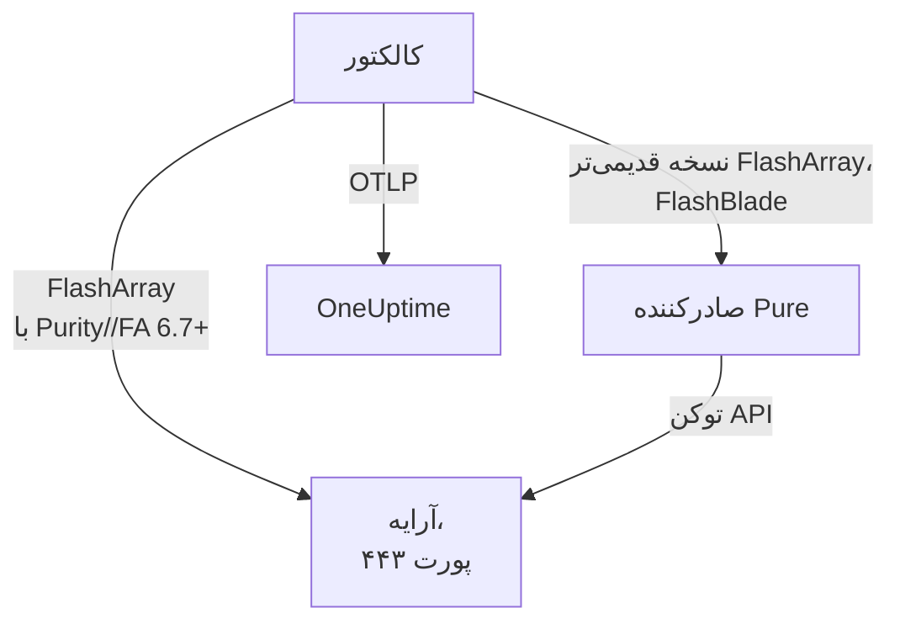

# عامل آرایه ذخیره‌سازی

عامل آرایه ذخیره‌سازی در OneUptime آرایه‌های ذخیره‌سازی را پایش می‌کند: ظرفیت و کاهش داده، تأخیر، IOPS و پهنای باند، حجم‌ها، میزبان‌ها، پادها و همتاسازی، سلامت سخت‌افزار، سیستم‌های فایل و باکت‌ها. این عامل یک OpenTelemetry Collector استاندارد است که نقطه‌های پایانی OpenMetrics آرایه را با توکن API یک کاربر فقط‌خواندنی برداشت می‌کند، هویت آرایه شما را روی هر متریک مُهر می‌زند و آن را به OneUptime می‌فرستد. [مانیتورهای آرایه ذخیره‌سازی](/docs/monitor/storage-array-monitor) بر پایه آنچه می‌رسد هشدار می‌دهند.

:::cards
- [نصب عامل](#نصب-عامل): یک کاربر فقط‌خواندنی، سپس اسکریپت نصب یا Docker Compose.
- [آنچه عامل گردآوری می‌کند](#آنچه-عامل-گردآوری-میکند): هر نقطه پایانی، و صفحه‌هایی که از آن ساخته می‌شوند.
- [پایش چند آرایه](#پایش-چند-آرایه): یک عامل برای هر آرایه، روی یک ماشین.
- [رفع اشکال](#رفع-اشکال): یک اسکریپت تشخیصی، و مشکلات معمول.
:::

## چگونه کار می‌کند

Storage Arrays محصولی است که برای هر سازنده‌ای به یک شکل کار می‌کند. این موارد را پشتیبانی می‌کند:

| آرایه | عامل چگونه آن را می‌خواند | پیکربندی کالکتور |
| --- | --- | --- |
| **Pure Storage FlashArray**، Purity//FA 6.7 و بعد از آن | نقطه پایانی OpenMetrics خود آرایه (`https://<array>/metrics/...?namespace=purefa`): چیزی کنار کالکتور اجرا نمی‌شود | `otel-collector-config.yaml` (پیش‌فرض) |
| **Pure Storage FlashArray**، Purity//FA قدیمی‌تر | صادرکننده OpenMetrics مخصوص FlashArray از Pure، که همان فایل Compose آن را به‌صورت سرویس `pure-fa-exporter` اجرا می‌کند | `otel-collector-config.flasharray-exporter.yaml` |
| **Pure Storage FlashBlade** | صادرکننده OpenMetrics مخصوص FlashBlade از Pure، که همان فایل Compose آن را به‌صورت سرویس `pure-fb-exporter` اجرا می‌کند | `otel-collector-config.flashblade.yaml` |

Pure Storage در فوریه ۲۰۲۶ نام خود را به **Everpure** تغییر داد. FlashArray، FlashBlade و Purity نام‌هایشان را نگه داشتند، و متریک‌های `purefa_*` و `purefb_*` هم همین‌طور، پس همه‌چیز در این صفحه درباره آرایه‌هایی که با هر یک از این دو نام فروخته شده‌اند صدق می‌کند.



یک عامل یک آرایه را پایش می‌کند: برای هر آرایه یک عامل اجرا کنید ([پایش چند آرایه](#پایش-چند-آرایه) را ببینید). آرایه با نخستین داده‌اش خودش را ثبت می‌کند، با نامی که عامل به‌صورت `storage.array.name` روی هر متریک مُهر می‌زند.

## پیش از شروع

- Docker Engine 20.10 یا بعد از آن با افزونه Docker Compose v2، روی ماشینی که از طریق HTTPS (TCP 443) به رابط مدیریتی آرایه برسد.
- یک حساب مدیر روی آرایه، برای ساختن کاربری با نقش داخلی **readonly** و یک توکن API برای آن.
- یک کلید دریافت داده. آن را زیر **تنظیمات پروژه** > **تله‌متری و APM** > **کلیدهای دریافت داده** بسازید و مقدارش را کپی کنید.

### عامل را کجا اجرا کنید

عامل از طریق HTTPS با رابط مدیریتی آرایه صحبت می‌کند، پس می‌تواند روی هر ماشینی با Docker و مسیری به شبکه مدیریتی روی TCP 443 اجرا شود: یک میزبان پایش، یا یک VM مدیریتی کوچک. ماشینی را ترجیح دهید که فضای ذخیره‌سازی خودش روی آرایه‌ای که زیر نظر دارد نباشد: اگر آرایه از کار بیفتد، پایش شما نباید با آن از کار بیفتد. شنونده اختیاری syslog همچنین نیاز دارد که آرایه روی پورت syslog به عامل برسد ([ارسال syslog آرایه](#اختیاری-ارسال-syslog-آرایه) را ببینید).

## نصب عامل

:::steps
### کاربر فقط‌خواندنی و توکن API را بسازید

عامل فقط می‌خواند. به آن کاربری ویژه خودش با نقش داخلی **readonly** بدهید، هرگز یک مدیر، و یک توکن API برای آن کاربر. توکن را **بدون تاریخ انقضا** بسازید، وگرنه عامل همان روزی که توکن منقضی شود از کار می‌ایستد.

:::tabs
@tab Purity CLI
به‌عنوان مدیر با SSH به FlashArray وصل شوید. فرمان نخست گذرواژه کاربر تازه را می‌پرسد؛ فرمان دوم توکن API آن را چاپ می‌کند که یک UUID است:

```bash
pureadmin create --role readonly oneuptime
pureadmin create --api-token oneuptime
```
@tab FlashArray GUI
1. _Settings → Users and Policies_ را باز کنید (در انتشارهای قدیمی‌تر _Settings → Access_).
2. از منوی ⋮ پنل **Users**، **Create User…** را برگزینید، نام کاربر را `oneuptime` بگذارید و نقش readonly را به آن بدهید.
3. از منوی ⋮ کاربر تازه، **Create API Token…** را برگزینید، **Expires In** را خالی بگذارید و توکن را کپی کنید.
@tab FlashBlade
به همین روش کاربری با نقش **readonly** و یک توکن API برای آن بسازید: در تنظیمات کاربر در GUI مربوط به FlashBlade، یا با `pureadmin` در CLI مربوط به Purity//FB. در انتشاری که کاربر محلی ندارد، از حسابی در یک سرویس دایرکتوری (LDAP یا Active Directory) استفاده کنید که گروهش به نقش readonly نگاشت شده باشد. توکن‌های API در FlashBlade با `T-` آغاز می‌شوند.
:::

### بررسی کنید که آیا FlashArray متریک‌های خودش را ارائه می‌کند

‏Pure نقطه پایانی بومی OpenMetrics را برای **Purity//FA نسخه 6.7.0 به بالا** مستند کرده است (اطلاعیه منسوخ‌شدن صادرکننده FlashArray از Pure می‌گوید 6.6.11 به بالا). سریع‌ترین راه برای دانستن، پرسیدن از خود آرایه است، از ماشینی که عامل روی آن اجرا خواهد شد:

```bash
curl -k 'https://<array>/metrics/array?namespace=purefa' --header 'Authorization: Bearer <api-token>' | grep purefa_info
```

یک خط `purefa_info{...} 1` یعنی آرایه متریک‌هایش را به‌طور بومی ارائه می‌کند: از پیکربندی پیش‌فرض استفاده کنید. یک `404` یعنی نه: از پیکربندی صادرکننده استفاده کنید، که صادرکننده Pure را کنار کالکتور اجرا می‌کند. Pure آن صادرکننده را منسوخ کرده است، پس به‌محض ارتقای آرایه به پیکربندی بومی بروید. FlashBlade همیشه از صادرکننده FlashBlade در Pure می‌گذرد، پس برای آن این گام را رد کنید.

### عامل را نصب و اجرا کنید

:::tabs
@tab install.sh
اسکریپت نصب را دانلود کنید و روی ماشینی که میزبان عامل خواهد بود اجرا کنید:

```bash
curl -sSL https://raw.githubusercontent.com/OneUptime/oneuptime/master/agents/StorageArrayAgent/install.sh -o install.sh
bash install.sh
```

اسکریپت می‌پرسد این کدام آرایه است (FlashArray با متریک‌های بومی، FlashArray روی Purity//FA قدیمی‌تر، یا FlashBlade)، سپس نشانی OneUptime شما، کلید دریافت داده، نامی برای آرایه، نشانی مدیریتی آرایه و توکن API کاربر فقط‌خواندنی را می‌پرسد (بی‌نمایش خوانده می‌شود). در `/opt/oneuptime-storage-array-agent` نصب می‌کند، فایل Compose و هر سه پیکربندی کالکتور را دانلود می‌کند، یک فایل با مجوز `0600` به نام `.env` با پیکربندی و پروفایل Compose متناظر می‌نویسد و عامل را با Docker Compose راه می‌اندازد. هر مقدار را همان‌طور که تایپ کرده‌اید برای Docker Compose درون نقل‌قول می‌گذارد. اجرای دوباره آن به‌جای پرسیدن دوباره، همه‌چیز را از `.env` موجود دوباره به کار می‌برد، و فایلی را که ویرایش کرده‌اید پیش از جایگزینی به‌صورت `<file>.bak.<timestamp>` نگه می‌دارد.
@tab Docker Compose
`docker-compose.yml` و سه فایل `otel-collector-config*.yaml` را از [پوشه StorageArrayAgent](https://github.com/OneUptime/oneuptime/tree/master/agents/StorageArrayAgent) در یک پوشه تازه دانلود کنید:

```bash
curl -fsSLO https://raw.githubusercontent.com/OneUptime/oneuptime/master/agents/StorageArrayAgent/docker-compose.yml
curl -fsSLO https://raw.githubusercontent.com/OneUptime/oneuptime/master/agents/StorageArrayAgent/otel-collector-config.yaml
curl -fsSLO https://raw.githubusercontent.com/OneUptime/oneuptime/master/agents/StorageArrayAgent/otel-collector-config.flasharray-exporter.yaml
curl -fsSLO https://raw.githubusercontent.com/OneUptime/oneuptime/master/agents/StorageArrayAgent/otel-collector-config.flashblade.yaml
```

کنار آن‌ها یک فایل `.env` بسازید. توکن API را در خود دارد، پس با `chmod 600 .env` خصوصی‌اش نگه دارید. برای FlashArrayای که متریک‌های بومی ارائه می‌کند:

```bash title=".env"
ONEUPTIME_URL=YOUR_ONEUPTIME_URL
ONEUPTIME_TELEMETRY_INGESTION_KEY=YOUR_TELEMETRY_INGESTION_TOKEN
STORAGE_ARRAY_NAME=my-storage-array
STORAGE_SYSTEM=purestorage.flasharray
STORAGE_ARRAY_COLLECTOR_CONFIG=otel-collector-config.yaml
COMPOSE_PROFILES=
PURE_FA_ENDPOINT=fa-prod-01.example.com
PURE_FA_API_TOKEN=YOUR_READ_ONLY_API_TOKEN
PURE_FB_ENDPOINT=
PURE_FB_API_TOKEN=
STORAGE_ARRAY_INSECURE_SKIP_VERIFY=true
```

برای FlashArray روی Purity//FA قدیمی‌تر، `STORAGE_ARRAY_COLLECTOR_CONFIG=otel-collector-config.flasharray-exporter.yaml` و `COMPOSE_PROFILES=flasharray-exporter` را تنظیم کنید. برای FlashBlade، `STORAGE_SYSTEM=purestorage.flashblade`، `STORAGE_ARRAY_COLLECTOR_CONFIG=otel-collector-config.flashblade.yaml` و `COMPOSE_PROFILES=flashblade` را تنظیم کنید، و `PURE_FB_ENDPOINT` و `PURE_FB_API_TOKEN` را پر کنید (به‌جای جفت `PURE_FA_*`). عامل را راه بیندازید:

```bash
docker compose up -d
```
:::

### بررسی کنید که عامل اجرا می‌شود

```bash
docker compose ps
docker logs -f oneuptime-storage-array-agent
```

`docker compose ps` کالکتور (`oneuptime-storage-array-agent`) و، با پیکربندی صادرکننده، خود صادرکننده (`pure-fa-exporter` یا `pure-fb-exporter`) را فهرست می‌کند. پس از راه‌اندازی کالکتور، لاگ‌هایش باید این خط را نشان دهند:

```text
Everything is ready. Begin running and processing data.
```

### یافتن آرایه در OneUptime

**محصولات** > **زیرساخت** > **Storage Arrays** > **All Storage Arrays** را باز کنید. پس از نخستین برداشت (حدود یک دقیقه) آرایه با ظرفیت، کارایی، هشدارهای باز و سخت‌افزارش آنجاست. حجم‌ها، میزبان‌ها و پادها ظرف ۲ دقیقه می‌آیند، سیستم‌های فایل و باکت‌های FlashBlade ظرف ۵ دقیقه، و دایرکتوری‌های FlashArray ظرف ۳۰ دقیقه.
:::

## متغیرهای محیطی

اسکریپت نصب این‌ها را در `/opt/oneuptime-storage-array-agent/.env` می‌نویسد؛ نصب با Docker Compose آن‌ها را از `.env` کنار `docker-compose.yml` می‌خواند. پس از تغییر یکی از آن‌ها، `docker compose up -d` را در همان پوشه اجرا کنید.

| متغیر | الزامی | توضیح |
| --- | --- | --- |
| `ONEUPTIME_URL` | بله | نشانی OneUptime شما، مانند `https://oneuptime.com` یا نمونه خودمیزبان شما. اگر نمونه فقط HTTP دارد، از `http://` و پورتش استفاده کنید. |
| `ONEUPTIME_TELEMETRY_INGESTION_KEY` | بله | کلید دریافت داده از **تنظیمات پروژه** > **تله‌متری و APM** > **کلیدهای دریافت داده**. |
| `STORAGE_ARRAY_NAME` | بله | نامی که آرایه با آن در OneUptime ثبت می‌شود، و به‌صورت ویژگی منبع `storage.array.name` روی هر متریک مُهر زده می‌شود. ثابتش نگه دارید: تغییرش در آینده آرایه دومی ثبت می‌کند. کالکتور بدون آن راه‌اندازی نمی‌شود. |
| `STORAGE_SYSTEM` | خیر | پلتفرم، که به‌صورت ویژگی منبع `storage.system` مُهر زده می‌شود: `purestorage.flasharray` یا `purestorage.flashblade`. پیش‌فرض آن `purestorage.flasharray` است. |
| `STORAGE_ARRAY_COLLECTOR_CONFIG` | خیر | اینکه کدام پیکربندی کالکتور همراه بسته اجرا شود: `otel-collector-config.yaml` (FlashArray، بومی: پیش‌فرض)، `otel-collector-config.flasharray-exporter.yaml` (FlashArray قدیمی‌تر) یا `otel-collector-config.flashblade.yaml` (FlashBlade). |
| `COMPOSE_PROFILES` | خیر | صادرکننده‌ای را که پیکربندی انتخاب‌شده برداشت می‌کند راه می‌اندازد: برای پیکربندی بومی FlashArray خالی، و برای دو پیکربندی دیگر `flasharray-exporter` یا `flashblade`. |
| `PURE_FA_ENDPOINT` | FlashArray | نشانی مدیریتی FlashArray: یک نام میزبان یا IP، بدون `https://`. |
| `PURE_FA_API_TOKEN` | FlashArray | توکن API کاربر FlashArray با نقش readonly. |
| `PURE_FB_ENDPOINT` | FlashBlade | نشانی مدیریتی FlashBlade: یک نام میزبان یا IP، بدون `https://`. |
| `PURE_FB_API_TOKEN` | FlashBlade | توکن API کاربر FlashBlade با نقش readonly. |
| `STORAGE_ARRAY_INSECURE_SKIP_VERIFY` | خیر | `true` گواهی خودامضای آرایه را روی نقطه پایانی بومی می‌پذیرد؛ `false` آن را اعتبارسنجی می‌کند. پیش‌فرض آن `true` است. صادرکننده‌های Pure هرگز گواهی آرایه را اعتبارسنجی نمی‌کنند، پس این متغیر بر آن‌ها اثری ندارد. |

## عامل چگونه برداشت می‌کند

- **یک کار برداشت برای هر نقطه پایانی، و هر کدام به همان اندازه که می‌ارزد خوانده می‌شود.** FlashArray: `/metrics/array` هر ۶۰ ثانیه؛ `/metrics/volumes`، `/metrics/hosts` و `/metrics/pods` هر ۲ دقیقه؛ `/metrics/directories` هر ۳۰ دقیقه، که توصیه خود Pure است، چون محاسبه فضای دایرکتوری‌ها برای آرایه پرهزینه است. FlashBlade: `/metrics/array` هر ۶۰ ثانیه؛ `/metrics/filesystems` و `/metrics/objectstore` هر ۵ دقیقه، باز هم به پیروی از توصیه Pure که نقطه‌های پایانی سیستم فایل و ذخیره‌ساز شیء کمتر از خود آرایه خوانده شوند.
- **هر کار سری‌هایش را با `scrape_endpoint: <endpoint>` برچسب می‌زند.** هر نقطه پایانی `purefa_info` یا `purefb_info` را هم صادر می‌کند، پس OneUptime می‌داند یک دسته فهرست کامل کدام خانواده‌هاست: همین‌گونه است که یک حجم، میزبان، پاد، سیستم فایل یا باکت حذف‌شده به‌جای ماندن، از موجودی بیرون می‌رود. برچسب‌ها را همان‌طور که همراه بسته آمده‌اند نگه دارید.
- **تأخیر هر حجم و هر میزبان سه بُعد را نگه می‌دارد.** هر حجم و میزبان تأخیر خود را در حداکثر شانزده `dimension` صادر می‌کند. قاعده‌ای در `metric_relabel_configs` سه مقدار `usec_per_read_op`، `usec_per_write_op` و `usec_per_mirrored_write_op` را نگه می‌دارد و تفکیک محدودیت نرخ QoS، صف، SAN و زمان سرویس را کنار می‌گذارد، که شمار سری‌های یک آرایه بزرگ را چند برابر می‌کند. تفکیک کل آرایه روی `purefa_array_performance_latency_usec` نگه داشته می‌شود. برای نگه‌داشتن تفکیک هر حجم هم، این قاعده را حذف کنید.
- **توکن API یک توکن Bearer است.** پیکربندی بومی آن را به خود آرایه می‌فرستد؛ پیکربندی‌های صادرکننده آن را فقط از راه شبکه Compose به صادرکننده می‌فرستند، و پورت‌های صادرکننده‌ها هرگز منتشر نمی‌شوند.
- **بدون `send_batch_max_size`.** ‏OneUptime فهرست موجودی را در هر درخواست از یک برداشت کامل بازمی‌سازد، پس پردازشگر `batch` همراهِ عامل هرگز یک برداشت را میان چند صادرات تقسیم نمی‌کند. تنظیمات batch را همان‌طور که ارسال شده‌اند نگه دارید.

## آنچه عامل گردآوری می‌کند

قراردادهای معنایی Pure میان نقطه پایانی بومی FlashArray و هر دو صادرکننده مشترک است. هر مقدار یک سنجه از نوع gauge است که آرایه خودش محاسبه می‌کند (تأخیرها به میکروثانیه برای هر عملیات، توان عملیاتی در ثانیه)، پس نیازی به محاسبه نرخ نیست، و شیءها با **برچسب‌های نقطه داده** نام‌گذاری می‌شوند: `name` برای حجم‌ها، پادها، دایرکتوری‌ها، سیستم‌های فایل و باکت‌ها، `host` برای میزبان‌ها، `component_name` برای سخت‌افزار FlashArray. عامل ویژگی‌های منبع `storage.array.name` و `storage.system` را می‌افزاید، پس OneUptime همه‌چیز را زیر آرایه شما بایگانی می‌کند:

| نقطه پایانی | خانواده‌های متریک | آنچه OneUptime از آن‌ها می‌سازد |
| --- | --- | --- |
| FlashArray `/metrics/array` | `purefa_info`، `purefa_alerts_open`، `purefa_array_space_*`، `purefa_array_performance_*`، `purefa_hw_component_status`، `purefa_hw_component_temperature_celsius`، `purefa_hw_controller_info`، `purefa_drive_capacity_bytes`، `purefa_network_interface_*` | نام آرایه، نسخه Purity و شناسه سیستم؛ ظرفیت، فضای مصرف‌شده و کاهش داده؛ شمار هشدارهای باز؛ سلامت آرایه؛ صفحه **Hardware** (قطعه‌ها، درایوها، کنترلرها، رابط‌های شبکه) |
| FlashArray `/metrics/volumes` | `purefa_volume_performance_*`، `purefa_volume_space_*`، `purefa_volume_qos_*` | صفحه **حجم‌ها**: اندازه تخصیص‌یافته و فیزیکی، کاهش داده، تأخیر خواندن و نوشتن، IOPS و پهنای باند هر حجم |
| FlashArray `/metrics/hosts` | `purefa_host_connectivity_info`، `purefa_host_connections_info`، `purefa_host_performance_*`، `purefa_host_space_*` | صفحه **میزبان‌ها**: اتصال (مسیرهای افزونه دارد یا نه)، حجم‌های متصل، تأخیر، IOPS و پهنای باند هر میزبان |
| FlashArray `/metrics/pods` | `purefa_pod_performance_*`، `purefa_pod_space_*`، `purefa_pod_replica_links_*`، `purefa_pod_mediator_status` | صفحه **Replication**: پادهای ActiveCluster و ActiveDR، وضعیت و عقب‌ماندگی پیوندهای replica |
| FlashArray `/metrics/directories` | `purefa_directory_performance_*`، `purefa_directory_space_*` | صفحه **Directories** (FlashArray File Services) |
| FlashBlade `/metrics/array` | `purefb_info`، `purefb_alerts_open`، `purefb_array_space_*`، `purefb_array_performance_*`، `purefb_hardware_health` | نام FlashBlade، نسخه Purity و شناسه سیستم؛ ظرفیت و کاهش داده؛ شمار هشدارهای باز؛ سلامت آرایه؛ صفحه **Hardware** |
| FlashBlade `/metrics/filesystems` | `purefb_file_systems_space_*`، `purefb_file_systems_performance_*` | صفحه **File Systems**: فضای تخصیص‌یافته و مصرف‌شده، کاهش داده، تأخیر، IOPS و پهنای باند هر سیستم فایل |
| FlashBlade `/metrics/objectstore` | `purefb_buckets_space_*`، `purefb_buckets_quota_space_bytes`، `purefb_buckets_object_count`، `purefb_buckets_performance_*`، `purefb_object_store_accounts_*` | صفحه **Buckets**: فضا، سهمیه، شمار شیءها و کارایی هر باکت، گروه‌بندی‌شده بر پایه حساب |

سلامت آرایه در **نمای کلی** آن **بحرانی** است تا وقتی که یک هشدار بحرانی باز گزارش می‌کند، یا یک قطعه سخت‌افزاری، درایو یا کنترلر که بحرانی، خراب، ناپیدا یا ناسالم است؛ **Warning** است تا وقتی که یک هشدار اخطار باز گزارش می‌کند، یا قطعه‌ای تنزل‌یافته یا ناشناخته؛ و در غیر این صورت **OK**. در معیارهای مانیتور، ویژگی‌های آرایه پیشوند `resource.` می‌گیرند (`resource.storage.array.name`، `resource.storage.system`)، در حالی که برچسب‌های نقطه داده بی‌پیشوند می‌مانند (`name`، `host`، `dimension`، `space`).

## اختیاری — ارسال syslog آرایه

به‌طور پیش‌فرض عامل فقط متریک می‌فرستد، پس صفحه **لاگ‌ها** آرایه خالی می‌ماند. آرایه‌ها هشدارها و رویدادهای ممیزی خود را به‌صورت syslog می‌فرستند، و هر پیکربندی کالکتور همراه بسته یک جفت گیرنده `syslog` در حالت توضیح دارد (TCP و UDP روی پورت ۵۵۱۴، RFC 3164) که به یک خط لوله `logs` در حالت توضیح وصل است و مُهر `storage.array.name` را می‌زند تا لاگ‌ها روی آرایه شما بنشینند.

:::steps
### گیرنده‌ها را روشن کنید

دو گیرنده `syslog/*` و خط لوله `logs` را در پیکربندی کالکتوری که به کار می‌برید از حالت توضیح خارج کنید. مُهرهای زمانی RFC 3164 منطقه زمانی ندارند: `location` را روی منطقه زمانی آرایه بگذارید، مگر اینکه ساعت آن روی UTC کار کند.

### پورت را باز کنید

بلوک `ports:` را در `docker-compose.yml` از حالت توضیح خارج کنید تا ماشین `5514/tcp` و `5514/udp` را منتشر کند، سپس `docker compose up -d` را اجرا کنید. پورت را در دیوار آتش ماشین برای شبکه مدیریتی آرایه باز کنید.

### آرایه را به سمت عامل بفرستید

این کار را به‌عنوان مدیر انجام دهید، نه با کاربر پایش فقط‌خواندنی. روی FlashArray، _Settings → System → Syslog Servers_ را باز کنید، `udp://<agent-host>:5514` (یا `tcp://<agent-host>:5514`) را بیفزایید و یک پیام آزمایشی بفرستید. روی FlashBlade، در تنظیمات syslog آن یک سرور syslog با همان URI بیفزایید. هر دو آرایه شکل `PROTOCOL://HOST:PORT` را می‌پذیرند، از راه REST APIهای خود (`syslog-servers`) هم.
:::

هر گیرنده syslog فقط روی یک انتقال گوش می‌دهد، به همین دلیل TCP و UDP دو گیرنده‌اند: اگر فقط یکی را لازم دارید، دیگری را در حالت توضیح بگذارید. ایمیج استاندارد کالکتور syslog را همان‌طور که هست می‌خواند: به ایمیج سفارشی نیازی نیست.

## برچسب‌گذاری آرایه با برچسب‌های پروژه

ویژگی منبعی که با `oneuptime.label.` آغاز شود، به برچسب پروژه روی آرایه ذخیره‌سازی تبدیل می‌شود: `oneuptime.label.<dimension>=<value>` همان برچسب `<dimension>:<value>` است. ویژگی‌ها را به پردازشگر `resource` در پیکربندی کالکتوری که به کار می‌برید، کنار `storage.array.name`، بیفزایید:

```yaml
processors:
  resource:
    attributes:
      # ...existing attributes...
      - key: oneuptime.label.team
        value: storage
        action: upsert
      - key: oneuptime.label.env
        value: production
        action: upsert
```

کالکتور پیکربندی‌اش را فقط هنگام راه‌اندازی می‌خواند: `docker compose restart oneuptime-storage-array-agent` را اجرا کنید. سپس آرایه برچسب‌های `team:storage` و `env:production` را نشان می‌دهد. برچسب‌ها بدون توجه به بزرگی و کوچکی حروف مقایسه می‌شوند، پس برچسب موجود `Production` به‌جای تکرار دوباره به کار می‌رود، و عامل هرگز برچسبی را که کسی در OneUptime افزوده است برنمی‌دارد.

## پایش چند آرایه

یک عامل یک آرایه را می‌خواند. برای پایش چند آرایه از یک ماشین، هر کدام را در پوشه خودش با `.env` خودش نصب کنید، مانند `INSTALL_DIR=/opt/oneuptime-storage-array-agent-fa02 bash install.sh`، و به هر کدام `container_name` خودش را در `docker-compose.yml` آن بدهید (مانند `oneuptime-storage-array-agent-fa02`): دو کانتینر نمی‌توانند یک نام داشته باشند. پوشه را با `-d` به اسکریپت تشخیصی بدهید.

## اجرا به‌صورت یک سرویس systemd

برای اینکه عامل همراه ماشین شروع شود و اگر از کار افتاد دوباره راه‌اندازی شود، واحد systemd آن را نصب کنید. این واحد فرض می‌کند عامل در `/opt/oneuptime-storage-array-agent` است، جایی که اسکریپت نصب آن را می‌گذارد:

```bash
sudo curl -fsSL https://raw.githubusercontent.com/OneUptime/oneuptime/master/agents/StorageArrayAgent/systemd/oneuptime-storage-array-agent.service -o /etc/systemd/system/oneuptime-storage-array-agent.service
sudo systemctl daemon-reload
sudo systemctl enable --now oneuptime-storage-array-agent
```

## به‌روزرسانی عامل

عامل نسخه کالکتوری را که فایل‌هایش ثابت کرده‌اند به‌عنوان **نسخه عامل** خود گزارش می‌دهد. وقتی این نسخه از نسخه‌ای که این انتشار OneUptime ثابت کرده قدیمی‌تر باشد، کنار آن یک نشانه هشدار در **نمای کلی** آرایه نمایان می‌شود. آن را انتخاب کنید تا این فرمان‌ها را ببینید. عاملی که پیش از آنکه فایل‌هایش نسخه‌ای گزارش دهند نصب شده باشد، تا وقتی به این روش به‌روزرسانی نشود هیچ نسخه‌ای نشان نمی‌دهد.

ایمیج کالکتور در `docker-compose.yml` ثابت شده و پیکربندی‌هایش فایل‌هایی کنار آن هستند، پس فقط کشیدن ایمیج‌ها عامل را جلو نمی‌برد. `install.sh` را دوباره اجرا کنید: هر مقداری را در `.env` موجود شما دوباره به کار می‌برد (هیچ چیزی دوباره پرسیده نمی‌شود)، `docker-compose.yml` و سه پیکربندی کالکتور را تازه می‌کند (فایلی که ویرایش کرده‌اید به‌صورت `<file>.bak.<timestamp>` نگه داشته می‌شود)، و عامل را دوباره می‌سازد تا کالکتور پیکربندی تازه‌اش را بخواند. عاملی که بیرون از `/opt/oneuptime-storage-array-agent` نصب شده، پوشه‌اش را لازم دارد: `INSTALL_DIR=<folder> bash install.sh`.

```bash
curl -sSL https://raw.githubusercontent.com/OneUptime/oneuptime/master/agents/StorageArrayAgent/install.sh -o install.sh
bash install.sh
```

به‌جای آن با Docker Compose نصبش کرده‌اید؟ در پوشه عامل، فایل Compose و سه پیکربندی کالکتور را دوباره دانلود کنید (و هر تغییری را که در آن‌ها داده بودید دوباره اعمال کنید)، سپس ایمیج‌ها را بکشید و عامل را دوباره بسازید:

```bash
curl -fsSLO https://raw.githubusercontent.com/OneUptime/oneuptime/master/agents/StorageArrayAgent/docker-compose.yml
curl -fsSLO https://raw.githubusercontent.com/OneUptime/oneuptime/master/agents/StorageArrayAgent/otel-collector-config.yaml
curl -fsSLO https://raw.githubusercontent.com/OneUptime/oneuptime/master/agents/StorageArrayAgent/otel-collector-config.flasharray-exporter.yaml
curl -fsSLO https://raw.githubusercontent.com/OneUptime/oneuptime/master/agents/StorageArrayAgent/otel-collector-config.flashblade.yaml
docker compose pull
docker compose up -d --force-recreate
```

## حذف عامل

```bash
cd /opt/oneuptime-storage-array-agent
docker compose down
```

سپس اگر دیگر نیازشان ندارید، کاربر فقط‌خواندنی و توکن API آن را روی آرایه پاک کنید.

## رفع اشکال

:::details نخست اسکریپت تشخیصی را اجرا کنید
عامل با یک اسکریپت، [`troubleshoot.sh`](https://github.com/OneUptime/oneuptime/blob/master/agents/StorageArrayAgent/troubleshoot.sh)، عرضه می‌شود که کل زنجیره را بررسی می‌کند: محیط اجرای کانتینر؛ نقطه پایانی آرایه دقیقاً همان‌طور که کالکتور به آن می‌رسد (نقطه پایانی بومی یا صادرکننده Pure: DNS، TLS، اینکه آیا FlashArray اصلاً نقطه پایانی بومی دارد، و اینکه آیا آرایه توکن API را می‌پذیرد، که اسکریپت آن را از راه stdin به curl می‌دهد)؛ نام آرایه که روی هر متریک مُهر زده می‌شود؛ شکل توکن؛ متریک‌های خود کالکتور؛ و اینکه آیا OneUptime کلید دریافت داده را می‌پذیرد. این بررسی آخر از همه مهم‌تر است. OneUptime کلید بد را با `401` رد می‌کند (`422` برای کلید غیرفعال یا کلید مرورگر)، و کالکتور هر دو را دائمی می‌داند: دسته را کنار می‌گذارد و یک خطای `Exporting failed` در لاگ می‌نویسد، که در حالی که کانتینر سالم می‌ماند آسان از چشم می‌افتد. اسکریپت از درون شبکه عامل `GET <url>/otlp/v1/validate` را می‌پرسد تا یک `200` (معتبر) یا `401` (نامعتبر) مستقیم بگیرد، و روی سرورهای قدیمی‌تر به `POST /fluentd/v1/logs` برمی‌گردد.

```bash
curl -sSL https://raw.githubusercontent.com/OneUptime/oneuptime/master/agents/StorageArrayAgent/troubleshoot.sh -o troubleshoot.sh
bash troubleshoot.sh    # add -d <dir> if you installed outside /opt/oneuptime-storage-array-agent
```

در پایان، حکمی با محتمل‌ترین علت می‌دهد.
:::

:::details هیچ آرایه‌ای در OneUptime نمایان نمی‌شود
1. لاگ‌های کالکتور را بخوانید: `docker logs oneuptime-storage-array-agent`. `server returned HTTP status 401` یعنی آرایه توکن API را رد کرده است، `404` یعنی FlashArray نقطه پایانی بومی ندارد، `x509` یعنی اعتبارسنجی TLS در برابر گواهی خودامضای آرایه روشن است، `no such host` یا `connection refused` یعنی `PURE_FA_ENDPOINT` یا `PURE_FB_ENDPOINT` نادرست است، و یک `401` هنگام صدور یعنی کلید دریافت داده بد است.
2. از شبکه عامل از آرایه بپرسید. ایمیج کالکتور نه پوسته دارد و نه curl، پس از یک کانتینر در شبکه آن بپرسید: `docker run --rm --network container:oneuptime-storage-array-agent curlimages/curl -sk -H 'Authorization: Bearer <api-token>' 'https://<array>/metrics/array?namespace=purefa'` باید خط‌های `purefa_*` را چاپ کند.
3. بررسی کنید که `STORAGE_ARRAY_NAME` تنظیم شده باشد: آرایه با ویژگی منبع `storage.array.name` آن پیدا می‌شود، و کالکتور بدون آن راه‌اندازی نمی‌شود.
:::

:::details آرایه قطع‌شده نشان داده می‌شود
وقتی OneUptime به مدت ۱۵ دقیقه هیچ چیزی از یک آرایه دریافت نکند، آرایه قطع‌شده می‌شود؛ OneUptime هر ۵ دقیقه بررسی می‌کند، و زمانی که خودش داده دریافت نمی‌کرد به حساب نمی‌آید. بررسی کنید که کالکتور در حال اجراست (`docker compose ps`)، لاگ‌هایش خطای برداشت یا صدور نشان نمی‌دهند، و ماشین هنوز به آرایه و نشانی OneUptime شما می‌رسد. آرایه با داده‌های بعدی‌اش دوباره متصل می‌شود.
:::

:::details FlashArray با 404 پاسخ می‌دهد
Purity//FA آن نقطه پایانی بومی OpenMetrics ندارد. `install.sh` را دوباره اجرا کنید و گزینه Purity قدیمی‌تر را برگزینید، یا `STORAGE_ARRAY_COLLECTOR_CONFIG=otel-collector-config.flasharray-exporter.yaml` و `COMPOSE_PROFILES=flasharray-exporter` را در `.env` تنظیم کنید و `docker compose up -d` را اجرا کنید. پس از ارتقای آرایه به Purity//FA 6.7 یا بعد از آن، به پیکربندی بومی برگردید و پروفایل را بردارید.
:::

:::details آرایه توکن API را رد می‌کند
بررسی کنید که توکن API را چسبانده‌اید، نه گذرواژه کاربر را؛ که کاربر هنوز وجود دارد و نقش readonly را دارد؛ و که توکن منقضی نشده است. یک توکن تازه بسازید (`pureadmin create --api-token oneuptime` روی FlashArray)، آن را در `.env` بگذارید و `docker compose up -d` را اجرا کنید. از راه صادرکننده‌های Pure، توکن ردشده در لاگ کالکتور به‌صورت یک HTTP `400` از صادرکننده دیده می‌شود که بدنه‌اش `failed to login` است.
:::

:::details خطاهای x509 یا TLS
آرایه‌ها به‌طور پیش‌فرض یک گواهی خودامضا ارائه می‌کنند که هیچ ایمیج Docker به آن اعتماد ندارد. یا `STORAGE_ARRAY_INSECURE_SKIP_VERIFY=true` را تنظیم کنید (انتخاب عملی در یک شبکه مدیریتی خصوصی)، یا گواهی‌ای از یک CA را روی آرایه نصب کنید که ایمیج کالکتور به آن اعتماد دارد.
:::

:::details نام pure-fa-exporter یا pure-fb-exporter پیدا نمی‌شود
صادرکننده در حال اجرا نیست: `COMPOSE_PROFILES` باید با `STORAGE_ARRAY_COLLECTOR_CONFIG` جور باشد (`flasharray-exporter` برای پیکربندی صادرکننده FlashArray، `flashblade` برای پیکربندی FlashBlade). `.env` را درست کنید و `docker compose up -d` را اجرا کنید؛ سپس `docker compose ps` صادرکننده را فهرست می‌کند.
:::

:::details حجم‌ها یا میزبان‌های حذف‌شده در موجودی می‌مانند
OneUptime یک شیء را وقتی حذف می‌کند که برداشت کامل نقطه پایانی‌اش دیگر آن را نداشته باشد، و این را با برچسب `scrape_endpoint` تشخیص می‌دهد. اگر پیکربندی کالکتور همراه بسته را با پیکربندی خودتان جایگزین کرده‌اید، برچسب‌های `scrape_endpoint` را روی کارهای برداشت آن نگه دارید؛ وگرنه شیءها فقط وقتی کهنه شوند از موجودی بیرون می‌روند.
:::

:::details متریک‌ها زیر آرایه نادرست می‌نشینند
OneUptime یک آرایه ذخیره‌سازی را با `storage.array.name` آن ثبت می‌کند، که عامل آن را از `STORAGE_ARRAY_NAME` می‌گیرد. تغییر آن پس از نخستین داده‌ها به‌جای تغییر نام آرایه نخست، آرایه دومی می‌سازد.
:::

:::details ارسال متریک‌ها بدون عامل
عامل یک پیکربندی کالکتور استاندارد است، پس کالکتورهایی که از پیش اجرا می‌کنید می‌توانند همین کار را انجام دهند: کارهای برداشت و پردازشگر `resource` را از پیکربندی همراه بسته در پیکربندی خودتان کپی کنید. ویژگی منبع `storage.array.name` همان چیزی است که آرایه را در OneUptime ثبت می‌کند، و حذف‌های `service.name` / `service.instance.id` نمی‌گذارند داده‌ها زیر یک سرویس بایگانی شوند: هر دو را نگه دارید، و برچسب‌های `scrape_endpoint` را هم.
:::

## گام‌های بعدی

:::cards
- [مانیتور آرایه ذخیره‌سازی](/docs/monitor/storage-array-monitor): هشدار بر پایه هشدارهای آرایه، ظرفیت، تأخیر، سخت‌افزار، مسیرهای میزبان، همتاسازی و سیستم‌های فایل.
- [عامل VMware](/docs/telemetry/vmware): VMware را روی این آرایه اجرا می‌کنید؟ دیتااستورها و VMهای آن را هم ببینید.
- [کالکتور OpenTelemetry روی میزبان](/docs/telemetry/host-otel-collector): نمای سیستم‌عامل از ماشین‌هایی که از آرایه استفاده می‌کنند.
:::
