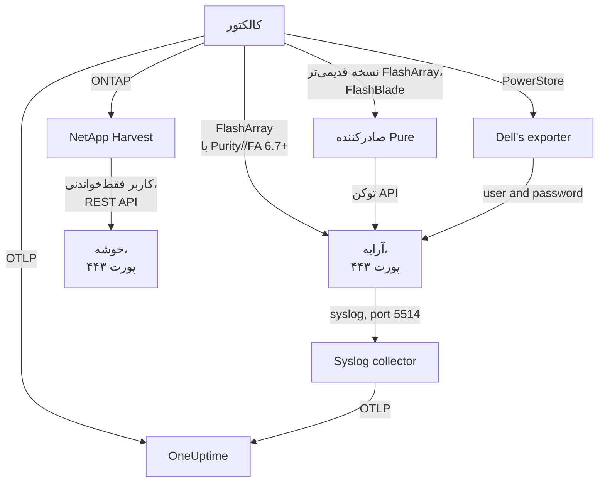

# عامل آرایه ذخیره‌سازی

عامل آرایه ذخیره‌سازی در OneUptime آرایه‌های ذخیره‌سازی را پایش می‌کند: ظرفیت و کاهش داده، تأخیر، IOPS و پهنای باند، حجم‌ها، میزبان‌ها، پادها و همتاسازی، سلامت سخت‌افزار، سیستم‌های فایل و باکت‌ها، و روی NetApp ONTAP اگریگیت‌ها، SVMها، LUNها و رابطه‌های SnapMirror آن. این عامل یک OpenTelemetry Collector استاندارد است که نقطه‌های پایانی OpenMetrics آرایه را با توکن API یک کاربر فقط‌خواندنی برداشت می‌کند (یا، برای ONTAP، صادرکننده Harvest خود NetApp را که کنار آن اجرا می‌شود)، هویت آرایه شما را روی هر متریک مُهر می‌زند و آن را به OneUptime می‌فرستد. [مانیتورهای آرایه ذخیره‌سازی](/docs/monitor/storage-array-monitor) بر پایه آنچه می‌رسد هشدار می‌دهند.

:::cards
- [نصب عامل](#نصب-عامل): یک کاربر فقط‌خواندنی، سپس اسکریپت نصب یا Docker Compose.
- [Dell PowerScale](#dell-powerscale): SNMP روی خوشه، پرس‌وجو از هر گره، و آنچه صفحه‌هایش نشان می‌دهند.
- [آنچه عامل گردآوری می‌کند](#آنچه-عامل-گردآوری-میکند): هر نقطه پایانی، و صفحه‌هایی که از آن ساخته می‌شوند.
- [پایش چند آرایه](#پایش-چند-آرایه): یک عامل برای هر آرایه، روی یک ماشین.
- [Dell PowerMax](#dell-powermax): بدون عامل: یک پراب همه آرایه‌های پشت Unisphere را می‌خواند.
- [رفع اشکال](#رفع-اشکال): یک اسکریپت تشخیصی، و مشکلات معمول.
:::

## چگونه کار می‌کند

Storage Arrays محصولی است که برای هر سازنده‌ای به یک شکل کار می‌کند. این موارد را پشتیبانی می‌کند:

| آرایه | `storage.system` | عامل چگونه آن را می‌خواند | پیکربندی کالکتور |
| --- | --- | --- | --- |
| **Pure Storage FlashArray**، Purity//FA 6.7 و بعد از آن | `purestorage.flasharray` | نقطه پایانی OpenMetrics خود آرایه (`https://<array>/metrics/...?namespace=purefa`): چیزی کنار کالکتور اجرا نمی‌شود | `otel-collector-config.yaml` (پیش‌فرض) |
| **Pure Storage FlashArray**، Purity//FA قدیمی‌تر | `purestorage.flasharray` | صادرکننده OpenMetrics مخصوص FlashArray از Pure، که همان فایل Compose آن را به‌صورت سرویس `pure-fa-exporter` اجرا می‌کند | `otel-collector-config.flasharray-exporter.yaml` |
| **Pure Storage FlashBlade** | `purestorage.flashblade` | صادرکننده OpenMetrics مخصوص FlashBlade از Pure، که همان فایل Compose آن را به‌صورت سرویس `pure-fb-exporter` اجرا می‌کند | `otel-collector-config.flashblade.yaml` |
| **Dell PowerStore** | `dell.powerstore` | صادرکننده PowerStore Metrics Exporter از Dell، که همان فایل Compose آن را به‌صورت سرویس `powerstore-exporter` می‌سازد و اجرا می‌کند؛ هشدارهای خوشه با syslog به سرویس `powerstore-syslog` آن می‌رسند | `otel-collector-config.powerstore.yaml` |
| **NetApp ONTAP** 9.12.1 و بعد از آن (AFF، FAS، ASA، ONTAP Select، Cloud Volumes ONTAP)، و **Amazon FSx for NetApp ONTAP** | `netapp.ontap` | [NetApp Harvest](https://github.com/NetApp/harvest) 26.11، که همان فایل Compose آن را به‌صورت سرویس `netapp-harvest` اجرا می‌کند: با یک کاربر فقط‌خواندنی و گذرواژه به REST API خوشه وارد می‌شود | `otel-collector-config.netapp-ontap.yaml` |
| **Dell PowerScale** (Isilon)، OneFS 8.0 و بعد از آن | `dell.powerscale` | هر گره از راه SNMP (ISILON-MIB متعلق به Dell)، با گیرنده SNMP خود کالکتور: چیزی کنار کالکتور اجرا نمی‌شود | `otel-collector-config.powerscale.yaml` |

ONTAP نقطه پایانی متریک ویژه خودش را ندارد، پس عامل صادرکننده متن‌باز NetApp، یعنی Harvest، را کنار کالکتور اجرا می‌کند. Harvest از REST API خوشه می‌خواند و آنچه خوانده را روی شبکه Compose ارائه می‌کند، با نام `netapp_<object>_<counter>` برای هر سری؛ کالکتور آن را برداشت می‌کند و به OneUptime می‌فرستد. Harvest هرگز چیزی روی خوشه نمی‌نویسد، و گزارش AutoSupport آن به NetApp خاموش است.

برای **Dell PowerMax** (`dell.powermax`) به عامل نیازی نیست: یک پراب OneUptime با یک حساب فقط‌خواندنی همه آرایه‌هایی را می‌خواند که یک Unisphere for PowerMax مدیریت می‌کند. [Dell PowerMax](#dell-powermax) را ببینید.

Pure Storage در فوریه ۲۰۲۶ نام خود را به **Everpure** تغییر داد. FlashArray، FlashBlade و Purity نام‌هایشان را نگه داشتند، و متریک‌های `purefa_*` و `purefb_*` هم همین‌طور، پس همه‌چیز در این صفحه درباره آرایه‌هایی که با هر یک از این دو نام فروخته شده‌اند صدق می‌کند.

یک خوشه **Dell PowerScale** به روش دیگری خوانده می‌شود: عامل از هر یک از گره‌هایش از راه SNMP، با یک community فقط‌خواندنی یا کاربر SNMPv3 و بدون توکن API، پرس‌وجو می‌کند. [Dell PowerScale](#dell-powerscale) از روشن کردن SNMP تا آنچه صفحه‌هایش نشان می‌دهند را پوشش می‌دهد؛ گام‌های نصب زیر مخصوص Pure Storage است.



یک عامل یک آرایه را پایش می‌کند: برای هر آرایه یک عامل اجرا کنید ([پایش چند آرایه](#پایش-چند-آرایه) را ببینید). آرایه با نخستین داده‌اش خودش را ثبت می‌کند، با نامی که عامل به‌صورت `storage.array.name` روی هر متریک مُهر می‌زند.

## پیش از شروع

- Docker Engine 20.10 یا بعد از آن با افزونه Docker Compose v2، روی ماشینی که از طریق HTTPS (TCP 443) به رابط مدیریتی آرایه برسد.
- یک حساب مدیر روی آرایه، برای ساختن کاربری با نقش داخلی **readonly** و یک توکن API برای آن. روی ONTAP، یک مدیر خوشه (روی Amazon FSx for NetApp ONTAP، `fsxadmin`)، برای ساختن یک کاربر REST فقط‌خواندنی با گذرواژه.
- برای Dell PowerStore، یک ماشین x86-64 (Dell صادرکننده خود را فقط برای x86-64 می‌سازد) و یک کاربر PowerStore برای عامل: [Dell PowerStore](#dell-powerstore) را ببینید.
- یک کلید دریافت داده. آن را زیر **تنظیمات پروژه** > **تله‌متری و APM** > **کلیدهای دریافت داده** بسازید و مقدارش را کپی کنید.

### عامل را کجا اجرا کنید

عامل از طریق HTTPS با رابط مدیریتی آرایه صحبت می‌کند، پس می‌تواند روی هر ماشینی با Docker و مسیری به شبکه مدیریتی روی TCP 443 اجرا شود: یک میزبان پایش، یا یک VM مدیریتی کوچک. ماشینی را ترجیح دهید که فضای ذخیره‌سازی خودش روی آرایه‌ای که زیر نظر دارد نباشد: اگر آرایه از کار بیفتد، پایش شما نباید با آن از کار بیفتد. شنونده اختیاری syslog همچنین نیاز دارد که آرایه روی پورت syslog به عامل برسد ([ارسال syslog آرایه](#اختیاری-ارسال-syslog-آرایه) را ببینید).

## نصب عامل

:::steps
### کاربر فقط‌خواندنی و توکن API را بسازید

عامل فقط می‌خواند. به آن کاربری ویژه خودش با نقش داخلی **readonly** بدهید، هرگز یک مدیر، و یک توکن API برای آن کاربر. توکن را **بدون تاریخ انقضا** بسازید، وگرنه عامل همان روزی که توکن منقضی شود از کار می‌ایستد.

:::tabs
@tab Purity CLI
به‌عنوان مدیر با SSH به FlashArray وصل شوید. فرمان نخست گذرواژه کاربر تازه را می‌پرسد؛ فرمان دوم توکن API آن را چاپ می‌کند که یک UUID است:

```bash
pureadmin create --role readonly oneuptime
pureadmin create --api-token oneuptime
```
@tab FlashArray GUI
1. _Settings → Users and Policies_ را باز کنید (در انتشارهای قدیمی‌تر _Settings → Access_).
2. از منوی ⋮ پنل **Users**، **Create User…** را برگزینید، نام کاربر را `oneuptime` بگذارید و نقش readonly را به آن بدهید.
3. از منوی ⋮ کاربر تازه، **Create API Token…** را برگزینید، **Expires In** را خالی بگذارید و توکن را کپی کنید.
@tab FlashBlade
به همین روش کاربری با نقش **readonly** و یک توکن API برای آن بسازید: در تنظیمات کاربر در GUI مربوط به FlashBlade، یا با `pureadmin` در CLI مربوط به Purity//FB. در انتشاری که کاربر محلی ندارد، از حسابی در یک سرویس دایرکتوری (LDAP یا Active Directory) استفاده کنید که گروهش به نقش readonly نگاشت شده باشد. توکن‌های API در FlashBlade با `T-` آغاز می‌شوند.
@tab ONTAP CLI
به‌عنوان مدیر با SSH به نشانی مدیریتی خوشه وصل شوید. فرمان نخست یک نقش REST می‌سازد که می‌تواند همه APIها را بخواند و هیچ کار دیگری نمی‌تواند؛ فرمان دوم یک کاربر HTTP با این نقش می‌سازد و گذرواژه آن را می‌پرسد:

```bash
security login rest-role create -role oneuptime-readonly -api /api -access readonly
security login create -user-or-group-name oneuptime -application http -authentication-method password -role oneuptime-readonly
```

عامل با همین کاربر و گذرواژه وارد می‌شود. هیچ توکن API در کار نیست.
@tab ONTAP System Manager
1. _Cluster → Settings → Users and Roles_ را باز کنید.
2. زیر **Roles**، **Add** را برگزینید، نام نقش را `oneuptime-readonly` بگذارید، `/api` را به‌عنوان **REST API path** وارد کنید و دسترسی **Read-Only** را برگزینید.
3. زیر **Users**، **Add** را برگزینید، نام کاربر را `oneuptime` بگذارید، نقش تازه را به آن بدهید، روش ورود **HTTP** را با **Password** بیفزایید و گذرواژه را تعیین کنید.
@tab Amazon FSx for NetApp ONTAP
به‌عنوان `fsxadmin` با SSH به نقطه پایانی مدیریتی سیستم فایل (نام DNS یا IP آن، از کنسول FSx) وصل شوید، و کاربر را با نقش فقط‌خواندنی ازپیش‌تعریف‌شده FSx بسازید. فرمان گذرواژه آن را می‌پرسد:

```bash
security login create -user-or-group-name oneuptime -application http -authentication-method password -role fsxadmin-readonly
```

سخت‌افزار سیستم فایل را AWS اداره می‌کند، پس FSx به پرسش هیچ‌کس درباره دیسک‌ها، قفسه‌های دیسک یا حسگرها پاسخ نمی‌دهد: صفحه **سخت‌افزار** آرایه گره‌ها و پورت‌هایش را فهرست می‌کند و همین را می‌گوید.
:::

### بررسی کنید که آیا FlashArray متریک‌های خودش را ارائه می‌کند

‏Pure نقطه پایانی بومی OpenMetrics را برای **Purity//FA نسخه 6.7.0 به بالا** مستند کرده است (اطلاعیه منسوخ‌شدن صادرکننده FlashArray از Pure می‌گوید 6.6.11 به بالا). سریع‌ترین راه برای دانستن، پرسیدن از خود آرایه است، از ماشینی که عامل روی آن اجرا خواهد شد:

```bash
curl -k 'https://<array>/metrics/array?namespace=purefa' --header 'Authorization: Bearer <api-token>' | grep purefa_info
```

یک خط `purefa_info{...} 1` یعنی آرایه متریک‌هایش را به‌طور بومی ارائه می‌کند: از پیکربندی پیش‌فرض استفاده کنید. یک `404` یعنی نه: از پیکربندی صادرکننده استفاده کنید، که صادرکننده Pure را کنار کالکتور اجرا می‌کند. Pure آن صادرکننده را منسوخ کرده است، پس به‌محض ارتقای آرایه به پیکربندی بومی بروید. FlashBlade همیشه از صادرکننده FlashBlade در Pure می‌گذرد، و خوشه ONTAP از NetApp Harvest، پس برای آن‌ها این گام را رد کنید.

### عامل را نصب و اجرا کنید

هر OneUptime اسکریپت نصب و فایل‌های عامل را از انتشار خودش ارائه می‌کند: دستورهای زیر آن‌ها را از `https://oneuptime.com` دانلود می‌کنند، پس در یک OneUptime خودمیزبان این نشانی را با نشانی خودتان جایگزین کنید. اسکریپت نصب اول با نام `install.sh` ذخیره می‌شود تا بتوانید پیش از اجرا آن را بخوانید.

:::tabs
@tab install.sh
اسکریپت نصب را دانلود کنید و روی ماشینی که میزبان عامل خواهد بود اجرا کنید:

```bash
curl -fsSL https://oneuptime.com/install/storage-array-agent -o install.sh
bash install.sh
```

اسکریپت می‌پرسد این کدام آرایه است (FlashArray با متریک‌های بومی، FlashArray روی Purity//FA قدیمی‌تر، FlashBlade، یا یک خوشه NetApp ONTAP)، سپس نشانی OneUptime شما، کلید دریافت داده، نامی برای آرایه، نشانی مدیریتی آرایه و توکن API کاربر فقط‌خواندنی، یا برای ONTAP نام و گذرواژه کاربر فقط‌خواندنی را می‌پرسد (بی‌نمایش خوانده می‌شود). در `/opt/oneuptime-storage-array-agent` نصب می‌کند، فایل Compose، همه پیکربندی‌های کالکتور و چهار فایل Harvest را دانلود می‌کند، یک فایل با مجوز `0600` به نام `.env` با پیکربندی و پروفایل Compose متناظر می‌نویسد و عامل را با Docker Compose راه می‌اندازد. هر مقدار را همان‌طور که تایپ کرده‌اید برای Docker Compose درون نقل‌قول می‌گذارد. اجرای دوباره آن به‌جای پرسیدن دوباره، همه‌چیز را از `.env` موجود دوباره به کار می‌برد، و فایلی را که ویرایش کرده‌اید پیش از جایگزینی به‌صورت `<file>.bak.<timestamp>` نگه می‌دارد.
@tab Docker Compose
`docker-compose.yml` و سه فایل `otel-collector-config*.yaml` را از OneUptime خودتان در یک پوشه تازه دانلود کنید:

```bash
curl -fsSLO https://oneuptime.com/install/storage-array-agent/docker-compose.yml
curl -fsSLO https://oneuptime.com/install/storage-array-agent/otel-collector-config.yaml
curl -fsSLO https://oneuptime.com/install/storage-array-agent/otel-collector-config.flasharray-exporter.yaml
curl -fsSLO https://oneuptime.com/install/storage-array-agent/otel-collector-config.flashblade.yaml
```

کنار آن‌ها یک فایل `.env` بسازید. توکن API را در خود دارد، پس با `chmod 600 .env` خصوصی‌اش نگه دارید. برای FlashArrayای که متریک‌های بومی ارائه می‌کند:

```bash title=".env"
ONEUPTIME_URL=YOUR_ONEUPTIME_URL
ONEUPTIME_TELEMETRY_INGESTION_KEY=YOUR_TELEMETRY_INGESTION_TOKEN
STORAGE_ARRAY_NAME=my-storage-array
STORAGE_SYSTEM=purestorage.flasharray
STORAGE_ARRAY_COLLECTOR_CONFIG=otel-collector-config.yaml
COMPOSE_PROFILES=
PURE_FA_ENDPOINT=fa-prod-01.example.com
PURE_FA_API_TOKEN=YOUR_READ_ONLY_API_TOKEN
PURE_FB_ENDPOINT=
PURE_FB_API_TOKEN=
POWERSCALE_ENDPOINT=
POWERSCALE_SNMP_COMMUNITY=
STORAGE_ARRAY_INSECURE_SKIP_VERIFY=true
POWERSTORE_ENDPOINT=
POWERSTORE_PASSWORD=
POWERSTORE_USERNAME=
POWERSTORE_BULK_METRICS=
POWERSTORE_API_VERSION=
POWERSTORE_REQUEST_LIMIT=
POWERSTORE_SYSLOG_PORT=
```

برای Dell PowerStore، `otel-collector-config.powerstore.yaml`، `powerstore-exporter.Dockerfile` و `powerstore-syslog.yaml` را هم دانلود کنید، `STORAGE_SYSTEM=dell.powerstore`، `STORAGE_ARRAY_COLLECTOR_CONFIG=otel-collector-config.powerstore.yaml` و `COMPOSE_PROFILES=powerstore` را تنظیم کنید، و `POWERSTORE_ENDPOINT`، `POWERSTORE_USERNAME` و `POWERSTORE_PASSWORD` را پر کنید، گذرواژه را داخل علامت نقل‌قول تکی.

برای FlashArray روی Purity//FA قدیمی‌تر، `STORAGE_ARRAY_COLLECTOR_CONFIG=otel-collector-config.flasharray-exporter.yaml` و `COMPOSE_PROFILES=flasharray-exporter` را تنظیم کنید. برای FlashBlade، `STORAGE_SYSTEM=purestorage.flashblade`، `STORAGE_ARRAY_COLLECTOR_CONFIG=otel-collector-config.flashblade.yaml` و `COMPOSE_PROFILES=flashblade` را تنظیم کنید، و `PURE_FB_ENDPOINT` و `PURE_FB_API_TOKEN` را پر کنید (به‌جای جفت `PURE_FA_*`).

برای یک خوشه NetApp ONTAP یا Amazon FSx for NetApp ONTAP، پیکربندی ONTAP و چهار فایل Harvest را هم دانلود کنید:

```bash
curl -fsSLO https://oneuptime.com/install/storage-array-agent/otel-collector-config.netapp-ontap.yaml
curl -fsSLO https://oneuptime.com/install/storage-array-agent/netapp-harvest.yml
curl -fsSLO https://oneuptime.com/install/storage-array-agent/netapp-harvest-rest.yaml
curl -fsSLO https://oneuptime.com/install/storage-array-agent/netapp-harvest-keyperf.yaml
curl -fsSLO https://oneuptime.com/install/storage-array-agent/netapp-harvest-restperf.yaml
```

و از این `.env` استفاده کنید. گذرواژه را مانند اینجا درون نقل‌قول تکی نگه دارید: آن‌گاه Docker Compose آن را دقیقاً همان‌طور که نوشته شده می‌خواند، هرچه در آن باشد. گذرواژه‌ای که `'` در خود دارد به‌جای آن درون نقل‌قول دوتایی می‌رود، با `\"`، `\\` و `$$` به‌جای `"`، `\` و `$`:

```bash title=".env"
ONEUPTIME_URL=YOUR_ONEUPTIME_URL
ONEUPTIME_TELEMETRY_INGESTION_KEY=YOUR_TELEMETRY_INGESTION_TOKEN
STORAGE_ARRAY_NAME=ontap-prod-01
STORAGE_SYSTEM=netapp.ontap
STORAGE_ARRAY_COLLECTOR_CONFIG=otel-collector-config.netapp-ontap.yaml
COMPOSE_PROFILES=netapp-ontap
NETAPP_ONTAP_ENDPOINT=ontap-prod-01.example.com
NETAPP_ONTAP_USERNAME=oneuptime
NETAPP_ONTAP_PASSWORD='YOUR_READ_ONLY_USER_PASSWORD'
STORAGE_ARRAY_INSECURE_SKIP_VERIFY=true
```

عامل را راه بیندازید:

```bash
docker compose up -d
```
:::

### بررسی کنید که عامل اجرا می‌شود

```bash
docker compose ps
docker logs -f oneuptime-storage-array-agent
```

`docker compose ps` کالکتور (`oneuptime-storage-array-agent`) و، با پیکربندی صادرکننده، خود صادرکننده (`pure-fa-exporter`، `pure-fb-exporter` یا `netapp-harvest`) را فهرست می‌کند. پس از راه‌اندازی کالکتور، لاگ‌هایش باید این خط را نشان دهند:

```text
Everything is ready. Begin running and processing data.
```

### یافتن آرایه در OneUptime

**محصولات** > **زیرساخت** > **آرایه‌های ذخیره‌سازی** > **همه آرایه‌های ذخیره‌سازی** را باز کنید. پس از نخستین برداشت (حدود یک دقیقه) آرایه با ظرفیت، کارایی، هشدارهای باز و سخت‌افزارش آنجاست. حجم‌ها، میزبان‌ها و پادها ظرف ۲ دقیقه می‌آیند، سیستم‌های فایل و باکت‌های FlashBlade ظرف ۵ دقیقه، و دایرکتوری‌های FlashArray ظرف ۳۰ دقیقه. خوشه ONTAP وقتی Harvest آن را خواند پدیدار می‌شود، و کل موجودی‌اش ظرف حدود ۳ دقیقه، یعنی فاصله‌ای که Harvest پیکربندی آن را پیمایش می‌کند. صفحهٔ **توپولوژی** آرایه میزبان‌ها، حجم‌ها، سیستم‌های فایل و سخت‌افزارش را روی یک نقشه می‌کشد: [توپولوژی](/docs/telemetry/topology#باز-کردن-نقشهٔ-خود-یک-منبع) را ببینید.
:::

## Dell PowerStore

عامل یک خوشه PowerStore را از طریق PowerStore Metrics Exporter از Dell، نسخه `powerstore-metrics-exporter_v1.0.3`، می‌خواند. Dell آن را به‌صورت فایل اجرایی منتشر می‌کند، نه ایمیج، پس سرویس `powerstore-exporter` در نخستین اجرا ایمیج مستندشده Dell را از `powerstore-exporter.Dockerfile` می‌سازد و SHA-256 فایل اجرایی را بررسی می‌کند؛ این ساخت یک بار به `quay.io` و `github.com` نیاز دارد.

صادرکننده Dell با نام کاربری و گذرواژه وارد می‌شود، چون PowerStore توکن API ندارد. در PowerStore Manager، زیر _Settings → Users_ یک کاربر محلی فقط برای عامل با نقش **Storage Operator** اضافه کنید: صادرکننده کارایی را از بایگانی پنج‌دقیقه‌ای متریک‌های انبوه PowerStore می‌خواند، که خودش آن را روشن می‌کند و PowerStoreOS 4.1 و بعد از آن به آن نیاز دارند، و به گفته README شرکت Dell نقش Operator نمی‌تواند آن را روشن کند. روی PowerStoreOS قدیمی‌تر، نقش فقط‌خواندنی **Operator** همراه با `POWERSTORE_BULK_METRICS=false` کافی است. فقط صادرکننده گذرواژه را از `.env` می‌خواند.

صادرکننده Dell هیچ هشداری نمی‌خواند، پس خوشه هشدارهای خودش را می‌فرستد: سرویس `powerstore-syslog` syslog راه دور آن را روی پورت 5514، با TCP و UDP، دریافت می‌کند و هر خط را در صفحه **لاگ‌ها** آرایه ثبت می‌کند، با رکورد PowerStore در ویژگی‌ها (`powerstore.alert.id`، `powerstore.alert.state`، `powerstore.event.code`) و شدتی برگرفته از کدهای رویداد Dell (`powerstore.alert.severity`). در PowerStore Manager، _Settings → Security → Remote Logging_ را باز کنید، این ماشین را روی پورت 5514 اضافه کنید و آن پورت را در دیوار آتش آن باز کنید. syslog روی TLS در پورت 6514 در `powerstore-syslog.yaml` توضیح داده شده است.

صادرکننده Dell نه میزبانی گزارش می‌کند و نه نشست تکثیری، پس این نسخه هیچ‌کدام را ندارد.

## متغیرهای محیطی

اسکریپت نصب این‌ها را در `/opt/oneuptime-storage-array-agent/.env` می‌نویسد؛ نصب با Docker Compose آن‌ها را از `.env` کنار `docker-compose.yml` می‌خواند. پس از تغییر یکی از آن‌ها، `docker compose up -d` را در همان پوشه اجرا کنید.

| متغیر | الزامی | توضیح |
| --- | --- | --- |
| `ONEUPTIME_URL` | بله | نشانی OneUptime شما، مانند `https://oneuptime.com` یا نمونه خودمیزبان شما. اگر نمونه فقط HTTP دارد، از `http://` و پورتش استفاده کنید. |
| `ONEUPTIME_TELEMETRY_INGESTION_KEY` | بله | کلید دریافت داده از **تنظیمات پروژه** > **تله‌متری و APM** > **کلیدهای دریافت داده**. |
| `STORAGE_ARRAY_NAME` | بله | نامی که آرایه با آن در OneUptime ثبت می‌شود، و به‌صورت ویژگی منبع `storage.array.name` روی هر متریک مُهر زده می‌شود. ثابتش نگه دارید: تغییرش در آینده آرایه دومی ثبت می‌کند. کالکتور بدون آن راه‌اندازی نمی‌شود. |
| `STORAGE_SYSTEM` | خیر | پلتفرم، که به‌صورت ویژگی منبع `storage.system` مُهر زده می‌شود: `purestorage.flasharray`، `purestorage.flashblade` یا `netapp.ontap`. پیش‌فرض آن `purestorage.flasharray` است. |
| `STORAGE_ARRAY_COLLECTOR_CONFIG` | خیر | اینکه کدام پیکربندی کالکتور همراه بسته اجرا شود: `otel-collector-config.yaml` (FlashArray، بومی: پیش‌فرض)، `otel-collector-config.flasharray-exporter.yaml` (FlashArray قدیمی‌تر)، `otel-collector-config.flashblade.yaml` (FlashBlade) یا `otel-collector-config.netapp-ontap.yaml` (ONTAP). |
| `COMPOSE_PROFILES` | خیر | صادرکننده‌ای را که پیکربندی انتخاب‌شده برداشت می‌کند راه می‌اندازد: برای پیکربندی بومی FlashArray خالی، و برای بقیه `flasharray-exporter`، `flashblade` یا `netapp-ontap`. |
| `PURE_FA_ENDPOINT` | FlashArray | نشانی مدیریتی FlashArray: یک نام میزبان یا IP، بدون `https://`. |
| `PURE_FA_API_TOKEN` | FlashArray | توکن API کاربر FlashArray با نقش readonly. |
| `PURE_FB_ENDPOINT` | FlashBlade | نشانی مدیریتی FlashBlade: یک نام میزبان یا IP، بدون `https://`. |
| `PURE_FB_API_TOKEN` | FlashBlade | توکن API کاربر FlashBlade با نقش readonly. |
| `POWERSTORE_ENDPOINT` | PowerStore | نشانی مدیریتی خوشه PowerStore: یک نام میزبان یا IP، بدون `https://`. |
| `POWERSTORE_USERNAME` | PowerStore | کاربر PowerStore که صادرکننده Dell با آن وارد می‌شود. |
| `POWERSTORE_PASSWORD` | PowerStore | گذرواژه آن کاربر. فقط صادرکننده آن را می‌خواند. |
| `POWERSTORE_BULK_METRICS` | خیر | `true` کارایی را از بایگانی متریک‌های انبوه PowerStore می‌خواند؛ `false` هر شیء را جداگانه می‌خواند. پیش‌فرض `true` است. |
| `POWERSTORE_API_VERSION` | خیر | `v3` برای PowerStoreOS 3.6 و بعد از آن، یا `v1`. پیش‌فرض `v3` است. |
| `POWERSTORE_REQUEST_LIMIT` | خیر | تعداد درخواست‌هایی که صادرکننده هم‌زمان به خوشه می‌فرستد. پیش‌فرض `16` است. |
| `POWERSTORE_SYSLOG_PORT` | خیر | پورتی که این ماشین syslog خوشه را روی آن دریافت می‌کند، با TCP و UDP. پیش‌فرض `5514` است. |
| `NETAPP_ONTAP_ENDPOINT` | ONTAP | نشانی مدیریتی خوشه (روی FSx، نقطه پایانی مدیریتی سیستم فایل): یک نام میزبان یا IP، بدون `https://`. |
| `NETAPP_ONTAP_USERNAME` | ONTAP | کاربر REST فقط‌خواندنی، مانند `oneuptime`. |
| `NETAPP_ONTAP_PASSWORD` | ONTAP | گذرواژه آن کاربر. فقط Harvest آن را می‌خواند، دقیقاً همان‌طور که نوشته شده است. |
| `POWERSCALE_NODES` | PowerScale | نشانی همه گره‌ها، جداشده با ویرگول، هرگز نام زُن SmartConnect. اسکریپت نصب پرس‌وجوهای زیر را از روی آن می‌نویسد. |
| `POWERSCALE_ENDPOINT` | PowerScale | گره‌ای که سلامت، ظرفیت و سهمیه‌های خود خوشه از راه آن خوانده می‌شوند: نخستین گره در `POWERSCALE_NODES`. |
| `POWERSCALE_SNMP_RECEIVERS` | PowerScale | پرس‌وجوهایی که کالکتور اجرا می‌کند: `snmp/cluster`، `snmp/quotas`، سپس `snmp/node-1` و بعدی‌ها، یکی برای هر گره. |
| `POWERSCALE_NODE_<n>` | PowerScale | نشانی گره `<n>`، از `1` تا `252`. نشانی IPv6 درون کروشه می‌آید، مانند `[fd00::11]`. |
| `POWERSCALE_SNMP_VERSION` | خیر | `v2c` یا `v3`. پیش‌فرض آن `v2c` است. |
| `POWERSCALE_SNMP_COMMUNITY` | SNMP v2c | community فقط‌خواندنی خوشه. |
| `POWERSCALE_SNMP_USER` | SNMPv3 | کاربر فقط‌خواندنی SNMPv3 خوشه. |
| `POWERSCALE_SNMP_SECURITY_LEVEL` | خیر | `auth_priv`، `auth_no_priv` یا `no_auth_no_priv`. پیش‌فرض آن `auth_priv` است. |
| `POWERSCALE_SNMP_AUTH_PROTOCOL` | خیر | `MD5`، `SHA`، `SHA224`، `SHA256`، `SHA384` یا `SHA512`، همان‌طور که `isi snmp settings view` نشان می‌دهد. پیش‌فرض آن `SHA` است. |
| `POWERSCALE_SNMP_AUTH_PASSWORD` | SNMPv3 | گذرواژه احراز هویت کاربر SNMPv3. |
| `POWERSCALE_SNMP_PRIVACY_PROTOCOL` | خیر | `DES`، `AES`، `AES192`، `AES256`، `AES192C` یا `AES256C`. پیش‌فرض آن `AES` است. |
| `POWERSCALE_SNMP_PRIVACY_PASSWORD` | SNMPv3 | گذرواژه حریم خصوصی کاربر SNMPv3، در سطح `auth_priv`. |
| `STORAGE_ARRAY_INSECURE_SKIP_VERIFY` | خیر | `true` گواهی خودامضای آرایه را روی نقطه پایانی بومی و در Harvest می‌پذیرد؛ `false` آن را اعتبارسنجی می‌کند. پیش‌فرض آن `true` است. صادرکننده‌های Pure هرگز گواهی آرایه را اعتبارسنجی نمی‌کنند، پس این متغیر بر آن‌ها اثری ندارد. |

## عامل چگونه برداشت می‌کند

- **یک کار برداشت برای هر نقطه پایانی، و هر کدام به همان اندازه که می‌ارزد خوانده می‌شود.** FlashArray: `/metrics/array` هر ۶۰ ثانیه؛ `/metrics/volumes`، `/metrics/hosts` و `/metrics/pods` هر ۲ دقیقه؛ `/metrics/directories` هر ۳۰ دقیقه، که توصیه خود Pure است، چون محاسبه فضای دایرکتوری‌ها برای آرایه پرهزینه است. FlashBlade: `/metrics/array` هر ۶۰ ثانیه؛ `/metrics/filesystems` و `/metrics/objectstore` هر ۵ دقیقه، باز هم به پیروی از توصیه Pure که نقطه‌های پایانی سیستم فایل و ذخیره‌ساز شیء کمتر از خود آرایه خوانده شوند.
- **هر کار سری‌هایش را با `scrape_endpoint: <endpoint>` برچسب می‌زند.** هر نقطه پایانی `purefa_info` یا `purefb_info` را هم صادر می‌کند، پس OneUptime می‌داند یک دسته فهرست کامل کدام خانواده‌هاست: همین‌گونه است که یک حجم، میزبان، پاد، سیستم فایل یا باکت حذف‌شده به‌جای ماندن، از موجودی بیرون می‌رود. برچسب‌ها را همان‌طور که همراه بسته آمده‌اند نگه دارید.
- **تأخیر هر حجم و هر میزبان سه بُعد را نگه می‌دارد.** هر حجم و میزبان تأخیر خود را در حداکثر شانزده `dimension` صادر می‌کند. قاعده‌ای در `metric_relabel_configs` سه مقدار `usec_per_read_op`، `usec_per_write_op` و `usec_per_mirrored_write_op` را نگه می‌دارد و تفکیک محدودیت نرخ QoS، صف، SAN و زمان سرویس را کنار می‌گذارد، که شمار سری‌های یک آرایه بزرگ را چند برابر می‌کند. تفکیک کل آرایه روی `purefa_array_performance_latency_usec` نگه داشته می‌شود. برای نگه‌داشتن تفکیک هر حجم هم، این قاعده را حذف کنید.
- **توکن API یک توکن Bearer است.** پیکربندی بومی آن را به خود آرایه می‌فرستد؛ پیکربندی‌های صادرکننده آن را فقط از راه شبکه Compose به صادرکننده می‌فرستند، و پورت‌های صادرکننده‌ها هرگز منتشر نمی‌شوند.
- **یک PowerStore هر ۵ دقیقه.** صادرکننده Dell هر بخش خوشه را در `/metrics/<cluster>/<part>` ارائه می‌دهد: پیکربندی `cluster` را هر ۶۰ ثانیه می‌خواند، که ضربان قلب آن است، و `appliance`، `capacity`، `hardware`، `port`، `volume`، `volumeGroup`، `nas` و `file` را هر ۵ دقیقه، چون PowerStore آن‌ها را در نمونه‌های پنج‌دقیقه‌ای محاسبه می‌کند.
- **بدون `send_batch_max_size`.** ‏OneUptime فهرست موجودی را در هر درخواست از یک برداشت کامل بازمی‌سازد، پس پردازشگر `batch` همراهِ عامل هرگز یک برداشت را میان چند صادرات تقسیم نمی‌کند. تنظیمات batch را همان‌طور که ارسال شده‌اند نگه دارید.
- **ONTAP: Harvest خوشه را پیمایش می‌کند، کالکتور Harvest را برداشت می‌کند.** Harvest پیکربندی و وضعیت خوشه را هر ۳ دقیقه، کارایی آن را هر دقیقه (تأخیرها به میکروثانیه برای هر عملیات، عملیات و بایت در ثانیه) و رویدادهای EMS آن را هر ۳ دقیقه می‌خواند، و تازه‌ترین مقدار همه‌چیز را روی `netapp-harvest:12990` ارائه می‌کند، که کالکتور هر ۶۰ ثانیه آن را با برچسب `scrape_endpoint: harvest` برداشت می‌کند. سه فایل `netapp-harvest-*.yaml` کار Harvest را به آنچه OneUptime می‌خواند محدود می‌کنند. سری‌های `netapp_metadata_*` خود Harvest می‌گویند کدام شیءها را به‌طور کامل فهرست کرده است، پس حجم حذف‌شده از موجودی بیرون می‌رود، در حالی که شیئی که Harvest نتوانسته بخواند آخرین شمار خود را نگه می‌دارد. کالکتور اندازه‌گیری‌های Harvest از خودش و سری‌های کارایی هر دیسک را کنار می‌گذارد، و زمان‌بندی هر رابطه SnapMirror را به `netapp_snapmirror_schedule_seconds` تبدیل می‌کند (زمان‌بندی ساعتی ۳۶۰۰ است)، که SnapMirror Behind Schedule عقب‌ماندگی را با آن مقایسه می‌کند.

## آنچه عامل گردآوری می‌کند

قراردادهای معنایی Pure میان نقطه پایانی بومی FlashArray و هر دو صادرکننده مشترک است؛ قراردادهای ONTAP از آنِ Harvest است و پس از جدول شرح داده شده است. هر مقدار یک سنجه از نوع gauge است که آرایه خودش محاسبه می‌کند (تأخیرها به میکروثانیه برای هر عملیات، توان عملیاتی در ثانیه)، پس نیازی به محاسبه نرخ نیست، و شیءها با **برچسب‌های نقطه داده** نام‌گذاری می‌شوند: `name` برای حجم‌ها، پادها، دایرکتوری‌ها، سیستم‌های فایل و باکت‌ها، `host` برای میزبان‌ها، `component_name` برای سخت‌افزار FlashArray. عامل ویژگی‌های منبع `storage.array.name` و `storage.system` را می‌افزاید، پس OneUptime همه‌چیز را زیر آرایه شما بایگانی می‌کند:

| نقطه پایانی | خانواده‌های متریک | آنچه OneUptime از آن‌ها می‌سازد |
| --- | --- | --- |
| FlashArray `/metrics/array` | `purefa_info`، `purefa_alerts_open`، `purefa_array_space_*`، `purefa_array_performance_*`، `purefa_hw_component_status`، `purefa_hw_component_temperature_celsius`، `purefa_hw_controller_info`، `purefa_drive_capacity_bytes`، `purefa_network_interface_*` | نام آرایه، نسخه Purity و شناسه سیستم؛ ظرفیت، فضای مصرف‌شده و کاهش داده؛ شمار هشدارهای باز؛ سلامت آرایه؛ صفحه **سخت‌افزار** (قطعه‌ها، درایوها، کنترلرها، رابط‌های شبکه) |
| FlashArray `/metrics/volumes` | `purefa_volume_performance_*`، `purefa_volume_space_*`، `purefa_volume_qos_*` | صفحه **حجم‌ها**: اندازه تخصیص‌یافته و فیزیکی، کاهش داده، تأخیر خواندن و نوشتن، IOPS و پهنای باند هر حجم |
| FlashArray `/metrics/hosts` | `purefa_host_connectivity_info`، `purefa_host_connections_info`، `purefa_host_performance_*`، `purefa_host_space_*` | صفحه **میزبان‌ها**: اتصال (مسیرهای افزونه دارد یا نه)، حجم‌های متصل، تأخیر، IOPS و پهنای باند هر میزبان |
| FlashArray `/metrics/pods` | `purefa_pod_performance_*`، `purefa_pod_space_*`، `purefa_pod_replica_links_*`، `purefa_pod_mediator_status` | صفحه **تکثیر**: پادهای ActiveCluster و ActiveDR، وضعیت و عقب‌ماندگی پیوندهای replica |
| FlashArray `/metrics/directories` | `purefa_directory_performance_*`، `purefa_directory_space_*` | صفحه **دایرکتوری‌ها** (FlashArray File Services) |
| FlashBlade `/metrics/array` | `purefb_info`، `purefb_alerts_open`، `purefb_array_space_*`، `purefb_array_performance_*`، `purefb_hardware_health` | نام FlashBlade، نسخه Purity و شناسه سیستم؛ ظرفیت و کاهش داده؛ شمار هشدارهای باز؛ سلامت آرایه؛ صفحه **سخت‌افزار** |
| FlashBlade `/metrics/filesystems` | `purefb_file_systems_space_*`، `purefb_file_systems_performance_*` | صفحه **سامانه‌های فایل**: فضای تخصیص‌یافته و مصرف‌شده، کاهش داده، تأخیر، IOPS و پهنای باند هر سیستم فایل |
| FlashBlade `/metrics/objectstore` | `purefb_buckets_space_*`، `purefb_buckets_quota_space_bytes`، `purefb_buckets_object_count`، `purefb_buckets_performance_*`، `purefb_object_store_accounts_*` | صفحه **باکت‌ها**: فضا، سهمیه، شمار شیءها و کارایی هر باکت، گروه‌بندی‌شده بر پایه حساب |
| PowerStore `cluster`، `appliance`، `capacity` | `powerstore_cluster`، `powerstore_metro_*`، `powerstore_appliance`، `powerstore_perf_*`، `powerstore_cap_*` | نام و وضعیت خوشه؛ صفحه **دستگاه‌های اختصاصی**: ظرفیت، کاهش داده، تأخیر، IOPS و پهنای باند هر دستگاه اختصاصی |
| PowerStore `hardware`، `port` | `powerstore_hardware_*`، `powerstore_wear_metrics_by_drive`، `powerstore_fc_port_*`، `powerstore_eth_port_*`، `powerstore_metricFcPort_*`، `powerstore_metricEthPort_*` | صفحه **سخت‌افزار**: گره‌ها، فن‌ها، منابع تغذیه، باتری‌ها، درایوها و پورت‌های جلویی، هر کدام با دستگاه اختصاصی خودش |
| PowerStore `volume`، `volumeGroup`، `nas`، `file` | `powerstore_volume_*`، `powerstore_metricVolume_*`، `powerstore_volumegroup_*`، `powerstore_metricVg_*`، `powerstore_nas_server_operational_status`، `powerstore_metricNas_*`، `powerstore_filesystem_*`، `powerstore_metricFilesystem_*` | صفحه‌های **حجم‌ها**، **گروه‌های حجم**، **سرورهای NAS** و **سامانه‌های فایل** |
| ONTAP، از راه Harvest | `netapp_cluster_*`، `netapp_node_*`، `netapp_aggr_*`، `netapp_svm_*`، `netapp_volume_*`، `netapp_lun_*`، `netapp_snapmirror_*` | نام، نسخه و UUID خوشه؛ ظرفیت آن (مجموع ظرفیت اگریگیت‌های داده‌اش) و کاهش داده؛ صفحه **حجم‌ها**؛ صفحه‌های **اگریگیت‌ها**، **SVMها**، **LUNها** و **SnapMirror**، یک صفحه برای هر شیء |
| سخت‌افزار ONTAP، از راه Harvest | `netapp_disk_*`، `netapp_shelf_*`، `netapp_environment_sensor_*`، `netapp_net_port_*`، `netapp_nic_*`، `netapp_fcp_*` | صفحه **سخت‌افزار**: گره‌ها، دیسک‌ها، قفسه‌های دیسک و منابع تغذیه، فن‌ها، ماژول‌ها و حسگرهای آن‌ها، حسگرهای گره‌ها، و پورت‌های Ethernet و Fibre Channel |
| مشکل‌های باز و رویدادهای ONTAP | `netapp_health_*`، `netapp_ems_events` | شمار هشدارهای باز و کارت **هشدارهای فعال** (دیسک‌های خراب، خطاهای قفسه دیسک، بر عهده گرفتن کار در HA، پورت‌های قطع، هشدارهای سلامت سامانه)، و الگوهای هشدار EMS |
| PowerScale `snmp/cluster` | `powerscale_cluster_*`، `powerscale_ifs_*` | نام خوشه، نسخه OneFS، سلامت و شمار گره‌ها؛ ظرفیت `/ifs`؛ توان عملیاتی، شبکه و CPU در کل خوشه |
| PowerScale `snmp/quotas` | `powerscale_quota_*` | صفحه **سهمیه‌ها**: مصرف هر سهمیه، حدهای آن و اینکه چقدر به آن‌ها نزدیک است |
| PowerScale `snmp/node-<n>` | `powerscale_node_*`، `powerscale_protocol_*`، `powerscale_drive_*`، `powerscale_fan_*`، `powerscale_temperature_*`، `powerscale_power_sensor_*`، `powerscale_interface_*`، `powerscale_chassis_*` | صفحه **گره‌ها**: سلامت، CPU، توان عملیاتی و کارایی پروتکل‌های هر گره؛ صفحه **سخت‌افزار**: درایوها، حسگرها و پورت‌های آن |

روی ONTAP هر سری از آنِ Harvest است: هر شیء با برچسب‌هایش نام‌گذاری می‌شود (`volume` درون `svm` خودش، `aggr`، `lun`، `node`، `disk`، `shelf`، و `destination_location` برای یک رابطه SnapMirror)، هر وضعیت یا یک `netapp_*_new_status` با مقدار ۱ یا ۰ است یا یک سری `netapp_*_labels` که برچسب‌هایش آن را می‌گویند، و هر مشکل باز یک سری `netapp_health_*_alerts` است که تا وقتی مشکل ادامه دارد وجود دارد.

ستون **سلامت** در **همه آرایه‌های ذخیره‌سازی** هشدارها و سخت‌افزار خود آرایه را از تازه‌ترین داده‌هایش می‌خواند: **بحرانی** تا وقتی که یک هشدار بحرانی باز گزارش می‌کند، یا یک قطعه سخت‌افزاری، درایو یا کنترلر که بحرانی، خراب، ناپیدا یا ناسالم است؛ **هشدار** تا وقتی که یک هشدار اخطار باز گزارش می‌کند، یا قطعه‌ای تنزل‌یافته یا ناشناخته؛ در غیر این صورت **OK**؛ و تا وقتی عامل قطع است، **ناشناخته**. **نمای کلی** آرایه بیش از این را می‌سنجد، همان‌طور که بخش بعدی می‌گوید. در معیارهای مانیتور، ویژگی‌های آرایه پیشوند `resource.` می‌گیرند (`resource.storage.array.name`، `resource.storage.system`)، در حالی که برچسب‌های نقطه داده بی‌پیشوند می‌مانند (`name`، `host`، `dimension`، `space`).

سلامت یک PowerStore همان سلامت سخت‌افزار آن است، چون هشدارهایش به‌صورت لاگ می‌رسند. عامل `powerstore_cap_physical_used_percent` و `powerstore_filesystem_logical_used_percent` را خودش محاسبه می‌کند و وضعیت یک گره را تا وقتی Healthy است 1 می‌خواند.

## آنچه صفحه‌های آرایه نشان می‌دهند

**نمای کلی** آرایه سلامت آن را، **سالم**، **کاهش کارایی** یا **ناسالم**، بر اساس آنچه نیاز به توجه دارد می‌گوید و آن را زیر **نیاز به توجه**، فوری‌ترین اول، فهرست می‌کند، هر یک با یک قدم تا جایی که باید دید:

- **خود آرایه.** هشدار بازی که آرایه با شدت بحرانی داده بحرانی است، و هشداری با شدت اخطار نیاز به نگاهی دارد. بالای ۸۰٪ ظرفیت قابل استفاده نیاز به نگاهی دارد و بالای ۹۰٪ بحرانی است، همان جایی که هشدارهای Capacity Above 80% و Capacity Above 90% فعال می‌شوند. FlashArray با میانگین تأخیر خواندن یا نوشتن بالای ۵ میلی‌ثانیه، یا FlashBlade که خواندن‌هایش بیش از ۱۰ میلی‌ثانیه طول می‌کشد، نیاز به نگاهی دارد.
- **سخت‌افزار.** قطعه، درایو، کنترلر یا رابط شبکه‌ای که آرایه آن را بحرانی، خراب، ناپیدا یا ناسالم گزارش می‌کند بحرانی است: تا تعویض قطعه، افزونگی از دست رفته است. آنچه را تنزل‌یافته، ناشناخته، شناسایی‌نشده یا آماده‌نبودن گزارش کند نیاز به نگاهی دارد. قطعه‌های نصب‌نشده، خاموش یا استفاده‌نشده هرگز فهرست نمی‌شوند.
- **میزبان‌ها.** میزبانی که دیگر از طریق هر دو کنترلر به آرایه نمی‌رسد نیاز به نگاهی دارد، با دلیل آن: فقط از طریق یک کنترلر، از مسیرهای نامتوازن یا بی هیچ مسیری.
- **Podها.** Podی که آرایه پیوند رونوشت آن را ناسالم گزارش می‌کند بحرانی است، و Podی که بیش از یک دقیقه عقب است نیاز به نگاهی دارد.
- **سامانه‌های فایل.** سامانه فایل FlashBlade که کمتر از ۱۰٪ اندازه تخصیص‌یافته‌اش آزاد مانده، نیاز به نگاهی دارد.
- **شیءهای خود یک خوشه ONTAP.** حجم، اگریگیت یا LUNی که ONTAP آن را آفلاین گزارش می‌کند، دیسک خراب، قطعه‌ای از قفسه دیسک که خطا دارد، حسگر گره‌ای که از آستانه بحرانی‌اش گذشته و پورتی که قطع است بحرانی‌اند؛ SVM متوقف‌شده، گره‌ای با فن یا منبع تغذیه خراب و حسگری که از آستانه اخطارش گذشته نیاز به نگاهی دارند، با دلیل آن به زبان خود ONTAP. رابطه SnapMirror که ONTAP آن را ناسالم گزارش می‌کند بحرانی است، و رابطه‌ای که بیش از یک و نیم بازه زمان‌بندی‌اش عقب است نیاز به نگاهی دارد.

فهرست‌های **میزبان‌ها**، **تکثیر** و **سامانه‌های فایل** وضعیت هر بخش را با همان قواعد می‌گویند، و دلیل زیر آن، و فهرست‌های **حجم‌ها**، **اگریگیت‌ها**، **SVMها**، **LUNها** و **SnapMirror** یک خوشه ONTAP هم همین‌طور، که هر سطرشان صفحه‌ای ویژه خود را باز می‌کند: وضعیتش، آنچه نیاز به توجه دارد، آنچه روی آن باز است، هشدارهایی از خوشه که آن را زیر نظر دارند، آنچه ONTAP درباره‌اش گزارش می‌کند و نمودارهایش. صفحه‌های هر پلتفرم به زبان همان پلتفرم سخن می‌گویند: یک حجم ONTAP نشان می‌دهد در کدام SVM و کدام اگریگیت است و چقدر پر است، و صفحه‌اش سری‌های ONTAP را در نمودار نشان می‌دهد. روی Amazon FSx for NetApp ONTAP، صفحه **سخت‌افزار** گره‌ها و پورت‌ها را فهرست می‌کند و می‌گوید چرا دیسک یا قفسه دیسکی در کار نیست. صفحه خود هر میزبان و هر سامانه فایل می‌گوید چه چیزی در آن نیاز به توجه دارد و کدام هشدارهای آرایه آن را زیر نظر دارند، با یک قدم برای روشن کردن بقیه، و صفحه هر بخش، از جمله حجم و باکت، می‌گوید چه چیزی روی آن باز است. تا وقتی عامل قطع است، سلامت **سلامت: نامشخص** نشان داده می‌شود: آخرین گزارش آرایه دیگر درست نیست. هر آستانه بالا همان است که الگوی هشدارش در آن فعال می‌شود، همان‌طور که [مانیتور آرایه ذخیره‌سازی](/docs/monitor/storage-array-monitor) آن‌ها را فهرست می‌کند.

روی یک PowerStore، زبانه‌های **دستگاه‌های اختصاصی**، **گروه‌های حجم** و **سرورهای NAS** بخش‌هایی را فهرست می‌کنند که فقط PowerStore دارد، و صفحه **سخت‌افزار** دستگاه اختصاصی هر بخش را نام می‌برد، چون همه دستگاه‌های اختصاصی بخش‌های خود را یکسان نام‌گذاری می‌کنند.

## اختیاری — ارسال syslog آرایه

کالکتور syslog یک PowerStore همان‌طور که عرضه شده اجرا می‌شود ([Dell PowerStore](#dell-powerstore) را ببینید): این بخش برای آرایه‌های Pure است.

به‌طور پیش‌فرض عامل فقط متریک می‌فرستد، پس صفحه **لاگ‌ها** آرایه خالی می‌ماند. آرایه‌ها هشدارها و رویدادهای ممیزی خود را به‌صورت syslog می‌فرستند، و هر پیکربندی کالکتور همراه بسته یک جفت گیرنده `syslog` در حالت توضیح دارد (TCP و UDP روی پورت ۵۵۱۴، RFC 3164) که به یک خط لوله `logs` در حالت توضیح وصل است و مُهر `storage.array.name` را می‌زند تا لاگ‌ها روی آرایه شما بنشینند.

:::steps
### گیرنده‌ها را روشن کنید

دو گیرنده `syslog/*` و خط لوله `logs` را در پیکربندی کالکتوری که به کار می‌برید از حالت توضیح خارج کنید. مُهرهای زمانی RFC 3164 منطقه زمانی ندارند: `location` را روی منطقه زمانی آرایه بگذارید، مگر اینکه ساعت آن روی UTC کار کند.

### پورت را باز کنید

بلوک `ports:` را در `docker-compose.yml` از حالت توضیح خارج کنید تا ماشین `5514/tcp` و `5514/udp` را منتشر کند، سپس `docker compose up -d` را اجرا کنید. پورت را در دیوار آتش ماشین برای شبکه مدیریتی آرایه باز کنید.

### آرایه را به سمت عامل بفرستید

این کار را به‌عنوان مدیر انجام دهید، نه با کاربر پایش فقط‌خواندنی. روی FlashArray، _Settings → System → Syslog Servers_ را باز کنید، `udp://<agent-host>:5514` (یا `tcp://<agent-host>:5514`) را بیفزایید و یک پیام آزمایشی بفرستید. روی FlashBlade، در تنظیمات syslog آن یک سرور syslog با همان URI بیفزایید. هر دو آرایه شکل `PROTOCOL://HOST:PORT` را می‌پذیرند، از راه REST APIهای خود (`syslog-servers`) هم.
:::

هر گیرنده syslog فقط روی یک انتقال گوش می‌دهد، به همین دلیل TCP و UDP دو گیرنده‌اند: اگر فقط یکی را لازم دارید، دیگری را در حالت توضیح بگذارید. ایمیج استاندارد کالکتور syslog را همان‌طور که هست می‌خواند: به ایمیج سفارشی نیازی نیست.

## برچسب‌گذاری آرایه با برچسب‌های پروژه

ویژگی منبعی که با `oneuptime.label.` آغاز شود، به برچسب پروژه روی آرایه ذخیره‌سازی تبدیل می‌شود: `oneuptime.label.<dimension>=<value>` همان برچسب `<dimension>:<value>` است. ویژگی‌ها را به پردازشگر `resource` در پیکربندی کالکتوری که به کار می‌برید، کنار `storage.array.name`، بیفزایید:

```yaml
processors:
  resource:
    attributes:
      # ...existing attributes...
      - key: oneuptime.label.team
        value: storage
        action: upsert
      - key: oneuptime.label.env
        value: production
        action: upsert
```

کالکتور پیکربندی‌اش را فقط هنگام راه‌اندازی می‌خواند: `docker compose restart oneuptime-storage-array-agent` را اجرا کنید. سپس آرایه برچسب‌های `team:storage` و `env:production` را نشان می‌دهد. برچسب‌ها بدون توجه به بزرگی و کوچکی حروف مقایسه می‌شوند، پس برچسب موجود `Production` به‌جای تکرار دوباره به کار می‌رود، و عامل هرگز برچسبی را که کسی در OneUptime افزوده است برنمی‌دارد.

## پایش چند آرایه

یک عامل یک آرایه را می‌خواند. برای پایش چند آرایه از یک ماشین، هر کدام را در پوشه خودش با `.env` خودش نصب کنید، مانند `INSTALL_DIR=/opt/oneuptime-storage-array-agent-fa02 bash install.sh`، و به هر کدام `container_name` خودش را در `docker-compose.yml` آن بدهید (مانند `oneuptime-storage-array-agent-fa02`): دو کانتینر نمی‌توانند یک نام داشته باشند. پوشه را با `-d` به اسکریپت تشخیصی بدهید.

یک عامل PowerStore دوم هم به پورت syslog خودش نیاز دارد: `POWERSTORE_SYSLOG_PORT` را، مثلاً `5515`، در `.env` آن تنظیم کنید.

## اجرا به‌صورت یک سرویس systemd

برای اینکه عامل همراه ماشین شروع شود و اگر از کار افتاد دوباره راه‌اندازی شود، واحد systemd آن را نصب کنید. این واحد فرض می‌کند عامل در `/opt/oneuptime-storage-array-agent` است، جایی که اسکریپت نصب آن را می‌گذارد:

```bash
sudo curl -fsSL https://oneuptime.com/install/storage-array-agent/systemd/oneuptime-storage-array-agent.service -o /etc/systemd/system/oneuptime-storage-array-agent.service
sudo systemctl daemon-reload
sudo systemctl enable --now oneuptime-storage-array-agent
```

## به‌روزرسانی عامل

عامل نسخه کالکتوری را که فایل‌هایش ثابت کرده‌اند به‌عنوان **نسخه عامل** خود گزارش می‌دهد. وقتی این نسخه از نسخه‌ای که این انتشار OneUptime ثابت کرده قدیمی‌تر باشد، کنار آن یک نشانه هشدار در **نمای کلی** آرایه نمایان می‌شود. آن را انتخاب کنید تا این فرمان‌ها را ببینید. عاملی که پیش از آنکه فایل‌هایش نسخه‌ای گزارش دهند نصب شده باشد، تا وقتی به این روش به‌روزرسانی نشود هیچ نسخه‌ای نشان نمی‌دهد.

ایمیج کالکتور در `docker-compose.yml` ثابت شده و پیکربندی‌هایش فایل‌هایی کنار آن هستند، پس فقط کشیدن ایمیج‌ها عامل را جلو نمی‌برد. `install.sh` را دوباره اجرا کنید: هر مقداری را در `.env` موجود شما دوباره به کار می‌برد (هیچ چیزی دوباره پرسیده نمی‌شود)، `docker-compose.yml`، همه پیکربندی‌های کالکتور و فایل‌های Harvest را تازه می‌کند (فایلی که ویرایش کرده‌اید به‌صورت `<file>.bak.<timestamp>` نگه داشته می‌شود)، و عامل را دوباره می‌سازد تا کالکتور پیکربندی تازه‌اش را بخواند. عاملی که بیرون از `/opt/oneuptime-storage-array-agent` نصب شده، پوشه‌اش را لازم دارد: `INSTALL_DIR=<folder> bash install.sh`.

```bash
curl -fsSL https://oneuptime.com/install/storage-array-agent -o install.sh
bash install.sh
```

به‌جای آن با Docker Compose نصبش کرده‌اید؟ در پوشه عامل، فایل Compose و پیکربندی‌های کالکتور را دوباره دانلود کنید (برای ONTAP، پیکربندی ONTAP و چهار فایل Harvest را هم، و هر تغییری را که در آن‌ها داده بودید دوباره اعمال کنید)، سپس ایمیج‌ها را بکشید و عامل را دوباره بسازید:

```bash
curl -fsSLO https://oneuptime.com/install/storage-array-agent/docker-compose.yml
curl -fsSLO https://oneuptime.com/install/storage-array-agent/otel-collector-config.yaml
curl -fsSLO https://oneuptime.com/install/storage-array-agent/otel-collector-config.flasharray-exporter.yaml
curl -fsSLO https://oneuptime.com/install/storage-array-agent/otel-collector-config.flashblade.yaml
curl -fsSLO https://oneuptime.com/install/storage-array-agent/otel-collector-config.powerscale.yaml
docker compose pull
docker compose up -d --force-recreate
```

یک عامل PowerStore فایل‌های `otel-collector-config.powerstore.yaml`، `powerstore-exporter.Dockerfile` و `powerstore-syslog.yaml` را هم دوباره دانلود می‌کند؛ وقتی نسخه تازه برچسب ایمیج صادرکننده را جابه‌جا کند، `docker compose up` آن ایمیج را دوباره می‌سازد.

## حذف عامل

```bash
cd /opt/oneuptime-storage-array-agent
docker compose down
```

سپس اگر دیگر نیازشان ندارید، کاربر فقط‌خواندنی و توکن API آن را روی آرایه پاک کنید. روی ONTAP، `security login delete -user-or-group-name oneuptime -application http -authentication-method password` را اجرا کنید، سپس `security login rest-role delete -role oneuptime-readonly -api /api` را.

روی یک PowerStore، `docker compose --profile powerstore down` را اجرا کنید تا صادرکننده و کالکتور syslog هم متوقف شوند.

## Dell PowerMax

برای Dell PowerMax به هیچ عاملی نیاز نیست. یک پراب OneUptime هر ۵ دقیقه با یک حساب فقط‌خواندنی به REST API در Unisphere for PowerMax وارد می‌شود و همه آرایه‌هایی را می‌خواند که آن Unisphere مدیریت می‌کند. هر آرایه با Symmetrix ID خود، مانند `000220200269`، در **آرایه‌های ذخیره‌سازی** نمایان می‌شود و می‌توانید نامش را تغییر دهید. رمز عبور رمزگذاری‌شده ذخیره می‌شود، دیگر هرگز نشان داده نمی‌شود و فقط به پرابی فرستاده می‌شود که برمی‌گزینید.

- **Unisphere for PowerMax 10.1 یا جدیدتر**، که آرایه‌هایی با PowerMaxOS 10 یا 5978 را مدیریت کند. از Unisphere 10.3 به بعد، یک حساب فقط‌خواندنی پورت‌ها و گروه‌های SRDF را هم می‌بیند.
- **پرابی که روی TCP 8443 به Unisphere برسد**، معمولاً یک [پراب سفارشی](/docs/probe/custom-probe) در شبکه Unisphere. در OneUptime Cloud، یک پراب مشترک هرگز رمز عبور ذخیره‌سازی را دریافت نمی‌کند، پس یکی از پراب‌های خود پروژه‌تان را برگزینید.
- **یک کاربر Unisphere با نقش Monitor** روی هر آرایه‌ای که باید بخواند، و نقش **PerfMonitor** برای کارایی. به چیز بیشتری نیاز ندارد: OneUptime هرگز آرایه را تغییر نمی‌دهد.

:::steps
### کاربر فقط‌خواندنی را بسازید

در Unisphere for PowerMax، زیر **Settings → Users and Groups**، یک کاربر محلی بسازید یا یک کاربر دایرکتوری برگزینید. به آن روی هر آرایه نقش **Monitor** و برای کارایی نقش **PerfMonitor** را بدهید.

### بررسی کنید که Unisphere کارایی را جمع‌آوری می‌کند

زیر **Settings → Performance → System Registrations** بررسی کنید که جمع‌آوری **Diagnostic** برای هر آرایه روشن باشد: بدون آن، OneUptime موجودی و هشدارهای آرایه را فهرست می‌کند اما نموداری از کارایی نمی‌کشد. برای دیدن یک گروه ذخیره‌سازی هر ۵ ثانیه، آن را همان‌جا برای **Real Time** هم ثبت کنید، تا ۱۰۰ گروه برای هر آرایه.

### Unisphere را متصل کنید

به **محصولات** > **زیرساخت** > **آرایه‌های ذخیره‌سازی** > **اتصال‌ها** بروید و روی **اتصال Unisphere** کلیک کنید. نشانی‌ای را که Unisphere را با آن باز می‌کنید، مانند `https://unisphere.example.com:8443`، و نام کاربری و رمز عبور را وارد کنید و پراب را برگزینید.

### اتصال را آزمایش کنید

**آزمایش اتصال** کاری می‌کند که پراب وارد شود و آنچه را حساب می‌تواند ببیند بخواند: هر آرایه، گروه‌های ذخیره‌سازی و حجم‌هایش، و اینکه آیا Unisphere کارایی آن را جمع‌آوری می‌کند. Unisphere به‌طور پیش‌فرض گواهی خودش را امضا می‌کند: آزمایش آن را نشان می‌دهد، و **اعتماد به این گواهی** اثر انگشت SHA-256 آن را در فرم قرار می‌دهد. نخست اثر انگشت را با اثر انگشت خود Unisphere مقایسه کنید، برای نمونه با `openssl s_client -connect unisphere.example.com:8443` از ماشین پراب.

### نام بگذارید و متصل کنید

برای اتصال نامی بگذارید، یا نام میزبان را نگه دارید، و روی **اتصال** کلیک کنید. صفحه آن ظرف چند دقیقه نخستین جمع‌آوری و همه آرایه‌هایی را که یافته نشان می‌دهد، هر کدام با پیوندی به صفحه‌اش در **آرایه‌های ذخیره‌سازی**.
:::

پراب نقطه‌های پایانی REST مستندشده Unisphere را می‌خواند: نقطه پایانی کلاسیک `/univmax/restapi` برای آرایه‌ها، ظرفیت، سلامت، هشدارها و استخرها، و نقطه پایانی انبوه `/univmax/rest/v1` برای گروه‌های ذخیره‌سازی، حجم‌ها، دایرکتورها، پورت‌ها، گروه‌های SRDF و کارایی. هر فراخوانی فقط یک خواندن است. آنچه را می‌خواند به‌صورت این سری‌ها می‌فرستد، با میلی‌ثانیه‌های Unisphere به‌صورت میکروثانیه و MB در ثانیه آن به‌صورت بایت در ثانیه:

| سری‌ها | چه چیزی در خود دارند |
| --- | --- |
| `powermax_array_*` | آرایه: مدل و میکروکد آن، ظرفیت قابل استفاده، مصرف‌شده و وعده‌داده‌شده، کاهش داده، امتیازهای سلامت، اینکه آیا Unisphere کارایی آن را جمع‌آوری می‌کند، و رقم‌های ۵ دقیقه‌ای زمان پاسخ، IOPS، توان عملیاتی، حافظه نهان و مشغولی آن |
| `powermax_alert_open` | یک سری برای هر هشداری که Unisphere برای آرایه باز دارد، از Minor به بالا، تا وقتی کسی آن را تأیید یا پاک کند |
| `powermax_storage_group_*` | هر گروه ذخیره‌سازی: ظرفیت و حجم‌هایش، زمان پاسخ، IOPS و توان عملیاتی ۵ دقیقه‌ای‌اش، و رقم‌های ۵ ثانیه‌ای‌اش وقتی برای بی‌درنگ ثبت شده باشد |
| `powermax_volume_*` | هر حجم در یک گروه ذخیره‌سازی: ظرفیتش، و رقم‌هایش وقتی گروه ذخیره‌سازی آن برای بی‌درنگ ثبت شده باشد |
| `powermax_srp_*` | هر استخر منابع ذخیره‌سازی: ظرفیت و زمان پاسخ آن |
| `powermax_director_*` | هر دایرکتور: نقش، وضعیت و رقم‌های مشغولی‌اش، و `powermax_director_offline` تا وقتی آنلاین نیست |
| `powermax_port_*` | هر پورت: پروتکل، سرعت، سطح نور و رقم‌های مشغولی‌اش، و `powermax_port_offline` تا وقتی پورتی که کسی به آن متکی است از کار افتاده است |
| `powermax_srdf_group_*` | هر گروه SRDF: آرایه دوردست و حالت‌هایش، عقب‌ماندگی و توان عملیاتی‌اش، و `powermax_srdf_group_not_healthy` تا وقتی معلق یا آفلاین است |

- **هر ۵ دقیقه**، یا هر ۱۰ دقیقه برای سبک‌تر کردن بار یک Unisphere پرمشغله (**فیلدهای بیشتر** در فرم اتصال): Unisphere کارایی را هر ۵ دقیقه محاسبه می‌کند.
- **فقط آرایه‌هایی که خود Unisphere مدیریت می‌کند.** آرایه‌های دوردستی که از راه SRDF می‌بیند در صفحه اتصال فهرست می‌شوند و Unisphere سایت خودشان آن‌ها را می‌خواند: آن یکی را هم متصل کنید.
- **تا ۵,۰۰۰ گروه ذخیره‌سازی و ۱۰,۰۰۰ حجم برای هر آرایه**، و ۲۰۰ هشدار تازه در هر جمع‌آوری (بقیه در جمع‌آوری‌های بعدی می‌آیند). اگر فهرستی کوتاه شده باشد، صفحه اتصال این را می‌گوید.
- **Unisphere 10.1 و 10.2** به یک حساب فقط‌خواندنی هیچ پورت یا گروه SRDF نشان نمی‌دهند: پراب دایرکتورها را یکی‌یکی می‌خواند، گروه‌های SRDF را از گروه‌های ذخیره‌سازی برمی‌گیرد، و این را می‌گوید.

## Dell PowerScale

عامل یک خوشه Dell PowerScale (Isilon) را از راه SNMP، از ISILON-MIB متعلق به Dell، با گیرنده SNMP خود کالکتور می‌خواند: بدون توکن API، و چیزی کنار کالکتور اجرا نمی‌شود. یک خوشه یک آرایه ذخیره‌سازی است، و گره‌ها، سهمیه‌ها، درایوها، حسگرها و پورت‌هایش موجودی آن‌اند.

- **از هر گره در نشانی خودش پرس‌وجو می‌شود.** هر گره فقط برای درایوها، حسگرها و پورت‌های خودش به SNMP پاسخ می‌دهد، پس عامل از هر گره با نشانی آن در شبکه‌ای که عامل به آن دسترسی دارد پرس‌وجو می‌کند، هرگز با نام زُن SmartConnect، که هر پرس‌وجو را به هر گره‌ای که خودش انتخاب کند می‌سپارد. یک خوشه حداکثر ۲۵۲ گره دارد.
- **اشیای خود خوشه یک بار، از راه نخستین گره، خوانده می‌شوند:** سلامت، ظرفیت، توان عملیاتی، CPU و شمار گره‌های آن هر ۶۰ ثانیه (`snmp/cluster`)، و SmartQuotas آن هر ۵ دقیقه (`snmp/quotas`). سلامت، CPU، کارایی پروتکل‌ها (NFS، SMB، S3، HDFS و بقیه)، درایوها، حسگرها و پورت‌های هر گره هر ۶۰ ثانیه از خود گره خوانده می‌شوند (`snmp/node-<n>`).
- **خوانش‌هایی که OneFS به‌صورت متن یا با یکاهای دیگر می‌دهد** (خوانش حسگرها، CPU به دهم درصد، توان عملیاتی به بیت) پیش از ارسال به دست کالکتور به عدد تبدیل می‌شوند، پس هر نمودار و هر قالب یک gauge ساده را می‌خواند.

### روشن کردن SNMP روی خوشه

با SSH و به‌عنوان مدیر به هر گره‌ای وصل شوید: OneFS تنظیمات SNMP را روی کل خوشه اعمال می‌کند. اگر خوشه از پیش برای ابزار دیگری به SNMP پاسخ می‌دهد، همان community فقط‌خواندنی یا کاربر SNMPv3 را به عامل بدهید و از این مرحله بگذرید. در غیر این صورت، سرویس SNMP و SNMP v2c را با یک community فقط‌خواندنی از آنِ خودتان روشن کنید، نه community پیش‌فرض OneFS یعنی `I$ilonpublic`:

```bash
isi snmp settings modify --service yes
isi snmp settings modify --snmp-v1-v2c-access yes -c '<read-only-community>'
```

یا SNMPv3 را روشن کنید که هر پرس‌وجو را احراز هویت و رمزگذاری می‌کند. OneFS یک کاربر فقط‌خواندنی SNMPv3 دارد که تا وقتی نامش را تغییر ندهید `general` است: به آن گذرواژه‌هایی با دست‌کم هشت نویسه و بدون فاصله بدهید:

```bash
isi snmp settings modify --service yes
isi snmp settings modify --snmp-v3-access yes -u '<read-only-user>' --snmp-v3-password '<authentication-password>' --snmp-v3-priv-password '<privacy-password>'
```

`isi snmp settings view` تنظیمات را همراه با پروتکل‌های احراز هویت و حریم خصوصی کاربر نشان می‌دهد. UDP 161 را از ماشین عامل به همه گره‌ها مجاز کنید و نشانی گره‌ها را با `isi network interfaces list` فهرست کنید.

### نصب عامل روی یک خوشه PowerScale

اسکریپت نصب را با پیکربندی PowerScale اجرا کنید:

```bash
curl -fsSL https://oneuptime.com/install/storage-array-agent -o install.sh
STORAGE_ARRAY_COLLECTOR_CONFIG=otel-collector-config.powerscale.yaml bash install.sh
```

اسکریپت نشانی OneUptime شما، کلید دریافت داده و نامی برای خوشه را می‌پرسد، سپس نشانی همه گره‌ها، جداشده با ویرگول، و نسخه SNMP را، و سپس community فقط‌خواندنی، یا کاربر SNMPv3 و دو گذرواژه آن را، که هر کدام بی‌نمایش خوانده می‌شود. کاربری که پروتکل‌هایش SHA و AES نیستند، به `POWERSCALE_SNMP_AUTH_PROTOCOL` و `POWERSCALE_SNMP_PRIVACY_PROTOCOL` پیش از `bash install.sh` نیاز دارد، و کاربر بدون حریم خصوصی به `POWERSCALE_SNMP_SECURITY_LEVEL=auth_no_priv`. اسکریپت برای هر گره یک پرس‌وجو در `.env` می‌نویسد:

```bash title=".env"
STORAGE_SYSTEM=dell.powerscale
STORAGE_ARRAY_COLLECTOR_CONFIG=otel-collector-config.powerscale.yaml
POWERSCALE_ENDPOINT='10.20.0.11'
POWERSCALE_SNMP_COMMUNITY='YOUR_READ_ONLY_COMMUNITY'
POWERSCALE_SNMP_VERSION='v2c'
POWERSCALE_NODES='10.20.0.11,10.20.0.12,10.20.0.13'
POWERSCALE_SNMP_RECEIVERS='[snmp/cluster, snmp/quotas, snmp/node-1, snmp/node-2, snmp/node-3]'
POWERSCALE_NODE_1='10.20.0.11'
POWERSCALE_NODE_2='10.20.0.12'
POWERSCALE_NODE_3='10.20.0.13'
```

وقتی گره‌ای به خوشه اضافه می‌شود، نشانی آن را به `POWERSCALE_NODES` در `.env` بیفزایید و `install.sh` را دوباره اجرا کنید: پرس‌وجوی آن گره را می‌نویسد و عامل را دوباره می‌سازد. با Docker Compose، `docker-compose.yml` و `otel-collector-config.powerscale.yaml` را دانلود کنید، و این خط‌ها را در `.env` راه‌اندازی سریع، به‌جای خط‌های `STORAGE_SYSTEM`، `STORAGE_ARRAY_COLLECTOR_CONFIG` و `POWERSCALE_*` آن بگذارید. `troubleshoot.sh` وقتی ماشین `snmpget` را داشته باشد، نام خوشه را با آن از هر گره می‌پرسد.

### آنچه صفحه‌های یک PowerScale نشان می‌دهند

**نمای کلی** خوشه سلامت آن را از سلامتی که خود OneFS گزارش می‌دهد می‌گیرد، گره‌ها و سهمیه‌هایش را می‌شمارد، و تأخیر و بار هر پروتکل، توان عملیاتی، پرکارترین گره‌ها و ظرفیت مصرف‌شده را رسم می‌کند. **گره‌ها** هر گره را با سلامت، مدل، نسخه OneFS، CPU و توان عملیاتی آن فهرست می‌کند؛ **سهمیه‌ها** هر سهمیه را با اینکه چه مقدار از حدش را مصرف می‌کند، بزرگ‌ترین اول، فهرست می‌کند؛ **سخت‌افزار** درایوهای هر گره، فن‌ها و حسگرهای دما و برق آن را با خوانش‌هایشان، و پورت‌هایش را فهرست می‌کند. ظرفیت همان ظرفیت `/ifs` است، و فضایی که OneFS برای یدک‌های داغ مجازی کنار می‌گذارد مصرف‌شده به حساب می‌آید: برای نوشتن در دسترس نیست.

### آنچه عامل هنوز نمی‌خواند

- **رویدادهای OneFS و استخرهای ذخیره‌سازی آن.** ‏SNMP هیچ‌کدام را منتقل نمی‌کند: این‌ها از API خود OneFS می‌آیند، که یک پراب OneUptime آن را خواهد خواند ([#11249](https://github.com/OneUptime/oneuptime/issues/11249)). تا آن زمان، رویدادها را به‌صورت تله‌های SNMP به یک [پراب سفارشی](/docs/probe/custom-probe) بفرستید و گره‌های خوشه را به‌عنوان [دستگاه‌های شبکه](/docs/monitor/network-device-monitor) به آن بیفزایید: تله‌ها روی UDP 162 می‌رسند، و معیارهای **دریافت SNMP Trap (Trap OID)** بر پایه آن‌ها هشدار می‌دهند. برای تله‌های SNMPv3، کاربر SNMPv3 خوشه را به دستگاه‌های شبکه بدهید ([تله‌ها و informهای SNMPv3](/docs/monitor/network-device-monitor#تلهها-و-informهای-snmpv3)). روی خوشه، کانال را بسازید و یک هشدار به آن بفرستید:

```bash
isi event channels create oneuptime snmp --host <probe-address> --community '<trap-community>' --use-snmp-trap true
isi event alerts modify <alert> --channel oneuptime
```

- **کاهش داده**، که OneFS فقط از راه API خود گزارش می‌دهد، با همان پراب می‌آید.

## رفع اشکال

:::details نخست اسکریپت تشخیصی را اجرا کنید
عامل با یک اسکریپت، [`troubleshoot.sh`](https://oneuptime.com/install/storage-array-agent/troubleshoot.sh)، عرضه می‌شود که کل زنجیره را بررسی می‌کند: محیط اجرای کانتینر؛ نقطه پایانی آرایه دقیقاً همان‌طور که کالکتور به آن می‌رسد (نقطه پایانی بومی یا صادرکننده Pure: DNS، TLS، اینکه آیا FlashArray اصلاً نقطه پایانی بومی دارد، و اینکه آیا آرایه توکن API را می‌پذیرد، که اسکریپت آن را از راه stdin به curl می‌دهد)؛ نام آرایه که روی هر متریک مُهر زده می‌شود؛ شکل توکن؛ متریک‌های خود کالکتور؛ و اینکه آیا OneUptime کلید دریافت داده را می‌پذیرد. این بررسی آخر از همه مهم‌تر است. OneUptime کلید بد را با `401` رد می‌کند (`422` برای کلید غیرفعال یا کلید مرورگر)، و کالکتور هر دو را دائمی می‌داند: دسته را کنار می‌گذارد و یک خطای `Exporting failed` در لاگ می‌نویسد، که در حالی که کانتینر سالم می‌ماند آسان از چشم می‌افتد. اسکریپت از درون شبکه عامل `GET <url>/otlp/v1/validate` را می‌پرسد تا یک `200` (معتبر) یا `401` (نامعتبر) مستقیم بگیرد، و روی سرورهای قدیمی‌تر به `POST /fluentd/v1/logs` برمی‌گردد.

```bash
curl -fsSL https://oneuptime.com/install/storage-array-agent/troubleshoot.sh -o troubleshoot.sh
bash troubleshoot.sh    # add -d <dir> if you installed outside /opt/oneuptime-storage-array-agent
```

در پایان، حکمی با محتمل‌ترین علت می‌دهد.
:::

:::details هیچ آرایه‌ای در OneUptime نمایان نمی‌شود
1. لاگ‌های کالکتور را بخوانید: `docker logs oneuptime-storage-array-agent`. `server returned HTTP status 401` یعنی آرایه توکن API را رد کرده است، `404` یعنی FlashArray نقطه پایانی بومی ندارد، `x509` یعنی اعتبارسنجی TLS در برابر گواهی خودامضای آرایه روشن است، `no such host` یا `connection refused` یعنی `PURE_FA_ENDPOINT` یا `PURE_FB_ENDPOINT` نادرست است، و یک `401` هنگام صدور یعنی کلید دریافت داده بد است.
2. از شبکه عامل از آرایه بپرسید. ایمیج کالکتور نه پوسته دارد و نه curl، پس از یک کانتینر در شبکه آن بپرسید: `docker run --rm --network container:oneuptime-storage-array-agent curlimages/curl -sk -H 'Authorization: Bearer <api-token>' 'https://<array>/metrics/array?namespace=purefa'` باید خط‌های `purefa_*` را چاپ کند.
3. بررسی کنید که `STORAGE_ARRAY_NAME` تنظیم شده باشد: آرایه با ویژگی منبع `storage.array.name` آن پیدا می‌شود، و کالکتور بدون آن راه‌اندازی نمی‌شود.
:::

:::details آرایه قطع‌شده نشان داده می‌شود
وقتی OneUptime به مدت ۱۵ دقیقه هیچ چیزی از یک آرایه دریافت نکند، آرایه قطع‌شده می‌شود؛ OneUptime هر ۵ دقیقه بررسی می‌کند، و زمانی که خودش داده دریافت نمی‌کرد به حساب نمی‌آید. بررسی کنید که کالکتور در حال اجراست (`docker compose ps`)، لاگ‌هایش خطای برداشت یا صدور نشان نمی‌دهند، و ماشین هنوز به آرایه و نشانی OneUptime شما می‌رسد. آرایه با داده‌های بعدی‌اش دوباره متصل می‌شود.
:::

:::details FlashArray با 404 پاسخ می‌دهد
Purity//FA آن نقطه پایانی بومی OpenMetrics ندارد. `install.sh` را دوباره اجرا کنید و گزینه Purity قدیمی‌تر را برگزینید، یا `STORAGE_ARRAY_COLLECTOR_CONFIG=otel-collector-config.flasharray-exporter.yaml` و `COMPOSE_PROFILES=flasharray-exporter` را در `.env` تنظیم کنید و `docker compose up -d` را اجرا کنید. پس از ارتقای آرایه به Purity//FA 6.7 یا بعد از آن، به پیکربندی بومی برگردید و پروفایل را بردارید.
:::

:::details آرایه توکن API را رد می‌کند
بررسی کنید که توکن API را چسبانده‌اید، نه گذرواژه کاربر را؛ که کاربر هنوز وجود دارد و نقش readonly را دارد؛ و که توکن منقضی نشده است. یک توکن تازه بسازید (`pureadmin create --api-token oneuptime` روی FlashArray)، آن را در `.env` بگذارید و `docker compose up -d` را اجرا کنید. از راه صادرکننده‌های Pure، توکن ردشده در لاگ کالکتور به‌صورت یک HTTP `400` از صادرکننده دیده می‌شود که بدنه‌اش `failed to login` است.
:::

:::details خطاهای x509 یا TLS
آرایه‌ها به‌طور پیش‌فرض یک گواهی خودامضا ارائه می‌کنند که هیچ ایمیج Docker به آن اعتماد ندارد. یا `STORAGE_ARRAY_INSECURE_SKIP_VERIFY=true` را تنظیم کنید (انتخاب عملی در یک شبکه مدیریتی خصوصی)، یا گواهی‌ای از یک CA را روی آرایه نصب کنید که ایمیج کالکتور به آن اعتماد دارد.
:::

:::details نام pure-fa-exporter، pure-fb-exporter یا netapp-harvest پیدا نمی‌شود
صادرکننده در حال اجرا نیست: `COMPOSE_PROFILES` باید با `STORAGE_ARRAY_COLLECTOR_CONFIG` جور باشد (`flasharray-exporter` برای پیکربندی صادرکننده FlashArray، `flashblade` برای پیکربندی FlashBlade، `netapp-ontap` برای پیکربندی ONTAP). `.env` را درست کنید و `docker compose up -d` را اجرا کنید؛ سپس `docker compose ps` صادرکننده را فهرست می‌کند.
:::

:::details ONTAP: Harvest نمی‌تواند وارد شود، یا شیئی ناپیداست
لاگ Harvest را بخوانید: `docker compose logs netapp-harvest`. یک `401` یا `Unauthorized` یعنی خوشه کاربر یا گذرواژه‌اش را رد کرده است: بررسی کنید که کاربر روش ورود **http** و نقش REST فقط‌خواندنی را داشته باشد (`security login show -user-or-group-name oneuptime`)، `.env` را درست کنید و `docker compose up -d` را اجرا کنید. یک `403` یا `not authorized` روی یک شیء یعنی نقش به آن API نمی‌رسد؛ نقش بالا به کل `/api` می‌رسد. روی Amazon FSx for NetApp ONTAP، FSx برای دیسک‌ها، قفسه‌های دیسک و حسگرها به هر کسی که بپرسد همین پاسخ را می‌دهد: این عادی است، و صفحه **سخت‌افزار** هم همین را می‌گوید. `connection refused` یا `no such host` یعنی `NETAPP_ONTAP_ENDPOINT` نادرست است: این نشانی مدیریتی خوشه است (روی FSx، نقطه پایانی مدیریتی)، نه نشانی یک گره یا یک SVM. اسکریپت تشخیصی همه این‌ها را هم بررسی می‌کند.
:::

:::details یک PowerStore هیچ چیزی نمی‌فرستد
لاگ صادرکننده را با `docker compose logs powerstore-exporter` بخوانید: `401` یعنی نام کاربری یا گذرواژه اشتباه است، و `403` روی `latest_five_min_metrics` یعنی نقش کاربر نمی‌تواند بایگانی متریک‌های انبوه را روشن کند (نقش **Storage Operator** را به آن بدهید، یا روی PowerStoreOS قدیمی‌تر از 4.1 مقدار `POWERSTORE_BULK_METRICS=false` را تنظیم کنید). صادرکننده پس از شروع یک دقیقه زمان لازم دارد تا پاسخ دهد. هیچ هشداری در صفحه **لاگ‌ها** نیست: تنظیمات _Remote Logging_ خوشه، دیوار آتش روی پورت 5514 و `docker compose logs powerstore-syslog` را بررسی کنید.
:::

:::details یک خوشه یا گره PowerScale هیچ چیزی نمی‌فرستد
`Error scraping metrics` همراه با `request timeout` در لاگ کالکتور گره‌ای را نام می‌برد که از ماشین عامل به SNMP پاسخ نمی‌دهد: SNMP برای نسخه‌ای که عامل به کار می‌برد خاموش است، community یا کاربر SNMPv3 از آنِ خوشه نیست، یا UDP 161 مسدود است. `bash troubleshoot.sh` از هر گره با `snmpget` می‌پرسد. گره‌ای که پاسخ می‌دهد اما در **گره‌ها** نیست، در `POWERSCALE_NODES` نیامده است: آن را بیفزایید و `install.sh` را دوباره اجرا کنید.
:::

:::details حجم‌ها یا میزبان‌های حذف‌شده در موجودی می‌مانند
OneUptime یک شیء را وقتی حذف می‌کند که برداشت کامل نقطه پایانی‌اش دیگر آن را نداشته باشد، و این را با برچسب `scrape_endpoint` تشخیص می‌دهد. اگر پیکربندی کالکتور همراه بسته را با پیکربندی خودتان جایگزین کرده‌اید، برچسب‌های `scrape_endpoint` را روی کارهای برداشت آن نگه دارید؛ وگرنه شیءها فقط وقتی کهنه شوند از موجودی بیرون می‌روند.
:::

:::details متریک‌ها زیر آرایه نادرست می‌نشینند
OneUptime یک آرایه ذخیره‌سازی را با `storage.array.name` آن ثبت می‌کند، که عامل آن را از `STORAGE_ARRAY_NAME` می‌گیرد. تغییر آن پس از نخستین داده‌ها به‌جای تغییر نام آرایه نخست، آرایه دومی می‌سازد.
:::

:::details ارسال متریک‌ها بدون عامل
عامل یک پیکربندی کالکتور استاندارد است، پس کالکتورهایی که از پیش اجرا می‌کنید می‌توانند همین کار را انجام دهند: کارهای برداشت و پردازشگر `resource` را از پیکربندی همراه بسته در پیکربندی خودتان کپی کنید. ویژگی منبع `storage.array.name` همان چیزی است که آرایه را در OneUptime ثبت می‌کند، و حذف‌های `service.name` / `service.instance.id` نمی‌گذارند داده‌ها زیر یک سرویس بایگانی شوند: هر دو را نگه دارید، و برچسب‌های `scrape_endpoint` را هم.
:::

:::details آزمایش اتصال می‌گوید گواهی Unisphere مورد اعتماد نیست
Unisphere for PowerMax گواهی خودش را امضا می‌کند، مگر اینکه کسی گواهی‌ای از یک مرجع صدور گواهی نصب کرده باشد. اثر انگشتی را که آزمایش نشان می‌دهد با اثر انگشت خود Unisphere مقایسه کنید، سپس روی **اعتماد به این گواهی** کلیک کنید و دوباره آزمایش کنید. وقتی گواهی Unisphere تمدید می‌شود، جمع‌آوری با **گواهی سرور تغییر کرد** متوقف می‌شود تا وقتی به گواهی تازه اعتماد کنید: پیش از آن چیزی به Unisphere فرستاده نمی‌شود.
:::

:::details آزمایش اتصال می‌گوید حساب اجازه خواندن آرایه‌ها را ندارد
Unisphere به حسابی که روی آرایه نقشی ندارد با `403` پاسخ می‌دهد. زیر **Settings → Users and Groups** به کاربر روی هر آرایه نقش **Monitor** و برای کارایی نقش **PerfMonitor** را بدهید. آرایه‌ای که حساب روی آن نقشی ندارد، همراه با دلیلش در صفحه اتصال فهرست می‌شود و بقیه خوانده می‌شوند.
:::

:::details یک PowerMax هیچ زمان پاسخ یا IOPS نشان نمی‌دهد
یا Unisphere هیچ کارایی‌ای برای آرایه جمع‌آوری نمی‌کند، یا حساب نقش **PerfMonitor** را ندارد: صفحه اتصال می‌گوید کدام. جمع‌آوری **Diagnostic** را زیر **Settings → Performance → System Registrations** روشن کنید. رقم‌های یک حجم، و رقم‌های ۵ ثانیه‌ای یک گروه ذخیره‌سازی، نیاز دارند که گروه ذخیره‌سازی همان‌جا برای **Real Time** هم ثبت شده باشد.
:::

## گام‌های بعدی

:::cards
- [مانیتور آرایه ذخیره‌سازی](/docs/monitor/storage-array-monitor): هشدار بر پایه هشدارهای آرایه، ظرفیت، تأخیر، سخت‌افزار، مسیرهای میزبان، همتاسازی و سیستم‌های فایل.
- [عامل VMware](/docs/telemetry/vmware): VMware را روی این آرایه اجرا می‌کنید؟ دیتااستورها و VMهای آن را هم ببینید.
- [کالکتور OpenTelemetry روی میزبان](/docs/telemetry/host-otel-collector): نمای سیستم‌عامل از ماشین‌هایی که از آرایه استفاده می‌کنند.
:::
