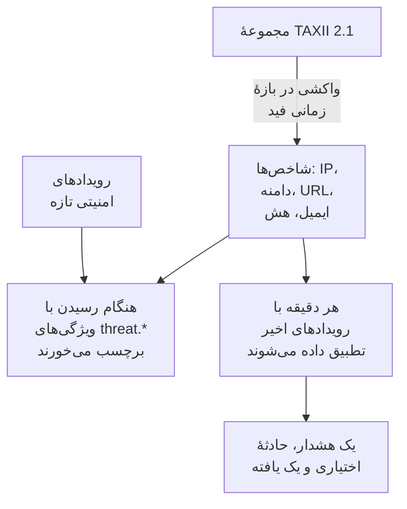

# هوش تهدید (STIX/TAXII)

یک فید هوش تهدید نشانی‌های IP، دامنه‌ها، URLها، نشانی‌های ایمیل و هش‌های فایل شناخته‌شدهٔ مخرب را به OneUptime می‌آورد، و به شما خبر می‌دهد وقتی [رویدادهای امنیتی](/docs/telemetry/security-events) شما از یکی از آن‌ها نام می‌برند. هر فید مشترک یک مجموعهٔ TAXII 2.1 از شاخص‌های STIX 2.1 می‌شود: سرور MISP، OpenCTI یا OpenTAXII خودتان، یا مجموعهٔ یک فراهم‌کننده. OneUptime هیچ محتوای فیدی از خودش عرضه نمی‌کند: مجموعه‌ها را شما می‌آورید، همان‌طور که قاعده‌های Sigma را می‌آورید.

:::cards
- [مشترک یک فید شوید](#مشترک-یک-فید-شوید): یک سرور TAXII، یک مجموعه و روش ورود.
- [چه چیزی دریافت می‌شود](#چه-چیزی-دریافت-میشود): الگوهای شاخصی که OneUptime نگه می‌دارد، و تا چه مدت.
- [تطابق‌ها چگونه پیدا می‌شوند](#تطابقها-چگونه-پیدا-میشوند): هنگام رسیدن رویدادها برچسب می‌خورند، و هر دقیقه تطبیق داده می‌شوند.
- [سطح‌های تهدید](#سطحهای-تهدید): اطمینان یک شاخص چگونه به شدت تبدیل می‌شود.
:::

## چگونه کار می‌کند



## پیش از شروع

- یک سرور TAXII 2.1 که اشیای `indicator` STIX 2.1 را منتشر می‌کند، و شناسهٔ مجموعه‌ای که باید از آن واکشی شود. یک فید به‌صورت ناشناس، با یک توکن bearer، یا با احراز هویت پایهٔ HTTP وارد می‌شود.
- سرورهایی که گواهی کلاینت TLS (TLS دوطرفه) لازم دارند، مانند CISA AIS، پشتیبانی نمی‌شوند. سرور عمومی ATT&CK متعلق به MITRE به‌جای شاخص‌ها، تکنیک‌ها و گروه‌ها را منتشر می‌کند، پس فیدی که به آن اشاره کند خالی می‌ماند.
- نقشی که بتواند فید بسازد: Project Owner، Project Admin، Security Admin یا Security Member. نقش Security Viewer می‌تواند فیدها و شاخص‌ها را بخواند. [نقش‌ها](/docs/permissions/reference#نقشها) را ببینید.

## مشترک یک فید شوید

:::steps
### به Threat Intel بروید

**محصولات** > **رویدادهای امنیتی** > **Threat Intel** را باز کنید.

### فید را بسازید

روی **ساخت Threat Intel Feed** کلیک کنید و چهار گام آن را پر کنید: **اطلاعات پایه** ، **TAXII Server** ، **احراز هویت** و **هنگام تطابق** . فیلدها در جدول زیر آمده‌اند.

### نخستین واکشی را بررسی کنید

در یکی دو دقیقه ردیف فید **Last Polled** را نشان می‌دهد، و **Last Poll Summary** می‌گوید واکشی چه چیزی آورده است. شاخص‌ها در جدول **Indicators** زیر فیدها نمایان می‌شوند.
:::

| فیلد | چه چیزی وارد کنید |
| --- | --- |
| **TAXII API Root URL** | ریشهٔ API TAXII 2.1 سرور، مانند `https://taxii.example.com/api1/` . مجموعه‌ها زیر آن نشانی‌دهی می‌شوند. |
| **Collection ID** | مجموعه‌ای که شاخص‌ها را منتشر می‌کند. |
| **Poll Interval (Minutes)** | هر چند وقت یک بار شیءهای تازه واکشی شوند: ۱ تا ۱۴۴۰ دقیقه، به‌طور پیش‌فرض ۶۰. |
| **Minimum Confidence** | شاخص‌هایی با `confidence` STIX پایین‌تر رد می‌شوند: ۰ تا ۱۰۰، و ۰ همه چیز را نگه می‌دارد. شاخص‌های بدون confidence همیشه می‌گذرند. |
| **API Token** | یک توکن bearer، برای مجموعه‌ای که آن را می‌خواهد. |
| **Basic Auth Username** و **Basic Auth Password** | برای مجموعه‌ای که احراز هویت پایهٔ HTTP را به کار می‌برد. برای مجموعهٔ عمومی هر دو و توکن را خالی بگذارید. |
| **Create Alert on Match** | به‌طور پیش‌فرض روشن: هر شاخص منطبق یک هشدار باز می‌کند. |
| **شدت هشدار** | شدت هر هشداری که این فید باز می‌کند. خالی‌اش بگذارید تا سطح تهدید هر شاخص به کار رود. |
| **Create Incident on Match** | به‌طور پیش‌فرض خاموش. حادثه‌ها ارجاع کشیک، SLAها و صفحه‌های وضعیت را به راه می‌اندازند، و برای تطابق شاخص‌ها معمولاً هشدار کافی است. |
| **شدت حادثه** | مانند **شدت هشدار** ، برای حادثه‌ها. |
| **Write Detection Finding on Match** | به‌طور پیش‌فرض روشن: هر تطابق یک یافته در جریان رویدادها می‌نویسد. |

توکن‌ها و گذرواژه‌ها رمزگذاری می‌شوند و پس از ذخیره دیگر هرگز نمایش داده نمی‌شوند. برای تغییرشان، در ردیف فید **Update Credentials** را برگزینید و سپس **API Token (Bearer)** ، **Basic Auth** یا **Anonymous (clear stored credentials)** را انتخاب کنید: انتخاب شما روش ورود فید را جایگزین می‌کند، پس ذخیرهٔ یک توکن گذرواژهٔ ذخیره‌شده را پاک می‌کند، و برعکس.

### یک فید چگونه واکشی می‌شود

هر واکشی، از راه مکان‌نمای `added_after` در TAXII، شیءهایی را می‌خواهد که از واکشی پیشین افزوده شده‌اند، و حداکثر ۱۰ صفحهٔ ۵۰۰ شیئی می‌خواند. پس یک مجموعهٔ بزرگ در چند واکشی همگام می‌شود: وقتی صفحه‌های بیشتری مانده باشد، **Last Poll Summary** آن را می‌گوید. برای اینکه نخستین همگام‌سازی بزرگ زودتر تمام شود، تا وقتی به‌روز شود **Poll Interval (Minutes)** را پایین بیاورید، تا ۱.

واکشی‌ها خود را با عامل کاربر `OneUptime/<version> (+https://oneuptime.com)` معرفی می‌کنند. اگر دیوار آتش فراهم‌کننده پاسخ `403` می‌دهد، از آن‌ها بخواهید اجازه‌اش را بدهند: بسیاری از دیوارهای آتش درخواست‌هایی را که شبیه یک اسکریپت بی‌نام‌اند مسدود می‌کنند.

فید غیرفعال نه واکشی می‌شود و نه تطبیق داده می‌شود. شاخص‌هایی که از پیش دارد تا وقتی منقضی شوند به برچسب زدن رویدادهای تازه ادامه می‌دهند.

## چه چیزی دریافت می‌شود

OneUptime اشیای `indicator` STIX را نگه می‌دارد که الگویشان برابری سادهٔ یکی از این نوع‌هاست:

| نوع | الگوی نمونه |
| --- | --- |
| نشانی IPv4 (`ipv4-addr`) | `[ipv4-addr:value = '198.51.100.7']` |
| نشانی IPv6 (`ipv6-addr`) | `[ipv6-addr:value = '2001:db8::7']` |
| نام دامنه (`domain-name`) | `[domain-name:value = 'evil.example']` |
| URL (`url`) | `[url:value = 'http://evil.example/payload']` |
| نشانی ایمیل (`email-addr`) | `[email-addr:value = 'billing@evil.example']` |
| هش فایل، SHA-256 (`file-hash-sha256`) | `[file:hashes.'SHA-256' = 'e3b0…b855']` |
| هش فایل، SHA-1 (`file-hash-sha1`) | `[file:hashes.'SHA-1' = 'da39…0709']` |
| هش فایل، MD5 (`file-hash-md5`) | `[file:hashes.MD5 = 'd41d…427e']` |

مقایسه‌هایی که با `OR` به هم پیوسته‌اند، درون یک `[...]` یا میان چند تا، درست‌اند، و هر مقدار به شاخصی جداگانه تبدیل می‌شود:

```text
[domain-name:value = 'evil.example' OR domain-name:value = 'evil2.example']
[ipv4-addr:value = '198.51.100.7'] OR [url:value = 'http://evil.example/x']
```

هر الگوی دیگری، با `AND` ، `FOLLOWEDBY` ، `NOT` ، `LIKE` ، `MATCHES` ، یک قید زمانی مانند `WITHIN` ، یا نوع شیء دیگری، به‌طور کامل رد می‌شود و در **Last Poll Summary** به‌عنوان پشتیبانی‌نشده شمرده می‌شود. برگرداندن تنها بخشی از یک الگوی `AND` بسیار بیشتر از آنچه نویسندهٔ فید منظور داشته تطابق پیدا می‌کرد.

### یک شاخص تا کی فعال می‌ماند

- یک شاخص از `valid_from` تا `valid_until` خود تطابق دارد. بدون `valid_until` ، از `valid_from` به مدت ۳۶۵ روز فعال می‌ماند، و واکشی دوباره آن را تمدید نمی‌کند.
- شاخص لغوشده، یا شاخصی که با یک `valid_until` در گذشته به‌روز شده، به‌محض واکشی شدن به‌روزرسانی دیگر تطابق ندارد. مقداری که فراهم‌کننده از یک الگوی به‌روزشده حذف می‌کند هم همین‌طور.
- مقدارها با حروف کوچک ذخیره می‌شوند و بدون توجه به بزرگی و کوچکی حروف تطابق دارند.

جدول **Indicators** شاخص‌ها را همان‌طور که ذخیره شده‌اند فهرست می‌کند، و در ستون **وضعیت** مقدار **فعال** ، **منقضی‌شده** یا **Revoked** را نشان می‌دهد. شاخصی که دوباره واکشی شده ممکن است مدتی دو بار نمایش داده شود، و ردیف منقضی‌شده یا لغوشده تا وقتی پاک‌سازی ذخیره‌گاه آن را حذف کند، حداکثر تا حدود یک ماه پس از انقضا، در فهرست می‌ماند. تطبیق همیشه اعتبار و لغو را بررسی می‌کند، پس چنین ردیفی هرگز تطابق ندارد.

## تطابق‌ها چگونه پیدا می‌شوند

### برچسب زدن هنگام رسیدن رویدادها

هر رویداد امنیتی ورودی، از API دریافت داده یا از یک اتصال، پیش از ذخیره با شاخص‌های فعال شما بررسی می‌شود. وقتی یکی از observableهای آن (IPها، میزبان‌ها، دامنه‌ها، هش‌ها و کاربرانی که از رویداد برداشته شده‌اند) با مقدار یک شاخص برابر باشد، این ویژگی‌ها روی رویداد زده می‌شوند:

| ویژگی | مقدار |
| --- | --- |
| `threat.matched` | روی رویداد برچسب‌خورده همیشه `"true"` |
| `threat.indicator_id` | شناسهٔ شاخص STIX |
| `threat.indicator_type` | نوع شاخص، مانند `ipv4-addr` یا `file-hash-sha256` |
| `threat.indicator_value` | مقدار منطبق، با حروف کوچک |
| `threat.feed` / `threat.feed_id` | فیدی که شاخص از آن آمده است |
| `threat.confidence` | اطمینان STIX شاخص |
| `threat.match_count` | چند observable از رویداد با یک شاخص تطابق داشتند |

وقتی چند شاخص با یک رویداد تطابق دارند، شاخصی که بیشترین confidence را دارد این مقدارها را پر می‌کند. این‌ها ویژگی‌های معمولی‌اند، پس می‌توانید در **رویدادها** بر پایهٔ آن‌ها جستجو کنید، مانیتورهای رویدادهای امنیتی را با آن‌ها فیلتر کنید، و در قاعده‌های تشخیص به کارشان ببرید:

```yaml title="threat-intel-logon.yml"
title: High-confidence indicator in a successful logon
level: critical
detection:
  selection:
    threat.matched: 'true'
    threat.confidence|gte: 80
    className: Authentication
    statusName: Success
  condition: selection
```

برچسب‌زنی فقط شاخص‌هایی را می‌شناسد که هنگام رسیدن یک رویداد وجود دارند: رویدادها بعداً هرگز دوباره برچسب نمی‌خورند.

### تطبیق در هر دقیقه

هر دقیقه، شاخص‌های فعال هر فید فعال با رویدادهایی تطبیق داده می‌شوند که زمان رویدادشان پس از بررسی پیشین فید است. این کار اطلاعاتی را می‌گیرد که پس از برچسب خوردن یک رویداد رسیده‌اند.

- نخستین بررسی ۱۵ دقیقهٔ گذشته را پوشش می‌دهد. پس از یک قطعی، بررسی بعدی حداکثر ۲۴ ساعت گذشته را جبران می‌کند.
- هر پنجره یک بار بررسی می‌شود. اطلاعاتی که پس از بررسی پنجره‌اش برسد فقط روی رویدادهای بعدی اعمال می‌شود.
- رویدادی که دیر می‌رسد، با زمانی پیش از بررسی پیشین، هنگام رسیدن همچنان برچسب می‌خورد، اما تطبیق داده نمی‌شود.
- هر بررسی حداکثر ۱۰۰ مقدار شاخص را برای هر فید تطبیق می‌دهد: آن‌هایی که در بیشترین رویدادها دیده شده‌اند.

### یک تطابق چه می‌کند

- هشداری با عنوان `[Threat Intel] <feed name> — <indicator value>` ، که تا وقتی باز است برای هر فید و مقدار یکی است. پس از رفع شدنش، تطابق بعدی هشداری تازه باز می‌کند. هشدارها خودکار رفع نمی‌شوند.
- یک حادثه، فقط با **Create Incident on Match** ، که به همان شکل تکراری‌زدایی می‌شود.
- یک یافتهٔ Threat Intel، با **Write Detection Finding on Match** : یک رویداد `Detection Finding` (کلاس OCSF ۲۰۰۴) از محصول `OneUptime Threat Intel` ، با سطح تهدید شاخص به‌عنوان شدتش، و این ویژگی‌ها:

| ویژگی | مقدار |
| --- | --- |
| `oneuptime.threat.feed_id` / `oneuptime.threat.feed_name` | فید |
| `oneuptime.threat.indicator_id` | شناسهٔ شاخص STIX |
| `oneuptime.threat.indicator_type` / `oneuptime.threat.indicator_value` | چه چیزی تطابق داشت |
| `oneuptime.threat.confidence` | اطمینان شاخص |
| `oneuptime.threat.match_count` | چند رویداد پشت این یافته است |

یافته‌ها خودشان هرگز تطبیق داده نمی‌شوند، پس یک تطابق نمی‌تواند تطابق دیگری را راه بیندازد.

## سطح‌های تهدید

شاخص‌ها سطح Sigma ندارند: به‌جای آن، `confidence` STIX آن‌ها یک سطح تهدید تعیین می‌کند.

| اطمینان شاخص | سطح تهدید |
| --- | --- |
| ۹۰ تا ۱۰۰ | Critical |
| ۷۰ تا ۸۹ | High |
| ۴۰ تا ۶۹ | Medium |
| ۱ تا ۳۹ | Low |
| بدون امتیاز (۰ یا ناموجود) | Medium |

شاخص بدون امتیاز Medium به شمار می‌آید: به هر حال کسی تصمیم گرفته آن را در یک فید بگذارد. سطح تهدید شدت یافته است، و شدت هشدار را از میان شدت‌های پروژهٔ شما، به این ترتیب، برمی‌گزیند:

1. **شدت هشدار** (یا **شدت حادثه** ) فید، اگر تنظیم شده باشد: روی هر تطابقی از آن فید اعمال می‌شود.
2. شدتی از شما که به نام سطح تهدید است، مانند High، بدون توجه به بزرگی و کوچکی حروف.
3. بر پایهٔ رتبه: Critical و High شدیدترین شدت شما را می‌گیرند، Medium و Low کم‌شدت‌ترین را.

سطح تهدید به هر شاخص تعلق دارد، نه به فید، پس یک فید می‌تواند در یک دقیقه یک هشدار Critical و یک هشدار Low باز کند. **Minimum Confidence** بر پایهٔ همان عدد فیلتر می‌کند: کمینهٔ ۷۰ فقط شاخص‌های High و Critical را نگه می‌دارد، به‌اضافهٔ شاخص‌های بدون امتیاز، که همیشه می‌گذرند.

## تطابق‌های یک فید را بپایید

اقدام **ساخت مانیتور** در ردیف یک فید، یک مانیتور رویدادهای امنیتی تازه باز می‌کند که یافته‌های فید را می‌شمارد: کلاس رویداد `Detection Finding` ، فیلترشده بر پایهٔ شناسهٔ فید در `oneuptime.threat.feed_id` (هرگز نامش، که با تغییر نام عوض می‌شود)، در یک ساعت گذشته. از آن برای انفجار ناگهانی تطابق‌ها، یا ساکت شدن فیدی پرکار استفاده کنید.

## نگهداری و صورت‌حساب

شاخص‌ها پیکربندی‌اند، نه تله‌متری، و به‌عنوان دادهٔ دریافت‌شده صورت‌حساب نمی‌شوند. یافته‌هایی که یک تطابق می‌نویسد رویدادهای امنیتی معمولی‌اند، و مانند بقیه صورت‌حساب و نگه داشته می‌شوند: [رویدادهای امنیتی](/docs/telemetry/security-events#نگهداری-و-صورتحساب) را ببینید.

## رفع اشکال

:::details پس از یک واکشی Last Error تنظیم شده است
`401` یا `403` : اعتبارنامه‌ها نادرست‌اند یا وجود ندارند؛ آن‌ها را با **Update Credentials** جایگزین کنید. یک `403` همچنین می‌تواند دیوار آتش فراهم‌کننده باشد که عامل کاربر را مسدود می‌کند. `404` : **TAXII API Root URL** را، که معمولاً به مسیری مانند `/api1/` ختم می‌شود، و **Collection ID** را بررسی کنید. خطا در واکشی موفق بعدی پاک می‌شود.
:::

:::details فید واکشی می‌شود، اما هیچ شاخصی نمایان نمی‌شود
**Last Poll Summary** را بخوانید. هیچ شیئی واکشی نشد: مجموعه خالی است یا هیچ شاخصی منتشر نمی‌کند. الگوهای پشتیبانی‌نشده: فراهم‌کننده ویژگی‌هایی از الگو را به کار می‌برد که این صفحه ردشده می‌داند. کمتر از کمینهٔ confidence: **Minimum Confidence** را پایین بیاورید. از پیش غیرفعال: فراهم‌کننده شاخص‌هایی فرستاده که از پیش لغو یا منقضی شده بودند.
:::

:::details شاخص‌ها هستند، اما هیچ چیز تطابق ندارد
تطبیق مقدار یک شاخص را با observableهای یک رویداد مقایسه می‌کند، نه با هر فیلد: رویدادی را که انتظار داشتید تطابق داشته باشد در **رویدادها** باز کنید و بررسی کنید که observableهایش آن مقدار را داشته باشند. فقط شاخص‌هایی با وضعیت **فعال** تطابق دارند. **Last Match Error** را روی فید بررسی کنید.
:::

:::details یک تطابق هشداری باز نکرد
**Create Alert on Match** خاموش است، یا هشداری برای همان فید و مقدار هنوز باز است و تطابق‌های بعدی در آن جمع می‌شوند. یک پروژه برای اینکه یک فید هشدار باز کند دست‌کم به یک شدت هشدار نیاز دارد.
:::

## گام‌های بعدی

:::cards
- [رویدادهای امنیتی](/docs/telemetry/security-events): رویدادها را بفرستید، در آن‌ها جستجو کنید و قاعده‌های تشخیص بنویسید.
- [Google SecOps](/docs/integrations/google-secops): تشخیص‌ها و رویدادهای Chronicle را وارد کنید.
- [مرجع دسترسی‌ها](/docs/permissions/reference): نقش‌های Security، و آنچه هر کدام می‌تواند بکند.
:::
