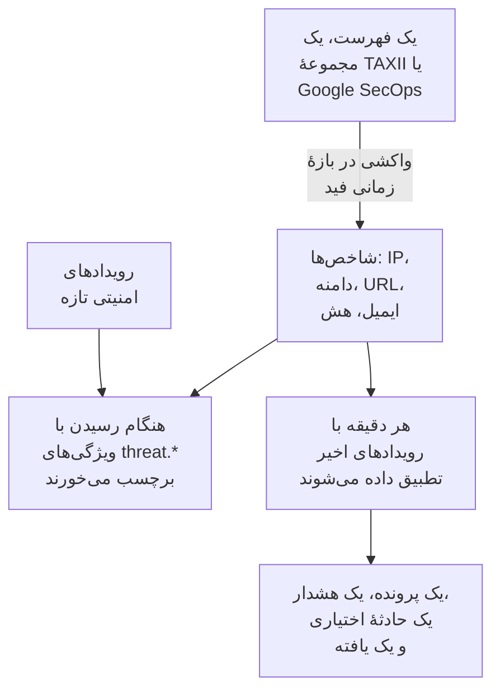

# هوش تهدید (STIX/TAXII)

یک فید هوش تهدید نشانی‌های IP، دامنه‌ها، URLها، نشانی‌های ایمیل و هش‌های فایل شناخته‌شدهٔ مخرب را به OneUptime می‌آورد، و به شما خبر می‌دهد وقتی [رویدادهای امنیتی](/docs/telemetry/security-events) شما از یکی از آن‌ها نام می‌برند. یک فید یک منبع را می‌خواند: فهرستی از شاخص‌ها در یک نشانی https، مانند فهرست‌های رایگانی که OneUptime با یک کلیک می‌افزاید، یک مجموعهٔ TAXII 2.1 از شاخص‌های STIX 2.1 از سرور MISP، OpenCTI یا OpenTAXII خودتان یا یک فراهم‌کننده، یا شاخص‌هایی که Google SecOps در رویدادهای شما یافته است.

:::cards
- [یک فهرست رایگان بیفزایید](#یک-فهرست-رایگان-بیفزایید): Feodo Tracker، Emerging Threats و گره‌های خروجی Tor، با یک کلیک.
- [مشترک یک فید شوید](#مشترک-یک-فید-شوید): نشانی یک فهرست، یک مجموعهٔ TAXII یا یک اتصال Google SecOps.
- [چه چیزی دریافت می‌شود](#چه-چیزی-دریافت-میشود): الگوهای شاخصی که OneUptime نگه می‌دارد، و تا چه مدت.
- [تطابق‌ها چگونه پیدا می‌شوند](#تطابقها-چگونه-پیدا-میشوند): هنگام رسیدن رویدادها برچسب می‌خورند، و هر دقیقه تطبیق داده می‌شوند.
- [سطح‌های تهدید](#سطحهای-تهدید): اطمینان یک شاخص چگونه به شدت تبدیل می‌شود.
:::

## چگونه کار می‌کند



## پیش از شروع

- برای یک فهرست، یک نشانی `https` که یک فایل متنی با یک شاخص در هر خط را دانلود می‌کند.
- برای یک فید TAXII، یک سرور TAXII 2.1 که اشیای `indicator` STIX 2.1 را منتشر می‌کند، و شناسهٔ مجموعه‌ای که باید از آن واکشی شود. یک فید TAXII به‌صورت ناشناس، با یک توکن bearer، یا با احراز هویت پایهٔ HTTP وارد می‌شود.
- برای یک فید Google SecOps، یک [اتصال Google SecOps](/docs/integrations/google-secops#راهاندازی-رابط-مدیریتشده) که حساب سرویس آن بتواند تطابق‌های شاخص را جست‌وجو کند: نقش `roles/chronicle.viewer` می‌تواند.
- سرورهایی که گواهی کلاینت TLS (TLS دوطرفه) لازم دارند، مانند CISA AIS، پشتیبانی نمی‌شوند. سرور عمومی ATT&CK متعلق به MITRE به‌جای شاخص‌ها، تکنیک‌ها و گروه‌ها را منتشر می‌کند، پس فیدی که به آن اشاره کند خالی می‌ماند.
- نقشی که بتواند فید بسازد: Project Owner، Project Admin، Security Admin یا Security Member. نقش Security Viewer می‌تواند فیدها و شاخص‌ها را بخواند. [نقش‌ها](/docs/permissions/reference#نقشها) را ببینید.

## یک فهرست رایگان بیفزایید

کارت **فهرست‌های رایگان** در **اطلاعات تهدید** یک فهرست مسدودسازی رایگان را با یک کلیک می‌افزاید: روی **افزودن فهرست** در یک فهرست کلیک کنید، و OneUptime فیدی می‌سازد که آن را طبق زمان‌بندی فهرست دانلود می‌کند. فهرستی که پروژه از پیش می‌خواند **افزوده شد** را نشان می‌دهد.

| فهرست | منتشرکننده | خواندن | اطمینان | یک تطابق باز می‌کند |
| --- | --- | --- | --- | --- |
| سرورهای C2 بات‌نت از Feodo Tracker | abuse.ch | هر ساعت | ۹۰، Critical | یک پرونده و یک هشدار |
| میزبان‌های به‌خطرافتاده از Emerging Threats | Proofpoint Emerging Threats | هر روز | ۷۰، High | یک پرونده و یک هشدار |
| گره‌های خروجی Tor | The Tor Project | هر ساعت | ۳۰، Low | یک پرونده |

کاشی هر فهرست به شرایط آن پیوند می‌دهد: Feodo Tracker برای هر کاربردی آزاد است (CC0)، و فهرست Emerging Threats مجوز BSD دارد. فیدی که از یک فهرست افزوده شده مانند هر فید دیگری ویرایش و حذف می‌شود.

## مشترک یک فید شوید

:::steps
### به Threat Intel بروید

**محصولات** > **رویدادهای امنیتی** > **تشخیص‌ها** > **اطلاعات تهدید** را باز کنید.

### فید را بسازید

روی **ساخت فید اطلاعات تهدید** کلیک کنید و **منبع** آن را برگزینید: **فهرست شاخص‌ها** ، **مجموعهٔ TAXII** یا **Google SecOps** . گام بعدی فقط همان منبع را می‌پرسد: **URL فهرست** برای یک فهرست، **سرور TAXII** و **ورود** برای یک مجموعه، یا **اتصال Google SecOps** . **هنگام تطابق** در پایان می‌آید. فیلدها در جدول زیر آمده‌اند.

### نخستین واکشی را بررسی کنید

در یکی دو دقیقه ردیف فید **آخرین فراخوانی** را نشان می‌دهد، و **خلاصه آخرین فراخوانی** می‌گوید واکشی چه چیزی آورده است. شاخص‌ها در جدول **شاخص‌ها** زیر فیدها نمایان می‌شوند.
:::

| فیلد | چه چیزی وارد کنید |
| --- | --- |
| **منبع** | شاخص‌ها از کجا می‌آیند. هنگام ساخت فید تعیین می‌شود: فیدی با منبعی دیگر، فیدی تازه است. |
| **URL فهرست** | برای یک فهرست: نشانی `https` یک فایل متنی با یک نشانی IP، دامنه، URL یا هش فایل در هر خط. |
| **اطمینان** | برای یک فهرست: فهرست چقدر مطمئن است، ۱ تا ۱۰۰. هر شاخص فهرست همین را می‌گیرد، و [سطح تهدید](#سطحهای-تهدید) را تعیین می‌کند؛ خالی یعنی Medium. |
| **اتصال Google SecOps** | برای Google SecOps: اتصالی که کلیدش شاخص‌هایی را که Google SecOps یافته می‌خواند. وقتی اتصالی نیست، **اتصال Google SecOps** صفحهٔ **اتصال‌ها** را باز می‌کند. |
| **نشانی ریشه API TAXII** | ریشهٔ API TAXII 2.1 سرور، مانند `https://taxii.example.com/api1/` . مجموعه‌ها زیر آن نشانی‌دهی می‌شوند. |
| **شناسه مجموعه** | مجموعه‌ای که شاخص‌ها را منتشر می‌کند. |
| **فاصله فراخوانی (دقیقه)** | هر چند وقت یک بار منبع خوانده شود: ۱ تا ۱۴۴۰ دقیقه، به‌طور پیش‌فرض ۶۰. یک فهرست حداکثر هر ۱۵ دقیقه یک بار خوانده می‌شود. |
| **حداقل اطمینان** | برای یک مجموعهٔ TAXII یا Google SecOps: شاخص‌هایی با اطمینان پایین‌تر رد می‌شوند، ۰ تا ۱۰۰، و ۰ همه چیز را نگه می‌دارد. شاخص‌های بدون confidence همیشه می‌گذرند. |
| **ورود** | شیوهٔ ورود OneUptime: **بدون ورود** برای مجموعهٔ عمومی، **توکن Bearer** برای توکنی که گردانندهٔ سرور داده، یا **نام کاربری و رمز عبور** برای احراز هویت پایهٔ HTTP. |
| **توکن API** ، **نام کاربری Basic Auth** و **گذرواژه Basic Auth** | فقط برای روش ورود انتخاب‌شده پرسیده می‌شوند. |
| **باز کردن پرونده هنگام تطبیق** | به‌طور پیش‌فرض روشن: هر رویدادی که از یک شاخص نام می‌برد یک [پرونده](/docs/telemetry/security-cases) دربارهٔ آن باز می‌کند، یا به پروندهٔ بازی که از پیش دربارهٔ آن است می‌پیوندد. |
| **هشدارها و حوادث** | به‌طور پیش‌فرض **ساخت هشدار** : هر شاخص منطبق یک هشدار باز می‌کند. |
| **شدت هشدار** | شدت هر هشداری که این فید باز می‌کند. خالی‌اش بگذارید تا سطح تهدید هر شاخص به کار رود. |
| **اعلام حادثه** یا **هر دو** | زیر **هشدارها و حوادث** . حادثه‌ها ارجاع کشیک، SLAها و صفحه‌های وضعیت را به راه می‌اندازند، و برای تطابق شاخص‌ها معمولاً هشدار کافی است. |
| **شدت حادثه** | مانند **شدت هشدار** ، برای حادثه‌ها. |
| **نوشتن Detection Finding هنگام تطبیق** | به‌طور پیش‌فرض روشن: هر تطابق یک یافته در جریان رویدادها می‌نویسد. |

توکن‌ها و گذرواژه‌های یک فید TAXII رمزگذاری می‌شوند و پس از ذخیره دیگر هرگز نمایش داده نمی‌شوند. برای تغییرشان، در ردیف فید **به‌روزرسانی اطلاعات ورود** را برگزینید و سپس **توکن Bearer** ، **نام کاربری و رمز عبور** یا **بدون ورود** را، که موارد ذخیره‌شده را پاک می‌کند، انتخاب کنید: انتخاب شما روش ورود فید را جایگزین می‌کند، پس ذخیرهٔ یک توکن گذرواژهٔ ذخیره‌شده را پاک می‌کند، و برعکس.

### یک فید چگونه واکشی می‌شود

هر واکشی، از راه مکان‌نمای `added_after` در TAXII، شیءهایی را می‌خواهد که از واکشی پیشین افزوده شده‌اند، و حداکثر ۱۰ صفحهٔ ۵۰۰ شیئی می‌خواند. پس یک مجموعهٔ بزرگ در چند واکشی همگام می‌شود: وقتی صفحه‌های بیشتری مانده باشد، **خلاصه آخرین فراخوانی** آن را می‌گوید. برای اینکه نخستین همگام‌سازی بزرگ زودتر تمام شود، تا وقتی به‌روز شود **فاصله فراخوانی (دقیقه)** را پایین بیاورید، تا ۱.

واکشی‌ها خود را با عامل کاربر `OneUptime/<version> (+https://oneuptime.com)` معرفی می‌کنند. اگر دیوار آتش فراهم‌کننده پاسخ `403` می‌دهد، از آن‌ها بخواهید اجازه‌اش را بدهند: بسیاری از دیوارهای آتش درخواست‌هایی را که شبیه یک اسکریپت بی‌نام‌اند مسدود می‌کنند.

فید غیرفعال نه واکشی می‌شود و نه تطبیق داده می‌شود. شاخص‌هایی که از پیش دارد تا وقتی منقضی شوند به برچسب زدن رویدادهای تازه ادامه می‌دهند.

### یک فهرست چگونه خوانده می‌شود

- هر واکشی کل فهرست را دانلود می‌کند و آن را خط به خط می‌خواند: نخستین مقدار هر خط، تا یک فاصله، تب، ویرگول یا نقطه‌ویرگول. خط‌هایی که با `#` ، `;` یا `//` آغاز می‌شوند توضیح‌اند، درگاه پس از یک نشانی یا دامنه کنار گذاشته می‌شود، و بازه‌ای از نشانی‌ها مانند `198.51.100.0/24` رد می‌شود.
- یک مقدار تا ۲ روز پس از واکشی‌ای که آخرین بار آن را خوانده یک شاخص فعال می‌ماند، و مقداری که فهرست کنار می‌گذارد از واکشی بعدی دیگر تطابق ندارد. فهرستی که تغییر نکرده روزی یک بار دوباره نوشته می‌شود.
- یک فهرست حداکثر ۵۰٬۰۰۰ شاخص دارد. **خلاصه آخرین فراخوانی** می‌گوید چند شاخص خوانده شد، چند خط رد شد و چند شاخص کنار ماند.
- نشانی باید از `https` استفاده کند و تابع همان قاعده‌های خروجی یک اتصال است: در OneUptime Cloud نشانی خصوصی پذیرفته نمی‌شود.

### Google SecOps چگونه خوانده می‌شود

- هر واکشی تطابق‌های شاخصی را که Google SecOps از واکشی پیشین ثبت کرده، با ویژگی‌های Mandiant می‌خواند: دامنه، نشانی یا هش فایل منطبق، اطمینان آن، دستهٔ آن و کارزارها و بازیگرانی که به آن پیوسته‌اند. نخستین واکشی ۷ روز گذشته را می‌خواند.
- یک شاخص تا ۳۰ روز پس از آخرین باری که Google SecOps آن را دیده، یا تا وقتی منبعش بگوید دیگر فعال نیست، فعال می‌ماند، و شاخصی که تحلیلگری در Google SecOps بی‌صدا کرده اینجا هم دیگر تطابق ندارد.
- تطابقی که Google SecOps آن را نفوذ فعال علامت می‌زند Critical است، و تطابقی با اولویت بالا دست‌کم High است.

## چه چیزی دریافت می‌شود

از یک مجموعهٔ TAXII، OneUptime اشیای `indicator` STIX را نگه می‌دارد که الگویشان برابری سادهٔ یکی از این نوع‌هاست. یک فهرست و Google SecOps همین نوع‌ها را می‌دهند:

| نوع | الگوی نمونه |
| --- | --- |
| نشانی IPv4 (`ipv4-addr`) | `[ipv4-addr:value = '198.51.100.7']` |
| نشانی IPv6 (`ipv6-addr`) | `[ipv6-addr:value = '2001:db8::7']` |
| نام دامنه (`domain-name`) | `[domain-name:value = 'evil.example']` |
| URL (`url`) | `[url:value = 'http://evil.example/payload']` |
| نشانی ایمیل (`email-addr`) | `[email-addr:value = 'billing@evil.example']` |
| هش فایل، SHA-256 (`file-hash-sha256`) | `[file:hashes.'SHA-256' = 'e3b0…b855']` |
| هش فایل، SHA-1 (`file-hash-sha1`) | `[file:hashes.'SHA-1' = 'da39…0709']` |
| هش فایل، MD5 (`file-hash-md5`) | `[file:hashes.MD5 = 'd41d…427e']` |

مقایسه‌هایی که با `OR` به هم پیوسته‌اند، درون یک `[...]` یا میان چند تا، درست‌اند، و هر مقدار به شاخصی جداگانه تبدیل می‌شود:

```text
[domain-name:value = 'evil.example' OR domain-name:value = 'evil2.example']
[ipv4-addr:value = '198.51.100.7'] OR [url:value = 'http://evil.example/x']
```

هر الگوی دیگری، با `AND` ، `FOLLOWEDBY` ، `NOT` ، `LIKE` ، `MATCHES` ، یک قید زمانی مانند `WITHIN` ، یا نوع شیء دیگری، به‌طور کامل رد می‌شود و در **خلاصه آخرین فراخوانی** به‌عنوان پشتیبانی‌نشده شمرده می‌شود. برگرداندن تنها بخشی از یک الگوی `AND` بسیار بیشتر از آنچه نویسندهٔ فید منظور داشته تطابق پیدا می‌کرد.

### یک شاخص تا کی فعال می‌ماند

- یک شاخص از `valid_from` تا `valid_until` خود تطابق دارد. بدون `valid_until` ، از `valid_from` به مدت ۳۶۵ روز فعال می‌ماند، و واکشی دوباره آن را تمدید نمی‌کند.
- شاخص لغوشده، یا شاخصی که با یک `valid_until` در گذشته به‌روز شده، به‌محض واکشی شدن به‌روزرسانی دیگر تطابق ندارد. مقداری که فراهم‌کننده از یک الگوی به‌روزشده حذف می‌کند هم همین‌طور.
- مقدارها با حروف کوچک ذخیره می‌شوند و بدون توجه به بزرگی و کوچکی حروف تطابق دارند.

جدول **شاخص‌ها** شاخص‌ها را همان‌طور که ذخیره شده‌اند فهرست می‌کند، و در ستون **وضعیت** مقدار **فعال** ، **منقضی‌شده** یا **لغوشده** را نشان می‌دهد. شاخصی که دوباره واکشی شده ممکن است مدتی دو بار نمایش داده شود، و ردیف منقضی‌شده یا لغوشده تا وقتی پاک‌سازی ذخیره‌گاه آن را حذف کند، حداکثر تا حدود یک ماه پس از انقضا، در فهرست می‌ماند. تطبیق همیشه اعتبار و لغو را بررسی می‌کند، پس چنین ردیفی هرگز تطابق ندارد.

## تطابق‌ها چگونه پیدا می‌شوند

### برچسب زدن هنگام رسیدن رویدادها

هر رویداد امنیتی ورودی، از API دریافت داده یا از یک اتصال، پیش از ذخیره با شاخص‌های فعال شما بررسی می‌شود. وقتی یکی از observableهای آن (IPها، میزبان‌ها، دامنه‌ها، هش‌ها و کاربرانی که از رویداد برداشته شده‌اند) با مقدار یک شاخص برابر باشد، این ویژگی‌ها روی رویداد زده می‌شوند:

| ویژگی | مقدار |
| --- | --- |
| `threat.matched` | روی رویداد برچسب‌خورده همیشه `"true"` |
| `threat.indicator_id` | شناسهٔ شاخص STIX، یا `list` یا `google-secops` برای آن منبع‌ها |
| `threat.indicator_type` | نوع شاخص، مانند `ipv4-addr` یا `file-hash-sha256` |
| `threat.indicator_value` | مقدار منطبق، با حروف کوچک |
| `threat.feed` / `threat.feed_id` | فیدی که شاخص از آن آمده است |
| `threat.confidence` | اطمینان STIX شاخص |
| `threat.match_count` | چند observable از رویداد با یک شاخص تطابق داشتند |

وقتی چند شاخص با یک رویداد تطابق دارند، شاخصی که بیشترین confidence را دارد این مقدارها را پر می‌کند. این‌ها ویژگی‌های معمولی‌اند، پس می‌توانید در **رویدادها** بر پایهٔ آن‌ها جستجو کنید، مانیتورهای رویدادهای امنیتی را با آن‌ها فیلتر کنید، و در قاعده‌های تشخیص به کارشان ببرید:

```yaml title="threat-intel-logon.yml"
title: High-confidence indicator in a successful logon
level: critical
detection:
  selection:
    threat.matched: 'true'
    threat.confidence|gte: 80
    className: Authentication
    statusName: Success
  condition: selection
```

برچسب‌زنی فقط شاخص‌هایی را می‌شناسد که هنگام رسیدن یک رویداد وجود دارند: رویدادها بعداً هرگز دوباره برچسب نمی‌خورند.

### تطبیق در هر دقیقه

هر دقیقه، شاخص‌های فعال هر فید فعال با رویدادهایی تطبیق داده می‌شوند که زمان رویدادشان پس از بررسی پیشین فید است. این کار اطلاعاتی را می‌گیرد که پس از برچسب خوردن یک رویداد رسیده‌اند.

- نخستین بررسی ۱۵ دقیقهٔ گذشته را پوشش می‌دهد. پس از یک قطعی، بررسی بعدی حداکثر ۲۴ ساعت گذشته را جبران می‌کند.
- هر پنجره یک بار بررسی می‌شود. اطلاعاتی که پس از بررسی پنجره‌اش برسد فقط روی رویدادهای بعدی اعمال می‌شود.
- رویدادی که دیر می‌رسد، با زمانی پیش از بررسی پیشین، هنگام رسیدن همچنان برچسب می‌خورد، اما تطبیق داده نمی‌شود.
- هر بررسی هر مقدار شاخص منطبق را به‌صورت یک Detection Finding ثبت می‌کند، تا ۱۰٬۰۰۰ مورد برای هر فید. برای ۱۰۰ مقداری که در بیشترین رویدادها دیده شده‌اند هشدار، حادثه و پرونده باز می‌شود؛ بقیه در یک پرونده دربارهٔ فید جمع می‌شوند، و **آخرین خطای تطبیق** فید می‌گوید چند مورد تطابق داشتند.

### یک تطابق چه می‌کند

- هشداری با عنوان `[Threat Intel] <feed name> — <indicator value>` ، که تا وقتی باز است برای هر فید و مقدار یکی است. پس از رفع شدنش، تطابق بعدی هشداری تازه باز می‌کند. هشدارها خودکار رفع نمی‌شوند.
- یک حادثه، فقط وقتی **هشدارها و حوادث** روی **اعلام حادثه** یا **هر دو** باشد، که به همان شکل تکراری‌زدایی می‌شود.
- یک یافتهٔ Threat Intel، با **نوشتن Detection Finding هنگام تطبیق** : یک رویداد `Detection Finding` (کلاس OCSF ۲۰۰۴) از محصول `OneUptime Threat Intel` ، با سطح تهدید شاخص به‌عنوان شدتش، و این ویژگی‌ها:

| ویژگی | مقدار |
| --- | --- |
| `oneuptime.threat.feed_id` / `oneuptime.threat.feed_name` | فید |
| `oneuptime.threat.indicator_id` | شناسهٔ شاخص STIX، یا `list` یا `google-secops` برای آن منبع‌ها |
| `oneuptime.threat.indicator_type` / `oneuptime.threat.indicator_value` | چه چیزی تطابق داشت |
| `oneuptime.threat.confidence` | اطمینان شاخص |
| `oneuptime.threat.match_count` | چند رویداد پشت این یافته است |

یافته‌ها خودشان هرگز تطبیق داده نمی‌شوند، پس یک تطابق نمی‌تواند تطابق دیگری را راه بیندازد.

## سطح‌های تهدید

شاخص‌ها سطح Sigma ندارند: به‌جای آن، `confidence` STIX آن‌ها یک سطح تهدید تعیین می‌کند.

| اطمینان شاخص | سطح تهدید |
| --- | --- |
| ۹۰ تا ۱۰۰ | Critical |
| ۷۰ تا ۸۹ | High |
| ۴۰ تا ۶۹ | Medium |
| ۱ تا ۳۹ | Low |
| بدون امتیاز (۰ یا ناموجود) | Medium |

شاخص بدون امتیاز Medium به شمار می‌آید: به هر حال کسی تصمیم گرفته آن را در یک فید بگذارد. سطح تهدید شدت یافته است، و شدت هشدار را از میان شدت‌های پروژهٔ شما، به این ترتیب، برمی‌گزیند:

1. **شدت هشدار** (یا **شدت حادثه** ) فید، اگر تنظیم شده باشد: روی هر تطابقی از آن فید اعمال می‌شود.
2. شدتی از شما که به نام سطح تهدید است، مانند High، بدون توجه به بزرگی و کوچکی حروف.
3. بر پایهٔ رتبه: Critical و High شدیدترین شدت شما را می‌گیرند، Medium و Low کم‌شدت‌ترین را.

سطح تهدید به هر شاخص تعلق دارد، نه به فید، پس یک فید می‌تواند در یک دقیقه یک هشدار Critical و یک هشدار Low باز کند. **حداقل اطمینان** بر پایهٔ همان عدد فیلتر می‌کند: کمینهٔ ۷۰ فقط شاخص‌های High و Critical را نگه می‌دارد، به‌اضافهٔ شاخص‌های بدون امتیاز، که همیشه می‌گذرند.

## تطابق‌های یک فید را بپایید

اقدام **ساخت مانیتور** در ردیف یک فید، یک مانیتور رویدادهای امنیتی تازه باز می‌کند که یافته‌های فید را می‌شمارد: کلاس رویداد `Detection Finding` ، فیلترشده بر پایهٔ شناسهٔ فید در `oneuptime.threat.feed_id` (هرگز نامش، که با تغییر نام عوض می‌شود)، در یک ساعت گذشته. از آن برای انفجار ناگهانی تطابق‌ها، یا ساکت شدن فیدی پرکار استفاده کنید.

## نگهداری و صورت‌حساب

شاخص‌ها پیکربندی‌اند، نه تله‌متری، و به‌عنوان دادهٔ دریافت‌شده صورت‌حساب نمی‌شوند. یافته‌هایی که یک تطابق می‌نویسد رویدادهای امنیتی معمولی‌اند، و مانند بقیه صورت‌حساب و نگه داشته می‌شوند: [رویدادهای امنیتی](/docs/telemetry/security-events#نگهداری-و-صورتحساب) را ببینید.

## رفع اشکال

:::details پس از یک واکشی Last Error تنظیم شده است
`401` یا `403` : اعتبارنامه‌ها نادرست‌اند یا وجود ندارند؛ آن‌ها را با **به‌روزرسانی اطلاعات ورود** جایگزین کنید. یک `403` همچنین می‌تواند دیوار آتش فراهم‌کننده باشد که عامل کاربر را مسدود می‌کند. `404` : **نشانی ریشه API TAXII** را، که معمولاً به مسیری مانند `/api1/` ختم می‌شود، و **شناسه مجموعه** را بررسی کنید. خطا در واکشی موفق بعدی پاک می‌شود.
:::

:::details فید واکشی می‌شود، اما هیچ شاخصی نمایان نمی‌شود
**خلاصه آخرین فراخوانی** را بخوانید. هیچ شیئی واکشی نشد: مجموعه خالی است یا هیچ شاخصی منتشر نمی‌کند. الگوهای پشتیبانی‌نشده: فراهم‌کننده ویژگی‌هایی از الگو را به کار می‌برد که این صفحه ردشده می‌داند. کمتر از کمینهٔ confidence: **حداقل اطمینان** را پایین بیاورید. از پیش غیرفعال: فراهم‌کننده شاخص‌هایی فرستاده که از پیش لغو یا منقضی شده بودند.
:::

:::details شاخص‌ها هستند، اما هیچ چیز تطابق ندارد
تطبیق مقدار یک شاخص را با observableهای یک رویداد مقایسه می‌کند، نه با هر فیلد: رویدادی را که انتظار داشتید تطابق داشته باشد در **رویدادها** باز کنید و بررسی کنید که observableهایش آن مقدار را داشته باشند. فقط شاخص‌هایی با وضعیت **فعال** تطابق دارند. اگر **وضعیت** فید **تطبیق ناموفق بود** را نشان دهد، **مشاهده خطا** در ردیفش علت را نشان می‌دهد.
:::

:::details آخرین خطای یک فید فهرستی می‌گوید نشانی با یک صفحهٔ وب پاسخ داد
**URL فهرست** یک صفحه را باز می‌کند، مانند صفحهٔ ورود یا خطا، نه فهرست را: آن را در مرورگر باز کنید و نشانی خود فایل را کپی کنید. فهرستی که متنش هیچ نشانی IP، دامنه، URL یا هش فایلی ندارد هم به همین شکل رد می‌شود، و شاخص‌های فید همان‌طور که بودند می‌مانند.
:::

:::details آخرین خطای یک فید Google SecOps می‌گوید HTTP 403
حساب سرویس اتصال نمی‌تواند تطابق‌های شاخص را جست‌وجو کند: نقش `roles/chronicle.viewer` را به آن بدهید. اگر اتصال حذف شده باشد، فید همین را می‌گوید: آن را ویرایش کنید و **اتصال Google SecOps** دیگری برگزینید.
:::

:::details یک تطابق هشداری باز نکرد
**هشدارها و حوادث** روی **اعلام حادثه** یا **هیچ‌کدام** است، یا هشداری برای همان فید و مقدار هنوز باز است و تطابق‌های بعدی در آن جمع می‌شوند. یک پروژه برای اینکه یک فید هشدار باز کند دست‌کم به یک شدت هشدار نیاز دارد.
:::

## گام‌های بعدی

:::cards
- [رویدادهای امنیتی](/docs/telemetry/security-events): رویدادها را بفرستید، در آن‌ها جستجو کنید و قاعده‌های تشخیص بنویسید.
- [Google SecOps](/docs/integrations/google-secops): تشخیص‌ها و رویدادهای Chronicle را وارد کنید.
- [مرجع دسترسی‌ها](/docs/permissions/reference): نقش‌های Security، و آنچه هر کدام می‌تواند بکند.
:::
