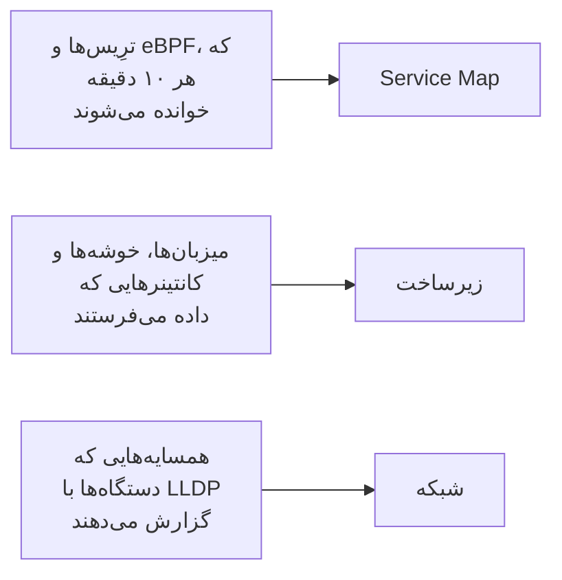

# توپولوژی

توپولوژی نشان می‌دهد سیستم‌هایتان چگونه به هم وصل‌اند: کدام سرویس‌ها کدام‌ها را فرا می‌خوانند، چه چیزی کجا اجرا می‌شود، و دستگاه‌های شبکه‌تان چگونه کابل‌کشی شده‌اند. OneUptime آن را از تله‌متری‌ای می‌سازد که همین حالا می‌فرستید، پس چیزی برای کشیدن با دست نمی‌ماند، و در یک نگاه نشان می‌دهد خطاها و حوادث کجا هستند.

:::cards
- [باز کردن توپولوژی](#باز-کردن-توپولوژی): سه نما از یک صفحه.
- [خواندن نقشهٔ سرویس‌ها](#خواندن-نقشهٔ-سرویسها): چه کسی چه کسی را فرا می‌خواند، و فراخوانی‌ها چقدر سالم‌اند.
- [کاوش در زیرساخت](#کاوش-در-زیرساخت): هر سرویس کجا اجرا می‌شود.
- [باز کردن نقشهٔ خود یک منبع](#باز-کردن-نقشهٔ-خود-یک-منبع): یک vCenter، خوشه یا میزبان با جزئیات.
- [دیدن شبکه](#دیدن-شبکه): دستگاه‌ها و پیوندهایشان، به‌صورت زنده.
:::

## نقشه چگونه ساخته می‌شود

هر نمای توپولوژی از نوع متفاوتی از تله‌متری ساخته می‌شود:

- **فقط آنچه فعال بوده کشیده می‌شود.** هر نما سرویس‌ها و منابعی را نشان می‌دهد که در بازهٔ زمانی داده فرستاده‌اند، و اتصال‌هایی را که در آن دیده شده‌اند. برای کشیدن موارد خاموش هم، **نمایش غیرفعال‌ها** را روشن کنید.
- **فراخوانی‌ها در یک بازهٔ اخیر شمرده می‌شوند.** OneUptime هر ۱۰ دقیقه فراخوانی‌های میان سرویس‌ها را جستجو می‌کند، و ارقام ترافیک ۱۵ دقیقهٔ اخیر را پوشش می‌دهند، نه کل بازهٔ زمانی را.
- **نمای شبکه زنده است.** دستگاه‌هایتان را همان‌طور که اکنون به هم وصل‌اند نشان می‌دهد، پس بازهٔ زمانی ندارد.

## پیش از شروع

- **تله‌متری در حال رسیدن.** نقشهٔ سرویس‌ها به ترِیس نیاز دارد: [OpenTelemetry](/docs/telemetry/open-telemetry) را ببینید. نمای زیرساخت به میزبان یا خوشه‌ای نیاز دارد که داده بفرستد: [عامل Kubernetes](/docs/telemetry/kubernetes-agent) را ببینید. نمای شبکه به دستگاه‌های شبکه نیاز دارد: [مانیتور دستگاه شبکه](/docs/monitor/network-device-monitor) را ببینید.
- **نقشی که تله‌متری را بخواند.** Project Owner، Project Admin، Project Member، Viewer، Telemetry Admin، Telemetry Member یا Telemetry Viewer، یا یک نقش سفارشی با مجوز Read Telemetry Service.

## باز کردن توپولوژی

به **محصولات** > **مشاهده‌پذیری** > **توپولوژی** بروید. **موجودی** > **Topology Map** همان صفحه را باز می‌کند. صفحه روی **Service Map** و برای **۱ روز گذشته** باز می‌شود.

| نما | پرسشی که پاسخ می‌دهد |
| --- | --- |
| **Service Map** | کدام سرویس‌ها به یکدیگر وابسته‌اند؟ |
| **زیرساخت** | در زیرساخت شما چه چیزی کجا اجرا می‌شود؟ |
| **شبکه** | دستگاه‌های شبکهٔ شما چگونه به هم وصل‌اند؟ |

کنار انتخابگر زمان، **نمایش غیرفعال‌ها** آنچه را در بازه داده نفرستاده اضافه می‌کند، و دکمهٔ تازه‌سازی نما را دوباره بار می‌کند. **چه چیزی نمایش داده می‌شود · درباره این داده‌ها** می‌گوید نما چه چیزی را می‌کشد و هر چند وقت محاسبه می‌شود. نوار نشانی نمایی را که در آن هستید نگه می‌دارد، پس پیوندی که هم‌رسانی می‌کنید همان نما را باز می‌کند.

## خواندن نقشهٔ سرویس‌ها

**Service Map** هر سرویسی را که داده فرستاده می‌کشد، و پایگاه‌داده‌ها، APIها و کارگزاران پیامی را که فرا می‌خوانند، حتی وقتی خودشان تله‌متری نمی‌فرستند. پیکان‌ها از فراخواننده به فراخوانده اشاره می‌کنند، و خط‌های ضخیم‌تر درخواست‌های بیشتری حمل می‌کنند. شمارش‌های بالای آن می‌گویند چند سرویس، وابستگی و اتصال کشیده شده و چندتا نیاز به توجه دارند.

هر سرویس وضعیتش را نشان می‌دهد که از فراخوانی‌های دریافتی‌اش در ۱۵ دقیقهٔ اخیر محاسبه می‌شود:

| وضعیت | چه زمانی |
| --- | --- |
| **سالم** | حداکثر ۱٪ از فراخوانی‌های دریافتی ناموفق بوده‌اند. |
| **Some errors** | بیش از ۱٪ و کمتر از ۵٪ ناموفق بوده‌اند. |
| **High error rate** | ۵٪ یا بیشتر ناموفق بوده‌اند. |
| **Entry point** | هیچ فراخوانی دریافت نکرده، اما فراخوانی‌هایی انجام داده است: مانند یک فرانت‌اند وب یا یک کار زمان‌بندی‌شده. |
| **No calls observed** | نه فراخوانی‌ای انجام داده و نه دریافت کرده است. |

سرویسی که حادثه یا هشدار فعالی دارد به‌جای آن شمار آن‌ها را نشان می‌دهد، و مانند سرویسی با **Some errors** یا **High error rate**، نیازمند توجه شمرده می‌شود.

:::steps
### یافتن سرویس‌هایی که نیاز به توجه دارند

روی **نیاز به توجه** کلیک کنید تا فقط همان سرویس‌ها و اتصال‌های مستقیمشان بمانند، یا در کادر بالای نقشه بر اساس نام جستجو کنید.

### باز کردن یک سرویس

روی یک سرویس کلیک کنید تا درخواست‌ها، خطاها و تأخیر میانگین آن را در ۱۵ دقیقهٔ اخیر ببینید، به همراه **حوادث فعال** و **هشدارهای فعال** آن، و پیوندهایی به **ترِیس‌های این سرویس** و **جزئیات موجودی** آن.

### باز کردن یک اتصال

روی یک پیکان کلیک کنید تا نرخ درخواست، نرخ خطا و تأخیر میانگین آن را ببینید. میان دو سرویسی که ابزارگذاری کرده‌اید، **History** فراخوانی‌ها، خطاها و تأخیر را هم دارد.
:::

**برچسب اتصال‌ها** روی هر پیکان یک عدد می‌نویسد: **نرخ درخواست**، **نرخ خطا** یا **میانگین تأخیر**، یا تا وقتی نشانگر را رویش نبرید هیچ. **جدول** همان سرویس‌ها را با **درخواست‌ها**، **نرخ خطا**، **میانگین تأخیر** و **اتصال‌ها** آن‌ها فهرست می‌کند، و **نمایش روی نقشه** یکی از آن‌ها را روی نقشه می‌کشد.

## کاوش در زیرساخت

**زیرساخت** نشان می‌دهد سرویس‌هایتان کجا اجرا می‌شوند: خوشه‌ها، میزبان‌ها، پادها، کانتینرها و دیگر منابعی که داده می‌فرستند. نسخه‌های تکثیرشدهٔ یک بار کاری در یک مدخل گروه‌بندی می‌شوند، و می‌توانید هر چیزی را باز کنید تا درونش را ببینید.

- **به روش خودتان مرور کنید.** آن را به‌صورت **فهرست** یا **نقشه** نشان دهید، از کل زیرساخت تا یک پاد. شمارش‌های بالای آن می‌گویند چند منبع و بار کاری کشیده شده، چند سرویس را می‌تواند جای دهد، و چند منبع خاموش را کنار می‌گذارد.
- **یک منبع را پیدا کنید.** آن را با نامش جستجو کنید و برای باز کردن صفحه‌اش روی **مشاهده جزئیات** کلیک کنید.
- **میان نماها جابه‌جا شوید.** سرویسی که روی یک منبع فهرست شده روی **Service Map** باز می‌شود، و منابعی که یک سرویس روی آن‌ها اجرا می‌شود روی **زیرساخت** باز می‌شوند.

## باز کردن نقشهٔ خود یک منبع

یک vCenter، یک خوشهٔ Kubernetes، یک میزبان، یک میزبان Docker یا Podman، یک خوشهٔ Docker Swarm، Proxmox یا Ceph و یک آرایهٔ ذخیره‌سازی هر کدام صفحهٔ **توپولوژی** خودشان را دارند. این صفحه همان یک منبع را با جزئیات و از روی موجودی خودش می‌کشد: چه چیزی درون چه چیزی است، هر بخش به رنگ وضعیتش، و هر حادثه و هشدار باز روی بخشی که به آن مربوط است.

- **آن را مثل یک درخت بخوانید.** منبع در بالا است، و بخش‌های هر بخش در سمت چپ آن کشیده می‌شوند و با خطی به آن وصل‌اند که هر جا چیزی نیاز به توجه دارد قرمز یا کهربایی می‌شود. بخش‌هایی که درونشان مشکلی هست خودشان باز می‌شوند، دکمهٔ گرد روی هر بخش آن را باز یا بسته می‌کند، و کلیدهای پیکان در نقشه جابه‌جا می‌شوند.
- **آنچه نیاز به توجه دارد را پیدا کنید.** **نیاز به توجه** فقط بخش‌های مشکل‌دار و مسیر رسیدن به هر کدام را نگه می‌دارد، و جستجو هر بخشی را در هر جای منبع پیدا می‌کند.
- **از نزدیک‌تر ببینید.** روی یک بخش کلیک کنید تا ببینید چیست و پیوندی به صفحهٔ خودش، و روی **تمرکز روی این** تا فقط همان بخش، آنچه درونش است و آنچه با آن مرتبط است کشیده شود.
- **در هر دو جهت بروید.** **باز کردن در توپولوژی** منبع را در **زیرساخت** باز می‌کند، و دکمهٔ **باز کردن توپولوژی vCenter**، **باز کردن توپولوژی خوشه**، **باز کردن توپولوژی میزبان** یا **باز کردن توپولوژی آرایه ذخیره‌سازی** آن شما را برمی‌گرداند.

## دیدن شبکه

**شبکه** نقشهٔ زندهٔ دستگاه‌های شبکهٔ شماست که از همسایه‌هایی ساخته می‌شود که دستگاه‌ها با LLDP، و روی دستگاه‌های Cisco با CDP، گزارش می‌دهند. انتخابگر زمان ندارد: اتصال‌ها خودشان تازه می‌شوند.

اگر دستگاه‌ها را در سایت‌ها گروه‌بندی کنید، نما روی سایت‌هایتان باز می‌شود: یکی را برگزینید، یا به **All devices** بروید. **Map options** نقشه را مرتب می‌کند و برمی‌گزیند چه چیزی را در بر بگیرد، و **خروجی PDF** نقشه‌ای را که می‌بینید ذخیره می‌کند. صفحه‌های دستگاه‌های شبکه همان نقشه را می‌کشند: [توپولوژی شبکه](/docs/monitor/network-device-monitor#توپولوژی-شبکه) را ببینید.

## عیب‌یابی

:::details نقشهٔ سرویس‌ها سرویس‌ها را نشان می‌دهد اما هیچ اتصالی ندارد
OneUptime هر ۱۰ دقیقه در ترِیس‌هایتان دنبال فراخوانی‌های میان سرویس‌ها می‌گردد. وقتی فراخوانی‌ای را می‌بیند که یک درخواست بافتار ترِیس، یعنی سرآیند `traceparent`، را از یک سرویس ابزارگذاری‌شده به بعدی ببرد، همان‌طور که ابزارگذاری‌های HTTP و gRPC در OpenTelemetry می‌کنند؛ وقتی یک سرویس اسپن‌های کلاینت را برای پایگاه‌داده‌ها و APIهایی که فرا می‌خواند گزارش کند؛ یا وقتی عامل Kubernetes با eBPF اجرا شود.
:::

:::details سرویسی که حذف کرده‌ام هنوز روی نقشه است
در بازهٔ زمانی داده فرستاده است. بازهٔ کوتاه‌تری برگزینید، یا صبر کنید تا آخرین تله‌متری‌اش از بازه بیرون برود. با روشن بودن **نمایش غیرفعال‌ها**، نقشه آنچه را از فرستادن داده بازایستاده هم می‌کشد.
:::

:::details نقشه می‌گوید فقط بخشی از آن نشان داده شده است
یک پروژهٔ بسیار بزرگ به سقف‌های نقشه می‌رسد، و پیامی می‌گوید چند منبع یا اتصال را نشان می‌دهد. یک سرویس را جستجو کنید، یا از **نمایش روی نقشه** در جدول استفاده کنید، تا بخش خوانایی از آن کشیده شود.
:::

## گام‌های بعدی

:::cards
- [کاتالوگ سرویس](/docs/telemetry/services): همه‌چیز دربارهٔ یک سرویس.
- [کاوشگر ترِیس](/docs/telemetry/traces-explorer): درخواست‌های پشت هر پیکان.
- [نمای کلی موجودی](/docs/inventory/overview): هر منبعی که نقشه می‌کشد.
- [مانیتور دستگاه شبکه](/docs/monitor/network-device-monitor): شبکه‌تان را روی نقشه بیاورید.
:::
