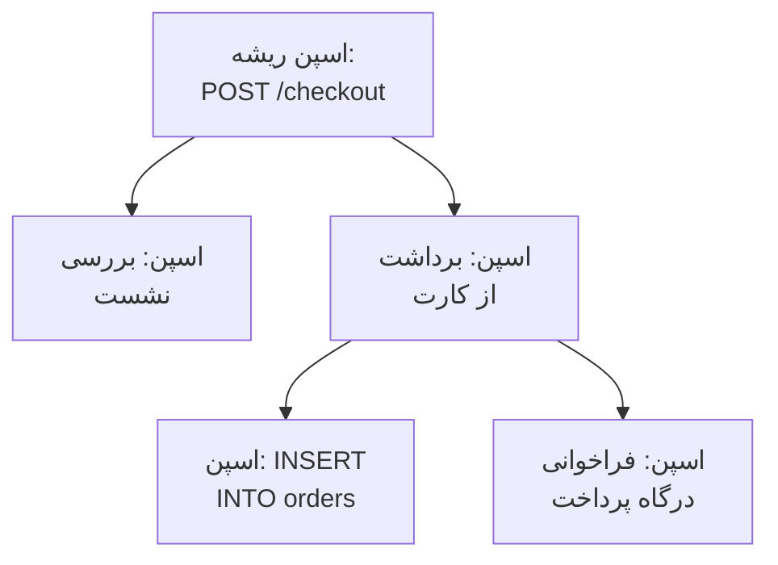

# کاوشگر ترِیس

کاوشگر ترِیس درخواست‌هایی را پیدا می‌کند که از سرویس‌هایتان گذشته‌اند: کندها، ناموفق‌ها، آن‌هایی که به حساب یک مشتری خاص دست زده‌اند. اسپن‌هایی را که سرویس‌هایتان می‌فرستند جستجو و فیلتر کنید، سپس یک ترِیس را باز کنید تا هر گام درخواست را به‌صورت آبشاری، نمودار شعله یا نقشهٔ سرویس ببینید.

:::cards
- [یافتن یک درخواست](#یافتن-یک-درخواست): اسپن‌ها را جستجو کنید، سپس بر اساس سرویس، وضعیت یا گونه فیلتر کنید.
- [خواندن یک ترِیس](#خواندن-یک-ترِیس): زمان کجا رفت، و کدام گام شکست خورد.
- [نمودار گرفتن از اسپن‌ها](#نمودار-گرفتن-از-اسپنها): شمار درخواست‌ها و زمان‌های پاسخ، به گروه‌بندی دلخواه شما.
- [بینش‌های ترِیس](#بینشهای-ترِیس): نرخ خطا، تأخیر و کندترین درخواست‌ها.
:::

## ترِیس‌ها و اسپن‌ها

یک ترِیس یک درخواست است در مسیرش از میان سیستم شما. هر گامی که برمی‌دارد، مانند یک هندلر HTTP، یک کوئری پایگاه داده یا فراخوانی سرویسی دیگر، یک اسپن است، و اسپن‌ها درون اسپن‌هایی که آن‌ها را آغاز کرده‌اند تودرتو می‌شوند. نخستین اسپن یک ترِیس، که والدی ندارد، اسپن ریشهٔ آن است: نقطهٔ ورود درخواست.

هر ردیف کاوشگر یک اسپن است، پس یک سرویس پرکار فهرست را با کوئری‌های پایگاه داده و فراخوانی‌های داخلی‌اش پر می‌کند. برای نشان دادن یک ردیف برای هر درخواست، در نوار کناری زیر **نوع اسپن** گزینهٔ **Root spans** را انتخاب کنید.

کاوشگر چهار زبانه دارد:

| زبانه | برای چیست |
| --- | --- |
| **بیننده** | اسپن‌ها را جستجو و فیلتر کنید، و ترِیس‌هایشان را باز کنید. روی یک ساعت گذشته باز می‌شود، تازه‌ترین‌ها اول، ۵۰ اسپن در هر صفحه. |
| **بینش‌ها** | نرخ درخواست، نرخ خطا و تأخیر هر سرویس، و درخواست‌هایی که ارزش نگاه کردن دارند. |
| **راهنمای راه‌اندازی** | چگونه با یکی از [کلیدهای دریافت داده‌تان](/docs/telemetry/ingestion-keys) ترِیس‌ها را با OpenTelemetry بفرستید. |
| **تنظیمات** | با رسیدن اسپن‌ها چه بر سرشان می‌آید: **خطوط لوله**، **فیلترهای حذف**، **قواعد پالایش** و **قواعد ضبط**. |

## پیش از شروع

- **ترِیس‌های در حال رسیدن.** سرویس‌هایتان را با [OpenTelemetry](/docs/telemetry/open-telemetry) ابزارگذاری کنید. زبانهٔ **راهنمای راه‌اندازی** کد زبان شما را نشان می‌دهد.
- **نقشی که تله‌متری را بخواند.** Project Owner، Project Admin، Project Member، Viewer، Telemetry Admin، Telemetry Member یا Telemetry Viewer، یا یک نقش سفارشی با مجوز Read Telemetry Service Traces. دامنهٔ آن تعیین می‌کند اسپن‌های چه کسانی را می‌بینید: [تله‌متری](/docs/permissions/index#تلهمتری) را ببینید.

## یافتن یک درخواست

:::steps
### بیننده را باز کنید

به **محصولات** > **مشاهده‌پذیری** > **ترِیس‌ها** بروید. **بیننده** اسپن‌های یک ساعت گذشته را، تازه‌ترین‌ها اول، هر کدام با وضعیت، سرویس، نام و مدت‌زمانش فهرست می‌کند.

### بازهٔ زمانی را انتخاب کنید

بازه‌ای را در انتخابگر زمان برگزینید، یا روی نمودار بالای فهرست بکشید تا روی یک جهش بزرگ‌نمایی کنید. برای کوچک‌نمایی دوباره روی نمودار دوبار کلیک کنید. [بزرگ‌نمایی یک بازه زمانی](/docs/telemetry/charts-and-time-ranges) را ببینید.

### جستجو کنید

پرس‌وجویی بنویسید و Enter را بزنید، مثلاً `service:checkout status:error duration:>500`. واژه‌های تنها در نام اسپن‌ها جستجو می‌کنند، و `@key:value` در یک ویژگی جستجو می‌کند، مانند `@http.route:/orders`. [نحو جستجو](/docs/telemetry/search-syntax#ترِیسها) را ببینید.

### با فیلترها محدودش کنید

روی مقداری در نوار کناری **فیلترها** کلیک کنید تا به‌صورت یک نشان افزوده شود. نوار کناری بر اساس **سرویس**، میزبان، خوشه یا منبع دیگری که اسپن را فرستاده، **وضعیت**، **نوع اسپن**، **استثنا دارد**، **گونه اسپن**، **نام اسپن**، **Service Instance** و **نام میزبان** فیلتر می‌کند.

### یک اسپن را باز کنید

روی یک ردیف کلیک کنید تا باز شود: ویژگی‌هایش، و لاگ‌ها و استثناهایی که ثبت کرده است. روی **See full trace** کلیک کنید تا کل ترِیس آن باز شود.
:::

جستجو، نشان‌ها و بازهٔ زمانی شما در نشانی صفحه نگه داشته می‌شوند، پس تازه‌سازی، نشانک یا پیوندی که به اشتراک گذاشته‌اید همان اسپن‌ها را باز می‌کند.

## خواندن یک ترِیس

صفحهٔ یک ترِیس با شماره‌های درخواست آغاز می‌شود:

| شماره | چیست |
| --- | --- |
| مدت‌زمان | کل درخواست چقدر طول کشید. |
| اسپن‌ها | ترِیس چند اسپن دارد. |
| سرویس‌ها | درخواست از چند سرویس گذشت. |
| خطاها | چند اسپن با وضعیت خطا پایان یافتند. برای نشان دادن فقط آن‌ها رویش کلیک کنید. |
| عمق | عمیق‌ترین زنجیرهٔ اسپن‌های تودرتو. |

زیر آن‌ها، یکی از چهار نما را انتخاب کنید:

| نما | چه نشان می‌دهد |
| --- | --- |
| **Waterfall** | هر اسپن روی یک خط زمانی، تودرتو زیر اسپنی که آغازش کرد. **Critical path** را روشن کنید تا زنجیرهٔ اسپن‌هایی که مدت درخواست را تعیین کردند برجسته شود. |
| **نمودار شعله** | همان درخت به‌صورت نوارهای روی هم، که پهن‌ترین نوارها بیشترین زمان را گرفته‌اند. |
| **Service map** | سرویس‌هایی که درخواست از آن‌ها گذشت، و فراخوانی‌های میانشان. |
| **Operations** | یک ردیف برای هر سرویس و نام اسپن، با فراخوانی‌ها، خطاها، زمان خودی و زمان کل. عملیاتی که ۱۰ بار یا بیشتر از یک اسپن والد فراخوانده شده علامت می‌خورد: اغلب یک کوئری N+1 یا حلقه‌ای که می‌شد دسته‌ای اجرایش کرد. |

در هر نما روی یک اسپن کلیک کنید تا پنلش باز شود، با زبانه‌هایی برای ویژگی‌ها، رویدادها، لاگ‌ها، استثناها و پیوندهایش، و پروفایل یا فراخوانی LLM آن وقتی داشته باشد. اسپن‌های ترِیس را با جعبهٔ جستجوی کنار نماها (`/` را بزنید) بر اساس نام، شناسه یا سرویس جستجو کنید، و **Errors only** را روشن کنید تا فقط اسپن‌های ناموفق بمانند.

یک ترِیس بزرگ هر بار ۵۰۰ اسپن بار می‌کند. برای بار کردن بیشتر، یا همه، روی دکمهٔ پایین ترِیس کلیک کنید.

> [!TIP]
> **Fix performance with AI** فقط روی ترِیسی ظاهر می‌شود که ارزش اصلاح دارد: ترِیسی با یک کوئری N+1، فراخوانی‌هایی که پشت سر هم انجام شده‌اند اما می‌توانستند هم‌زمان اجرا شوند، یا یک فراخوانی که بیشترِ درخواست را می‌گیرد، وقتی این واقعاً زمان می‌برد (۱۰۰ میلی‌ثانیه یا بیشتر برای همهٔ فراخوانی‌ها با هم، ۵۰۰ میلی‌ثانیه یا بیشتر برای یک فراخوانی تنها، و دست‌کم یک‌دهم درخواست). آنچه را پیدا کرده نام می‌برد، مثلاً «همان کوئری پایگاه داده در ReportService.build، ۴۰ بار اجرا شد»، و یک وظیفهٔ هوش مصنوعی را آغاز می‌کند که برای اصلاحش یک pull request باز می‌کند. [کد](/docs/ai/ai-agent) را ببینید.

## نمودار گرفتن از اسپن‌ها

نمودار بالای فهرست شمار اسپن‌ها را در طول زمان، به تفکیک وضعیت، رسم می‌کند. در سربرگ نمودار سنجهٔ دیگری انتخاب کنید تا به‌جای آن میانگین، میانه (P50) یا P95 زمان پاسخ آن‌ها رسم شود.

برای بیشتر، فهرست را از **اسپن‌ها** به **Analytics** ببرید. یک سری زمانی، یک فهرست برترین‌ها یا یک جدول انتخاب کنید؛ شمار درخواست‌ها، شمار خطاها یا زمان‌های پاسخ (میانگین، P50، P90، P95، P99، کمینه یا بیشینه) را بسنجید؛ و بر اساس نام اسپن، سرویس، وضعیت، گونهٔ اسپن یا هر ویژگی گروه کنید، سپس بر اساس یک فیلد دوم. یک فهرست برترین‌ها یا جدول ۵ تا ۱۰۰ گروه برتر را نشان می‌دهد.

## دنبال کردن، ذخیره و اشتراک‌گذاری

- روی **متوقف‌شده** بالای فهرست کلیک کنید تا به‌روزرسانی زنده روشن شود. سپس دکمه **Live** را نشان می‌دهد، و فهرست هر ۱۰ ثانیه اسپن‌های تازه را بررسی می‌کند. برای توقف دوباره رویش کلیک کنید.
- **Saved Views** یک جستجو، فیلترهایش و بازهٔ زمانی را زیر یک نام برای همهٔ افراد پروژه نگه می‌دارد. نماهای ذخیره‌شده همان‌طور کار می‌کنند که در [کاوشگر لاگ](/docs/telemetry/logs-explorer#ذخیرهٔ-یک-نما).
- دکمه‌های **لاگ‌ها** و **متریک‌ها** آن کاوشگرها را برای همان پنجرهٔ زمانی باز می‌کنند، با هر اندازه از فیلترهای شما که بتوانند به کار ببرند. نشانگر را روی یک دکمه ببرید تا ببینید چه چیزی را نمی‌تواند با خود ببرد.

## بینش‌های ترِیس

زبانهٔ **بینش‌ها** درخواست‌های یک بازهٔ زمانی را خلاصه می‌کند:

- شمار درخواست‌ها، نرخ خطا، و تأخیر P50، P95 و P99؛
- جدول سلامت سرویس‌هایتان، مرتب‌شده بر اساس نرخ خطا، تا سرویس‌هایی که نیاز به توجه دارند اول بیایند؛
- تازه‌ترین درخواست‌های ناموفق، و کندترین‌ها.

با فهرست کشویی کنار انتخابگر زمان آن را به برخی سرویس‌ها محدود کنید.

## با رسیدن اسپن‌ها چه بر سرشان می‌آید

زبانهٔ **تنظیمات** قواعدی را در خود دارد که OneUptime با رسیدن اسپن‌ها روی آن‌ها اعمال می‌کند، همان‌طور که برای لاگ‌ها. این قواعد روی اسپن‌هایی اثر می‌گذارند که پس از آن می‌رسند، نه روی اسپن‌های ذخیره‌شده. اینکه هر اسپن چه مدت نگه داشته شود هم هنگام رسیدنش تعیین می‌شود: [نگهداری داده](/docs/telemetry/data-retention) را ببینید.

| قاعده | چه می‌کند |
| --- | --- |
| **فیلترهای حذف** | اسپن‌هایی را که نمی‌خواهید نگه دارید دور بریزید، یا نمونه‌ای از آن‌ها را نگه دارید. [حذف یا نمونه‌برداری رکوردها](/docs/telemetry/drop-filters-and-scrub-rules#حذف-یا-نمونهبرداری-رکوردها) را ببینید. |
| **قواعد پالایش** | داده‌های حساس را در ویژگی‌های اسپن بپوشانید. [پالایش داده‌های حساس](/docs/telemetry/drop-filters-and-scrub-rules#پالایش-دادههای-حساس) را ببینید. |
| **خطوط لوله** | اسپن‌ها را تغییر دهید و غنی کنید: هر خط لوله اسپن‌ها را با یک فیلتر برمی‌گزیند، سپس پردازشگرهایش را به ترتیب اجرا می‌کند. |
| **قواعد ضبط** | شمار اسپن‌ها، شمار خطاها و مدت‌زمان‌ها را هر دقیقه به متریک‌های تازه تبدیل کنید. [قواعد ضبط لاگ](/docs/telemetry/log-recording-rules) را ببینید. |

## عیب‌یابی

:::details یک ترِیس می‌گوید هیچ اسپنی پیدا نشد
اسپن‌ها معمولاً ظرف یک دقیقه پس از پایان درخواست می‌رسند. روی **تازه‌سازی** در صفحهٔ ترِیس کلیک کنید تا دوباره بررسی شود.
:::

:::details برخی اسپن‌ها در بالاترین سطح آبشار قرار دارند
آن‌ها به اسپن والدی اشاره می‌کنند که OneUptime دریافت نکرده است، اغلب چون سرویسی که والد را نوشته هنوز ترِیس به OneUptime نمی‌فرستد. آن سرویس را هم ابزارگذاری کنید.
:::

:::details فهرست ردیف‌هایی بسیار بیشتر از درخواست‌ها نشان می‌دهد
هر ردیف یک اسپن است، نه یک درخواست. برای نشان دادن یک ردیف برای هر درخواست، در نوار کناری زیر **نوع اسپن** گزینهٔ **Root spans** را انتخاب کنید.
:::

## گام‌های بعدی

:::cards
- [نحو جستجو](/docs/telemetry/search-syntax): همهٔ فیلترهایی که جعبهٔ جستجو می‌فهمد.
- [مانیتور ترِیس‌ها](/docs/monitor/traces-monitor): برای درخواست‌های ناموفق یا کند هشدار بگیرید.
- [ردیابی استثناها](/docs/telemetry/exceptions): خطاهایی را که اسپن‌هایتان ثبت می‌کنند دسته‌بندی کنید.
- [کاوشگر لاگ](/docs/telemetry/logs-explorer): خط‌های لاگی را که یک درخواست نوشته بخوانید.
:::
