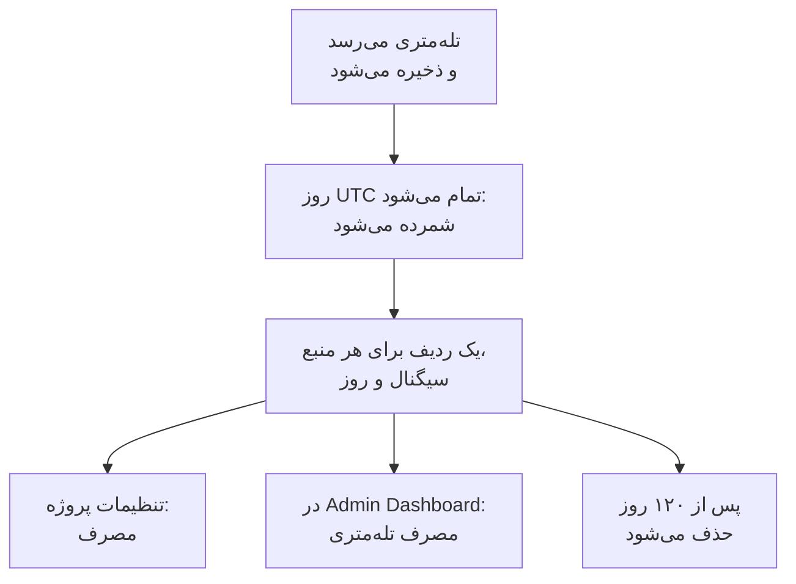

# مصرف تله‌متری

ببینید هر پروژه، و هر سرویس یا منبع در آن، چه مقدار تله‌متری می‌فرستد: لاگ‌ها، متریک‌ها، ترِیس‌ها، استثناها، پروفایل‌ها، بازپخش‌های نشست و رویدادهای امنیتی. مصرف در هر نصب OneUptime شمرده می‌شود، با صورت‌حساب یا بدون آن، تا بتوانید بدون پرس‌وجو از ClickHouse بفهمید چه چیزی فضای ذخیره‌سازی‌تان را پر می‌کند.

:::cards
- [مصرف چگونه شمرده می‌شود](#مصرف-چگونه-شمرده-میشود): روزی یک بار، برای هر منبع و سیگنال.
- [دیدن مصرف یک پروژه](#دیدن-مصرف-یک-پروژه): تنظیمات پروژه > تله‌متری و APM > مصرف.
- [دیدن مصرف همهٔ پروژه‌ها](#دیدن-مصرف-همهٔ-پروژهها): Admin Dashboard، برای مدیر نمونه.
- [مصرف چه مدت نگه داشته می‌شود](#مصرف-چه-مدت-نگه-داشته-میشود): ۱۲۰ روز، مگر اینکه تغییرش دهید.
:::

## مصرف چگونه شمرده می‌شود

روزی یک بار، پس از پایان هر روز به وقت UTC، OneUptime می‌شمارد که هر منبعِ هر پروژه در آن روز برای هر سیگنال چه فرستاده است، و این شمارش را به‌صورت یک ردیف برای هر منبع، سیگنال و روز نگه می‌دارد.



- **هر روز پس از پایانش شمرده می‌شود.** هر روز تا حدود ساعت ۰۸:۰۰ UTC روز بعد شمرده می‌شود، پس مصرف امروز فردا نمایش داده می‌شود. روزی که شمرده نشد، تا یک هفته دوباره امتحان می‌شود.
- **اندازه، اندازهٔ ذخیره‌شده است.** هر سیگنال به اندازهٔ ردیف‌هایی که در آن‌ها ذخیره شده، پیش از فشرده‌سازی، شمرده می‌شود. بازپخش‌های نشست به اندازهٔ بایت‌هایی که ضبط‌کننده‌ها بارگذاری کرده‌اند شمرده می‌شوند.
- **استثناها جداگانه نشان داده می‌شوند.** استثناهایی که از اسپن‌ها و لاگ‌ها ثبت شده‌اند جمع، ستون و بخشی از نمودار را از آنِ خود دارند، و **ترِیس‌ها** اسپن‌ها را می‌شمارد. استثناها ردیف جداگانه‌ای ندارند: هر ردیف ترِیس‌ها نشان می‌دهد چه مقدار از آن استثنا بوده است. روزی که پیش از جداگانه نشان‌دادن استثناها شمرده شده، همچنان مانند گذشته آن‌ها را درون **ترِیس‌ها** دارد.
- **پروفایل‌ها نمونه‌هایشان را در بر دارند.**
- **تله‌متری خود OneUptime شمرده نمی‌شود.** خوانش‌های مانیتور، هشدار، حادثه و SLO، خوانش‌های مشاهده‌پذیری داده و متریک‌های بودجهٔ بازپخش نشست را خود OneUptime می‌نویسد.
- **در OneUptime Cloud، هزینهٔ تله‌متری از روی همین ردیف‌ها محاسبه می‌شود.** در نصبی بدون صورت‌حساب، مصرف بی‌هزینه شمرده می‌شود و هیچ مبلغی بابت آن گرفته نمی‌شود، حتی اگر بعدها صورت‌حساب روشن شود.
- **هزینهٔ استثناها به‌عنوان بخشی از ترِیس‌ها محاسبه می‌شود.** در OneUptime Cloud، هزینهٔ ترِیس‌ها برای اسپن‌ها و استثناهایشان با هم و به قیمت ترِیس‌ها محاسبه می‌شود، همان‌طور که همیشه بوده است. جداگانه نشان‌دادن استثناها چیزی را در صورت‌حساب شما تغییر نمی‌دهد، و هرگز دو بار بابت آن‌ها مبلغی گرفته نمی‌شود.
- **بودجه جدا از مصرف شمرده می‌شود.** یک [بودجهٔ دریافت داده](/docs/telemetry/ingestion-budgets) تله‌متری را هنگام رسیدن و پس از بازگشایی فشرده‌سازی می‌شمارد، پس می‌تواند تله‌متری یک روز را در همان روز متوقف کند. تا وقتی بودجه‌ای تعیین شده باشد، این صفحه با بودجه‌های امروز باز می‌شود. استثناها بودجهٔ جداگانه‌ای ندارند: در بودجهٔ ترِیس‌ها یا لاگ‌هایی شمرده می‌شوند که درون آن‌ها می‌رسند.

## پیش از شروع

- **نقشی که تله‌متری پروژه را بخواند.** مالک پروژه، مدیر پروژه، عضو پروژه، بیننده، مدیر تله‌متری، عضو تله‌متری یا بیننده تله‌متری، یا یکی از نقش‌های صورت‌حساب. نقش باید به کل پروژه برسد: نقشی که به برخی برچسب‌ها محدود است مصرف را نشان نمی‌دهد.
- **تله‌متری در پروژه.** مصرف برای تله‌متری‌ای شمرده می‌شود که پروژه با [کلیدهای دریافت داده](/docs/telemetry/ingestion-keys) خود می‌فرستد.

## دیدن مصرف یک پروژه

:::steps
### باز کردن مصرف

به **تنظیمات پروژه** > **تله‌متری و APM** > **مصرف** بروید. **تله‌متری و APM** در منوی کناری بسته شروع می‌شود: برای باز کردنش روی آن کلیک کنید.

### انتخاب یک بازه

صفحه با **۳۰ روز گذشته** باز می‌شود. در کادر بالا سمت چپ کارت **مصرف تله‌متری**، **۷ روز گذشته** یا **۹۰ روز گذشته** را انتخاب کنید. هر بازه به دیروز ختم می‌شود، یعنی تازه‌ترین روزی که شمرده شده است.

### پیدا کردن آنچه رشد کرده

کارت **مصرف بر اساس منبع** هر سرویس و منبعی را که در این بازه چیزی فرستاده فهرست می‌کند، پرمصرف‌ترین‌ها اول. برای مرتب‌سازی بر اساس یک ستون روی عنوانش کلیک کنید، و برای باز کردن صفحهٔ یک منبع روی نامش.
:::

این صفحه سه کارت دارد:

| کارت | چه نشان می‌دهد |
| --- | --- |
| **مصرف تله‌متری** | **کل** بازه، یک جمع برای هر سیگنال، و نموداری از هر روز که سیگنال‌هایش روی هم چیده شده‌اند. |
| **مصرف بر اساس منبع** | هر **منبع** با نوعش، یک ستون برای هر سیگنال، **کل** و **نگهداری**، یعنی مدتی که تله‌متری‌اش نگه داشته می‌شود. |
| **تاریخچه مصرف تله‌متری** | یک ردیف برای هر محصول، منبع و روز، با فیلترهای **محصول**، **روز** و **سرویس**. ردیف **ترِیس‌ها** اسپن‌ها و استثناهایش را با هم نگه می‌دارد، همان‌طور که هزینهٔ ترِیس‌ها محاسبه می‌شود، و زیر **داده دریافت‌شده (به گیگابایت)** نشان می‌دهد چه مقدار از آن استثنا بوده است. |

تله‌متری‌ای که نام سرویسی را نیاورده، به‌صورت **سرویس ناشناخته** فهرست می‌شود. منبعی که از آن پس حذف شده، یا نقش شما نوع آن را نمی‌خواند، با نوعش و ابتدای شناسه‌اش فهرست می‌شود.

## چه کسی چه چیزی می‌بیند

| نقش | چه می‌بیند |
| --- | --- |
| مالک پروژه، مدیر پروژه، مدیر صورت‌حساب، عضو صورت‌حساب، بیننده صورت‌حساب، Manage Billing | هر منبع چه مقدار فرستاده و چه مدت نگه داشته می‌شود، و در OneUptime Cloud چه هزینه‌ای داشته است |
| عضو پروژه، بیننده، مدیر تله‌متری، عضو تله‌متری، بیننده تله‌متری | هر منبع چه مقدار فرستاده و چه مدت نگه داشته می‌شود |

هزینهٔ مصرف فقط در OneUptime Cloud نمایش داده می‌شود: نصبی بدون صورت‌حساب هیچ هزینه‌ای بابت آن نمی‌گیرد. برای قیمت‌ها [صورت‌حساب و مصرف](/docs/configuration/billing#تاریخچه-مصرف) را ببینید.

## دیدن مصرف همهٔ پروژه‌ها

در نصب با میزبانی شخصی، مدیر نمونه مصرف همهٔ پروژه‌ها را در Admin Dashboard می‌بیند:

:::steps
### باز کردن مصرف تله‌متری

در Admin Dashboard، منو را باز کنید و روی **مصرف تله‌متری** کلیک کنید. فهرست هر پروژه‌ای را که در این بازه چیزی فرستاده نشان می‌دهد، پرمصرف‌ترین‌ها اول، با یک ستون برای هر سیگنال و **کل**.

### پیدا کردن پرمصرف‌ترین پروژه‌ها

بازه‌ای را در بالا سمت چپ کارت انتخاب کنید، و برای مرتب‌سازی بر اساس یک ستون روی عنوانش کلیک کنید: **کل**، یک سیگنال، یا **پروژه** برای نام.

### باز کردن یک پروژه

روی نام یک پروژه کلیک کنید. صفحهٔ **مصرف تله‌متری** آن، زیر **پروژه‌ها** در Admin Dashboard، مصرفش را بر اساس روز، سیگنال و منبع نشان می‌دهد، همان‌طور که اعضایش آن را می‌بینند.
:::

## مصرف چه مدت نگه داشته می‌شود

مصرف ۱۲۰ روز نگه داشته می‌شود، مگر اینکه تغییرش دهید، چه صورت‌حساب روشن باشد چه خاموش. این مدت نگهداری شمارش‌های مصرف است، نه خود تله‌متری: برای آن [نگهداری داده](/docs/telemetry/data-retention) را ببینید.

:::steps
### باز کردن نگهداری داده

در Admin Dashboard، به **تنظیمات** > **نگهداری داده** بروید.

### تعیین شمار روزها

در کارت **نگهداری مصرف تله‌متری**، روی **ویرایش نگهداری مصرف تله‌متری** کلیک کنید، **نگهداری مصرف تله‌متری (روز)** را از ۳۰ تا ۱۰۹۵ وارد کنید و روی **ذخیره تغییرات** کلیک کنید. برای ۱۲۰ روز آن را خالی بگذارید.
:::

مصرف قدیمی‌تر از آن روزی یک بار حذف می‌شود. نگهداری هرگز کوتاه‌تر از ۳۰ روز نیست: روزی که شمرده شده هرگز حذف و دوباره شمرده نمی‌شود.

## خواندن مصرف با API

`GET /api/telemetry-usage/project` مصرف یک پروژه را در بازه‌ای از روزهای UTC برمی‌گرداند، همان‌طور که صفحه نشانش می‌دهد. آن را با یک [کلید API](/docs/permissions/index#کلیدهای-api) فراخوانی کنید که یکی از نقش‌های بالا را دارد:

```bash
curl 'https://oneuptime.com/api/telemetry-usage/project?startDay=2026-10-01&endDay=2026-10-31' \
  -H "ApiKey: $ONEUPTIME_API_KEY"
```

`startDay` و `endDay` روزهایی هستند که به‌صورت `YYYY-MM-DD` نوشته می‌شوند، هر دو شامل، و یک بازه می‌تواند تا ۱۰۹۵ روز باشد. پاسخ جمع‌ها، هر روز بر اساس سیگنال و هر منبع بر اساس سیگنال را دارد، به گیگابایت، و هزینه را فقط جایی که صورت‌حساب روشن است و کلید صورت‌حساب را می‌خواند. استثناها زیر `Exceptions` هستند، جدا از `Traces`، و روزی که پیش از جداگانه نشان‌دادن استثناها شمرده شده، آن‌ها را درون `Traces` دارد.

## عیب‌یابی

:::details صفحهٔ مصرف می‌گوید هنوز مصرف تله‌متری‌ای نیست
هر روز پس از پایانش به وقت UTC، تا حدود ساعت ۰۸:۰۰ UTC روز بعد، شمرده می‌شود: پروژه‌ای که امروز شروع به فرستادن کرده، نخستین روزش را فردا نشان می‌دهد. بررسی کنید که پروژه در کاوشگرها تله‌متری دریافت می‌کند.
:::

:::details اعداد از دیسک ClickHouse من بزرگ‌ترند
مصرف، اندازهٔ ردیف‌ها پیش از فشرده‌سازی است. ClickHouse آنچه را ذخیره می‌کند فشرده می‌کند، پس فضای دیسکی که اشغال می‌کند چند برابر کمتر است.
:::

:::details یک منبع با نوعش و یک شناسه فهرست شده است
منبع پس از فرستادن تله‌متری حذف شده است، یا نقش شما آن نوع منبع را نمی‌خواند. مصرفش همچنان شمرده می‌شود.
:::

:::details ترِیس‌ها در روز نمایان شدن استثناها کاهش یافت
استثناها پیش‌تر درون **ترِیس‌ها** شمرده می‌شدند. از نخستین روزی که استثناها جداگانه شمرده شدند، **ترِیس‌ها** اسپن‌ها را می‌شمارد و **استثناها** استثناها را. جمع این دو همان مقداری است که پیش‌تر **ترِیس‌ها** بود، و همان مقداری که هزینهٔ ترِیس‌ها بر اساس آن محاسبه می‌شود.
:::

## گام‌های بعدی

:::cards
- [فیلترهای حذف و قواعد پالایش](/docs/telemetry/drop-filters-and-scrub-rules): ذخیرهٔ تله‌متری‌ای را که لازم ندارید متوقف کنید.
- [نگهداری داده](/docs/telemetry/data-retention): تله‌متری را تا وقتی لازم دارید نگه دارید، نه بیشتر.
- [صورت‌حساب و مصرف](/docs/configuration/billing): هزینهٔ تله‌متری در OneUptime Cloud.
- [کلیدهای دریافت داده](/docs/telemetry/ingestion-keys): تله‌متری را به پروژه‌تان بفرستید.
- [بودجه‌های دریافت داده](/docs/telemetry/ingestion-budgets): برای اینکه یک پروژه در یک روز از هر سیگنال چه مقدار بفرستد سقف بگذارید.
:::
