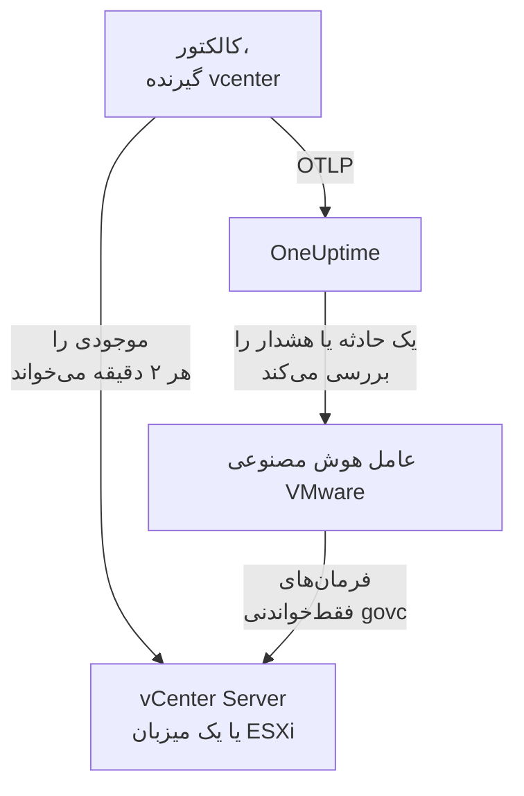

# عامل VMware

عامل VMware در OneUptime، VMware vSphere را زیر نظر دارد: vCenter Server، میزبان‌های ESXi، ماشین‌های مجازی، دیتااستورها، خوشه‌ها، استخرهای منبع و vSAN. این عامل یک OpenTelemetry Collector استاندارد است که [گیرنده `vcenter`](https://github.com/open-telemetry/opentelemetry-collector-contrib/tree/main/receiver/vcenterreceiver) آن با یک کاربر فقط‌خواندنی API در vSphere را می‌خواند، هر متریک را با نام vCenter شما مُهر می‌زند و آن را به OneUptime می‌فرستد: نه افزونه‌ای روی vCenter و نه چیزی درون VMها. [مانیتورهای VMware](/docs/monitor/vmware-monitor) بر پایه آنچه می‌رسد هشدار می‌دهند.

:::cards
- [نصب عامل](#نصب-عامل): یک کاربر فقط‌خواندنی، سپس اسکریپت نصب، Docker Compose یا systemd.
- [آنچه عامل جمع می‌کند](#آنچه-عامل-گردآوری-میکند): هر شیء vSphere، هویت آن و متریک‌هایش.
- [عامل هوش مصنوعی](#عامل-هوش-مصنوعی): بگذارید OneUptime AI هنگام بررسی، vCenter را بخواند.
- [رفع اشکال](#رفع-اشکال): یک اسکریپت تشخیصی، و مشکلات معمول.
:::

## چگونه کار می‌کند

هر عامل یک نقطه پایانی vSphere را زیر نظر دارد: یک **vCenter Server** که هر دیتاسنتر، خوشه و میزبانی را که مدیریت می‌کند پوشش می‌دهد، یا یک **میزبان ESXi مستقل** که هیچ vCenterی آن را مدیریت نمی‌کند. به ازای هر vCenter یک عامل اجرا کنید. کالکتور در هر نوبت جمع‌آوری یک بار کل موجودی را می‌پیماید (به‌طور پیش‌فرض هر ۲ دقیقه) و به ازای هر شیء یک منبع می‌فرستد. همان فایل Compose، عامل هوش مصنوعی VMware را هم برای OneUptime AI در کنار آن اجرا می‌کند. ترجیح می‌دهید Docker اجرا نکنید؟ همین کالکتور، با همین پیکربندی، روی هر ماشین Linux به‌صورت سرویس systemd هم اجرا می‌شود.



vCenter با نخستین داده‌هایش، با نامی که عامل به‌صورت `vmware.vcenter.name` روی هر متریک مُهر می‌زند، خود را ثبت می‌کند. برای پایش یک vCenter بی‌آنکه اصلاً عاملی اجرا کنید، [VMware بدون عامل](/docs/telemetry/vmware-agentless) را ببینید: یکی از پراب‌های شما همین داده‌ها را با یک حساب فقط‌خواندنی جمع می‌کند.

## پیش از شروع

- Docker Engine 20.10 یا بعد از آن با افزونه Docker Compose v2، یا برای نصب بدون Docker، یک ماشین Linux (x86_64 یا arm64) با systemd 235 یا بعد از آن. در هر دو حالت، ماشین باید از طریق HTTPS (TCP 443) به vCenter برسد.
- vCenter Server یا ESXi 7.0 یا بعد از آن: گیرنده از vSphere 7 و 8 پشتیبانی می‌کند.
- حسابی که بتواند یک کاربر vSphere بسازد و روی شیء vCenter در بالاترین سطح به آن نقشی بدهد.
- یک کلید دریافت داده. آن را زیر **تنظیمات پروژه** > **تله‌متری و APM** > **کلیدهای دریافت داده** بسازید و مقدارش را کپی کنید.

### عامل را کجا اجرا کنید

عامل از طریق HTTPS با vCenter صحبت می‌کند، پس لازم نیست نزدیک آن اجرا شود، و بهتر است نه روی vCenter Server Appliance اجرا شود و نه در VMای روی خوشه‌ای که زیر نظر دارد: اگر آن خوشه از کار بیفتد، پایش شما هم با آن از کار می‌افتد. یک VM مدیریتی کوچک روی سخت‌افزار جداگانه، یک میزبان پایش، یا هر ماشینی که Docker اجرا کند (یا بدون Docker، هر ماشین Linux با systemd) و روی TCP 443 به vCenter برسد، جای درستی است. شنونده اختیاری syslog همچنین نیاز دارد که میزبان‌های ESXi روی پورت syslog به عامل برسند ([ارسال syslog در ESXi](#اختیاری-ارسال-syslog-در-esxi) را ببینید).

## نصب عامل

:::steps
### کاربر فقط‌خواندنی vSphere را بسازید

عامل فقط می‌خواند: موجودی، شمارنده‌های کارایی و آمار vSAN. به آن یک حساب ویژه با نقش داخلی **Read-Only** بدهید، هرگز یک مدیر.

:::tabs
@tab vSphere Client
1. حساب را بسازید: _Menu → Administration → Single Sign On → Users and Groups_ را باز کنید، دامنه `vsphere.local` (یا منبع هویت خودتان) را برگزینید، روی **Add** کلیک کنید، نام کاربر را `oneuptime` بگذارید و یک گذرواژه تعیین کنید. در این صورت کاربر `oneuptime@vsphere.local` است.
2. نقش را بدهید: شیء **vCenter Server** در بالاترین سطح را در موجودی _Hosts and Clusters_ برگزینید، زبانه **Permissions** را باز کنید، روی **Add** کلیک کنید، کاربر را برگزینید، نقش را **Read-Only** بگذارید و **Propagate to children** را تیک بزنید.
@tab govc
از ماشینی با اعتبارنامه‌های مدیر:

```bash
govc sso.user.create -p 'a-strong-password' -R ReadOnly oneuptime
govc permissions.set -principal oneuptime@vsphere.local -role ReadOnly -propagate=true /
```
@tab PowerCLI
از نشستی که به‌عنوان مدیر به vCenter وصل است:

```powershell
New-SsoPersonUser -UserName oneuptime -Password 'a-strong-password'
New-VIPermission -Entity (Get-Folder -NoRecursion) -Principal 'VSPHERE.LOCAL\oneuptime' -Role ReadOnly -Propagate:$true
```
@tab ESXi Host Client
برای یک میزبان ESXi مستقل (بدون vCenter)، کاربر را زیر _Host → Manage → Security & Users → Users_ بسازید و نقش Read-Only را زیر _Host → Manage → Security & Users → Permissions_ به آن بدهید. یا در پوسته میزبان، `esxcli system account add` و سپس `esxcli system permission set --id oneuptime --role ReadOnly` را اجرا کنید.
:::

> [!IMPORTANT]
> انتشار همان بخشی است که از چشم می‌افتد. گیرنده دیتاسنترها، خوشه‌ها، میزبان‌ها، VMها، دیتااستورها و استخرهای منبع را می‌پیماید، و هر شیئی که کاربر نتواند ببیند بی‌صدا کنار گذاشته می‌شود. نقش Read-Only که روی شیء vCenter _بدون_ انتشار داده شود، موجودی‌ای خالی و داشبوردی پر از صفر به دست می‌دهد.

### عامل را نصب و اجرا کنید

:::tabs
@tab install.sh
اسکریپت نصب را دانلود کنید و روی ماشینی که میزبان عامل خواهد بود اجرا کنید:

```bash
curl -sSL https://raw.githubusercontent.com/OneUptime/oneuptime/master/agents/VMwareAgent/install.sh -o install.sh
bash install.sh
```

اسکریپت نشانی OneUptime شما، کلید دریافت داده، نامی برای vCenter، نقطه پایانی vCenter و اعتبارنامه‌های فقط‌خواندنی (گذرواژه را بی‌نمایش می‌خواند) را می‌پرسد، و اینکه آیا عامل هوش مصنوعی می‌تواند اصلاح‌ها را اعمال کند (اگر بله، یک کاربر vSphere ویژه خودش و VMهایی را که هرگز نباید تغییر دهد). در `/opt/oneuptime-vmware-agent` نصب می‌کند، یک فایل با مجوز `0600` به نام `.env` می‌نویسد و عامل را با Docker Compose راه می‌اندازد. هر مقدار را همان‌طور که تایپ کرده‌اید برای Docker Compose درون نقل‌قول می‌گذارد، پس گذرواژه‌ای با `$`، `#`، فاصله یا نقل‌قول همان‌طور که تایپ شده کار می‌کند. اجرای دوباره اسکریپت به‌جای پرسیدن دوباره، همه‌چیز را از `.env` موجود دوباره به کار می‌برد، و [به‌روزرسانی عامل](#بهروزرسانی-عامل) هم همین‌گونه است.
@tab Docker Compose
`docker-compose.yml` و `otel-collector-config.yaml` را از [پوشه VMwareAgent](https://github.com/OneUptime/oneuptime/tree/master/agents/VMwareAgent) در یک پوشه تازه دانلود کنید، سپس کنار آن‌ها یک فایل `.env` بسازید. گذرواژه را در خود دارد، پس با `chmod 600 .env` خصوصی‌اش نگه دارید:

```bash title=".env"
ONEUPTIME_URL=YOUR_ONEUPTIME_URL
ONEUPTIME_TELEMETRY_INGESTION_KEY=YOUR_TELEMETRY_INGESTION_TOKEN
VMWARE_VCENTER_NAME=my-vcenter
VCENTER_ENDPOINT=https://vcsa.example.com
VCENTER_USERNAME=oneuptime@vsphere.local
VCENTER_PASSWORD=a-strong-password
VCENTER_INSECURE_SKIP_VERIFY=true
VCENTER_COLLECTION_INTERVAL=2m
```

گذرواژه‌ای با `$`، `#`، فاصله یا نقل‌قول درون نقل‌قول تکی می‌رود ([vCenter ورود را رد می‌کند](#رفع-اشکال) را ببینید). عامل را راه بیندازید:

```bash
docker compose up -d
```
@tab systemd
عامل به Docker نیازی ندارد: یک فایل اجرایی OpenTelemetry Collector و یک فایل پیکربندی است. روی یک ماشین Linux (x86_64 یا arm64) با systemd 235 یا بعد از آن (Ubuntu 18.04، Debian 10، RHEL 8 یا تازه‌تر)، نسخه‌ای از `otelcol-contrib` را که عامل ثابت کرده است، با همان `otel-collector-config.yaml`، به‌صورت سرویس systemd اجرا کنید. واحدی که عامل برای این کار همراه دارد، [`oneuptime-vmware-agent-native.service`](https://github.com/OneUptime/oneuptime/blob/master/agents/VMwareAgent/systemd/oneuptime-vmware-agent-native.service)، کالکتور را با یک کاربر موقت و بدون امتیاز، بدون capabilities و بدون هیچ جایی برای نوشتن اجرا می‌کند.

کالکتور، پیکربندی و واحد را دانلود کنید و در `/opt/oneuptime-vmware-agent` نصب کنید:

```bash
cd "$(mktemp -d)"
VERSION=0.161.0   # the collector release the agent pins
ARCH=$(uname -m | sed 's/x86_64/amd64/;s/aarch64/arm64/')
curl -fL -o otelcol-contrib.tar.gz \
  https://github.com/open-telemetry/opentelemetry-collector-releases/releases/download/v${VERSION}/otelcol-contrib_${VERSION}_linux_${ARCH}.tar.gz
curl -fsSLO https://raw.githubusercontent.com/OneUptime/oneuptime/master/agents/VMwareAgent/otel-collector-config.yaml
curl -fsSL -o oneuptime-vmware-agent.service \
  https://raw.githubusercontent.com/OneUptime/oneuptime/master/agents/VMwareAgent/systemd/oneuptime-vmware-agent-native.service

sudo install -d -m 0755 /opt/oneuptime-vmware-agent
sudo tar --no-same-owner --preserve-permissions -xzf otelcol-contrib.tar.gz -C /opt/oneuptime-vmware-agent otelcol-contrib
sudo install -m 0644 otel-collector-config.yaml /opt/oneuptime-vmware-agent/otel-collector-config.yaml
sudo install -m 0644 oneuptime-vmware-agent.service /etc/systemd/system/oneuptime-vmware-agent.service
```

تنظیمات در `/opt/oneuptime-vmware-agent/.env` قرار می‌گیرند: همان متغیرهای `.env` در نصب Docker. گذرواژه را در خود دارد، پس پیش از باز کردنش آن را فقط برای root خواندنی کنید:

```bash
sudo touch /opt/oneuptime-vmware-agent/.env
sudo chmod 600 /opt/oneuptime-vmware-agent/.env
sudoedit /opt/oneuptime-vmware-agent/.env
```

این را در آن بگذارید:

```bash
ONEUPTIME_URL=YOUR_ONEUPTIME_URL
ONEUPTIME_TELEMETRY_INGESTION_KEY=YOUR_TELEMETRY_INGESTION_TOKEN
VMWARE_VCENTER_NAME=my-vcenter
VCENTER_ENDPOINT=https://vcsa.example.com
VCENTER_USERNAME="oneuptime@vsphere.local"
VCENTER_PASSWORD="a-strong-password"
VCENTER_INSECURE_SKIP_VERIFY=true
VCENTER_COLLECTION_INTERVAL=2m
```

این فایل را systemd می‌خواند، نه پوسته: نام کاربری و گذرواژه را در نقل‌قول دوتایی نگه دارید و هر `\` را به‌صورت `\\` و هر `"` را به‌صورت `\"` بنویسید — `DOMAIN\user` می‌شود `"DOMAIN\\user"` — در حالی که `$`، `#`، `'` و فاصله همان‌طور که هستند می‌روند. این همان شکلی است که همه نسخه‌های systemd یکسان می‌خوانند؛ نسخه‌های قدیمی‌تر (برای نمونه نسخه RHEL 8) بک‌اسلش را حتی درون تک‌نقل‌قول هم حذف می‌کنند. سپس عامل را آغاز کنید و کاری کنید که در هر راه‌اندازی آغاز شود:

```bash
sudo systemctl daemon-reload
sudo systemctl enable oneuptime-vmware-agent
sudo systemctl restart oneuptime-vmware-agent
```

این نصب فقط کالکتور را اجرا می‌کند: [عامل هوش مصنوعی](#عامل-هوش-مصنوعی) فقط به‌صورت ایمیج کانتینر عرضه می‌شود. به ازای هر vCenter یک عامل اجرا کنید: اگر از نصب Docker کوچ می‌کنید، نخست آنجا `docker compose down` را اجرا کنید، وگرنه هر متریک دو بار می‌رسد.
:::

### نصب را بررسی کنید

بررسی کنید که عامل در حال اجراست و لاگ‌های کالکتور را بخوانید:

```bash
docker compose ps
docker logs -f oneuptime-vmware-agent
```

با systemd نصب کرده‌اید؟ به‌جای آن سرویس و ژورنال آن را بررسی کنید:

```bash
systemctl status oneuptime-vmware-agent --no-pager
sudo journalctl -u oneuptime-vmware-agent -f
```

پس از راه‌اندازی کالکتور، لاگ‌هایش باید این خط را نشان دهند:

```text
Everything is ready. Begin running and processing data.
```

### یافتن vCenter در OneUptime

تا نخستین پیمایش کامل موجودی تمام نشود چیزی فرستاده نمی‌شود، پس یک بازه جمع‌آوری صبر کنید (به‌طور پیش‌فرض ۲ دقیقه). سپس **محصولات** > **زیرساخت** > **VMware** > **همهٔ vCenterها** را باز کنید: vCenter آنجاست، همراه با دیتاسنترها، خوشه‌ها، میزبان‌های ESXi، ماشین‌های مجازی، دیتااستورها و استخرهای منبع آن.
:::

## متغیرهای محیطی

Docker Compose این‌ها را از `.env` کنار `docker-compose.yml` می‌خواند؛ نصب systemd آن‌ها را از `/opt/oneuptime-vmware-agent/.env` می‌خواند و واحد آن همان پیش‌فرض‌ها را می‌دهد.

| متغیر | الزامی | توضیح |
| --- | --- | --- |
| `ONEUPTIME_URL` | بله | نشانی OneUptime شما، مانند `https://oneuptime.com` یا نمونه خودمیزبان شما. اگر نمونه فقط HTTP دارد، از `http://` و پورتش استفاده کنید. |
| `ONEUPTIME_TELEMETRY_INGESTION_KEY` | بله | کلید دریافت داده از **تنظیمات پروژه** > **تله‌متری و APM** > **کلیدهای دریافت داده**. |
| `VMWARE_VCENTER_NAME` | بله | نام vCenter در OneUptime، که به‌صورت ویژگی منبع `vmware.vcenter.name` روی هر متریک مُهر زده می‌شود. ثابتش نگه دارید: تغییرش در آینده vCenter دومی ثبت می‌کند. پیش‌فرض آن `vmware-vcenter` است. |
| `VCENTER_ENDPOINT` | بله | طرح و میزبان vCenter Server یا یک میزبان ESXi مستقل، **بدون** `/sdk`، مانند `https://vcsa.example.com`. |
| `VCENTER_USERNAME` | بله | کاربر vSphere با نقش Read-Only، مانند `oneuptime@vsphere.local` (یا `DOMAIN\user` برای منبع هویت Active Directory). |
| `VCENTER_PASSWORD` | بله | گذرواژه آن کاربر. اگر `$`، `#`، فاصله یا نقل‌قول دارد، در `.env` نصب Docker آن را درون نقل‌قول تکی بگذارید (`install.sh` این کار را برایتان می‌کند)، و در فایل نصب systemd درون نقل‌قول دوتایی ([رفع اشکال](#رفع-اشکال) را ببینید). |
| `VCENTER_INSECURE_SKIP_VERIFY` | خیر | `true` گواهی خودامضای پیش‌فرض vCenter (VMCA) را می‌پذیرد؛ `false` اعتبارسنجی TLS را روشن نگه می‌دارد. پیش‌فرض آن `false` است. |
| `VCENTER_COLLECTION_INTERVAL` | خیر | اینکه کل موجودی هر چند وقت خوانده شود. برای vCenterهای بسیار بزرگ آن را به `5m` یا `10m` افزایش دهید. پیش‌فرض آن `2m` است. |

تنظیمات ویژه عامل هوش مصنوعی زیر [عامل هوش مصنوعی](#عامل-هوش-مصنوعی) آمده است.

## آنچه عامل گردآوری می‌کند

در هر `VCENTER_COLLECTION_INTERVAL`، گیرنده کل موجودی vSphere را می‌پیماید و به ازای هر شیء یک منبع OpenTelemetry می‌فرستد. هویت هر شیء در **ویژگی‌های منبع** آن است — `vcenter.datacenter.name`، `vcenter.cluster.name`، `vcenter.host.name`، `vcenter.vm.name` / `vcenter.vm.id`، `vcenter.datastore.name`، `vcenter.resource_pool.name` / `vcenter.resource_pool.inventory_path` — و عامل `vmware.vcenter.name` را هم روی آن می‌افزاید، پس OneUptime همه‌چیز را زیر vCenter شما بایگانی می‌کند:

| شیء vSphere | هویت (ویژگی‌های منبع) | متریک‌ها |
| --- | --- | --- |
| دیتاسنتر | `vcenter.datacenter.name` | `vcenter.datacenter.cluster.count`، `vcenter.datacenter.host.count`، `vcenter.datacenter.vm.count`، `vcenter.datacenter.datastore.count`، `vcenter.datacenter.disk.space`، `vcenter.datacenter.cpu.limit`، `vcenter.datacenter.memory.limit` |
| خوشه | + `vcenter.cluster.name` | `vcenter.cluster.cpu.effective`، `vcenter.cluster.cpu.limit`، `vcenter.cluster.memory.effective`، `vcenter.cluster.memory.limit`، `vcenter.cluster.host.count`، `vcenter.cluster.vm.count`، `vcenter.cluster.vm_template.count`، `vcenter.cluster.vsan.*` (توان عملیاتی، عملیات، تأخیر، ازدحام) |
| میزبان ESXi | + `vcenter.host.name` (و `vcenter.cluster.name` وقتی میزبان در یک خوشه است) | `vcenter.host.cpu.usage` / `.capacity` / `.utilization` / `.reserved`، `vcenter.host.memory.usage` / `.utilization` / `.capacity`، `vcenter.host.disk.latency.avg` / `.latency.max` / `.throughput`، `vcenter.host.network.usage` / `.throughput` / `.packet.rate` / `.packet.drop.rate` / `.packet.error.rate`، `vcenter.host.vsan.*` |
| ماشین مجازی | + `vcenter.host.name`، `vcenter.vm.name`، `vcenter.vm.id` (UUID نمونه)؛ `vcenter.resource_pool.*` یا `vcenter.virtual_app.*` | `vcenter.vm.disk.usage`، `vcenter.vm.disk.utilization`، `vcenter.vm.memory.usage` / `.utilization` / `.ballooned` / `.swapped` / `.swapped_ssd`؛ فقط VMهای روشن: `vcenter.vm.cpu.usage`، `vcenter.vm.cpu.readiness`، `vcenter.vm.cpu.utilization`، `vcenter.vm.disk.latency.avg` / `.latency.max` / `.throughput`، `vcenter.vm.network.*`، `vcenter.vm.vsan.*` |
| الگوی VM | `vcenter.vm_template.name`، `vcenter.vm_template.id` | فقط `vcenter.vm.disk.usage` |
| دیتااستور | + `vcenter.datastore.name` | `vcenter.datastore.disk.usage`، `vcenter.datastore.disk.utilization` |
| استخر منبع | + `vcenter.resource_pool.name`، `vcenter.resource_pool.inventory_path` | `vcenter.resource_pool.cpu.usage` / `.cpu.shares`، `vcenter.resource_pool.memory.usage` / `.memory.shares` / `.memory.ballooned` / `.memory.swapped` / `.memory.granted` |

متریک‌های شمارش و ظرفیت بر اساس **ویژگی‌های نقطه داده** تفکیک می‌شوند، که دقیقاً همان چیزی است که در شرط‌های مانیتور بر پایه‌اش فیلتر و گروه‌بندی می‌کنید:

| ویژگی | مقادیر | همراه با |
| --- | --- | --- |
| `direction` | `read` / `write` برای دیسک، `transmitted` / `received` برای شبکه | تأخیر و توان عملیاتی دیسک، توان عملیاتی شبکه و نرخ بسته‌ها |
| `disk_state` | `available` / `used` | `vcenter.datastore.disk.usage`، `vcenter.vm.disk.usage`، `vcenter.datacenter.disk.space` |
| `status` | `red` / `yellow` / `green` / `gray` (وضعیت کلی شیء در vSphere) | `vcenter.datacenter.cluster.count` / `.host.count` / `.vm.count` |
| `power_state` | میزبان‌ها: `on` / `off` / `standby` / `unknown`؛ VMها: `on` / `off` / `suspended` / `unknown` | `vcenter.datacenter.host.count` / `.vm.count`، `vcenter.cluster.vm.count` |
| `effective` | `true` / `false` (به‌صورت رشته ذخیره می‌شوند) | `vcenter.cluster.host.count` |
| `object` | نمونه NIC، دیسک یا vCPU (مانند `vmnic0`) | سری‌های دیسک و شبکه به ازای هر دستگاه برای میزبان‌ها و VMها |
| `cpu_reservation_type` | `total` / `used` | `vcenter.host.cpu.reserved` |
| `type` | حافظه: `guest` / `host` / `overhead`، `private` / `shared`؛ vSAN: `read` / `write` / `unmap` | سری‌های حافظه استخرهای منبع، تأخیر و عملیات vSAN |

واحدها همان واحدهای OTLP خود گیرنده‌اند که OneUptime برای نمایش مقیاس‌شان می‌کند: `MHz` برای مصرف و ظرفیت CPU، `%` برای بهره‌وری و CPU ready، `MiBy` برای حافظه میزبان‌ها، VMها و استخرهای منبع، `By` برای حافظه خوشه‌ها و دیتاسنترها و همه فضای دیسک، `ms` برای تأخیر دیسک میزبان‌ها و VMها، و `us` (میکروثانیه) برای تأخیر vSAN. در شرط‌های مانیتور، ویژگی‌های هویت پیشوند `resource.` می‌گیرند (`resource.vcenter.host.name`، `resource.vmware.vcenter.name`)، در حالی که ویژگی‌های نقطه داده بدون پیشوند می‌مانند (`disk_state`، `power_state`، `status`).

`vcenter.host.memory.capacity` در نسخه بالادستی به‌طور پیش‌فرض خاموش است؛ پیکربندی همراه بسته آن را روشن می‌کند، چون OneUptime برای بهره‌وری حافظه میزبان بر آن تقسیم می‌کند. یک توضیح در `otel-collector-config.yaml` متریک‌های اختیاری دیگر را فهرست می‌کند (`vcenter.vm.cpu.time`، `vcenter.vm.memory.granted`، `vcenter.host.memory.active`، `vcenter.host.memory.ballooned`، `vcenter.host.memory.granted`، `vcenter.vm.network.broadcast.packet.rate`، `vcenter.vm.network.multicast.packet.rate`): هر کدام را به همین روش روشن کنید.

### وضعیت روشن و خاموش VM

گیرنده هیچ متریکی برای وضعیت روشن و خاموش یک VM نمی‌فرستد. این گیرنده `vcenter.vm.cpu.*` را **فقط برای VMهای روشن** می‌فرستد، پس OneUptime وضعیت را از آنچه در هر نوبت جمع‌آوری رسیده است استنباط می‌کند: VMای که متریک‌های CPU گزارش کرده **Powered on** است؛ VMای که فقط مصرف حافظه و دیسک را گزارش کرده **Powered off** است (یا معلق: vSphere اینجا این دو را از هم جدا نمی‌کند). الگوهای VM وضعیت روشن و خاموش ندارند. این کار **کل یک نوبت جمع‌آوری را یکجا** می‌خواند، و به همین دلیل پردازشگر `batch` همراه بسته یک `send_batch_size` بزرگ دارد و عمداً هیچ `send_batch_max_size` ندارد: جمع‌آوری‌ای که میان دو صدور تقسیم شود، شمارش‌های موجودی را صفر می‌کند و VMها را «خاموش» نشان می‌دهد. تنظیمات batch را همان‌طور که همراه بسته آمده نگه دارید.

## vCenter در OneUptime


صفحه **نمای کلی** نخست به این پرسش پاسخ می‌دهد که «آیا این vCenter سالم است»: میزبان‌های مؤثر، CPU و حافظه میزبان‌ها با وزن ظرفیت، پرترین دیتااستور و بدترین زمان CPU ready در VMها. وقتی چیزی افت کرده باشد، شیء مسئول را نام می‌برد، پس لازم نیست دنبالش بگردید.

### میزبان‌های ESXi


### ماشین‌های مجازی


ماشین‌های مجازی خاموش و الگوها هم فهرست می‌شوند. vCenter شمارنده‌های CPU را فقط برای VMهای روشن گزارش می‌کند، پس ستون‌های CPU آن‌ها به‌جای یک صفر گمراه‌کننده، N/A نشان می‌دهند.

### انبارداده‌ها


## اختیاری — ارسال syslog در ESXi

به‌طور پیش‌فرض عامل فقط متریک می‌فرستد، پس صفحه **لاگ‌ها** در vCenter خالی می‌ماند. میزبان‌های ESXi (و خود vCenter) می‌توانند syslog خود را به هر شنونده‌ای بفرستند، و `otel-collector-config.yaml` همراه بسته یک جفت گیرنده `syslog` در حالت توضیح دارد (TCP و UDP روی پورت ۵۵۱۴، RFC 3164: قالب خود ESXi) که به یک خط لوله `logs` در حالت توضیح وصل است و مُهر `vmware.vcenter.name` را می‌زند تا لاگ‌ها روی vCenter شما بنشینند.

:::steps
### گیرنده‌ها را روشن کنید

دو گیرنده `syslog/*` و خط لوله `logs` را در `otel-collector-config.yaml` از حالت توضیح خارج کنید.

### پورت را باز کنید

بلوک `ports:` را در `docker-compose.yml` از حالت توضیح خارج کنید تا ماشین `5514/tcp` و `5514/udp` را منتشر کند، سپس `docker compose up -d` را اجرا کنید. با systemd پورتی برای انتشار نیست، چون کالکتور روی خود ماشین گوش می‌دهد: به‌جای آن `sudo systemctl restart oneuptime-vmware-agent` را اجرا کنید. پورت را در دیوار آتش ماشین برای شبکه مدیریتی ESXi باز کنید.

### هر میزبان ESXi را به سمت عامل بفرستید

در vSphere Client میزبان را برگزینید، _Configure → System → Advanced System Settings_ را باز کنید، `Syslog.global.logHost` را ویرایش کنید و آن را روی `udp://<agent-host>:5514` (یا `tcp://<agent-host>:5514`؛ چند مقصد را با ویرگول جدا کنید) بگذارید. سپس ترافیک خروجی را زیر _Configure → System → Firewall → Edit → syslog_ مجاز کنید. یا روی هر میزبان با `esxcli`:

```bash
esxcli system syslog config set --loghost='udp://<agent-host>:5514'
esxcli system syslog reload
esxcli network firewall ruleset set --ruleset-id=syslog --enabled=true
```

با PowerCLI، برای یک خوشه کامل: `Get-VMHost | Get-AdvancedSetting -Name Syslog.global.logHost | Set-AdvancedSetting -Value 'udp://<agent-host>:5514' -Confirm:$false`.
:::

هر گیرنده syslog فقط روی یک انتقال گوش می‌دهد، به همین دلیل TCP و UDP دو گیرنده‌اند: اگر فقط یکی را لازم دارید، دیگری را در حالت توضیح بگذارید. برای syslog روی TLS (`ssl://`)، TLS را پیش از عامل خاتمه دهید؛ خود گیرنده با TCP و UDP ساده کار می‌کند. ایمیج استاندارد کالکتور syslog را همان‌طور که هست می‌خواند: به ایمیج سفارشی نیازی نیست.

## برچسب‌گذاری vCenter با برچسب‌های پروژه

ویژگی منبعی که با `oneuptime.label.` آغاز شود، به برچسب پروژه روی vCenter تبدیل می‌شود: `oneuptime.label.<dimension>=<value>` همان برچسب `<dimension>:<value>` است. ویژگی‌ها را به پردازشگر `resource` در `otel-collector-config.yaml`، کنار `vmware.vcenter.name`، بیفزایید:

```yaml
processors:
  resource:
    attributes:
      # ...existing attributes...
      - key: oneuptime.label.team
        value: platform
        action: upsert
      - key: oneuptime.label.env
        value: production
        action: upsert
```

کالکتور پیکربندی‌اش را فقط هنگام راه‌اندازی می‌خواند: `docker compose restart oneuptime-vmware-agent` را اجرا کنید، یا با systemd `sudo systemctl restart oneuptime-vmware-agent` را. سپس vCenter برچسب‌های `team:platform` و `env:production` را نشان می‌دهد. برچسب‌ها بدون توجه به بزرگی و کوچکی حروف مقایسه می‌شوند، پس برچسب موجود `Production` به‌جای تکرار دوباره به کار می‌رود، و عامل هرگز برچسبی را که کسی در OneUptime افزوده است برنمی‌دارد.

## اجرا به‌صورت یک سرویس systemd

نصب Docker هم می‌تواند زیر systemd اجرا شود، تا همراه ماشین شروع شود و اگر از کار افتاد دوباره راه‌اندازی شود. واحد آن Docker Compose را دربرمی‌گیرد و فرض می‌کند عامل در `/opt/oneuptime-vmware-agent` است، جایی که اسکریپت نصب آن را می‌گذارد:

```bash
sudo curl -fsSL https://raw.githubusercontent.com/OneUptime/oneuptime/master/agents/VMwareAgent/systemd/oneuptime-vmware-agent.service -o /etc/systemd/system/oneuptime-vmware-agent.service
sudo systemctl daemon-reload
sudo systemctl enable --now oneuptime-vmware-agent
```

نصب بدون Docker خودش از پیش یک سرویس systemd با واحد خودش است.

## به‌روزرسانی عامل

عامل نسخه کالکتوری را که فایل‌هایش ثابت کرده‌اند به‌عنوان **نسخه عامل** خود گزارش می‌دهد. وقتی این نسخه از نسخه‌ای که این انتشار OneUptime ثابت کرده قدیمی‌تر باشد، کنار آن یک نشانه هشدار نمایان می‌شود، در صفحه **نمای کلی** vCenter و در فهرست **همهٔ vCenterها**. آن را انتخاب کنید تا این فرمان‌ها را ببینید. عاملی که پیش از آنکه فایل‌هایش نسخه‌ای گزارش دهند نصب شده باشد، تا وقتی به این روش به‌روزرسانی نشود هیچ نسخه‌ای نشان نمی‌دهد.

کالکتور در `docker-compose.yml` ثابت شده است (یا بدون Docker، با نسخه‌ای که دانلود کرده‌اید) و پیکربندی‌اش فایلی کنار آن است، پس فقط کشیدن ایمیج‌ها عامل را جلو نمی‌برد:

:::tabs
@tab install.sh
`install.sh` را دوباره اجرا کنید: هر مقداری را در `.env` موجود شما دوباره به کار می‌برد (هیچ چیزی دوباره پرسیده نمی‌شود)، `docker-compose.yml` و `otel-collector-config.yaml` را تازه می‌کند و عامل را دوباره می‌سازد تا کالکتور پیکربندی تازه‌اش را بخواند.

```bash
curl -sSL https://raw.githubusercontent.com/OneUptime/oneuptime/master/agents/VMwareAgent/install.sh -o install.sh
bash install.sh
```
@tab Docker Compose
در پوشه عامل، هر دو فایل را دوباره دانلود کنید (و هر تغییری را که در آن‌ها داده بودید دوباره اعمال کنید)، سپس ایمیج‌ها را بکشید و عامل را دوباره بسازید:

```bash
curl -fsSLO https://raw.githubusercontent.com/OneUptime/oneuptime/master/agents/VMwareAgent/docker-compose.yml
curl -fsSLO https://raw.githubusercontent.com/OneUptime/oneuptime/master/agents/VMwareAgent/otel-collector-config.yaml
docker compose pull
docker compose up -d --force-recreate
```
@tab systemd
فرمان‌های نصب را دوباره اجرا کنید: نسخه‌ای را که این OneUptime ثابت کرده با تازه‌ترین `otel-collector-config.yaml` و واحد دانلود می‌کنند و `.env` شما را دست‌نخورده می‌گذارند (هر تغییری را که در پیکربندی داده بودید دوباره اعمال کنید). سپس سرویس را دوباره راه‌اندازی کنید:

```bash
cd "$(mktemp -d)"
VERSION=0.161.0   # the collector release the agent pins
ARCH=$(uname -m | sed 's/x86_64/amd64/;s/aarch64/arm64/')
curl -fL -o otelcol-contrib.tar.gz \
  https://github.com/open-telemetry/opentelemetry-collector-releases/releases/download/v${VERSION}/otelcol-contrib_${VERSION}_linux_${ARCH}.tar.gz
curl -fsSLO https://raw.githubusercontent.com/OneUptime/oneuptime/master/agents/VMwareAgent/otel-collector-config.yaml
curl -fsSL -o oneuptime-vmware-agent.service \
  https://raw.githubusercontent.com/OneUptime/oneuptime/master/agents/VMwareAgent/systemd/oneuptime-vmware-agent-native.service

sudo install -d -m 0755 /opt/oneuptime-vmware-agent
sudo tar --no-same-owner --preserve-permissions -xzf otelcol-contrib.tar.gz -C /opt/oneuptime-vmware-agent otelcol-contrib
sudo install -m 0644 otel-collector-config.yaml /opt/oneuptime-vmware-agent/otel-collector-config.yaml
sudo install -m 0644 oneuptime-vmware-agent.service /etc/systemd/system/oneuptime-vmware-agent.service
sudo systemctl daemon-reload
sudo systemctl restart oneuptime-vmware-agent
```
:::

## حذف عامل

:::tabs
@tab Docker Compose
```bash
cd /opt/oneuptime-vmware-agent
docker compose down
```
@tab systemd
```bash
sudo systemctl disable --now oneuptime-vmware-agent
sudo rm /etc/systemd/system/oneuptime-vmware-agent.service
sudo systemctl daemon-reload
sudo rm -r /opt/oneuptime-vmware-agent
```
:::

سپس اگر دیگر لازمش ندارید، دسترسی کاربر `oneuptime` را در vCenter حذف کنید، و اگر برای عامل هوش مصنوعی کاربری جداگانه ساخته‌اید، آن را هم.

## عامل هوش مصنوعی

فایل `docker-compose.yml` عامل، **عامل هوش مصنوعی VMware** را هم اجرا می‌کند: `oneuptime-vmware-ai-agent` (ایمیج `oneuptime/resource-ai-agent:release`). وقتی OneUptime AI حادثه یا هشداری را روی این vCenter بررسی می‌کند، فرمان‌های فقط‌خواندنی `govc` را از راه آن اجرا می‌کند — `govc vm.info web-01`، `govc events -n 50 /DC/vm/web-01`، `govc metric.sample -n 12 /DC/vm/web-01 cpu.usage.average` — و فقط اگر اجازه دهید، اصلاح‌هایی مانند روشن کردن دوباره یک VM را اعمال می‌کند. مانند کالکتور، با vCenter نام‌گذاری‌شده در `VMWARE_VCENTER_NAME` ثبت می‌شود و در OneUptime در صفحه **هوش مصنوعی** > **عامل هوش مصنوعی** همان vCenter دیده می‌شود.

- **بررسی‌های هوش مصنوعی به‌طور پیش‌فرض روشن‌اند.** همین که عامل وصل شود، OneUptime AI حادثه‌ها و هشدارهای این vCenter را با آن بررسی می‌کند و صفحه **نمای کلی** همان vCenter وضعیت عامل را نشان می‌دهد. برای توقف، `ONEUPTIME_AI_INVESTIGATION=false` را جایی که عامل اجرا می‌شود تنظیم کنید (**تغییر** زیر **کارهای مجاز هوش مصنوعی** در صفحه عامل هوش مصنوعی روشش را نشان می‌دهد)، یا عامل را کنار بگذارید.
- **نقش vSphere مرز سخت است.** بررسی‌ها با کاربر **Read-Only** جمع‌کننده (`VCENTER_USERNAME` / `VCENTER_PASSWORD`) وارد می‌شوند که فقط می‌تواند بخواند و هیچ چیز دیگر. اصلاح‌ها به کاربری از آنِ خود عامل هوش مصنوعی نیاز دارند که نقشش اجازه روشن و خاموش کردن و بازنشانی ماشین‌های مجازی را بدهد (`VirtualMachine.Interact.PowerOn`، `PowerOff` و `Reset`)، فقط روی پوشه‌هایی اعطا شود که هوش مصنوعی مجاز به اصلاحشان است، و به‌صورت `ONEUPTIME_AI_VCENTER_USERNAME` / `ONEUPTIME_AI_VCENTER_PASSWORD` تنظیم شود.
- **فقط‌خواندنی** است مگر آنکه `ONEUPTIME_AI_ALLOW_WRITES=true` را تنظیم کنید؛ `ONEUPTIME_AI_WRITE_TARGETS` (نام‌ها یا مسیرهای موجودی ماشین‌های مجازی و میزبان‌ها) محدود می‌کند که یک اصلاح به چه چیزی دست بزند. هرگز ماشین مجازی‌ای را که هم‌نام میزبانِ `VCENTER_ENDPOINT` است — که معمولاً خودِ دستگاه vCenter است — تغییر نمی‌دهد و دستگاه را فقط با همین نام می‌شناسد: وقتی `VCENTER_ENDPOINT` یک نشانی IP است، یا ماشین مجازی دستگاه نام دیگری دارد، آن ماشین مجازی را همراه با ماشین مجازی‌ای که عامل روی آن اجرا می‌شود در `ONEUPTIME_AI_PROTECTED_TARGETS` بگذارید. `ONEUPTIME_AI_FIXES` در همان `.env` تعیین می‌کند اصلاح‌ها چگونه اجرا شوند — `ask-for-approval` (هر اصلاح را یک نفر تأیید می‌کند)، `automatic` یا `bypass-approval` — و صفحه عامل هوش مصنوعی آن را فقط‌خواندنی نشان می‌دهد ([آنچه هوش مصنوعی مجاز است انجام دهد، به تنظیم عامل](/docs/ai/infrastructure-ai-agents#what-ai-may-do-set-by-the-agent)).
- برای تأیید گواهی vCenter به‌جای نادیده گرفتن آن، CA آن را در کانتینر سوار کنید و `VCENTER_CA_FILE` را تنظیم کنید؛ روی vCenter با چند دیتاسنتر، `GOVC_DATACENTER` را تنظیم کنید.
- با UID 1000 و بدون هیچ قابلیتی اجرا می‌شود، و هرگز عملیات مهمان، اسنپ‌شات، `esxcli` یا هر چیزی که ماشین مجازی بسازد یا نابود کند اجرا نمی‌کند. اگر از هوش مصنوعی OneUptime استفاده نمی‌کنید، سرویس `oneuptime-vmware-ai-agent` را از `docker-compose.yml` حذف کنید.
- نصب بدون Docker عامل هوش مصنوعی ندارد: این عامل فقط به‌صورت ایمیج کانتینر عرضه می‌شود. برای افزودن آن، روی هر ماشینی که به vCenter می‌رسد آن را با Docker اجرا کنید — `docker-compose.yml` را دانلود کنید، کنار آن یک `.env` با تنظیمات `/opt/oneuptime-vmware-agent/.env` بنویسید که همان‌طور که Docker Compose می‌خواهد درون نقل‌قول تکی باشند، و عامل هوش مصنوعی را به‌تنهایی با `docker compose up -d oneuptime-vmware-ai-agent` راه بیندازید (نه کالکتور را که از پیش در حال اجراست).

آنچه می‌تواند اجرا کند، اینکه اصلاح‌ها چگونه کار می‌کنند و چگونه اشکال آن را رفع کنید: [عامل‌های AI زیرساخت](/docs/ai/infrastructure-ai-agents#vmware-vcenter). README عامل فرمان‌های دقیق نقش اصلاح را دارد.

## رفع اشکال

:::details نخست اسکریپت تشخیصی را اجرا کنید
عامل با یک اسکریپت، [`troubleshoot.sh`](https://github.com/OneUptime/oneuptime/blob/master/agents/VMwareAgent/troubleshoot.sh)، عرضه می‌شود که کل زنجیره را بررسی می‌کند: محیط اجرای کانتینر، اینکه آیا vCenter پاسخ می‌دهد و اعتبارنامه‌ها را می‌پذیرد، نام vCenter که روی هر متریک مُهر زده می‌شود، شکل توکن، متریک‌های خود کالکتور، و اینکه آیا OneUptime کلید دریافت داده را می‌پذیرد. این بررسی آخر از همه مهم‌تر است. OneUptime کلید بد را با `401` رد می‌کند (`422` برای کلید غیرفعال یا کلید مرورگر)، و کالکتور هر دو را دائمی می‌داند: دسته را کنار می‌گذارد و یک خطای `Exporting failed` در لاگ می‌نویسد، که در حالی که کانتینر سالم می‌ماند آسان از چشم می‌افتد. اسکریپت از درون شبکه عامل `GET <url>/otlp/v1/validate` را می‌پرسد تا یک `200` (معتبر) یا `401` (نامعتبر) مستقیم بگیرد، روی سرورهای قدیمی‌تر به `POST /fluentd/v1/logs` برمی‌گردد، و `<VCENTER_ENDPOINT>/sdk/vimServiceVersions.xml` را هم به همین روش می‌پرسد، پس خطاهای DNS، دیوار آتش و TLS دقیقاً همان‌طور نمایان می‌شوند که کالکتور به آن‌ها برمی‌خورد.

```bash
curl -sSL https://raw.githubusercontent.com/OneUptime/oneuptime/master/agents/VMwareAgent/troubleshoot.sh -o troubleshoot.sh
bash troubleshoot.sh    # add -d <dir> if you installed outside /opt/oneuptime-vmware-agent
```

در پایان، حکمی با محتمل‌ترین علت می‌دهد.
:::

:::details نصب‌شده بدون Docker
اسکریپت تشخیصی به Docker نیاز دارد. بدون آن کالکتور روی خود ماشین اجرا می‌شود، پس همان زنجیره را مستقیم بررسی کنید: سرویس و لاگ آن، API در vCenter روی مسیر شبکه خود کالکتور، اینکه آیا OneUptime کلید دریافت داده را می‌پذیرد (`"valid":true` همراه با `"keyType":"Server"`)، و شمارنده‌های خود کالکتور، که آن‌ها را روی `127.0.0.1:8890` به‌جای `8888` ارائه می‌کند تا بتواند کنار کالکتور دیگری اجرا شود:

```bash
systemctl status oneuptime-vmware-agent --no-pager
sudo journalctl -u oneuptime-vmware-agent -n 100 --no-pager
curl -sk https://<vcenter-host>/sdk/vimServiceVersions.xml
curl -s -H "x-oneuptime-token: <key>" https://<oneuptime-host>/otlp/v1/validate
curl -s http://127.0.0.1:8890/metrics | grep -E 'otelcol_(receiver_accepted|exporter_sent|exporter_send_failed)_metric_points'
```

لاگ مانند لاگ کانتینر خوانده می‌شود، پس موارد زیر صدق می‌کنند. سرویسی که پیوسته دوباره راه‌اندازی می‌شود دلیلش را در لاگ می‌نویسد: `Failed with result 'resources'` یعنی systemd نمی‌تواند `/opt/oneuptime-vmware-agent/.env` را بخواند، و `cannot unmarshal the configuration` یا `requires positive value` یعنی مقداری در آن، مقداری نیست که کالکتور بپذیرد. systemd فایل `.env` را با قواعد خودش می‌خواند، و نسخه‌های قدیمی‌تر (برای نمونه نسخه RHEL 8) حتی درون نقل‌قول تکی هم یک بک‌اسلش را حذف می‌کنند: نام کاربری و گذرواژه را درون نقل‌قول دوتایی بگذارید، و هر `\` را به‌صورت `\\` و هر `"` را به‌صورت `\"` بنویسید، تنها شکلی که هر نسخه همان‌طور که نوشته شده می‌خواند. چون کالکتور به مخزن CA ماشین اعتماد دارد، می‌توانید اعتبارسنجی TLS را روشن نگه دارید: گواهی ریشه vCenter (فایل‌های `.0` زیر `certs/lin/` در `https://<vcenter>/certs/download.zip`) را به `/usr/local/share/ca-certificates/` با نامی با پسوند `.crt` بیفزایید و در Debian و Ubuntu `update-ca-certificates` را اجرا کنید، یا به `/etc/pki/ca-trust/source/anchors/` بیفزایید و در RHEL `update-ca-trust` را اجرا کنید، سپس سرویس را دوباره راه‌اندازی کنید.
:::

:::details هیچ vCenterی در OneUptime نمایان نمی‌شود
1. لاگ‌های کالکتور را بخوانید: `docker logs oneuptime-vmware-agent`. خطای ورود (`incorrect user name or password`، `InvalidLogin`) یعنی اعتبارنامه‌ها بد است، `x509: certificate signed by unknown authority` یعنی اعتبارسنجی TLS در برابر یک گواهی خودامضا روشن است، `connection refused` یا `no such host` یعنی `VCENTER_ENDPOINT` نادرست است، و یک `401` هنگام صدور یعنی کلید دریافت داده بد است.
2. بررسی کنید که vCenter از شبکه عامل پاسخ می‌دهد. ایمیج کالکتور نه پوسته دارد و نه curl، پس از یک کانتینر در شبکه آن بپرسید: `docker run --rm --network container:oneuptime-vmware-agent curlimages/curl -sk https://<vcenter-host>/sdk/vimServiceVersions.xml` باید یک سند XML چاپ کند که `urn:vim25` را نام می‌برد.
3. بررسی کنید که `VMWARE_VCENTER_NAME` تنظیم شده باشد: vCenter با ویژگی منبع `vmware.vcenter.name` آن پیدا می‌شود.
4. یک بازه جمع‌آوری فرصت بدهید: تا پایان نخستین پیمایش کامل فهرست موجودی چیزی فرستاده نمی‌شود.
:::

:::details vCenter قطع‌شده نشان داده می‌شود
وقتی OneUptime به مدت ۱۵ دقیقه هیچ چیزی از یک vCenter دریافت نکند، vCenter قطع‌شده می‌شود؛ OneUptime هر ۵ دقیقه بررسی می‌کند، و زمانی که خودش داده دریافت نمی‌کرد به حساب نمی‌آید. بررسی کنید که کالکتور در حال اجراست، لاگ‌هایش خطای صدور نشان نمی‌دهند و هر نوبت جمع‌آوری در `VCENTER_COLLECTION_INTERVAL` به پایان می‌رسد (مورد موجودی‌های بزرگ را در پایین ببینید). vCenter با داده‌های بعدی‌اش دوباره متصل می‌شود.
:::

:::details خطاهای x509 یا TLS
اپلاینس‌های vCenter گواهی‌ای ارائه می‌کنند که VMCA خودشان صادر کرده و هیچ ایمیج Docker به آن اعتماد ندارد. یا `VCENTER_INSECURE_SKIP_VERIFY=true` را تنظیم کنید (انتخاب عملی در یک شبکه مدیریتی خصوصی)، یا گواهی ماشین vCenter را با گواهی‌ای از یک CA جایگزین کنید که ایمیج کالکتور به آن اعتماد دارد. نقطه پایانی را **هرگز** به یک نشانی `http://` نفرستید: vCenter API خود را فقط روی HTTPS ارائه می‌کند.
:::

:::details vCenter ورود را رد می‌کند (401 یا InvalidLogin)
از نام کامل principal استفاده کنید — `oneuptime@vsphere.local`، یا `DOMAIN\user` / `user@domain.example` برای منبع هویت Active Directory — و بررسی کنید گذرواژه در `.env` چگونه نوشته شده است. Docker Compose v2 ارجاع‌های `$VAR` را در مقادیر بدون نقل‌قول و با نقل‌قول دوتایی گسترش می‌دهد و فاصله‌ای را که پس از آن `#` بیاید آغاز توضیح می‌خواند، پس گذرواژه‌ای که `$`، `#`، فاصله یا نقل‌قول دارد باید درون نقل‌قول تکی باشد — `VCENTER_PASSWORD='p@ss$word'` — که همان چیزی است که `install.sh` می‌نویسد. گذرواژه‌ای که خودش نقل‌قول تکی دارد درون نقل‌قول دوتایی می‌رود، و هر `$` به‌صورت `$$` نوشته می‌شود و `"` / `\` با بک‌اسلش گریز داده می‌شوند. حساب قفل‌شده (تلاش‌های ناموفق بیش از حد) گذرواژه درست را هم رد می‌کند: _Administration → Single Sign On → Users and Groups_ را بررسی کنید.
:::

:::details میزبان‌ها نمایان می‌شوند ولی هیچ VM، دیتااستور یا خوشه‌ای نه (NoPermission)
نقش Read-Only روی شیء vCenter بدون **Propagate to children** داده شده، یا روی شیئی محدودتر از ریشه vCenter. شیءهایی که کاربر نمی‌تواند ببیند بی‌صدا کنار گذاشته می‌شوند. مجوز را روی شیء vCenter در بالاترین سطح با انتشار روشن درست کنید؛ نوبت جمع‌آوری بعدی موجودی را پر می‌کند.
:::

:::details همه VMها خاموش نشان داده می‌شوند
وضعیت روشن و خاموش یک VM از نقطه‌های داده `vcenter.vm.cpu.*` استنباط می‌شود که در همان نوبت جمع‌آوری با نقطه‌های داده حافظه و دیسک آن می‌رسند ([وضعیت روشن و خاموش VM](#وضعیت-روشن-و-خاموش-vm) را ببینید). اگر پردازشگر `batch` را تغییر داده و یک `send_batch_max_size` افزوده‌اید، موجودی بزرگ میان چند صدور تقسیم می‌شود و نقطه‌های داده CPU در درخواستی جدا از بقیه می‌نشینند: تنظیمات batch همراه بسته را برگردانید.
:::

:::details موجودی‌های بزرگ: جمع‌آوری‌های کند، خطاهای vpxd.stats.maxQueryMetrics
هر نوبت جمع‌آوری کل موجودی را می‌پیماید و به ازای هر دسته از شیءها یک پرس‌وجوی کارایی انجام می‌دهد. برای vCenterهایی با هزاران VM:

- `VCENTER_COLLECTION_INTERVAL` را به `5m` یا `10m` افزایش دهید. جمع‌آوری‌ای که بیش از بازه طول بکشد رد می‌شود، نه هم‌پوشان، پس بازه خیلی کوتاه فقط شکاف به جا می‌گذارد.
- گیرنده به ازای هر پرس‌وجوی کارایی تا `max_query_metrics: 256` موجودیت درخواست می‌کند. vCenter این را با `vpxd.stats.maxQueryMetrics` محدود می‌کند (به‌طور پیش‌فرض 256 در vCenter 7 و 8). اگر مدیری آن را پایین آورده باشد، کالکتور `The maximum number of performance metrics per query exceeded` را در لاگ می‌نویسد: `max_query_metrics` را در `otel-collector-config.yaml` به همان اندازه پایین بیاورید، یا تنظیم vCenter را زیر _vCenter → Configure → Advanced Settings_ بالا ببرید.
- حافظه کالکتور را زیر نظر بگیرید: `memory_limiter` همراه بسته 512 MiB را مجاز می‌داند. اگر لاگ بگوید محدودکننده داده‌ها را دور می‌ریزد، `limit_mib` را بالا ببرید (و به کانتینر حافظه بیشتری بدهید).
:::

:::details پایش یک میزبان ESXi مستقل (بدون vCenter)
`VCENTER_ENDPOINT` را به خود میزبان (`https://esxi01.example.com`) بفرستید، با یک کاربر محلی ESXi که نقش Read-Only دارد. هر چه یک میزبان می‌داند جمع می‌شود: خود میزبان، VMها، دیتااستورها و استخرهای منبع آن. میزبان مستقل شیء دیتاسنتر یا خوشه ندارد، پس آن صفحه‌ها خالی می‌مانند، و REST API در vCenter هم ندارد، پس اسکریپت تشخیصی بررسی اعتبارنامه را نامشخص گزارش می‌کند (در آنجا پاسخ در لاگ کالکتور است).
:::

:::details متریک‌ها زیر vCenter نادرست می‌نشینند
OneUptime یک vCenter را با `vmware.vcenter.name` آن ثبت می‌کند، که عامل آن را از `VMWARE_VCENTER_NAME` می‌گیرد. تغییر آن پس از نخستین داده‌ها به‌جای تغییر نام vCenter نخست، vCenter دومی می‌سازد.
:::

:::details ارسال متریک‌ها بدون عامل
vSphere هیچ ارسال OpenTelemetry از خود ندارد، پس عامل (یا هر OpenTelemetry Collector با گیرنده `vcenter`) راه ورود است. اگر از پیش کالکتورهایی اجرا می‌کنید، به‌جای اجرای این عامل، گیرنده `vcenter` را به یکی از آن‌ها بیفزایید: گیرنده `vcenter` و پردازشگر `resource` را از `otel-collector-config.yaml` همراه بسته در پیکربندی خودتان کپی کنید. ویژگی منبع `vmware.vcenter.name` همان چیزی است که vCenter را در OneUptime ثبت می‌کند، و حذف‌های `service.name` / `service.instance.id` نمی‌گذارند داده‌ها زیر یک سرویس بایگانی شوند: هر دو را نگه دارید.
:::

## گام‌های بعدی

:::cards
- [مانیتور VMware](/docs/monitor/vmware-monitor): هشدار بر پایه میزبان‌ها، VMها، دیتااستورها، خوشه‌ها، دیتاسنترها و vSAN.
- [VMware بدون عامل](/docs/telemetry/vmware-agentless): به‌جای آن بگذارید یک پراب vCenter را جمع کند.
- [عامل‌های AI زیرساخت](/docs/ai/infrastructure-ai-agents): آنچه عامل هوش مصنوعی VMware می‌تواند اجرا کند، و اینکه اصلاح‌ها چگونه کار می‌کنند.
- [کالکتور OpenTelemetry روی میزبان](/docs/telemetry/host-otel-collector): نمای سیستم‌عامل درون VMها، یا از ماشین عامل.
:::
