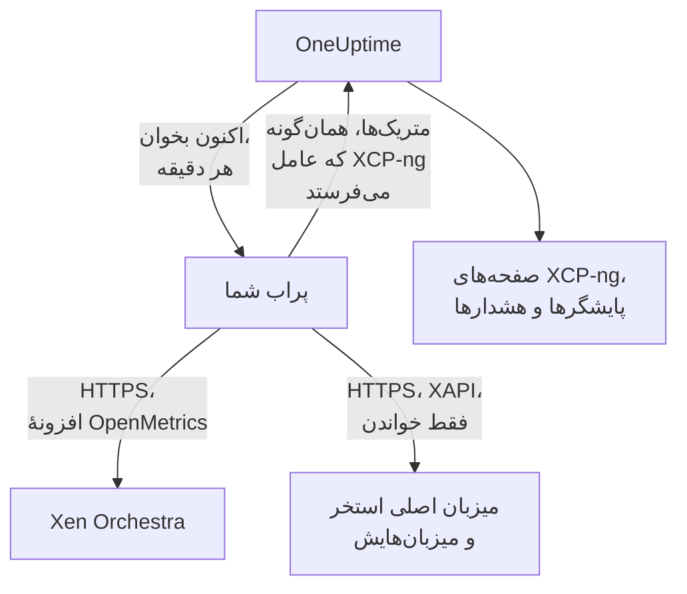

# XCP-ng بدون عامل

استخرهای XCP-ng را بدون نصب هیچ چیزی پایش کنید: یک پراب OneUptime آن‌ها را می‌خواند، یا از راه Xen Orchestraای که مدیریتشان می‌کند، یا برای استخری بدون Xen Orchestra، مستقیم از XAPI روی میزبان اصلی استخر. هر استخر همان صفحه‌ها، [پایشگرهای XCP-ng](/docs/monitor/xcp-ng-monitor) و الگوهایی را می‌گیرد که استخرِ فرستاده‌شده توسط [عامل XCP-ng](/docs/telemetry/xcp-ng) دارد. هیچ عاملی برای نصب، ارتقا یا روشن نگه‌داشتن وجود ندارد.

:::cards
- [پیش از شروع](#پیش-از-شروع): پرابی که به Xen Orchestra یا استخر برسد، و دسترسی فقط‌خواندنی.
- [اتصال Xen Orchestra](#اتصال-xen-orchestra): هر استخری که مدیریت می‌کند، از راه یک اتصال.
- [اتصال استخری بدون Xen Orchestra](#اتصال-استخری-بدون-xen-orchestra): یک استخر، خوانده‌شده از میزبان اصلی آن.
- [عیب‌یابی](#عیبیابی): معنای هر پیام و آنچه آن را درست می‌کند.
:::

## چگونه کار می‌کند

پراب هر دقیقه هر اتصال را می‌خواند و آنچه خوانده را به OneUptime می‌فرستد:

- **Xen Orchestra**: پراب افزونهٔ OpenMetrics در Xen Orchestra را با راز افزونه می‌خواند، درست همان‌گونه که عامل XCP-ng می‌خواند، پس هر استخری که Xen Orchestra مدیریت می‌کند با همان سری‌ها می‌رسد.
- **XAPI یک استخر**: پراب وارد میزبان اصلی استخر می‌شود و همان خواندن‌هایی را انجام می‌دهد که خود افزونهٔ Xen Orchestra انجام می‌دهد: رکوردهای استخر، و متریک‌های هر میزبانِ در حال اجرا که از همان میزبان خوانده می‌شود. آن‌ها را به همان سری‌هایی تبدیل می‌کند که افزونه ارائه می‌کند، پس استخر درست مانند خواندن از راه Xen Orchestra خوانده می‌شود. همچنین پیام‌های XAPI استخر، مانند ماشین مجازی‌ای که از کار افتاد یا میزبانی که HA از دست داد، را در خوراک استخر می‌گذارد.

هر استخر، مانند استخرهای عامل، با نخستین خواندنش بر اساس UUID خود ثبت می‌شود و در **XCP-ng ← همه استخرها** نمایش داده می‌شود.

## کدام روش اتصال

| | ‏Xen Orchestra، از یک پراب | ‏XAPI یک استخر، از یک پراب | عامل XCP-ng |
|---|---|---|---|
| آنچه اجرا می‌کنید | پرابی که از پیش اجرا می‌کنید، یا یک پراب تازه | پرابی که از پیش اجرا می‌کنید، یا یک پراب تازه | عامل، روی ماشینی جداگانه |
| آنچه می‌خواند | هر استخری که Xen Orchestra مدیریت می‌کند | یک استخر | هر استخری که Xen Orchestra مدیریت می‌کند |
| آنچه نیاز دارد | راز افزونهٔ OpenMetrics، و در صورت تمایل یک توکن API فقط‌خواندنی | یک حساب استخر: root، یا کاربر Active Directory با نقش read-only | راز افزونهٔ OpenMetrics |
| جای نگهداری رازها | رمزگذاری‌شده در OneUptime، فقط به پراب فرستاده می‌شود | رمزگذاری‌شده در OneUptime، فقط به پراب فرستاده می‌شود | در پروندهٔ `.env` عامل |
| پیام‌های XAPI در خوراک استخر | گنجانده نشده | گنجانده شده | گنجانده نشده |

هر سه همان سری‌ها را می‌فرستند. هر استخر در هر زمان فقط از یکی از آن‌ها خوانده می‌شود، تا هر که آن را بخواند، تاریخچه‌اش یک خط بماند.

## پیش از شروع

- **پرابی که از راه TCP 443 به نشانی برسد.** معمولاً یک [پراب سفارشی](/docs/probe/custom-probe) در همان شبکه است. در OneUptime Cloud پراب‌های مشترک هرگز رازهای XCP-ng را دریافت نمی‌کنند، پس پراب خودتان را اضافه کنید. در یک نمونهٔ خودمیزبان، پراب‌های خود نمونه هم می‌توانند بخوانند.
- **برای Xen Orchestra:** نسخهٔ 6.9 یا بالاتر Xen Orchestra با افزونهٔ OpenMetrics روشن: [روشن کردن افزونهٔ OpenMetrics](/docs/telemetry/xcp-ng#روشن-کردن-افزونه-openmetrics) را دنبال کنید و راز آن را کپی کنید. در صورت تمایل، توکن API یک کاربر Xen Orchestra با نقش داخلی **Read only**: OneUptime بررسی می‌کند که فقط بخواند، و پیش از انقضایش به شما هشدار می‌دهد.
- **برای استخری بدون Xen Orchestra:** نسخهٔ 8.2 یا بالاتر XCP-ng، و نشانی میزبان اصلی آن. نقش‌های XAPI فقط برای کاربران Active Directory اعمال می‌شوند، پس تنها حساب محلی آن، `root`، می‌تواند همه چیز را در استخر تغییر دهد. برای دسترسی فقط‌خواندنی، استخر را به Active Directory بپیوندانید و به یک کاربر نقش `read-only` بدهید.

> [!IMPORTANT]
> یک استخر را از راه Xen Orchestra یا از راه XAPI آن متصل کنید، نه هر دو: دومین اتصالی که استخری را می‌خواند، آن را به اولی می‌سپارد.

## اتصال Xen Orchestra

:::steps
### اتصال‌ها را باز کنید
در OneUptime، **XCP-ng ← اتصال‌ها** را باز کنید و روی **اتصال XCP-ng** کلیک کنید.

### Xen Orchestra را انتخاب کنید
در **چه چیزی خوانده شود**، گزینهٔ **Xen Orchestra** را انتخاب کنید. **نشانی Xen Orchestra** را وارد کنید، همان نشانی‌ای که آن را با آن در مرورگر باز می‌کنید، مانند `https://xo.example.com`، و پرابی را که به آن می‌رسد انتخاب کنید.

### راز افزونه را وارد کنید
**راز OpenMetrics** را بچسبانید. اگر **توکن API** کاربر فقط‌خواندنی را دارید، آن را هم اضافه کنید.

### اتصال را آزمایش کنید و به گواهی اعتماد کنید
روی **آزمایش اتصال** کلیک کنید. Xen Orchestra گواهی خود را خودش امضا می‌کند، پس آزمایش آن را نشان می‌دهد: اثر انگشت آن را بررسی کنید، سپس روی **اعتماد به این گواهی** کلیک کنید. نتیجه استخرهایی را که Xen Orchestra ارائه می‌کند، همراه با میزبان‌ها، ماشین‌های مجازی و مخزن‌های ذخیره‌سازی‌شان فهرست می‌کند.

### نام بگذارید و متصل کنید
نام به‌طور پیش‌فرض نام میزبان Xen Orchestra است، و هر استخری که می‌خواند آن را نشان می‌دهد. روی **اتصال XCP-ng** کلیک کنید تا صفحهٔ اتصال باز شود.
:::

## اتصال استخری بدون Xen Orchestra

:::steps
### از اتصال‌ها آغاز کنید
در OneUptime، **XCP-ng ← اتصال‌ها** را باز کنید و روی **اتصال XCP-ng** کلیک کنید.

### استخر را انتخاب کنید
در **چه چیزی خوانده شود**، گزینهٔ **استخری بدون Xen Orchestra** را انتخاب کنید. **نشانی میزبان اصلی استخر** را وارد کنید، مانند `https://10.0.0.10`، و پرابی را که به آن می‌رسد انتخاب کنید.

### حساب را وارد کنید
**نام کاربری** و **رمز عبور** را وارد کنید: `root`، یا کاربر Active Directory با نقش read-only، نوشته‌شده با دامنه‌اش، مانند `EXAMPLE\oneuptime`.

### اتصال را آزمایش کنید و به گواهی میزبان اصلی اعتماد کنید
روی **آزمایش اتصال** کلیک کنید. هر میزبان XCP-ng گواهی خود را خودش امضا می‌کند، پس آزمایش گواهی میزبان اصلی را نشان می‌دهد: اثر انگشت آن را بررسی کنید، سپس روی **اعتماد به این گواهی** کلیک کنید. نتیجه می‌گوید میزبان اصلی کدام XCP-ng را اجرا می‌کند و حساب چه چیزی را می‌تواند بخواند، و اگر حساب بتواند استخر را تغییر دهد به شما هشدار می‌دهد.

### برای استخر نام بگذارید و متصل کنید
روی **اتصال XCP-ng** کلیک کنید تا صفحهٔ اتصال باز شود.
:::

صفحهٔ اتصال نشان می‌دهد خواندن آن در چه وضعی است. تا نخستین خواندن، که ظرف یک دقیقه آغاز می‌شود، **در حال بررسی** را نشان می‌دهد، سپس **در حال جمع‌آوری**، و استخرهایی که می‌خواند در **استخرهایی که می‌خواند** نمایش داده می‌شوند.

اگر تا ۲۰ دقیقه هیچ پرابی برای اتصال نیاید، چون آفلاین است یا بیش از حد قدیمی است، صفحه **جمع‌آوری نمی‌شود** را نشان می‌دهد و همین را می‌گوید. وقتی هیچ پرابی اجازهٔ خواندن اتصال را ندارد، بی‌درنگ **جمع‌آوری نمی‌شود** را نشان می‌دهد و می‌گوید چه چیزی را باید تغییر داد: یک راز، نام کاربری یا رمز عبور وجود ندارد، هیچ پرابی برای خواندن آن تعیین نشده، پراب آن اجازهٔ خواندنش را ندارد (یک پراب مشترک در OneUptime Cloud، یا پراب پروژه‌ای دیگر)، یا پراب آن قطع است.

## استخرهایی که عامل از پیش می‌فرستد

استخری که عامل XCP-ng ثبت کرده است، به نخستین اتصالی که آن را می‌خواند سپرده می‌شود: تاریخچه‌اش به‌صورت یک خط ادامه می‌یابد، و خوراک استخر می‌گوید که عامل را می‌توان متوقف کرد.

> [!WARNING]
> همین که پرابی استخرهای عامل XCP-ng را بخواند، عامل را متوقف کنید. تا وقتی هر دو اجرا می‌شوند، هر متریک دو بار می‌رسد.

برای بازگشت، صفحهٔ **تنظیمات** استخر را باز کنید. کارت **جمع‌آوری داده** آن، برای استخری که یک پراب می‌خواند **استفاده از عامل XCP-ng** و برای استخری که عامل می‌فرستد **جمع‌آوری با پراب** را پیشنهاد می‌دهد. استخری که به عامل بازگردانده شده، نزد آن می‌ماند، هر چه اتصال بخواند.

## گواهی‌ها

پراب هرگز بررسی گواهی را نادیده نمی‌گیرد. هر اتصال یک دست‌دهی کامل TLS را به پایان می‌رساند، و سپس:

- بدون گواهی مورد اعتماد، گواهی باید از مرجعی باشد که ماشین پراب برای نشانی‌ای که وارد کرده‌اید به آن اعتماد دارد؛
- با یک گواهی مورد اعتماد، نشانی باید دقیقاً همان گواهی را ارائه کند که با اثر انگشت SHA-256 آن شناخته می‌شود، هر نامی که گواهی داشته باشد. گواهی خود Xen Orchestra هیچ نشانی‌ای را نام نمی‌برد، و به همین روش مورد اعتماد قرار می‌گیرد.

برای بررسی یک اثر انگشت، `openssl s_client -connect xo.example.com:443 </dev/null | openssl x509 -noout -fingerprint -sha256` را از ماشین پراب اجرا کنید و آن را با خود گواهی مقایسه کنید: روی میزبان اصلی استخر، `openssl x509 -noout -fingerprint -sha256 -in /etc/xensource/xapi-ssl.pem`.

برای یک استخر، شما به گواهی میزبان اصلی اعتماد می‌کنید. خود استخر گواهی‌ای را که هر یک از میزبان‌هایش ارائه می‌کند فهرست می‌کند، و پراب هر میزبان دیگر را با پیوستن به همان گواهی می‌خواند. وقتی میزبان دیگری میزبان اصلی شود، پراب فقط تا میزبانی آن را دنبال می‌کند که استخر در آخرین خواندنش ضامنش شده بود. وقتی یک گواهی تغییر کند، خواندن با **گواهی تغییر کرده است** متوقف می‌شود و گواهی تازه نمایش داده می‌شود: تا وقتی در صفحهٔ اتصال به آن اعتماد نکنید چیزی فرستاده نمی‌شود.

## رازهای ذخیره‌شده

راز، توکن و رمز عبور رمزگذاری‌شده و فقط‌نوشتنی هستند: هیچ‌کس نمی‌تواند آن‌ها را دوباره بخواند، و API هرگز آن‌ها را برنمی‌گرداند. آن‌ها فقط به پرابی فرستاده می‌شوند که اتصال را می‌خواند، و آن پراب آن‌ها را در حافظه نگه می‌دارد.

راز ذخیره‌شده فقط به همان نشانی، از راه همان پراب و به همان گواهی‌ای فرستاده می‌شود که برایشان وارد شده است. تغییر نشانی، پراب یا گواهی مورد اعتماد در **ویرایش اتصال** وارد کردن دوبارهٔ آن را لازم می‌کند، پس هیچ‌کس که بتواند اتصال را ویرایش کند نمی‌تواند آن را به جای دیگری بفرستد، و توکن API ذخیره‌شده‌ای که دوباره وارد نشود فراموش می‌شود. اعتماد به گواهی‌ای که پراب در نشانی ذخیره‌شده یافته است، آن‌ها را نگه می‌دارد. **حذف توکن API** توکن را از OneUptime حذف می‌کند: آن را در Xen Orchestra هم باطل کنید.

## توکن API

توکن API اختیاری است: متریک‌ها از راه راز افزونه می‌رسند. با یک توکن، هر خواندن آن را حداکثر ساعتی یک بار بررسی می‌کند:

- **فقط می‌خواند.** توکنی که کاربرش مدیر است، یا نقشش می‌تواند چیزی را تغییر دهد، در آزمایش رد می‌شود و در صفحهٔ اتصال به‌عنوان مشکل نمایش داده می‌شود. OneUptime فقط توکن‌های فقط‌خواندنی را نگه می‌دارد.
- **آنچه OneUptime نیاز دارد را می‌خواند.** Xen Orchestra به فهرستی که کاربری اجازهٔ خواندنش را ندارد با فهرستی خالی پاسخ می‌دهد، پس توکن باید هشدارها، پیام‌ها و گزارش‌های پشتیبان را بخواند. نقش داخلی **Read only** هر سه را می‌خواند.
- **چه زمانی منقضی می‌شود.** Xen Orchestra توکن را در همان لحظه‌ای که منقضی می‌شود فراموش می‌کند. دو هفته پیش از آن، صفحهٔ اتصال و خوراک هر استخری که می‌خواند این را می‌گویند. برای همان کاربر یک توکن تازه بسازید و آن را در **ویرایش اتصال** وارد کنید.

## مرجع

| تنظیم | پیش‌فرض | توضیحات |
|---|---|---|
| خواندن هر | ۱ دقیقه | از ۱ تا ۶۰ دقیقه. هر دقیقه با عامل XCP-ng برابر است؛ برای فشار کمتر بر یک Xen Orchestra بزرگ، آن را کمتر بخوانید. |
| خواندن‌های هم‌زمان | ۴ برای هر پراب | خواندنی که کندتر از فاصلهٔ خود باشد رد می‌شود، و هرگز روی هم انباشته نمی‌شود. |
| بزرگ‌ترین خواندن | حدود ۴۸ مبی‌بایت | ‏Xen Orchestraهای بزرگ‌تر به عامل XCP-ng نیاز دارند. |
| پیام‌های XAPI | ۲۰۰ در هر خواندن | از لحظه‌ای که استخر متصل می‌شود، هر کدام یک بار تحویل داده می‌شود، قدیمی‌ترین نخست. |
| آزمایش اتصال | ۹۰ ثانیه تا آغاز | آزمایشی که هیچ پرابی به‌موقع برش ندارد، یا بیش از ۱۵۰ ثانیه طول بکشد، ناموفق پاسخ داده می‌شود. |

## عیب‌یابی

:::details گواهی مورد اعتماد نیست
‏Xen Orchestra و میزبان‌های XCP-ng به‌طور پیش‌فرض گواهی‌های خود را امضا می‌کنند. اثر انگشت نمایش‌داده‌شده را با گواهی مقایسه کنید، سپس روی **اعتماد به این گواهی** کلیک کنید.
:::

:::details گواهی تغییر کرده است
تا وقتی به گواهی تازه اعتماد نکنید چیزی فرستاده نمی‌شود. اگر آن را تمدید کرده‌اید، اثر انگشت تازه را بررسی کنید، به آن اعتماد کنید و رازها را در **ویرایش اتصال** دوباره وارد کنید.
:::

:::details Xen Orchestra راز را رد کرد
راز را دوباره از **Settings → Plugins → openmetrics** در Xen Orchestra کپی کنید و آن را در **ویرایش اتصال** وارد کنید.
:::

:::details افزونهٔ OpenMetrics پاسخ نمی‌دهد
‏**openmetrics** را زیر **Settings → Plugins** در Xen Orchestra بارگذاری کنید، و **Auto-load** را روشن کنید تا پس از راه‌اندازی دوباره برگردد.
:::

:::details این Xen Orchestra افزونهٔ OpenMetrics ندارد
این افزونه به Xen Orchestra نسخهٔ 6.9 یا بالاتر و در Xen Orchestra Appliance به پروانهٔ Premium نیاز دارد. بدون آن، به‌جایش هر استخر را از راه XAPI آن متصل کنید.
:::

:::details هیچ استخری متصل نیست
‏Xen Orchestra هیچ استخر متصلی گزارش نمی‌کند. استخرهای خود را در Xen Orchestra اضافه یا دوباره متصل کنید، سپس دوباره آزمایش کنید.
:::

:::details توکن API می‌تواند Xen Orchestra را تغییر دهد
‏OneUptime فقط توکن‌های فقط‌خواندنی را نگه می‌دارد. برای کاربری توکن بسازید که نسخه‌ای از نقش داخلی **Read only** را دارد و نقش دیگری ندارد.
:::

:::details توکن API نمی‌تواند هشدارها، پیام‌ها یا پشتیبان‌ها را بخواند
به کاربر توکن نسخه‌ای از نقش داخلی **Read only** در Xen Orchestra بدهید که هر سه را می‌خواند.
:::

:::details توکن API منقضی شده است
در Xen Orchestra یک توکن تازه برای کاربر فقط‌خواندنی بسازید و آن را در **ویرایش اتصال** وارد کنید. در این میان متریک‌ها همچنان می‌رسند.
:::

:::details XAPI ورود را رد کرد
نام کاربری و رمز عبور را بررسی کنید. کاربر Active Directory با دامنه‌اش نوشته می‌شود، مانند `EXAMPLE\oneuptime`.
:::

:::details این میزبان، میزبان اصلی استخر نیست
عضوی از استخر با نشانی میزبان اصلی‌اش پاسخ می‌دهد که پیام آن را نام می‌برد. آن نشانی را وارد کنید و دوباره آزمایش کنید.
:::

:::details این حساب نمی‌تواند استخر را بخواند
به کاربر Active Directory نقش read-only را روی استخر بدهید، یا از حسابی استفاده کنید که این نقش را دارد.
:::

:::details پراب هیچ پاسخی نمی‌گیرد
شبکهٔ پراب نمی‌تواند از راه TCP 443 به نشانی برسد. آن را در دیوارهٔ آتش مجاز کنید، یا پرابی در همان شبکه انتخاب کنید.
:::

:::details پراب این را برنداشت
پراب آفلاین است، یا نسخه‌ای از OneUptime را اجرا می‌کند که قدیمی‌تر از خواندن XCP-ng است. در جدول **پراب‌های سفارشی** بررسی کنید که متصل باشد، و آن را به‌روزرسانی کنید.
:::

:::details این اتصال برای خوانده‌شدن از یک پراب بیش از حد بزرگ است
متریک‌های آن بزرگ‌تر از حد یک بارگذاری پراب است. برای آن از [عامل XCP-ng](/docs/telemetry/xcp-ng) استفاده کنید.
:::

## گام‌های بعدی

:::cards
- [پایشگر XCP-ng](/docs/monitor/xcp-ng-monitor): برای استخرها، میزبان‌ها، ماشین‌های مجازی و مخزن‌های ذخیره‌سازی هشدار دهید.
- [پراب سفارشی](/docs/probe/custom-probe): یک پراب در شبکهٔ استخرها اجرا کنید.
- [عامل XCP-ng](/docs/telemetry/xcp-ng): به‌جای آن Xen Orchestra را با عامل بخوانید.
:::
