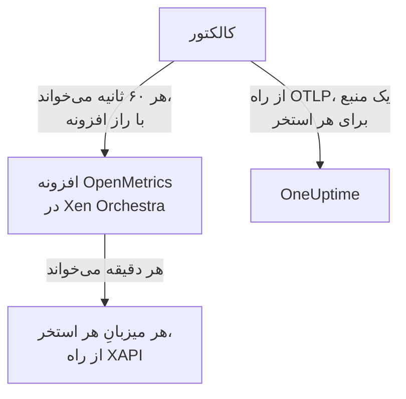

# عامل XCP-ng

عامل XCP-ng در OneUptime استخرهای XCP-ng را که یک Xen Orchestra مدیریت می‌کند پایش می‌کند: میزبان‌ها، ماشین‌های مجازی، مخزن‌های ذخیره‌سازی و دیسک‌های مجازی آن‌ها را. این عامل یک OpenTelemetry Collector استاندارد است که افزونه OpenMetrics خودِ Xen Orchestra را با راز افزونه می‌خواند و آنچه را می‌خواند به OneUptime می‌فرستد، جایی که هر استخر با موجودی‌اش نمایان می‌شود. هیچ گذرواژه‌ای از یک استخر یا از Xen Orchestra هرگز به عامل نمی‌رسد. [مانیتورهای XCP-ng](/docs/monitor/xcp-ng-monitor) بر پایه داده‌ای که می‌رسد هشدار می‌دهند.

:::cards
- [نصب عامل](#نصب-عامل): افزونه را روشن کنید، سپس از اسکریپت نصب یا Docker Compose استفاده کنید.
- [گواهی Xen Orchestra](#گواهی-xen-orchestra): عامل چگونه به Xen Orchestra اعتماد می‌کند، بی‌آنکه هرگز بررسی را کنار بگذارد.
- [آنچه عامل گردآوری می‌کند](#آنچه-عامل-گردآوری-میکند): هر سری افزونه، و شمارنده‌هایی که در واقع نرخ‌اند.
- [رفع اشکال](#رفع-اشکال): یک اسکریپت تشخیصی، و مشکلات معمول.
:::

## چه به دست می‌آورید

- **هر استخر جداگانه.** هر استخری که Xen Orchestra مدیریت می‌کند در OneUptime یک استخر XCP-ng می‌شود که با UUID خود در XAPI شناخته می‌شود و همان نامی را می‌گیرد که Xen Orchestra به آن می‌دهد. دو استخر پشت یک Xen Orchestra دو استخرند، و تغییر نام یک استخر در OneUptime بی‌خطر است: تله‌متری از راه UUID به آن وصل می‌شود.
- **موجودی آن.** میزبان‌ها، ماشین‌های مجازی، مخزن‌های ذخیره‌سازی و دیسک‌های مجازی استخر، همراه با وضعیت و متریک‌هایشان. دامنه‌های کنترلی (dom0) خود را به‌صورت ماشین مجازی گزارش می‌کنند، و صفحه‌های استخر آن‌ها را پنهان می‌کنند مگر اینکه نمایششان را بخواهید.
- **یک عامل برای هر Xen Orchestra.** افزونه هر استخری را که Xen Orchestra آن به آن متصل است ارائه می‌کند، پس یک عامل همه را می‌خواند، و استخری که بعداً متصل شود در خواندن بعدی پدیدار می‌شود.

## چگونه کار می‌کند

عامل یک کانتینر است که با Docker Compose روی یک ماشین اجرا می‌کنید: یک OpenTelemetry Collector استاندارد، بدون هیچ ایمیج ویژه OneUptime. هر ۶۰ ثانیه `/openmetrics/metrics` را از Xen Orchestra می‌خواهد، با راز افزونه به‌عنوان توکن Bearer، از راه نشانی و گواهی خودِ Xen Orchestra. افزونه متریک‌های هر میزبان را از راه XAPI با تفکیک ۶۰ ثانیه می‌خواند. کالکتور سری‌های استخرها را نگه می‌دارد، آن‌ها را بر پایه استخر گروه‌بندی می‌کند و از راه OTLP به OneUptime می‌فرستد.



هر استخر با نخستین داده‌اش خود را ثبت می‌کند، با UUID ای که عامل به‌صورت `xcp_ng.pool.id` روی سری‌هایش می‌گذارد، و نامی که Xen Orchestra به آن می‌دهد، `xcp_ng.pool.name`. استخری که در Xen Orchestra نامی ندارد، تا وقتی نامش را تغییر دهید، «Pool» به همراه ابتدای UUID خود نامیده می‌شود.

## پیش از شروع

- Xen Orchestra 6.9 یا بعد از آن، متصل به استخرهایی که می‌خواهید پایش کنید، با افزونه OpenMetrics آن. روی یک Xen Orchestra Appliance (XOA) این افزونه به مجوز Premium نیاز دارد؛ Xen Orchestra ساخته‌شده از کد منبع آن را دارد.
- Docker Engine 20.10 یا بعد از آن با افزونه Docker Compose v2، و `curl` و `openssl`، روی ماشینی که از راه HTTPS به Xen Orchestra برسد.
- گواهی‌ای روی Xen Orchestra که نشانی‌ای را که عامل به آن وصل می‌شود نام ببرد. گواهی خودامضایی که Xen Orchestra برای خودش می‌سازد هیچ نشانی‌ای را نام نمی‌برد، پس هیچ کلاینت TLS امروزی نمی‌تواند آن را بررسی کند، و Xen Orchestra ساخته‌شده از کد منبع تا وقتی گواهی‌ای به آن ندهید HTTP ساده ارائه می‌کند: [گواهی Xen Orchestra](#گواهی-xen-orchestra) را ببینید.
- یک کلید دریافت داده. آن را زیر **تنظیمات پروژه ← تله‌متری و APM ← کلیدهای دریافت داده** بسازید و مقدارش را کپی کنید.
- HTTPS خروجی از آن ماشین به نشانی OneUptime شما.

### نسخه‌های پشتیبانی‌شده

| | پشتیبانی‌شده | چرا |
| --- | --- | --- |
| Xen Orchestra | 6.9 یا بعد از آن، با افزونه OpenMetrics `xo-server-openmetrics` 1.9 | این افزونه راز خود را پس از راه‌اندازی دوباره Xen Orchestra نگه می‌دارد، اصلاح نشت‌های حافظه هنگام خواندن را دارد و هر سری‌ای را که صفحه‌های استخر می‌خوانند ارائه می‌کند: وضعیت میزبان‌ها و ماشین‌های مجازی، مخزن‌های ذخیره‌سازی و دیسک‌های مجازی. افزونه‌ای قدیمی‌تر می‌توانست در راه‌اندازی دوباره رازی تازه بسازد و عامل را بیرون نگه دارد تا کسی دوباره آن را کپی کند. |
| XCP-ng | 8.3 LTS | پشتیبانی Vates تا ۳۰ نوامبر ۲۰۲۸. عمر XCP-ng 8.2 در ۱۶ سپتامبر ۲۰۲۵ به پایان رسید. |
| XenServer | هنوز آزموده نشده | Xen Orchestra استخر XenServer ای را که مدیریت می‌کند با همان سری‌ها گزارش می‌کند، پس باید کار کند، اما هنوز کسی آن را با OneUptime نیازموده است. |

### عامل را کجا اجرا کنید

عامل از راه HTTPS با Xen Orchestra گفت‌وگو می‌کند، پس می‌تواند روی هر ماشینی با Docker و مسیری به آن اجرا شود: خودِ ماشین Xen Orchestra، یک میزبان پایش یا یک ماشین مجازی کوچک مدیریتی. بهتر است ماشینی را برگزینید که ماشین مجازی‌اش روی استخرهای تحت پایش اجرا نمی‌شود: وقتی استخری از کار می‌افتد، پایش شما نباید همراه آن از کار بیفتد. هر عامل یک Xen Orchestra را می‌خواند؛ برای چند تا، [خواندن چند Xen Orchestra](#خواندن-چند-xen-orchestra) را ببینید.

## روشن کردن افزونه OpenMetrics

عامل هر استخر را از راه افزونه OpenMetrics در Xen Orchestra، با راز افزونه، می‌خواند.

:::steps
### افزونه را روشن کنید

در Xen Orchestra، *Settings → Plugins* را باز کنید، **openmetrics** را پیدا کنید و روشنش کنید. نخستین باری که آغاز به کار می‌کند، یک راز می‌سازد، و Xen Orchestra آن را در راه‌اندازی‌های دوباره نگه می‌دارد.

### راز آن را کپی کنید

تنظیمات افزونه را باز کنید و **Prometheus secret** آن را کپی کنید: در گام بعد آن را به عامل می‌دهید. همان‌جا می‌توانید رازی از خودتان هم بنویسید و ذخیره کنید. آن را خصوصی نگه دارید: هر کس آن را داشته باشد می‌تواند متریک‌های هر استخر را بخواند.

### بررسی کنید که پاسخ می‌دهد

افزونه روی نشانی خودِ Xen Orchestra و با گواهی خودِ آن، در `/openmetrics/metrics` پاسخ می‌دهد، و فقط به درخواستی که راز آن را بفرستد. بررسی سلامت آن به راز نیاز ندارد، پس فقط همین یک درخواست می‌تواند بررسی گواهی را با `-k` کنار بگذارد؛ عامل هرگز چنین نمی‌کند:

```bash
curl -k https://xo.example.com/openmetrics/health
```

تا وقتی افزونه کار می‌کند `{"status":"ok"}` برمی‌گرداند. پاسخ `404` یعنی افزونه روشن نیست.
:::

## نصب عامل

:::steps
### عامل را نصب و اجرا کنید

هر OneUptime اسکریپت نصب و فایل‌های عامل را از انتشار خودش ارائه می‌کند: دستورهای زیر آن‌ها را از `https://oneuptime.com` دانلود می‌کنند، پس در یک OneUptime خودمیزبان این نشانی را با نشانی خودتان جایگزین کنید. اسکریپت نصب اول با نام `install.sh` ذخیره می‌شود تا بتوانید پیش از اجرا آن را بخوانید.

:::tabs
@tab install.sh
اسکریپت نصب را دانلود کنید و روی ماشینی که میزبان عامل خواهد بود اجرا کنید:

```bash
curl -fsSL https://oneuptime.com/install/xcp-ng-agent -o install.sh
bash install.sh
```

اسکریپت نشانی OneUptime شما، کلید دریافت داده، نشانی Xen Orchestra به همان شکلی که آن را در مرورگر باز می‌کنید (مانند `https://xo.example.com` یا `https://10.0.0.5:8443`)، راز افزونه (هنگام تایپ نشان داده نمی‌شود) و نامی را که این Xen Orchestra در OneUptime باید داشته باشد می‌پرسد. سپس گواهی Xen Orchestra را می‌خواند: گواهی‌ای که این ماشین از پیش به آن اعتماد دارد با بسته CA آن بررسی می‌شود؛ هر گواهی دیگری با اثر انگشت SHA-256 خود نشان داده می‌شود، و پس از آنکه اثر انگشت را با اثر انگشت روی ماشین Xen Orchestra مقایسه کردید، با پاسخ **y** به همان گواهی و نه هیچ گواهی دیگری اعتماد می‌کنید. هرگز بررسی را خاموش نمی‌کند. در پایان، پیش از نصب هر چیزی، با راز از افزونه متریک‌هایش را می‌خواهد و استخرهایی را که Xen Orchestra گزارش می‌کند نام می‌برد. در `/opt/oneuptime-xcp-ng-agent` نصب می‌کند، با مجوزهای `0600` یک فایل `.env` و `xo-ca.pem` را می‌نویسد، یعنی گواهی‌هایی که عامل برای Xen Orchestra به آن‌ها اعتماد می‌کند، و عامل را با Docker Compose آغاز می‌کند. اگر اسکریپت را دوباره اجرا کنید، به‌جای پرسیدن دوباره، همه چیز را از همان `.env` دوباره به کار می‌برد؛ [به‌روزرسانی عامل](#بهروزرسانی-عامل) همین‌گونه است.
@tab Docker Compose
`docker-compose.yml` و `otel-collector-config.yaml` را از OneUptime خودتان در یک پوشه تازه دانلود کنید:

```bash
mkdir oneuptime-xcp-ng-agent && cd oneuptime-xcp-ng-agent
curl -fsSLO https://oneuptime.com/install/xcp-ng-agent/docker-compose.yml
curl -fsSLO https://oneuptime.com/install/xcp-ng-agent/otel-collector-config.yaml
```

کنار آن‌ها یک فایل `.env` بسازید. راز افزونه را در خود دارد، پس با `chmod 600 .env` آن را خصوصی نگه دارید:

```bash title=".env"
ONEUPTIME_URL=YOUR_ONEUPTIME_URL
ONEUPTIME_TELEMETRY_INGESTION_KEY=YOUR_TELEMETRY_INGESTION_TOKEN
XO_SCHEME=https
XO_ADDRESS=xo.example.com
XO_OPENMETRICS_SECRET='your-plugin-secret'
XO_NAME='Xen Orchestra'
XO_TLS_SERVER_NAME=
```

`XO_ADDRESS` همان `host` یا `host:port` در Xen Orchestra است، بدون `https://`. راز افزونه را میان تک‌نقل‌قول بگذارید و هر `$` درون آن را `$$` بنویسید: کالکتور مقدار را یک بار دیگر می‌خواند و `$` را آغاز یک متغیر می‌پندارد. رازی که `'` در خود دارد نمی‌تواند میان تک‌نقل‌قول بیاید: بگذارید اسکریپت نصب آن را بنویسد، یا در Xen Orchestra راز دیگری برگزینید.

سپس گواهی Xen Orchestra را به نام `xo-ca.pem` کنار `docker-compose.yml` ذخیره کنید: عامل Xen Orchestra را با این فایل و نه هیچ چیز دیگری بررسی می‌کند. برای اعتماد به گواهی خودِ Xen Orchestra، آن را بخوانید و پیش از به کار بردن، اثر انگشتش را با اثر انگشت روی ماشین Xen Orchestra مقایسه کنید:

```bash
openssl s_client -connect xo.example.com:443 -servername xo.example.com </dev/null 2>/dev/null \
  | openssl x509 -out xo-ca.pem
openssl x509 -in xo-ca.pem -noout -fingerprint -sha256
```

اگر CA خودتان گواهی را صادر کرده است، به‌جای آن گواهی همان CA را در `xo-ca.pem` کپی کنید؛ اگر یک CA عمومی آن را صادر کرده است، بسته CA این ماشین را کپی کنید (`cp /etc/ssl/certs/ca-certificates.crt xo-ca.pem`). عامل را آغاز کنید:

```bash
docker compose up -d
```
:::

### بررسی کنید که عامل اجرا می‌شود

```bash
docker compose ps
docker logs -f oneuptime-xcp-ng-agent
```

`docker compose ps` کالکتور، `oneuptime-xcp-ng-agent`، را نشان می‌دهد. پس از آغاز، لاگ‌های آن باید این خط را نشان دهند:

```text
Everything is ready. Begin running and processing data.
```

### استخرها را در OneUptime پیدا کنید

**محصولات ← زیرساخت ← XCP-ng ← همه استخرها** را باز کنید. هر استخری که Xen Orchestra گزارش می‌کند حدود یک دقیقه پس از نخستین خواندن، با نامی که Xen Orchestra به آن می‌دهد، همراه با میزبان‌ها، ماشین‌های مجازی و ذخیره‌سازی‌اش پدیدار می‌شود. صفحه **توپولوژی** آن، آن‌ها را به‌صورت یک نقشه می‌کشد: [توپولوژی](/docs/telemetry/topology#باز-کردن-نقشهٔ-خود-یک-منبع) را ببینید.
:::

## گواهی Xen Orchestra

عامل گواهی Xen Orchestra را در هر خواندن بررسی می‌کند، با `xo-ca.pem` و نه هیچ چیز دیگری، و هرگز بررسی را کنار نمی‌گذارد: راز افزونه در هر درخواست فرستاده می‌شود. `xo-ca.pem` یکی از سه چیز را در خود دارد:

- **گواهی خودِ Xen Orchestra**، که با اثر انگشت SHA-256 خود سنجاق شده است (`XO_TLS_FINGERPRINT`): عامل به همان گواهی و نه هیچ گواهی دیگری اعتماد می‌کند.
- **CA ای که آن را صادر کرده است** (`XO_CA_FILE`)، برای گواهی‌ای از CA خودتان.
- **بسته CA این ماشین**، برای گواهی‌ای که این ماشین از پیش به آن اعتماد دارد، مانند گواهی یک CA عمومی.

در هر حال، گواهی باید نشانی‌ای را که عامل به آن وصل می‌شود نام ببرد. عامل نام‌هایی را که گواهی برای آن‌ها صادر شده است، یعنی نام‌های جایگزین موضوع آن (subject alternative names)، بررسی می‌کند، همان‌گونه که هر کلاینت TLS امروزی می‌کند، و هرگز خودِ موضوع را بررسی نمی‌کند. گواهی خودامضایی که Xen Orchestra برای خودش می‌سازد هیچ نامی را نمی‌برد، پس عامل نمی‌تواند به آن اعتماد کند، چه سنجاق‌شده باشد چه نه، و با `x509: certificate is not valid for any names` شکست می‌خورد؛ اسکریپت نصب روی چنین گواهی‌ای می‌ایستد و علتش را می‌گوید.

### به Xen Orchestra گواهی‌ای بدهید که نشانی‌اش را نام ببرد

از گواهی‌ای از CA خودتان یا یک CA عمومی استفاده کنید، یا روی ماشین Xen Orchestra یک گواهی خودامضا بسازید که نشانی Xen Orchestra را نام ببرد، با نام و نشانی آن در نام‌های جایگزین موضوعش:

```bash
sudo mkdir -p /etc/ssl/xo
sudo openssl req -x509 -newkey rsa:2048 -nodes -days 825 \
  -subj "/CN=xo.example.com" \
  -addext "subjectAltName=DNS:xo.example.com,IP:10.0.0.5" \
  -keyout /etc/ssl/xo/key.pem -out /etc/ssl/xo/cert.pem
```

شنونده HTTPS در xo-server را به این دو فایل نشانه بگیرید، که کاربری که xo-server با آن اجرا می‌شود (به‌طور پیش‌فرض root) باید بتواند آن‌ها را بخواند، در یک فایل پیکربندی جداگانه: `/etc/xo-server/config.httpscert.toml` روی یک XOA، یا کنار `config.toml` در xo-server برای Xen Orchestra ساخته‌شده از کد منبع. شنونده‌های Xen Orchestra شماره دارند، و دومی، `http.listen.1`، شنونده HTTPS آن است:

```toml
[http.listen.1]
port = 443
cert = '/etc/ssl/xo/cert.pem'
key = '/etc/ssl/xo/key.pem'
```

سپس xo-server را با `systemctl restart xo-server` دوباره راه‌اندازی کنید، و عامل را نصب کنید، یا اسکریپت نصب را دوباره اجرا کنید: گواهی تازه را می‌خواند و اثر انگشتش را برای بررسی نشان می‌دهد. یا بگذارید خودِ Xen Orchestra یک گواهی Let's Encrypt درخواست کند، همان‌گونه که یک XOA می‌تواند (مستندات Xen Orchestra را ببینید): این گواهی به‌طور عمومی مورد اعتماد است، پس عامل به هیچ تنظیمی نیاز ندارد. اگر گواهی Xen Orchestra را با نامی جز نشانی موجود در `XO_ADDRESS` نام می‌برد، `XO_TLS_SERVER_NAME` را روی همان نام بگذارید؛ اسکریپت نصب هر جا بتواند آن را از روی گواهی پر می‌کند.

وقتی گواهی سنجاق‌شده‌ای تمدید می‌شود، عامل خواندن Xen Orchestra را متوقف می‌کند تا به گواهی تازه اعتماد کند. اسکریپت نصب را دوباره اجرا کنید: اثر انگشت تازه را نشان می‌دهد و می‌ایستد، بی‌آنکه چیزی را تغییر دهد. آن اثر انگشت را روی ماشین Xen Orchestra بررسی کنید، سپس اسکریپت را یک بار دیگر با آن اجرا کنید: `XO_TLS_FINGERPRINT=<new fingerprint> bash install.sh`. اگر با Docker Compose نصب کرده‌اید، `xo-ca.pem` را دوباره بنویسید و `docker compose up -d --force-recreate` را اجرا کنید.

## متغیرهای محیطی

اسکریپت نصب این‌ها را در `/opt/oneuptime-xcp-ng-agent/.env` می‌نویسد؛ نصب با Docker Compose آن‌ها را از `.env` کنار `docker-compose.yml` می‌خواند. پس از تغییر یک متغیر، `docker compose up -d` را در همان پوشه اجرا کنید.

| متغیر | الزامی | توضیح |
| --- | --- | --- |
| `ONEUPTIME_URL` | بله | نشانی OneUptime شما، مانند `https://oneuptime.com` یا نمونه خودمیزبان شما. اگر نمونه فقط HTTP دارد، از `http://` و پورتش استفاده کنید. |
| `ONEUPTIME_TELEMETRY_INGESTION_KEY` | بله | کلید دریافت داده از **تنظیمات پروژه ← تله‌متری و APM ← کلیدهای دریافت داده**. |
| `XO_URL` | اسکریپت نصب | نشانی Xen Orchestra به همان شکلی که آن را در مرورگر باز می‌کنید، مانند `https://xo.example.com` یا `https://10.0.0.5:8443`. اسکریپت نصب `XO_SCHEME` و `XO_ADDRESS` را از آن به دست می‌آورد. |
| `XO_SCHEME` | خیر | `https`، پیش‌فرض. `http` فقط در آزمایشگاه: آن‌گاه راز بدون رمزگذاری از شبکه می‌گذرد. |
| `XO_ADDRESS` | بله | همان `host` یا `host:port` در Xen Orchestra، بدون طرح نشانی. |
| `XO_OPENMETRICS_SECRET` | بله | راز افزونه OpenMetrics، که به‌عنوان توکن Bearer فرستاده می‌شود. هر `$` درون آن `$$` نوشته می‌شود. |
| `XO_NAME` | خیر | نام این Xen Orchestra در OneUptime، که به‌صورت `xen_orchestra.name` روی هر استخری که می‌خواند گذاشته می‌شود و در **تنظیمات** هر استخر نشان داده می‌شود. پیش‌فرض، نشانی Xen Orchestra است. |
| `XO_TLS_FINGERPRINT` | اسکریپت نصب | اثر انگشت SHA-256 گواهی خودِ Xen Orchestra، به همان شکلی که `openssl x509 -fingerprint -sha256` نشان می‌دهد، با دونقطه‌های اختیاری، وقتی عامل به همان گواهی و نه هیچ گواهی دیگری اعتماد می‌کند. اسکریپت نصب گواهی‌ای را که با آن نخواند رد می‌کند. |
| `XO_CA_FILE` | اسکریپت نصب | بسته CA ای که گواهی Xen Orchestra را صادر کرده است؛ اسکریپت نصب گواهی را با آن بررسی می‌کند و آن را در `xo-ca.pem` کپی می‌کند. |
| `XO_TLS_SERVER_NAME` | خیر | نامی که گواهی Xen Orchestra با آن بررسی می‌شود، وقتی `XO_ADDRESS` نشانی‌ای است که گواهی نامش را نمی‌برد. خالی: میزبانِ `XO_ADDRESS`. |

## آنچه عامل گردآوری می‌کند

عامل هر دقیقه افزونه را می‌خواند، که پایگاه‌های داده چرخشی (round-robin) هر میزبان را از راه XAPI با تفکیک ۶۰ ثانیه می‌خواند. سری‌های `xcp_*` را نگه می‌دارد و استخر هر سری را به منبعی که سری‌ها را روی آن می‌فرستد منتقل می‌کند، به‌صورت `xcp_ng.pool.id` (UUID استخر، که هرگز تغییر نمی‌کند) و `xcp_ng.pool.name`:

| دسته | سری‌ها |
| --- | --- |
| استخر | `xcp_pool_connected`، تا وقتی Xen Orchestra به استخر متصل است حاضر است |
| میزبان‌ها | `xcp_host_status` (وضعیت برق آن و اینکه فعال است یا نه)، `xcp_host_uptime_seconds`، `xcp_host_cpu_average`، `xcp_host_cpu_core_usage`، `xcp_host_load`، `xcp_host_load_average`، `xcp_host_memory_*`، `xcp_host_running_vcpus`، `xcp_host_network_*` برای هر رابط فیزیکی، `xcp_host_disk_*` برای هر مخزن ذخیره‌سازی، `xcp_host_power_consumption_watts` |
| VMها | `xcp_vm_status`، `xcp_vm_uptime_seconds`، `xcp_vm_cpu_usage`، `xcp_vm_cpu_core_usage`، `xcp_vm_runstate_*` (رقابت بر سر پردازنده)، `xcp_vm_memory_*`، `xcp_vm_network_*` برای هر رابط، `xcp_vm_disk_*` برای هر دیسک، `xcp_vm_power_consumption_watts` |
| ذخیره‌سازی | `xcp_sr_physical_size_bytes`، `xcp_sr_physical_usage_bytes`، `xcp_sr_virtual_size_bytes`، `xcp_vdi_virtual_size_bytes`، `xcp_vdi_physical_usage_bytes` |
| XOSTOR | `xcp_xostor_*`، روی استخرهایی که XOSTOR اجرا می‌کنند |

دامنه‌های کنترلی خود را به‌صورت ماشین‌های مجازی با `is_control_domain="true"` گزارش می‌کنند. هر سری از Xen Orchestra نام و برچسب‌هایش را نگه می‌دارد، مانند `uuid`، `host_name`، `vm_name`، `sr_name` و `tags`؛ [مانیتور XCP-ng](/docs/monitor/xcp-ng-monitor#متریکهای-جمعآوریشده) همه آن‌ها را نام می‌برد.

### شمارنده‌هایی که نرخ‌اند

Xen Orchestra هشت سری توان عملیاتی را به‌عنوان شمارنده تعریف می‌کند و آن‌ها را `_total` می‌نامد، هرچند هر کدام نرخ در ثانیه XAPI را در خود دارد: `xcp_host_network_receive_bytes_total`، `xcp_host_network_transmit_bytes_total`، `xcp_vm_network_receive_bytes_total`، `xcp_vm_network_transmit_bytes_total`، `xcp_vm_network_receive_errors_total`، `xcp_vm_network_transmit_errors_total`، `xcp_vm_disk_read_bytes_total` و `xcp_vm_disk_write_bytes_total`. اگر آن‌ها را شمارنده بخوانیم، هر نمودار توان عملیاتی شبکه و دیسک نادرست می‌شود: نرخی که پایین می‌آید به‌صورت بازنشانی شمارنده خوانده می‌شود. پردازنده `transform/xcp-ng-rates` در عامل آن‌ها را با نام‌ها و مقدارهای دست‌نخورده به گیج تبدیل می‌کند، تا OneUptime آن‌ها را همان نرخ‌هایی که هستند ذخیره کند، بر حسب بایت یا خطا در ثانیه. OneUptime هر سری‌ای را هم که هنوز به‌صورت شمارنده برسد، از کالکتوری که خودتان پیکربندی کرده‌اید، تبدیل می‌کند.

### آنچه OneUptime می‌افزاید

OneUptime برای هر استخر، هم‌زمان با رسیدن داده‌هایش، چهار سری ۰/۱ به دست می‌آورد که الگوهای هشدار آن‌ها را می‌خوانند:

| سری | ۱ تا وقتی |
| --- | --- |
| `xcp_ng.host.running` | Xen Orchestra میزبان را Running گزارش کند؛ ۰ تا وقتی Halted است، یا وضعیتش Unknown است |
| `xcp_ng.host.enabled` | میزبان فعال باشد؛ ۰ در حالت نگهداری یا هنگام تخلیه، وقتی XAPI هیچ ماشین مجازی‌ای را روی آن آغاز نمی‌کند |
| `xcp_ng.vm.running` | ماشین مجازی Running باشد؛ ۰ تا وقتی Halted، Paused یا Suspended است |
| `xcp_ng.vm.stopped_after_running` | ماشین مجازی‌ای که در ۲۴ ساعت گذشته کار کرده است Halted یا Paused باشد |

همچنین روی هر نقطه `xcp_ng.scope` (`pool`، `host`، `vm`، `sr`، `vdi` یا `xostor`) و `xcp_ng.id` (UUID همان شیء) را می‌گذارد، که مانیتورها و داشبوردها بر پایه آن‌ها فیلتر می‌کنند: [هویت منبع](/docs/monitor/xcp-ng-monitor#هویت-منبع) را ببینید.

### آنچه عامل نگه نمی‌دارد

- سری‌های فرایند خودِ Xen Orchestra (`xo_*`)، که به هیچ استخری تعلق ندارند، و سری‌های خواندن خودِ کالکتور.
- توانی از یک میزبان که Xen Orchestra از راه IPMI می‌خواند: افزونه این مقدار را بدون استخرش می‌فرستد، پس آن هم به هیچ استخری تعلق ندارد. سهم برآوردشده هر ماشین مجازی، `xcp_vm_power_consumption_watts`، نگه داشته می‌شود.

## صفحه‌های یک استخر چه نشان می‌دهند

یک استخر را از **محصولات ← زیرساخت ← XCP-ng ← همه استخرها** باز کنید. منوی آن این‌ها را دارد:

| صفحه | چه نشان می‌دهد |
| --- | --- |
| **نمای کلی** | سلامت استخر و آنچه نیاز به توجه دارد، میزبان‌ها، ماشین‌های مجازی و ذخیره‌سازی آن، پرکارترین ماشین‌های مجازی و میزبان‌ها، و Xen Orchestra ای که از آن خوانده می‌شود، همراه با نسخه عامل. |
| **میزبان‌ها**، **VMها**، **ذخیره‌سازی** | هر میزبان، ماشین مجازی و مخزن ذخیره‌سازی، هر کدام با صفحه و نمودارهای خود. **VMها** دامنه‌های کنترلی را پنهان می‌کند مگر اینکه نمایششان را بخواهید، و صفحه یک مخزن ذخیره‌سازی دیسک‌های مجازی آن را نشان می‌دهد. |
| **توپولوژی** | استخر، میزبان‌هایش، ماشین‌های مجازی روی هر میزبان و مخزن‌های ذخیره‌سازی‌ای که به کار می‌برند، به‌صورت یک نقشه. |
| **مصرف منابع** | نمودارهای میزبان‌ها، ماشین‌های مجازی، ذخیره‌سازی، دیسک‌ها و شبکه استخر در طول زمان، یک خط برای هر میزبان، ماشین مجازی یا مخزن ذخیره‌سازی. |
| **توصیه‌ها** | [الگوهای هشدار](/docs/monitor/xcp-ng-monitor#الگوهای-هشدار-آماده) برای روشن کردن، هر کدام یک مانیتور. |
| **متریک‌ها**، **لاگ‌ها** | هر سری استخر در کاوشگرها، محدود به همان استخر. عامل فقط متریک می‌فرستد، پس **لاگ‌ها** فقط لاگ‌هایی را نشان می‌دهد که خودتان با `xcp_ng.pool.id` استخر بفرستید. |
| **حوادث**، **هشدارها**، **تعمیر و نگهداری زمان‌بندی‌شده** | آن‌هایی که استخر را نام می‌برند. |
| **فید** | آنچه در OneUptime برای استخر رخ داد: کی افزوده، تغییر داده، بایگانی یا بازیابی شد، مالکانش چه کسانی‌اند، و قواعد مالکیت و برچسبی که روی آن اجرا شدند. |
| **مالکان** | چه کسی درباره آن آگاه می‌شود، به‌صورت دستی یا با قواعد مالکیت. |
| **تنظیمات** | نام آن، Xen Orchestra ای که از آن خوانده می‌شود، نامش در آنجا و نسخه عامل، همراه با مدت نگهداری تله‌متری آن. |
| **مستندات** | همین راه‌اندازی، با نشانی و کلید شما که از پیش پر شده‌اند. |

**نمای کلی** استخر سلامت آن را، **سالم**، **کاهش کارایی** یا **ناسالم**، از روی آنچه نیاز به توجه دارد نام می‌برد، و آن را زیر **نیاز به توجه**، فوری‌ترین را نخست، نشان می‌دهد:

- **بحرانی:** میزبانی که Halted است، یا در وضعیتی است که Xen Orchestra نمی‌تواند تعیین کند (Unknown)؛ مخزن ذخیره‌سازی‌ای که بیش از ۹۵٪ پر است، جایی که ماشین‌های مجازی دیگر نمی‌توانند بنویسند.
- **ارزش یک نگاه:** میزبانی غیرفعال، در حالت نگهداری یا در حال تخلیه؛ ماشین مجازی‌ای که Halted یا Paused است و در ۲۴ ساعت گذشته کار کرده است؛ مخزن ذخیره‌سازی‌ای که بیش از ۹۰٪ پر است، جایی که هشدار Storage Repository Near Full فعال می‌شود، یا با تخصیص تُنُک (thin provisioning) بیش از اندازه‌اش تخصیص یافته است.

ماشین مجازی معلق (Suspended) عمداً معلق شده است و هرگز شمرده نمی‌شود، و همچنین ماشین مجازی‌ای که کسی یک روز کار کردنش را ندیده است، یا یک دامنه کنترلی. کتابخانه‌های ISO و رسانه‌های جداشدنی دیسک ماشین مجازی ندارند، پس عددهای ذخیره‌سازی استخر آن‌ها را کنار می‌گذارند.

وقتی Xen Orchestra به مدت ۱۵ دقیقه گزارش یک استخر را متوقف می‌کند، استخر **قطع‌شده** می‌شود، و صفحه‌هایش آخرین گزارش آن را نگه می‌دارند. میزبان، ماشین مجازی، مخزن ذخیره‌سازی یا دیسک مجازی‌ای که دیگر در گزارش‌های Xen Orchestra نیست، ۱۵ دقیقه بعد از موجودی خارج می‌شود؛ متوقف کردن یک ماشین مجازی هرگز آن را حذف نمی‌کند.

## برچسب‌گذاری استخرها با برچسب‌های پروژه

ویژگی منبعی که با `oneuptime.label.` آغاز شود روی هر استخری که عامل می‌خواند به برچسب پروژه تبدیل می‌شود: `oneuptime.label.<dimension>=<value>` همان برچسب `<dimension>:<value>` است. ویژگی‌ها را به پردازنده `resource` در `otel-collector-config.yaml` بیفزایید، کنار `oneuptime.agent.version`:

```yaml
processors:
  resource:
    attributes:
      # ...existing attributes...
      - key: oneuptime.label.team
        value: platform
        action: upsert
      - key: oneuptime.label.env
        value: production
        action: upsert
```

کالکتور پیکربندی‌اش را فقط هنگام آغاز می‌خواند: `docker compose restart oneuptime-xcp-ng-agent` را اجرا کنید. آن‌گاه استخرها برچسب‌های `team:platform` و `env:production` را نشان می‌دهند. برچسب‌ها بدون توجه به کوچکی و بزرگی حروف مقایسه می‌شوند، پس برچسب موجود `Production` به‌جای تکرار دوباره به کار می‌رود، و عامل هرگز برچسبی را که کسی در OneUptime افزوده است حذف نمی‌کند. اجرای دوباره اسکریپت نصب، `otel-collector-config.yaml` ویرایش‌شده را جایگزین می‌کند و فایل شما را کنار آن به‌صورت `otel-collector-config.yaml.bak.<timestamp>` نگه می‌دارد.

## خواندن چند Xen Orchestra

یک عامل یک Xen Orchestra و هر استخری را که مدیریت می‌کند می‌خواند. برای خواندن Xen Orchestra دوم از همان ماشین، عامل دومی را در پوشه خودش با `.env` خودش نصب کنید، مانند `INSTALL_DIR=/opt/oneuptime-xcp-ng-agent-lab bash install.sh`، و به آن `container_name` خودش را در `docker-compose.yml` آن بدهید (مانند `oneuptime-xcp-ng-agent-lab`): دو کانتینر نمی‌توانند یک نام داشته باشند. به هر کدام `XO_NAME` خودش را بدهید تا **تنظیمات** هر استخر بگوید کدام Xen Orchestra آن را می‌خواند، و پوشه را با `-d` به اسکریپت تشخیصی بدهید.

هرگز نگذارید دو عامل یک استخر را از راه دو Xen Orchestra که هر دو آن را مدیریت می‌کنند بخوانند: از راه UUID خود در OneUptime یک استخر است و دو بار گزارش می‌شود.

## اجرا به‌صورت یک سرویس systemd

برای اینکه عامل همراه ماشین آغاز شود و اگر از کار افتاد دوباره راه‌اندازی شود، واحد systemd آن را نصب کنید. این واحد فرض می‌کند عامل در `/opt/oneuptime-xcp-ng-agent` است، جایی که اسکریپت نصب آن را می‌گذارد:

```bash
sudo curl -fsSL https://oneuptime.com/install/xcp-ng-agent/systemd/oneuptime-xcp-ng-agent.service -o /etc/systemd/system/oneuptime-xcp-ng-agent.service
sudo systemctl daemon-reload
sudo systemctl enable --now oneuptime-xcp-ng-agent
```

## به‌روزرسانی عامل

عامل نسخه کالکتوری را که فایل‌هایش سنجاق می‌کنند به‌عنوان **نسخه عامل** خود، در **نمای کلی** و **تنظیمات** هر استخر، گزارش می‌کند. وقتی از نسخه‌ای که این انتشار OneUptime سنجاق می‌کند قدیمی‌تر باشد، نشانه هشداری کنار آن پدیدار می‌شود. آن را برگزینید تا این دستورها را ببینید.

ایمیج کالکتور در `docker-compose.yml` سنجاق شده است و پیکربندی آن فایلی کنار آن است، پس pull به‌تنهایی عامل را جلو نمی‌برد. `install.sh` را دوباره اجرا کنید: هر مقدار موجود در `.env` فعلی شما را دوباره به کار می‌برد (هیچ چیز دوباره پرسیده نمی‌شود)، گواهی Xen Orchestra را به همان شکل بررسی می‌کند، `docker-compose.yml` و `otel-collector-config.yaml` را تازه می‌کند (فایلی که ویرایش کرده‌اید به‌صورت `<file>.bak.<timestamp>` نگه داشته می‌شود)، ایمیج را pull می‌کند و عامل را دوباره می‌سازد تا کالکتور پیکربندی تازه‌اش را بخواند. عاملی که بیرون از `/opt/oneuptime-xcp-ng-agent` نصب شده است به پوشه‌اش نیاز دارد: `INSTALL_DIR=<folder> bash install.sh`.

```bash
curl -fsSL https://oneuptime.com/install/xcp-ng-agent -o install.sh
bash install.sh
```

به‌جای آن با Docker Compose نصب کرده‌اید؟ هر دو فایل را در پوشه عامل دوباره دانلود کنید (و تغییرهایی را که در آن‌ها داده بودید دوباره اعمال کنید)، سپس ایمیج را pull کنید و عامل را دوباره بسازید. `.env` و `xo-ca.pem` شما سر جایشان می‌مانند:

```bash
curl -fsSLO https://oneuptime.com/install/xcp-ng-agent/docker-compose.yml
curl -fsSLO https://oneuptime.com/install/xcp-ng-agent/otel-collector-config.yaml
docker compose pull
docker compose up -d --force-recreate
```

## حذف عامل

```bash
cd /opt/oneuptime-xcp-ng-agent
docker compose down
```

سپس اگر چیز دیگری افزونه OpenMetrics را نمی‌خواند، آن را در Xen Orchestra خاموش کنید.

## رفع اشکال

:::details نخست اسکریپت تشخیصی را اجرا کنید
عامل اسکریپتی دارد، [`troubleshoot.sh`](https://oneuptime.com/install/xcp-ng-agent/troubleshoot.sh)، که کل زنجیره را به همان ترتیبی که داده می‌پیماید بررسی می‌کند: کانتینر؛ نشانی Xen Orchestra از شبکه خودِ عامل؛ بررسی سلامت افزونه؛ گواهی Xen Orchestra در برابر `xo-ca.pem`، و اینکه آیا گواهی سنجاق‌شده هنوز همان گواهی‌ای است که نشان می‌دهد؛ راز افزونه؛ استخرهایی که Xen Orchestra گزارش می‌کند؛ شکل کلید دریافت داده؛ متریک‌های خودِ کالکتور؛ و اینکه آیا OneUptime کلید دریافت داده را می‌پذیرد. آخرین بررسی از همه مهم‌تر است. OneUptime کلید نادرست را با `401` رد می‌کند (`422` برای کلید غیرفعال یا کلید مرورگر)، و کالکتور هر دو را دائمی می‌شمارد: دسته را دور می‌اندازد و یک خطای `Exporting failed` ثبت می‌کند که تا وقتی کانتینر سالم می‌ماند به‌آسانی از چشم می‌افتد. اسکریپت از شبکه عامل `GET <url>/otlp/v1/validate` را فرا می‌خواند تا بی‌درنگ `200` (معتبر) یا `401` (نامعتبر) بگیرد، و روی سرورهای قدیمی‌تر به `POST /fluentd/v1/logs` برمی‌گردد. هرگز راز یا کلید را چاپ نمی‌کند.

```bash
curl -fsSL https://oneuptime.com/install/xcp-ng-agent/troubleshoot.sh -o troubleshoot.sh
bash troubleshoot.sh    # add -d <dir> if you installed outside /opt/oneuptime-xcp-ng-agent
```

در پایان، حکمی با محتمل‌ترین علت می‌دهد.
:::

:::details Xen Orchestra راز را رد می‌کند (401)
کالکتور `server returned HTTP status 401 Unauthorized` را ثبت می‌کند. راز را دوباره از *Settings → Plugins → openmetrics* کپی کنید، `XO_OPENMETRICS_SECRET` را در `.env` روی آن بگذارید، میان تک‌نقل‌قول و با هر `$` نوشته‌شده به‌صورت `$$`، و `docker compose up -d` را در پوشه عامل اجرا کنید. پیش از 6.8، Xen Orchestra می‌توانست در راه‌اندازی دوباره رازی تازه بسازد: آن را به‌روزرسانی کنید.
:::

:::details افزونه پاسخ نمی‌دهد (404، 500، 502 یا 503)
Xen Orchestra پاسخ می‌دهد، اما افزونه OpenMetrics آن نه. افزونه را زیر *Settings → Plugins → openmetrics* روشن کنید، و بررسی کنید که Xen Orchestra نسخه 6.9 یا بعد از آن باشد. یک XOA برای این افزونه به مجوز Premium نیاز دارد. تا وقتی افزونه کار می‌کند، `/openmetrics/health` بدون راز `{"status":"ok"}` برمی‌گرداند.
:::

:::details خطاهای گواهی
- `x509: certificate is not valid for any names`: گواهی هیچ نشانی‌ای را نام نمی‌برد، مانند گواهی خودامضای خودِ Xen Orchestra. [به Xen Orchestra گواهی‌ای بدهید که نشانی‌اش را نام ببرد](#به-xen-orchestra-گواهیای-بدهید-که-نشانیاش-را-نام-ببرد).
- `x509: certificate is valid for <names>, not <address>`: با یکی از آن نام‌ها وصل شوید، یا `XO_TLS_SERVER_NAME` را روی یکی از آن‌ها بگذارید.
- `x509: cannot validate certificate for <IP> because it doesn't contain any IP SANs`: `XO_ADDRESS` یک نشانی IP است که گواهی نامش را نمی‌برد. `XO_TLS_SERVER_NAME` را روی نامی که گواهی می‌برد بگذارید، یا اسکریپت نصب را دوباره اجرا کنید، که همین کار را می‌کند.
- `x509: certificate signed by unknown authority`: `xo-ca.pem` نه این گواهی را دارد و نه CA ای را که آن را صادر کرده است. گواهی تمدید شده، یا فایل گواهی دیگری را دارد: اثر انگشت تازه را روی ماشین Xen Orchestra بررسی کنید و اسکریپت نصب را با آن اجرا کنید، `XO_TLS_FINGERPRINT=<new fingerprint> bash install.sh`، یا فایل را دوباره بنویسید.
- `unable to read CA cert`: `xo-ca.pem` نیست یا خوانده نمی‌شود. اسکریپت نصب را دوباره اجرا کنید.
:::

:::details مهلت خواندن به پایان می‌رسد (context deadline exceeded)
Xen Orchestra برای گردآوری متریک‌ها بیش از ۵۰ ثانیه، یعنی سقف عامل، زمان گذاشت، پس آن خواندن چیزی نمی‌فرستد: بیشتر وقت‌ها میزبانی از یکی از استخرهایش به آن پاسخ نمی‌دهد. میزبان‌های استخرها را در Xen Orchestra بررسی کنید؛ عامل یک دقیقه بعد دوباره می‌خواند.
:::

:::details یک استخر قطع‌شده است
OneUptime وقتی به مدت ۱۵ دقیقه هیچ چیزی برای یک استخر خوانده نشده باشد، آن را قطع‌شده علامت می‌زند؛ OneUptime هر ۵ دقیقه بررسی می‌کند، و زمانی که خودش داده دریافت نمی‌کرد شمرده نمی‌شود.

1. اگر همه استخرهای این Xen Orchestra قطع‌شده‌اند، عامل را بررسی کنید: `docker compose ps` و `docker logs oneuptime-xcp-ng-agent`، در پوشه عامل.
2. اگر فقط یکی است، Xen Orchestra دیگر آن را گزارش نمی‌کند: در Xen Orchestra، زیر *Settings → Servers*، سرور استخر باید متصل باشد. میزبان‌ها، ماشین‌های مجازی و ذخیره‌سازی استخر همان‌گونه می‌مانند که Xen Orchestra آخرین بار گزارششان کرد.
:::

:::details یک استخر پیدا نیست
Xen Orchestra فقط استخرهایی را گزارش می‌کند که به آن‌ها متصل است، و عامل فقط همان Xen Orchestra را می‌خواند. سرور استخر را زیر *Settings → Servers* در Xen Orchestra وصل کنید؛ استخر در خواندن بعدی در OneUptime پدیدار می‌شود. استخری که Xen Orchestra دیگری مدیریت می‌کند به عامل خودش، کنار همان Xen Orchestra، نیاز دارد.
:::

:::details نمودارهای توان عملیاتی نادرست به نظر می‌رسند
هشت سری `_total` که نرخ در خود دارند باید به‌صورت گیج به OneUptime برسند. اگر `otel-collector-config.yaml` همراه را با فایل خودتان جایگزین کرده‌اید، پردازنده `transform/xcp-ng-rates` را در آن نگه دارید. آن‌ها را همان‌گونه که هستند بخوانید، بر حسب بایت یا خطا در ثانیه: نرخ در ثانیه آن‌ها نرخِ یک نرخ می‌شود.
:::

:::details ارسال متریک‌ها بدون عامل
عامل یک پیکربندی استاندارد از کالکتور است، پس کالکتوری که هم‌اکنون اجرا می‌کنید می‌تواند همین کار را بکند: کار خواندن و پردازنده‌ها را از پیکربندی همراه در پیکربندی خودتان کپی کنید. ویژگی منبع `xcp_ng.pool.id` هر استخر را در OneUptime ثبت می‌کند، پردازنده `groupbyattrs` هر استخر را یک منبع می‌کند، و حذف `service.name` و `service.instance.id` نمی‌گذارد داده زیر یک سرویس برود: هر سه را نگه دارید، و `transform/xcp-ng-rates` را.
:::

## آنچه افزونه هنوز پوشش نمی‌دهد

افزونه OpenMetrics در Xen Orchestra متریک ارائه می‌کند، پس بخشی از آنچه در یک استخر XCP-ng زیر نظر دارید هنوز در آن نیست:

- **آلارم‌ها**، جز آلارم‌های XOSTOR، **وضعیت HA**، **ارباب استخر**، **وصله‌های نصب‌نشده**، **پشتیبان‌ها** و **اسنپ‌شات‌ها**، و **وضعیت پیوند** رابط‌های فیزیکی یک میزبان (PIFها). این‌ها از REST API در Xen Orchestra می‌آیند، در [#10997](https://github.com/OneUptime/oneuptime/issues/10997).
- **استخرهای بدون Xen Orchestra**، یا پشت یک XOA بدون مجوز Premium که افزونه نیاز دارد: این‌ها مستقیم از راه XAPI خوانده می‌شوند، در [#10999](https://github.com/OneUptime/oneuptime/issues/10999).
- **اتصال بدون عامل**، از یک پراب OneUptime، همان‌گونه که برای VMware ممکن است: [#10996](https://github.com/OneUptime/oneuptime/issues/10996).

## گام‌های بعدی

:::cards
- [مانیتور XCP-ng](/docs/monitor/xcp-ng-monitor): هشدار برای استخرها، میزبان‌ها، ماشین‌های مجازی و مخزن‌های ذخیره‌سازی.
- [عامل Proxmox](/docs/telemetry/proxmox): خوشه‌های Proxmox VE را به همین شیوه پایش کنید.
- [کالکتور OpenTelemetry روی میزبان](/docs/telemetry/host-otel-collector): نمای سیستم‌عامل از درون ماشین‌های مجازی شما.
:::
