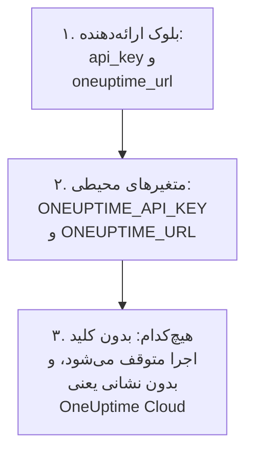

# راهنمای کامل

این راهنما آنچه را پس از نخستین apply می‌آید پوشش می‌دهد: ارائه‌دهنده چگونه کلید API خود را پیدا می‌کند، چگونه یک پیکربندی را برای یک یا چند پروژه بچینید، منابع چگونه به یکدیگر ارجاع می‌دهند، چگونه رکوردهایی را که مدیریت نمی‌کنید بخوانید، چگونه state را امن نگه دارید، و چگونه ارتقا دهید. تازه با ارائه‌دهنده آشنا شده‌اید؟ از [شروع سریع](/docs/terraform/quick-start) شروع کنید.

:::cards
- [پیکربندی ارائه‌دهنده](#پیکربندی-ارائهدهنده): کلید API و نشانی، و اینکه ارائه‌دهنده آن‌ها را از کجا می‌خواند.
- [چیدمان یک پیکربندی](#چیدمان-یک-پیکربندی): فایل‌ها، پروژه‌ها، و منابع بسیار از یک بلوک.
- [خواندن آنچه از قبل وجود دارد](#خواندن-آنچه-از-قبل-وجود-دارد): منبع‌های داده، و اینکه جست‌وجو چگونه مطابقت می‌یابد.
- [امن نگه داشتن state](#امن-نگه-داشتن-state): یک بک‌اند راه دور، و آنچه هرگز نباید commit شود.
:::

## پیکربندی ارائه‌دهنده

ارائه‌دهنده دو تنظیم می‌گیرد. هر کدام از بلوک ارائه‌دهنده می‌آید، وگرنه از یک متغیر محیطی:

| تنظیم | متغیر محیطی | وقتی هیچ‌کدام تعیین نشده باشد |
| --- | --- | --- |
| `api_key` | `ONEUPTIME_API_KEY` | ارائه‌دهنده پیش از اینکه چیزی پلن شود متوقف می‌شود: `Missing API Key` |
| `oneuptime_url` | `ONEUPTIME_URL` | `https://oneuptime.com`، یعنی OneUptime Cloud |



`oneuptime_url` نشانی OneUptime شماست، بدون `/api`: اگر نشانی scheme نداشته باشد ارائه‌دهنده `https://` را اضافه می‌کند، و در انتها `/api` را. `api_key` حساس است، پس Terraform هرگز آن را چاپ نمی‌کند.

کلید باید یک کلید API از پروژه‌ای باشد که مدیریت می‌کنید، با اجازهٔ ساختن، خواندن، تغییر دادن و حذف کردن هر نوع رکوردی که پیکربندی شما دارد: [ساخت کلید API پروژه](/docs/terraform/quick-start#ساخت-کلید-api-پروژه) را ببینید. کلید API اصلی یک OneUptime خودمیزبان به هیچ پروژه‌ای تعلق ندارد، پس ساختنی که با آن انجام شود با `ProjectId required` شکست می‌خورد.

### دادن کلید به ارائه‌دهنده

:::tabs
@tab متغیر محیطی
```bash
export ONEUPTIME_API_KEY="<your-api-key>"
# Only on a self-hosted OneUptime:
export ONEUPTIME_URL="https://oneuptime.example.com"
```

```hcl title="main.tf"
provider "oneuptime" {}
```
@tab متغیر Terraform
```hcl title="variables.tf"
variable "oneuptime_api_key" {
  description = "API key of the OneUptime project"
  type        = string
  sensitive   = true
}

provider "oneuptime" {
  api_key = var.oneuptime_api_key
}
```

```hcl title="terraform.tfvars"
oneuptime_api_key = "<your-api-key>"
```
:::

متغیر محیطی کلید را بیرون از همهٔ فایل‌ها نگه می‌دارد. فایل متغیرها روی دستگاه خودتان کار را راحت می‌کند: `terraform.tfvars` را به `.gitignore` اضافه کنید. در یک پایپ‌لاین، به‌جای نوشتن فایل، `TF_VAR_oneuptime_api_key` را تعیین کنید.

### اجرا در CI/CD

کلید را به‌عنوان یک راز، در متغیر محیطی `ONEUPTIME_API_KEY`، به job بدهید:

:::tabs
@tab GitHub Actions
```yaml title=".github/workflows/oneuptime.yml"
name: OneUptime
on:
  push:
    branches: [main]

jobs:
  apply:
    runs-on: ubuntu-latest
    env:
      ONEUPTIME_API_KEY: ${{ secrets.ONEUPTIME_API_KEY }}
    steps:
      - uses: actions/checkout@v4
      - uses: hashicorp/setup-terraform@v3
      - run: terraform init -input=false
      - run: terraform plan -input=false -out=tfplan
      - run: terraform apply -input=false tfplan
```
@tab GitLab CI
```yaml title=".gitlab-ci.yml"
apply:
  image:
    name: hashicorp/terraform:latest
    entrypoint: [""]
  rules:
    - if: $CI_COMMIT_BRANCH == $CI_DEFAULT_BRANCH
  script:
    - terraform init -input=false
    - terraform plan -input=false -out=tfplan
    - terraform apply -input=false tfplan
```
:::

در GitHub، راز را در **Settings → Secrets and variables → Actions** اضافه کنید؛ در GitLab، یک متغیر CI/CD پوشانده‌شده با همان نام اضافه کنید. state را در یک [بک‌اند راه دور](#امن-نگه-داشتن-state) نگه دارید، تا هر اجرا از stateی شروع شود که اجرای قبلی بر جا گذاشته است.

## چیدمان یک پیکربندی

چیدمانی که خوب کار می‌کند:

```text
oneuptime/
├── main.tf          # the terraform and provider blocks
├── variables.tf     # input variables
├── outputs.tf       # the IDs other configurations need
├── shared.tf        # labels, teams and monitor statuses
├── monitors.tf      # monitors and monitor groups
├── status-pages.tf  # status pages and their domains
└── on-call.tf       # on-call policies and escalation rules
```

- **یک پیکربندی برای هر پروژه.** هر کلید API به یک پروژه تعلق دارد، پس یک پیکربندی به‌طور طبیعی یک پروژه را مدیریت می‌کند.
- **رکوردهای مشترک فقط یک بار.** برچسب‌ها، تیم‌ها و وضعیت‌های مانیتور را در یک فایل تعریف کنید، و در هر جای دیگر با نشانی‌شان به آن‌ها ارجاع دهید.

### مدیریت چند پروژه

برای مدیریت بیش از یک پروژه از یک پیکربندی، برای هر پروژه یک نام مستعار به ارائه‌دهنده بدهید، هر کدام با کلید همان پروژه. هر منبع با `provider` نام مستعاری را که به کار می‌برد مشخص می‌کند:

```hcl
provider "oneuptime" {
  alias   = "production"
  api_key = var.production_api_key
}

provider "oneuptime" {
  alias   = "staging"
  api_key = var.staging_api_key
}

resource "oneuptime_label" "staging_critical" {
  provider = oneuptime.staging

  name  = "critical"
  color = "#FF5733"
}
```

`production_api_key` و `staging_api_key` را مانند بالا به‌صورت متغیرهایی که با `sensitive` علامت خورده‌اند تعریف کنید.

### منابع بسیار از یک بلوک

`for_each` برای هر مدخل یک map یک منبع می‌سازد. این مانیتورها معیارهایشان را به اشتراک می‌گذارند و فقط در نام و نشانی متفاوت‌اند:

```hcl
variable "websites" {
  type = map(string)
  default = {
    homepage = "https://example.com"
    docs     = "https://docs.example.com"
  }
}

resource "oneuptime_monitor" "website" {
  for_each = var.websites

  name                = "Website: ${each.key}"
  monitor_type        = "Website"
  monitoring_interval = "*/5 * * * *"

  monitor_steps = [{
    monitor_destination      = each.value
    monitor_destination_type = "URL"

    criteria = [
      {
        name                  = "Offline"
        filter_condition      = "Any"
        change_monitor_status = true
        monitor_status_id     = data.oneuptime_monitor_status.offline.id

        filters = [
          {
            check_on    = "Is Online"
            filter_type = "False"
          }
        ]
      }
    ]
  }]
}
```

یک سایت به map اضافه کنید، و apply بعدی مانیتور آن را می‌سازد. یکی را بردارید، و آن را حذف می‌کند.

## ارجاع به منابع دیگر

منبعی که ویژگی منبع دیگری را نام می‌برد به آن وابسته است، و Terraform کار را بر اساس همین ارجاع‌ها مرتب می‌کند. در اینجا برچسب اول ساخته می‌شود و آخر حذف می‌شود، چون مانیتور و صفحهٔ وضعیت آن را نام می‌برند:

```mermaid title="Terraform اول چیزی را می‌سازد که منبع به آن ارجاع می‌دهد"
flowchart TB
    L["oneuptime_label<br/>payments"] --> M["oneuptime_monitor<br/>checkout_api"]
    L --> SP["oneuptime_status_page<br/>payments"]
    M --> R["oneuptime_status_page_resource<br/>checkout_api"]
    SP --> R
```

```hcl
resource "oneuptime_label" "payments" {
  name        = "payments"
  description = "Payment infrastructure"
  color       = "#2ECC71"
}

resource "oneuptime_monitor" "checkout_api" {
  name         = "Checkout API"
  description  = "Availability of the checkout API"
  monitor_type = "Manual"
  labels       = [oneuptime_label.payments.id]
}

resource "oneuptime_status_page" "payments" {
  name                  = "Payments Status"
  page_title            = "Payments Status"
  is_public_status_page = true
  labels                = [oneuptime_label.payments.id]
}

resource "oneuptime_status_page_resource" "checkout_api" {
  status_page_id = oneuptime_status_page.payments.id
  monitor_id     = oneuptime_monitor.checkout_api.id
  display_name   = "Checkout API"
}
```

به ندرت به `depends_on` نیاز پیدا می‌کنید: آن را فقط برای ترتیبی اضافه کنید که Terraform نمی‌تواند از روی ویژگی‌ها ببیند. فهرست‌های ID مانند `labels` مجموعه هستند، پس تغییر ترتیبشان چیزی را تغییر نمی‌دهد.

## خواندن آنچه از قبل وجود دارد

هر منبع یک منبع داده با همان نام دارد. منبع داده رکوردی را می‌خواند که این پیکربندی مدیریتش نمی‌کند، و در داشبورد یا با پیکربندی دیگری ساخته شده است، تا بتوانید بدون در اختیار گرفتنش به آن ارجاع دهید.

```hcl
data "oneuptime_label" "critical" {
  name = "critical"
}

data "oneuptime_monitor_status" "offline" {
  is_offline_state = true
}

data "oneuptime_status_page" "main" {
  id = "5f8a1b2c-3d4e-4f6a-8b9c-0d1e2f3a4b5c"
}

resource "oneuptime_monitor" "database" {
  name         = "Database Health"
  monitor_type = "Manual"
  labels       = [data.oneuptime_label.critical.id]
}
```

جست‌وجو چگونه مطابقت می‌یابد:

| آنچه تعیین می‌کنید | آنچه پیدا می‌کند | خطاها |
| --- | --- | --- |
| `id` | رکوردی که آن ID را دارد | `Not Found` وقتی هیچ رکوردی آن را ندارد |
| هر آرگومان سادهٔ دیگر، یکی یا بیشتر | تنها رکوردی که با همهٔ آن‌ها مطابقت دارد | `Not Found` وقتی هیچ‌کدام مطابقت ندارد، `Ambiguous Match` وقتی بیش از یکی مطابقت دارد |
| `id` و آرگومانی دیگر، یا هیچ | هیچ | `Invalid Lookup` |

آرگومان‌های ساده متن، عدد و درست یا نادرست هستند: یک نام، یک اولویت، پرچمی مانند `is_offline_state`. با فهرست‌ها، مقدارهای JSON، برچسب‌های زمانی و رازها نمی‌توان جست‌وجو کرد. برای در اختیار گرفتن یک رکورد به‌جای فقط خواندن آن، [آن را import کنید](/docs/terraform/importing-resources).

## امن نگه داشتن state

state در Terraform شناسه‌ها و ویژگی‌های هر چیزی را که مدیریت می‌کند نگه می‌دارد، از جمله رازها. آن را در یک بک‌اند راه دور نگه دارید که قفلش می‌کند، تا یک تیم یک state مشترک داشته باشد و دو اجرا هرگز هم‌زمان در آن ننویسند. هر بک‌اند استانداردی کار می‌کند، برای نمونه یک باکت S3:

```hcl
terraform {
  backend "s3" {
    bucket       = "my-terraform-state"
    key          = "oneuptime/production.tfstate"
    region       = "us-east-1"
    encrypt      = true
    use_lockfile = true
  }
}
```

`use_lockfile` به Terraform 1.10 یا OpenTofu 1.10، یا جدیدتر، نیاز دارد. پیش از آن‌ها، بک‌اند S3 با یک جدول DynamoDB (`dynamodb_table`) قفل می‌کند.

- **هرگز state را با دست ویرایش نکنید.** از `terraform state mv` و `terraform state rm` استفاده کنید.
- **هرگز `terraform.tfstate` یا فایل `.tfvars` حاوی راز را commit نکنید.**

## انحراف، و آنچه باعث آن نمی‌شود

`terraform plan`، OneUptime را با پیکربندی شما مقایسه می‌کند و آنچه را متفاوت است فهرست می‌کند. برخی تفاوت‌ها هرگز نشان داده نمی‌شوند:

- **زمان‌ها به‌صورت لحظه مقایسه می‌شوند.** `2030-06-01T02:00:00Z` و شیوهٔ سرور برای نوشتن همان لحظه برابرند.
- **مقدارهای پیش‌فرضی که سرور اضافه می‌کند**، به مراحل یک مانیتور یا به یک مقدار JSON، تفاوتی با آنچه نوشته‌اید به شمار نمی‌آیند.
- **آنچه سرور به‌روز نگه می‌دارد**، مانند وضعیت فعلی یک مانیتور، هم تفاوت نیست.

اما مقداری که در هر اجرا محاسبه می‌کنید تفاوت است: `timestamp()` در هر اجرا زمان تازه‌ای می‌دهد، پس پلن همیشه آن را نشان می‌دهد. به‌جای آن زمان‌های ثابت بنویسید:

```hcl
resource "oneuptime_scheduled_maintenance_event" "database_upgrade" {
  title       = "Database upgrade"
  description = "Planned PostgreSQL upgrade"
  starts_at   = "2030-06-01T02:00:00Z"
  ends_at     = "2030-06-01T04:00:00Z"
}
```

## ارتقای ارائه‌دهنده

:::steps
### یادداشت‌های انتشار را بخوانید

[Terraform Registry](https://registry.terraform.io/providers/oneuptime/oneuptime) و [انتشارهای ارائه‌دهنده در GitHub](https://github.com/OneUptime/terraform-provider-oneuptime/releases) آنچه را تغییر کرده فهرست می‌کنند.

### قید نسخه را بالا ببرید

`{{TERRAFORM_PROVIDER_VERSION}}` از قبل هر نسخهٔ {{TERRAFORM_PROVIDER_MAJOR}}.x را می‌گیرد. نسخهٔ اصلی تازه به قید تازه نیاز دارد.

### نسخهٔ تازه را دانلود کنید

```bash
terraform init -upgrade
```

### پیش از اعمال، پلن بگیرید

`terraform plan` را اجرا کنید، و فقط وقتی اعمال کنید که خالی باشد یا تغییراتی را نشان دهد که انتظارش را دارید.
:::

روی OneUptime خودمیزبان، اول OneUptime را ارتقا دهید و بعد ارائه‌دهنده را: ارائه‌دهنده نباید از OneUptime شما جدیدتر باشد. [راه‌اندازی خودمیزبان](/docs/terraform/self-hosted) را ببینید.

## گام‌های بعدی

:::cards
- [مراحل مانیتور](/docs/terraform/monitor-steps): تعیین کنید مانیتور چه چیزی را بررسی می‌کند و هر نتیجه چه معنایی دارد.
- [نمونه‌ها](/docs/terraform/examples): پیکربندی‌های آماده برای منابع رایج.
- [وارد کردن منابع](/docs/terraform/importing-resources): آنچه را در داشبورد ساخته‌اید زیر مدیریت Terraform بیاورید.
- [رفع اشکال](/docs/terraform/troubleshooting): خطاهای رایج و راه رفع آن‌ها.
:::
