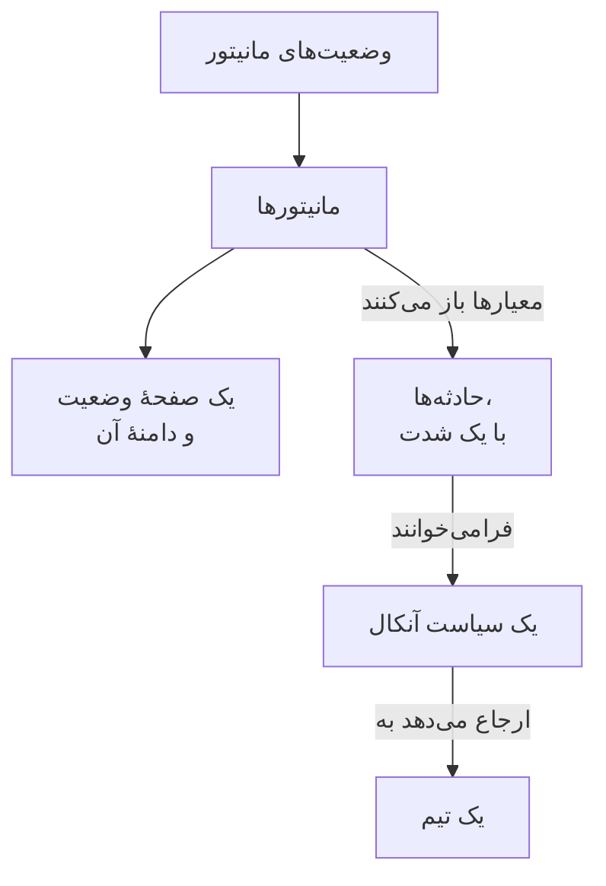

# نمونه‌ها

پیکربندی‌های آماده برای منابعی که بیشتر پروژه‌ها با آن‌ها شروع می‌شوند. هر بلوک همان‌طور که هست روی تنظیم ارائه‌دهندهٔ زیر اعمال می‌شود، و بیشترشان از تست‌های سرتاسری ارائه‌دهنده می‌آیند، که در هر تغییر آن‌ها را روی یک OneUptime واقعی اعمال می‌کنند.

:::cards
- [مانیتورها](#مانیتورها): مانیتورهای وب‌سایت، API، ping، پورت، گواهی SSL، heartbeat و دستی.
- [صفحه‌های وضعیت](#صفحههای-وضعیت): یک صفحهٔ وضعیت با یک گروه و یک مانیتور، و یک دامنهٔ سفارشی.
- [تیم‌ها و آنکال](#تیمها-و-آنکال): یک تیم، و یک سیاست آنکال که آن را فرامی‌خواند.
- [حادثه‌ها و نگهداری](#حادثهها-و-نگهداری): شدت‌ها، وضعیت‌ها، یک حادثهٔ اعلام‌شده و یک بازهٔ نگهداری.
:::



## تنظیم ارائه‌دهنده

همهٔ نمونه‌ها این تنظیم را فرض می‌کنند، با کلید API در متغیر محیطی `ONEUPTIME_API_KEY`:

```hcl title="main.tf"
terraform {
  required_providers {
    oneuptime = {
      source  = "oneuptime/oneuptime"
      version = "{{TERRAFORM_PROVIDER_VERSION}}"
    }
  }
}

provider "oneuptime" {
  # On a self-hosted OneUptime, add your OneUptime's address:
  # oneuptime_url = "https://oneuptime.example.com"
}
```

## برچسب‌ها

برچسب‌ها رکوردها را مرتب و فیلتر می‌کنند. بیشتر منابع مجموعه‌ای از IDهای برچسب را در `labels` می‌گیرند:

```hcl
resource "oneuptime_label" "production" {
  name        = "production"
  description = "Production infrastructure"
  color       = "#FF5733"
}
```

## مانیتورها

مانیتورهای زیر وضعیتشان را با سه تا از وضعیت‌هایی تعیین می‌کنند که هر پروژه با آن‌ها شروع می‌شود، و این وضعیت‌ها با منبع‌های داده خوانده می‌شوند:

```hcl
data "oneuptime_monitor_status" "operational" {
  name = "Operational"
}

data "oneuptime_monitor_status" "degraded" {
  name = "Degraded"
}

data "oneuptime_monitor_status" "offline" {
  name = "Offline"
}
```

`monitor_steps` هر مانیتور می‌گوید چه چیزی را بررسی می‌کند و هر نتیجه چگونه سنجیده می‌شود: [مراحل مانیتور](/docs/terraform/monitor-steps) هر ویژگی را توضیح می‌دهد.

### مانیتور وب‌سایت

وقتی سایت پاسخ ندهد offline، و وقتی با 200 پاسخ دهد online. تست سرتاسری `35-monitor-with-steps` مانیتوری با همین بررسی‌ها را اعمال می‌کند:

```hcl
resource "oneuptime_monitor" "website" {
  name                = "Website"
  description         = "Homepage availability and status code"
  monitor_type        = "Website"
  monitoring_interval = "*/5 * * * *"
  labels              = [oneuptime_label.production.id]

  monitor_steps = [{
    monitor_destination      = "https://example.com"
    monitor_destination_type = "URL"
    request_type             = "GET"

    criteria = [
      {
        name                  = "Offline"
        description           = "The website does not respond"
        filter_condition      = "Any"
        change_monitor_status = true
        monitor_status_id     = data.oneuptime_monitor_status.offline.id

        filters = [
          {
            check_on    = "Is Online"
            filter_type = "False"
          }
        ]
      },
      {
        name                  = "Online"
        description           = "The website responds with 200"
        filter_condition      = "All"
        change_monitor_status = true
        monitor_status_id     = data.oneuptime_monitor_status.operational.id

        filters = [
          {
            check_on    = "Is Online"
            filter_type = "True"
          },
          {
            check_on    = "Response Status Code"
            filter_type = "Equal To"
            value       = "200"
          }
        ]
      }
    ]
  }]
}
```

### مانیتور API

یک `POST` با سرآیندها و یک بدنهٔ JSON، که وقتی پاسخ کند باشد degraded می‌شود. تست سرتاسری `35-monitor-with-steps` مانیتور API مشابهی را اعمال می‌کند:

```hcl
resource "oneuptime_monitor" "orders_api" {
  name         = "Orders API"
  description  = "Health check of the orders API"
  monitor_type = "API"

  monitor_steps = [{
    monitor_destination      = "https://api.example.com/v1/health"
    monitor_destination_type = "URL"
    request_type             = "POST"
    request_headers = {
      "Content-Type" = "application/json"
      "Accept"       = "application/json"
    }
    request_body = jsonencode({ check = "health" })

    criteria = [
      {
        name                  = "Offline"
        description           = "The API does not answer, or answers with an error"
        filter_condition      = "Any"
        change_monitor_status = true
        monitor_status_id     = data.oneuptime_monitor_status.offline.id

        filters = [
          {
            check_on    = "Is Online"
            filter_type = "False"
          },
          {
            check_on    = "Response Status Code"
            filter_type = "Greater Than Or Equal To"
            value       = "500"
          }
        ]
      },
      {
        name                  = "Slow"
        description           = "The API takes more than two seconds"
        filter_condition      = "All"
        change_monitor_status = true
        monitor_status_id     = data.oneuptime_monitor_status.degraded.id

        filters = [
          {
            check_on    = "Response Time (in ms)"
            filter_type = "Greater Than"
            value       = "2000"
          }
        ]
      },
      {
        name                  = "Online"
        description           = "The API answers in time"
        filter_condition      = "All"
        change_monitor_status = true
        monitor_status_id     = data.oneuptime_monitor_status.operational.id

        filters = [
          {
            check_on    = "Is Online"
            filter_type = "True"
          }
        ]
      }
    ]
  }]
}
```

### مانیتور Ping

مانیتور Ping به‌جای URL یک نام میزبان یا نشانی IP می‌گیرد:

```hcl
resource "oneuptime_monitor" "gateway" {
  name         = "Gateway"
  description  = "The gateway answers ping"
  monitor_type = "Ping"

  monitor_steps = [{
    monitor_destination      = "gateway.example.com"
    monitor_destination_type = "Hostname"

    criteria = [
      {
        name                  = "Unreachable"
        filter_condition      = "Any"
        change_monitor_status = true
        monitor_status_id     = data.oneuptime_monitor_status.offline.id

        filters = [
          {
            check_on    = "Is Online"
            filter_type = "False"
          }
        ]
      },
      {
        name                  = "Reachable"
        filter_condition      = "All"
        change_monitor_status = true
        monitor_status_id     = data.oneuptime_monitor_status.operational.id

        filters = [
          {
            check_on    = "Is Online"
            filter_type = "True"
          }
        ]
      }
    ]
  }]
}
```

### مانیتور پورت

مانیتور پورت `port` را برای بررسی اضافه می‌کند، به‌صورت عدد:

```hcl
resource "oneuptime_monitor" "database_port" {
  name         = "Database port"
  description  = "PostgreSQL accepts connections"
  monitor_type = "Port"

  monitor_steps = [{
    monitor_destination      = "db.example.com"
    monitor_destination_type = "Hostname"
    port                     = 5432

    criteria = [
      {
        name                  = "Closed"
        filter_condition      = "Any"
        change_monitor_status = true
        monitor_status_id     = data.oneuptime_monitor_status.offline.id

        filters = [
          {
            check_on    = "Is Online"
            filter_type = "False"
          }
        ]
      },
      {
        name                  = "Open"
        filter_condition      = "All"
        change_monitor_status = true
        monitor_status_id     = data.oneuptime_monitor_status.operational.id

        filters = [
          {
            check_on    = "Is Online"
            filter_type = "True"
          }
        ]
      }
    ]
  }]
}
```

### مانیتور گواهی SSL

وقتی گواهی معتبر نباشد offline، و وقتی ظرف ۱۴ روز یا کمتر منقضی شود degraded، همان‌طور که یک مانیتور گواهی SSL تازه در داشبورد است:

```hcl
resource "oneuptime_monitor" "certificate" {
  name         = "example.com certificate"
  description  = "The TLS certificate of example.com"
  monitor_type = "SSL Certificate"

  monitor_steps = [{
    monitor_destination      = "https://example.com"
    monitor_destination_type = "URL"

    criteria = [
      {
        name                  = "Not valid"
        description           = "Expired, self-signed, untrusted or not reachable"
        filter_condition      = "Any"
        change_monitor_status = true
        monitor_status_id     = data.oneuptime_monitor_status.offline.id

        filters = [
          {
            check_on    = "Is Not A Valid Certificate"
            filter_type = "True"
          }
        ]
      },
      {
        name                  = "Expires soon"
        description           = "Valid, and expires in 14 days or less"
        filter_condition      = "All"
        change_monitor_status = true
        monitor_status_id     = data.oneuptime_monitor_status.degraded.id

        filters = [
          {
            check_on    = "Is Valid Certificate"
            filter_type = "True"
          },
          {
            check_on    = "Expires In Days"
            filter_type = "Less Than Or Equal To"
            value       = "14"
          }
        ]
      },
      {
        name                  = "Valid"
        filter_condition      = "All"
        change_monitor_status = true
        monitor_status_id     = data.oneuptime_monitor_status.operational.id

        filters = [
          {
            check_on    = "Is Valid Certificate"
            filter_type = "True"
          }
        ]
      }
    ]
  }]
}
```

### مانیتور دستی

مانیتور دستی چیزی را بررسی نمی‌کند: وضعیت آن را خودتان تعیین می‌کنید. به `monitor_steps` نیازی ندارد:

```hcl
resource "oneuptime_monitor" "payment_provider" {
  name         = "Payment provider"
  description  = "Set by hand during the provider's incidents"
  monitor_type = "Manual"
}
```

### مانیتور heartbeat

مانیتور درخواست ورودی به‌جای فرستادن درخواست، منتظر درخواست‌ها می‌ماند: در اینجا، کار پشتیبان‌گیری‌ای که هر شب گزارش می‌دهد. وقتی ۲۵ ساعت هیچ درخواستی نیاید، offline می‌شود:

```hcl
resource "oneuptime_monitor" "nightly_backup" {
  name         = "Nightly backup"
  description  = "The backup job sends a heartbeat when it finishes"
  monitor_type = "Incoming Request"

  monitor_steps = [{
    criteria = [
      {
        name                  = "No heartbeat"
        filter_condition      = "Any"
        change_monitor_status = true
        monitor_status_id     = data.oneuptime_monitor_status.offline.id

        filters = [
          {
            check_on    = "Incoming Request"
            filter_type = "Not Recieved In Minutes"
            value       = "1500"
          }
        ]
      },
      {
        name                  = "Heartbeat received"
        filter_condition      = "All"
        change_monitor_status = true
        monitor_status_id     = data.oneuptime_monitor_status.operational.id

        filters = [
          {
            check_on    = "Incoming Request"
            filter_type = "Recieved In Minutes"
            value       = "1500"
          }
        ]
      }
    ]
  }]
}

output "nightly_backup_heartbeat_key" {
  value     = oneuptime_monitor.nightly_backup.incoming_request_secret_key
  sensitive = true
}
```

این کار درخواستش را به `https://oneuptime.com/heartbeat/YOUR_SECRET_KEY` می‌فرستد، با کلیدی که `terraform output -raw nightly_backup_heartbeat_key` چاپ می‌کند: [مانیتور درخواست ورودی](/docs/monitor/incoming-request-monitor) را ببینید. عامل یک مانیتور سرور هم به همین شکل، با `server_monitor_secret_key`، وارد می‌شود.

### گروه مانیتور

گروه مانیتور مجموعه‌ای از مانیتورها را با یک وضعیت نشان می‌دهد:

```hcl
resource "oneuptime_monitor_group" "storefront" {
  name        = "Storefront"
  description = "Everything the shop needs"
}

resource "oneuptime_monitor_group_resource" "website" {
  monitor_group_id = oneuptime_monitor_group.storefront.id
  monitor_id       = oneuptime_monitor.website.id
}

resource "oneuptime_monitor_group_resource" "orders_api" {
  monitor_group_id = oneuptime_monitor_group.storefront.id
  monitor_id       = oneuptime_monitor.orders_api.id
}
```

## صفحه‌های وضعیت

### یک صفحهٔ وضعیت با یک گروه و یک مانیتور

یک صفحهٔ وضعیت منابع را نشان می‌دهد، و می‌تواند آن‌ها را در گروه‌ها مرتب کند. تست سرتاسری `42-status-page-resources` این تنظیم را اعمال می‌کند:

```hcl
resource "oneuptime_status_page" "public" {
  name                  = "Public Status"
  description           = "Customer-facing status page"
  page_title            = "System Status"
  page_description      = "Check our system status and incident history"
  is_public_status_page = true
}

resource "oneuptime_status_page_group" "services" {
  status_page_id = oneuptime_status_page.public.id
  name           = "Services"
}

resource "oneuptime_status_page_resource" "website" {
  status_page_id       = oneuptime_status_page.public.id
  status_page_group_id = oneuptime_status_page_group.services.id
  monitor_id           = oneuptime_monitor.website.id
  display_name         = "Website"
}
```

### یک دامنهٔ سفارشی

سه منبع با هم کار می‌کنند: یک دامنه از پروژهٔ شما، صفحهٔ وضعیت، و دامنهٔ صفحهٔ وضعیت که این دو را به هم وصل می‌کند. سرور `full_domain` و توکن تأیید CNAME را پر می‌کند: آن‌ها را تعیین نکنید. تست‌های سرتاسری `12-status-page-domain` و `25-status-page-with-domain` این تنظیم را اعمال می‌کنند:

```hcl
resource "oneuptime_domain" "company" {
  domain = "example.com"
}

resource "oneuptime_status_page_domain" "status" {
  domain_id      = oneuptime_domain.company.id
  status_page_id = oneuptime_status_page.public.id
  subdomain      = "status"
}

output "status_page_address" {
  # The subdomain and the domain, such as status.example.com.
  value = oneuptime_status_page_domain.status.full_domain
}
```

یک دامنهٔ تازه باید پیش از آنکه صفحهٔ وضعیت روی آن پاسخ دهد، تأیید DNS را بگذراند.

## تیم‌ها و آنکال

### یک تیم و اعضای آن

```hcl
resource "oneuptime_team" "sre" {
  name        = "SRE"
  description = "Site reliability engineering"
}

variable "alice_user_id" {
  description = "Alice's user ID, the last part of the address of her page under Users"
  type        = string
}

resource "oneuptime_team_member" "alice" {
  team_id = oneuptime_team.sre.id
  user_id = var.alice_user_id
}
```

کسی که از قبل در پروژه است بی‌درنگ به تیم می‌پیوندد. هر کس دیگری دعوت می‌شود، و به‌محض پذیرفتن در تیم است. تست سرتاسری `33-team-crud` این تیم را اعمال می‌کند.

### یک سیاست آنکال که یک تیم را فرامی‌خواند

نخستین قاعدهٔ سیاست تیم را فرامی‌خواند، و وقتی کسی تأیید نکند، سیاست تا دو بار از نو شروع می‌شود:

```hcl
resource "oneuptime_on_call_policy" "primary" {
  name                                             = "Primary on-call"
  description                                      = "First line for production incidents"
  repeat_policy_if_no_one_acknowledges             = true
  repeat_policy_if_no_one_acknowledges_no_of_times = 2
}

resource "oneuptime_escalation_rule" "first_line" {
  on_call_duty_policy_id    = oneuptime_on_call_policy.primary.id
  name                      = "Page the SRE team"
  description               = "Moves on after 5 minutes without an acknowledgement"
  order                     = 1
  escalate_after_in_minutes = 5
}

resource "oneuptime_team_on_call_duty_escalation_rule" "sre" {
  on_call_duty_policy_id                 = oneuptime_on_call_policy.primary.id
  on_call_duty_policy_escalation_rule_id = oneuptime_escalation_rule.first_line.id
  team_id                                = oneuptime_team.sre.id
}
```

معیارهای یک مانیتور سیاست را از طریق `on_call_policy_ids` روی حادثه‌هایی که باز می‌کنند فرامی‌خوانند: [حادثه‌ها و هشدارها](/docs/terraform/monitor-steps#حادثهها-و-هشدارها) را ببینید.

## حادثه‌ها و نگهداری

### شدت‌ها و وضعیت‌ها

شدت‌ها اثر یک حادثه را رتبه‌بندی می‌کنند، و وضعیت‌ها گام‌های زندگی آن هستند. `order` جایی است که هر کدام در فهرست می‌آید:

```hcl
resource "oneuptime_incident_severity" "sev1" {
  name        = "SEV-1"
  description = "Full outage, all hands"
  color       = "#E74C3C"
  order       = 1
}

resource "oneuptime_incident_state" "mitigated" {
  name        = "Mitigated"
  description = "Impact contained, fix in progress"
  color       = "#F39C12"
  order       = 3
}
```

`oneuptime_alert_severity` و `oneuptime_alert_state` برای هشدارها به همین شکل کار می‌کنند. تست‌های سرتاسری `03-incident-severity` و `04-incident-state` این‌ها را اعمال می‌کنند.

### اعلام یک حادثه

معمولاً مانیتورها حادثه باز می‌کنند، ولی حادثه هم یک منبع است، که برای یک روز تمرین مناسب است. این یک حادثهٔ واقعی است، پس تمرین را از صفحه‌های وضعیتتان دور نگه دارید:

```hcl
resource "oneuptime_incident" "drill" {
  title                     = "Disaster recovery drill"
  description               = "A game day: we fail over the database"
  incident_severity_id      = oneuptime_incident_severity.sev1.id
  is_visible_on_status_page = false

  should_status_page_subscribers_be_notified_on_incident_created = false
}
```

تست سرتاسری `28-incident-crud` یک حادثه را اعمال می‌کند.

### نگهداری زمان‌بندی‌شده

یک بازهٔ نگهداری با زمان‌های ثابت، که روی صفحه‌های وضعیت شما نشان داده می‌شود:

```hcl
resource "oneuptime_scheduled_maintenance_event" "database_upgrade" {
  title                       = "Database maintenance"
  description                 = "Planned PostgreSQL upgrade: writes pause briefly"
  starts_at                   = "2030-06-01T02:00:00Z"
  ends_at                     = "2030-06-01T04:00:00Z"
  is_visible_on_status_page   = true
  monitors                    = [oneuptime_monitor.website.id]
  change_monitor_status_to_id = data.oneuptime_monitor_status.degraded.id
}
```

زمان‌ها در قالب RFC 3339 هستند، و همان لحظه اگر به شکلی دیگر نوشته شود تغییر به شمار نمی‌آید. تست سرتاسری `30-scheduled-maintenance-crud` رویدادهای نگهداری را اعمال می‌کند.

برای اینکه مانیتورهای رویداد در طول اجرای آن در یک وضعیت باشند، آن‌ها را با `monitors` پیوست کنید و `change_monitor_status_to_id` را روی یکی از وضعیت‌های مانیتورتان بگذارید: مانیتورها وقتی رویداد شروع می‌شود به آن وضعیت می‌روند، و وقتی تمام شود به وضعیت عملیاتی برمی‌گردند. Terraform تا پیش از شروع رویداد، `change_monitor_status_to_id` را در جا تغییر می‌دهد. وقتی رویداد شروع شد، مانیتورهایش از قبل در آن وضعیت هستند، و applyای که آن را تغییر دهد با «Change Monitor Status to can no longer be changed: this event has already started.» شکست می‌خورد.

## پراب‌ها

پراب خودتان بررسی‌ها را از شبکهٔ شما اجرا می‌کند. کلید آن رازی است که پراب با آن وارد می‌شود، پس آن را در یک متغیر بدهید:

```hcl
variable "probe_key" {
  description = "The key the probe signs in with"
  type        = string
  sensitive   = true
}

resource "oneuptime_probe" "eu_west" {
  key           = var.probe_key
  name          = "EU West"
  description   = "Probe in our eu-west-1 network"
  probe_version = "1.0.0"

  should_auto_enable_probe_on_new_monitors = true
}
```

پراب را با `PROBE_ID` برابر با `id` پراب و `PROBE_KEY` برابر با کلید اجرا کنید: [پراب‌های سفارشی](/docs/probe/custom-probe) را ببینید. تست سرتاسری `23-probe-crud` پراب‌ها را اعمال می‌کند.

## گام‌های بعدی

:::cards
- [مراحل مانیتور](/docs/terraform/monitor-steps): همهٔ ویژگی‌های بررسی‌ها و معیارهای یک مانیتور.
- [وارد کردن منابع](/docs/terraform/importing-resources): آنچه را در داشبورد ساخته‌اید زیر مدیریت Terraform بیاورید.
- [راهنمای کامل](/docs/terraform/complete-guide): منبع‌های داده، state، CI/CD و ارتقا.
:::
