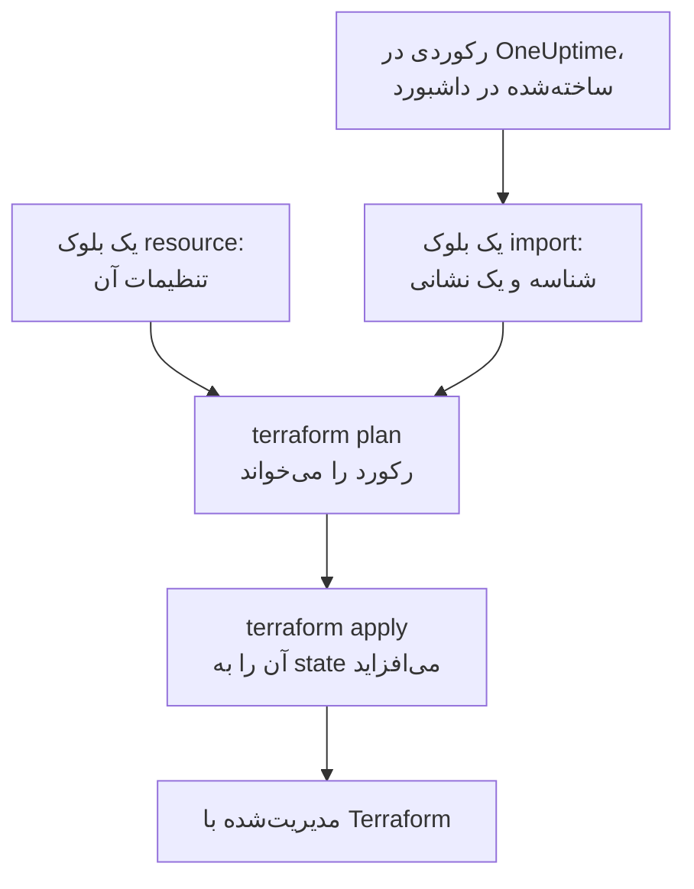

# وارد کردن منابع

برای مدیریت OneUptime با Terraform لازم نیست از نو شروع کنید. مانیتورها، صفحه‌های وضعیت، تیم‌ها و رکوردهای دیگری را که از قبل دارید import کنید، و Terraform از آن پس همان‌طور که هستند مدیریتشان می‌کند. import فقط می‌خواند: در OneUptime چیزی تغییر نمی‌کند تا وقتی تغییری را که پلن کرده‌اید اعمال کنید.

:::cards
- [import چگونه کار می‌کند](#import-چگونه-کار-میکند): import چه می‌خواند، و شما چه می‌نویسید.
- [import یک منبع](#import-یک-منبع): از صفحهٔ آن در داشبورد، در چهار گام.
- [import منابع بسیار](#import-منابع-بسیار): بلوک‌های import برای یک فهرست کامل، و پیکربندی‌ای که Terraform برایتان می‌نویسد.
- [پایان دادن به مدیریت یک منبع](#پایان-دادن-به-مدیریت-یک-منبع): آن را بی‌آنکه حذف شود به داشبورد برگردانید.
:::

## import چگونه کار می‌کند

import رکوردی را که از قبل در OneUptime وجود دارد به یک بلوک `resource` در پیکربندی شما وصل می‌کند. شما یک بلوک `import` با شناسهٔ رکورد و نشانی‌ای که به آن می‌رود می‌نویسید. `terraform plan` بعدی رکورد را با شناسه‌اش می‌خواند و نشان می‌دهد که import می‌شود، همراه با هر تفاوتی میان رکورد و پیکربندی شما. `terraform apply` آن را به state در Terraform می‌افزاید، و از آن پس رکورد مانند هر چیزی که Terraform ساخته است مدیریت می‌شود.



بلوک `resource` را طوری بنویسید که همان چیزی را بگوید که رکورد از قبل هست. هر جا با هم فرق کنند، پلن import و یک تغییر را نشان می‌دهد، و اعمال آن رکورد را در OneUptime تغییر می‌دهد.

### چه چیزهایی import می‌شوند

هر منبع ارائه‌دهنده با شناسه‌اش import می‌شود، جز `oneuptime_file`: API در OneUptime نمی‌تواند فایلی را دوباره بخواند، پس ارائه‌دهنده با `Import Not Supported` پاسخ می‌دهد. منبع‌های داده هرگز import نمی‌شوند. برای استفاده از یک رکورد در پیکربندی بی‌آنکه مدیریتش کنید، آن را به‌جای این کار با یک [منبع داده](/docs/terraform/complete-guide#خواندن-آنچه-از-قبل-وجود-دارد) بخوانید.

## پیش از شروع

- **Terraform 1.5 یا جدیدتر، یا OpenTofu 1.6 یا جدیدتر.** بلوک‌های `import` این صفحه به این نسخه‌ها نیاز دارند. Terraform قدیمی‌تر از [خط فرمان](#import-از-خط-فرمان) import می‌کند.
- **کلید API‌ای که بتواند آنچه را import می‌کنید بخواند.** import هر رکورد را با کلید ارائه‌دهنده می‌خواند، و مدیریت آن پس از این، دسترسی تغییر دادن و حذف کردنش را هم لازم دارد. [ساخت کلید API پروژه](/docs/terraform/quick-start#ساخت-کلید-api-پروژه) را ببینید.
- **ارائه‌دهنده در پیکربندی شما**، راه‌اندازی‌شده مانند [شروع سریع](/docs/terraform/quick-start#terraform-را-به-oneuptime-وصل-کنید).

## import یک منبع

داشبورد پیکربندی منبعی را که به آن نگاه می‌کنید، همراه با بلوک `import` آن، می‌نویسد، پس به ندرت یکی را با دست می‌نویسید.

:::steps
### صفحهٔ Terraform منبع را باز کنید

مانیتور، صفحهٔ وضعیت یا منبع دیگر را در داشبورد باز کنید. در منوی کناری آن، **توسعه‌دهنده** و سپس **Terraform** را باز کنید.

### پیکربندی آن را کپی کنید

صفحه بلوک `resource` منبع را از تنظیمات فعلی آن می‌نویسد، و یک بلوک `import` با شناسهٔ آن. هر دو را در یک فایل `.tf` بگذارید:

```hcl title="status-pages.tf"
resource "oneuptime_status_page" "public_status" {
  name       = "Public Status"
  page_title = "Acme Status"

  # Secrets are not shown here: master_password, embedded_overall_status_token.
  # Terraform leaves them as they are in OneUptime.
}

import {
  to = oneuptime_status_page.public_status
  id = "68a1b2c3-d4e5-4f6a-8b9c-0d1e2f3a4b02"
}
```

صفحه تنظیماتی را می‌نویسد که با مقدار پیش‌فرضشان فرق دارند، و توضیحی پس از هر شناسه رکوردی را که به آن اشاره می‌کند نام می‌برد. رازها هرگز نشان داده نمی‌شوند: آن‌هایی که منبع لازم دارد از متغیرهایی خوانده می‌شوند که `sensitive` علامت خورده‌اند، و توضیح آن‌هایی را که کنار گذاشته است نام می‌برد.

### پلن

`terraform plan` را اجرا کنید. با `Plan: 1 to import, 0 to add, 0 to change, 0 to destroy.` تمام می‌شود: Terraform رکورد را پیدا کرده است، و پیکربندی شما با آن جور است.

### اعمال

`terraform apply` را اجرا کنید. صفحهٔ وضعیت اکنون در state در Terraform است، و پلن بعدی با `No changes.` پاسخ می‌دهد. سپس می‌توانید بلوک `import` را حذف کنید، یا آن را به‌عنوان یادداشتی از اینکه منبع از کجا آمده نگه دارید: وقتی منبع مدیریت می‌شود دیگر کاری نمی‌کند.
:::

### بلوک‌ها را خودتان بنویسید

بدون داشبورد، هر دو بلوک را خودتان بنویسید. بلوک `resource` را با ویژگی‌هایی که منبع لازم دارد شروع کنید، و `terraform plan` را اجرا کنید. هر جا پیکربندی شما با رکورد فرق کند، پلن تغییر را کنار import نشان می‌دهد:

```text
  # oneuptime_label.critical will be updated in-place
  # (imported from "68a1b2c3-d4e5-4f6a-8b9c-0d1e2f3a4b03")
  ~ resource "oneuptime_label" "critical" {
      ~ color = "#FF5733" -> "#000000"
    }

Plan: 1 to import, 0 to add, 1 to change, 0 to destroy.
```

مقدار رکورد را در پیکربندی خود کپی کنید (اینجا `color = "#FF5733"`)، و دوباره پلن بگیرید تا پلن import و هیچ تغییری را نشان دهد. شناسهٔ رکورد در سه جا هست:

| کجا | چگونه |
| --- | --- |
| صفحهٔ منبع | کارت جزئیات آن با یک خط **ID** تمام می‌شود. روی شناسه، یا دکمهٔ کپی کنار آن، کلیک کنید تا کل شناسه کپی شود. |
| نوار نشانی | شناسه پس از نام فهرست می‌آید: `/dashboard/<project-id>/monitors/<monitor-id>`. |
| API | هر رکورد شناسه‌اش را در `_id` دارد. |

## import منابع بسیار

برای import هر مانیتور، صفحهٔ وضعیت یا منبع دیگری از یک نوع، از فهرست آن شروع کنید.

:::steps
### صفحهٔ Terraform فهرست را باز کنید

فهرست را باز کنید، سپس **توسعه‌دهنده** و **Terraform** را در منوی کناری آن، برای نمونه **مانیتورها** > **توسعه‌دهنده** > **Terraform**.

### بلوک‌های import را کپی کنید

صفحه برای هر رکورد (۱۰۰ مورد نخست) یک بلوک `import` می‌نویسد، با نشانی‌ای که از نام رکورد ساخته شده است. آن‌ها را در فایلی جداگانه بگذارید، مانند `imports.tf`:

```hcl title="imports.tf"
import {
  to = oneuptime_monitor.homepage
  id = "68a1b2c3-d4e5-4f6a-8b9c-0d1e2f3a4b01"
}

import {
  to = oneuptime_monitor.checkout_api
  id = "68a1b2c3-d4e5-4f6a-8b9c-0d1e2f3a4b05"
}
```

### بگذارید Terraform پیکربندی را بنویسد

پلن را با نام فایلی برای پیکربندی‌ای که Terraform می‌نویسد اجرا کنید. این فایل نباید از قبل وجود داشته باشد: Terraform فقط در فایلی تازه می‌نویسد.

```bash
terraform plan -generate-config-out=monitors.tf
```

Terraform هر رکورد را می‌خواند و برای هر بلوک `import` که هنوز بلوکی ندارد یک بلوک `resource` می‌نویسد. هشدار می‌دهد که ساختن پیکربندی آزمایشی است، پس آنچه را نوشته است بخوانید.

### بازبینی و اعمال

در فایل تازه، شناسه‌های رکوردهای دیگر را با ارجاع به منبع‌هایشان جایگزین کنید، مانند `labels = [oneuptime_label.critical.id]`، تا Terraform بداند به چه ترتیبی کار کند. `terraform plan` را اجرا کنید تا فقط importها را نشان دهد، سپس `terraform apply`.
:::

### یک پروژهٔ کامل

یک پروژه را فهرست به فهرست import کنید، از رکوردهایی شروع کنید که دیگران به آن‌ها ارجاع می‌دهند. آن‌وقت هر بلوک منبع می‌تواند به آن‌هایی که پیش از آن آمده‌اند با نشانی ارجاع دهد، نه با شناسه:

```mermaid title="نخست رکوردهایی را import کنید که دیگران به آن‌ها ارجاع می‌دهند"
flowchart TB
    S["برچسب‌ها، تیم‌ها،<br/>وضعیت‌های مانیتور<br/>و شدت‌های حادثه"] --> M["مانیتورها، صفحه‌های وضعیت<br/>و سیاست‌های آنکال"]
    M --> L["آنچه آن‌ها را به هم وصل می‌کند:<br/>منابع صفحهٔ وضعیت،<br/>قاعده‌های تشدید<br/>و اعضای تیم"]
```

رکوردهایی که هر پروژه با آن‌ها شروع می‌شود، مانند وضعیت‌های مانیتور و شدت‌های حادثه، اغلب بهتر است با منبع‌های داده خوانده شوند تا import: آن‌وقت Terraform می‌تواند به آن‌ها ارجاع دهد، اما هرگز تغییرشان نمی‌دهد یا حذفشان نمی‌کند. پروژه وقتی import شده است که `terraform plan` با `No changes.` پاسخ دهد.

## import از خط فرمان

`terraform import` منابع را یکی‌یکی import می‌کند، و در هر نسخه‌ای از Terraform و OpenTofu کار می‌کند. نخست بلوک `resource` را بنویسید، سپس فرمان را با نشانی بلوک و شناسهٔ رکورد اجرا کنید:

```bash
terraform import oneuptime_status_page.public_status 68a1b2c3-d4e5-4f6a-8b9c-0d1e2f3a4b02
terraform import oneuptime_label.critical 68a1b2c3-d4e5-4f6a-8b9c-0d1e2f3a4b03
terraform import oneuptime_team.sre 68a1b2c3-d4e5-4f6a-8b9c-0d1e2f3a4b04
```

هر کدام با `Import successful!` تمام می‌شود. برخلاف بلوک `import`، این فرمان state را همان دم می‌نویسد، بی‌آنکه پیش از آن پلنی برای بازبینی باشد: پس از آن `terraform plan` را اجرا کنید، و پیکربندی خود را تغییر دهید تا پلن با `No changes.` پاسخ دهد.

## پایان دادن به مدیریت یک منبع

برای برگرداندن یک منبع به داشبورد بی‌آنکه حذف شود، بلوک `resource` آن را با یک بلوک `removed` جایگزین کنید که رکورد را نگه می‌دارد:

```hcl
removed {
  from = oneuptime_team.sre

  lifecycle {
    destroy = false
  }
}
```

پلن می‌گوید که تیم دیگر با Terraform مدیریت نمی‌شود، و چیزی را نابود نمی‌کند. آن را اعمال کنید، سپس بلوک `removed` را حذف کنید. بلوک `removed` با `destroy = false` به Terraform 1.7 یا جدیدتر، یا OpenTofu 1.10 یا جدیدتر نیاز دارد. با نسخه‌ای قدیمی‌تر، به‌جای آن `terraform state rm oneuptime_team.sre` را اجرا کنید.

> [!WARNING]
> حذف یک بلوک `resource` در apply بعدی رکورد آن را در OneUptime حذف می‌کند. در Terraform، بلوک `removed` بدون `destroy = false` هم همین کار را می‌کند: همیشه بلوک `lifecycle` را بنویسید.

## خوب است بدانید

- **import چیزی را تغییر نمی‌دهد، اما apply بعدی تغییر می‌دهد.** اعمال پلنی که کنار یک import تغییری نشان می‌دهد، رکورد را در OneUptime تغییر می‌دهد. نخست کاری کنید که پلن فقط import را نشان دهد.
- **رازها دوباره خوانده نمی‌شوند.** رازی که OneUptime هرگز پس نمی‌فرستد، مانند `secret_value` یک راز مانیتور، پس از import در state نیست. اگر پیکربندی شما آن را تنظیم کند، نخستین پلن آن را به‌صورت تغییر نشان می‌دهد، و اعمال آن راز را دوباره می‌نویسد.
- **یک پیکربندی برای هر رکورد.** رکوردی که در دو پیکربندی import شده است، در هر apply به آنچه هر کدام می‌گوید برگردانده می‌شود.
- **رکوردهای import‌شده رکوردهای مدیریت‌شده‌اند.** `terraform destroy` آن‌ها را از OneUptime حذف می‌کند، مانند رکوردهایی که Terraform ساخته است.

## رفع اشکال

:::details پیام «Cannot import non-existent remote object»
هیچ رکوردی آن شناسه را ندارد، یا کلید API ارائه‌دهنده اجازهٔ خواندنش را ندارد: OneUptime به هر دو یکسان پاسخ می‌دهد. شناسه را بررسی کنید، و اینکه کلید می‌تواند آن نوع رکورد را بخواند.
:::

:::details پیام «Import Not Supported»
`oneuptime_file` تنها منبعی است که import نمی‌شود. آن را کنار بگذارید، و بگذارید Terraform به‌جای آن فایلی تازه بسازد.
:::

:::details پیام «Invalid ID format»
شناسه، شناسهٔ یک رکورد نیست، برای نمونه یک نام است. import شناسه را می‌گیرد، یک UUID مانند `68a1b2c3-d4e5-4f6a-8b9c-0d1e2f3a4b02`: آن را از صفحهٔ منبع کپی کنید.
:::

:::details پیام «Target generated file already exists»
`-generate-config-out` فایلی را نام می‌برد که از قبل هست. فایلی تازه نام ببرید، یا محتوای فایل را جای دیگری ببرید و آن را حذف کنید.
:::

:::details پیام «Resource already managed by Terraform»
به `terraform import` نشانی‌ای داده شده که از قبل در state هست. رکورد را به نشانی دیگری import کنید، یا با `terraform state list` بررسی کنید آن نشانی چه دارد.
:::

## گام‌های بعدی

:::cards
- [راهنمای کامل](/docs/terraform/complete-guide): منبع‌های داده، ارجاع میان منابع، و state.
- [مراحل مانیتور](/docs/terraform/monitor-steps): آنچه یک مانیتور import‌شده بررسی می‌کند را بخوانید و تغییر دهید.
- [نمونه‌ها](/docs/terraform/examples): پیکربندی‌های آمادهٔ استفاده برای منابع رایج.
- [رفع اشکال](/docs/terraform/troubleshooting): خطاهای رایج و چگونگی رفع آن‌ها.
:::
