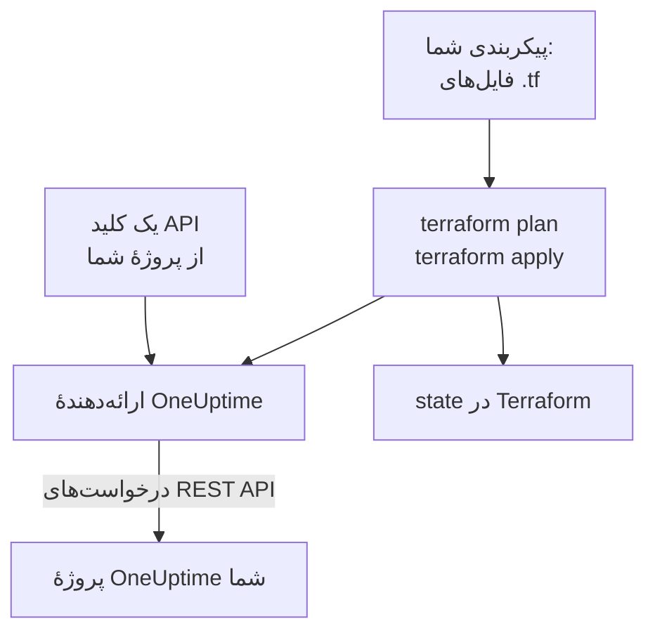

# نمای کلی Terraform

ارائه‌دهندهٔ Terraform برای OneUptime پروژهٔ OneUptime شما را به‌صورت کد مدیریت می‌کند. مانیتورها، صفحه‌های وضعیت، سیاست‌های آنکال، تیم‌ها، برچسب‌ها و دیگر رکوردهای پروژه‌تان را در فایل‌های `.tf` توصیف کنید، با `terraform plan` ببینید چه چیزی تغییر می‌کند، و تغییر را با `terraform apply` اعمال کنید. این ارائه‌دهنده هم با OneUptime Cloud و هم با OneUptime خودمیزبان کار می‌کند، و هم با Terraform و هم با OpenTofu.

:::cards
- [ارائه‌دهنده چگونه کار می‌کند](#ارائهدهنده-چگونه-کار-میکند): پیکربندی شما، پلن، و درخواست‌های API پشت آن‌ها.
- [نصب ارائه‌دهنده](#نصب-ارائهدهنده): بلوک ارائه‌دهنده، و نسخه‌ای که باید انتخاب کنید.
- [بگذارید داشبورد آن را بنویسد](#بگذارید-داشبورد-آن-را-بنویسد): پیکربندی و بلوک‌های import برای آنچه از قبل دارید.
- [چه چیزهایی را می‌توانید مدیریت کنید](#چه-چیزهایی-را-میتوانید-مدیریت-کنید): منابع، منبع‌های داده، و اینکه ویژگی‌هایشان چگونه نوشته می‌شوند.
:::

## ارائه‌دهنده چگونه کار می‌کند

ارائه‌دهنده افزونه‌ای است که Terraform آن را از یک رجیستری دانلود می‌کند. در `terraform apply`، هر تغییر پلن را به یک درخواست به REST API OneUptime تبدیل می‌کند که با یک کلید API از پروژهٔ شما فرستاده می‌شود. Terraform آنچه را ساخته است در state خود نگه می‌دارد، بنابراین پلن بعدی فقط چیزی را نشان می‌دهد که از آن زمان تغییر کرده است.



هر کلید API به یک پروژه تعلق دارد و تعیین می‌کند Terraform در آن چه چیزی را می‌تواند بخواند و تغییر دهد، بنابراین هر پیکربندی یک پروژه را مدیریت می‌کند. برای مدیریت چند پروژه، برای هر کدام یک [نام مستعار](/docs/terraform/complete-guide#مدیریت-چند-پروژه) به ارائه‌دهنده بدهید.

## پیش از شروع

- **Terraform 1.5 یا جدیدتر، یا OpenTofu 1.6 یا جدیدتر.** بلوک‌های `import` که داشبورد می‌نویسد به این نسخه‌ها نیاز دارند.
- **یک کلید API از پروژهٔ شما.** [شروع سریع](/docs/terraform/quick-start#ساخت-کلید-api-پروژه) نشان می‌دهد چگونه یکی را در **تنظیمات پروژه** > **پیشرفته** > **کلیدهای API** بسازید.
- **در OneUptime Cloud، طرح Growth یا بالاتر.** کلیدهای API یک پروژه فقط روی آن کار می‌کنند.

## نصب ارائه‌دهنده

ارائه‌دهنده را به یک فایل `.tf` اضافه کنید. `terraform init` آن را از Terraform Registry دانلود می‌کند، و `tofu init` از OpenTofu Registry:

```hcl title="main.tf"
terraform {
  required_providers {
    oneuptime = {
      source  = "oneuptime/oneuptime"
      version = "{{TERRAFORM_PROVIDER_VERSION}}"
    }
  }
}

provider "oneuptime" {
  # The API key comes from the ONEUPTIME_API_KEY environment variable.
  # On a self-hosted OneUptime, add your OneUptime's address:
  # oneuptime_url = "https://oneuptime.example.com"
}
```

کلید را بیرون از فایل‌هایتان نگه دارید: پیش از اجرای Terraform آن را export کنید، یا در متغیری که با `sensitive` علامت خورده است بدهید. [راهنمای کامل](/docs/terraform/complete-guide#پیکربندی-ارائهدهنده) همهٔ راه‌های دادن کلید و نشانی به ارائه‌دهنده را فهرست می‌کند.

### انتخاب نسخه

نسخه‌های ارائه‌دهنده از نسخه‌های OneUptime پیروی می‌کنند: ارائه‌دهندهٔ {{TERRAFORM_PROVIDER_MAJOR}}.x از OneUptime {{TERRAFORM_PROVIDER_MAJOR}}.x ساخته می‌شود. قید بالا، `{{TERRAFORM_PROVIDER_VERSION}}`، جدیدترین نسخهٔ {{TERRAFORM_PROVIDER_MAJOR}}.x را می‌گیرد، که برای OneUptime Cloud درست است. روی OneUptime خودمیزبان، جدیدترین ارائه‌دهنده‌ای را به کار ببرید که از OneUptime شما جدیدتر نباشد: [راه‌اندازی خودمیزبان](/docs/terraform/self-hosted) نشان می‌دهد چگونه آن را ثابت کنید.

## بگذارید داشبورد آن را بنویسد

لازم نیست منبعی را که از قبل دارید با دست بنویسید. هر منبع در داشبورد OneUptime (یک مانیتور، یک صفحهٔ وضعیت، یک گردش‌کار، یک سیاست آنکال و بقیه) در منوی کناری یک بخش **توسعه‌دهنده** دارد که تا بازش نکنید بسته می‌ماند. صفحهٔ **Terraform** آن، پیکربندی را با اطلاعات پروژهٔ خودتان برایتان می‌نویسد.

:::steps
### منبع را باز کنید

مانیتور، صفحهٔ وضعیت یا منبع دیگری را که می‌خواهید Terraform مدیریت کند باز کنید.

### صفحهٔ Terraform آن را باز کنید

در منوی کناری، **توسعه‌دهنده** و سپس **Terraform** را باز کنید.

### پیکربندی را کپی کنید

صفحه پیکربندی منبع را از تنظیمات فعلی آن می‌نویسد، همراه با یک بلوک `import`. توضیحی که بعد از هر ID آمده است، رکوردی را که به آن اشاره می‌کند نام می‌برد (`incident_severity_id = "..." # Critical Incident`).

### پلن بگیرید و اعمال کنید

`terraform plan` را اجرا کنید: نشان می‌دهد منبع import می‌شود و چیزی برای تغییر نیست. آن را اعمال کنید، و از آن پس Terraform منبع را مدیریت می‌کند.
:::

زیر پیکربندی، **گسترش آن** چیزهایی را دارد که معمولاً کنار منبع اضافه می‌شوند و با نشانی آن به آن ارجاع می‌دهند: یک تیم مالک برای یک حادثه، گروهی از مانیتورها برای یک صفحهٔ وضعیت، یک قاعدهٔ تشدید برای یک سیاست آنکال.

صفحه‌های فهرست (برای نمونه **حوادث** یا **مانیتورها**) همین بخش را دارند. در آنجا صفحهٔ **Terraform** یک منبع تازه را با فیلدهایی که بیشتر کاربران پر می‌کنند، و با رکوردهای خود پروژهٔ شما، می‌نویسد: حادثه‌ای با یکی از شدت‌های شما، یا مانیتوری با معیارهایی که مانیتور تازه در داشبورد می‌گیرد و به وضعیت‌های شما وصل است. این صفحه **پیکربندی‌های رایج** آماده هم می‌دهد (یک صفحهٔ وضعیت با یک گروه و یک مانیتور، یک سیاست آنکال که یک تیم را فرامی‌خواند، یک چرخهٔ آنکال هفتگی) و برای هر منبعی که از قبل دارید (۱۰۰ مورد نخست) یک بلوک `import`، آماده برای `terraform plan -generate-config-out`. هر دو صفحه بلوک ارائه‌دهنده را هم برای OneUptime شما می‌دهند: `oneuptime_url` درست، و قید نسخه‌ای که با OneUptime شما جور است.

این صفحه‌ها هرگز رازها را نشان نمی‌دهند. وقتی پیکربندی به یک راز نیاز دارد (برای نمونه سرآیند `Authorization` یک مانیتور)، آن را از یک متغیر Terraform که با `sensitive` علامت خورده است می‌خواند. رازهایی که لازم ندارد کنار گذاشته می‌شوند، و Terraform آن‌ها را همان‌طور که در OneUptime هستند رها می‌کند.

همین بخش یک صفحهٔ **API** با دستورهای `curl` برای منبع دارد، و یک صفحهٔ **دستیارهای هوش مصنوعی** که Claude، GitHub Copilot یا Cursor را به [سرور MCP](/docs/ai/mcp-server) وصل می‌کند.

## چه چیزهایی را می‌توانید مدیریت کنید

ارائه‌دهنده برای هر نوع رکوردی که بتوانید از طریق API OneUptime بسازید، یک منبع به نام `oneuptime_<name>` دارد. بیشتر پیکربندی‌ها با این‌ها شروع می‌شوند:

| منبع | چیست |
| --- | --- |
| `oneuptime_monitor` | یک مانیتور: وب‌سایت، API، ping، پورت، گواهی SSL، سرور، درخواست ورودی، دستی و هر نوع دیگر |
| `oneuptime_monitor_status` | یک وضعیت مانیتور، مانند Operational، Degraded یا Offline |
| `oneuptime_monitor_group` | گروهی از مانیتورها که با یک وضعیت نشان داده می‌شود |
| `oneuptime_status_page` | یک صفحهٔ وضعیت عمومی یا خصوصی |
| `oneuptime_status_page_domain` | دامنهٔ سفارشی یک صفحهٔ وضعیت |
| `oneuptime_domain` | دامنه‌ای از پروژهٔ شما که برای صفحه‌های وضعیت تأیید شده است |
| `oneuptime_label` | یک برچسب، برای مرتب‌سازی و فیلتر کردن رکوردها |
| `oneuptime_team`, `oneuptime_team_member` | یک تیم، و اینکه چه کسانی در آن هستند |
| `oneuptime_on_call_policy`, `oneuptime_escalation_rule` | یک سیاست آنکال، و قواعدی که به ترتیب فرامی‌خواند |
| `oneuptime_incident`, `oneuptime_incident_severity`, `oneuptime_incident_state` | حادثه‌ها، شدت‌هایشان و وضعیت‌هایشان |
| `oneuptime_alert`, `oneuptime_alert_severity`, `oneuptime_alert_state` | هشدارها، شدت‌هایشان و وضعیت‌هایشان |
| `oneuptime_scheduled_maintenance_event` | یک بازهٔ نگهداری زمان‌بندی‌شده |
| `oneuptime_probe` | پراب خودتان، که از شبکهٔ شما بررسی می‌کند |

[Terraform Registry](https://registry.terraform.io/providers/oneuptime/oneuptime/latest/docs) هر منبع را با همهٔ ویژگی‌هایش فهرست می‌کند.

### خواندن آنچه از قبل وجود دارد

هر منبع یک منبع داده با همان نام دارد، مانند `data "oneuptime_label"`. منبع داده رکوردی را می‌خواند که این پیکربندی مدیریتش نمی‌کند، برای نمونه رکوردی که در داشبورد ساخته شده است. آن را با `id` آن پیدا کنید، یا با آرگومان‌های ساده‌اش: هر آرگومانی که تعیین می‌کنید باید مطابقت داشته باشد، و دقیقاً یک رکورد می‌تواند با همهٔ آن‌ها مطابقت داشته باشد.

```hcl
data "oneuptime_monitor_status" "offline" {
  name = "Offline"
}

# Any plain argument works. Set several, and all of them must match.
data "oneuptime_monitor_status" "offline_state" {
  is_offline_state = true
}
```

پیدا نشدن هیچ موردی، یا پیدا شدن بیش از یکی، خطا است، نه یک پاسخ خالی یا دلبخواهی. قواعد در [راهنمای کامل](/docs/terraform/complete-guide#خواندن-آنچه-از-قبل-وجود-دارد) آمده‌اند.

### منابعی که نامشان تغییر کرده است

نام منابع واژه‌هایی مانند IoT و vCenter را یکپارچه نگه می‌دارد: `oneuptime_iot_fleet` و `oneuptime_vcenter`، در جایی که ارائه‌دهنده‌های قدیمی‌تر `oneuptime_io_t_fleet` و `oneuptime_v_center` داشتند (و همین‌طور برای قواعد برچسب، مالکان و فیدهایشان). نام‌های قدیمی هنوز به‌عنوان نام‌های مستعار منسوخ کار می‌کنند، و پلنی که یکی از آن‌ها را به کار ببرد این را می‌گوید. برای جابه‌جایی، نام منبع را در پیکربندی‌تان تغییر دهید و یک بلوک `moved` اضافه کنید، تا Terraform منبع موجود را نگه دارد و جایگزینش نکند:

```hcl
# Was: resource "oneuptime_io_t_fleet" "factory"
resource "oneuptime_iot_fleet" "factory" {
  name = "Factory floor"
}

moved {
  from = oneuptime_io_t_fleet.factory
  to   = oneuptime_iot_fleet.factory
}
```

بردن یک منبع به نوعی دیگر به Terraform 1.8 یا جدیدتر نیاز دارد. روی موتوری قدیمی‌تر، فعلاً نام قدیمی را نگه دارید: همچنان کار می‌کند.

## ویژگی‌ها چگونه نوشته می‌شوند

ویژگی‌ها از API OneUptime پیروی می‌کنند، به شکل snake_case:

| نوع مقدار | چگونه آن را می‌نویسید | نمونه |
| --- | --- | --- |
| متن، عدد، درست یا نادرست | همان‌طور که هستند | `is_public_status_page = false` |
| ارجاع به رکوردی دیگر | ID آن، معمولاً `id` یک منبع دیگر | `incident_severity_id = oneuptime_incident_severity.sev1.id` |
| فهرستی از ارجاع‌ها | مجموعه‌ای از IDها که ترتیبشان فرقی نمی‌کند | `labels = [oneuptime_label.critical.id]` |
| رنگ، دامنه و دیگر مقدارهای بسته‌بندی‌شده | مقدار سادهٔ آن‌ها | `color = "#FF5733"` |
| تاریخ و زمان | متن RFC 3339 | `starts_at = "2030-06-01T02:00:00Z"` |
| بررسی‌های یک مانیتور | ویژگی‌های تودرتوی نوع‌دار: [مراحل مانیتور](/docs/terraform/monitor-steps) را ببینید | `monitor_steps = [{ ... }]` |
| دیگر تنظیمات ساختاریافته | JSON، نوشته‌شده با `jsonencode()` | `log_monitor = jsonencode({ ... })` |

دو نوع مقدار متعلق به سرور هستند، و آن‌ها را نمی‌نویسید:

- **IDهای درون یک منبع.** مراحل و معیارهای یک مانیتور، و قالب‌های حادثه و هشدارشان، IDهایی دارند که سرور می‌دهد و در هر apply نگه می‌دارد، تا حادثه‌ها همچنان به معیارهایی اشاره کنند که آن‌ها را باز کرده‌اند.
- **آنچه سرور به‌روز نگه می‌دارد.** وضعیت فعلی یک مانیتور، یا زمان آخرین heartbeat آن، ممکن است میان `terraform plan` و پایان `terraform apply` تغییر کند. ارائه‌دهنده برای هر چیزی که تعیین نکرده‌اید مقدار پلن‌شده را نگه می‌دارد، و refresh بعدی مقدار سرور را می‌خواند، بنابراین این هرگز باعث شکست یک apply نمی‌شود و به‌عنوان تغییر نشان داده نمی‌شود.

## دریافت کمک

- باگ‌ها و درخواست ویژگی: [github.com/OneUptime/oneuptime/issues](https://github.com/OneUptime/oneuptime/issues).
- ارائه‌دهنده از مشخصات OpenAPI در [مخزن اصلی OneUptime](https://github.com/OneUptime/oneuptime) تولید می‌شود. مخزن منتشرشدهٔ ارائه‌دهنده فقط‌خواندنی است، بنابراین مشکلات را در مخزن اصلی گزارش کنید.

## گام‌های بعدی

:::cards
- [شروع سریع](/docs/terraform/quick-start): یک کلید API بسازید و نخستین منابعتان را در ده دقیقه اعمال کنید.
- [راهنمای کامل](/docs/terraform/complete-guide): احراز هویت، چیدمان پروژه، منبع‌های داده، state و ارتقا.
- [مراحل مانیتور](/docs/terraform/monitor-steps): تعیین کنید مانیتور چه چیزی را بررسی می‌کند و هر نتیجه چه معنایی دارد.
- [نمونه‌ها](/docs/terraform/examples): پیکربندی‌های آماده برای منابع رایج.
- [وارد کردن منابع](/docs/terraform/importing-resources): آنچه را در داشبورد ساخته‌اید زیر مدیریت Terraform بیاورید.
:::
